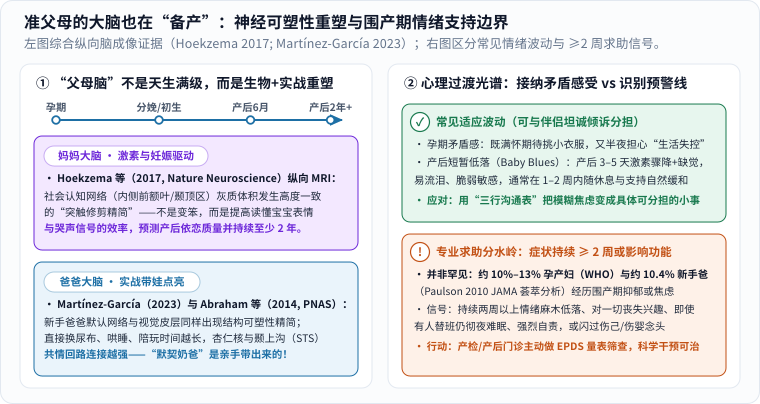

### 写在前面：超声屏幕上那颗绿豆大小的光点

当我们得知即将成为父母的那一刻，客厅的钟表仿佛走慢了半拍。那种惊喜、发懵、期待与手足无措交织的情绪，只有亲身站在两道红杠或检查单前的人才能真正体会。

我至今记得第一次陪产检时，诊室灯光微暗，探头滑过涂了耦合剂的肚皮。灰白屏幕上突然跳出一颗只有绿豆大小、却规律闪烁的小光点，紧接着音箱里传出每分钟一百四五十下、像小火车穿过山谷般急促有力的“噗通、噗通”声。那一刻，“怀孕”不再是一纸抽象通知：**一个真实的小生命，正一毫米一毫米地把自己拼装起来。**

顺便记一个让很多新手准爸懵五秒的产科冷知识：临床“孕周”并非从受精那天算起，而是按**末次月经首日（LMP）**起算 [1]。因此在医学日历的“孕 1–2 周”，精卵其实还没相遇；等到“孕 6–7 周”看见胎心闪烁时，小胚胎才刚刚奋力生长了四周左右 [1]。

---

### 一、隔着肚皮的好奇：感官是怎么依次“开机”的？

很多准爸妈一怀上就忍不住对着肚子讲故事、放音乐，夜里又会好奇：**他现在真的听得见吗？隔着肚皮看到和听到的世界究竟是什么样的？**

顺着美国国家医学图书馆（MedlinePlus）的临床发育时间轴往下读 [1]，胎儿感官并不是出生时“一键全开”，而是遵循着讲究的施工次序——**先触觉与心搏，再味嗅觉与听觉，最后才是留到出生后慢慢校准的视觉**：

_图 1：先沿左图横轴从 0 周读到 40 周看清关键里程碑，再看右侧卡片理解子宫滤波与初生焦距。个体发育存在自然浮动，不必按天卡表。[单独打开图片](/assets/images/early-curiosity/prenatal-senses.svg)_

1. **先建心跳与触觉，眼睑拉上“保护窗帘”（孕 6–14 周）**：约孕 **6–7 周**，心脏开始规律搏动，眼耳原基初现；孕 **10 周末**正式从“胚胎”升级为“胎儿”；到 **11–14 周**，小手已会握拳，上下眼睑却主动闭合起来，像给暗房拉上窗帘一样安静保护正在布线的视网膜，直到孕 **27–28 周左右**才重新睁开 [1]。
2. **听觉真正“通电开机”（孕 19–21 周起）**：到孕中期（**19–21 周**），耳蜗结构逐步到位，宝宝开始能听见声音并学会吞咽羊水，妈妈也常在这时第一次感受到像“小鱼吐泡泡”般的初胎动（Quickening）；到 **26 周左右**，外界突响会引起胎儿惊跳反应；到 **27–30 周**可睁闭眼，**35–37 周**已拥有明确的睡眠—觉醒节律 [1]。
3. **留给第一次见面的“25 厘米专属焦距”**：据美国视光学会（AOA）资料，足月新生儿视力仍很朦胧，最清晰的对焦距离只有眼前约 **20–25 厘米（8–10 英寸）** [2]。第一次读到这个数字时心里一下子软了——`25 厘米` 不偏不倚，**正好是你把刚出生的宝宝抱在臂弯里时，他的眼睛到你脸庞的距离** [2]。整个房间都是柔焦背景，唯独低头看他的爸爸妈妈稳稳落在焦点上。

---

### 二、子宫是一间“水下低音混响室”：他到底听懂了什么？

知道宝宝从孕 20 周左右能听见声音之后，紧接着就是第二个让无数准爸妈纠结的问题：**那我们是不是该买个专用的“胎教耳机”贴在肚皮上放莫扎特？宝宝在肚子里真的能听懂故事词句吗？**

要回答这个问题，先别急着看广告，我们不妨跟着声学家和产科医生，把“微型水下麦克风（水听器）”放进真实的子宫环境里听一听。

法国产科团队 Querleu 等人（1988）以及美国佛罗里达大学听力学家 Gerhardt 与 Abrams（2000，发表于儿科学权威期刊库）曾系统测量过声音穿过孕妇腹壁、子宫肌层与羊水时的物理衰减规律 [3, 4]。结果颠覆了很多人的直觉——子宫既不是隔音真空室，也不是高保真音乐厅，而是一间**自带背景白噪音的“水下低音混响室”**：

_图 2：先看左图的频率衰减曲线（在支持动画的浏览器中打开时，蓝线会沿频率从低向高绘制一次并停留在完整状态；开启系统“减少动态效果”则直接静态呈现）：绿色区域（100–300 Hz 人声基频）几乎无损穿透，而橙色区域（>1000 Hz 高频辅音与泛音）被大幅闷住。右图展示科学家如何用精巧实验证明胎儿记住了“语调韵律”与“羊水风味”。[单独打开图片（刷新可重播）](/assets/images/baby-science/womb-sound-flavor-lab.svg)_

#### 1. 为什么高频清音进不去，爸妈的语调却格外清楚？

首先，羊水囊里的本底环境其实相当热闹：妈妈规律的心跳搏动、胎盘脐带动脉的血流声、呼吸时横膈膜的起伏，还有肠胃蠕动的咕噜声，共同构成了一层约 `60–85 分贝` 的低频生命律动 [3, 4]。

当外界空气里的声音想穿过妈妈的皮肤、脂肪、腹壁肌肉和羊水传进胎儿内耳时，这几层软组织加液体就像一道天然的**声学低通滤波器（Low-pass filter）**（图 2 左）：

- **低频段（约 `100–300 Hz`）几乎畅通无阻**：成年男性说话的声带基频大约在 `100–150 Hz`，成年女性大约在 `180–250 Hz`。这个频段穿过腹壁时，声压级仅仅衰减约 **`3–5 dB`** [3, 4]！更妙的是，当准妈妈自己开口说话或哼歌时，声带振动还会直接沿着胸腔、脊柱和骨盆的**骨骼传导通路**直达子宫，信噪比比任何外放音响都清晰得多 [4]。
- **中高频段（`>1000–4000 Hz`）被严重“闷住”**：人类语言里区分精细词义的清辅音（比如汉语拼音里的 `s`、`sh`、`t`、`f` 或英语里的清擦音）以及小提琴的高频泛音，能量大多集中在 `1000–4000 Hz` 以上。穿过腹壁和羊水后，这一频段会被削弱 **`15–30 dB` 甚至更多** [3, 4]。

分贝（$$\text{dB}$$）是一个对数刻度，声强比满足：

$$
\Delta L = 10 \log_{10}\!\left(\frac{I_{\text{子宫内}}}{I_{\text{体外}}}\right)
$$

算成大白话就是：衰减 `20 dB` 意味着声波能量只剩下原来的 **百分之一（$$10^{-2}$$）**；衰减 `30 dB` 则只剩 **千分之一（$$10^{-3}$$）**！这就好比你潜进游泳池水底听岸上的人聊天——你根本听不清对方吐字是“西红柿”还是“四十四”，但你能清清楚楚听出**这句话是温柔上扬的疑问、轻快跳跃的儿歌，还是急促生气的吼叫**。语言学上，这种剥离了具体字词、由音高起伏、重音节拍与停顿长短构成的旋律骨架，就叫**语音韵律（Prosody）**。

#### 2. 科学侦探题：不会说话的新生儿，怎么问他“记不记得”？

低频韵律虽然传进了子宫，胎儿的大脑真的会把它存进记忆吗？发展心理生物学家安东尼·德卡斯珀（Anthony DeCasper）设计了一套拍案叫绝的**“压力传感奶嘴实验”**，让刚出生不到三天的新生儿亲口“投了票” [5, 6]（图 2 右上）：把无营养的无菌安抚奶嘴连上气压传感器与电脑，宝宝用较快节律吸吮就播放录音 A，停顿久一点再吸吮就切换录音 B。

- **第一回合（DeCasper & Fifer, 1980, *Science*）** [5]：出生不足 72 小时的新生儿很快摸清了奶嘴规则，主动调整吸吮节律去触发**自己妈妈的声音**，而非陌生女性的声音。
- **第二回合（DeCasper & Spence, 1986，《戴帽子的猫》童谣实验）** [6]：为排除产后头两天的快速学习，研究者请 **16 位准妈妈**在孕末约 **6 周**每天早晚朗读极富韵律的苏斯博士童谣《戴帽子的猫》（累计仅 3.5–5 小时）。宝宝出生约 **55–70 小时**后测试发现：实验组新生儿显著调整吸吮去选择《戴帽子的猫》（未朗读对照组则无偏好）；**哪怕把朗读人换成从未见过的陌生女性，宝宝依然偏爱这首童谣！** [6]

这组对照漂亮地划清了科学与商业玄学的边界：

- **胎儿记住的是“语调韵律与安全感”，不是提前背单词或变莫扎特神童**：陌生阿姨音色完全不同，宝宝认出的正是孕晚期反复听熟的抑扬顿挫与重音节拍 [6]。爸爸每天凑在床边聊家常的低沉男声（基频约 `100–150 Hz`）穿透损耗极小，同样是极好的产前熟悉信号。
- **切勿把耳机或喇叭紧贴肚皮开大音量**：Gerhardt 与 Abrams（2000）专门警示，日常空气交谈（约 `60–65 dB`）很安全，但将振源紧贴腹壁放大音量会绕过空气反射界面直传子宫，过强低频声压反而有损伤耳蜗毛细胞或干扰胎儿睡眠的风险 [4]。睡前夫妻自然聊天哼歌，就胜过一切昂贵器材。

---

### 三、还没出生，已经尝过妈妈碗里的“家乡味”？

除了耳朵在听，孕中期起每天吞咽羊水的胎宝宝，还在悄悄品尝“妈妈餐桌的味道”。准妈妈吃下的大蒜、香草、八角、胡萝卜等挥发性风味分子会进入羊水，同时刺激胎儿的嗅觉感受器与味蕾 [7]。

2001 年，莫奈尔化学感官中心 Mennella 等人在《儿科学》（*Pediatrics*）发表了经典的**胡萝卜汁随机对照试验** [7]（图 2 右下）：准妈妈被随机分为三组——**孕晚期连喝 3 周胡萝卜汁**（每周 4 天 × `300 mL`）、哺乳期喝胡萝卜汁、以及全程只喝白水的对照组。等宝宝约 **5.5–6 个月**初次添加辅食时，用白水米糊与胡萝卜汁米糊做双盲录像测试。结果显示：**早在羊水里接触过胡萝卜风味的宝宝，吃到胡萝卜米糊时皱眉抗拒的消极表情显著更少，喜爱度评分更高** [7]！

原来世界各地孩子对家乡菜底味的亲切感，从子宫里就埋下了伏笔。当然，准妈妈绝不必勉强吃反胃的食物——严格避开酒精、未巴氏杀菌生冷食物与高汞深海大型鱼类等医学禁忌，吃得舒服均衡，就是给宝宝寄出的第一张“风味明信片”。

---

### 四、准父母自己的“生长痛”：大人的大脑也在悄悄重构

怀孕的十个月，不只是宝宝在长身体，也是两个成年人重新认识彼此的过程——在一次次产检等待中学会**责任**，在孕吐、腰酸与夜醒翻身中学会**分担与耐心**，也慢慢理解“父母”不是领到出生证明那一秒自动加载完成的技能，而是一起练习出来的默契。

近十年的脑成像研究更证实，**“父母大脑重新连线”不是文学比喻，而是核磁共振（MRI）直接测出的神经可塑性重塑**：

_图 3：先看左图妈妈（妊娠激素驱动社会认知网络精简）与爸爸（实战带娃时长驱动共情回路）的神经可塑性路径；再看右图区分常见情绪波动与“持续两周”求助线。[单独打开图片](/assets/images/baby-science/parental-brain-transition.svg)_

1. **妈妈的大脑不是“变傻”，而是“高精度突触修剪”**：Hoekzema 等（2017, *Nature Neuroscience*）前瞻性追踪备孕前至产后两年的 MRI 发现，所有初产妈妈负责**社会认知与心智化（揣摩他人意图与情绪）**的皮层灰质均发生高度一致的精简重构，且持续至少两年 [8]。这并非损伤，而是类似青春期大脑成熟的**适应性突触修剪**——剪掉冗余杂音，专精于高效解码宝宝的表情与哭声，修剪越显著的妈妈产后依恋评分越高 [8]。日常“忘拿钥匙”更多源于睡眠碎片化与多任务超载。
2. **爸爸的“育儿脑”靠亲手带娃点亮**：跨国纵向 MRI（Martínez-García 等, 2023）发现新手爸爸默认模式与视觉皮层同样出现结构精简 [9]；Abraham 与 Feldman 等（2014, *PNAS*）更证实，**爸爸亲自换尿布、喂奶、哄睡的时间越长，情绪唤醒区（杏仁核）与社会理解区（颞上沟 STS）的功能连接就越紧密** [10]。默契奶爸从来不是天生的，是挽起袖子一点点长进神经元里的！

---

### 五、坦诚面对矛盾情绪：什么时候该找医生搭把手？

也要坦诚告诉自己：**期待不必每一分钟都是兴奋的。** 一边满心欢喜挑小衣服，一边在夜深人静时害怕“我真的能照顾好一个小人儿吗？生活会不会失控？”——这两种看似矛盾的感受完全可以同时存在。

与此同时，请像记清产检时间一样划清**“常见情绪起伏”**与**“专业求助信号”**的边界（图 3 右）：

- **产后短暂低落（Baby Blues）**：分娩后头 3–5 天激素骤降叠加缺觉，易流泪敏感，家人接力照护、保证睡眠后多在 **1–2 周内**自然缓解。
- **围产期抑郁与焦虑（持续 ≥ 2 周）**：WHO 统计全球约 **10% 孕妇**与 **13% 产后女性**受此困扰 [11]；Paulson 等（2010, *JAMA*）对 28,004 人的荟萃分析更显示，约 **`10.4%` 的准爸爸/新手爸爸**同样经历围产期抑郁（常表现为易怒、逃避或失眠），且夫妻情绪显著相关 [12]。

无论准妈妈还是准爸爸，若**持续两周以上**感到低落麻木、对一切丧失兴趣、即使有人替班仍彻夜失眠、深重自责，或**一旦闪过伤害自己/宝宝的念头（急症信号）**，请立即告诉伴侣并在产检或心理门诊做 EPDS/PHQ-9 筛查——主动求助和按时补叶酸、做超声一样正当且重要 [11]。

---

### 六、不急着写成一份完美计划：留给彼此的“三行周末便签”

比起列一张密密麻麻的囤货清单，不妨找个周末各自写三行话，再交换着读（读第二行时先倾听拥抱，不急着说“这有啥好怕的”）：

| 今天的一行 | 可以从哪里开始 | 落地的具体例子 |
|---|---|---|
| **我最期待的** | 一次具体的见面、一种日常画面，不必是宏大目标 | “深秋推着婴儿车，我们仨一起去楼下公园踩落叶。” |
| **我最担心的** | 把模糊的焦虑说具体，先倾听，不急着替对方评判或解决 | “怕月子里半夜涨奶疼又缺觉，一个人躲在被子里哭。” |
| **我希望你帮我的** | 一件本周或产后就能做到的小事，而非“你要更体贴” | “陪我散步二十分钟；产后每晚 8–11 点你全权抱娃让我睡整觉。” |

这不是准父母必交的作业，本文也是个人感悟与科普整理，而非人人必须按部就班经历的心理模板。等几年后蓦然回首，最珍贵的也许不是婴儿车买得多专业、待产包收拾得多周全，而是在生命翻开新篇章之前，两个新手曾经这样认真地听见过彼此。

---

### 参考与延伸

1. [MedlinePlus（美国国家医学图书馆）：Fetal development](https://medlineplus.gov/ency/article/002398.htm)——核对末次月经（LMP）孕周临床起算口径，以及孕 6–7 周心管规律搏动、10 周末胚胎转胎儿、11–14 周握拳与眼睑闭合、19–21 周听觉开启与初胎动/吞咽、26–30 周声音惊跳反应与睁闭眼、35–37 周睡眠节律等里程碑。
2. [American Optometric Association（AOA）：Infant Vision — Birth to 24 Months of Age](https://www.aoa.org/healthy-eyes/eye-health-for-life/infant-vision)——核对足月新生儿早期最佳对焦距离约 8–10 英寸（约 20–25 厘米，恰好对应怀抱中父母脸庞距离）及早期视觉发育规律。
3. Querleu, D., Renard, X., Versyp, F., Paris-Delrue, L., & Crepin, G. (1988). *Fetal hearing*. *European Journal of Obstetrics & Gynecology and Reproductive Biology*, 28(3), 191–212.——宫内水听器实测子宫内本底生理声响及不同频率外界声音穿过母体腹壁的分贝衰减数据（低频衰减极小，高频显著衰减）。
4. [Gerhardt, K. J., & Abrams, R. M. (2000). *Fetal exposures to sound and vibroacoustic stimulation*（PubMed: `11190697`）](https://pubmed.ncbi.nlm.nih.gov/11190697/)，*Journal of Perinatology*, 20(8 Pt 2), S21–S30.——系统综述胎儿骨传导听觉路径、低频元音韵律保留与高频辅音衰减特性，以及避免将高强度声源紧贴孕妇腹壁的听力安全警示。
5. [DeCasper, A. J., & Fifer, W. P. (1980). *Of human bonding: Newborns prefer their mothers' voices*（PubMed: `7375928`）](https://pubmed.ncbi.nlm.nih.gov/7375928/)，*Science*, 208(4448), 1174–1176.——利用无营养吸吮压力传感装置证明出生不足 3 天的新生儿能够分辨并主动偏爱母亲嗓音。
6. DeCasper, A. J., & Spence, M. J. (1986). *Prenatal maternal speech influences newborns' perception of speech sounds*. *Infant Behavior and Development*, 9(2), 133–150.（DOI: `10.1016/0163-6383(86)90025-1`）——经典的《戴帽子的猫》产前朗读实验：孕末 6 周每日朗读短童谣后，出生约 60 小时的新生儿即便面对陌生女性朗读录音仍显著偏爱熟悉童谣的语音韵律。
7. [Mennella, J. A., Jagnow, C. P., & Beauchamp, G. K. (2001). *Prenatal and postnatal flavor learning by human infants*（PubMed: `11389286`）](https://pubmed.ncbi.nlm.nih.gov/11389286/)，*Pediatrics*, 107(6), e88.——胡萝卜汁随机对照试验，证实母亲孕晚期饮食风味可经羊水被胎儿吞咽感知，并提升婴儿初添辅食时对该风味的接受度。
8. [Hoekzema, E. et al. (2017). *Pregnancy leads to long-lasting changes in human brain structure*（PubMed: `27991897`）](https://pubmed.ncbi.nlm.nih.gov/27991897/)，*Nature Neuroscience*, 20(2), 287–296.——证实妊娠促使女性社会认知网络灰质发生适应性修剪重塑，预测产后母婴依恋并持续至少两年。
9. [Martínez-García, M. et al. (2023). *First-time fathers show longitudinal gray matter cortical volume reductions*（PubMed: `36057840`）](https://pubmed.ncbi.nlm.nih.gov/36057840/)，*Cerebral Cortex*, 33(7), 4156–4163.——证实首次成为父亲的男性在默认模式网络与视觉皮层出现神经可塑性重塑。
10. [Abraham, E., Hendler, T., Zagoory-Sharon, O., & Feldman, R. et al. (2014). *Father's brain is sensitive to childcare experiences*（PubMed: `24912146`）](https://pubmed.ncbi.nlm.nih.gov/24912146/)，*PNAS*, 111(27), 9792–9797.——证实父亲直接育儿时长塑造杏仁核—颞上沟共情回路连接。
11. [World Health Organization（WHO）：Perinatal mental health](https://www.who.int/teams/mental-health-and-substance-use/promotion-prevention/perinatal-mental-health)——全球孕期（约 10%）与产后（约 13%）心理健康数据及干预指南。
12. [Paulson, J. F., & Bazemore, S. D. (2010). *Prenatal and postpartum depression in fathers*（PubMed: `20483973`）](https://pubmed.ncbi.nlm.nih.gov/20483973/)，*JAMA*, 303(19), 1961–1969.——28,004 人荟萃分析证实约 10.4% 的准爸爸/新爸爸经历围产期抑郁。
13. [UNICEF Parenting：Child development](https://www.unicef.org/parenting/child-development)——早期回应性照护与准父母支持参考。
