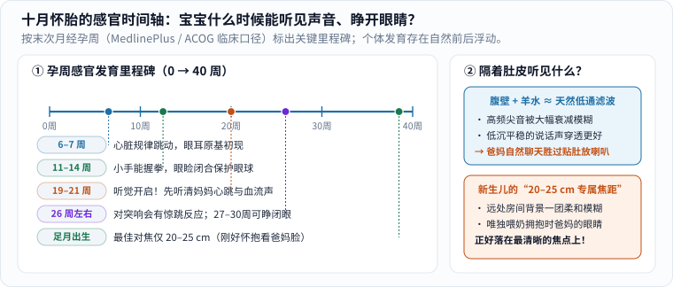

### 写在前面

当我们得知即将成为父母的那一刻，时间仿佛静止了。那种复杂的情绪，惊喜、紧张、期待、不安……只有经历过的人才能真正体会。

从最初看着验孕棒或检查单发呆，到第一次在超声屏幕上看见那个只有绿豆大小、却在规律闪烁的小光点，我们开始意识到：一个真实的小生命，正在一点点把自己拼装起来。

### 隔着肚皮的好奇：宝宝什么时候才听得见我们说话？

很多准爸妈一怀上就忍不住对着肚子讲故事、放音乐，心里其实都会好奇一句：**他现在真的听得见吗？在里面看到和听到的世界到底是什么样的？**

翻开临床产科与医学百科的发育时间轴（按末次月经首日起算的孕周口径 [1]），这个过程比传言更有层次，也更奇妙：

_图 1：先沿左图横轴从 0 周读到 40 周，再看右侧两张卡片。胎儿并不是一开始就能“听胎教音乐”，而是在孕中期听觉通路逐步建成后，先熟悉妈妈体内的心跳与说话共振；出生时仅 20–25 厘米的清晰焦距，也恰好对准怀抱里父母的脸。[单独打开图片](/assets/images/early-curiosity/prenatal-senses.svg)_

1. **先有心跳与触觉，再有听觉（孕 6–14 周）**：大约在孕 **6–7 周**，胚胎的心脏已经开始有节律地搏动，眼睛和耳朵的原基刚刚萌芽；到 **11–14 周**，小手已经会握成拳头，眼睑则合拢起来，像拉上窗帘一样安静保护正在发育的眼球，直到孕 **27–30 周**左右才重新睁开。[1]
2. **听觉真正“开机”（孕 19–21 周起）**：大约到孕中期（**19–21 周**），宝宝开始能够听见声音，妈妈也常常在这段时间第一次感觉到像小鱼吐泡泡一样的胎动；到 **26 周左右**，外界突然传来的大声响甚至会引起胎儿的惊跳反应。[1]
3. **子宫是一间“低音混响室”，不是高保真音乐厅**：宝宝泡在羊水里，外面还隔着子宫壁和腹壁。声学上，这几层组织与液体就像一道天然的**低通滤波器**——尖锐的高频声音会被明显削弱，而妈妈说话时胸腔骨骼传导的共振，以及爸爸贴近身边低沉平稳的嗓音，反而能更清晰地传进去。所以，**根本不必把耳机或小喇叭直接贴在肚皮上调大音量**（过强的近距离声压反而有潜在风险）；每天睡前夫妻俩自然地聊聊天、哼几句熟悉的歌，就是最舒服、最安全的“声音名片”。
4. **留给第一次见面的“专属焦距”**：根据美国视光学会（AOA）的婴儿视觉资料，刚出生的足月宝宝视力还很朦胧，最清晰的对焦距离只有眼前约 **20–25 厘米（8–10 英寸）**。[2] 第一次知道这个数字时特别让人动容——25 厘米，不偏不倚，**正好是你把刚出生的宝宝抱在臂弯里时，他的眼睛到你脸庞的距离**。整个房间都是柔焦背景，只有低头看他的爸爸妈妈在焦点上。

### 准父母自己的“生长痛”

怀孕的十个月，不只是宝宝在长身体，也是两个成年人重新认识彼此的过程。

从最初的震惊，到慢慢接受，再到开始想象孩子的模样、规划房间角落、重新审视生活的重心——突然之间，很多以前觉得天大的职场琐事变得不再那么紧要，而很多以前忽略的日常细节，开始变得意义非凡：

- 我们开始在一次次产检等待中学会**责任**；
- 在孕吐、腰酸、翻身睡不好的夜里学会**分担与耐心**；
- 也慢慢理解，“父母”这两个字不是领到出生证明那一秒自动加载完成的技能，而是一起练习出来的默契。

也要坦诚告诉自己：**期待不必每一分钟都是兴奋的。** 一边满心欢喜地挑小衣服，一边在夜深人静时突然害怕“我真的能照顾好一个小人儿吗？我们的生活会不会彻底失控？”——这两种看似矛盾的感受完全可以同时存在。

无论是准妈妈受激素剧烈波动、身体负担与睡眠打断带来的情绪起伏，还是准爸爸面对角色转换与责任压力产生的隐形焦虑，都不是“矫情”或“没准备好”。如果持续两周以上感到低落、失眠、喘不过气或难以承受，主动告诉伴侣并在产检时向医生咨询围产期心理支持，和按时补叶酸、做超声一样正当且重要。[3]

### 不急着写成一份完美计划

如果想给这段等待的日子留一点实在的东西，比起列一张密密麻麻的囤货清单，不妨找个周末各自写三行话，再交换着读：

| 今天的一行 | 可以从哪里开始 |
|---|---|
| 我最期待的 | 一次具体的见面、一种日常画面，不必是宏大目标 |
| 我最担心的 | 把模糊的焦虑说具体，先倾听，不急着替对方评判或解决 |
| 我希望你帮我的 | 一件本周就能做到的小事（如“陪我散步二十分钟”），而非“你要更体贴” |

这不是准父母必交的作业。等几年后蓦然回首，最珍贵的也许不是婴儿车买得多专业、待产包收拾得多周全，而是在生命翻开新篇章之前，两个新手曾经这样认真地听见过彼此。本文是个人感悟与科普整理，不是一条人人都必须按部就班经历的心理模板。

### 参考与延伸

1. [MedlinePlus（美国国家医学图书馆）：Fetal development](https://medlineplus.gov/ency/article/002398.htm)——核对末次月经孕周计算口径，以及孕 6–7 周心管搏动、11–14 周握拳与闭睑、19–21 周听觉与胎动、26–30 周声音惊跳与睁眼等发育阶段。
2. [American Optometric Association（AOA）：Infant Vision (Birth to 24 Months)](https://www.aoa.org/healthy-eyes/eye-health-for-life/infant-vision)——新生儿早期最佳注视距离约 8–10 英寸（约 20–25 厘米）及视觉发育过程。
3. [UNICEF Parenting：Child development & Early moments](https://www.unicef.org/parenting/child-development)——早期回应性照护与准父母支持参考。
