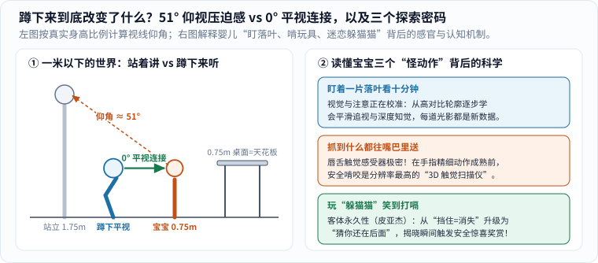
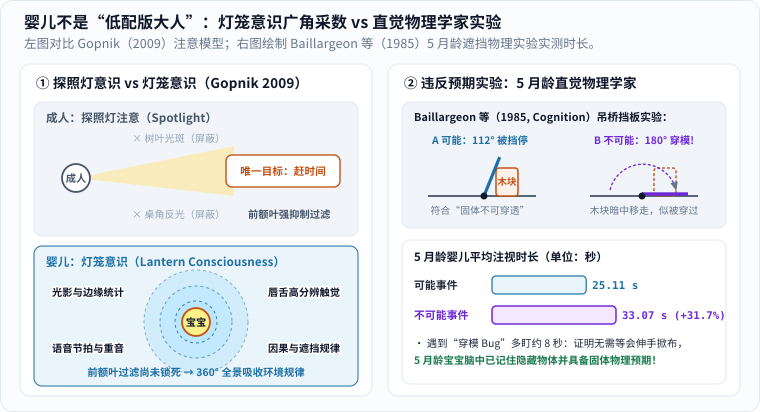

作为成年人，我们太习惯用一米七、一米八的海拔和熟练的生活经验去扫视房间：客厅敞亮、餐桌寻常、大人站在旁边说话的声音也挺温和。直到有了孩子，某天真正在学步垫上把膝盖弯到底、把下巴贴近离地半米多的高度往上看，我才猛然吃了一惊：**原来一米以下的世界，完全是另一套空间几何与感官系统！**

在这个低海拔的新世界里，一个一岁以内的小宝宝为什么总在干一些让大人摸不着头脑的事——为什么能盯着窗边一片晃动的树叶发呆十分钟？为什么拿到任何新玩具第一反应永远是塞进嘴里啃？又为什么会对“双手捂脸—喵！”这种毫无悬念的躲猫猫笑到打嗝？

让我们先弯下膝盖算清眼前的空间几何账，再换上感官神经科学与发展心理学的显微镜，把这三件看似“傻乎乎”的小事一步步拆开来看（当然，下面聊的是读懂孩子的科学视角，绝不是拿来按月打卡考评的发育清单）。

---

## 一、蹲下来看世界：先算一笔“51 度仰角”的空间几何账

_图 1：先看左图的视线夹角——大人站着说话时，宝宝需要以约 51° 大仰角费力仰望下巴；一旦大人屈膝蹲下，视线瞬间变成 0° 平视连接。右图先概览宝宝日常最常见的三个“奇怪举动”背后的发展科学线索。[单独打开图片](/assets/images/early-curiosity/baby-perspective.svg)_

### 1. 站着催促 vs 屈膝蹲平：从 51.3° 压迫仰角到 0° 视线对齐

我们不妨用最朴素的三角函数算一笔客厅里的日常几何账（图 1 左）：

假设一位身高 $$1.75\ \mathrm{m}$$ 的大人，站在距离 $$0.75\ \mathrm{m}$$ 高的学步宝宝仅 $$0.80\ \mathrm{m}$$ 远的地方低头催促或训话。两双眼睛的垂直高度差是 $$1.00\ \mathrm{m}$$，那么宝宝想要看清大人的眉眼表情，视线仰角 $$\theta$$ 必须抬高到：

$$
\theta = \arctan\!\left(\frac{1.75 - 0.75}{0.80}\right) = \arctan(1.25) \approx 51.3^\circ
$$

**$$51.3^\circ$$ 是什么概念？** 差不多相当于你站在两层小楼的墙根底下，死死仰着脖子跟二楼阳台边上的人说话！由于透视缩短效应，大人的下巴与鼻孔会被夸张放大，上半张脸的温和眼神反而退到视野边缘；更别提家里 $$0.75\ \mathrm{m}$$ 高的餐桌底板和茶几棱角——在大人眼里只是膝盖与腰际温顺的家具，在孩子的水平视线里，却是一堵堵横亘在半空、随时可能撞头的“混凝土天花板”。

### 2. 物理视野对齐的那一秒，沟通的信息信噪比才真正接通

当我们真正屈膝蹲下来（或者干脆盘腿坐在地垫上），让眼睛降到离地 $$0.75\ \mathrm{m}$$ 和孩子齐平的那一秒，改变的绝不只是“大人态度变和蔼了”，而是**两个人的视觉采样平面彻底对齐了**：

- **大人终于看懂了他的分心源**：你立刻能顺着他的目光看见刚才让他走神的桌角金属反光、地毯缝里翘起的一根线头，或是沙发底下滚进去半截的彩色小球；
- **孩子终于不用仰视读脸**：他的颈椎卸下了 $$51^\circ$$ 的后仰负担，双目正好落在 $$0^\circ$$ 平视线上，第一次毫无遮挡地同时捕捉到你的瞳孔朝向、眼角笑意与清晰口型。

---

## 二、谜题一：盯着光影发呆十分钟？他在校准镜头、点亮“灯笼意识”

很多新手爸妈买回一整套粉蓝柔和的莫兰迪色床铃，挂在婴儿床头摇了半天，满月不久的宝宝却眼皮都不抬一下，反而偏偏盯着爸爸穿的黑白条纹衫，或者墙角一道明暗交界的光斑看得出神。

这不是宝宝“不给面子”，而是**他的视觉系统正在经历一场从柔焦黑白到高清立体的硬件升级**。

### 1. 从 20/400 到立体彩色：眼睛怎样后天“学会看”？

美国视光学会（AOA）指出，人类婴儿并不是一出生就自带全高清视力的；视网膜黄斑区视锥细胞的密集排列、视神经髓鞘化以及枕叶初级视觉皮层（V1）的突触校准，都必须在出生后靠真实光影刺激一步步“学会看（Learn to see）” [1]。综合美国眼科学会（AAO）与视觉诱发电位实测研究（Norcia & Tyler）的视锐度里程碑 [2]，一岁以内的镜头升级大致走过四个台阶：

_图 2：从左向右依次对比 0–1 个月、2–3 个月、5–8 个月与 9–12 个月的视觉画面（模糊度按 Snellen 视锐度比例示意，非真实视网膜成像照片），再看下方空间分辨率演进柱状图与眼科就医红线。[单独打开图片](/assets/images/baby-science/infant-vision-stages.svg)_

- **0–1 个月（约 `20/400`，空间分辨率仅约为成人的 `5%`）**：所谓 `20/400`，意思是正常 `20/20` 视力的成人站在 $$400\ \text{英尺}$$（约 $$120\ \mathrm{m}$$）外能看清的视标细节，新生儿必须凑到 $$20\ \text{英尺}$$（约 $$6\ \mathrm{m}$$）才勉强分辨轮廓 [2]。此时他的晶状体调节肌尚弱，最佳对焦距离仅在眼前 **$$20\text{–}25\ \mathrm{cm}$$（8–10 英寸）** [1]；视锥细胞对比敏感度低，浅粉、米黄等柔和色块全糊成一片灰雾，唯独**高空间对比度的黑白条纹、窗框明暗边界，以及爸妈脸庞与黑发的轮廓线**能产生足够强的神经脉冲直达视觉皮层！头两个月双眼眼外肌还在练习“同步组队”，偶尔短暂飘移或像斗鸡眼多属生理过渡（但若单眼恒定内斜或外斜则需及时就医 [1]）。
- **2–3 个月（约 `20/200`）**：左右眼辐辏调节开始默契配合，大约 8 周起能稳稳锁定父母眼睛，3 个月左右能用平滑追随眼动（Smooth pursuit）追踪缓慢移动的玩具并尝试伸手挥碰 [1, 2]。
- **5–8 个月（约 `20/120`，色彩饱和度与 3D 立体景深开启！）**：这是视觉质变的一步！AOA 指出，刚出生的婴儿没有双眼立体视（世界像一张二维平面画布），直到**约第 5 个月**，视觉皮层双眼视差神经元才成熟到能把左右眼略有偏移的两幅图像融合成**三维立体深度知觉（Stereopsis）**，三原色视锥通路也趋近灵敏 [1]。再配合 8 个月前后的爬行位移，手—眼—空间距离测算被全面激活。
- **9–12 个月（约 `20/60`，2 岁前后趋近 `20/20`）**：10 个月左右练成拇指与食指指尖对捏的**“钳式抓握（Pincer grasp）”**，地毯上的一粒小米渣都逃不过他的眼睛；到 1 岁时已能相当准确地估算远近高低 [1, 2]。

### 2. 戈普尼克的“灯笼意识”：为什么婴儿比大人更擅长捕捉环境细节？

除了视网膜和视觉皮层在升级，加州大学伯克利分校发展心理学家艾莉森·戈普尼克（Alison Gopnik）在名著《哲学家宝宝》（*The Philosophical Baby*, 2009）里，还提出过一个让人豁然开朗的认知模型——**成人的“探照灯意识（Spotlight Consciousness）” vs 婴儿的“灯笼意识（Lantern Consciousness）”** [4]（见图 3 左）：

_图 3：左图对比成人的窄束“探照灯注意”（高效执行任务但屏蔽背景）与婴儿的 360°“灯笼意识”（广角吸收环境统计规律）；右图拆解 Baillargeon 等（1985）著名的 5 月龄吊桥遮挡物理实验与注视时长实测数据。[单独打开图片](/assets/images/baby-science/lantern-vs-spotlight-mind.svg)_

成年人的前额叶皮层（负责目标规划与自上而下的抑制过滤）已经高度髓鞘化。当我们急着出门上班或低头回消息时，注意力就像一束聚光极窄的**舞台探照灯**——照亮唯一任务目标的同时，自动把树叶晃动的光斑、空调轻微的嗡鸣、桌角的一道反光统统当成“无关噪声”抑制屏蔽掉 [4]。

婴儿恰恰相反！他们的大脑突触连接密度远高于成人，而前额叶的“抑制过滤网”尚未锁死。Gopnik 指出，婴儿并不是注意力缺陷，而是点亮了一盏 **$$360^\circ$$ 向四周柔和发光的“纸灯笼”** [4]：为了在短短一两年内摸透这个陌生星球的语音节拍、光影规律和因果结构，他们必须不做预设地进行全景式统计采样（心理学实验甚至发现，幼儿有时比成人更容易记住大人因“专注主任务”而漏看的背景图案！）。所以，当宝宝盯着一片被风吹动的叶子看上好几分钟时，千万别急着拍拍他喊“别发呆啦，看爸爸这儿”——**他那盏小灯笼，正在高负荷采集“风吹、叶动与光影变化”的第一手物理数据呢！**

---

## 三、谜题二：什么都往嘴里塞？嘴巴是他最高清的“3D 触觉扫描仪”

等宝宝长到四五个月，家里往往会上演一出“夺宝奇兵”：摇铃、布书、牙胶、甚至大人的衣角，只要被他小手抓到，下一秒准保精准塞进嘴里啃得口水直流。不少长辈一看就着急：“快拿出来！是不是没吃饱？老吃手和玩具多脏啊！”

其实，翻开美国疾控中心（CDC）发布的 4 个月与 6 个月儿童发育里程碑，你会惊讶地看到：**“把物品放进嘴里探索（Puts things in mouth to explore them）”**并没有被归在饮食栏，而是白纸黑字列在**“认知里程碑（学习、思考与解决问题）”**的第一条 [3]！

### 1. 彭菲尔德“体感皮层小人”：为什么唇舌分到了最昂贵的大脑算力？

为什么非得用嘴巴“思考”，用手摸不行吗？答案藏在神经外科先驱怀尔德·彭菲尔德（Wilder Penfield）与 Boldrey（1937）通过脑皮层微电流刺激绘制的经典图谱——**“大脑体感皮层小人（Somatosensory Homunculus）”**里 [5]：

大脑中央后回的**初级体感皮层（S1）**在分配神经元版图时，完全不按身体部位的实际皮肤面积来分，而是按**机械感受器密度与精细分辨需求**来分配。如果我们按大脑皮层里分到的“神经元地皮面积”重画一个人，画出来的小人会滑稽得吓人：他的后背、手肘和大腿瘦小得像火柴棍，而**双唇、舌尖和口腔黏膜却巨大无比**，占掉了整条体感皮层极为夸张的黄金算力 [5]！舌尖两点辨别阈可达 $$1\ \mathrm{mm}$$ 量级，比人体绝大多数皮肤表面都敏锐得多。

### 2. 从头尾向远端的髓鞘化时间差：当手指还像戴着厚滑雪手套

再叠加上人类神经系统髓鞘化的发育时间差——大脑感觉与运动通路的成熟严格遵循**“从头尾向远端、从躯干中心向四肢末梢（Cephalocaudal & Proximodistal）”**的推进次序：

- **半岁前的手指像戴着厚棉手套**：在 4–6 个月时，皮质脊髓束通往手指末梢的精细控制尚未成熟，宝宝抓东西多是整个手掌一把攥住的“尺侧/掌心抓握”，指尖无法独立摩挲物体的微小棱角；
- **唇舌从出生第一天就是满级探头**：为了保证出生即可吸吮求生，支配唇舌与下颌的三叉神经、面神经、舌下神经早在胎儿期就高度成熟！当一只安全牙胶送进嘴里，舌尖一舔、牙床一咬，物体的**软硬弹性模量、导热冷暖、表面颗粒纹理与三维几何凹凸**瞬间通过高带宽神经束上传大脑完成高清 3D 建模，还能顺便训练下颌闭合与舌位灵活度，为日后辅食咀嚼和辅音发音打底 [3, 5]。

所以只要物品干净、尺寸绝对防吞咽，**他真不是饿了，他是在用全身分辨率最高的“3D 触觉扫描仪”看清世界！**

---

## 四、谜题三：躲猫猫玩二十遍还笑到打嗝？欢迎认识“小小直觉物理学家”

到了六七个月以后，全世界几乎所有文化里的父母都会无师自通地跟宝宝玩同一个游戏——**躲猫猫（Peekaboo）**：大人用双手或小毛巾把脸一挡，停顿两秒，猛地拉开喊一声“喵！在这儿呢！”，宝宝能咯咯笑到打嗝，连玩二十遍都不嫌腻（关于躲猫猫在不同月龄如何激发大笑，也可同读姊妹篇《[孩子的笑能融化你的心]()》）。

为什么这么老套的“魔术”，能成为人类幼崽百看不厌的喜剧冠军？

### 1. 皮亚杰的“客体永久性”悬案：不掀毛巾是因为以为玩具消失了吗？

二十世纪最具影响力的发展心理学家让·皮亚杰（Jean Piaget）最早通过藏玩具实验观察到：在极年幼的婴儿世界里，似乎存在着“眼不见，即不存在”的阶段。比如把一只小鸭子当着 5–6 个月宝宝的面盖在手帕底下，他往往立刻收回手不再寻找，仿佛小鸭子从宇宙里凭空蒸发了一样；直到约 **8–9 个月**以后，宝宝才开始果断掀开遮挡布抓出目标——这就是发展心理学基石概念**“客体永久性（Object Permanence）”**。

但这里藏着一道困扰了学界几十年的实验方法学悬案：**5 个月大的宝宝不去掀毛巾，真的是因为他的大脑以为“被挡住的物体消失了”吗？还是说他心里明明知道玩具还在毛巾底下，只是受限于前额叶工作记忆与运动规划，还组织不出“先忍住拿玩具的冲动去掀开毛巾、再去抓玩具”这两步串联动作？**

### 2. 巴亚热“吊桥穿模实验”：多盯 8 秒钟揭开 5 月龄固体物理推理

1985 年，发展心理学家勒妮·巴亚热（Renée Baillargeon）与 Spelke、Wasserman 在《认知》（*Cognition*）期刊上发表了一项里程碑式的**“违反预期法（Violation-of-Expectation）”**实验，彻底改写了人们对婴儿智力的低估 [6]（图 3 右）：

既然 5 个月宝宝手部串联动作还不灵光，那就绕开双手、直接测他的**眼睛注视时长**——就像成年人看到魔术师穿墙而过会瞪大眼睛盯更久一样，如果婴儿对违反物理定律的画面注视时间显著更长，就铁证他脑海里早已存有这条物理预测！

研究者先让 **5 个月大**的宝宝习惯观看一块像吊桥一样的银色挡板，从桌面平躺（$$0^\circ$$）绕轴向后翻转 $$180^\circ$$ 贴到对面桌面。接着，实验员当着宝宝的面在挡板后方立起一块结实的**彩色实心木块**，再展示两种测试画面（挡板一竖起来就会彻底遮住宝宝看木块的视线）：

- **A. 可能事件（符合固体不可穿透定律）**：挡板向后转到约 **$$112^\circ$$** 时，“咔”地被视线后方的隐藏实心木块挡住停下；
- **B. 不可能事件（现实版“物理穿模 Bug”）**：实验员通过桌面暗门悄悄降下了木块，结果挡板竟然毫无阻碍地“穿透”原本实心木块占据的空间，一路转满 **$$180^\circ$$** 平贴到对面桌面！

计时结果令人拍案叫绝：5 个月大的婴儿看“可能事件（$$112^\circ$$ 停住）”虽然动作幅度很新奇，平均注视时长为 **$$25.11\ \mathrm{s}$$**；而看到动作跟热身阶段一模一样、却违反固体物理的“不可能穿模事件（$$180^\circ$$ 压平）”时，平均注视时长猛增到了 **$$33.07\ \mathrm{s}$$**——相对增幅达：

$$
\frac{33.07 - 25.11}{25.11} \approx +31.7\%
$$

足足多盯了约 $$8\ \mathrm{s}$$（而撤掉木块的纯动作对照组毫无此差异） [6]！在后续的小车轨道实验与重力支撑实验里，哪怕只有 **3.5 到 6.5 个月**的婴儿，看到积木大半悬空却没掉下来时，同样会露出“这不科学！”的长时间凝视 [7]。

现在再回头看客厅里的“躲猫猫”，你就瞬间秒懂宝宝在笑什么了：当你的双手挡住脸时，这位“小小直觉物理学家”脑海里的预测模型正在高速运转——**“根据连续性与固体定律，爸爸那么大一个人绝不可能凭空蒸发，我赌他一定还藏在手掌后面！”** 两秒钟悬念揭晓，手掌一拉开：“哇！我的物理预测 100% 算对了！而且最爱我的爸爸真的没丢！”这种**“认知预测被验证的智力快感 + 重逢安全感”**，正是人类最早的科学推理与幽默感源泉！

---

## 五、奶爸实战课：咽回“播音员导游词”，守住慢十秒与两条安全红线

真正读懂了一岁以内的感官与认知密码，孩子教会我最重要的一课其实是：**把大人的“导游词”咽回去，学会先观察、慢半拍再接话。**

### 1. 地垫上的“安静慢十秒”练习：顺着他的小灯笼接球

很多大人陪玩时特别容易陷入一种“早教播音员焦虑”：宝宝刚伸手碰一下积木，大人就连珠炮似地抢答考问：“宝宝看！这是什么颜色呀？红色！这是正方形还是圆形呀？来跟爸爸念，Red！”结果孩子玩两下就烦躁地扭头爬走了——因为他那盏正在专注采样的“小灯笼”，被大人密集的提问硬生生拽断了注意力流。

下次坐在地垫上陪玩时，不妨对照这张**“视角翻译卡”**，做一个**“安静慢十秒”**的小练习：

| 宝宝眼里的“怪动作” | 大人容易误解成 | 发展科学的真实后台 | 顺着他节奏的回应方式 |
|---|---|---|---|
| **盯着小车轮子或落叶看半天** | “这孩子怎么老发呆走神？” | 视觉追视校准 + **灯笼意识**采集运动与光影统计规律 [1, 4] | 先安静等 10 秒不打岔；等他看向你时，轻轻拨动轮子：“哇，轮子转起来啦。” |
| **抓起安全牙胶就往嘴里啃** | “又饿了？怎么啥都乱吃！” | **体感皮层唇舌高分辨率建模**，用嘴巴测软硬纹理与 3D 形状 [3, 5] | 提前备好干净合格的大尺寸牙胶/布书，微笑描述：“咬起来软软的、凉凉的对不对？” |
| **把勺子/积木往地上扔十遍** | “故意捣乱、试探大人底线！” | 重力支持与声音因果实验：“每次松手它真的都会往下掉并响一声吗？” [7] | 在地垫上换成软布球或耐摔积木陪他玩“松手—咚！”游戏，把枯燥捡东西变成轮流互动。 |

### 2. 绝不能含糊的两条安全与医疗底线

在放手让宝宝探索一米以下世界的同时，请一定替他守死两条红线：

1. **防误吞窒息与化学灼伤红线**：正因为口部探索是婴儿认知发育的必经之路，地垫视线及小手可及范围内，**绝不能出现硬币、纽扣电池（一旦卡在食道可在短短两小时内引发严重电化学灼伤穿孔！）、强力小磁珠、整颗坚果、葡萄整粒、纸巾碎屑或易脱落小零件**；任何给 3 岁以下婴幼儿玩耍的物品直径应大于标准防窒息测试筒内径（约 $$3.17\ \mathrm{cm}$$，大体相当于普通卫生纸卷芯直径——凡能塞进纸卷芯的小物件一律收高锁好！），且地面玩耍全程需成人看护 [3]。
2. **尊重个体节奏与眼科筛查红线**：每个宝宝的发育时间表都有自然快慢，不用拿月龄数字给自家孩子打分焦虑。美国视光学会（AOA）建议在 **6–12 个月**进行首次常规眼健康筛查；若发现宝宝 **3–4 个月后**仍不能用目光追随移动物体、单眼或双眼恒定内斜/外斜、异常畏光流泪，或闪光灯照片及光线下**瞳孔出现白色/黄白色反光（白瞳症信号，需紧急排查先天性白内障或视网膜母细胞瘤等眼疾）**，请第一时间前往眼科或儿科就诊 [1]。

当我们愿意弯下膝盖、收起考卷，安静陪他看一会儿风吹树叶的影子，也许被治愈的反而是终日赶路的我们自己。

---

## 参考与延伸

1. [American Optometric Association（AOA）：Infant Vision — Birth to 24 Months of Age](https://www.aoa.org/healthy-eyes/eye-health-for-life/infant-vision)——新生儿 8–10 英寸（约 20–25 厘米）最佳注视距离、头两月双眼协同过渡、约 5 个月立体深度知觉与色彩视觉成熟，以及婴儿眼病就医预警信号。
2. [American Academy of Ophthalmology（AAO EyeWiki）：Visual Acuity Assessment in Children](https://eyewiki.aao.org/Visual_Acuity_Assessment_in_Children)（及 Norcia, A. M., & Tyler, C. W., 1985, *Vision Research*）——儿童视锐度典型发育阶段：初生约 20/400、4 个月约 20/200、6 个月约 20/120、1 岁约 20/60、2 岁趋近 20/20。
3. [CDC（美国疾控中心）：Milestones by 6 Months](https://www.cdc.gov/act-early/milestones/6-months.html)——将“把物品放入口中探索”列为 6 月龄核心认知里程碑，并提供轮流互动建议与防窒息安全提示。
4. Gopnik, A. (2009). *The Philosophical Baby: What Children's Minds Tell Us About Truth, Love, and the Meaning of Life*（Chapter 1: *The Lantern and the Spotlight*）. Farrar, Straus and Giroux.——提出婴儿广角接收环境规律的“灯笼意识”与成人前额叶抑制聚焦的“探照灯意识”对比模型。
5. Penfield, W., & Boldrey, E. (1937). *Somatic motor and sensory representation in the cerebral cortex of man as studied by electrical stimulation*. *Brain*, 60(4), 389–443.——经典人类大脑初级体感皮层功能定位图谱（体感小人），揭示唇、舌与口腔占据极高比例的感觉皮层神经元表征。
6. [Baillargeon, R., Spelke, E. S., & Wasserman, S. (1985). *Object permanence in five-month-old infants*（PubMed: `4064606`）](https://pubmed.ncbi.nlm.nih.gov/4064606/)，*Cognition*, 20(3), 191–208.——经典吊桥挡板“违反预期”实验，实测 5 月龄婴儿对不可能穿模事件平均注视 33.07 秒（可能事件 25.11 秒），证实婴儿早期已具备客体永久性与固体不可穿透预期。
7. Baillargeon, R. (1987). *Young infants' reasoning about the physical and spatial properties of a hidden object*. *Cognitive Development*, 2(3), 179–200.——进一步通过轨道小车与支撑关系实验揭示早期婴儿的直觉物理推理能力。
8. [UNICEF Parenting：Child development and play](https://www.unicef.org/parenting/child-development)——按年龄阶段跟随孩子兴趣互动的实操入口。
