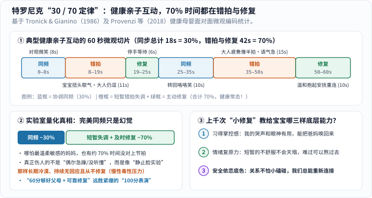

有了孩子之后，我们常常觉得家里多了一面高清放大镜，把平时在职场上藏得滴水不漏的焦躁和脆弱全照了出来。

先把一条重要的前提摆在最前面：小宝宝的哭闹，绝大多数时候首先来自饥饿、困倦过度、肠胀气、冷热不适或渴望怀抱等纯粹的生理信号；我们绝不能把孩子的每一次不安都归咎于玄乎的“他感应到了妈妈/爸爸的坏情绪”，更不该拿这种说法反过来苛责本就已经精疲力竭的照护者。

真正让无数新手爸妈夜里困惑、甚至偷偷掉眼泪自责的，往往是另一个瞬间：

**白天在公司面对难缠的客户都能心平气和讲道理，为什么到了凌晨三点，怀里最心爱的小人儿第 N 次“一沾床就炸醒”大哭时，胸口却会毫无征兆地窜起一股无名邪火？等好不容易哄睡了，低头看着他眼角还挂着泪珠的小脸，又后悔得恨不得抽自己一巴掌：“我怎么会对这么小的宝宝发脾气？”**

如果你也有过这样“一秒上头、事后愧疚”的深夜，先别急着给自己贴“坏父母”标签。把情绪神经科学的底牌掀开看一眼，你就会明白那股火气究竟从哪儿来：

_图 1：左图先概览大脑面对哭声与缺觉时的“快警报 vs 慢刹车”双通道及降温开关；右图展示发展心理学中的关系真相——安全依恋不是靠“永不急躁”攒出来的，而是靠失调后的修复闭环建立的。[单独打开图片](/assets/images/early-curiosity/emotion-repair-loop.svg)_

---

## 一、掀起脑科学的底牌：哭声声学特权与缺觉大脑的“刹车断线”

凌晨三点那一秒钟的心跳狂飙，绝不是因为你修养不够，而是你的大脑同时撞上了演化生物学与睡眠神经科学最猛烈的**双重生理过载**：

_图 2：左图展示 Yoo 与 Walker 等（2007）的脑成像实测数据——缺觉使内侧前额叶（mPFC）抑制断联、杏仁核反应飙升 +60%；右图展示共同调节唤醒曲线（支持动画时绿蓝平复曲线自动绘制一次并停留在终态；开启“减少动态效果”则直接静态完整显示）。[单独打开图片（刷新可重播）](/assets/images/baby-science/sleep-amygdala-brake.svg)_

### 1. 第一重冲击：婴儿哭声天生占据人类听觉的“最高警报频道”

人类幼崽出生时极度脆弱，如果哭声温和悦耳得像轻音乐，远古时代的父母一睡死，幼崽就活不下来。演化为此给婴儿啼哭设计了一套根本无法被大脑忽略的声学武器：

- **精准命中外耳道共振峰 +“声学粗糙度”调制**：婴儿啼哭的声带基频高达 $$300\text{–}600\ \mathrm{Hz}$$，高次谐波能量密集覆盖 **$$300\text{–}3000\ \mathrm{Hz}$$**（恰好撞在成年人外耳道物理共振放大最强的频率敏感区！），同时还夹杂着 $$30\text{–}150\ \mathrm{Hz}$$ 快速振幅调制的**声学粗糙度（Acoustic Roughness）**。纽约大学与日内瓦大学 Arnal 等人（2015，发表于 *Current Biology*）通过声学图谱与脑成像证实，这种粗糙调制专门占据人类沟通声景中的“紧急警报生态位”，与现代消防警报器同源，能绕过慢条斯理的常规语义分析区，直接刺入皮层下杏仁核危险评估回路 [3]。
- **$$100\text{–}200\ \mathrm{ms}$$ 本能交感唤醒**：美国国家儿童健康与人类发育研究所 Bornstein 等人（2017，发表于 *PNAS*）联合中国、美国、意大利等 11 国团队的跨文化行为与 fMRI 研究表明，婴儿哭声会自动激活照护者大脑的辅助运动皮层（随时准备起身去抱）、前脑岛与边缘警报回路；脑磁图（MEG）时间轴更测出，哭声响起仅 **$$100\text{–}200\ \mathrm{ms}$$**（比人类眨一次眼所需的 $$300\ \mathrm{ms}$$ 还快！），脑岛与杏仁核就已经拉响火警，催促交感神经瞬间飙升心率、血压与手心汗液 [4]。

### 2. 第二重冲击：睡眠剥夺让杏仁核狂飙 `+60%`，还剪断了前额叶刹车线！

如果大人昨晚睡饱了八小时，大脑理性总指挥**前额叶皮层（Prefrontal Cortex）**会在几百毫秒后迅速接管局面，顺着下行抑制纤维温柔地给杏仁核踩下一脚刹车：“没事，宝宝只是肠胀气不舒服，抱起来拍拍就好。”

可偏偏带娃头一年最残酷的现实，就是持续数周甚至数月的**碎片化睡眠剥夺**。

2007 年，哈佛医学院与加州大学伯克利分校睡眠科学家马修·沃克（Matthew Walker）与 Yoo 等人在《当代生物学》（*Current Biology*）发表了一项震动学界的 fMRI 实验 [2]（图 2 左）：研究者招募 **26 名**健康青年，对比“正常睡饱对照组（$$n=12$$）”与“睡眠剥夺组（$$n=14$$）”在观看由中性渐变至负性情绪图像时的脑部神经动力学。结果触目惊心：

$$
R_{\text{缺觉杏仁核}} \approx 1.60 \times R_{\text{充足睡眠基准}}
$$

1. **情绪油门暴涨 `+60%`**：面对负性情绪刺激时，缺觉组大脑警报中心——**双侧杏仁核（Amygdala）**的血氧信号激活强度比睡饱组暴增了 **`60%` 以上**，被卷入高反应的杏仁核空间激活体积也同步扩大了 **超过 3 倍** [2]！
2. **前额叶刹车线断联**：更致命的是功能连接分析——睡饱组的大脑里，负责理性评估与情绪抑制的**内侧前额叶皮层（mPFC）**与杏仁核紧密相连、随时稳控油门；而在缺觉组大脑里，这条 `mPFC ↔ 杏仁核` 抑制通路明显断裂，杏仁核反而掉头与原始脑干的**蓝斑核（Locus coeruleus，大量释放去甲肾上腺素的“战斗或逃跑”中枢）**耦合锁定 [2]！

把这个神经电路搬回凌晨三点的卧室：连续几周每晚夜醒三四次，相当于你正开着一辆**油门灵敏度放大 $$1.6$$ 倍、刹车油管却暂时漏气**的汽车，耳边还贴着一只 $$100\text{–}200\ \mathrm{ms}$$ 直刺杏仁核的高频警报器！深夜窜上来的那股烦躁、委屈甚至想摔门逃跑的冲动，**首先是大脑发出的生理过载信号，绝不代表你不爱孩子**。

---

## 二、共同调节与“情绪命名”：为什么大人必须先给自己戴氧气面罩？

看懂了缺觉大脑的双通道电路图，我们就能顺理成章解开第二个育儿痛点：**为什么宝宝越哭、大人越急着哄“别哭了！快睡啊！”，宝宝反而哭得越撕心裂肺？**

### 1. 在学会“自我调节”之前，宝宝靠的是“共同调节（Co-regulation）”

哈佛大学儿童发展中心指出，一岁以内的婴儿（乃至两三岁的幼儿）大脑前额叶到边缘系统的长程白质纤维髓鞘化远远没有发育完成——**他们的脑袋里根本还没有安装好独立的“情绪刹车片”** [1]。

指望一个半岁或一岁的宝宝在交感神经风暴发作时“听懂道理、自己冷静下来”，在神经解剖学上就像指望刚满月的宝宝自己下床去厨房冲奶粉一样不切实际。在生命最初几年，人类幼崽唯一能平复心率与应激激素的机制，叫**“生理与情绪共同调节（Co-regulation）”**（图 2 右）：

- **良性阻尼降温（绿线带蓝线）**：当照护者自己先做两次慢呼气激活迷走神经（副交感刹车）、放软肩膀，用温暖稳定的胸膛贴住宝宝、以每分钟约 $$60$$ 拍的低沉节律轻拍时，**大人的身体其实充当了宝宝的“外接前额叶稳压器”**，通过皮肤深压觉、心率呼吸同步与温柔语调，带着宝宝狂飙的皮质醇沿阻尼曲线慢慢回落；
- **失控正反馈啸叫（橙色虚线）**：反之，如果大人已经在崩溃边缘，小臂肌肉僵硬紧绷、呼吸短促、嗓门拔高加快，敏感的婴儿神经系统立刻捕捉到“连保护我的大人都进入危险战斗状态了！”，两个过载的边缘系统就会像两只挨太近的麦克风与音箱一样，陷入越哄越炸的**正反馈共振啸叫**。

这就是为什么飞机安全须知里的**“先给自己戴好氧气面罩，再帮孩子戴”**，在育儿神经科学里是一条物理铁律：先稳住你自己，不是自私，而是你手里最核心的哄娃工具。

### 2. 一句“给情绪起名字”，如何帮前额叶重新挂上刹车挡？

那情绪已经冲到嗓子眼时，难道要硬咬牙默念“我不许生气、我要当温和父母”吗？恰恰相反——单纯的强行压抑（Suppression）只管住了面部表情，交感神经血压反而升得更高。真正有脑成像铁证支持的四两拨千斤小工具，叫**“情绪命名（Affect Labeling，俗称 Name it to tame it）”**。

加州大学洛杉矶分校（UCLA）神经心理学家 Matthew Lieberman 团队（2007，发表于 *Psychological Science*）通过 fMRI 揭开了这一步的精确脑通路：当受试者不再只是被动浸泡在负面情绪画面里，而是调动语言中枢**用准确的词汇点出当下情绪的名字**时，大脑**右侧腹外侧前额叶皮层（RVLPFC）**会立刻显著激活，并经由内侧前额叶（mPFC）中继通路，实实在在地把杏仁核的警报活动压低下来 [5]！

放到真实的带娃现场，操作步骤非常简单——把脑海里攻击自己或怪罪孩子的“灾难化台词”，翻译成一句客观的**“生理状态 + 情绪词汇播报”**：

| 容易引爆崩溃的现场 | 大脑自动冒出的“火上浇油台词” | 启动 RVLPFC 前额叶刹车的“情绪命名翻译” |
|---|---|---|
| **凌晨三点哄睡第三次落地醒** | “我怎么这么没用！他是不是故意折腾我？” | “我现在感受到的是**连续缺觉四小时后的透支和挫败**。不是宝宝针对我，是我的前额叶电量耗尽了。” |
| **刚拖完地，辅食碗被打翻一地** | “烦死了！一天到晚净添乱！” | “我胸口这股火叫**疲惫叠加计划被打断的烦躁**。深呼吸三秒，只是一碗米糊，擦掉只要两分钟。” |
| **独自哄哭闹娃，伴侣还没下班** | “这个家全靠我一个人死撑，没人管我！” | “我现在觉得**孤立无援和委屈**。与其生闷气，我现在就发条消息请他一进门接手二十分钟。” |

你会惊讶地发现，当你把一团面目模糊的怒火精准拆解成“困倦”“孤立无援”“担心明天开会起不来”这几个具体名词的瞬间，大脑算力就从边缘系统切回了前额叶，你也从被巨浪卷走的溺水者，站回到了岸边的观察者位置上 [5]。

---

## 三、特罗尼克“30 / 70 定律”：安全依恋靠的是修复，不是满分

即便学会了大脑降温和情绪命名，很多高要求的新手爸妈心里还是藏着一根刺：“昨天我对宝宝语气凶了一下 / 刚才看手机慢了半拍没理他，会不会已经给他留下童年心理阴影了？”

哈佛医学院发展心理学家爱德华·特罗尼克（Edward Tronick）与 Gianino（1986）以及意大利学者 Livio Provenzi 团队（2018，发表于 *Frontiers in Psychology* 的系统综述）长达数十年的母婴面对面微观互动编码研究，给出了一组足以让天下所有父母长舒一口气的实测数据 [6, 7]：

_图 3：先读上方 60 秒微观时间轴，看清健康亲子互动中“同频 ↔ 错拍 ↔ 修复”的真实交替节奏；再看左下方的 30% / 70% 比例条与右下方的三项成长收益。[单独打开图片](/assets/images/baby-science/tronick-30-70-repair.svg)_

### 1. 逐秒录像揭开的真相：健康母婴日常互动也只有 `30%` 时间完全合拍

很多人都幻想，完美的母婴/父婴互动应该像奶粉广告慢镜头那样——宝宝一眨眼，爸妈一秒钟温柔读懂，全天候 `100%` 丝滑同频。但实验室把健康、敏感、充满爱意的母婴自由玩耍过程按**每秒逐帧录像**微观编码后发现，真实的时间分配比例竟然是：

$$
T_{\text{协调同频}} : T_{\text{错拍失调与修复}} \approx 30\% : 70\%
$$

你没有看错 [6, 7]（对照图 3 上方 60 秒时间轴）：

- **哪怕是最敏感、最爱孩子的健康父母，在日常面对面互动中也只有大约 `30%` 的时间跟宝宝处在完全合拍的同步状态（Synchrony）！**
- **剩下的约 `70%` 时间里，两人不是正处在“没对上拍（Mismatch）”，就是在“往回找补修复（Interactive Repair）”的路上**：比如第 `8` 秒宝宝刺激够了想扭头歇口气，爸爸没看懂还在继续逗（短暂错拍）；第 `19` 秒爸爸敏锐察觉到了，停下手放轻声音温柔等待（启动修复）；第 `25` 秒宝宝缓过劲来，重新转头冲爸爸咯咯一笑（重回同频）！平均每隔 **3–5 秒**，互动状态就会发生一次细微切换 [6, 7]。

### 2. 区分“日常错拍”与“慢性冷漠”：微修复替孩子修完的三门必修课

这组数据为什么如此治愈？因为它从实证上厘清了两个极易被育儿焦虑混淆的概念：**真正伤害婴幼儿大脑前额叶与应激系统的，从来不是日常难免的“错拍、慢半拍或偶尔急躁”，而是像特罗尼克著名的“静止脸实验（Still-Face Paradigm）”所模拟的那样——长期麻木冷漠、持续无回应且从不修复的慢性断裂（毒性压力）** [1, 7]。

恰恰相反，正是每天成百上千次**“同频 → 短暂错拍 → 及时修复”**的真实闭环，替孩子修完了三门“100 分无菌温室”反而教不会的人生必修课（图 3 右下）：

1. **自我效能与关系掌控感**：“原来当我难受发出信号时，我有能力把爸爸妈妈唤回来调整节奏，我的感受是算数、被听见的”；
2. **情绪复原力（Resilience）**：“短暂的不愉快、误会和等待不会让天塌下来，微小的挫败是可以安然度过的”；
3. **安全依恋的底层信念**：哪怕爸爸妈妈刚才累了声音大了一点，只要大人缓过神来重新温柔抱住我，轻声补上一句修复：“刚才爸爸太困急躁了，声音大吓到宝宝了对不对？不是宝宝的错，爸爸现在陪着你”——信任的纽带非但没断，反而因为“修补过”而更加结实 [6, 7]。

英国儿科医生兼心理学家温尼科特所说的“够好的父母（Good-enough parent）”，核心秘密就在这八个字：**允许失误，可靠修复。**

---

## 四、情绪快要决堤的那十秒钟：照着提醒卡做三步“紧急迫降”

道理平时都懂，但真到了凌晨三点太阳穴突突直跳、理智只剩最后一格电量的紧急关头，长篇大论根本想不起来。这时候请把要求降到最低，只按下面这张提醒卡一步步做“紧急迫降”：

_图 4：从上往下读，不必同时做到全部。情绪冲顶时，物理安全永远排第一。[单独打开提醒卡](/assets/images/archive-guides/parent-pause.svg)_

### 1. 第一步：物理安全永远排第一，独自崩溃时先放回婴儿床退开两步

如果家里有伴侣或长辈在场，立刻抛开面子说出最直白的交接指令：“我现在情绪到临界点了，你接手抱十分钟，我去洗把冷水脸喘口气。”

**如果此刻只有你独自一人在家**，哪怕宝宝正哭得满脸通红，一旦你感觉到手臂发抖、怒火失控，**请立刻把他仰面平放在没有任何松软枕头、厚被褥、防撞床围和毛绒玩具遮挡口鼻的安全婴儿床或游戏围栏里，锁好护栏，自己转身走到门外深呼吸两三分钟！**

请死死记住一条儿科急救铁律：在绝对安全的婴儿床里多哭两三分钟，不会给宝宝留下任何伤害；但**千万、绝对不要在愤怒或极度疲惫时剧烈摇晃婴儿！** 婴幼儿头部占体重比例高达约四分之一、颈部肌肉极弱、颅内桥静脉极其脆弱，短短几秒钟的剧烈前后摇晃即可引发致死或终身重残的**“婴儿摇晃综合征（虐待性头部创伤，Abusive Head Trauma）”**。在失控前先把孩子安全放下走开两分钟，不是冷血抛弃，而是满分的救命守护！

### 2. 第二步：用物理装备给听觉减负，只管未来十分钟最小的一件事

在门外用冷水冲一把手腕、喝半杯温水，把卧室刺眼的顶灯换成微弱暖黄小夜灯。如果遇到宝宝黄昏哭闹或肠绞痛，不得不长时间抱哄，**非常推荐备一副软海绵隔音耳塞或主动降噪耳机！**

戴上耳塞完全不妨碍你眼睛看着宝宝、把他温柔贴在胸口轻拍安抚，却能从物理声学上把最刺耳的 $$1000\text{–}3000\ \mathrm{Hz}$$ 尖锐谐波削减 $$15\text{–}25\ \mathrm{dB}$$，直接替你的杏仁核卸掉一半报警负荷，也不用半夜三点灾难化脑补“他以后性格不好怎么办”，只专注把眼前这十分钟过完。

### 3. 第三步：守住心理健康“两周红线”，该找医生时绝不硬扛

正如我们在孕期篇《[蓦然回首 - 准父母的那些事]()》中所强调的，无论是妈妈还是爸爸，如果出现以下信号：

- **连续两周以上**感到心如死灰或持续紧绷焦虑、对一切失去兴趣；
- 明明家人已经接手带娃、环境安静了，自己却依然整夜睁眼失眠、食欲骤变、被深重的无价值感与自责淹没；
- 或者**哪怕只有一次闪过伤害自己或伤害孩子的念头（急症红线）**；

请务必第一时间告诉家人，前往医院产后心理门诊或精神心理科寻求专业评估与支持。这和高烧肺炎要去医院看诊一模一样——不是你不够坚强，而是给深爱的家人和自己系好安全带。

学会温柔地接住那个困倦、笨拙偶尔还会冒火的自己，我们才真正拥有了温柔接住孩子的力气。

---

## 参考与延伸

1. [Harvard Center on the Developing Child：Serve and Return & Caregiver Stress](https://developingchild.harvard.edu/key-concept/serve-and-return/)——解析“发球—回球”回应性互动与共同调节如何塑造早期大脑回路，以及照护者慢性压力缓冲与社会支持的重要性。
2. [Yoo, S. S., Gujar, N., Hu, P., Jolesz, F. A., & Walker, M. P. (2007). *The human emotional brain without sleep — a prefrontal amygdala disconnect*（PubMed: `17956744`）](https://pubmed.ncbi.nlm.nih.gov/17956744/)，*Current Biology*, 17(20), R877–R878.——经典睡眠剥夺 fMRI 研究，证实缺觉导致人类杏仁核对负性刺激反应增强 60%（激活体积扩大 35%），且内侧前额叶抑制连接显著断裂。
3. [Arnal, L. H., Flinker, A., Kleinschmidt, A., Giraud, A. L., & Poeppel, D. (2015). *Human screams occupy a privileged niche in the communication soundscape*（PubMed: `26190070`）](https://pubmed.ncbi.nlm.nih.gov/26190070/)，*Current Biology*, 25(15), 2051–2056.——揭示紧急啼哭/尖叫声的声学粗糙度调制如何直接激活边缘警报回路。
4. [Bornstein, M. H. et al. (2017). *Neurobiology of culturally common maternal responses to infant cry*（PubMed: `29078366`）](https://pubmed.ncbi.nlm.nih.gov/29078366/)，*PNAS*, 114(45), E9465–E9473.——涵盖中国、美国等 11 国的跨文化行为与脑成像证据，揭示照护者对婴儿哭声快速运动与听觉唤醒的神经基础。
5. [Lieberman, M. D. et al. (2007). *Putting feelings into words: affect labeling disrupts amygdala activity in response to affective stimuli*（PubMed: `17576282`）](https://pubmed.ncbi.nlm.nih.gov/17576282/)，*Psychological Science*, 18(5), 421–428.——情绪命名激活右侧腹外侧前额叶（RVLPFC）经内侧前额叶平缓杏仁核警报的脑成像证据。
6. Tronick, E. Z., & Gianino, A. F. (1986). *Interactive mismatch and repair: Challenges to the coping infant*. *Zero to Three*, 6(3), 1–6.——提出母婴面对面日常互动中仅约 30% 时间处于协调匹配状态、约 70% 处于错拍与修复过程的奠基研究。
7. [Provenzi, L., Scotto di Minico, G., Giusti, L., Guida, E., & Müller, M. (2018). *Disentangling the Dyadic Dance: Theoretical, Methodological and Outcomes Systematic Review of Mother-Infant Dyadic Processes*（PubMed: `29615947`）](https://pubmed.ncbi.nlm.nih.gov/29615947/)，*Frontiers in Psychology*, 9, 348.——系统综述母婴互动“匹配—错拍—修复—同步”循环机制及其对婴幼儿前三年情绪与依恋发展的核心贡献。
8. [UNICEF Parenting：Child development](https://www.unicef.org/parenting/child-development)——日常育儿支持、安全看护与分阶段回应指南。
