### 情绪的镜子

孩子有时像一面镜子，让我们看见自己的紧绷。但孩子的哭闹也可能来自饥饿、困倦、不适或其他需求，不能把每次不安都归因于父母情绪，更不该把它变成对照护者的责备。

在养育孩子的过程中，我们其实是在重新认识自己。那些被我们压抑多年的情绪，那些童年留下的阴影，都会在育儿的过程中被放大，被触发。

### 看见情绪

深夜喂奶的疲惫
孩子哭闹时的无助
面对生病时的自责
对未来的不确定和焦虑

**这些情绪都很正常。**

我们首先是自己，然后才是父母。允许自己有情绪，允许自己不完美，这才是育儿的第一课。

### 与自己和解

认识情绪，接纳情绪，最后与情绪和解。

这不仅是为了孩子，更是为了我们自己。
不必把“情绪稳定”当成永不生气的考试。比一次都不失控更现实的，是看见自己的状态，获得支持，并在冲突之后重新连接。

### 情绪上来时，先把事情缩小

从上往下读，不必同时做到全部。先把“我怎么这么糟糕”换成一句具体的话：“我已经很久没睡好了，我需要有人接一会儿。”

照护者需要暂停时，先确保孩子处于适龄、安全的环境，或交由可靠成人照护；**不要摇晃婴儿**。等自己缓下来，再处理眼前的一件事，不用在最疲惫的时候解决全部育儿难题。

如果焦虑、低落或失控感持续影响生活，可以向医疗或心理专业人员求助；出现伤害自己或孩子的念头，应立即寻求身边支持和当地紧急帮助。这不是“不够爱孩子”，而是需要帮助。

图是非诊断性的自我提醒，不是治疗流程。关于孩子的发展与日常互动，可从 [UNICEF 儿童发展指南](https://www.unicef.org/parenting/child-development)继续阅读。
