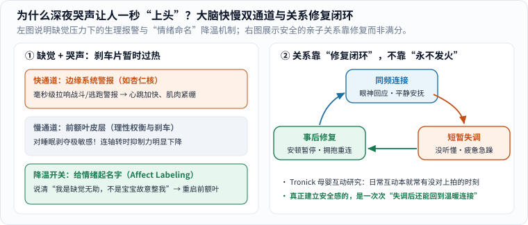

### 情绪的镜子：为什么白天讲理的人，半夜会一秒“上头”？

孩子有时像一面放大镜，照出我们平时藏得很好的紧绷。当然，小宝宝的哭闹首先往往来自饥饿、困倦、胀气、冷热或需要安抚等生理信号，不能把孩子的每次不安都归咎于“感应到了大人的坏情绪”，更不该拿这种说法反过来苛责本就已经精疲力竭的照护者。

真正让许多新手爸妈困惑甚至深深自责的是另一件事：**为什么我在职场上挺能控制脾气的，面对自己最爱的小人儿，在凌晨三点哄睡失败时，心里却会突然窜起一股无名火，事后看着他熟睡的小脸又后悔得想哭？**

把脑科学的底牌掀开看一眼，你就不会再简单骂自己“不是个好爸爸/好妈妈”了：

_图 1：左图展示大脑面对高频哭声与长期缺觉时的两条通路——警报器毫秒级拉响，而负责理性刹车的“前额叶”最怕缺觉；右图展示发展心理学中的关系真相——安全感不是靠“100% 不急躁”攒出来的，而是靠失调后的修复闭环建立的。[单独打开图片](/assets/images/early-curiosity/emotion-repair-loop.svg)_

1. **婴儿哭声天生被演化设计成“最高优先级警报”**：为了保证脆弱的人类幼崽不被忽略，婴儿啼哭的声学频率会直接触发成人大脑边缘系统（包括杏仁核等快速威胁/唤醒回路）的毫秒级生理反应——心跳飙升、手心出汗、肌肉紧绷，催促你立刻行动。
2. **长期碎片化睡眠，最先削弱的是大脑的“刹车片”**：平时帮我们踩住冲动、换位思考的总指挥是**前额叶皮层（Prefrontal Cortex）**。而前额叶恰恰是全脑对睡眠剥夺与慢性压力最敏感的区域之一！当你连续几周每晚醒三四次，相当于开着一辆油门灵敏度翻倍、刹车片却过热衰减的车——深夜那一秒的烦躁、无助甚至想逃跑的冲动，**首先是神经生理层面的过载信号，不是你不够爱孩子**。[1]

### 看见情绪：一句“给情绪起名字”，真的能帮大脑降温

深夜喂奶的疲惫、怎么哄都放不下的无助、孩子发烧时的自责、生活节奏被打乱的委屈——**这些情绪全都是真实且正当的。**

我们首先是活生生的人，然后才是父母。很多人在情绪涌上来时习惯硬憋：“我不许生气！我要做情绪稳定的父母！”结果越压抑越像捂住排气阀的高压锅。

心理学里有一个经过脑成像验证、非常简单好用的小工具，叫**“情绪命名（Affect Labeling，俗称 Name it to tame it）”**。加州大学洛杉矶分校（UCLA）Lieberman 等人在 2007 年发表于《心理科学》（*Psychological Science*）的 fMRI 研究发现：当受试者不再只是被动淹没在负面画面里，而是用准确的词语把当下的情绪**说出来或点出名字**时，右侧腹外侧前额叶皮层被激活，而杏仁核等边缘系统的警报反应随之显著回落。[2]

翻译成凌晨三点的育儿现场，就是把脑子里那句攻击自己的话，替换成一句客观的“状态播报”：

- 把 **“我怎么这么没用，连哄个觉都哄不好！”**
- 换成 **“我现在感受到的是连续缺觉四小时后的透支和无助。这只是身体在报警说我累了。”**

当你把一团乱麻的火气精准拆解成“困倦”“孤立无援”“担心明天起不来”时，你就从情绪的席卷者变回了观察者，前额叶的刹车也重新挂上了挡。

### 与自己和解：安全感靠的是“修复”，不是“满分”

更让人松一口气的科学结论，来自发展心理学家爱德华·特罗尼克（Edward Tronick）团队长达数十年的母婴面对面互动研究。

很多人以为，理想的亲子关系应该是电影慢镜头那样——宝宝一皱眉，爸妈一秒钟温柔读懂，全天候百分之百同频。但实验室逐秒录像分析发现：**哪怕是最敏感、最用心的健康照护者，日常互动里也有很大比例的时间跟宝宝“没对上拍（Mismatch）”**——比如宝宝想扭头歇会儿大人还在逗，或者大人刚好走神、疲惫、语气急了一点！[1]

那为什么这些孩子依然长出了稳稳的安全依恋？因为紧跟着“短暂失调”之后，发生了最关键的第三步——**修复（Repair）**（图 1 右）：

- 大人察觉到自己急了，先深呼吸缓下来；
- 重新抱起或轻拍孩子，温和地说一句：“刚才爸爸声音太大了，吓到你了对不对？爸爸只是太困了，现在爸爸陪着你。”

正是这一次次**“同频 → 偶尔失调 → 重新修复连接”**的真实循环，让孩子在潜移默化中学到了受用一生的底层信念：**不开心和摩擦并不可怕，关系不会因为一次小磕碰就碎掉，我们总能重新找回彼此。**

### 情绪快要决堤时，先把动作缩到最小

_图 2：从上往下读，不必同时做到全部。情绪冲顶时，物理安全永远排第一。[单独打开提醒卡](/assets/images/archive-guides/parent-pause.svg)_

当你觉得太阳穴突突跳、快要控制不住脾气的那十秒钟，请直接照着下面这三步做“紧急迫降”：

1. **先把孩子放进绝对安全的地方，退开两步**：如果身边有伴侣或家人，立刻说一句具体求助：“我现在快撑不住了，你接手抱十分钟，我去洗把脸。”如果独自在家，哪怕宝宝还在大哭，**把他平放在没有松软枕被遮挡的婴儿床/安全围栏里，关好护栏，自己走到门外深呼吸两三分钟是完全安全且明智的做法**——哭几分钟不会伤害宝宝，但**千万、绝对不要在愤怒或崩溃时剧烈摇晃婴儿**（婴儿头重颈弱，剧烈摇晃可致严重脑损伤）。
2. **只解决未来十分钟里最小的一件事**：喝半杯温水、把刺眼的大灯调暗、戴上降噪耳塞降低哭声分贝（你能看见并抱住他，同时保护自己的听觉神经不过载！），不用在凌晨三点思考“他以后性格不好怎么办”。
3. **分清日常疲惫与需要专业搭把手的信号**：如果持续两周以上感到情绪麻木低落、对什么都提不起劲、严重失眠即使宝宝睡了也睡不着，或者闪过伤害自己或孩子的念头，请务必第一时间告诉家人并前往医院心理科/产后门诊求助。这和发高烧要去医院一样，不是脆弱，而是给全家系好安全带。

### 参考与延伸

1. [Harvard Center on the Developing Child：Serve and Return & Caregiver Stress](https://developingchild.harvard.edu/key-concept/serve-and-return/)——回应性互动如何塑造大脑回路，以及持续压力对照护者回应能力的影响与社会支持的重要性。
2. Lieberman, M. D. et al. (2007). *Putting feelings into words: affect labeling disrupts amygdala activity in response to affective stimuli*. *Psychological Science*, 18(5), 421–428.（PubMed 编号 `17576282`）——用语言命名情绪激活右侧腹外侧前额叶并平缓杏仁核反应的脑成像证据。
3. [UNICEF：Child development](https://www.unicef.org/parenting/child-development)——日常育儿支持与分阶段回应指南。
