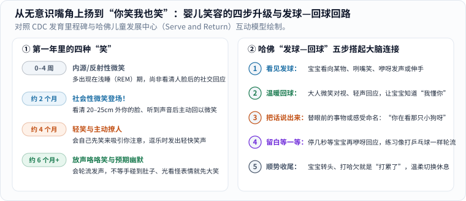

你一定记得那个瞬间。

那个平时吃完就睡、哭了就喂的小人儿，突然在满月前后的某一天，在半梦半醒之间，嘴角轻轻往上一翘，露出了第一个像小天使一样的微笑——全家人举着手机屏住呼吸，生怕惊醒了这一秒。当时家里老人多半会乐呵呵地说：“看，小家伙做美梦梦到好吃的啦！”不过，如果你翻开发育神经病学教材，会发现这其实是一场更奇妙的“神经试电彩排”。

再过几个星期（通常在出生后 **6–8 周、接近满 2 个月** 的某天早晨 [1]），真正让人鼻头一酸的一幕发生了：这一次他完全清醒，没有在吃奶，也没有在打瞌睡，黑亮亮的眼珠稳稳锁住俯下身的你，听见你轻声叫他的小名，忽然整个小脸舒展开来——眼睛弯成两道月牙，对着你咧开没牙的小嘴笑了起来！

那一刻，连熬了几个通宵的疲惫仿佛都被一秒钟融化了。

如果你仔细追踪生命第一年里宝宝的笑容，就会发现它绝不是同一个面部动作在原地重复，而是一场横跨**脑干、视觉皮层、面部神经双通路、父母多巴胺回路与社会心智预测**的四幕科学大戏。

---

## 一、第一个笑容的神经交接：从脑干“睡梦试电”到皮层认出你的脸

在宝宝满周岁前，他的笑容按神经控制层级的由低到高，一步步解锁了四道发育台阶（图 1 左）：

_图 1：左图对照美国疾控中心（CDC）发育里程碑，梳理婴儿第一年笑容的四步演进；右图展示哈佛大学儿童发展中心总结的“发球—回球（Serve and Return）”五步互动回路。[单独打开图片](/assets/images/early-curiosity/smile-serve-return.svg)_

### 1. 0–4 周的“内源性微笑”：REM 活跃睡眠里的脑干自发脉冲

为什么月子里的宝宝总爱在半梦半醒、刚吃完奶打嗝或者排气舒服时嘴角上扬，真正睁大眼睛清醒时反而一脸严肃？

答案藏在新生儿独特的睡眠结构与皮层下神经通路里。成年人每晚睡眠中只有约 `20%–25%` 属于**快速眼动睡眠（REM）**，而足月新生儿每天 $$14\text{–}17\ \mathrm{h}$$ 的睡眠里，竟然有高达 **约 `50%` 处于活跃的 REM 睡眠期**！在 REM 阶段，尽管负责高级认知的大脑皮层尚未接管表情，位于大脑底部的古老**脑干（脑桥被盖区）与边缘系统下部**却在密集发放自发内源性电脉冲（Endogenous bursts），顺着**第七对脑神经（面神经，CN VII）**传到脸颊，牵动单侧或双侧嘴角轻轻上翘。

这种**“内源/反射性微笑（Endogenous Smile）”**甚至在孕晚期的四维超声里就能拍到——它就像剧院正式演出前，电工师傅在后台逐一拨动开关测试舞台灯路通不通电，还不代表宝宝看清了面前是谁。

### 2. 第 6–8 周的“社会性微笑”：20–30 厘米哺乳焦距与倒三角眼神识别

真正的质变发生在出生后 **第 6–8 周（接近满 2 个月）** [1]。要完成一个清醒的对视微笑，宝宝的大脑内部必须跑通一条精密的三步接力链：

1. **光学焦距刚好锁住怀抱距离**：新生儿晶状体调节能力有限，眼睛最清晰的自然对焦窗口恰好落在鼻尖前方约 **$$20\text{–}30\ \mathrm{cm}$$** 处——这正是妈妈抱在胸前哺乳、或爸爸把宝宝托在臂弯对视时，大人脸庞到宝宝视网膜的物理距离！
2. **从皮层下“人脸雷达”交棒给视觉皮层**：刚出生时，宝宝主要靠上丘—枕核等皮层下古老通路本能朝向“上面两个黑圆点（眼睛）+ 下面一道横线（嘴巴）”的高对比度**倒三角形图案**；而到了 6–8 周，枕叶视觉皮层与腹侧颞叶面孔识别网络的突触密度和髓鞘化跨过关键阈值，宝宝终于能把你的眉毛、发际线明暗边界、温柔声调和熟悉气味整合拼成一张完整的“爸爸/妈妈的脸” [1]！
3. **大脑皮层正式接管面神经开关**：认出你的那一瞬，前扣带回与运动皮层主动抑制住杂乱的脑干抽动，有意识地向双侧面神经下达指令——宝宝清醒地锁住你的瞳孔，回敬你一个对称舒展的**“社会性微笑（Social Smile）”** [1]。这是人类生命递出的第一张真正意义上的社交名片。

### 3. 从 4 个月“主动抛绣球”到 6 个月“预期性大笑”：因果律的觉醒

跨过 2 个月的门槛后，笑容的认知含金量还在按月跳级：

- **约 4 个月（主动发起微笑 + 有声轻笑 Chuckles）**：仔细对比 CDC 2 月龄与 4 月龄里程碑，你会发现一个极迷人的主客体反转——2 个月时是“你先逗他，他被动回你一笑”；到了 **4 个月左右**，**他会自己先露出大大的笑容来主动召唤你的注意** [2]！这一步说明他的前额叶与纹状体已经摸透了第一条社会因果律（操作性条件联结）：“只要我主动一笑，爸爸妈妈就会立刻转过头来陪我说话！”与此同时，呼吸肌与声门开合配合升级，无声咧嘴笑变成了带气流声的轻笑 [2]。
- **约 6 个月起（放声大笑与预期幽默）**：半岁前后，横膈膜节律性收缩解锁了清脆响亮的**咯咯放声大笑（Belly laugh）** [3]。更妙的是，有时你的手指还没碰到他的小肚子，只是坏笑着把五指张开悬在半空，拉长声调喊一句“大螃蟹——要——来——咯——”，他就已经提前笑得直蹬小胖腿了！这种**“预期性大笑（Anticipatory laughter）”**标志着工作记忆与时间预测回路的成熟：他不仅记住了上一轮的游戏脚本，还能在安全悬念揭晓前提前品尝“即将被挠痒痒”的快乐。

---

## 二、为什么婴儿的笑这么“真”？杜氏眼轮匝肌与父母大脑的多巴胺回路

你有没有想过一个问题：成年人职场和饭局上每天也有无数客气的微笑，为什么唯独小宝宝咧嘴一笑，哪怕刚经历了夜醒五次、换尿布换到腰酸背痛、哄睡哄到怀疑人生的父母，也会在一秒钟内觉得“心都化了，又能再撑一天”？

这真不是父母自作多情的心理安慰，背后藏着**面部神经双通路解剖学**与**功能核磁共振（fMRI）脑科学**的两项硬核发现（图 2 左）：

_图 2：左图展示为什么宝宝笑起来“眼睛弯成月牙”——颧大肌提拉嘴角的同时，不受意识强行伪装的眼轮匝肌外圈自然收缩，并直接点亮父母大脑的黑质—纹状体多巴胺奖赏回路；右图汇总伦敦大学金史密斯学院对 390 个家庭的婴儿笑声实测调查。[单独打开图片](/assets/images/early-curiosity/smile-brain-reward.svg)_

### 1. 两条截然不同的面神经通路：为什么婴儿学不会“礼仪假笑”？

早在 1862 年，法国神经学家纪尧姆·杜兴（Guillaume Duchenne）与后来的表情心理学家保罗·艾克曼（Paul Ekman）就发现，人类的“礼貌微笑”和“发自内心的真笑”，在大脑里走的根本不是同一条电线：

1. **礼貌假笑走“锥体系”皮层随意运动通路**：当你拍证件照听摄影师喊“一二三，茄子！”时，大脑**初级运动皮层（M1）**发出意识指令，单独指挥嘴角两侧的**颧大肌（Zygomaticus major）**向斜上方牵拉。嘴角虽然翘起来了，但眼眶四周的肌肉纹丝不动，眼神看起来依旧平静甚至疲惫；
2. **杜氏真笑（Duchenne Smile）走“锥体外系”边缘情绪通路**：当一个人真正沉浸在纯粹喜悦中时，信号直接从**基底神经节、杏仁核与扣带回情绪中枢**发出，在拉动颧大肌咧开小嘴的同时，自动激活了极难靠主观意志单独伪装的**眼轮匝肌外圈（Orbicularis oculi，眶部肌纤维）**！眼轮匝肌一收缩，瞬间把饱满的小脸颊往上推起两团苹果肌，**把两只黑亮亮的眼睛挤成弯弯的月牙**（发展心理学家 Messinger 等人还发现，当婴儿与父母深情对视大笑时，常叠加下颌放松张大的“张口杜氏笑”，传递出最高浓度的积极情绪！）。

一岁以内的小宝宝，前额叶压根还没学会成年人那套“皮笑肉不笑”的社交面具规则。只要他冲你笑，每一次都是由边缘情绪中枢直通眼角与嘴角的**100% 纯度杜氏真笑**——人类视觉系统经过百万年演化，对这种毫无防备的真诚信号几乎零抵抗力。

### 2. 儿科顶刊 fMRI 实测：一秒点亮父母的“黑质—纹状体多巴胺回路”

宝宝的杜氏笑脸传进父母眼睛后，大人的大脑深处究竟发生了什么化学反应？2008 年，美国贝勒医学院儿科学与神经科学团队 Lane Strathearn 等人在儿科权威顶刊《儿科学》（*Pediatrics*）上发表了一项极其经典的 fMRI 脑成像实验 [5]：

研究者邀请了 **28 位初产妈妈**躺进核磁共振扫描仪，随机观看 **60 张** 5–10 月龄婴儿的面部特写照片——照片里一半是**她自己的宝宝**，一半是对年龄、肤色与表情严格配对的**陌生宝宝**；每组宝宝都包含**开心微笑（Happy）、平静中性（Neutral）、伤心哭泣（Sad）**三种自然表情，全程不放任何声音，纯粹检验“看见婴儿表情”瞬间的脑回路响应 [5]。

全脑血氧水平依赖（BOLD）信号分析揭开了两层精妙无比的激活规律：

- **第一层（认出“这是我的崽”）**：只要屏幕上出现**自家宝宝**的脸（哪怕是平静或哭泣），妈妈大脑里负责情绪共情（脑岛、前扣带回）、社会读心（颞上沟 STS）和动作准备（运动前区）的大片网络就会整体点亮，响应强度显著高于看陌生宝宝 [5]；
- **第二层（唯有“自家宝宝笑脸”才能打开的多巴胺金库）**：当研究者专门追踪大脑深处释放**多巴胺（Dopamine）**的核心奖赏通路——包括中脑**腹侧被盖区（VTA）/ 黑质（Substantia nigra）**、**黑质—纹状体通路（Nigrostriatal pathway）与腹侧纹状体（Ventral striatum / 伏隔核）**，以及眶额叶皮层时，惊人的一幕出现了：**唯独在看到“自家宝宝开心笑脸”的那两秒钟，这片多巴胺奖赏中枢被特异性地强烈引爆！** 激活幅度严格满足单调递减阶梯 [5]：

$$
I_{\text{自家宝宝笑脸}} > I_{\text{自家宝宝平静脸}} \approx I_{\text{自家宝宝哭脸}}
$$

（反观看到自家宝宝哭脸时，虽然前扣带回警报区会亮起催你去哄，却完全不会激活多巴胺快乐奖赏区！）

从演化人类学视角看，这项设计堪称生命的神来之笔：由于人类直立行走收窄了骨盆，人类婴儿必须在脑容量仅达成人约 `25%` 时“提前早产”降生，成为自然界最“费妈费爸”、头一年连自己翻身觅食都做不到的高耗能幼崽。演化之所以把**“婴儿杜氏笑脸 → 直连父母黑质—纹状体多巴胺充电站”**写进基因底层，正是为了在无数个屎尿屁与碎片睡眠交织的深夜之后，给精疲力竭的照护者注入一针内源性多巴胺强心剂，把亲子依恋死死焊牢 [5]。

当然，看透了这个生理机制，我们反而更该卸下道德包袱：**笑容给的多巴胺回血很真实，但大人缺觉欠下的生理睡眠债也百分之百真实。** 不必苛求自己“看到孩子笑就必须立刻忘掉所有委屈和腰疼”，累极了踏实请伴侣或家人接手补一觉，比硬撑着当“永动机父母”科学得多。

---

## 三、伦敦大学全球千名婴儿笑声调查：躲猫猫为什么从“惊奇”笑到“读心”？

再问一个特别好玩的问题：成年人看喜剧笑的是谐音梗、反转和生活吐槽；连一句话都听不懂的小宝宝，每天到底在笑什么？为什么你把一张餐巾纸“刺啦”撕成两半，他都能咯咯笑上半天？

先后任教于伦敦大学伯贝克学院婴儿实验室（Birkbeck BabyLab）与金史密斯学院（Goldsmiths, University of London）的发展心理学家卡斯帕·阿迪曼（Caspar Addyman），专门发起了著名的全球**“婴儿笑声项目（Baby Laughter Project）”**——他不仅收集了来自全球二十多个国家 **超过 1,400 名父母**的长问卷与视频记录 [7]，还在 BBC 合作开展的 **390 个家庭**实测任务中，请父母在家逐一测试五类经典逗娃游戏（图 2 右） [6]：

### 1. 全球 1,400 多份问卷与 390 户实测：“良性冲突”加上全神贯注的你

跨文化统计数据高度一致：全球宝宝平均在约 **6 周**露出第一个微笑，约 **3.5 个月**发出第一声笑，而在所有文化里稳坐头把交椅、把普通玩具花活甩开近两倍差距的“喜剧总冠军”，正是全世界父母无师自通都会玩的——**躲猫猫（Peekaboo，实测约 `70%` 的受试宝宝放声大笑）**，紧随其后的是挠痒痒悬念游戏（约 `63%`）与“温和打破日常规则”的装傻动作 [6, 7]！

为什么“撕纸巾”“爸爸把塑料碗扣在自己头上”“拿着玩具小猫却学小狗汪汪叫”能把宝宝逗得前仰后合？心理学家提炼出了婴儿幽默的两味核心配方：

1. **认知配方——“良性冲突（Benign Violation）”**：纸巾平时总是完整安静的，突然“刺啦”裂开；爸爸平时总是稳重可靠的，突然打了个夸张的假喷嚏——**一件违反宝宝既有世界模型的新奇意外发生了（Violation），但因为发生在他最信赖的照护者怀里，他的边缘系统百分之百确认这件事毫无危险（Benign）！** “可预测规律的小小破绽 + 绝对安全的怀抱”碰撞在一起，原本用来警戒意外的唤醒能量瞬间转化为欢快的大笑（这也与我们在《[进入孩子的视角]()》里拆解的违反预期物理实验一脉相承）。
2. **社交配方——“百分之百在场的共同专注”**：在 1,400 多份问卷中，Addyman 发现了一个极温暖的统计规律——**婴儿有人陪伴时发笑的频率，是独自一人玩耍时的近十倍！** 正如 Addyman 教授那句直击人心的总结：**“你根本没办法一边心不在焉地刷手机，一边玩好躲猫猫。”** [6, 7] 宝宝的笑声从来不是孤芳自赏的独白，而是发给大人的社交确认信：“我知道你此刻全神贯注在看我，我好喜欢和你待在一起！”

### 2. 同一个“躲猫猫”，4–6 个月与 9–12 个月笑的竟不是同一件事！

更精彩的是，Addyman 顺着月龄时间轴对比上千份记录后发现：虽然从 4 个月到 1 岁宝宝都爱玩躲猫猫，但**前半年和后半年，他们大脑里觉得好笑的机制已经悄悄换了一套引擎** [7]！

- **4–6 个月：笑的是“物理重逢的惊奇释放（Surprise & Relief）”**
  这个阶段的宝宝工作记忆容量只有短短几秒，客体永久性刚刚萌芽。当你双手捂住脸时，他的视觉追踪突然中断，心里泛起一丝真实的微弱悬念：“咦？爸爸的脸去哪儿了？”一定要在 **1–2 秒内**迅速把手打开喊“喵！”——你的脸瞬间重现，打破了短暂消失的紧张感，宝宝爆发出的笑声是**“哇！原来你真的还在！”的惊喜释放**。如果你捂着脸停顿七八秒不开，4 个月宝宝非但不会觉得更好笑，反而会因为记忆断线而困惑转头甚至扁嘴哭起来 [7]。
- **9–12 个月：笑的是“社交预期与心智捉迷藏（Social Anticipation & Theory-of-Mind Tease）”**
  到了九十个月以后，客体永久性早已稳如泰山——你拿一块巴掌大的小方巾挡住眼睛，宝宝心里 **100% 明镜似的知道你就躲在方巾后面**！这时候他笑什么呢？他笑的是**两个人共享一套“假装看不见”的社交剧本** [7]！你会看到 10 个月大的宝宝不等你掀布，自己先咯咯笑着扑上来扯掉你的手，甚至主动把小口水巾盖在**他自己的脸上**，屏住呼吸等你配合演出那句夸张的：“哎呀！我们家宝宝怎么不见啦？！”——从被动看魔术的观众，升级成了懂得调侃大人预期的**“小小喜剧导演”**，这正是人类**心智理论（Theory of Mind，理解他人视角与心理状态）**最早的闪光！

---

## 四、开口说话前的“原初对话”：0.5–2 秒留白节拍与日常记录边界

看懂了笑容背后的神经接力与社交属性，我们就能彻底读懂哈佛大学儿童发展中心反复强调的**“发球与回球（Serve and Return）”**，在客厅地垫上的短短几秒钟里究竟该怎么落地 [4]（图 1 右、图 3）。

### 1. 守住 0.5–2 秒的黄金等待窗：别让“连珠炮输出”塞满对话留白

发展心理学家特里瓦森（Colwyn Trevarthen）把 2–9 个月婴儿开口说话前与大人的眼神、笑容和咿呀互动，命名为**“原初对话（Proto-conversation）”**。如果你用录音软件把一段高质量的母婴/父婴互动录下来画成时间轴波形，会惊讶地发现它像极了高手对打的乒乓球节拍（图 3 上半图）：

_图 3：上图是健康的“原初对话”节拍——大人回应完一句后，刻意留出约 1–2 秒安静空白，给宝宝大脑处理信号并组织下一次“啊—咕”或笑容的时间；下图是大人最容易踩坑的“连珠炮单向输出”，把空白全塞满反而让宝宝过载扭头。[单独打开图片](/assets/images/early-curiosity/proto-conversation-rhythm.svg)_

为什么很多大人明明很卖力地对着宝宝一直说话，宝宝却看两眼就把头扭开了？问题恰恰出在**成人与婴儿神经信息处理速率的时间差**上：

- 成年人日常聊天时，上一句结尾到下一句接话的轮流停顿（Turn-taking gap）平均只有极短的 **约 $$0.2\ \mathrm{s}$$（200 毫秒）**；
- 而小婴儿从听清你的语调、看懂你的笑脸，到调动前额叶与胸腹呼吸肌组织出下一声“啊——咕！”或回敬一个微笑，大脑需要的反应与筹备窗口约为：

$$
\Delta t_{\text{婴儿回应留白}} \approx 0.5\text{–}2.0\ \mathrm{s}
$$

与此同时，婴儿大脑判断“大人刚才那句温柔回应是不是专门针对我的发声（Contingency detection）”也有一扇约 **$$0.5\text{–}3.0\ \mathrm{s}$$** 的敏感关联窗：

- **最舒服的“回球 + 留白”节奏（图 3 上）**：宝宝发出“呃—啊”或冲你一笑（发球）→ 你在 $$1\ \mathrm{s}$$ 内微笑对视回应一句“宝宝也醒啦？”（及时回球，稳稳落在关联窗内）→ **最关键的一步：立刻闭上嘴，保持微笑看着他，在心里默数“一、二”，留出 $$1.5\text{–}2.0\ \mathrm{s}$$ 的安静空白！** 就在这短短一两秒留白里，你会惊喜地看到他小胸脯一挺、嘴角一咧，努力接上下一拍“咕——”！一岁前练熟的这套轮流节拍，正是日后真正口语对话的神经骨架 [1, 4]。
- **过犹不及的两端陷阱（图 3 下）**：如果大人零停顿连珠炮发问（`0 秒`留白），就会像发球机失控一样把宝宝撞得感官过载；反过来，如果大人一直低头滑手机，等宝宝叫了七八秒才敷衍抬头回一句，超出了因果关联窗，宝宝同样无法建立“我的声音能得到回应”的连接感。

### 2. 读懂“转头暂停键”，留住家庭相册里的真实留白

同样来自 CDC 2 月龄与 6 月龄指南的一条贴心提醒：如果对视欢笑了几分钟后，宝宝突然**把头转向一侧、眼神飘向天花板、打哈欠、弓背或者轻微哼唧**，千万别误以为是“宝宝不理我了”而硬把脸凑过去追着逗 [1, 3]！

对突触高负荷运转的小婴儿来说，高浓度的面对面眼神与笑容交换其实非常耗电；**主动移开视线（Gaze aversion）是他唯一能按下的“自我保护暂停键”**，翻译成大白话就是：“爸爸，刚才这局聊天满分开心！但我的小 CPU 有点发烫，得看两分钟白墙散散热，充好电咱们再聊！”顺势放轻声音、把他竖抱在肩头安静拍一拍，就是最高级的默契。

成年人的快乐好像越来越复杂、门槛越来越高；但小宝宝用每天几十次毫无保留的杜氏真笑提醒我们，快乐本来可以这么具体而微小：一只沙沙响的安全摇铃、爸爸鼓起腮帮子做的一个鬼脸、妈妈哼的一首哪怕跑调的儿歌，或者在地垫上翻过身来，第一眼确认你还在旁边冲他笑。

当你想留住这样一幕时，不必举着手机死死挡在自己脸前追着喊“看镜头！再给爸爸笑一个！”——要知道，当你把脸藏在冰冷的黑色手机背面时，宝宝恰恰看不见他最想对视的那双弯弯的眼睛了！先用你自己的眼睛接住他的笑，事后再用三句短话记在备忘录里就够了：**刚才我们一起做了什么，他有什么细微回应，我那一刻是什么感受。**

如果想给家庭相册写句旁白，给画面留白往往比塞满大人式的评价更耐看：

| 照片旁的一句话 | 不必写成 |
|---|---|
| 今天妈妈哼歌时，你停下来看了我五秒 | “音乐天赋从小显露” |
| 你冲我笑了一下，我也放下了手里的活 | “每天都必须做到高质量陪伴” |
| 那一刻我很开心，眼皮也真的很沉 | “好父母永远不会觉得累” |

照片只留在家人之间也很好。发到公开社交平台前，多检查一眼画面里有没有露出门牌号、小区楼栋特征、幼儿园校徽或日常固定散步路线，替慢慢长大的孩子守住一份数字隐私边界。这里记录的只是一段真实的亲密时光，不需要任何外部点赞替它打分。

---

## 参考与延伸

1. [CDC（美国疾控中心）：Milestones by 2 Months](https://www.cdc.gov/act-early/milestones/2-months.html)——2 月龄社会性微笑（对人说话或微笑时回以微笑）、注视人脸，以及识别宝宝转头/打哈欠需要休息的信号。
2. [CDC：Milestones by 4 Months](https://www.cdc.gov/act-early/milestones/4-months.html)——4 月龄主动微笑吸引注意、轻笑（chuckles）与轮流发声互动。
3. [CDC：Milestones by 6 Months](https://www.cdc.gov/act-early/milestones/6-months.html)——6 月龄放声大笑、一问一答轮流发声游戏与情绪读取建议。
4. [Harvard Center on the Developing Child：Serve and Return](https://developingchild.harvard.edu/key-concept/serve-and-return/)——“发球与回球”五步互动怎样在开口说话前构建社交与语言神经回路。
5. [Strathearn, L., Li, J., Fonagy, P., & Montague, P. R. (2008). *What's in a smile? Maternal brain responses to infant facial cues*（PubMed: `18595985`）](https://pubmed.ncbi.nlm.nih.gov/18595985/)，*Pediatrics*, 122(1), 40–51.——28 位初产妈妈 fMRI 脑成像实测：唯有自家婴儿开心笑脸特异性激活腹侧被盖区/黑质与纹状体多巴胺奖赏通路。
6. [Goldsmiths, University of London：Best way to make babies laugh revealed（Caspar Addyman 婴儿笑声项目）](https://www.gold.ac.uk/news/best-way-to-make-babies-laugh-/)——390 个家庭实测躲猫猫（约 70% 放声大笑）等早期幽默游戏排行与“共同专注在场”机制。
7. Addyman, C. (2020). *The Laughing Baby: The Extraordinary Science Behind What Makes Babies Happy*. Unbound.（基于伦敦大学伯贝克学院 BabyLab 与金史密斯学院涵盖全球逾 1,400 名父母的婴儿笑声问卷调查，解析躲猫猫从 4–6 月龄惊奇释放到 9–12 月龄社交预期与心智互动的演进）。
8. Duchenne de Boulogne, G.-B. (1862/1990). *The Mechanism of Human Facial Expression*; 及 Ekman, P., Davidson, R. J., & Friesen, W. V. (1990), *The Duchenne smile: Emotional expression and brain physiology II*, *Journal of Personality and Social Psychology*, 58(2), 342–353.——解析眼轮匝肌与颧大肌协同的杜氏真笑及随意假笑的神经通路差异。
