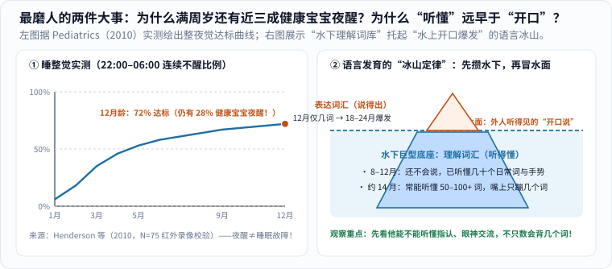

回头翻翻相册和深夜搜索记录，新手爸妈几乎都在凌晨两点钟搜过这一串让人越看越心慌的问题：

- “宝宝抬头是不是比同月龄群里的孩子晚？”
- “满月时扶着腋下还会迈步，怎么两个月大突然腿软定住不迈步了？”
- “儿保单子上身高体重写着 `P20`，是不是不及格、营养没跟上？”
- “别人家十个月就满地跑、叫爸妈了，我家一岁两个月还在扶沙发、只会指东西咿呀叫，到底正不正常？”
- “网上说四五个月就能训练睡整觉，为什么我家快一岁了半夜还要醒？”

在小区花园推车遛娃时，最怕听见旁边热心长辈问一句：“哟，几个月啦？怎么还不会走呀，我们家那个九个多月就会跑了！”明明知道人家没有恶意，一句话还是能让刚放宽的心又揪紧一整个礼拜。

与其靠一句空洞的“别焦虑、顺其自然”硬撑，不如把世界卫生组织（WHO）、发育生物力学与儿科纵向追踪最硬核的四份真实研究摊在桌面上——**当你亲眼算清人类幼崽正常的生理发育窗口有多宽、看懂动作与睡眠背后的底层机制，至少八成没必要的自我怀疑当场就能烟消云散。**

---

## 一、第一把尺子：WHO 跨国实测“大运动时间窗”到底有多宽？

很多人脑子里都有一张隐形的“月龄打卡死命令”：三翻、六坐、七滚、八爬、周岁走——只要自家娃比民间顺口溜慢了半个月，就开始怀疑是不是缺钙、肌张力有问题或发育落后。

但顺口溜为了押韵好记，把原本极宽的生命正态分布硬生生削成了一个个冰冷的单点！2006 年，世界卫生组织（WHO）多中心生长参考研究组在加纳、印度、挪威、阿曼和美国五个大洲代表性国家，对 **816 名营养与健康状况良好的婴幼儿**从 4 个月到 24 个月进行了严密的纵向家访实测，发布了全球儿科学界通用的**六项大运动正常达标窗口（第 1 至第 99 百分位区间，即 `P1–P99`）**（图 1 左） [1, 2]：

_图 1：左图横条严格按 WHO（2006）实测数据比例绘制，每一根彩色条代表全球健康婴幼儿达成该动作的正常月龄范围（P1 至 P99）；右图说明体检单上的百分位怎么读，以及哪些情况应当及时找医生评估。[单独打开图片](/assets/images/early-curiosity/who-motor-windows.svg)_

### 1. 从“单点打卡”到 `P1–P99` 正态窗口：为什么前后差 9 个月都算满分健康？

顺着图 1 左边六根彩色横条，把全球健康宝宝解锁核心动作的真实跨度一笔笔算出来 [1, 2]：

- **独立稳坐（Sitting without support）**：最早 `P1` 为 **$$3.8\ \text{个月}$$**，最晚 `P99` 为 **$$9.2\ \text{个月}$$**（正常跨度达 $$5.4\ \text{个月}$$）；
- **扶物站立（Standing with assistance）**：`P1–P99` 为 **$$4.8\text{–}11.4\ \text{个月}$$**，手膝爬行（Hands-and-knees crawling）为 **$$5.2\text{–}13.5\ \text{个月}$$**，扶物行走（Walking with assistance）为 **$$5.9\text{–}13.7\ \text{个月}$$**；
- **独立站立与独立行走（Walking alone）**：独站窗口宽达 **$$6.9\text{–}16.9\ \text{个月}$$**（整整 $$10\ \text{个月}$$！）；而最牵动全家神经的**独立行走**，`P1` 先锋宝宝在 **$$8.2\ \text{个月}$$** 就能撒手迈步，`P50` 中位数约在 **$$12.0\ \text{个月}$$**，而排在 `P99` 边界上的健康宝宝要到 **$$17.6\ \text{个月}$$**（将近一岁半！）才稳稳迈出第一步：

$$
\Delta t_{\text{正常独走窗口}} = 17.6 - 8.2 = 9.4\ \text{个月}
$$

前后整整相差 **9.4 个月**，却全都是神经与骨骼完完全全健康的孩子 [1, 2]！拿小区里一个 9 个月早走的宝宝，去焦虑自家 15 个月正在稳稳扶沙发蓄力的宝宝，就像怪秋天的金桂为什么不在四月和桃花一起开一样毫无道理。

### 2. 为什么多达两成健康宝宝不按“标准手膝爬”剧本出牌？

很多家长还有第二个心结：“听说不爬直接走会感觉统合失调？我家娃怎么只会肚皮贴地蹭，或者干脆坐着挪屁股？”

把一手临床统计拆开看，真相会让你立刻松一口气：

1. **WHO 纵向队列与发育运动学实测**：在 WHO（2006）对手膝爬行连续追踪的样本中，有 **`4.3%` 的健康婴儿从头到尾压根没有出现过手膝爬行**，直接扶站学走 [2]；而在涵盖更多日常移动姿态的儿科运动学追踪中（如纽约大学运动发育学家 Karen Adolph 团队 1998 年研究及英美儿科队列统计），**多达约 `15%–25%` 的健康婴儿在学会标准手膝爬之前或替代手膝爬时，采用的是非典型移动方案**——有的肚皮贴地像特种兵一样匍匐前进（Belly/commando crawling），有的双手双脚伸直像小熊一样撑地爬（Bear crawl），有的坐在地板上靠小脚一蹬一蹬“蹭屁股平移（Bottom-shuffling）”，还有的靠连续翻滚过客厅，最后全都按时稳稳学会了走路 [7]！
2. **背后的生物力学与环境原因**：为什么这么多健康宝宝不走“教科书手膝爬”？一方面，自上世纪 90 年代全球儿科推行预防婴儿猝死综合征（SIDS）的**“仰睡运动（Back to Sleep）”**以来，习惯仰卧的婴儿早期趴卧撑起上肢的机会减少，许多宝宝更晚才练出手膝四点支撑所需的肩带肌力；另一方面，现代家庭光滑的木地板和瓷砖摩擦力小，肚皮滑行或坐着挪屁股反而省力高效！正因为健康婴儿的爬行姿势百花齐放、缺乏单一标准，美国疾控中心（CDC）与美国儿科学会（AAP）在 **2022 年修订发育里程碑指南时，专门将“爬行”从统一必查筛查表中移出**（当然，清醒看护下多做趴卧练习 Tummy Time 和钻爬游戏依然极有利于核心与肩颈力量，只是绝不必把“没按标准姿势手膝爬”当成脑发育缺陷！）。

### 3. 儿保单上的 `P20` 不是“只考了 20 分”：分清排队位置与纵向速率

每次儿保称完身高体重，看到体检单上印着 `P15` 或 `P20`，不少爸妈当场就慌了，回家端着碗追着喂。

其实**生长百分位数（Percentile）只是健康同龄人群里的横向排队序号，绝不是百分制考卷** [3]：把 100 个完全健康的同月龄、同性别宝宝从矮到高排成一列，站在第 20 号位置的健康宝宝就是 `P20`，站在正中间第 50 号的是 `P50`，第 85 号是 `P85`。父母遗传靶身高与骨架本来就有娇小与高大之分，怎么可能 100 个健康孩子全部挤在第 90 名呢？

儿科医生看生长曲线时，真正关注的核心指标从来不是单次排名高低，而是**纵向生长轨迹（Growth velocity）平不平稳** [3]：

- **健康信号**：哪怕宝宝一直在 `P15–P20` 通道里，但每三个月复测都稳稳沿着这条轨道平行向上攀升，精神活泼、奶量辅食正常——这就是满分匹配他遗传潜力的健康长势；
- **真正需要排查的信号**：反过来，哪怕原本在 `P75`，如果短短几个月内身高、体重或头围曲线突然走平，甚至**连续向下跌穿两条主要百分位线**（如从 `P75` 跌破 `P50` 再跌向 `P25`），或者短期内异常暴涨跨过多条线，才需要请儿科医生排查喂养吸收或内分泌原因 [3]。

---

## 二、塞伦 1984 温水缸经典实验：为什么满月会“踏步”，两个月却腿软了？

讲到大运动快慢，很多细心的爸妈都亲眼见过一个极其神奇的“返祖”现象：宝宝刚出生头两三周，如果你双手稳稳托住他的腋下，让他的小脚底轻轻沾到床垫表面，他居然会像模像样地左一脚、右一脚交替往前迈（医学上称为**新生儿踏步反射 Stepping reflex**）！可等出了月子、到了两个月大再试，他的两条小胖腿却像面条一样缩起来或定在原地，怎么也不肯迈步了。

### 1. 统治教科书几十年的旧猜想：“大脑皮层把反射关掉了”？

在长达半个世纪里，传统神经成熟论（Neuromaturational theory）给出的标准解释听起来顺理成章：“新生儿踏步只是低级脊髓/脑干的原始反射；到了 2 个月大，高级大脑皮层发育起来，自上而下抑制关闭了这组反射，必须等到快 1 岁皮层运动区完全成熟后，大脑才能重新学会走路。”

直到 **1984 年**，美国印第安纳大学发展心理学家埃丝特·塞伦（Esther Thelen）与同事在《婴儿行为与发展》（*Infant Behavior and Development*）上发表了一组拍案叫绝的生物力学实验，用一个像高中物理课一样干净利落的点子，彻底推翻了这个单一脑中心解释（图 2） [5]！

_图 2：1984 年 Esther Thelen 团队的三步对照实验——① 跟踪发现长肉最快的宝宝踏步最早消失；② 给还能踏步的瘦宝宝脚踝加上模拟脂肪的小配重，踏步立刻减少；③ 把已经“不踏步”的胖宝宝抱进齐腰深的温水里借浮力托住小腿，消失的踏步瞬间满血复活！[单独打开图片](/assets/images/early-curiosity/thelen-stepping-buoyancy.svg)_

### 2. 配重块与阿基米德浮力双向破案：不是脑子忘了，是小胖腿太沉了！

Thelen 仔细测量婴儿头三个月的身体成分变化后，抓到了一个被前人忽略的物理事实：出生后 1–3 个月是人类婴儿**皮下脂肪堆积最迅猛的爆发期**（俗称长出“米其林莲藕腿”），大腿体积与质量 $$m_{\text{腿}}$$ 飞速膨胀，重力向下拉拽小腿的力矩随之猛增；然而此时婴儿腿部屈髋、屈膝肌肉的横截面积肌力 $$F_{\text{肌}}$$ 增长却远远没追上脂肪囤积的速度！

为了检验“2 个月不踏步到底是因为大脑神经指令消失了，还是单纯因为腿太沉抬不动了”，Thelen 设计了双向可逆的物理操控实验 [5]：

1. **正向“增重测试”（给 4 周龄瘦宝宝贴上未来脂肪）**：研究者找来正处于踏步高峰期的 4 周龄宝宝，在他们小脚踝上轻轻绑上几百克安全铅粒软带——配重重量精准模拟出他们再过四周即将长出的小腿脂肪量。结果一绑上配重，原本欢快交替迈步的宝宝，每分钟踏步次数和抬腿高度当场断崖式下跌！
2. **反向“减重测试”（把不踏步的胖宝宝放进温水缸！）**：接着是最精彩的一幕——研究者找来在陆地上已经“丧失踏步能力”的 2–3 月龄胖宝宝，双手托住腋下，把他们下半身浸入齐躯干深的温暖水缸里。根据阿基米德浮力定律，温水向上的浮力 $$F_{\text{浮}}$$ 瞬间抵消了小胖腿绝大部分有效重力：

$$
G_{\text{水中有效腿重}} = m_{\text{腿}} g - F_{\text{浮}} \ll m_{\text{腿}} g
$$

奇迹在入水那一秒发生了：**上一分钟在垫子上还一动不动的胖宝宝，两条小腿在温水里立刻生龙活虎地重新左一脚、右一脚交替踏起步来，频率甚至比满月时还要带劲！** [5]

如果踏步反射真的是在脑子里被皮层“永久删除关闭”了，泡一泡温水怎么可能在 1 秒钟内改写大脑神经回路呢？！真相豁然开朗：脊髓与脑干里的节律踏步神经回路一直都在好端端地待命，只是陆地重力暂时锁住了胖乎乎的小腿！

这就是当代发展科学影响深远的**“动力系统理论（Dynamic Systems Theory）”** [5]：**孩子解锁任何一个里程碑动作，从来不是“大脑聪明度”这颗单一螺丝决定的，而是神经回路、肌肉力量、骨骼杠杆比例、皮下脂肪分布、重心平衡与地面支撑环境共同组装的结果。** 冬天穿得像小棉球一样的宝宝、或者体重长势喜人的胖宝宝，翻身和爬行比瘦小灵活的同龄娃晚几周，往往只是他在耐心等核心肌力追上敦实的小体重而已！

---

## 三、夜醒与开口的底层结构：45 分钟睡眠周期与“水下语言冰山”

除了走路早晚，一岁多以内最磨人、最容易引发家庭育儿争执的还有两桩事：**半夜醒来**和**迟迟不开口叫人**。我们同样把生理结构拆到最底层来看（图 3）：

_图 3：左图整理自《儿科学》（Pediatrics, 2010）红外夜视录像校验的 1–12 月龄追踪数据——按最贴合父母作息的“晚 10 点至早 6 点连续睡”标准，满周岁时仍有 28%（21/75）的健康宝宝尚未达标；右图展示“听懂的水下词库”如何先于“开口表达”积累。[单独打开图片](/assets/images/early-curiosity/sleep-and-language-iceberg.svg)_

### 1. 45–50 分钟睡眠周期与近半数活跃 REM：为什么满周岁还有近三成健康娃夜醒？

短视频平台上到处充斥着“三个月必须睡整觉，夜醒影响脑发育和身高”的恐吓营销。要想不被唬住，先对比一下**婴儿与成人的睡眠周期硬件架构**有多大差别：

- **成年人的睡眠列车（约 $$90\text{–}110\ \mathrm{min}$$ 一圈）**：成人入睡后迅速沉入深慢波非快速眼动睡眠（NREM），整晚活跃的快速眼动睡眠（REM）仅占约 `20%–25%`；周期交界处虽也有短暂微觉醒，但大人翻个身拉一下被子就无意识接上下一轮了。
- **小婴儿的睡眠列车（仅约 $$45\text{–}50\ \mathrm{min}$$ 一圈，且约 `50%` 是活跃 REM！）**：初生至半岁婴儿的单个睡眠周期长度只有成人的约一半（$$45\text{–}50\ \mathrm{min}$$），且早期高达一半的睡眠时间处在脑血流量旺盛、眼珠转动、手脚抽动的**活跃 REM 睡眠**——这恰恰是婴儿大脑在睡眠中疯狂搭建突触、巩固白天感官记忆的黄金施工期！但代价是，每隔短短 45 分钟，宝宝就会浮上一次浅睡转换关口；一旦撞上夜间饥饿、猛涨期、牙龈萌出肿痛、白天刚学会翻身/扶站夜里闭着眼还在练，或者 8–10 个月客体永久性成熟带来的分离焦虑，就极易彻底醒来呼唤爸妈（关于大人自己如何在夜醒缺觉时保护情绪，可参看《[感受和认识自己的情绪]()》）。

那么在真实世界里，不强行干预的健康宝宝到底几岁才睡整觉？2010 年，新西兰坎特伯雷大学睡眠研究团队 Henderson 等人在《儿科学》（*Pediatrics*）发表了一项用**红外夜视录像（Videosomnography）校验家长睡眠日记**的严密纵向研究，连续 12 个月追踪了 **75 名正常发育婴儿**（图 3 左） [6]：

- 连续睡眠能力进步最快的阶段是 **1–4 个月**（配合视交叉上核昼夜节律与夜间褪黑素分泌逐步建立）；到 **5 个月大**时，刚过半数的宝宝能跨过贴合父母睡眠区间的“晚 `22:00` 至早 `06:00` 连续 8 小时”标准；
- **最治愈的一颗定心丸在 12 个月终点线**：哪怕到了**满周岁（12 月龄）**，75 名完全健康的受试宝宝里，依然有 **21 人（占 `28%`，超过四分之一！）尚未实现 `22:00–06:00` 一觉到天亮**（即便退一步按最宽松的午夜 `24:00–05:00` 连续睡 5 小时计算，满一岁也仍有约 `15%` 未达标） [6]！

只要宝宝白天精神饱满、眼神互动灵动、生长曲线平稳，周岁前后仍有夜醒完全属于正常生理变异范围，绝不等于“大脑发育受损”或“父母哄睡不及格”。

### 2. 听懂永远跑在说出来前面：语言爆发前的“理解性词库”与 70 块发音肌协同

一岁前后第二个高频焦虑重灾区是语言：“小区同月龄的小妹妹一岁就会喊爸爸、妈妈、抱、拿、灯，我家小子一岁两个月了怎么还只会伸着食指‘嗯！嗯！’使唤人？”

发展语言学里有一座著名的**“词汇冰山模型”**（图 3 右，源自 Fenson 等人的麦克阿瑟—贝茨沟通发展量表 CDI 大样本常模）：外人耳朵能听见的**表达性词汇（Expressive vocabulary，嘴巴清晰说出来的词）**只是浮出水面的一小截冰尖；而在水面之下，早已潜伏着一座体积庞大数倍的**理解性词汇（Receptive vocabulary，耳朵听得懂含义的词）**！

为什么“听懂”会比“说出”领先好几个月？看看大脑内部的神经分工就明白了：

1. **水下输入端（颞叶听觉词义映射，8–12 个月高速扩容）**：负责把语音串（如“小皮球”）与眼前圆滚滚的实物绑定起来的颞叶韦尼克区（Wernicke's area）网络成熟较早。常模统计显示，许多 **10–12 个月**大的健康婴儿嘴上只能说出 `0–3` 个模糊单词，但水下其实已经能准确听懂 **20–50 个甚至上百个**日常名词与短句指令！
2. **水上输出端（运动皮层对 70 多块肌肉的毫秒级编排，18–24 个月才迎来爆发）**：要把脑海里的词清晰吐出来，额叶布洛卡区与运动皮层必须以几十毫秒的精度，同步协调胸腔呼气气流、喉部声带振动、软腭升降以及舌尖、双唇、下颌**超过 70 块肌肉**的精细开合！这道极高的运动门槛，使得绝大多数孩子要先攒够约 50 个基础词，到 **18–24 个月左右**才突然迎来“一天冒出好几个新词”的**词汇爆发期（Vocabulary spurt）**。

因此在 9–15 个月期间，比起每天追着考“跟妈妈念：苹—果！”，儿保医生更看重水下这**三根沟通地基**结不结实 [4]：

- **词汇理解（Receptive check）**：不靠手势提示，问他“小熊在哪儿？”“把袜子递给爸爸”，他能不能转头找到或配合行动？
- **共同注意与陈述性指物（Joint attention & Pointing）**：看到窗外挖机或天上小鸟，他会不会主动伸出食指指给你看，紧接着**转回头看你的眼睛**，确认你也看见了这份惊喜？（12–14 个月食指指物是预测后续语言发展的黄金指标！）
- **非语言轮流沟通**：叫名字时能否灵敏转头对视，会不会用摇头、挥手再见、把打不开的盒子递到你手里求助来双向交流（也可结合《[孩子的笑能融化你的心]()》里的原初对话节拍一起观察）？

只要水下的理解、眼神与手势热火朝天，水面上的清晰词汇往往只是接下来几个月水到渠成的事。

---

## 四、守住科学底线：怎么区分“健康慢热”与“需要早期干预的预警红线”？

把正常发育窗口的宽度一五一十算清楚，是为了替父母卸下无谓的横向攀比枷锁；但科学育儿永远有同样关键的下半句：**不瞎比、不抢跑，绝不等于拿一句“贵人语迟”或“长大自然就好了”把真正需要医学支持信号往后拖延！**

### 1. 四类绝不含糊的儿科发育预警红线（Red Flags）

结合世界卫生组织（WHO）运动窗口上限与美国疾控中心（CDC Act Early）/ 儿科学会临床筛查指南 [1, 4]，请把下面四类清晰的**就医评估红线**存进手机备忘录——一旦触及，不观望、不自责，直接挂正规医院**儿童保健科 / 发育行为儿科 / 小儿神经科**请医生专业把关：

- **红线一：跨过了正常发育窗口的上限边界**
  - 大运动：满 **4 个月**拉坐或竖抱时头部仍极度后垂不稳；满 **9 个月**仍无法独立稳坐；满 **18 个月**仍无法独立行走 [1, 4]；
  - 语言与沟通：满 **12 个月**仍没有任何连续辅音咿呀学语（如 `ba-ba`、`da-da`、`ma-ma`），也没有任何社交手势（不会指物、挥手、摇头）；满 **16–18 个月**仍不会说出任何一个有明确指代意义的单字/单词；满 **24 个月**仍不会自发组合两个词的短语（非单纯鹦鹉学舌背儿歌） [4]。
- **红线二：左右两侧明显不对称，或肌张力异常偏高/偏低**
  - 在 **1 岁以前**就过早表现出强烈的“只用一只手抓物，另一只手总攥拳不用”（真正的左撇子/右撇子优势通常在 18–24 个月后才稳定，周岁前明显偏侧需排查对侧运动通路）；爬行或扶站时一条腿明显僵硬拖曳；或者抱起来全身像木板一样僵硬打挺（双腿交叉剪刀步），又或像布娃娃一样极度松软无力。
- **红线三：眼神对视、唤名反应与社交分享持续缺席**
  - 满 **6 个月**极少对亲近照护者露出温暖微笑或眼神交流；满 **9–12 个月**在安静环境下多次呼唤乳名毫无转头反应（需同时排查听力与社交发育），从不主动拿感兴趣的东西向大人展示或分享目光 [4]。
- **红线四（最高优先级急症信号）：任何月龄出现“技能倒退（Loss of skills）”！**
  - **无论孩子几岁几个月**，一旦发现他原本已经稳稳掌握的本领——比如原本会说的几个词突然彻底沉默不说、原本热络的对视和指物互动突然消失、或者原本稳当的独坐/独走出现明显倒退不稳——请**立即就医**排查神经发育或代谢原因 [4]！

### 2. 就诊前的“30 秒居家视频 + 三条事实”准备法，与放过自己的对照表

当你心里对某个表现拿不准时，最消耗人的做法是在凌晨两点刷短视频评论区对号入座吓唬自己；最省心高效的做法是：

1. **提前拍好 2–3 段每次 `30 秒` 的居家自然状态小视频**（因为很多一岁前后的宝宝一进陌生诊室穿白大褂的环境就会紧张大哭或闭嘴，家里的爬行步态、眼神指物和呼名反应视频对儿保医生判断极有价值！）；
2. **在纸上记清三条客观事实**：① 这个情况是从几月龄开始的、最近一个月是有进步还是停滞？② 他在家里能不能听懂不带手势的日常指令？③ 出生史（是否早产低出生体重）与近期生长曲线走势如何；
3. 带去儿保门诊做一次标准化发育筛查——没问题，全家踏踏实实睡个好觉；万一确实存在运动肌张力或语言社交迟缓，**0–3 岁恰恰是人类大脑突触可塑性最黄金的窗口期**，科学的早期康复与家庭互动干预介入越早，追赶效果越好 [4]。

| 容易混在一起的话 | 更愿意留在心里的意思 |
|---|---|
| “别焦虑，再等等看” | 在 `P1–P99` 正常窗口内不急着贴标签，但触及预警红线时一天也不拖延 |
| “你看人家孩子都会了” | 只跟自家孩子上个月的状态比进步，不拿别人家孩子的时间表当考卷 |
| “时间能解决一切” | 把需要蓄力的自然成长交给时间，把专业筛查把关交给儿科医生 |

标题里的“没事，时间将治愈一切”，是一句在疲惫深夜里想轻轻拍拍自己肩膀的安慰，不是包治百病的医学承诺。等走过这一程回头再看，当年让你焦虑得辗转反侧的翻身、长牙、断夜奶和第一声“爸爸妈妈”，确实都会在某一天悄无声息地翻篇；而真正陪我们稳稳走过这段路的，是**既看得懂科学正态分布的宽容厚度、愿意给小树苗慢慢扎根的耐心，也清楚风雨来时去哪里推开专业求助的大门。**

---

## 参考与延伸

1. [WHO（世界卫生组织）：Motor development milestones](https://www.who.int/tools/child-growth-standards/standards/motor-development-milestones)——六项儿童大运动里程碑达标窗口官方图表与百分位表（独坐 3.8–9.2 月，独走 8.2–17.6 月）。
2. [WHO Multicentre Growth Reference Study Group (2006). *WHO Motor Development Study: windows of achievement for six gross motor development milestones*（PubMed: `16817682`）](https://pubmed.ncbi.nlm.nih.gov/16817682/)，*Acta Paediatrica Suppl*, 450, 86–95.——加纳、印度、挪威、阿曼、美国五国 816 名健康儿童纵向追踪的 1%–99% 月龄窗口及 4.3% 完全不经手膝爬行的统计结论。
3. [WHO：Child growth standards](https://www.who.int/tools/child-growth-standards)——儿童身高、体重、头围生长曲线标准与纵向百分位通道评估体系。
4. [CDC（美国疾控中心）：Concerned About Your Child's Development? & 2022 Revised Milestones](https://www.cdc.gov/act-early/families/concerned.html)——2022 年循证修订发育里程碑（含移出单一爬行筛查项说明）以及发育迟缓、技能倒退就医预警指南。
5. Thelen, E., Fisher, D. M., & Ridley-Johnson, R. (1984). *The relationship between physical growth and a newborn reflex*. *Infant Behavior and Development*, 7(4), 479–493.——揭示婴儿 2 月龄踏步反射消失源于腿部皮下脂肪增长快于肌力、脚踝加配重可抑制踏步而温水浮力可立即恢复踏步的经典动力系统实验。
6. [Henderson, J. M., France, K. G., Owens, J. L., & Blampied, N. M. (2010). *Sleeping through the night: the consolidation of self-regulated sleep across the first year of life*（PubMed: `20974775`）](https://pubmed.ncbi.nlm.nih.gov/20974775/)，*Pediatrics*, 126(5), e1081–e1087.——75 名健康婴儿 1–12 月龄红外录像与睡眠日记追踪：满周岁时仍有 28% 未达 22:00–06:00 连续整夜睡眠。
7. Adolph, K. E., Vereijken, B., & Denny, M. A. (1998). *Learning to crawl*. *Child Development*, 69(5), 1299–1312; 及 Robson, P. (1984), *Prewalking locomotor movements and their use in predicting standing and walking*, *Child: Care, Health and Development*, 10(5), 317–330.——解析婴儿肚皮匍匐、蹭屁股移动等多样化爬行策略及其正常行走预后。
