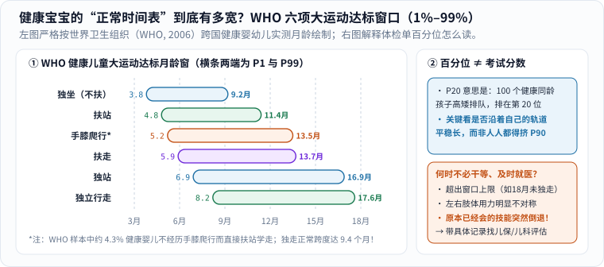

### 那些曾经让你彻夜刷手机的焦虑

回头翻翻相册和搜索记录，新手爸妈几乎都在深夜搜过这一串让人睡不着觉的问题：

- “宝宝抬头是不是比同月龄群里的孩子晚？”
- “怎么还不会翻身？别人家的都已经满地爬了！”
- “儿保单子上身高体重写着 `P20`，是不是不及格、营养不良啊？”
- “一岁两个月了还不敢撒手自己走，到底正不正常？”

在小区花园推车遛娃时，最怕听见旁边热心长辈问一句：“哟，几个月啦？怎么还不会走呀，我们家那个十个月就会跑了！”一句话就能让刚放宽的心又揪紧一整个礼拜。

与其靠一句空洞的“别焦虑”硬撑，不如把儿科和世界卫生组织（WHO）最硬核的一张实测数据图摊在桌面上——**看完真实数据的宽度，至少一半没必要的横向比较当场就能放下。**

### 看懂两把科学尺子：WHO 的“大运动窗口”到底有多宽？

2006 年，世界卫生组织（WHO）多中心生长参考研究组在加纳、印度、挪威、阿曼和美国五个国家，对 **816 名健康婴幼儿**从 4 个月到 24 个月进行了持续跟踪评估，绘出了著名的**六项大运动正常达标时间窗（1%–99% 百分位区间）**（图 1 左）：[1][2]

_图 1：左图横条严格按 WHO（2006）实测数据比例绘制，每一根彩色条代表全球健康婴幼儿达成该动作的正常月龄范围（第 1 至第 99 百分位）；右图说明体检单上的百分位怎么读，以及哪些情况应当及时找医生评估。[单独打开图片](/assets/images/early-curiosity/who-motor-windows.svg)_

仔细看图 1 左边那六根长长的横条，有三个极其震撼、却很少有人仔细告诉家长的事实：

1. **“正常”根本不是某一天，而是一扇宽达五到十个月的大门！**
   以父母最惦记的**“独立行走”**为例：排在最前面的 1% 健康宝宝 **8.2 个月**就能撒手走了，而排在后面的健康宝宝要到 **17.6 个月**（快一岁半！）才稳稳迈出第一步——**前后整整相差 9.4 个月，却全都是完完全全健康的孩子！** 同样，“独坐”横跨 `3.8–9.2` 个月，“独站”更是横跨 `6.9–16.9` 个月（整整 10 个月跨度）。拿一个 10 个月先走的孩子去苛求一个 14 个月正在攒力气的孩子，就像怪秋天的桂花为什么不在春天开一样没有道理。[1][2]
2. **连“发展顺序”都不是死板的独木桥**：
   WHO 这项研究还记录了一个有趣的数据——在完全健康的受试宝宝里，约有 **90%** 大致按常见顺序解锁动作，另有 **4.3% 的健康宝宝压根没有经历标准的“手膝爬行”**（有的肚皮贴地匍匐，有的挪屁股，有的直接扶着沙发站起来学走）！[2]
3. **体检单上的 `P20`，绝不是“满分 100 只考了 20 分”！**
   很多家长一看到生长曲线落在 `P15` 或 `P25` 就如临大敌、拼命硬喂。其实**百分位数（Percentile）只是排队位置**：把 100 个完全健康的同龄同性别孩子从矮到高（或从轻到重）排成一排，站在第 20 位的健康孩子就是 `P20`，站在正中间第 50 位的就是 `P50`。[3] 遗传高矮胖瘦本来就有分布，不可能全班 100 个孩子统统挤在第 90 名！儿科医生真正看重的不是某一次数字高不高，而是**孩子是不是沿着属于自己的那条曲线轨道平稳往前长**——只要精神好、吃睡正常、曲线平稳不突然跨多档掉队，`P15` 和 `P85` 一样健康！

### 每个孩子都有自己的节奏，但“不瞎比”不等于“闭眼干等”

理解了科学窗口的宽度，我们就能把心放回肚子里：**你的孩子不是流水线上的标准件。**

但与此同时，理性育儿还有同样关键的下半句：**尊重个体差异，绝不等于“所有落后都靠一句‘贵人语迟’往后拖”。**

怎么分清“可以安心给时间”和“需要请专业医生把关”？看图 1 右下角这三条清晰的医学边界：[4]

1. **超出了正常窗口的上限**：比如满 9 个月仍不能独坐、满 18 个月仍不能独立行走，或相应月龄社交眼神、听力反应、语言发声明显未达标；
2. **左右两侧明显不对称或肌张力异常**：比如总是只用一只手抓物、一条腿使劲，或者身体异常僵硬/绵软无力；
3. **最重要的一条红线——技能倒退（Loss of skills）**：**任何年龄段**，如果孩子原本已经掌握的本领（比如本来会叫爸妈、会对视大笑、会扶走）突然消失或明显倒退，不要观望等待，应第一时间去儿保科或儿科就诊评估。[4]

当你心里拿不准时，最管用的做法不是在深夜刷短视频对号入座，而是**把模糊的焦虑变成三条具体观察笔记**：

- 什么时候观察到的？
- 当时在什么情境下（困倦、陌生环境还是在家放松时）？
- 这种情况是偶尔一次还是持续重复出现？

带着这三条记录去儿保门诊请医生看一眼——没问题，全家人踏踏实实睡个好觉；真需要早期干预支持，越早开始效果越好。[4]

### 放下横向比赛，但不放弃专业支持

| 容易混在一起的话 | 更愿意留下的意思 |
|---|---|
| “别焦虑，再等等看” | 在正常窗口内不急着贴标签，但超出边界时绝不讳疾忌医 |
| “你看人家孩子都会了” | 只跟孩子自己的上一季比进步，不拿邻居孩子当考卷 |
| “时间能解决一切” | 把能交给成长的交给时间，把专业判断交给儿科医生 |

[美国疾控中心（CDC）关于发育担忧的家庭指南](https://www.cdc.gov/act-early/families/concerned.html)特别提醒：日常里程碑清单只是观察线索，不能替代标准化的专业筛查工具；只要家长心存疑虑，随时可以和医生沟通，不必苦等下一次常规体检（注：该页面中的美国州级转介电话仅适用当地，国内家庭直接前往社区儿保、妇幼保健院或综合医院儿科即可）。

标题里的“时间将治愈一切”，是一句在疲惫夜里想轻轻拍拍自己肩膀的安慰，不是包治百病的医学承诺。等走过这一程回头看，很多当年天大的焦虑确实都成了下酒的笑谈；而真正让我们一路安心走过来的，是**既懂得给一棵小树慢慢扎根的耐心，也知道风雨来时去哪里寻找屋檐。**

### 参考与延伸

1. [WHO（世界卫生组织）：Motor development milestones](https://www.who.int/tools/child-growth-standards/standards/motor-development-milestones)——六项儿童大运动里程碑达标窗口官方图表与百分位表。
2. WHO Multicentre Growth Reference Study Group (2006). *WHO Motor Development Study: windows of achievement for six gross motor development milestones*. *Acta Paediatrica Suppl*, 450, 86–95.（PubMed 编号 `16817682`）——816 名跨国健康儿童纵向追踪的 1%–99% 月龄窗口及 4.3% 不经手膝爬行的统计结论。
3. [WHO：Child growth standards](https://www.who.int/tools/child-growth-standards)——儿童身高、体重生长曲线标准与百分位评估体系。
4. [CDC：Concerned About Your Child's Development?](https://www.cdc.gov/act-early/families/concerned.html)——何时就发育疑虑或技能倒退及时咨询医生的行动建议。
