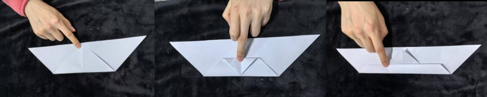
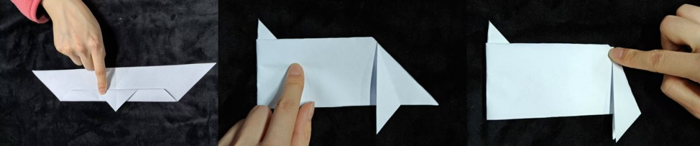
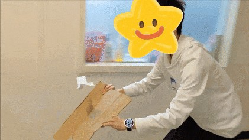

同样是待在天上，纸飞机、麻雀、火箭和卫星，靠的是一回事吗？

先剧透：**机翼要借助空气，火箭可以自己带着要喷出去的物质，而卫星入轨以后，主要靠的是速度与引力。** “飞起来”这三个字，藏着好几种不同的物理故事。

### 先看懂一架飞机身上的四支箭头

先看上下：重力把飞机往下拉，机翼与空气相互作用产生的升力，在平直飞行时主要向上。再看左右：发动机提供推力，空气带来阻力。图示的是**无风、平直、匀速**这个简单场景，不是任何姿态下都能把四支箭头照搬。

平飞不是“不受力”，而是合力为零。汽车匀速行驶也一样：发动机仍在工作，只是没有继续加速。

#### 升力不是“上面的空气必须赶上下面的空气”

机翼上下两股空气没有“必须同时到达尾缘”的约定。更可靠的理解是：机翼让周围气流改变方向，同时形成压力分布；综合起来，空气对机翼施加力。**压力分布的描述和空气动量变化的描述，是同一个过程的两种观察方式。**

升力垂直于相对来流，阻力沿着相对运动的反方向。平板在合适迎角下也能产生升力，并不一定非得长成“上鼓下平”的样子。继续增加迎角，也不是升力永远增加：气流可能明显分离，发生失速。详见 [NASA 对升力的解释](https://www1.grc.nasa.gov/beginners-guide-to-aeronautics/what-is-lift/)。

### 动物比我们更早把空气玩明白了

昆虫、翼龙、鸟类和蝙蝠，是动物演化史上独立演化出动力飞行的四大类群。它们的翅膀结构不同，却没有各自发明不同的物理定律：都需要与空气交换动量。

鸟会改变翅膀形状和姿态，拍翼既能贡献升力，也能贡献推力。滑翔时则可以暂时不拍翼，用高度换取维持运动所需的能量。羽毛能配合翼的运动调整形状，但不要把它想成“每一根羽毛都安装了独立遥控器”。

昆虫的拍翼常涉及明显的非定常流动，比如前缘涡。不同昆虫的扇翅频率、驱动肌肉和飞行方式差别很大，不能拿某一个数字代表全部，更不能据此推导“蜜蜂能负重自身几十倍飞行”。

直升机的旋翼也是旋转的机翼。它和鸟、昆虫可以互相启发，但不是把某一种昆虫简单放大，就造出了直升机。

### 纸飞机：不用发动机，为什么也能飞？

因为它通常没有“免费飞行”：你投出去时给了它速度，放飞的高度也储存着重力势能。它在下降中把势能转成运动，同时不断把能量交给空气。**升力不是凭空产生的能源。**

#### 一起做一架冲浪纸飞机

下面保留原来的折纸练习。用轻薄纸，折痕左右对称；剪裁由成人协助，不朝人脸投掷。

将纸折出三角形基础，再按图折叠机头和两侧机翼：

不要急着用力扔。先轻轻松手，观察它是俯冲、翻转，还是平稳滑下。每次只微调一个地方，比如翼后缘的折角，再比较结果。

拿一块大纸板在它下方、偏后的位置缓慢向前移动，让纸板附近的上升气流帮助它停留。空间要开阔，别倒着跑、别踩踏家具。

这时额外能量来自**你推动纸板所做的功**。所以它不是永动机，也不是“有机翼就永远不会掉下来”。这三个对照最值得玩：

| 只改这一项 | 先猜什么 | 观察什么 |
|---|---|---|
| 轻轻放飞或用力投掷 | 越用力一定越稳吗？ | 轨迹、翻滚与落点 |
| 两侧机翼是否对称 | 会往哪边偏？ | 偏航方向是否重复 |
| 纸板不动或向前移动 | 谁在补充能量？ | 飞机能停留多久 |

原有折纸照片在此作为操作示意保留；它们不承担升力机理或定量验证的任务。

### 飞得高，路程就会变成四倍吗？

网上有一种趣图：飞机在 33,000 英尺而不是 5,000 英尺的高度飞行，路程就要长好几倍。[Charles Petzold 讨论过这个错误](https://www.charlespetzold.com/blog/2025/01/Very-Wrong-Math.html)。

漏洞是忘记了地球半径。取平均半径约 6,371 千米，对应同一圆心角的两条圆弧，高度分别约 10.06 和 1.52 千米：

$$
\frac{6371+10.06}{6371+1.52}\approx1.00134
$$

只有约 **0.13%** 的几何差别，不是四倍。真实航程还受航路、风和空管等因素影响；这个算式只反驳“高度直接让路程翻倍”，不能单独算出真实飞行时间。

### 火箭：没有空气，拿什么“往后推”？

拿自己带着的物质。

火箭把气体高速向后喷出，火箭本体获得向前的动量变化。它不需要“踩着空气”，所以真空里也能工作。常见化学火箭还随身携带氧化剂，不必依靠外界氧气。

对比一下就清楚了：

| 装置 | 主要与什么交换动量？ | 真空里怎样？ |
|---|---|---|
| 机翼、螺旋桨 | 周围空气 | 没有空气就不能靠它们产生通常的气动力 |
| 化学火箭 | 自身携带并喷出的推进剂 | 可以产生推力 |
| 入轨后的卫星 | 大部分时间自由落体 | 不必一直开机“托着自己” |

[NASA 的火箭推力说明](https://www1.grc.nasa.gov/beginners-guide-to-aeronautics/rocket-thrust/)把“自带推进剂”和“吸入空气”的区别讲得很清楚。这里讨论航天原理，不涉及推进装置的自制实验。

### 卫星：不是不往下掉，而是不断绕着地球落

如果一个物体只有向上的速度，它最终会落回来；入轨还需要足够的**横向速度**。在合适条件下，它一边向地球落，一边向前运动，轨迹就能不断绕过地球。

“第一宇宙速度约 7.9 千米/秒”对应理想的近地表圆轨道模型。真实卫星有高度，速度随轨道而变，不能统一套用这个数。

| 场景 | 大致高度 | 周期举例 |
|---|---|---|
| 国际空间站附近的近地轨道 | 约 400 千米 | 约 90 多分钟 |
| GPS 卫星的中地球轨道 | 约 20,200 千米 | 约 12 小时 |
| 地球静止轨道 | 赤道上空约 35,786 千米 | 一个恒星日，约 23 小时 56 分 |

地球静止还要求近圆轨道、位于赤道平面并与地球自转同向，不是“任何绕一圈约一天的卫星都静止”。真实轨道也有扰动，需要维护；低轨卫星还会受到稀薄大气阻力。

### 奶爸说

和孩子一起探索飞行，最棒的从来不只是标准答案。

当纸飞机歪歪扭扭落下来，先别急着说“失败了”。问一句：**“这次它为什么往左偏，下次只改哪里？”**

那个想要飞起来的梦想，可以从这样一次小小的观察开始。

### 参考与延伸

- [NASA：What is Lift?](https://www1.grc.nasa.gov/beginners-guide-to-aeronautics/what-is-lift/)——升力方向、气流偏转和常见误解。
- [NASA：Rocket Thrust](https://www1.grc.nasa.gov/beginners-guide-to-aeronautics/rocket-thrust/)——火箭为什么可以在真空中工作。
- [Petzold：Very Wrong Math](https://www.charlespetzold.com/blog/2025/01/Very-Wrong-Math.html)——把飞行高度误当路径比例的趣例。
- [单独打开原创四力图](/assets/images/archive-guides/flight-forces.svg)——图中力的长度只用于表示平衡关系，不是实测数据。
