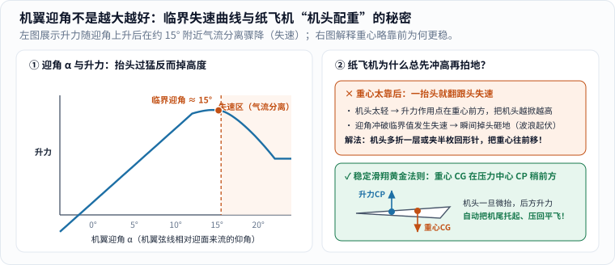
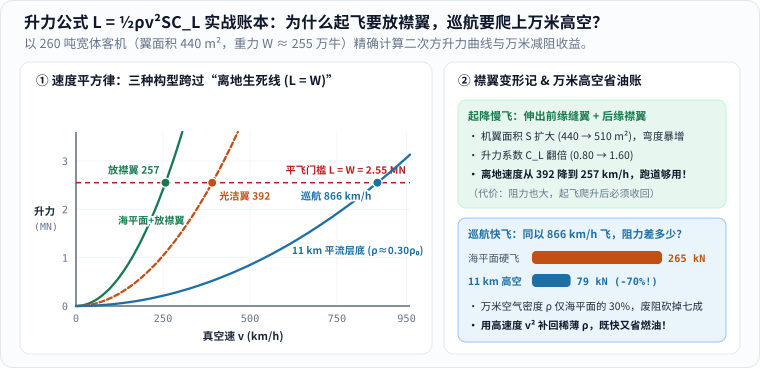
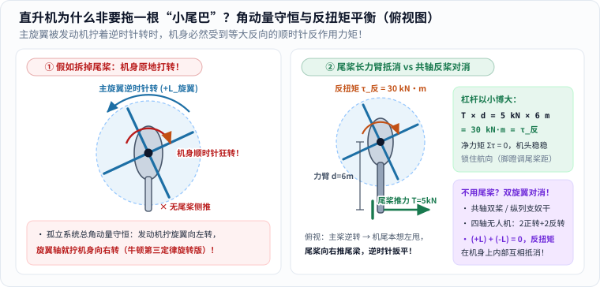
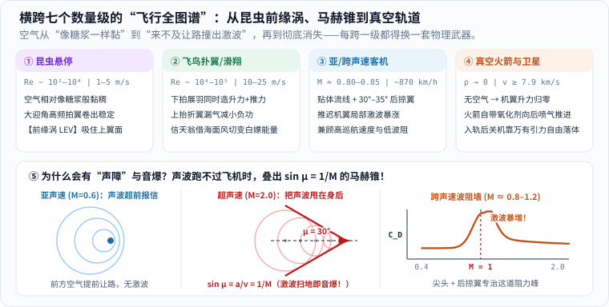
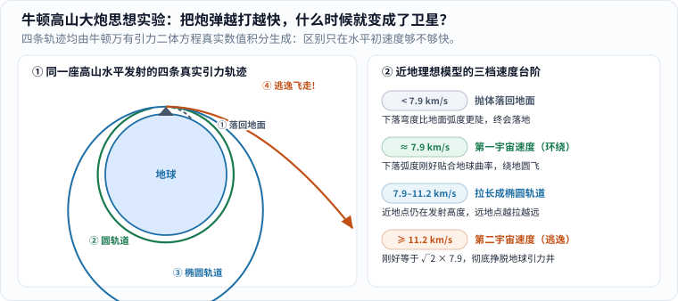

周末带娃去公园大草坪放风，只要抬头望十秒钟，你大概率能同时抓到好几种“待在天上”的家伙：树梢间扑棱翅膀的麻雀、草坪上空嗡嗡悬停的四轴航拍机、孩子刚脱手滑出去的纸飞机、万米高空拖着白烟掠过的银色客机；要是等到傍晚天色擦黑，头顶还可能有一颗不闪不烁的亮星匀速划过天际——那是飞在 $$400$$ 千米高空的中国空间站。

孩子仰着脖子问出的第一个问题，往往朴素得让人一愣：**“爸爸，它们怎么都不往下掉呀？靠的是同一种本事吗？”**

先剧透底牌：**完全不是一回事！** “飞起来”这三个字在日常汉语里共用一个词，但在物理学家的账本上，至少藏着三套截然不同的生存法则：

| 天上的主角 | 靠什么抵抗下坠？ | 主要和谁交换动量？ | 如果把周围空气瞬间抽干，会发生什么？ |
| --- | --- | --- | --- |
| **纸飞机、滑翔机** | 机翼气动升力（消耗初始动能或高度势能） | 周围的空气 | 升力瞬间归零，像石头一样沿抛物线砸向地面 |
| **昆虫、飞鸟、客机、直升机** | 扑翼 / 固定机翼 / 旋转桨叶的气动升力 | 周围的空气 | 升力与螺旋桨/涡扇推力双双归零，无法起飞 |
| **化学火箭** | 向后高速喷出燃气产生的反冲推力 | **自己随身携带的推进剂** | **反而推得更欢！** 没有空气阻力，喷管效率更高 |
| **入轨后的卫星与空间站** | **根本没有“托住自己”，一直在自由落体！** | 入轨后几乎不需推力，靠万有引力拐弯 | **毫发无损！** 本来就靠真空环境免除空气阻力长期绕转 |

顺着这张底牌表，我们从手边的纸飞机和客机机翼出发，一路拆解直升机的小尾巴、鸟和虫子的翅膀绝技、冲破声障的马赫锥，最后跟着火箭冲出大气层，把“飞行”这件事从地面一直算到太空。

---

### 一、先看懂飞机身上的四支箭头：平飞不是“不受力”，而是拔河打成平手

很多小朋友第一次画飞机受力图，会觉得：“飞机在天上既没往上蹿、也没往下掉，是不是重力消失了？”

恰恰相反，地球引力一刻也没松手。一架在万米高空**无风、平直、匀速**巡航的客机，身上时刻拴着两对方向相反的“拔河绳”（图 1）：

_图 1：先看上下——地球重力把飞机往下拉，机翼与空气相互作用产生的**升力**向上托；再看前后——发动机提供向前的**推力**，空气摩擦与压差带来向后的**阻力**。注意图示对应的是“无风、平直、匀速”基准场景，四支箭头两两抵消（合力为零），并非在爬升、转弯或无动力滑翔时都能原样照搬。[单独打开图片](/assets/images/archive-guides/flight-forces.svg)_

看这张图时，有两个连大人都常踩坑的细节值得先钉牢 [1]：

1. **匀速平飞不是“没有力”，而是合力为零**。就像汽车在高速公路上以 $$100\ \mathrm{km/h}$$ 匀速巡航时，发动机依然在持续烧油输出推力，只不过这股推力刚好用来抵消轮胎滚阻和迎面风阻，所以速度不再继续增加。飞机平飞时，$$\text{升力} = \text{重力}$$，$$\text{推力} = \text{阻力}$$，牛顿第一定律保证了它稳稳保持原有速度。
2. **升力永远垂直于“迎面相对气流”，不一定永远竖直朝上！** 空气动力学对升力（Lift）和阻力（Drag）的定义非常严格：把空气对飞机施加的总气动力拆成两个垂直分量——**垂直于相对来流方向的分量叫升力，顺着相对来流往后推的分量叫阻力** [1]。当纸飞机关掉动力斜向下滑翔时，迎面气流是从斜下方吹来的，此时“升力”其实微微斜向前上方，它向前倾斜的那个小分力，正好替没有发动机的纸飞机克服空气阻力！

---

### 二、撕掉课本里流传最广的假解释：机翼上下的空气，根本不会“约好在尾缘重逢”！

既然升力是空气给机翼的，那薄薄一片金属机翼划过空气，凭什么能凭空变出几百吨向上的托举力？

翻开不少老旧的少儿百科全书甚至中学教辅，你十有八九会读到下面这段听上去特别顺耳的“标准答案”：

> “机翼截面做成**上表面弯曲凸起、下表面平坦**的形状。迎面吹来的空气在机翼前缘一分为二，因为上面的弧线比下面的直线更长，为了**在机翼后缘同时重逢**，走上表面的空气就必须跑得更快；根据伯努利原理，流速越快压强越小，于是下表面高压把机翼往上顶起来了。”

这段话流传了近百年，连 NASA 格伦研究中心（Glenn Research Center）都专门在航空入门指南里辟出整章，给它贴上了头号错案标签——**“等时间谬误（Equal Transit-Time Fallacy）”** [2][3]！

为什么说它是错的？不需要高深数学，看一眼图 2 左半边的三个日常事实，这个假说当场就会碎成渣：

_图 2：先看左图——“上下两团空气必须在尾缘同时重逢”完全是没有物理依据的凭空想象，平板纸飞机、倒飞特技机与实测升力数值三条铁证就能直接推翻它；再看右图——真实风洞脉冲烟流显示，机翼上方的烟团不仅更快，而且**远远早于下方烟团冲过尾缘**（图中绿线在打开时动态演示一次上方气流的快速掠过，静态终态保留完整时刻对比）！[单独打开，刷新可重播](/assets/images/flight-physics/equal-transit-myth.svg)_

我们来挨个戳破左图的漏洞 [2][3]：

- **反例一：上下一样长的薄机翼照样飞得欢**。你手里的纸飞机，机翼就是一张上下表面长度分毫不差的白纸；1903 年莱特兄弟造出人类第一架动力飞机“飞行者一号”时，用的也是薄薄一层弯曲帆布翼（上下弧长几乎完全相等）[3]，可它们全都实打实地产生了充沛升力！甚至现代某些低阻超临界翼型，下表面的弧长比上表面还要长一点。
- **反例二：特技飞机“肚皮朝天”倒着飞怎么没掉下来？** 如果升力纯粹靠“上弧长、下平短”，那航展上的特技飞行员把飞机翻个身倒扣过来飞时，长弧跑到了底下，岂不是要被空气狠狠往下吸进地里？事实上，只要飞行员把机头相对来流微微昂起一个合适的仰角，倒扣的飞机照样能稳稳平飞！
- **反例三：定量一算，连零头都凑不够**。假如两团空气真的只是为了“同时到达尾缘”而拉开一点点速度差（比如上弧比下弦长 $$2\%\text{–}3\%$$），把这个微弱的速度差代进伯努利方程算出来的升力，连真实风洞实测升力的**十分之一**都不到 [2]！

#### 真实风洞里到底发生了什么？“伯努利派”和“牛顿派”其实是一家人！

当科学家在真实风洞里每隔几毫秒发射一排垂直的彩色脉冲烟雾（图 2 右），高清高速摄影拍下了让人大呼过瘾的一幕：

在机翼前缘被劈开的上下两小团相邻空气，**压根没有任何“尾缘约会协议”！** 走上表面的那团空气被前缘上方强烈的低压区猛烈加速，像坐了滑梯一样狂飙突进，**当它早就冲过机翼尾缘一大截时，走下表面的那团空气才慢吞吞挪到机翼肚子底下四分之三的位置** [2]！它们这辈子都不会在尾缘重新排成一列了。

那上表面为什么会形成这么强的低压高速区？科普圈里经常有人为此吵成两派——一派喊“全靠伯努利压差！”，另一派喊“伯努利没用，全靠牛顿第三定律往下拍空气！”。NASA 的空气动力学家给出的定论非常干脆：**别吵了，你们俩说的是同一个流场的同一件事！** [1][2]

1. **从机翼表面的“压强账本”看（欧拉方程与伯努利视角）**：当具有迎角或弯度的机翼切入气流时，下表面迎着来流把空气往下推挤，流速减慢、压强升高（$$p_{\text{下}} > p_\infty$$）；而上表面向后下方倾斜退让，贴着翼面走的气流被迫顺着弧面向下拐弯。流体要沿着弯曲流线拐弯，外侧大气压必须比贴近翼面的压强更高才能提供向心力——于是上表面上方自然形成一片强烈的**低压吸力区**（$$p_{\text{上}} < p_\infty$$），同时把这个区域的空气猛烈吸快（顺着流线满足伯努利关系：压强低处流速高）。实际上，**客机约三分之二以上的升力来自上表面低压区的“向上吸”，不到三分之一来自下表面高压区的“向上托”！**
2. **从机翼身后的“动量账本”看（牛顿第二、第三定律视角）**：既然上下两股气流顺着翼型走完后，整体都被机翼往斜下方掰弯了一个角度，在机翼身后留下一股实实在在向下倾泻的气流——航空上叫**下洗气流（Downwash）**。设机翼每秒钟把质量为 $$\dot{m}$$ 的一大团空气赋予向下的速度增量 $$\Delta v_y$$，根据牛顿第二定律，机翼对空气施加了向下的力 $$F_{\text{下}} = \dot{m}\Delta v_y$$；再按牛顿第三定律，这团被往下拨动的空气必然反过来给机翼一个等大反向、竖直向上的反作用力——那就是升力 $$L = \dot{m}\Delta v_y$$ [1]！

在流体力学里，把机翼表面每一小块面积上的上下压强差加起来（压强面积分），和把远处一整圈控制面上空气动量的向下变化率算出来（动量通量积分），是**从同一组流体运动方程推导出来的恒等式**。就像同一个苹果，你按“单价×重量”算钱，还是按“扫码枪总价”算钱，得出的账单分毫不差。

---

### 三、为什么机头抬太高反而会掉下来？看懂“迎角与临界失速”

搞懂了“机翼靠偏转气流产生升力”，很多读者马上会顺理成章地推导出一个危险的念头：**既然迎角越大，机翼把空气往下掰得越狠，那飞行员想紧急爬升时，把机头越往天上猛拉，升力岂不是越大？**

看一眼图 3 左半边那条像悬崖一样的曲线，你就明白为什么所有飞行员上第一堂课都要背诵“严禁超临界拉杆”了：

_图 3：先看左图——在约 $$0^\circ$$ 到 $$15^\circ$$ 的正常区间里，**迎角 $$\alpha$$**（机翼弦线与迎面相对来流的夹角）越大，机翼向下偏转空气的能力越强，升力也近似成正比攀升；可一旦越过约 $$15^\circ\text{–}16^\circ$$ 的临界迎角（因翼型而异），上表面的气流再也贴不住陡峭倾斜的翼面，突然成片撕裂剥离、碎成翻滚的乱流漩涡，升力断崖式暴跌、阻力成倍猛增，这就是**失速（Stall）**！右图则揭示了纸飞机配重稳定的秘密。[单独打开图片](/assets/images/early-curiosity/wing-lift-stall.svg)_

这里一定要帮孩子排掉一个字面误区：**航空里的“失速（Stall）”，绝不是“飞行速度变成零了”！** 一架飞到 $$500\ \mathrm{km/h}$$ 的喷气机，如果在急拉杆时让机翼迎角瞬间冲破了 $$16^\circ$$，哪怕速度表指针高得吓人，机翼上表面的低压吸力区也会因为气流分离而瞬间垮塌，飞机照样会像踩空楼梯一样猛地往下掉高度 [1]。反过来，遇到失速预警时，飞行员救命的第一反应绝不是继续往后死拉操纵杆抬头，而是**果断推杆低头减小迎角**，让气流重新贴回机翼表面！

想在家里零成本体验一次“迎角与气流分离”？打开家里的落地电风扇调到最大挡（切勿在行驶的汽车里把手伸出窗外！），把手掌平放对准风口：
- 当你把大拇指那一侧（前缘）微微向上昂起 $$5^\circ\text{–}10^\circ$$ 时，你会清晰感受到风在手背上方顺畅滑过，一股温柔而有力的托举感把整只手往上抬；
- 可当你贪心地把手掌猛竖到 $$40^\circ\text{–}45^\circ$$ 时，手背后面立刻变成乱糟糟的漩涡区，向上托的升力几乎消失殆尽，只剩下一股把手往后硬推的巨大阻力！

---

### 四、拆开升力公式 $$L = \frac{1}{2}\rho v^2 S C_L$$：为什么 260 吨客机起飞要“变形”，巡航却非要钻进万米高空？

定性看懂了气流偏转，我们再往前迈一小步，把空气动力学家压箱底的**升力方程**和**阻力方程**端上桌 [4][5]——别怕公式，它一共只有四个主角相乘，却能把机场跑道和万米高空的所有工程秘密一次算穿：

$$
L = \frac{1}{2}\rho v^2 S C_L, \qquad D = \frac{1}{2}\rho v^2 S C_D.
$$

把里面四个字母挨个认清（全部采用国际单位制）：
- **$$\rho$$（读作 rho，空气密度，单位 $$\mathrm{kg/m^3}$$）**：每立方米空气有多“瓷实”。海平面标准大气密度约为 $$\rho_0 = 1.225\ \mathrm{kg/m^3}$$（一立方米空气重约 $$1.2$$ 千克，比你想象的沉得多！）；到了 $$11$$ 千米高空，空气稀薄到只剩 $$\rho_{11} \approx 0.364\ \mathrm{kg/m^3}$$，不到海平面的三分之一。
- **$$v$$（真空速，单位 $$\mathrm{m/s}$$）**：飞机相对周围空气穿行的速度。**千万盯住它头顶那个平方 $$v^2$$！** 速度翻 $$2$$ 倍，动压 $$\frac{1}{2}\rho v^2$$ 直接翻 **$$4$$ 倍**；速度翻 $$3$$ 倍，升力和阻力潜力直接暴涨 **$$9$$ 倍** [4]！
- **$$S$$（机翼参考面积，单位 $$\mathrm{m^2}$$）**：俯瞰机翼展开的投影面积。一架双通道宽体大客机（如空客 A350 或波音 777 级别），一对翅膀摊开的面积大约在 $$440\ \mathrm{m^2}$$ 左右，足足相当于三套大平层住宅或一整个标准篮球场！
- **$$C_L$$ 与 $$C_D$$（无量纲升力系数与阻力系数）**：把翼型弯度、迎角 $$\alpha$$、表面光滑度等几何因素打包浓缩成的“抓气本领分” [4][5]。正常巡航小迎角下 $$C_L$$ 大约只有 $$0.5\text{–}0.6$$；通过改变机翼弯度和迎角，可以把它调高。

现在，我们拿一架满载起飞后约 **$$260$$ 吨**（重力 $$W = mg \approx 2.55\times 10^6\ \mathrm{N}$$，即 $$255$$ 万牛顿）、翼面积 $$S = 440\ \mathrm{m^2}$$ 的宽体客机来算两笔真金白银的工程账（图 4）：

_图 4：左图严格按 $$L = \frac{1}{2}\rho v^2 S C_L$$ 绘制三条二次方抛物线，红色水平虚线是托起 $$260$$ 吨机身所需的 $$2.55\ \mathrm{MN}$$ 生死门槛；右图算清了为什么起飞降落必须伸出襟翼、而巡航时又必须收起襟翼爬上 $$11$$ 千米平流层底。[单独打开图片](/assets/images/flight-physics/lift-speed-altitude.svg)_

#### 第一笔账：起飞和降落跑得慢，怎么防止掉下来？——靠“机翼变形术”！

坐在靠窗座位起飞或降落前，你一定听见过机翼肚子里传来一阵“嗡嗡嗡”的液压电机声，紧接着整片机翼前缘往外探出一溜窄缝板（**前缘缝翼 Slats**），后缘更是往后下方滑出好几层巨大的弯折板（**后缘襟翼 Flaps**），原本光滑紧凑的翅膀一下子变得像鹰爪一样张开。

为什么要费这么大劲变形？看图 4 左边的橙色虚线和绿色实线：
- 假如客机起飞时**不放襟翼**（保持巡航时的光洁机翼 $$S = 440\ \mathrm{m^2}$$，安全迎角下取 $$C_L = 0.80$$），代进 $$L = W$$ 反解离地速度：

$$
v_{\text{光洁}} = \sqrt{\frac{2W}{\rho_0 S C_L}} = \sqrt{\frac{2\times 2.55\times 10^6}{1.225\times 440\times 0.80}} \approx 108.8\ \mathrm{m/s} \approx 392\ \mathrm{km/h}
$$

接近 $$400\ \mathrm{km/h}$$ 的地面狂飙！且不说普通国际机场 $$3{,}000\text{–}3{,}800$$ 米的跑道根本刹不住万一中断起飞的巨无霸，单是起落架橡胶轮胎在地面承受这个转速就会直接爆胎解体！
- 而一旦把前缘缝翼和后缘襟翼全部放出来，机翼有效面积 $$S$$ 扩大到约 $$510\ \mathrm{m^2}$$，大幅下弯的翼面更把升力系数 $$C_L$$ 直接翻倍推高到 $$1.60$$（大型三开缝襟翼甚至可达 $$2.0$$ 以上）。重新代入公式一算：

$$
v_{\text{襟翼}} = \sqrt{\frac{2\times 2.55\times 10^6}{1.225\times 510\times 1.60}} \approx 71.4\ \mathrm{m/s} \approx 257\ \mathrm{km/h}
$$

**离地与接地速度一下子砍掉了 $$135\ \mathrm{km/h}$$！** 这就是为什么几百吨的大铁鸟能在短短两三千米跑道上从容拉起、稳稳接地。当然，天下没有白吃的午餐——张开的襟翼同时会让空气阻力暴增（降落时这反而是好事，正好帮忙减速），所以起飞爬升到安全高度和速度后，飞行员第一件事就是把襟翼全部收进机翼肚子里，恢复流线型身材。

#### 第二笔账：万米高空空气少了七成，客机干嘛非要往稀薄的地方钻？

紧接着第二个灵魂追问来了：既然升力正比于空气密度 $$\rho$$，海平面空气最浓，爬到 $$11$$ 千米高空（对流层顶 / 平流层底）空气密度跌到了 $$\rho_{11} = 0.364\ \mathrm{kg/m^3} \approx 0.30\,\rho_0$$，升力岂不是凭空丢了七成？客机为什么要花二十多分钟死命往上爬？

答案藏在那个既能造升力、也会造阻力的双刃剑——$$\frac{1}{2}\rho v^2$$ 里（图 4 右下）！

我们坐长途飞机最核心的诉求是什么？**既要飞得快（比如 $$850\text{–}900\ \mathrm{km/h}$$），又要省燃油！**
- 假如一架客机非要赖在空气浓稠的海平面（$$\rho_0 = 1.225\ \mathrm{kg/m^3}$$）硬开到 $$866\ \mathrm{km/h}$$（$$240.6\ \mathrm{m/s}$$），会发生什么灾难？取光洁机身与机翼的零升寄生阻力系数 $$C_{D0} \approx 0.017$$，它在海平面受到的迎风废阻高达：

$$
D_{0,\text{海平面}} = \frac{1}{2}\rho_0 v^2 S C_{D0} \approx 0.5\times 1.225\times 240.6^2\times 440\times 0.017 \approx 265\ \mathrm{kN}
$$

足足 $$26.5$$ 吨的恐怖迎面风阻，两台发动机开满加力都得烧成“油老虎”，机身还会被低空浓密湍流颠得像筛糠！
- 反过来，爬到 $$11$$ 千米高空后，空气密度 $$\rho_{11}$$ 降到了海平面的 $$29.7\%$$。同样以 **$$866\ \mathrm{km/h}$$** 巡航，迎风寄生阻力瞬间同比例砍掉七成，只剩 **$$79\ \mathrm{kN}$$**！那升力够不够托住 $$260$$ 吨机身呢？看图 4 左边的蓝色曲线：虽然 $$\rho$$ 变成了原来的 $$0.30$$ 倍，但速度 $$v$$ 从起飞时的 $$257\ \mathrm{km/h}$$ 涨到了 $$866\ \mathrm{km/h}$$（$$v^2$$ 暴涨了 **$$11.4$$ 倍**！），只用最省力的黄金巡航升力系数 $$C_L = 0.55$$，升力就稳稳重新顶到了 $$2.55\ \mathrm{MN}$$！再加上平流层底部没有上下翻腾的积雨云，涡扇发动机在低温进气下热效率也更高——**万米高空，正是高速与低阻完美握手的“黄金甜蜜点”**。

#### 顺手戳破一个网红错题：飞在万米高空，圆弧路程会变成低空的四倍吗？

网上曾经疯传过一张让人哭笑不得的漫画：画了一个小地球，上面画一圈 $$5{,}000$$ 英尺（约 $$1.52\ \mathrm{km}$$）的低空航线，再在外圈画一圈夸张放大四倍的 $$33{,}000$$ 英尺（约 $$10.06\ \mathrm{km}$$）高空航线，质问航空公司“为什么非要飞高空绕远路浪费乘客时间？”（著名科普作家 [Charles Petzold 专门撰文调侃过这个数学笑话](https://www.charlespetzold.com/blog/2025/01/Very-Wrong-Math.html) [7]）。

漏洞在哪？画图的人忘了**地球半径 $$R_E \approx 6{,}371$$ 千米**是个多么庞大的基数！对应同一个圆心角的两条同心圆弧，真实长度之比等于它们到地心的半径之比：

$$
\frac{6371 + 10.06}{6371 + 1.52} = \frac{6381.06}{6372.52} \approx 1.00134.
$$

**只多了 $$0.134\%$$！** 也就是说，哪怕飞一趟 $$10{,}000$$ 千米的跨洋航线，万米高空因为圆弧变大而多出来的几何路程也只有区区 **$$13.4$$ 千米**——客机巡航不到一分钟就飞完了，换来的却是整趟航程快了三倍、省下几十吨航空煤油！

---

### 五、直升机与无人机：没有跑道也能悬停，为什么尾巴上非要拖个小螺旋桨？

客机必须先在跑道上狂奔到两百多千米每小时，机翼才能攒够相对气流 $$v$$。那救援直升机和草坪上的航拍无人机，机身一动不动悬在半空（对地速度为零），升力又是从哪儿变出来的？

秘密很简单：**机身不跑，让细长的机翼自己绕着头顶转轴高速兜圈跑！** 直升机头顶那几片长长的旋翼（Rotor Blades），切开看截面就是标准的翼型。哪怕机身悬停在原地，只要发动机带着半径七八米的旋翼以每秒五六圈的速度旋转，桨尖划过空气的线速度照样高达 $$200\ \mathrm{m/s}$$（$$700\ \mathrm{km/h}$$ 以上），源源不断地把头顶空气往下压，稳稳托起整架直升机 [8]。

但只要你仔细观察过单旋翼直升机，一定会好奇：**头顶大旋翼负责往上托就够了，为什么几乎每架直升机都在长长的尾巴末端，竖着装一个朝侧面吹风的小尾桨？万一那个小尾桨坏了会怎样？**

电影里尾桨中弹后直升机像陀螺一样在空中疯狂打转的画面，一点都没夸张——这背后是物理学里铁面无私的**角动量守恒定律**与牛顿第三定律旋转版（图 5）：

_图 5：从直升机正上方往下俯视——左图展示假如拆掉尾桨，发动机拧着主旋翼逆时针旋转（获得逆时针角动量 $$+L_{\text{旋翼}}$$）的同一瞬间，旋翼轴必然反过来给机身施加等大反向的**反作用力矩（反扭矩）**，把机舱拧得顺时针疯狂打转；右图算清了长尾梁怎样用“四两拨千斤”的杠杆力臂锁住航向。[单独打开图片](/assets/images/flight-physics/helicopter-torque-balance.svg)_

想象你脚穿冰刀站在绝对光滑的冰面上，双手举起一把沉重的大雨伞，用力把雨伞往逆时针方向拧转——雨伞转起来的瞬间，你自己的身体一定会控制不住地往顺时针方向打转！悬在半空的直升机周围除了空气没有任何支点，就是这个冰面上的你 [8]：

- 拿一架典型中型直升机来算定量账：发动机输出轴功率 $$P = 900\ \mathrm{kW}$$，驱动主旋翼以角速度 $$\Omega = 30\ \mathrm{rad/s}$$（约每分钟 $$286$$ 转）逆时针旋转。由旋转功率公式 $$P = \tau \Omega$$，发动机施加给旋翼轴的驱动力矩、以及机身同时承受的顺时针**反扭矩**高达：

$$
\tau_{\text{反}} = \frac{P}{\Omega} = \frac{900{,}000\ \mathrm{W}}{30\ \mathrm{rad/s}} = 30{,}000\ \mathrm{N\cdot m}\ (= 30\ \mathrm{kN\cdot m}).
$$

这相当于在距离转轴 $$1$$ 米远的地方挂上 **$$3$$ 吨重物**死死横着拽机身！没有反制手段，飞行员在座舱里三秒钟就会被转晕。
- **解法一（单旋翼 + 长尾梁尾桨）**：工程师往机身后面伸出一根长达 $$d = 6.0\ \mathrm{m}$$ 的细长尾梁（图 5 右）。俯视主旋翼逆时针转时，顺时针反扭矩本想把机头往右拧、把机尾往左甩；尾桨装在尾梁末端向右侧吹气产生向右的侧推力 $$T_{\text{尾}}$$，只需：

$$
T_{\text{尾}} = \frac{\tau_{\text{反}}}{d} = \frac{30{,}000\ \mathrm{N\cdot m}}{6.0\ \mathrm{m}} = 5{,}000\ \mathrm{N}\ (= 5\ \mathrm{kN})
$$

就能制造出一个 $$30\ \mathrm{kN\cdot m}$$ 的逆时针恢复力矩，让全机净力矩 $$\Sigma\tau = 0$$！飞行员双脚踩住座舱里的两块**反扭矩脚蹬**，稍微调大或调小尾桨桨叶的迎角，就能自如地让机头原地左转或右转 [8]。
- **解法二（双旋翼反桨对消）**：如果不想让尾桨白白消耗约 $$5\%\text{–}10\%$$ 的发动机功率呢？那就装**两组转向相反的旋翼**！比如卡莫夫直升机的上下共轴反转双旋翼、“支奴干”运输机的前后纵列双旋翼，还有孩子们在公园玩的**四轴航拍无人机**——仔细看无人机的四个螺旋桨，对角线上的两只正转、另外两只反转，两组反扭矩在机架内部直接 $$(+\tau) + (-\tau) = 0$$ 互相抵消，所以连尾巴都省掉了！

---

### 六、动物比人类早三亿年把空气玩明白了——那人绑两块大纸板为什么飞不起来？

在人类造出飞机之前漫长的三亿多年里，地球生命史上先后有四个类群独立演化出了真正的动力飞行能力：**昆虫（约 3.5 亿年前）、翼龙（约 2.3 亿年前）、鸟类（约 1.5 亿年前）和哺乳纲的蝙蝠（约 5000 万年前）**。它们骨骼与翅膀构造天差地别，却没有谁能绕开动量守恒：全都得靠巧妙拨动空气来谋生 [9]。

#### 1. 飞鸟的“非对称扑翼魔术”与信天翁的“海面风切变白嫖术”

客机把任务分得很死：**固定机翼只管向上造升力，翼下吊着的涡扇发动机只管向前造推力**。可麻雀和白鸽身上没有涡扇发动机，一对翅膀如果只是直上直下傻拍，向下拍得多少升力，向上抬就会受多少向下的负升力，原地抵消！鸟是怎么破解这个死结的？

慢动作高速摄像机拍下了飞鸟羽毛与关节的绝妙配合 [9]：
- **下拍做功冲程（Downstroke）**：翅膀完全舒展摊平，翼尖一排坚韧的**初级飞羽**在风压下紧密搭扣成一张不透风的大帆，同时整片翅膀前缘微微向下扭转——这一掌斜向后下方拍出去，空气反推翅膀的合力指向**前上方**，**一举两得地同时包揽了向上的升力和向前的推力！**
- **上抬回位冲程（Upstroke）**：手腕与肘关节顺势弯曲收拢翅膀（大幅缩小迎风面积 $$S$$），在慢速起飞或悬停时，初级飞羽还会像百叶窗叶片一样微微扭转裂开缝隙让气流漏过去，把上抬带来的向下阻力和负功压到最低。
- **信天翁的“无油续航神话”**：翼展超过 $$3$$ 米的漂泊信天翁，可以连续几星期不拍一下翅膀横跨南大洋上万千米！它可不是在做消耗高度的普通滑翔，而是练成了一门叫**动态翱翔（Dynamic Soaring）**的绝活：海面附近因为波浪摩擦风速较慢，往高处走十几米风速骤增（存在强烈的垂直**风切变**）。信天翁先迎着风从低空慢风层刺入高空快风层（相对空速突然暴涨，白赚一笔升力爬高），到了高处调头顺着快风俯冲加速，落回低空慢风层再调头迎风拉起——周而复始地从高低两层海风的速度差里“榨取”动能！

#### 2. 破除“科学家算不出大黄蜂怎么飞”的老谣言：昆虫前缘涡（LEV）

你可能听过一句很有名的鸡汤谣言：“空气动力学家算完大黄蜂的翅膀面积和拍频，断定大黄蜂按物理定律根本飞不起来，但大黄蜂不懂物理，照飞不误。”

这其实上世纪三十年代餐巾纸上的一句玩笑误传 [9]：当年有人拿**固定翼飞机的稳态平飞公式**去硬套大黄蜂的翅膀，当然算不够升力！到了 1990 年代，剑桥大学的埃灵顿（Charles Ellington）与加州理工的迪金森（Michael Dickinson）把放大的机器昆虫翅膀放进流体槽测量，彻底看清了昆虫压箱底的秘密武器——**前缘涡（Leading-Edge Vortex, LEV）** [9]：

对几毫米长的果蝇或几厘米的蜜蜂来说，由于体型极小、特征尺度极短（流体力学里的**雷诺数 $$\mathrm{Re} \sim 10^2\text{–}10^4$$**，比客机的 $$10^7\text{–}10^8$$ 小了上万倍），周围空气在它们感觉里黏稠得像稀糖浆一样。昆虫以高达 $$30^\circ\text{–}45^\circ$$ 的超大迎角高频扇翅（蜜蜂每秒约 $$200$$ 次，蚊子可达 $$600$$ 次以上），按客机的标准早就该失速了；但在小尺度旋转拍击下，翅膀前缘卷起的强烈低压漩涡（**前缘涡**）顺着翼展方向排走涡量，稳稳吸附在翅膀背上不脱落，像一对强力真空吸盘一样源源不断地把虫子往上吸！不过也要注意科学边界：不同昆虫的间接飞行肌与承载力差异很大，千万别轻信“蜜蜂能背起自身几十倍重物飞行”的夸张网文（工蜂满载花蜜通常也只接近自身体重的几成到一倍左右）。

#### 3. 为什么人类在胳膊上绑两扇大羽毛翅膀，绝对飞不起来？

古希腊神话里的伊卡洛斯用蜡粘羽毛飞上蓝天，中世纪也有无数勇敢者绑着木框布翼从高塔往下跳——为什么无一例外全都摔了下来？

算一笔冷酷的**功率重量比账**就全明白了：
- 一只擅长飞行的鸟，全身最发达的引擎是胸口那两块巨型肌肉——负责下拍的**胸大肌**和穿过骨滑轮负责上抬的**乌喙上肌**，光这两块肌肉就占了整只鸟体重的 **$$15\%\text{–}25\%$$**，骨骼中空轻巧，胸骨中央还高高隆起一块用来挂肌肉的**龙骨突**；
- 反观一个 $$70\ \mathrm{kg}$$ 的成年人类，胸大肌重量还不到体重的 **$$1\%\text{–}2\%$$**！就算换成环法自行车冠军用全身最强壮的大腿肌肉拼命蹬踏板，人类持续输出的机械功率也只有区区 **$$250\text{–}350\ \mathrm{W}$$**（还不到半台微波炉的功率！）。1979 年，人类历史上真正靠自身体力飞越英吉利海峡的传奇人力飞机“轻羽信天翁号”（*Gossamer Albatross*），整架飞机碳纤维骨架加透明塑料薄膜只敢造到 **$$32\ \mathrm{kg}$$**，翼展却不得不拉长到惊人的 **$$29.8$$ 米**（比波音 737 翼展还宽！），由顶尖自行车手贴着海面拼死蹬了近三小时才勉强过关。靠两条胳膊扇两块硬纸板想飞上天？我们的胸肌功率差了不止十倍！

---

### 七、动手实验室：折一架“冲浪纸飞机”与三秒钟调参急救箱

既然胳膊扇不动自己，我们就把空气动力学浓缩进一张 A4 纸里！纸飞机没有发动机，凭什么也能滑出十几米远？

因为它绝不是“免费飞行”：要么你脱手投掷时先给了它一笔**初始动能**，要么你站在高处松手先存了一笔**重力势能**。它在缓缓下降的滑翔途中，不断把高度势能兑换成维持空速的能量，再去克服空气阻力做功——**升力只负责改变运动方向、延缓下坠，升力自己绝不是凭空造能量的永动机。**

#### 1. 一起折一架冲浪纸飞机（保留经典亲子实操）

用轻薄对称的折纸，折痕尽量压平、左右完全对称；如需剪裁请由成人协助，严禁朝着他人脸部或眼睛投掷。

将纸折出三角形基础，再按图折叠机头和两侧机翼：

折好后先别急着用蛮力往前猛甩！用两根手指捏住机身底部，水平轻轻松手或柔和推出，观察它是优雅平缓地滑下，还是猛抬头翻跟头、或是直直扎向地板。每次只微调一个变量，再做对比：

如果家里有宽敞无障碍的客厅或体育馆，还可以解锁上面这张照片里的神奇玩法——**人工斜坡上升气流冲浪**！拿一块平整的大硬纸板，斜着举在滑翔纸飞机的后下方缓慢向前跟进：你向前推动倾斜纸板时，纸板前上方被迫向上隆起一股持续的**上升气流**（和山坡迎风面托起滑翔伞的“坡面升力”一模一样！），纸飞机就能像踩在看不见的浪头上一样迟迟不落地。注意场地务必开阔，切勿倒退奔跑或攀爬家具；此时维持飞行的额外能量，完全来自**你推动大纸板对空气所做的功**。

这三组亲子对照实验最能帮孩子建立科学控制变量的直觉：

| 每次只改这一项 | 动手前先猜一猜 | 放飞后重点观察什么 |
| --- | --- | --- |
| 轻轻平推 vs 拼命用力猛掷 | 用力越大一定飞得越远越稳吗？ | 是否一出手就猛翻跟头失速拍地？ |
| 左右机翼折角是否完全对称 | 一边高一边低会往哪边拐？ | 滚转与偏航方向在五次试飞中是否稳定重复？ |
| 大纸板静止不动 vs 斜推跟进 | 究竟是谁在给纸飞机“续费”能量？ | 飞机滞空时间差了几倍？ |

#### 2. 纸飞机“调参急救箱”：为什么机头夹半枚回形针立刻变稳？

折好纸飞机一脱手，十架里有八架会犯下面这两种“毛病”。回看前面**图 3 右半边**的重心与压力中心关系，你花三秒钟就能当场修好它：

- **病症一：一脱手就猛地往天上蹿高，在最高点顿住、翻个跟头栽向地板（波浪过山车轨迹）**。
  - **病因诊断**：**机头太轻、全机重心（CG）落在了机翼升力合作用点（压力中心 CP）的后面！** 一旦飞起来产生升力，跑在重心前面的升力就像一只手抓着机头往上掀，迎角瞬间冲破 $$15^\circ$$ 临界线发生**失速**；失速后掉头俯冲攒回速度，又再掀起来失速，循环往复。
  - **三秒处方**：把机头往里多折厚一层，或者在机鼻尖上夹半枚小小的回形针（或贴一小截透明胶带），让**重心稳稳挪到压力中心稍靠前一点的位置**。这样一旦阵风让机头微抬，落在重心身后的升力就会自动把机尾往上托、把机头温柔压回原位——航空工程上这叫**纵向静稳定（Static Longitudinal Stability）**，所有客机配载货物和排座位时都要死守这条铁律！
- **病症二：姿态倒是不翻滚了，但像标枪一样直愣愣往地板上猛扎**。
  - **病因诊断**：重心已经够靠前了，缺少一点点持续抬起机头的配平力矩。
  - **三秒处方**：用大拇指和食指把两侧机翼**最后缘向上轻轻捏起一丁点（仅需 `1–2 毫米` 的微翘折边！）**。迎面气流撞上微翘的后缘，把机尾轻轻往下压，机头自然就昂起来进入完美滑翔角了——这就是真飞机水平尾翼上**升降舵（Elevator）**的原版物理！

---

### 八、冲破“声障”与飞出大气层：马赫锥、化学火箭与“永远掉不进地面”的卫星

从昆虫翅膀的几米每秒，到万米客机的 $$866\ \mathrm{km/h}$$，如果我们继续踩油门把速度推向每秒几百米甚至每秒好几千米，空气和引力的脾气又会发生两次天翻地覆的剧变（图 6）：

_图 6：上方四张卡片串联起从低雷诺数黏性涡流到真空自由落体的四大飞行疆域；下方用精确几何揭示了“声障”与音爆的来历——当飞行速度达到声速 $$2$$ 倍（$$M = 2.0$$）时，一圈圈落后于机头的球面声波恰好相切叠出半顶角 $$\mu = \arcsin(1/2) = 30^\circ$$ 的圆锥形激波面！[单独打开图片](/assets/images/flight-physics/flight-regimes-map.svg)_

#### 1. 什么是“马赫”与“声障”？为什么超声速战机全长着尖鼻子和后掠三角翼？

新闻里常说战斗机飞到了“$$2$$ 马赫”，客机巡航在“$$0.82$$ 马赫”。**马赫数（Mach Number, $$M$$）**就是飞行速度 $$v$$ 与当地空气声速 $$a$$ 的比值：$$M = v / a$$ [10]（海平面 $$15^\circ\mathrm{C}$$ 时声速约为 $$340\ \mathrm{m/s} \approx 1{,}224\ \mathrm{km/h}$$；到了零下五十多度的万米高空，温度越低声速越慢，降到约 $$295\ \mathrm{m/s} \approx 1{,}062\ \mathrm{km/h}$$）。

为什么声速 $$a$$ 是一道如此特殊的分水岭？因为**声波，本质上就是空气分子互相碰撞传递微小压强扰动的最高通报速度** [10][11]（见图 6 下半部分）：
- **亚声速飞行（$$M < 1$$，如图左 $$M = 0.6$$）**：飞机发出的压强波跑得比飞机自己快，一圈圈向外扩散的波前永远赶在机头前头给远处的空气分子“通风报信”，前方空气提前优雅地向两侧分流让路。
- **跨声速“波阻墙”（$$M \approx 0.8\text{–}1.2$$，如图右曲线）**：当飞机接近 $$1$$ 马赫时，机翼上表面加速后的局部气流率先跨过声速，空气分子根本来不及提前让路，被硬生生挤压成一道极薄的压强密度突变面——**激波（Shock Wave）**。激波带来剧烈的能量耗散，让阻力系数 $$C_D$$ 突然陡增好几倍（图 6 右下橙色尖峰），早期螺旋桨战机俯冲到这里时剧烈抖动、操纵变僵，飞行员觉得像撞上了一堵看不见的墙，才起了**“声障（Sound Barrier）”**这个名字。现代喷气客机和战机把翅膀向后斜掠 $$30^\circ\text{–}60^\circ$$（**后掠翼**）并削尖机头，正是为了推迟和削弱这道激波阻力峰！
- **超声速马赫锥（$$M > 1$$，如图中 $$M = 2.0$$）**：一旦真正冲破 $$1$$ 马赫，机头跑得比自己发出的声波还快！过去每一时刻在身后留下的球面声波统统被甩在屁股后面，它们的外公切面严丝合缝地叠成一个圆锥壳——**马赫锥（Mach Cone）** [11]。用初中直角三角形正弦就能算出锥面半顶角 $$\mu$$：在时间 $$\Delta t$$ 内，声波向外扩开半径 $$a\Delta t$$，机头向前冲出斜边 $$v\Delta t$$，于是：

$$
\sin\mu = \frac{a\Delta t}{v\Delta t} = \frac{a}{v} = \frac{1}{M}.
$$

当 $$M = 2.0$$ 时，$$\sin\mu = 1/2$$，马赫锥半顶角分毫不差等于 **$$30^\circ$$**！飞得越快，圆锥越尖瘦。注意：**“音爆（Sonic Boom）”并不是飞机刚突破 $$1$$ 马赫那一秒才响一声的鞭炮**——只要飞机保持超声速飞行，它身后就一直拖着这把看不见的圆锥激波扫帚，扫帚边沿扫过地面哪座城市，哪里的窗户就会听见“轰隆”一声巨响！

#### 2. 化学火箭：太空里连一个空气分子都没有，它拿什么“往后蹬”？

顺着高度继续往上走，越过 $$100$$ 千米高空的卡门线进入太空，空气密度 $$\rho \to 0$$。此时无论是纸飞机、大黄蜂的前缘涡、客机的大机翼还是直升机的旋翼，统统变成了废铁；依赖吸入空气助燃的涡扇喷气发动机也当场熄火 [6]。

那火箭凭什么能在漆黑的真空里照样点火加速？**靠扔自己兜里揣着的物质！**

看一眼 NASA 给出的广义火箭推力方程 [6]：

$$
F = \dot{m} V_e + A_e (p_e - p_0).
$$

方程里压根没有“外界空气质量”这一项！化学火箭自己背着两个大罐子——一罐装燃料（如液氢、煤油或液甲烷），另一罐装**氧化剂（液氧）**，在燃烧室里剧烈燃烧产生高温高压燃气，经过先收窄到喉部（恰好达到 $$M = 1$$ 声速壅塞）、再向外扩张成大喇叭口的**拉瓦尔喷管**，把燃气加速到惊人的超声速 $$V_e$$（通常每秒 $$3\text{–}4.5$$ 千米）向后猛喷出去 [6]。火箭每秒向后抛出质量 $$\dot{m}$$ 的燃气，燃气就按动量守恒反过来给火箭本体向前的推力 $$\dot{m}V_e$$；到了真空里，外界大气背压 $$p_0 = 0$$，第二项压力推力 $$A_e(p_e - 0)$$ 不仅没丢，**反而比在地面大气压挤压下推力更大！**（注意：此处仅讨论航天推进物理原理，切勿在家尝试任何自制火药或推进剂实验。）

#### 3. 卫星与空间站：不是“飘在天上不掉”，而是每秒往下掉 4.9 米却永远砸不中地球！

最后一步最颠覆直觉：火箭烧了几分钟燃料把卫星送入几百千米高空、关掉发动机分离之后，卫星既没有机翼升力，也不再喷火推进，而且那里的地球重力足足还有地面的近 **$$89\%$$**——它怎么不掉下来呢？

真相是：**它一秒钟都没停，一直在拼命往地球上掉！只不过它横着跑得太快，掉下去的弧度刚好和球形大地往下弯曲退让的弧度一模一样！**

牛顿在 1687 年《自然哲学的数学原理》里画过那个千古绝妙的思想实验——**高山大炮**（图 7）：假设在一座高出大气层、完全没有空气阻力的高山顶上架起一门大炮，水平向前发射炮弹：

_图 7：左图四条曲线由牛顿万有引力二体方程真实数值积分算出——① 初速不够快（如 $$4\ \mathrm{km/s}$$），炮弹画条弧线砸回地面；② 水平初速刚好达到近地第一宇宙速度（约 $$7.9\ \mathrm{km/s}$$），炮弹每秒自由落体下坠约 $$4.9$$ 米，而球形地球表面每向前延伸 $$7.9$$ 千米也恰好向下弯曲退让 $$4.9$$ 米，于是炮弹永远“掉不进地面”，化作贴地圆轨道卫星；③ 再快一点（$$7.9\text{–}11.2\ \mathrm{km/s}$$），轨道拉长成闭合椭圆；④ 达到 $$\sqrt{2}\times 7.9 \approx 11.2\ \mathrm{km/s}$$（第二宇宙速度），彻底挣脱地球引力飞向深空！[单独打开图片](/assets/images/early-curiosity/newton-cannon-orbits.svg)_

设地球质量为 $$M_E$$、卫星到地心的轨道半径为 $$r$$，让万有引力恰好充当圆周运动的向心力 $$\frac{GM_E m}{r^2} = \frac{mv^2}{r}$$，一行代数就能解出圆轨道环绕速度：

$$
v = \sqrt{\frac{GM_E}{r}}.
$$

看清分母里的 $$r$$：“第一宇宙速度约 $$7.9\ \mathrm{km/s}$$”是把地球半径 $$R_E \approx 6{,}371\ \mathrm{km}$$ 直接代入的理想近地表圆轨极限。真实的卫星都飞在大气层外，**离地越高 $$r$$ 越大，地球拉得越松，在轨巡航速度反而越慢**（但从地面爬出引力井要交更多势能买路钱，所以发射高轨卫星反而更费大火箭！想把这两个经典追问彻底算透，强烈推荐接着读本站姊妹篇《[飞得越高反而越慢？从发射卫星读懂三大宇宙速度]()》与《[地球引力明明还在，空间站里为什么会失重？]()》）：

| 典型航天器场景 | 大致离地高度 | 在轨运行速度与绕地周期 |
| --- | --- | --- |
| **中国空间站 / 国际空间站（近地轨道 LEO）** | 约 $$400$$ 千米 | 速度约 $$7.67\ \mathrm{km/s}$$，约 $$92$$ 分钟绕地球一圈（一天看 16 次日出！） |
| **GPS / 北斗主力导航卫星（中圆地球轨道 MEO）** | 约 $$20{,}200\text{–}21{,}500$$ 千米 | 速度约 $$3.8\text{–}3.9\ \mathrm{km/s}$$，周期约 $$12$$ 小时左右 |
| **风云四号等地球静止气象/通信卫星（GEO）** | 赤道正上空约 $$35{,}786$$ 千米 | 速度仅约 $$3.07\ \mathrm{km/s}$$，周期恰好等于一个恒星日（$$23$$ 小时 $$56$$ 分 $$04$$ 秒） |

顺便提一句严谨的工程边界：“地球静止轨道”不仅要求高度对准 $$35{,}786$$ 千米，还必须严格位于**赤道平面内**、近正圆且与地球自转同向，才能在地面头顶“钉”住不动；真实太空里还有月球与太阳引力摄动、地球扁率影响，低轨空间站更会受到极稀薄高层大气的微弱摩擦，所以每隔一段时间还得开机“抬一抬轨”。

---

### 奶爸说

每次带孩子在草坪上捡起歪歪扭扭栽进草丛的纸飞机，我都忍住不直接替他折一架“标准答案”。

与其说“你看，你折歪了”，不如蹲下来指着机头问他一句：**“刚才它是先猛抬头翻跟头才掉下来的，还是直直扎下去的？我们下次只改机头，还是只捏一点点机尾试试？”**

从捏起那 `1 毫米` 纸飞机后缘的指尖，到莱特兄弟风洞里的薄木片，再到万米平流层收起襟翼的银翼客机和围绕蓝色星球永不停歇下坠的空间站——人类学会飞行的全部历史，其实就浓缩在孩子这一次次“观察—猜想—只改一处再试飞”的眼睛里。

---

### 参考与延伸

1. **NASA Glenn Research Center**: [What is Lift?](https://www1.grc.nasa.gov/beginners-guide-to-aeronautics/what-is-lift/) —— 升力与阻力的严格方向定义、流体转向动量机理，以及“无流体无升力、无相对运动无升力”边界。
2. **NASA Glenn Research Center (Tom Benson)**: [Incorrect Lift Theory #1 (Equal Transit-Time Theory)](https://www.grc.nasa.gov/WWW/k-12/VirtualAero/BottleRocket/airplane/wrong1.html) —— 详细拆解“等时间/长路径假设”为何错误、风洞与数值实验中上表面气流提前越过尾缘的事实，以及压强积分与流动偏转的统一。
3. **NASA Glenn Research Center**: [Lift & Wright 1903 Airfoil](https://www1.grc.nasa.gov/beginners-guide-to-aeronautics/lift-3/) —— 莱特兄弟 1903 年薄曲板翼上下等长依然产生充沛升力的历史实证。
4. **NASA Glenn Research Center**: [The Lift Equation](https://www1.grc.nasa.gov/beginners-guide-to-aeronautics/lift-equation/) —— 升力公式 $$L = \frac{1}{2}\rho V^2 A C_L$$ 各物理量定义与动压概念。
5. **NASA Glenn Research Center**: [The Drag Equation](https://www1.grc.nasa.gov/beginners-guide-to-aeronautics/drag-equation/) —— 阻力公式 $$D = \frac{1}{2}\rho V^2 A C_D$$、寄生阻力、诱导阻力与波阻构成。
6. **NASA Glenn Research Center**: [Rocket Thrust](https://www1.grc.nasa.gov/beginners-guide-to-aeronautics/rocket-thrust/) —— 广义火箭推力方程、自带氧化剂与吸气式发动机的本质区别，以及真空推力机理。
7. **Charles Petzold (2025)**: [Very Wrong Math](https://www.charlespetzold.com/blog/2025/01/Very-Wrong-Math.html) —— 忽略地球半径 $$6{,}371\ \mathrm{km}$$ 把万米巡航圆弧路径误画成数倍长度的趣味算例。
8. **Federal Aviation Administration (FAA)**: *Helicopter Flying Handbook (FAA-H-8083-21B)*, Chapter 2 "Aerodynamics of Flight" —— 单旋翼直升机扭矩效应（Torque Effect）、尾桨反扭矩杠杆平衡与双旋翼对消设计。
9. **Chin, D. D., & Lentink, D. (2016)**: [Flapping wing aerodynamics: from insects to vertebrates](https://journals.biologists.com/jeb/article/219/7/920/17778/Flapping-wing-aerodynamics-from-insects-to), *Journal of Experimental Biology*, 219(7), 920–932 —— 综述昆虫与脊椎动物扑翼飞行中的前缘涡（LEV）稳定机制与上下冲程非对称气动原理。
10. **NASA Glenn Research Center**: [Role of the Mach Number](https://www1.grc.nasa.gov/beginners-guide-to-aeronautics/role-of-the-mach-number/) —— 马赫数与空气可压缩性关系推导（$$\mathrm{d}\rho/\rho = -M^2\,\mathrm{d}V/V$$）及亚声速、跨声速、超声速分区。
11. **NASA Glenn Research Center**: [Mach Angle](https://www.grc.nasa.gov/www/k-12/airplane/machang.html) —— 超声速扰动下游受限传播与马赫角几何关系 $$\sin\mu = a/v = 1/M$$。
