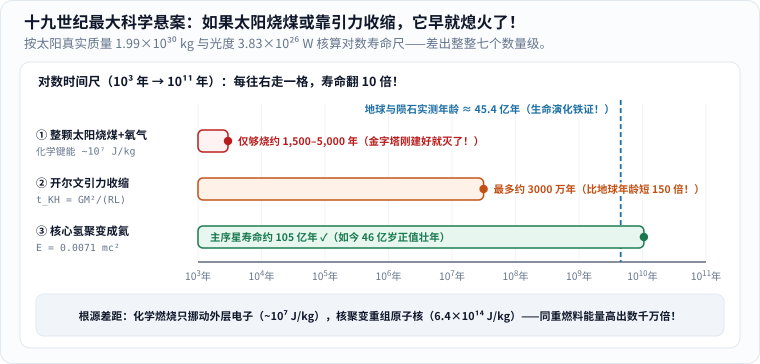
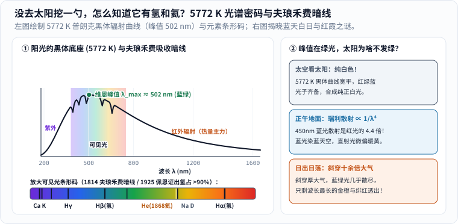
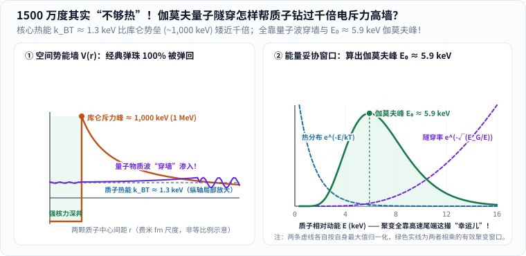
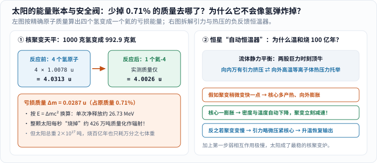
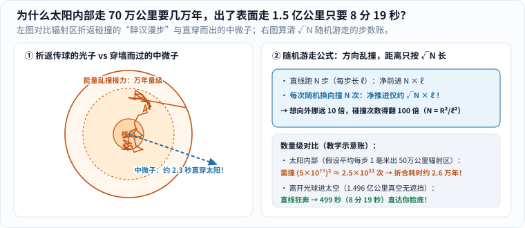

冬日午后带娃在阳台晒太阳，暖洋洋的光落在手背上，孩子眯着眼睛（记住：千万别直视太阳！）问出一句看似天真、却曾把十九世纪全世界最聪明的大脑集体难倒的问题：

**“爸爸，太阳在天上烧了那么久，它烧的是煤还是木头呀？怎么一直烧不完？”**

先给剧透答案：**太阳既不是一块大煤球，也不是一团普通的化学火焰。** 它是一颗重达约 $$2\times 10^{27}$$ 吨的炽热等离子体巨球，最深处的核心正在进行**氢原子核聚变成氦原子核的热核反应** [1]。而且，从“核心聚变释放出一份能量”到“这缕阳光晒暖你的鼻尖”，中间隔着两段脾气截然相反的奇幻旅途——

### 先看全景地图：太阳肚子里慢如蜗牛，出了太阳快如闪电

_图 1：读懂阳光全程只需分三步——① **核心造能**（氢聚变成氦，质量亏损化作高能辐射与中微子）；② **内部接力输运**（先在致密辐射区反复散射吸收“醉汉漫步”数万至十余万年，再由外层对流区翻滚托举到光球表面）；③ **太空直线冲刺**（穿过 $$1.496$$ 亿千米真空只需约 $$8$$ 分 $$19$$ 秒）。图中箭头依次描出一次仅表示叙述次序，并非真实速度比例；不看动画同样能读懂全图。[单独打开，刷新可重播](/assets/images/archive-guides/sun-energy.svg)_

顺着这张路线图，我们像侦探破案一样，把这缕阳光背后最惊心动魄的六个科学谜团逐一解开。

---

## 一、第一幕：十九世纪最大科学悬案——连物理泰斗开尔文都算错了太阳的寿命！

### 1. 地质演化要几十亿年，经典物理却算出了“两份绝望账单”

今天连小学生都听说过“太阳已经发光发热约 $$46$$ 亿年了”。可如果把时钟拨回一百六十多年前的十九世纪中叶，当时的物理学界、地质学界和生物学界，正因为太阳的年龄吵得不可开交 [2]！

一边是地质学家莱伊尔和生物学家达尔文（1859 年发表《物种起源》）：无论是几千米厚的海底沉积岩层，还是生命从简单单细胞一步步演化出鱼类、恐龙与哺乳动物，地球和太阳都**至少需要好几亿甚至几十亿年**的漫长岁月；另一边却是手握能量守恒定律的顶尖物理学家——在核能尚未被发现的年代，他们把人类已知的所有能源挨个套在太阳头上算了一遍，算出来的结果把所有人都吓出了一身冷汗（图 2）：

_图 2：横轴是一把横跨八个数量级的**对数时间尺**（每往右走一大格，寿命翻 $$10$$ 倍！）——把太阳真实质量 $$M_\odot \approx 1.99\times 10^{30}\ \mathrm{kg}$$ 与总发光功率 $$L_\odot \approx 3.83\times 10^{26}\ \mathrm{W}$$ 代入一除：烧煤撑不过五千年，引力收缩最多撑三千万年，双双撞碎在地球 $$45.4$$ 亿年古老岩石的铁证面前！[单独打开图片](/assets/images/sun-light/kelvin-coal-vs-fusion.svg)_

我们可以亲手复算一下当年物理学家算出的三份“绝望账单” [2]，先看最直观的前两份：

1. **假说一：如果整颗太阳是一块实心好煤 + 纯氧呢？**
   化学燃烧的本质是原子外层电子重新配对。一千克碳连同助燃所需的氧气完全反应生成二氧化碳（$$\mathrm{C + O_2 \rightarrow CO_2}$$），释放的化学能大约只有 $$9\times 10^6\ \mathrm{J/kg}$$（即便换成热值更高的碳氢燃料，量级也只在 $$10^7\ \mathrm{J/kg}$$ 左右）。哪怕整颗太阳 $$1.99\times 10^{30}\ \mathrm{kg}$$ 连一粒灰都不掺、全是顶级燃料配纯氧，按现在的太阳光度 $$L_\odot = 3.828\times 10^{26}\ \mathrm{J/s}$$ 敞开烧：

   $$
   t_{\text{烧煤}} \approx \frac{1.99\times 10^{30}\ \mathrm{kg} \times 1.8\times 10^7\ \mathrm{J/kg}}{3.828\times 10^{26}\ \mathrm{J/s}} \approx 9.4\times 10^{10}\ \mathrm{s} \approx 3{,}000\ \text{年}
   $$

   满打满算**只够烧两三千年（就算忽略氧气配重最多也不过五千年）**！也就是说，要是古埃及法老修金字塔那会儿点着这炉煤，还没熬到今天，太阳早就烧成一坨冰冷的黑灰了！
2. **假说二：靠无数陨石雨掉进太阳砸出热量呢？**
   十九世纪有人猜想，太空中源源不断有流星和陨石坠入太阳，把动能变成热。可天文学家一算：要想凑够太阳每秒洒出的能量，每 $$100$$ 年就得往太阳里砸进整整**一个地球质量**的陨石！太阳变重这么多，根据开普勒第三定律，地球绕太阳公转一年的长度每年就会缩短约 $$2$$ 秒——这在天文观测里一眼就能看穿，根本没发生过 [2]。

### 2. 开尔文—亥姆霍兹引力收缩炉：算对了“点火火柴”，却漏掉了核能金库

既然烧煤和砸陨石都行不通，物理学泰斗亲自端出了第三份、也是十九世纪最聪明的终极账单：

- **假说三：开尔文勋爵与亥姆霍兹的“引力收缩炉”**
  1850 年代，英国物理学泰斗威廉·汤姆孙（后受封**开尔文勋爵**，热力学温标 $$\mathrm{K}$$ 就是以他命名的）与德国科学家亥姆霍兹提出了十九世纪最聪明的一个机制 [2]：太阳不需要烧煤，只要靠自身庞大的万有引力**每年把直径往里轻轻压缩约 $$40$$ 米**（肉眼和望远镜几千年都看不出变小了），外层物质向内坠落释放的引力势能就足够让太阳发光！把整颗太阳从无穷散开的星云收缩到今天半径 $$R_\odot \approx 6.96\times 10^8\ \mathrm{m}$$ 所能释放的引力势能除以太阳光度，就是大名鼎鼎的**开尔文—亥姆霍兹时标**：

  $$
  t_{\text{KH}} \approx \frac{G M_\odot^2}{R_\odot L_\odot} \approx 3.1\times 10^7\ \text{年（约 3,000 万年）}.
  $$

  开尔文据此居高临下地宣布：太阳最多只有两三千万岁，达尔文需要的几亿年演化时间“在物理上绝无可能”！这件事曾让晚年的达尔文焦虑万分，称之为自己心头最痛的一根刺 [2]。

谁也没想到，错的居然是物理泰斗开尔文——他算术一点没算错，错在十九世纪的人类根本不知道原子最中心还锁着一座**能量密度比化学键高出数千万倍的核能金库**！不过，开尔文的引力收缩并没有白算：大约 $$46$$ 亿年前太阳刚从弥漫气体尘埃星云里诞生时，正是**引力收缩**充当了“第一根火柴”，把原恒星核心一路压缩升温到 **$$1{,}500$$ 万开尔文**（而且在正式点燃持续氢聚变之前，原恒星就已经靠引力收缩发光了，不能误以为“没点着核聚变之前完全是黑的”）[1][2]！

---

## 二、第二幕：没人拿勺子去太阳挖过土，我们怎么知道它是氢和氦做的？

在揭晓核心核反应之前，先回答一个特别棒的追问：太阳表面温度接近 $$5{,}800\ \mathrm{K}$$（约 $$5{,}500\ ^\circ\mathrm{C}$$），任何人类探测器靠近都会化为蒸汽，没有任何人去太阳上舀过一勺样品——**科学家凭什么斩钉截铁地说“太阳主要是由氢和氦组成的”？**

答案就藏在晒进你家窗户的那束阳光里！阳光不仅送来了热量，还随身夹带了一份精确到小数点后好几位的**“元素身份证条形码”**（图 3）：

_图 3：左图上半部分是按国际天文学联合会（IAU）标称太阳有效温度 $$T_{\text{eff}} = 5772\ \mathrm{K}$$ 精确计算的热辐射光谱曲线，下半部分把可见光彩虹带放大，标出太阳大气层留下的**夫琅禾费吸收暗线**与日食中发现的氦线；右图解开了一个常见疑惑——峰值明明落在 $$502\ \mathrm{nm}$$ 蓝绿光，为什么太阳看起来不是绿色的？[单独打开图片](/assets/images/sun-light/solar-spectrum-fraunhofer.svg)_

### 1. 跨越百年的“隔空验血记”：夫琅禾费暗线、太阳元素氦与佩恩的氢丰度革命

这场横跨一百多年的“隔空验血记”，由三次漂亮接力完成 [3][4]：

1. **1814 年，夫琅禾费在彩虹里数出近 600 道“黑缝”**：1672 年牛顿用三棱镜把白光拆成七色彩虹时，以为彩虹是完美连续的；到了 1814–1815 年，德国光学家约瑟夫·夫琅禾费（Joseph von Fraunhofer）用精密狭缝分光镜放大阳光光谱，震惊地发现彩虹上密密麻麻刻着近 $$600$$ 道位置固定不变的细黑线 [3]！1860 年基尔霍夫与本生终于破译了黑线密码：太阳深处炽密的光球层发出连续彩虹光，往外穿过太阳表面稍冷一点的稀薄大气时，大气里的每种原子就像挑食的孩子，**只精准吞掉特定波长的光子**，在彩虹上留下一套独一无二的暗线条形码（比如 $$656.3\ \mathrm{nm}$$ 的红光暗线 $$\mathrm{H}\alpha$$ 和 $$486.1\ \mathrm{nm}$$ 的蓝青暗线 $$\mathrm{H}\beta$$ 专属于**氢**，$$589\ \mathrm{nm}$$ 双黄线专属于**钠**，$$393\ \mathrm{nm}$$ 紫端深线专属于电离**钙**）[3]。
2. **1868 年，人类在太阳上先抓到了地球上还没见过的“太阳元素”——氦（Helium）！** 1868 年 8 月印度日全食期间，法国天文学家让森（Pierre Janssen）和英国天文学家洛克耶（Norman Lockyer）把分光镜对准月球黑影边缘火红的太阳日珥，在 $$587.6\ \mathrm{nm}$$ 处抓到了一条极亮的金黄色谱线——翻遍地球化学实验室所有已知元素的图谱，居然**查无此人**！洛克耶大胆断定这是太阳上特有的一种新元素，用古希腊太阳神 *Helios* 给它取名 **Helium（氦）**。直到整整 **$$27$$ 年后**的 1895 年，英国化学家拉姆齐用酸处理地球上的铀矿石时，才第一次在地球上捉到了这种气体 [3]！这是科学史上第一次“先在天上认出元素，后在地上找到实物”。
3. **1925 年，25 岁的塞西莉亚·佩恩（Cecilia Payne-Gaposchkin）颠覆百年成见**：哪怕认出了氢线和钙线，直到 1920 年代初，全世界天文学家依然固执地以为“太阳的成分应该和地球地壳差不多，以铁、钙、硅为主”——因为太阳光谱里钙线和铁线看起来特别粗黑！1925 年，哈佛天文台年仅 25 岁的女博士生塞西莉亚·佩恩在博士论文里运用量子力学与萨哈电离方程算清了真相 [4]：在 $$5{,}800\ \mathrm{K}$$ 的温度下，绝大多数氢原子都老老实实待在基态，只有极微小比例的氢处在能吸收可见光的第二能级，却依然划出了那么明显的 $$\mathrm{H}\alpha$$ 暗线——这意味着太阳里的氢原子总数必定多得超乎想象！最终证实：**按原子个数算，太阳表面约 $$92.0\%$$ 是氢，$$7.8\%$$ 是氦，剩下所有碳、氮、氧、铁等元素加起来还不到 $$0.2\%$$；按质量算，氢占约 $$73.4\%$$，氦占约 $$25.0\%$$，重元素仅占不到 $$2\%$$** [4]！（顺带一提，太阳不是固体，而是大量原子被高温剥离电子后的电离气体——关于这种占宇宙可见物质 $$99\%$$ 以上的“物质第四态”有哪些奇特性质，欢迎同读本站《[固体、液体、气体之后：等离子体到底是什么？]()》。）

### 2. 顺手解开一个光学小悬念：太阳辐射峰值明明在“蓝绿光”，为什么我们没看见一颗绿太阳？

仔细看图 3 左上的普朗克黑体曲线，按维恩位移定律 $$\lambda_{\max} = \frac{2.898\times 10^6\ \mathrm{nm\cdot K}}{T}$$ 代入太阳有效温度 $$5772\ \mathrm{K}$$，发光最强的波长明明落在 **$$\lambda_{\max} \approx 502\ \mathrm{nm}$$（正宗的蓝绿色！）**——那为什么从来没人见过绿油油的太阳？

看图 3 右边的三层滤镜就懂了：
- **在太空空间站里看太阳：它是纯正耀眼的白色！** 因为 $$5772\ \mathrm{K}$$ 的辐射峰非常宽平，从 $$400\ \mathrm{nm}$$ 蓝紫光、$$502\ \mathrm{nm}$$ 绿光一直到 $$650\ \mathrm{nm}$$ 红光强度都很充沛，同时把人眼视网膜上的红、绿、蓝三种视锥细胞均衡激活，大脑合成出来的就是最标准的**纯白光**（毕竟人类眼睛本来就是在太阳光底下演化定型的）[3]！
- **正午站在地球地面看：蓝天 + 暖白偏黄的太阳**。阳光一头扎进地球大气层，空气里的氮气、氧气分子尺寸远小于光波长，触发强烈的**瑞利散射（Rayleigh Scattering）**——散射强度与波长的四次方成反比（$$I_{\text{散射}} \propto 1/\lambda^4$$）！算一下 $$450\ \mathrm{nm}$$ 蓝光与 $$650\ \mathrm{nm}$$ 红光的比值：

  $$
  \left(\frac{650}{450}\right)^4 \approx 4.35.
  $$

  蓝紫光被空气分子向四面八方弹散的概率是红光的 **$$4.4$$ 倍**！漫天散开的蓝光把整个天空穹顶染成了蔚蓝色；而直奔你眼睛的直射阳光因为沿途丢掉了一截蓝紫光，剩下的混合光就带上了淡淡的暖黄调。
- **日出与日落时分：金橙到绯红的晚霞**。傍晚太阳贴近地平线，阳光斜着擦过厚厚的大气层，穿行空气的路程比正午头顶直射暴增了 **$$10\text{–}30$$ 倍**！不仅蓝紫光被散得一干二净，连绿光、黄光也大半折损在路上，最后只有波长最长、最不容易被散射的橙光和红光突出重围照到脸庞。

---

## 三、第三幕：1500 万度其实“远远不够热”！量子隧穿怎样帮质子钻过千倍电斥力高墙？

### 1. 差了七百多倍的绝望高墙：1000 keV 库仑电斥力 vs 1.3 keV 质子热运动

知道了太阳满肚子都是氢原子核（也就是单颗带正电的**质子 $$p$$**），核心又被引力压到了约 **$$1{,}500$$ 万开尔文**（密度高达约 $$150\ \mathrm{g/cm^3}$$，比实心铅块还密实十几倍 [1]），二十世纪初的天体物理学家爱丁顿（Arthur Eddington）大胆猜想：只要把四个氢核捏成一个氦核，亏损的质量按爱因斯坦 $$E = mc^2$$ 释放出来，太阳寿命之谜就迎刃而解了 [5]！

可当核物理学家真拿起纸笔算第一行碰撞账时，全都傻眼了：**按经典物理学，$$1{,}500$$ 万度的太阳核心其实“冷得可怜”，连一对质子都撞不到一块儿去！**

为什么？看图 4 左半边那堵高耸入云的橙色围墙：

_图 4：左图画出两颗质子迎面靠近时的空间势能墙——吸引彼此的**强核力深井**（绿色）手特别短，只有靠到约 $$1.4\text{–}2\ \mathrm{fm}$$（$$10^{-15}\ \mathrm{m}$$）以内才够得着；在此之外全是同种正电荷互相推斥的**库仑静电斥力墙**（峰值约 $$1{,}000\ \mathrm{keV}$$），而核心质子热能 $$k_B T$$ 只有可怜的 $$1.3\ \mathrm{keV}$$！右图精确算出了热运动分布与量子穿墙率妥协出的 **$$5.9\ \mathrm{keV}$$ 伽莫夫峰**。[单独打开图片](/assets/images/sun-light/gamow-quantum-tunneling.svg)_

把这两个悬殊了近千倍的数字摆在一起，你就知道这有多离谱：
- **围墙有多高？** 两颗质子都带一个单位正电荷 $$+e$$，距离越近，库仑静电斥力势能 $$V_C(r) = \frac{e^2}{4\pi\varepsilon_0 r}$$ 飙升得越猛。要想挤进强核力接管的核半径（约 $$1.4\ \mathrm{fm}$$），墙头高度足足有 **$$1\ \mathrm{MeV} = 1{,}000\ \mathrm{keV}$$**！
- **质子跑得有多快？** 在 $$T = 1.5\times 10^7\ \mathrm{K}$$ 的太阳核心，热运动特征能量只有：

  $$
  k_B T \approx 1.29\ \mathrm{keV} \approx 1.3\ \mathrm{keV}
  $$

  （平均平动动能 $$\frac{3}{2}k_B T$$ 也不过 $$1.9\ \mathrm{keV}$$），**比墙头矮了整整七百多倍！** 如果质子真是经典力学里硬邦邦的小钢珠，这就像你站在喜马拉雅山脚下，手劲只够把乒乓球往上抛高 $$10$$ 米，却指望乒乓球翻过八千米的珠峰顶一样——即便加上麦克斯韦热分布里跑得快一点的极少数分子，能硬翻过 $$1{,}000\ \mathrm{keV}$$ 墙头的比例也是 $$e^{-1000/1.3} \approx 10^{-334}$$，把整个宇宙的质子全塞进太阳里也撞不出哪怕一次聚变！

### 2. 伽莫夫量子穿墙术与 5.9 keV 聚变甜蜜峰

当时有人自嘲：难道太阳不懂经典物理？没错——**因为微观世界的原子核，本来就不归经典弹珠管，而归量子力学管！**

1928 年，俄裔物理学家乔治·伽莫夫（George Gamow）率先用海森堡不确定性原理和薛定谔波动力学捅破了这层窗户纸：微观质子不是一个体积无限小的硬点，而是一团弥散开来的**物质概率波**（左图紫色波纹）。当这团波撞上比自己能量高得多的库仑势垒时，虽然大部分波被弹了回来，但它在墙体内部并没有瞬间归零，而是按指数规律衰减渗透；只要墙在顶部附近足够薄，**就有一缕微弱但非零的波函数尾巴能直接“穿墙”渗进里面的强核力深井，咔嗒一声锁死聚变！** 这就是拯救了整座宇宙星光的**量子隧穿效应（Quantum Tunneling）**。

更妙的是图 4 右半边那场漂亮的数学拔河：
- 能量 $$E$$ 越高的质子，离墙顶越近、需要钻的墙越薄，伽莫夫隧穿概率 $$\exp(-\sqrt{E_G/E})$$（紫色虚线，其中质子对伽莫夫能量 $$E_G \approx 493\ \mathrm{keV}$$）涨得飞快；
- 可能量 $$E$$ 越高，在麦克斯韦热分布 $$\exp(-E/k_B T)$$（蓝色虚线）里占的人数就跌得越惨！
- 把“人数比例”和“穿墙成功率”两条曲线乘在一起，就挤出了中间那座尖尖的绿色小山峰——**伽莫夫峰（Gamow Peak）**，其峰值能量精确落在：

  $$
  E_0 = \left(\frac{E_G (k_B T)^2}{4}\right)^{1/3} \approx 5.9\ \mathrm{keV}.
  $$

**看明白了吗？** 真正点亮太阳的，既不是 $$1.3\ \mathrm{keV}$$ 的大多数普通质子（它们穿墙率太低），也不是 $$1{,}000\ \mathrm{keV}$$ 翻墙硬汉（根本不存在），而是热分布高速尾巴上那批能量在 **$$4\text{–}9\ \mathrm{keV}$$** 附近的“幸运冲锋队”，靠着量子穿墙术把太阳稳稳点着了！1938–1939 年，物理学家**汉斯·贝特（Hans Bethe）**在此基础上完整算出了太阳型恒星的**质子—质子链（PP 链）**与大质量恒星的碳氮氧循环（CNO 循环），一举摘得 1967 年诺贝尔物理学奖 [5]。

---

## 四、第四幕：四个氢怎样换来光？每秒亏损 426 万吨的 $$E=mc^2$$ 账本与“防爆恒温器”

### 1. 质子—质子链三步接力：四个氢核怎样拼成一颗氦-4？

钻过量子隧道之后，太阳核心主要通过**质子—质子链（PP 链）**分三步把四个氢核组装成一个氦-4 核 [5][6]。先看最主力的 PP-I 支路：

| 接力步骤 | 核反应具体做了什么？ | 最容易误会的关键物理细节 |
| --- | --- | --- |
| **第一步：双质子慢火造氘** | 两颗质子钻墙相遇，其中一颗发生弱衰变转为中子，合体成重氢核（氘 $${}^2\mathrm{H}$$），吐出一颗正电子 $$e^+$$ 和一颗电子中微子 $$\nu_e$$ | 必须在撞上的极短瞬间碰巧发生**弱相互作用**，成功概率极低，是整条流水线的总限速阀！ |
| **第二步：氘核吃质子造氦-3** | 刚生成的氘核在几秒内迅速捕获周围另一颗质子，合成氦-3（$${}^3\mathrm{He}$$）并射出一颗高能伽马光子 $$\gamma$$ | 到这一步只攒了 3 个核子，还没变成最终稳定的氦-4 |
| **第三步：双氦-3 合体收官** | 两个氦-3 核迎头相撞，拼成极为稳固的氦-4 核（$${}^4\mathrm{He}$$），同时把多出来的两颗质子退回炉膛继续打工 | 所以前两步必须各进行 **2 次**，才能凑够第三步所需的两个氦-3 原料！ |

写成核反应方程清清楚楚：

$$
p + p \rightarrow {}^2\mathrm{H} + e^+ + \nu_e
$$

$$
{}^2\mathrm{H} + p \rightarrow {}^3\mathrm{He} + \gamma
$$

$$
{}^3\mathrm{He} + {}^3\mathrm{He} \rightarrow {}^4\mathrm{He} + 2p
$$

这里 $$p$$ 是质子，$$e^+$$ 是正电子（产生后很快与周围等离子体里的自由电子 $$e^-$$ 湮灭化作两颗伽马光子），$$\nu_e$$ 是电子中微子，$$\gamma$$ 是高能光子。

把前两步乘 $$2$$ 再和第三步相加，扣掉退回来的两颗质子，净总结算就是：**每 $$4$$ 个氢核（连同 $$2$$ 个电子）一步步变成 $$1$$ 个氦-4 原子，净释放约 $$26.73\ \mathrm{MeV}$$ 能量**（其中约 $$2\%\text{–}3\%$$ 由不恋战的中微子直接带走，其余约 $$97\%$$ 留在太阳内部化作热与光）[6][8]。

### 2. 把原子放上天平称重：0.71% 质量亏损与每秒蒸发 426 万吨

爱因斯坦的 $$E = mc^2$$ 在这里一点也不抽象——我们可以直接把反应前后的原子放到高精度质谱天平上称重对账（图 5 左）：

_图 5：左图是核聚变的“质量天平”——4 个氢-1 原子的总质量为 $$4.0313\ \mathrm{u}$$，合成为 1 个氦-4 原子后只剩 $$4.0026\ \mathrm{u}$$，凭空少掉的 $$0.0287\ \mathrm{u}$$（约 $$0.71\%$$）化作了光与热；右图解释为什么太阳是一座极其温顺的“自动恒温炉”，而不会像氢弹那样瞬间炸掉。[单独打开图片](/assets/images/early-curiosity/sun-mass-thermostat.svg)_

用原子质量单位 $$\mathrm{u}$$ 一笔笔核对：
- **反应前 4 个氢-1 原子总重**：$$4 \times 1.007825\ \mathrm{u} = 4.03130\ \mathrm{u}$$；
- **反应后 1 个氦-4 原子实测重**：只有 $$4.002603\ \mathrm{u}$$！

一减之下，凭空消失了 **$$\Delta m = 0.0287\ \mathrm{u}$$，恰好占原质量的 $$0.71\%$$**！换算成日常厨房秤的直觉：每拿 $$1{,}000$$ 克氢聚变成氦，最后只能收到 $$992.9$$ 克氦，另外 **$$7.1$$ 克物质彻底化作了纯能量**（$$0.0071 \times c^2 \approx 6.4\times 10^{14}\ \mathrm{J/kg}$$，正好比第一幕烧煤高出好几千万倍！）。再拿太阳总发光功率 $$L_\odot \approx 3.828\times 10^{26}\ \mathrm{W}$$ 除以光速平方 $$c^2$$：

$$
\frac{\Delta m}{\Delta t} = \frac{3.828\times 10^{26}\ \mathrm{J/s}}{(2.998\times 10^8\ \mathrm{m/s})^2} \approx 4.26\times 10^9\ \mathrm{kg/s}.
$$

**每一秒钟——你眨一下眼的工夫——太阳都在把大约 426 万吨自身质量直接变成电磁辐射洒向宇宙！**（如果算上被转换成氦的原料，太阳核心每秒钟要把约 **$$6$$ 亿吨氢**烧成 $$5.96$$ 亿吨氦 [6]！）听上去吓人，但因为太阳总体重高达 $$1.99\times 10^{27}$$ 吨，核心约 $$10\%$$ 的质量可供主序星阶段聚变，哪怕照这个胃口连吃带烧 **$$100$$ 亿年**，因辐射损失掉的质量也还不到太阳总体重的万分之七！

### 3. 灵魂追问：既然核心装满了核聚变燃料，为什么太阳不会像氢弹那样“轰”一下全炸光？

因为大自然给太阳装上了**微观 + 宏观两道双重安全锁**（图 5 右）[6][7]：

1. **第一把锁在微观（弱相互作用限速阀）**：人造氢弹用的是早已现成配好中子的**氘和氚**，一撞就能靠强核力瞬间聚变；而太阳核心全是单打独斗的**质子**，第一步必须等两颗质子量子穿墙撞上的那亿亿分之一秒内，恰巧有一颗质子通过极其缓慢的**弱相互作用**变成中子！这一步概率低到什么程度？在太阳核心，平均一颗质子每秒碰撞上亿次，也要苦等**几十亿年**才能撞成功一次！甚至算下来，太阳核心每立方米体积产生的热功率只有大约 $$270\ \mathrm{W/m^3}$$——还不如一头成年人身体或一堆发酵干草堆的单位体积发热猛（太阳之所以总功率吓人，纯粹是因为炉膛体积太大了）！（注意科学概念区分：**反应速率慢，是因为弱相互作用截面极小，绝不能误解成“这个反应需要吸热所以慢”——总过程明明是剧烈放能的！**）
2. **第二把锁在宏观（流体静力平衡“负反馈恒温器”）**：太阳每一层都处在向内挤压的万有引力与向外顶托的高温等离子体气体压强精准抵消的**流体静力平衡（Hydrostatic Equilibrium）**之中 [7]。假如此刻核心聚变稍微快了 $$1\%$$，多出来的热量立刻让核心气体升温膨胀；**核心往外一膨胀，密度和温度随即双双下降，高度依赖温度与密度的聚变速率当场自动踩刹车退回原位！** 反之如果火力稍弱，引力往里轻轻一收，升温增密又把火力续上。靠着这套纯天然的负反馈恒温器，太阳已经稳稳当当地烧了 $$46$$ 亿年，还将继续温和照耀约 $$50$$ 亿年。

---

## 五、第五幕：为什么能量在太阳肚子里要“醉汉漫步”走几万年，到了表面又像煮开的麦片粥？

核心造出了高能伽马光子，太阳半径 $$R_\odot \approx 69.6$$ 万千米，按光速 $$30$$ 万千米/秒一除，直着跑明明只需 **$$2.3$$ 秒**就能冲出太阳表面！可为什么天体物理学家总说，核心释放的能量要花上**几万到几十万年**才能磨蹭到表面 [7][8]？

罪魁祸首是太阳内部拥挤不堪的带电粒子海洋，以及概率论里大名鼎鼎的**随机游走（Random Walk）**模型（图 6）：

_图 6：左图对比在致密等离子体中被反复散射吸收、折返接力的电磁辐射能量路线（橙色折线）与几乎畅通无阻、约 $$2.3$$ 秒直穿整颗太阳的中微子（蓝色虚线）；右图算清了每步随机乱拐弯后，净推进距离为何只按步数平方根 $$\sqrt{N}$$ 缓慢爬升。[单独打开图片](/assets/images/early-curiosity/photon-random-walk.svg)_

顺着太阳从里往外剥洋葱，能量一共要换乘三趟“交通工具” [4][7]：

### 1. 第一程（内层辐射区，约 $$0.25\,R_\odot \rightarrow 0.70\,R_\odot$$）：走一步退半步的“醉汉接力”

在这里，自由电子和裸原子核挤得密不透风。一颗光子刚飞出平均不到一毫米到几毫米（平均自由程 $$\ell$$），就会一头撞上电子发生汤姆孙散射，或者被离子吸收后再朝一个**上下左右完全随机的新方向**吐出来：
- 如果死认准朝外一个方向直线走 $$N$$ 步，走出的总距离是 $$N\ell$$；
- 可如果每走一步都彻底忘掉刚才朝哪儿、随机乱拐弯，前后左右的步伐大量互相抵消，概率论严格证明：走完 $$N$$ 步后离起点的均方根净距离只有：

  $$
  R \approx \ell\sqrt{N} \quad\Longrightarrow\quad N \approx \left(\frac{R}{\ell}\right)^2.
  $$

**那个平方号就是拖延时间的魔鬼！** 想往外多挪远 $$10$$ 倍，碰撞步数就得翻 **$$100$$ 倍**！拿一个典型教学步长 $$\ell \sim 1\ \mathrm{mm} = 10^{-3}\ \mathrm{m}$$ 穿过 $$R \approx 5\times 10^8\ \mathrm{m}$$（$$50$$ 万千米）的辐射区试算：需要的总折返步数高达 $$N \approx (5\times 10^{11})^2 = 2.5\times 10^{23}$$ 步，折合总路程 $$N\ell \approx 2.5\times 10^{20}\ \mathrm{m}$$，除以光速就是**两三万年**；若采用更精细的恒星内部不透明度模型（核心附近自由程甚至短至亚毫米级），扩散时标更长达**十余万年至数十万年** [7][8]！

> **一个极其重要的物理澄清**：在这上百亿亿次碰撞吸收与再发射中，最初那颗几百万电子伏特的高能伽马光子，早已在一次次热平衡接力中被“找零钱”拆成了成千上万颗能量低得多的紫外、可见光与红外光子！所以**千万别把今天晒在你脸上的某一颗可见光光子，当成十万年前从核心原装出发、一路没换过身份证的同一颗粒子**——漫长接力送出来的是**能量**，不是原装光子本人！

### 2. 第二程（外层对流区，最外约 $$30\%$$ 半径，厚约 $$20$$ 万千米）：光球“米粒沸粥”与日震学 B 超

能量好不容易熬到距离中心约 $$70\%$$ 半径处，温度降到了约 $$200$$ 万开尔文，部分重离子开始留住电子，气体对光变得更不透明，“光子接力”堵车了；于是等离子体直接改用更痛快的办法——像砂锅里煮滚的麦片粥或味噌汤一样**整体翻腾对流** [4][7]！滚烫的等离子体柱以每秒 $$2\text{–}3$$ 千米的速度直冲顶层**光球（Photosphere，厚仅约 $$400$$ 千米）**，把光洒向太空变凉后再从边缘沉回锅底。

用专业太阳望远镜拍下光球表面，你会看到整张太阳脸铺满了密密麻麻像撒了大米粒一样的亮斑——天文学上叫**米粒组织（Granulation）** [4]！别看照片里只是一粒粒小芝麻，**每一颗“米粒”的直径都有 $$700\text{–}1{,}000$$ 千米宽（足足抵得上整个美国得克萨斯州或大半个华北平原！），每颗米粒沸腾冒头 $$5\text{–}10$$ 分钟就会散开消亡，换新米粒顶上来**。更神奇的是，现代天文学家通过测量光球表面每秒几百米、周期约 $$5$$ 分钟的微弱多普勒起伏（就像给太阳听诊内部声波回音的**日震学 Helioseismology**，声波穿过整颗太阳只需约 $$1$$ 小时！），不用钻洞就像做 B 超一样精准测出了对流区刚好始于 $$0.70\,R_\odot$$ [8]！

### 3. 第三程（离开光球穿行太空）：499 秒直线狂飙

一旦光子从稀薄透明的光球顶层脱身，前方再无阻拦。日地平均距离（$$1$$ 天文单位）约为 $$1.496\times 10^8\ \mathrm{km}$$，除以真空光速 $$c \approx 299{,}792\ \mathrm{km/s}$$：

$$
t = \frac{149{,}597{,}870\ \mathrm{km}}{299{,}792.458\ \mathrm{km/s}} \approx 499.0\ \mathrm{s} \approx 8\ \text{分}\ 19\ \text{秒}.
$$

（因为地球绕日轨道略呈椭圆，近日点约 $$1.471$$ 亿千米、远日点约 $$1.521$$ 亿千米 [4]，所以这趟太空快递在一年里会在 $$8$$ 分 $$10$$ 秒到 $$8$$ 分 $$27$$ 秒之间微微浮动。）

---

## 六、第六幕：困扰学界 30 年的惊天悬案——“失踪的三分之二太阳中微子”去哪了？

读到第五幕，脑子转得快的读者一定会背脊一凉，问出一个极其刁钻的问题：

> **“既然核心产生的光和热要花十几万年才能磨蹭到太阳表面，那万一太阳核心在五万年前就已经偷偷熄火停工了，我们岂不是还要蒙在鼓里再晒好几万年‘库存余热’才能发现？！”**

放心！科学家早就派了一位能在 **$$2.3$$ 秒内直穿整颗太阳**的“卧底特工”，帮我们实时直播太阳核心**八分钟前刚刚发生**的聚变现场——它就是第四幕核反应第一步诞生的幽灵粒子：**电子中微子（$$\nu_e$$）** [8][9]！

中微子不带电、几乎不与任何普通物质发生电磁或强核力作用，整颗太阳和整颗地球在它眼里比空气还透明。就在你读这一行字的 **$$1$$ 秒钟**里，大约有 **$$6.4\times 10^{10}$$ 颗（640 亿颗！）**来自太阳核心的中微子悄无声息地穿透了你的大拇指甲盖，没惊动你身体里的哪怕一颗原子 [8][9]！

可正是为了去抓这群幽灵验证太阳核聚变，物理学界差点被一桩离奇的“失踪案”逼疯了整整三十年（图 7）：

_图 7：上图描绘了太阳核心发出的纯电子中微子（$$\nu_e$$）在飞往地球的 $$1.496$$ 亿千米旅途中上演的量子“变脸魔术”（蓝线在打开时动态演示一次波包传播，静态终态保留完整三味比例）；下图对比了两位诺奖得主相隔三十年的地下深井破案账本。[单独打开，刷新可重播](/assets/images/sun-light/neutrino-oscillation-mystery.svg)_

### 1. 1970 年金矿底下的 615 吨干洗剂：惊悚的“三分之一惨案”

为了挡住地表铺天盖地的宇宙射线假信号，美国物理学家**雷蒙德·戴维斯（Raymond Davis Jr.）**跑到南达科他州霍姆斯塔克（Homestake）金矿地下 **$$1.5$$ 千米**深的岩洞里，造了一口装满近 $$40$$ 万升（约 $$615$$ 吨）四氯乙烯（$$\mathrm{C_2Cl_4}$$，就是干洗店常用的干洗液！）的大罐子 [8]。极少数高能太阳电子中微子撞上其中的氯-37 原子核，会把它变成具有放射性的氩-37 原子（$$\nu_e + {}^{37}\mathrm{Cl} \rightarrow {}^{37}\mathrm{Ar} + e^-$$）。

理论算出来，这么大一罐液体**每天只会变出大约 $$1$$ 颗**氩原子！戴维斯团队每个月像大海捞针一样把这十几颗氩原子吹洗出来计数——技术神乎其技，可从 1970 年一路测了几十年，测出来的数字永远只有贝特与巴考尔（John Bahcall）标准太阳模型预测值的 **约三分之一（$$\sim 34\%$$）** [8][9]！

**另外三分之二的太阳中微子人间蒸发了！** 难道人类算错了太阳核心温度？还是太阳核心真的出了什么古怪故障？

### 2. 1998–2001 年地下两千米的 1,000 吨重水球一锤定音：不是丢了，是半路换马甲了！

粒子物理世界里其实一共有三种（“三味”）中微子：**电子中微子（$$\nu_e$$）、缪子中微子（$$\nu_\mu$$）和陶子中微子（$$\nu_\tau$$）**。太阳核心的 PP 链百分之百只生产**电子中微子 $$\nu_e$$**；巧合又致命的是，戴维斯金矿里的氯原子反应有能量门槛，**它只认得电子中微子 $$\nu_e$$，对另外两种中微子完全是个“睁眼瞎”** [8][9]！

1998 年日本超级神冈探测器（Super-Kamiokande，梶田隆章领衔）率先在大气中微子里抓到了变身铁证；紧接着 2001 年，加拿大安大略省地下 **$$2$$ 千米**深镍矿里的**萨德伯里中微子天文台（SNO，阿瑟·麦克唐纳领衔）**祭出了终极杀器——一只直径 $$12$$ 米的透明丙烯酸巨球，里面装满 **$$1{,}000$$ 吨超纯重水（$$\mathrm{D_2O}$$）**，外围密布 $$9{,}600$$ 只光电倍增管 [8][9]！重水里的氘核既能单独挑出 $$\nu_e$$ 计数，又能通过“中性流反应”被**全部三种中微子（$$\nu_e + \nu_\mu + \nu_\tau$$）不偏不倚地撞碎**。

当 SNO 打开总账本的那一刻，全世界天体物理学家起立鼓掌：
- 只数电子中微子 $$\nu_e$$？确实只剩约 **$$34\%$$**（证明戴维斯当年一粒都没数错，戴维斯与小柴昌俊随即获颁 **2002 年诺贝尔物理学奖** [10]）；
- 把 $$\nu_e + \nu_\mu + \nu_\tau$$ 三兄弟加在一起数？**分毫不差等于标准太阳模型预测的 $$100\%$$！** 原来另外 $$66\%$$ 的电子中微子在飞往地球的半路上，通过量子力学**中微子振荡（Neutrino Oscillation）**摇身变成了缪子和陶子中微子（梶田隆章与麦克唐纳获颁 **2015 年诺贝尔物理学奖** [9]）！

这桩长达三十年的悬案不仅彻底洗刷了太阳模型的冤屈——铁证如山地确认**此时此刻太阳核心正如理论计算那样一秒不停地精准聚变**，近年意大利地下 Borexino 实验甚至把太阳里占 $$99\%$$ 的低能 PP 链中微子和占约 $$1\%$$ 的微弱 CNO 循环中微子全都单独测齐了 [8]——而且顺手撼动了粒子物理标准模型：因为只有当**中微子拥有微小的非零静止质量**时，三种身份才能在飞行途中发生量子振荡 [8][9]！

---

## 七、第七幕：阳光的祖先来自哪里？树荫下的两个亲子小实验

### 1. 阳光的宇宙家谱：138 亿年前的大爆炸原初氢与超新星“星尘”边界

追完了阳光从太阳核心到地球脸庞的全程，如果孩子还不肯罢休地追问最后一句：**“那太阳肚子里的那些氢，最早又是从哪儿来的呀？”**

你可以给他讲一段既浪漫又有严格科学边界的宇宙家谱：
- 太阳里那占了七成以上质量的**氢**和绝大部分原始的**氦**，并不是任何老恒星造出来的，而是直接继承自约 **$$138$$ 亿年前早期宇宙大爆炸（Big Bang）最初几分钟的原初核合成**；而你我血液里的铁、骨骼里的钙、呼吸的氧和身体里的碳，则是比太阳更早几代的大质量恒星在生命末期熔炼合成、借由超新星爆发或恒星风撒回星际星云的遗产。
- 不过，跟孩子讲卡尔·萨根那句名言“我们都是星尘（We are made of starstuff）”时，正好帮他划清两条科学边界：**第一，我们身体里数量最多的氢原子（比如水分子 $$\mathrm{H_2O}$$ 里的两个氢）比第一代恒星还要古老，不是超新星炸出来的；第二，宇宙大爆炸描述的是整个早期时空从极高温极高密状态均匀膨胀冷却，绝不是在某个现成空房间里引爆了一颗超级核弹**，对于尚无定论的“大爆炸最初始奇点之前”也不必编造确定故事。

### 2. 周末下楼就能和孩子玩的两个“阳光物理观察”

讲完硬核故事，挑一个晴朗的周末，不用买任何昂贵仪器，带娃在小区树荫下就能做两个超棒的现场实验：

1. **实验一：闭上眼睛，从树荫迈进阳光里——是谁把暖意送过来的？**
   让孩子闭上眼，从阴凉树荫往外迈一步站进阳光里，脸颊立刻在半秒钟内感到暖洋洋的。这时候问他：**“是太阳像吹风机一样，把热空气跨越太空吹到你脸上了吗？”**
   引导他自己推理：地球和太阳之间隔着 $$1.496$$ 亿千米几乎空无一物的宇宙真空（连传声和吹风的空气分子都没有！），热传导和热对流全断了路。太阳纯粹靠不需要任何介质的**电磁辐射**（可见光与红外线是加热主力 [3]）把能量快递过来，光子撞上你的皮肤和衣服被吸收后，才转化成了你皮肤分子的热运动！
2. **实验二：低头看浓密大树底下的地面——为什么树叶缝隙是尖角乱形状，地上的光斑却全是小圆饼？**
   大晴天看茂密梧桐或榕树底下的水泥地，满地都是一个个圆溜溜的小光斑！让孩子抬头看树叶间的缝隙——明明是三角形、锯齿形、不规则多边形，为什么投在地上全变成了圆形？
   因为每一个细小的树叶缝隙，都是一个天然的**小孔成像照相机**！地上那一百个小圆饼，不是树叶缝的形状，而是**一百个缩小倒立的太阳圆盘实像**！（顺便留个一辈子难忘的彩蛋：以后遇到**日偏食**那天，根本不用抢破头买滤光镜，直接带孩子去浓密大树底下低头看地面——满地成百上千个小圆光斑，会齐刷刷变成一地弯弯的**小月牙光斑**！）

> **安全红线提醒（务必告诉孩子）**：任何时候都**绝对不要用肉眼直视太阳**，更严禁透过望远镜、双筒镜、相机光学取景器或放大镜看太阳（聚焦后的太阳辐射会在一瞬间不可逆地灼伤视网膜！）。观察地面树影光斑，就已经是最安全也最奇妙的太阳光学课了。至于这缕阳光落到绿叶上之后，又怎样被叶绿素捕获、拆开水分子锁进葡萄糖和我们餐桌上的米饭里，欢迎接着共读本站姊妹篇《[可视化理解光合作用]()》！

---

## 奶爸说

把真相拆到底之后你会发现：今天下午晒在孩子鼻尖上的这一缕光，并没有揣着一本“十五万年前原装出发”的煽情旅行日记。

可真实的物理故事，比童话还要让人起鸡皮疙瘩——

它是 $$138$$ 亿年前早期宇宙留下的两颗质子，在 $$46$$ 亿岁的等离子体炉心深处，靠着量子波穿过了比自己高近千倍的静电高墙；亏损掉的千分之七质量化作滚烫能量，在辐射区经历了亿亿万次折返接力，托起一锅得克萨斯州大小的沸腾米粒，最后只用 $$8$$ 分 $$19$$ 秒越过一亿五千万千米深空，穿过蔚蓝大气的散射筛网，轻轻落成孩子脸颊上那一点点真实的暖意。

**把故事讲得毫厘不差，从来不会冲淡它的浪漫；恰恰相反，准确，才是大自然最深沉的诗意。**

---

## 参考与延伸

1. **NASA Science**: [Our Sun: Facts](https://science.nasa.gov/sun/facts/) —— 太阳基本参数、$$46$$ 亿年星云形成、$$1{,}500$$ 万摄氏度核心、光球/色球/日冕分层与较差自转。
2. **OpenStax *Astronomy 2e***: [16.1 Sources of Sunshine: Thermal and Gravitational Energy](https://openstax.org/books/astronomy-2e/pages/16-1-sources-of-sunshine-thermal-and-gravitational-energy) —— 十九世纪化学燃烧寿命、陨石撞击假说反证，以及开尔文与亥姆霍兹引力收缩时标同地质/演化年龄的历史冲突。
3. **OpenStax *Astronomy 2e***: [5.2 The Electromagnetic Spectrum](https://openstax.org/books/astronomy-2e/pages/5-2-the-electromagnetic-spectrum) & [5.3 Spectroscopy in Astronomy](https://openstax.org/books/astronomy-2e/pages/5-3-spectroscopy-in-astronomy) —— 普朗克热辐射、维恩位移定律、夫琅禾费太阳光谱近 600 条吸收暗线，以及 1868 年太阳光谱率先发现氦元素（Helium）的历史。
4. **OpenStax *Astronomy 2e***: [15.1 The Structure and Composition of the Sun](https://openstax.org/books/astronomy-2e/pages/15-1-the-structure-and-composition-of-the-sun) —— 1925 年塞西莉亚·佩恩（Cecilia Payne-Gaposchkin）博士论文确立恒星氢氦丰度（原子数约 $$92\%$$ 氢、$$7.8\%$$ 氦）、辐射区与对流区分界及光球米粒组织（$$700\text{–}1{,}000\ \mathrm{km}$$，寿命 $$5\text{–}10$$ 分钟）。
5. **NobelPrize.org (1967)**: [Speed read: Stellar nuclear reactors (Hans Bethe)](https://www.nobelprize.org/prizes/physics/1967/speedread/) —— 汉斯·贝特 1938–1939 年确立太阳型恒星质子—质子链与大质量恒星 CNO 循环核聚变理论。
6. **OpenStax *Astronomy 2e***: [16.2 Mass, Energy, and the Theory of Relativity](https://openstax.org/books/astronomy-2e/pages/16-2-mass-energy-and-the-theory-of-relativity) —— $$E=mc^2$$ 质量亏损核算、PP 链分步核反应及太阳每秒约四百余万吨质量转化账本。
7. **OpenStax *Astronomy 2e***: [16.3 The Solar Interior: Theory](https://openstax.org/books/astronomy-2e/pages/16-3-the-solar-interior-theory) —— 太阳流体静力平衡负反馈恒温机制与内部辐射/对流能量输运理论。
8. **OpenStax *Astronomy 2e***: [16.4 The Solar Interior: Observations](https://openstax.org/books/astronomy-2e/pages/16-4-the-solar-interior-observations) —— 日震学（Helioseismology）5 分钟表面脉动探测内部结构、雷蒙德·戴维斯 Homestake 金矿四氯乙烯实验、加拿大 SNO 重水探测器与意大利 Borexino 中微子观测。
9. **NobelPrize.org (2015)**: [Popular information: The chameleons of space (Takaaki Kajita & Arthur B. McDonald)](https://www.nobelprize.org/prizes/physics/2015/popular-information/) —— 超级神冈与萨德伯里中微子天文台（SNO）发现中微子三味振荡、终结太阳中微子失踪之谜并证实中微子具有非零质量。
10. **NobelPrize.org (2002)**: [The Nobel Prize in Physics 2002 (Raymond Davis Jr. & Masatoshi Koshiba)](https://www.nobelprize.org/prizes/physics/2002/summary/) —— 宇宙与太阳中微子开创性探测诺贝尔奖公报。
