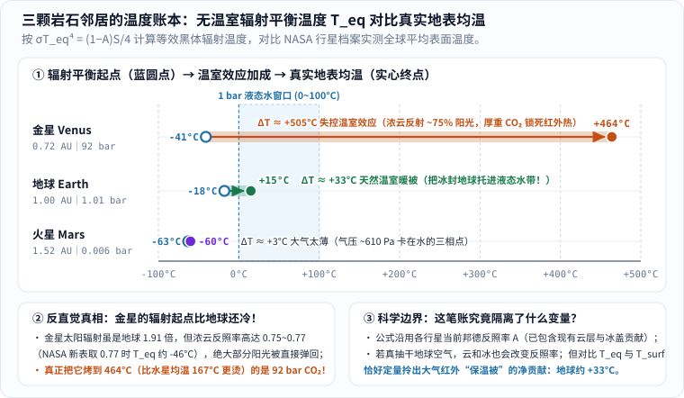
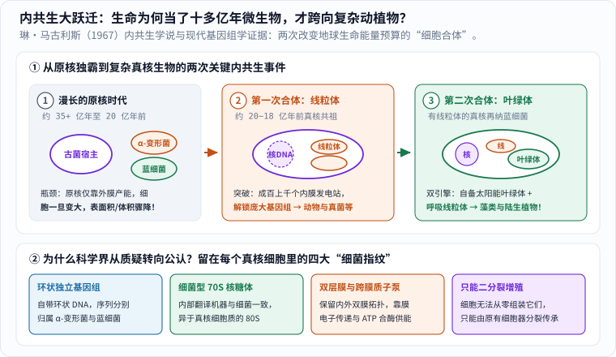

假如你能给 45 亿年前刚诞生的地球拍一张快照寄回今天，照片上绝不会有蔚蓝温和的海湾、森林里穿梭的飞鸟，更没有一口能让人活下去的空气。

那时的地球表面刚从剧烈撞击的熔岩海里慢慢结壳，头顶是富含二氧化碳、氮气和水蒸气的陌生天空，游离氧气几乎为零；月亮悬在比今天近得多的夜空里掀起巨浪；就连天上的太阳，光度也只有今天的七成多一点。放到今天的人类眼里，那简直是一颗不折不扣的“外星荒漠”。

再往左右两位邻居看一眼，悬念就更深了：

- 往太阳方向走一步，**金星**的大小、密度和地球几乎像一对双胞胎（直径只差约 5%），结果地表平均温度高达 **$$464^\circ\mathrm{C}$$**，连金属铅都会在地面化成水，气压相当于地球海底 900 米深处；
- 往外走一步，**火星**同样有四季更替、极地冰冠和远古河床遗迹，如今地表均温却跌到约 **$$-60^\circ\mathrm{C}$$**，空气稀薄得连一杯纯液态水端出门都会一边结冰一边沸腾。

夹在炼狱和冰窖中间，地球凭什么稳稳守住了几十亿年的液态海洋？当年轻的太阳还很暗淡时，地球靠什么机关躲过了永恒冰封？为什么地球地壳里硅元素比碳多得多，长出来的却是碳基生命而不是“会走路的石头”？既然生命早在三十多亿年前就已登场，为什么它们乖乖当了十多亿年的单细胞微生物，直到很晚才突然涌现出参天大树与动物世界？

很多人容易把地球理解成一张“天选配方表”：离太阳不远不近、有水、有大气、有月亮，打勾集齐，生命就自动蹦出来了。但现代行星科学与生物学真正迷人的地方恰恰相反：**地球今天这副宜居模样，既靠物理与化学定律的精妙配合，也是生命亲自花了数十亿年一点点“装修”出来的；而在环境与生命之间，还横着一道至今仍未完全解开的起源之谜。**

今天，我们就带着算盘、地质锤和显微镜，一层一层拆开这桩横跨 45.4 亿年的科学大案。

---

## 一、先把两道题拆开：“适合居住”不等于“自动长出生命”

在开始算账之前，我们得先分清三个经常被混成一团的问题：**一颗行星为什么能长期留住液态水？无生命的化学分子怎样第一次变成活细胞？生命出现后，又怎样反过来重塑整颗行星？**

_先从上往下读前两格：液态水环境、碳等化学原料与持续的能量流，是我们研究已知生命时最看重的宜居线索；再停在第三格的开放问题上——这个问号不是讲解偷懒，而是人类当前科学认知的真实边界。[单独打开宜居线索图](/assets/images/archive-guides/earth-habitable.svg)。_

天文学家在寻找系外行星时，最喜欢先找液态水、碳氮氢氧磷硫等原料以及光能或化学能。原因很简单：在我们目前唯一确知有生命的样本——地球上，几乎所有活跃的新陈代谢都离不开液态水充当溶剂、碳骨架搭建分子机器、自由能驱动非自发反应。

但请注意一个极容易踩空的逻辑陷阱：**“房子通了水电煤气”是住人的好条件，却不等于空房子锁门放一万年，客厅里就必定会自动长出一个房客。**

一方面，由于我们手里目前只有地球这 **1 个** 生命样本（统计学上最头疼的 $$N=1$$ 难题），任何声称“已经精确算出宇宙中生命诞生概率是十的负多少次方”的说法，其实都把未知的反应路径当成了已知赌局；另一方面，宜居条件也不是“地球户口本”的死板复印件——木卫二（Europa）和土卫二（Enceladus）虽然远在太阳系雪线之外、表面冰寒刺骨，但冰壳下受潮汐加热的地下液态海洋照样有水、有岩石热液化学能，因此同样是天体生物学重点探测的舞台。

弄清了这个边界，我们就能轻装上阵，去算第一笔硬核物理账：**地球表面那锅珍贵的液态水，究竟是怎么保住的？**

---

## 二、第一笔温度账：如果撕掉地球的“空气被子”，今天会冷到几度？

问任何人“为什么地球温度刚刚好”，十有八九会得到同一个回答：**因为地球离太阳不远也不近，正好落在“宜居带”（Goldilocks Zone）里。**

这个回答对了一半，却漏掉了更惊心动魄的另一半。不信，我们先老老实实算一笔阳光账。

### 1. 阳光随距离摊薄：平方反比定律只管“进账”

同一颗太阳每秒向四面八方辐射的总功率几乎恒定。想象太阳外围套着一个半径为 $$d$$ 的巨大球面，球面总面积是 $$4\pi d^2$$。距离太阳越远，同样多的光能就要摊在越大的球面上，因此**垂直于阳光的单位面积每秒收到的太阳辐射（太阳常数），严格与距离的平方成反比**。

根据 [NASA 行星科学档案（Planetary Fact Sheet）](https://nssdc.gsfc.nasa.gov/planetary/factsheet/)的实测数据，地球距太阳平均约 $$1.496\times 10^8\ \mathrm{km}$$（定义为 $$1\ \mathrm{AU}$$，即 1 个天文单位），大气层顶垂直于阳光每平方米每秒接收约 $$S_0 \approx 1361\ \mathrm{W/m^2}$$ 的能量——相当于在每平方米地面上方点亮了十几盏百瓦白炽灯。

把金星（$$0.723\ \mathrm{AU}$$）、地球（$$1.000\ \mathrm{AU}$$）和火星（$$1.524\ \mathrm{AU}$$）放进 $$1/d^2$$ 的尺子里一算：

$$
\frac{S_{\text{金星}}}{S_0} \approx \frac{1}{0.723^2} \approx 1.91,\qquad
\frac{S_{\text{火星}}}{S_0} \approx \frac{1}{1.524^2} \approx 0.43
$$

_先把中间地球的柱长当作基准尺“1.00”，再对比上下两条：金星轨道处每平方米收到的阳光约为地球的 1.91 倍（约 $$2601\ \mathrm{W/m^2}$$），火星轨道处约为地球的 0.43 倍（约 $$586\ \mathrm{W/m^2}$$）。注意这只是送到门口的“毛收入”，还不是行星真正吞进肚子的热量，更不直接等于地表温度。[单独打开比较图](/assets/images/deep-science/earth-sunlight.svg)。_

只看这张图，一切似乎顺理成章：金星阳光接近地球两倍所以热，火星不到一半所以冷。

**慢着！如果真是“阳光越强就越热”，接下来这个计算结果一定会让你大吃一惊。**

### 2. 亲手算一次：没有温室效应，地球其实是一颗零下 18 度的冰球！

一颗行星为什么不会在阳光照射下无休止地升温直到汽化？因为任何有温度的物体都会向外辐射电磁波散热（行星温度不高，发出的主要是肉眼看不见的**热红外辐射**）。温度越高，向外辐射散热的本领就越强——物理学上的**斯特藩—玻尔兹曼定律（Stefan–Boltzmann law）**告诉我们，理想黑体单位面积的辐射功率等于 $$\sigma T^4$$，其中常数 $$\sigma \approx 5.67 \times 10^{-8}\ \mathrm{W/(m^2\cdot K^4)}$$，$$T$$ 是绝对温度（开尔文，$$0^\circ\mathrm{C} = 273.15\ \mathrm{K}$$）。

现在，我们来列一个中学生也能看懂的行星收支平衡方程：

1. **行星怎样“接阳光”？** 阳光平行射来时，半径为 $$R$$ 的球体挡住阳光的影子是一个圆盘，截面积是 **$$\pi R^2$$**，而不是整个球面！送到门口的阳光里，有一部分比例 $$A$$（叫**邦德反照率 Bond albedo**）被云层、冰雪、海洋和陆地直接反射回太空，真正被地球吸收的功率是 $$\pi R^2 (1 - A) S_0$$。
2. **行星怎样“散红外热”？** 地球一边自转，一边由大气和海洋搬运热量，整个球面 **$$4\pi R^2$$** 都在日夜不停地朝太空发射红外辐射。假设没有大气层在半路截留红外线，地球就像一颗温度均匀为 $$T_{\text{eq}}$$ 的裸球直接向太空散热，总散热功率就是 $$4\pi R^2 \sigma T_{\text{eq}}^4$$。

当长期平均“吸热 = 散热”达到收支平衡时，两边的 $$\pi R^2$$ 漂亮地约掉了，只剩下一个极其简洁的公式：

$$
\sigma T_{\text{eq}}^4 = \frac{(1 - A)S_0}{4}
$$

分母上那个“$$4$$”，正是“圆盘投影面积 $$\pi R^2$$”与“球体表面积 $$4\pi R^2$$”之比！把地球实测的太阳常数 $$S_0 = 1361\ \mathrm{W/m^2}$$ 和综合反照率 $$A \approx 0.30$$（地球把约三成阳光反射回太空）代进去：

$$
\frac{(1 - 0.30)\times 1361}{4} \approx 238.2\ \mathrm{W/m^2}
\quad\Longrightarrow\quad
T_{\text{eq}} = \left(\frac{238.2}{5.67\times 10^{-8}}\right)^{1/4} \approx 254.6\ \mathrm{K} \approx -18.6^\circ\mathrm{C}
$$

算完倒吸一口凉气：**约 $$-18^\circ\mathrm{C}$$（$$255\ \mathrm{K}$$）！**

可今天地球真实的全球平均地表温度是多少？根据 [NASA Earth Fact Sheet](https://nssdc.gsfc.nasa.gov/planetary/factsheet/earthfact.html) 与 [NASA 温室效应专题](https://science.nasa.gov/climate-change/faq/what-is-the-greenhouse-effect/)，实测值约为 **$$+15^\circ\mathrm{C}$$（$$288\ \mathrm{K}$$）**。

从 $$-18^\circ\mathrm{C}$$ 到 $$+15^\circ\mathrm{C}$$，中间整整差出了救命的 **$$+33^\circ\mathrm{C}$$**！是谁替地球垫上了这 $$33^\circ\mathrm{C}$$？正是大气层里的**天然温室气体**——主要包括水蒸气（$$\mathrm{H_2O}$$）、二氧化碳（$$\mathrm{CO_2}$$）、甲烷（$$\mathrm{CH_4}$$）和氧化亚氮（$$\mathrm{N_2O}$$）。

占干洁空气 99% 的氮气（$$\mathrm{N_2}$$）和氧气（$$\mathrm{O_2}$$）是由两个相同原子组成的对称双原子分子，对地表发出的热红外辐射几乎“视而不见”；但三原子或更多原子的水蒸气和二氧化碳，分子振动时正负电荷中心会发生偏摆，恰好能强烈吸收地表向上的红外光子，再向四面八方（包括朝下向地面）重新辐射。地球向太空交出的总热量最终仍然等于吸收的太阳能（大约在几千米高空的等效辐射层以 $$-18^\circ\mathrm{C}$$ 向外辐射平衡），但贴近地面的空气和海洋却像盖了一床会透可见光、却能慢放红外热的羽绒被，稳稳停在了 $$+15^\circ\mathrm{C}$$。

### 3. 把金星、地球、火星摆上同一把温度尺：双胞胎为何走向失控？

现在，我们用完全相同的公式，把金星和火星的 $$T_{\text{eq}}$$ 也算出来，和它们的真实地表温度摆在同一张图上：

_先看每颗行星左端的蓝色空心圆（按无温室红外截留算出的辐射平衡温度 $$T_{\text{eq}}$$），再顺着箭头看右端实心圆（NASA 实测地表平均温度）。中间浅蓝竖带标出 1 个标准大气压下纯水的液态窗口（$$0\sim 100^\circ\mathrm{C}$$）：只有地球靠 $$+33^\circ\mathrm{C}$$ 的适度温室效应精准跳进窗口内！[单独打开大图](/assets/images/earth-life/venus-earth-mars-energy.svg)。_

盯着第一行金星的数据，你会发现太阳系里最反直觉的一幕：

- **金星离太阳明明更近，它的辐射平衡起点 $$T_{\text{eq}}$$ 居然比地球还要冷（约 $$-41^\circ\mathrm{C}\sim -46^\circ\mathrm{C}$$）！** 为什么？因为金星全身裹着厚达二十多千米的浓硫酸云层，像一面刺眼的镜子，把 **75%～77%** 的入射阳光直接弹回了太空（经典教材取 $$A\approx 0.75$$ 时 $$T_{\text{eq}}\approx -41^\circ\mathrm{C}$$；[NASA 最新金星档案](https://nssdc.gsfc.nasa.gov/planetary/factsheet/venusfact.html)取 $$A=0.77$$ 时 $$T_{\text{eq}}=226.6\ \mathrm{K}\approx -46.6^\circ\mathrm{C}$$）。金星真正吃进肚子里的太阳能，反倒比地球还少！
- **那它凭什么烧到 $$+464^\circ\mathrm{C}$$，甚至比贴着太阳转的水星（白天极热但无大气，全球均温约 $$167^\circ\mathrm{C}$$）还要滚烫？** 罪魁祸首是金星高达 **$$92\ \mathrm{bar}$$**（地球海平面气压的 92 倍）、由 **96.5% 二氧化碳**组成的超厚大气层！这床厚得离谱的“铅衣棉被”把红外辐射层层锁死，硬生生制造了超过 **$$+500^\circ\mathrm{C}$$** 的**失控温室效应（runaway greenhouse effect）**。行星气候模型显示，早期金星由于离太阳近、接收辐射超出临界阈值，即便曾有过水，也会大量蒸发成强温室气体水蒸气——“越热越蒸发、越蒸发越锁热”，直到海水彻底蒸干；水分子在高空被太阳紫外线劈开，轻盈的氢逃逸进太空，留下的碳全堆在空气里，再也没有海洋能替它洗掉二氧化碳。

再看第三行的**火星**：

- 火星大气虽然也有约 **95% 是二氧化碳**，但火星个头太小（质量仅地球的 **10.7%**，逃逸速度 $$5.0\ \mathrm{km/s}$$ 只有地球 $$11.2\ \mathrm{km/s}$$ 的不到一半），内部冷却快、早早失去了全球偶极磁场，大部分早期大气散失殆尽，如今表面气压只剩约 **$$0.006\ \mathrm{bar}$$（约 $$610\ \mathrm{Pa}$$）**，不到地球的百分之一。
- 这层薄如蝉翼的二氧化碳只能给火星提供约 **$$+3^\circ\mathrm{C}$$** 的微弱增温（从 $$-63^\circ\mathrm{C}$$ 升到约 $$-60^\circ\mathrm{C}$$）。更致命的是，纯水的**三相点（triple point）**——冰、液态水、水蒸气能同时稳定共存的最低气压门槛——恰好是 **$$611.7\ \mathrm{Pa}$$（$$0.00612\ \mathrm{bar}$$，$$0.01^\circ\mathrm{C}$$）**！火星平均气压正好卡在这条生死线上：在火星绝大部分地表，哪怕正午阳光把一块冰晒暖到 $$0^\circ\mathrm{C}$$ 以上，由于头顶气压压不住水分子，纯水根本没法安稳聚成池塘，不是直接升华成水汽，就是剧烈沸腾蒸发（只有极高浓度的卤水盐液才可能短暂湿润）。

说到这里，必须补上一句严谨的模型说明，同时回应一个现实追问：

1. **模型边界**：上面算地球 $$-18^\circ\mathrm{C}$$ 时，用的是地球当前的反照率 $$A\approx 0.30$$（里面已经算进了现有云层和极地冰雪的反光）。假如真的瞬间抽干地球大气，云会消失、地表冰雪面积也会巨变，真实裸岩反照率并不会停在 $$0.30$$。之所以用 $$A=0.30$$ 算 $$T_{\text{eq}}$$，是为了在**保持当前阳光吸收量不变**的前提下，单独拎出大气红外温室效应贡献的那 $$+33^\circ\mathrm{C}$$。
2. **为什么天然温室效应是救命恩人，现代人类排碳却成了危机？** 道理就像人发烧：体温 $$36.8^\circ\mathrm{C}$$ 靠被子保暖很舒服，不代表往身上再叠三床棉被也没事。工业革命前地球大气 $$\mathrm{CO_2}$$ 约为 $$280\ \mathrm{ppm}$$，如今已突破 $$420\ \mathrm{ppm}$$，打破了数千年稳定的能量收支，推动现代全球快速变暖。**理解自然机制有多珍贵，恰恰能让我们明白为什么不能鲁莽拨动它的旋钮。**

---

## 三、第二笔时间账：40 亿年前太阳暗淡近三成，地球为何没冻成死冰球？

算清了今天的空间对比，我们把时间拨回 40 亿年前——立刻会撞上一道曾让天文学家和地质学家面面相觑的著名难题：**暗淡年轻太阳悖论（Faint Young Sun Paradox）**。

1972 年，天文学家卡尔·萨根（Carl Sagan）与乔治·马伦（George Mullen）在《科学》（*Science*）杂志发表论文，指出了一个尖锐矛盾：

在日常印象里，篝火总是越烧越旺、木柴快用完时越来越暗；**但像太阳这样的主序星，核聚变规律偏偏相反——它是越老越亮的！**

原因藏在恒星核心的流体静力学平衡里：太阳核心每秒把约 6 亿吨氢（4 个质子）聚变成氦（1 个氦核）。粒子总数变少了，核心气体的平均分子量 $$\mu$$ 逐渐增大；为了顶住外层巨大的引力挤压不坍缩，太阳核心必须向内轻微收缩、变得更密更热。而核聚变速率对温度极其敏感，核心一升温，聚变功率就随之攀升！恒星物理标准模型（如 Gough 1981 公式）算出的结果非常明确：**45 亿年前刚诞生时，太阳光度只有今天的约 70%；到 40 亿年前，也仅约为今天的 74%～75%，此后每十亿年大约变亮 7%～9%。**

萨根和马伦算了一笔账：如果 40 亿年前的地球拥有和今天完全一样的大气成分与反照率，太阳输入少掉四分之一，地球全球平均温度将直接跌破 $$0^\circ\mathrm{C}$$ 冰点；而且一旦海洋结冰，洁白的冰面会把更多阳光反射回太空（冰雪反照率高达 $$0.5\sim 0.7$$，而深蓝海面只有约 $$0.06$$），地球将在 20 亿年前以前一直冻成一颗坚硬的白冰球！

可地质学家敲开古老岩石看到的证据，却完全不是这么回事：

- 在澳大利亚西部杰克山（Jack Hills）的沉积岩里，科学家找到了距今高达 **44 亿年**的微小**锆石晶体（zircon）**（Wilde 等，2001，*Nature*）。锆石中的氧同位素比值（$$\delta^{18}\mathrm{O}$$）表明，形成这些晶体的母岩浆曾与低温**液态水**发生过相互作用！
- 在格陵兰伊苏阿（Isua，约 37～38 亿年前）、南非巴伯顿和西澳皮尔巴拉（约 35 亿年前）的古老岩层中，更直接保留了岩浆在水下喷发急速冷却形成的**枕状熔岩（pillow lavas）**、水下沉积波痕以及微生物席留下的**叠层石**。

太阳明明暗了近三成，地球海洋却波光粼粼、还孕育了早期生命！是谁在太阳偏暗时把棉被加厚，又在太阳这几十亿年越晒越猛时，悄悄帮地球一层层“掀薄棉被”，没让地球重蹈金星覆辙？

_先看左图：橙色实线是太阳光度从约 72% 升至 100% 的恒星演化曲线，绿色圆点标出 44 亿年锆石与 38～35 亿年古海洋岩石证据。再顺着右图上方四个色块顺时针读：火山脱气、硅酸盐风化、碳酸盐入海沉积构成百万年尺度的气候负反馈；右下图说明当这套机关暂时失守陷入“雪球地球”时，火山 $$\mathrm{CO_2}$$ 如何花数百万年融穿冰壳。[单独打开大图](/assets/images/earth-life/silicate-weathering-thermostat.svg)。_

### 1. 一块普通石头参与的“百万年气候恒温器”

1981 年，詹姆斯·沃克（James Walker）、保罗·海斯（Paul Hays）与詹姆斯·卡斯廷（James Kasting）提出了行星科学史上最具洞察力的机制之一：**碳酸盐—硅酸盐风化循环（carbonate–silicate geochemical cycle）**。

原来，空气、海洋和脚下的岩石根本不是三个互不相干的死箱子，它们之间有一条由温度掌管快慢的化学传送带：

1. **碳的持续进账（不看天气脸色）**：地球内部余热与放射性元素衰变驱动地幔对流、板块俯冲和火山喷发，把深部岩石里的碳变成 $$\mathrm{CO_2}$$ 源源不断喷回大气和海洋。
2. **碳的风化支出（高度依赖温度和降雨！）**：大气里的 $$\mathrm{CO_2}$$ 溶进雨水生成弱酸性的碳酸（$$\mathrm{H_2CO_3}$$），落在陆地硅酸盐岩石（可用钙硅酸盐 $$\mathrm{CaSiO_3}$$ 作简化代表）上，缓慢蚀解岩石，释放出钙离子（$$\mathrm{Ca^{2+}}$$）和碳酸氢根离子（$$\mathrm{HCO_3^-}$$）顺河流进大海；海洋生物或化学沉淀再把它们重新组装成石灰岩（碳酸钙 $$\mathrm{CaCO_3}$$）铺在海底埋藏起来。把中间步骤合起来，净反应可以浓缩成一行极漂亮的化学式：

$$
\mathrm{CaSiO_3\text{（硅酸盐岩）} + CO_2 \longrightarrow CaCO_3\text{（碳酸盐岩）} + SiO_2}
$$

看懂这行式子，你就看懂了地球的“地质自动调温阀”：

- **当早期太阳暗淡、气候偏冷偏干时**：蒸发减弱、降雨变少，化学风化反应速率随温度下降而大幅变慢——陆地岩石“吃掉 $$\mathrm{CO_2}$$”的速度踩了刹车，可地底火山却照常喷出 $$\mathrm{CO_2}$$！于是大气里的 $$\mathrm{CO_2}$$（再配合早期产甲烷古菌制造的 $$\mathrm{CH_4}$$，以及早期陆地面积较小、深色大洋反照率更低等有利因素）越攒越厚，自动给年轻地球盖上一床超厚温室被，护住了液态海洋；
- **当几十亿年间太阳越来越亮、地表偏暖多雨时**：暴雨和高温加速硅酸盐岩石风化，把大气里的 $$\mathrm{CO_2}$$ 更猛烈地洗刷进海洋锁成石灰岩，温室被自动变薄，防止地球过热沸腾！

### 2. 当恒温器也曾失手：“雪球地球”的死里逃生

不过，千万别把这套地质负反馈神化成一台毫秒不差的精密空调！正如 [NASA Earth Observatory 碳循环综述](https://science.nasa.gov/earth/earth-observatory/the-carbon-cycle/)强调的那样，大陆漂移的位置、造山运动暴露的新鲜岩石面积、生物演化都会干扰风化效率。地球历史上，这台恒温器就曾几度险些“翻车”。

最惊险的两次发生在约 **24 亿年前（休伦冰期）** 和新元古代 **约 7.2 亿～6.35 亿年前**。地质学家保罗·霍夫曼（Paul Hoffman）等人在纳米比亚等地的古老赤道地层里，发现了直接延伸到海平面的冰川擦痕与冰筏坠石——这就是著名的**“雪球地球”（Snowball Earth）**假说（具体是全球彻底封冻的“硬雪球”还是赤道留有狭窄开阔水带的“泥球 Slushball”，学界仍在精细争论）。

一旦冰盖跨过中低纬度的临界线，高反照率冰雪会把地球推入全局冰封。如果换作一颗内部早已冷透、没有火山活动的死寂行星，故事到这里就彻底剧终了。**但地球是一颗地质活跃的活行星！**

厚厚冰层把陆地岩石和雨水隔绝开来，硅酸盐风化耗碳几乎归零；而冰盖底下的火山却毫不在乎地面有多冷，继续一年接一年往大气里吐出 $$\mathrm{CO_2}$$。历经**数百万年乃至上千万年**的漫长累积，大气 $$\mathrm{CO_2}$$ 飙升到现代水平的数百倍，超强温室效应终于一举融穿全球冰壳！紧接着，湿热暴雨疯狂冲刷裸露岩石，把巨量碳酸盐瞬间倾泻回海底——在世界各地新元古代冰碛岩正上方，至今都整整齐齐叠着一层厚达数米到数十米的奇特**“盖帽碳酸盐岩”（cap carbonates）**，像一道镌刻在岩层里的死里逃生伤疤。

读懂这段惊心动魄的往事，也能顺手破除一种危险的现代误解：“既然地球连雪球都能自己调回来，那人类烧化石燃料排点二氧化碳怕什么？地球自己会风化掉的！”

**错在时间尺度！** 硅酸盐风化恒温器的响应节拍是 **几十万年到几百万年（$$10^5\sim 10^6$$ 年）**。地球岩石圈本身当然不会因为气候变暖而毁灭，但人类农业、城市、海岸线和现存生态系统要面对的是**几十年到一百年**内的剧烈冲击。拿百万年尺度的地质慢药去安慰百年尺度的气候急症，就像告诉刚从十楼跳下的人“别担心，几百万年后地面会被风化平整的”一样荒诞。

---

## 四、分子层面的偏心眼：为什么生命非得挑“水”和“碳”？

保住了合适的温度和气压，我们把镜头放大十亿倍，推进到分子世界。

很多好奇的孩子都会问一个绝妙的脑洞题：**“宇宙这么大，外星生命就不能用别的液体代替水、用硅代替碳吗？毕竟科幻电影里老演硅基怪兽呀！”**

严肃的化学家从来不会武断下令“宇宙绝对禁止硅基或氨溶剂生命”，但只要把元素周期表摊开一算，你就会发现：**水（$$\mathrm{H_2O}$$）和碳（$$\mathrm{C}$$）并不是地球随手抓来的凑合材料，它们各自拥有同族兄弟难以企及的“分子特技”。**

_先看左图上半部分的蓝色实测曲线：液态水在 $$4^\circ\mathrm{C}$$ 附近达到最大密度 $$1.0000\ \mathrm{g/cm^3}$$，结成 $$0^\circ\mathrm{C}$$ 六方冰时密度骤降到 $$0.917\ \mathrm{g/cm^3}$$，因此冰层浮在左下图湖面充当“保温盖”。再看右图上下两栏：碳与硅虽然同处周期表第 14 族，但成键稳定性与氧化产物（可溶气体 $$\mathrm{CO_2}$$ 对比石英砂固体 $$\mathrm{SiO_2}$$）天差地别。[单独打开大图](/assets/images/earth-life/water-ice-carbon-silicon.svg)。_

### 1. 冰为什么会浮在水上？一条拯救水下世界的“反常曲线”

打开冰箱倒一杯冰水，冰块理所当然浮在水面。我们太习惯这个画面了，以至于忘了它在物理学上有多么离经叛道！

自然界绝大多数学物质（无论是铁、蜡烛石蜡还是固态二氧化碳干冰），受冷凝固成固体时，原子或分子排列得更紧凑，**固体密度大于液体密度**，扔进自家液体里会咕咚一声沉底。

为什么偏偏水是个“叛徒”？秘密藏在水分子的 **$$104.5^\circ$$ 折线形结构**和**氢键（hydrogen bond）**里。氧原子拽电子的本领强，略带负电；两个氢原子略带正电。这不仅让水成为极优秀的极性溶剂（能轻松溶解盐类离子、糖、氨基酸，并迫使磷脂双分子层自动围成细胞膜），还让相邻水分子之间牵起一张动态的“氢键手拉手网络”，赋予了水极高的比热容（$$4.184\ \mathrm{J/(g\cdot K)}$$，帮地球海洋平抑昼夜和四季温差）。

更神奇的事情发生在降温接近冰点时（参照 NIST 流体热物性标准与 Kell 1975 密度方程）：

- 从室温一路降到 **$$4^\circ\mathrm{C}$$（精确值约 $$3.98^\circ\mathrm{C}$$）**：分子热运动减慢占主导，水分子越靠越近，密度一路上升到峰值 **$$0.99997\ \mathrm{g/cm^3}$$（约 $$1.000\ \mathrm{g/cm^3}$$）**；
- 从 **$$4^\circ\mathrm{C}$$ 继续降向 $$0^\circ\mathrm{C}$$ 并结冰**：热运动弱到拆不动氢键了，每个水分子被周围四个邻居按正四面体方向规规矩矩顶开，搭成一座满是六角形空腔的**六方冰晶（Ice $$I_h$$）**！这一撑开，体积反而膨胀了约 **9%**，冰的密度一下子掉到 **$$0.9168\ \mathrm{g/cm^3}$$（约 $$0.917\ \mathrm{g/cm^3}$$）**！

试想一下，如果水没有这个“反常膨胀”脾气，冰比水重，地球会发生什么惨剧？

每到严冬或冰期，湖面和海面刚结出一层薄冰，就会立刻沉入水底；上面新露出的水面继续结冰、继续沉底……由于水底照不到夏天的阳光，沉底的冰越积越厚，整个湖泊甚至大片海洋都会**自下而上冻成实心大冰坨**！幸亏 $$4^\circ\mathrm{C}$$ 的液态水最重沉底、$$0^\circ\mathrm{C}$$ 的轻冰浮在表层——这层浮冰反而像一扇天然防寒窗，挡住了刺骨寒风，让冰层底下始终留着一汪 $$4^\circ\mathrm{C}$$ 的液态避难所，护住了鱼虾与亿万年不绝的水生微生物火种。

### 2. 硅明明比碳多上千倍，为什么没长出“石头人”？

再看右半边：在地壳岩石里，氧占了约 46%，第二名就是**硅（$$\mathrm{Si}$$，约 28%）**，而碳（$$\mathrm{C}$$）在地壳质量里连 **0.1%** 都不到！而且翻开元素周期表第 14 族，硅就坐在碳的正下方，最外层同样有 **4 个价电子**，能伸出四只手牵住四个原子。既然原料满地都是、手脚数量也一样，生命干嘛舍近求远选了稀罕的碳？

把两者的化学成绩单放在一起，胜负立判：

1. **碳链既结实又灵巧，硅链却“怕水又怕氧”**：碳原子个头小，原子核对成键电子抓得紧，**$$\mathrm{C-C}$$ 单键键能高达约 $$346\ \mathrm{kJ/mol}$$**，而且跟 $$\mathrm{C-O}$$（约 $$358\ \mathrm{kJ/mol}$$）、$$\mathrm{C-H}$$（约 $$413\ \mathrm{kJ/mol}$$）实力相当——这意味着碳不仅能拼出几十上百个原子的长链、支链、芳香环，还能轻松拉起稳定的双键（$$\mathrm{C=C}$$、$$\mathrm{C=O}$$）和三键，在室温酶促条件下拆装自如。反观硅原子半径大了一圈，**$$\mathrm{Si-Si}$$ 键能跌到仅约 $$222\ \mathrm{kJ/mol}$$**，很难形成稳定的双键；硅氢长链（硅烷）一碰到水和氧气就极不稳定，瞬间断裂，转头投奔键能高达 **$$\approx 452\ \mathrm{kJ/mol}$$ 的超强 $$\mathrm{Si-O}$$ 键**——一旦锁进硅氧键，在常温生物条件下就几乎成了一潭拆不动的死水！
2. **最致命的一击：呼吸排废怎么排？** 碳与氧结合生成**二氧化碳（$$\mathrm{O=C=O}$$）**——两个双键把碳原子的四只手全部占满，分子之间只有微弱的范德华力，所以 $$\mathrm{CO_2}$$ 在常温下是**轻盈且可溶于水的气体**！植物隔空就能吸进叶子，动物呼一口气就能排回空气，碳原子得以在全行星的大气、海洋与生物圈之间高速周转。
   那硅与氧结合生成**二氧化硅（$$\mathrm{SiO_2}$$）**呢？因为硅不爱跟氧拉双键，每个硅原子干脆伸出四只单键手抓住四个氧，每个氧再抓两个硅，无限延伸成三维共价巨型网状晶体——那就是我们脚下坚硬无比、不溶于水的**石英砂和燧石**！如果真有一头生活在地球有氧环境里的硅基生物，它每做一次有氧呼吸，肺里结出来的不是气体，而是一粒粒沙子！

---

## 五、月亮、地轴与磁场：好邻居到底帮了什么忙？

走出分子车间，抬起头看看夜空里的月亮和脚下看不见的地磁场。在不少通俗读物里，它们常被写成“缺了一个地球生命就必死无疑的守护神”。真相比童话更扎实，也更有分寸。

### 1. 大碰撞留下的月亮，与 23.4° 倾角带来的四季

目前行星动力学的主流模型认为，约 45 亿年前地球形成早期，一颗火星大小的原行星（常被称为“忒伊亚” Theia）与原始地球发生过一次惊天动地的斜向大碰撞，抛射出的熔融硅酸盐幔层物质在轨道上吸积成了月球（碰撞角度、撞击体成分与月球吸积细节仍是前沿热点，不能把某段计算机模拟动画当成精确到天的现场录像）。

这颗相对于主行星个头格外大的卫星，给地球留下了两份厚礼：

- **抑制地轴倾角的剧烈混沌摆动**：首先纠正一个常见错觉——**地球一年四季冷暖交替，主要原因绝不是“夏天地球离太阳更近”！** 恰恰相反，如今每年 1 月初地球经过近日点时，北半球正是隆冬；同一天北半球穿羽绒服时，南半球澳大利亚正在海滩过盛夏。四季的真正导演，是地球自转轴相对于公转轨道面法线倾斜了约 **$$23.4^\circ$$**，让南北半球轮流以更陡的角度迎接正午阳光、享受更长的白昼。数值天体力学计算显示，如果没有大质量月球的引力力矩拉住地轴进动频率，地球自转轴在数百万到数千万年尺度上可能会像火星那样发生几十度的大幅摇摆，引发更剧烈的区域气候动荡（当然，即使倾角摆动较大，海洋热惯量也能缓冲一部分冲击，不能简单断言“没月亮就绝对无法存活微生物”）。
- **日夜拍岸的潮汐搅拌机**：潮汐并不是“月亮只拽海面不拽地心”，而是**引力随距离衰减产生的差值（潮汐力与距离立方成反比，$$\propto 1/r^3$$）**：月球对向月侧海水的拉力略大于对地心的拉力，对地心的拉力又略大于对背月侧海水的拉力，结果把地球水圈沿着地月连线双向拉出隆起（太阳也贡献约相当于月球小一半的潮汐，农历初一新月和十五满月时日、地、月近乎成一直线，潮差叠加成大潮，具体推算可参看本站《[农历和公历如何计算]()》）。顺便提一个好玩的反直觉事实：算绝对万有引力，太阳拉月球的力其实大约是地球拉月球的两倍多！月球之所以没被太阳单独抢走，是因为太阳同时以几乎相等的加速度拉着地球一起绕日公转。在早期地月距离更近的时代，强劲的潮间带干湿交替环境，甚至被不少生命起源学者视为有机小分子浓缩聚合成链的候选温床之一。

### 2. 地磁场、大气层与臭氧层：三道防线别混成一张罩子

人们常把地磁场画成一把挡掉一切宇宙射线的透明雨伞，这其实把三套完全不同的物理防线混在了一起：

1. **地磁场（外地核液态铁镍对流发电机产生）**：只对**带电粒子**（如太阳风质子、电子和部分宇宙射线）施加洛伦兹力，让它们偏转绕行或顺磁力线导流到极区高空激发出极光；对不带电的紫外光子、X 射线光子，磁场本身根本拦不住！还要留心一个行星对比：金星没有内禀全球偶极磁场，照样靠足够大的引力留住了 $$92\ \mathrm{bar}$$ 的浓厚大气；而质量只有地球十分之一的火星，在内部冷却失去磁场后，稀薄高层大气才更容易被太阳风长期剥蚀。所以不能把“地球同款磁场”当成保住大气的唯一开关。
2. **稠密大气层本身**：靠实打实的气体分子柱密度，挡住了绝大部分高能 X 射线、极紫外辐射以及每天闯入的无数微小流星体。
3. **平流层臭氧层（$$\mathrm{O_3}$$）**：专门吸收对 DNA 极具破坏力的中波紫外线（UV-B）——但注意！**臭氧层并不是地球娘胎里自带的！** 它是早期产氧光合微生物把大气改造出游离氧气（$$\mathrm{O_2}$$）之后，氧气在紫外线照射下才衍生出来的“生物副产品保护伞”。没有水下微生物先苦干十几亿年造氧，动植物根本没法大规模登陆晒太阳！

---

## 六、把 45.4 亿年压成 24 小时：氧气巨变与马古利斯的“内共生大跃迁”

这就把我们带到了整篇文章最激动人心的转折点：**生命绝不只是地球温室里的挑剔租客，它还是地球历史上最狂野的“地质改造工程师”。**

根据 [美国地质调查局（USGS）对地球与陨石铅同位素测年的权威总结](https://pubs.usgs.gov/gip/geotime/age.html)，地球与太阳系固体的年龄约为 **45.4 亿年**（误差小于 1%）。45.4 亿年太庞大，大脑很难产生实感。不如做一个比例尺游戏：令地球诞生那一刻是凌晨 **00:00**，此时此刻的今天是午夜 **24:00**，每 1 小时大约代表 1.89 亿年。

_先顺着上方均匀的 24 小时刻度尺看四个圆点的位置，再读下方对应的事件卡片与午夜前放大框。清晨 05:30 已有早期生命活动证据，可直到晚上 21:09 寒武纪动物多样化才拉开大幕，而早期智人谱系登场已在午夜前约 5.7 秒！[单独打开时间尺](/assets/images/deep-science/earth-day.svg)。_

盯着这面 24 小时挂钟，两个巨大的问号会扑面而来：

1. **为什么清晨 05:30 就有生命了，却等到接近中午 11:19（约 24 亿年前）空气里才攒出氧气？**
2. **更奇怪的是：从清晨 05:30 到晚上 21:09 之前，整整十几个小时（超过地球历史的一大半！），地球上为什么几乎全是肉眼看不见的单细胞微生物，迟迟没长出大树和动物？**

### 1. 先有生命还是先有氧气？海底铁锈写下的氧化史诗

习惯了每分钟呼吸十几次的我们，总觉得“没氧气怎么活”。但在清晨五六点钟的太古宙海洋里，最早的原核生命全是**厌氧居民**——它们靠无氧发酵、不产氧光合作用或化能自养过得有声有色。

后来，演化史上的一群超级英雄——**蓝细菌（Cyanobacteria）的祖先**——干成了一件惊天大事：它们串联起两套光系统，学会了用阳光强行劈开地球上取之不尽的**水分子（$$\mathrm{H_2O}$$）**夺取电子固定二氧化碳，顺手把**氧气（$$\mathrm{O_2}$$）**当作“工业废气”排了出来！

奇怪的是，蓝细菌明明早就开工产氧了（[NASA 天体生物学关于早期“氧气微风 Whiffs of Oxygen”的研究报道](https://astrobiology.nasa.gov/news/whiffs-and-the-rise-of-oxygen/)显示，在 24 亿年前之前局部海洋就已有短暂微弱的氧化痕迹），空气里的氧气为什么迟迟涨不上去？

因为当时的太古宙海洋里溶解着巨量的二价亚铁离子（$$\mathrm{Fe^{2+}}$$），地壳和火山气体里也满是还原性硫化物与氢气。蓝细菌刚吐出一点氧气，立刻就被海水里的亚铁离子抢去“生锈”，变成不溶于水的红褐色三价铁氧化物沉入海底，与富硅层交替叠成厚厚的红灰条纹——这就是今天人类炼钢最重要的富铁矿家底：**条带状铁建造（Banded Iron Formations, BIFs）**！你家里炒菜的铁锅、跨海大桥的钢筋，追根溯源都凝结着二十多亿年前微生物吐出的氧气。

直到约 **24 亿年前**前后，海洋和表层地球化学“氧气汇”与产氧源的长期收支跨过临界点，游离氧气终于开始在大气中持续留存——这就是**大氧化事件（Great Oxidation Event）**（当时大气氧含量仍远低于今天的 21%，接近现代水平的富氧大气直到新元古代晚期至古生代才逐步成型）。对许多缺乏抗氧化酶的古老厌氧菌来说，活性极强的氧气是一场灭顶之灾，逼得它们退居海底淤泥或动物肠道深处；但对演化出**有氧呼吸**的生物来说，用氧气当最终电子受体分解一分子葡萄糖能换来约 **30 个 ATP**，是无氧酵解（仅净产 **2 个 ATP**）的十多倍！这笔能量大账，恰好把本文和《[可视化理解光合作用]()》、《[可视化理解呼吸作用]()》严丝合缝地串在了一起。

### 2. 琳·马古利斯与“内共生大跃迁”：两场吞噬如何打破微生物天花板？

既然二十多亿年前就已经有了有氧呼吸和光合作用，为什么生命还是没有立刻长成参天巨树和鱼虾，反而继续在单细胞原核生物的形态里停留了漫长岁月？

生物化学家尼克·莱恩（Nick Lane）与威廉·马丁（William Martin）等人从细胞能量预算的角度解释过这道紧箍咒：**原核生物（细菌和古菌）没有细胞器，它们全靠最外层那张细胞膜泵氢离子造 ATP。** 如果一个细菌想把身体直径放大 10 倍，它的体积和蛋白质合成需求会暴涨 **$$10^3 = 1000$$ 倍**，可负责发电的外膜表面积只增加了 **$$10^2 = 100$$ 倍**！发电厂面积跟不上城市扩张，原核细胞根本养不起拥有几万个基因、精密调控分化的庞大基因组。

怎么打破这道“表面积—体积紧箍咒”？地球生命没有靠单打独斗硬熬，而是上演了演化史上最传奇的两次“强强合并”！

1967 年，年轻的美国生物学家**琳·马古利斯（Lynn Margulis）**在历经十几次退稿后，于《理论生物学杂志》（*Journal of Theoretical Biology*）发表了石破天惊的内共生论文。起初备受质疑的假说，在几十年后被 DNA 测序与分子生物学铁证彻底证实，成为现代演化生物学的基石（详见 [OpenStax 生物学教材：真核生物的起源](https://openstax.org/books/biology-2e/pages/23-1-eukaryotic-origins)）：

_顺着上方 ①→②→③ 读两次关键合体：约 20～18 亿年前，一个古菌亲缘宿主与好氧 $$\alpha$$-变形菌建立内共生，演化出成百上千个内膜发电站“线粒体”，诞生了动物、真菌与植物的真核共同祖先；随后其中一支再纳入会做产氧光合作用的蓝细菌，演化出“叶绿体”。下方四张卡片列出今天留在你我细胞里的四大“细菌指纹”。[单独打开大图](/assets/images/earth-life/endosymbiosis-leap.svg)。_

1. **第一次合体（约 20 亿～18 亿年前）：迎进“线粒体”发电站！** 一个与现代阿斯加德古菌（Asgard archaea）亲缘极近的宿主细胞，把一个擅长有氧呼吸的**好氧 $$\alpha$$-变形菌**吞入体内（或建立紧密互利共生），却没有消化它：宿主给细菌提供有机物原料，细菌用氧气高效制造 ATP 回馈宿主。亿万年磨合下来，客人把绝大部分冗余基因搬进了宿主的细胞核，自己专职保留了一小圈核心呼吸链基因和层层折叠的内膜（嵴），化身为**线粒体（Mitochondrion）**！一个大细胞里可以塞进几百甚至几千个线粒体，发电膜面积瞬间脱离了外表面积的束缚，每个基因能分到的能量预算暴涨数个数量级——细胞核、复杂内膜系统、细胞骨架、有性减数分裂乃至后来的多细胞动物和真菌，全都建在这笔能量红利之上！
2. **第二次合体：再请进“叶绿体”太阳能车间！** 在已经拥有线粒体的真核生物大家族里，有一支后来又吞入了一个会劈开水做产氧光合作用的**蓝细菌**，同样没消化，把它驯化成了**叶绿体（Chloroplast）**——这支同时装备“叶绿体造糖车间 + 线粒体呼吸电站”的幸运儿，最终演化成了绿藻、红藻以及铺满陆地的花草树木！

最妙的是，你根本不用坐时光机回 18 亿年前——此时此刻，打开你自己的任何一个体细胞，或者摘一片窗台绿萝的叶子，就能当场查获当年那两场“吞并案”留下的**四大细菌指纹**：

- 线粒体和叶绿体至今各自带着一圈**独立的环状 DNA**，拿去测序比对，线粒体基因直接认亲 $$\alpha$$-变形菌，叶绿体基因直接认亲蓝细菌；
- 它们内部的蛋白质翻译机器是细菌同款的 **70S 核糖体**（对红霉素、氯霉素等抑菌抗生素的敏感性都像细菌！），而外头真核细胞质里用的却是 **80S 核糖体**；
- 它们包裹着**内外双层膜**，内膜上依然用当年细菌老祖宗传下来的跨膜氢离子梯度驱动旋转式 ATP 合酶；
- 细胞哪怕拥有全套核基因，一旦彻底丢光所有线粒体或叶绿体，也**无法从零凭空捏出一个新细胞器**——它们至今像细菌一样，只能靠原有细胞器的分裂（二分裂式增殖）一代代传下去！

就这样，经过新元古代多细胞演化的漫长铺垫，直到 24 小时挂钟的 **21:09 左右（约 5.39 亿年前）**，寒武纪海洋里硬壳、复眼、掠食与防御的军备竞赛才在数千万年的地质时间里集中绽放；**23:39（约 6600 万年前）**，一颗直径约 10 千米的小行星撞击尤卡坦半岛，终结了非鸟恐龙的统治（但恐龙并未团灭——你窗外叽叽喳喳的麻雀和餐桌上的烤鸭，在演化支系上正是活生生的恐龙后裔！）；而根据[摩洛哥杰贝尔依罗约 30 万年前早期智人化石记录](https://www.nhm.ac.uk/discover/news/2017/june/oldest-known-homo-sapiens-fossils-discovered-in-morocco.html)，我们这个物种登台亮相，只占午夜钟声敲响前的最后 **5.7 秒**。

---

## 七、最后一道悬案：集齐了水、碳和能量，离“活过来”还差哪几步？

一路读到这里，我们已经解开了地球为什么能保住液态海、为什么没冻僵也没烤干、为什么偏爱水和碳、氧气和复杂细胞从何而来。唯独最开头留下的那个问号——**在清晨 05:30 甚至更早以前，第一批无生命的分子究竟是怎样跨过门槛变成活细胞的？**——科学界至今仍在拼最后几块关键拼图。

有人会问：“1953 年米勒—尤里（Miller–Urey）放电实验不是早就用无机气体合成出氨基酸了吗？陨石里不也检出过核糖和碱基吗？原料都有了，怎么还不算破案？”

打个比方：**在砖瓦厂烧出几堆红砖、水泥和电线，跟平地自动立起一座会自己修补漏水、自己交电费、还能生出一模一样小楼房的智能大厦，完全是两码事！** 从前生物有机小分子（monomers）走向第一个能遵循达尔文演化的最小原初细胞（protocell），至少要同时跨过三道险关（可对照[伦敦自然历史博物馆的生命起源科学综述](https://www.nhm.ac.uk/discover/origin-of-life-on-earth.html)）：

1. **边界关（分家而不绝交）**：如果把好不容易合成的有机物直接倒进汪洋大海，几秒钟就会被稀释得找不着北。生命必须用双亲性脂质分子围成微小的**囊泡（vesicle）**，把自己的家当圈起来，同时这层原始膜还得允许小分子原料进出、允许囊泡长大分裂。
2. **代谢与浓缩关（持续供能而不靠撞大运）**：水虽然是好溶剂，但氨基酸连成肽链、核苷酸连成 RNA 都是**脱水缩合反应**——在茫茫大水里，热力学反而倾向于加水拆散它们！这促使科学家兵分几路寻找天然“炼丹炉”：一派看好**海底碱性热泉喷口**（天然微孔矿物格室 + 跨膜质子梯度和铁硫矿物催化，仿佛天然电池）；另一派看好**陆地地热浅水池或潮间带**（白天蒸发浓缩促成脱水聚合成链，夜晚注水包裹成囊泡，还能借助适度紫外线驱动光化学合成）。目前两派各有漂亮的实验室证据，谁也不能宣布“已经拍板唯一定址”。
3. **信息与复制关（先有鸡还是先有蛋？）**：现代细胞里，DNA 存图纸，蛋白质酶干苦力，可抄写 DNA 偏偏需要蛋白质酶，造蛋白质酶又必须读 DNA 图纸！为了解开这个死结，学者提出了著名的**“RNA 世界”假说**：因为单链 RNA 既能靠碱基配对储存遗传信息，又能折叠成三维形状充当具有催化活性的“核酶（ribozyme）”（现代核糖体催化肽键形成的核心，至今仍是一段 RNA！）。但前生物环境下长链 RNA 如何高保真合成并与原始代谢、脂质膜精准耦联，依然是今天化学与合成生物学最硬核的无人区。

同样，读早期生命化石新闻（例如[威斯康星大学关于约 35 亿年前微化石碳同位素鉴别的报道](https://news.wisc.edu/oldest-fossils-found-show-life-began-before-3-5-billion-years-ago/)，或更古老的 38～41 亿年石墨碳争议）时，也要记住科学的诚实品格：**非生物水热反应有时也能模仿出微管形状和偏轻的碳同位素，因此越古老的微痕，越需要多条独立证据交叉审讯；证明某条反应“在烧瓶里行得通”，也不等于证明 40 亿年前的地球“百分之百只走了这一条路”。**

---

## 八、趣味插曲：如果把人等比例放大十倍，会变成超级巨人吗？

在见识过原核细胞的“表面积—体积紧箍咒”和火星因个头太小留不住大气之后，我们不妨顺手和孩子玩一个伽利略在四百年前就想过的思想实验：**假如把一个身高 1.7 米的人，保持体型比例、骨骼材料和身体密度完全不变，高、宽、厚统统放大 10 倍变成 17 米高的巨人，他能一拳打翻霸王龙吗？**

拿笔算两行乘法就破案了：

$$
\text{身高长度}\times 10
\quad\Longrightarrow\quad
\text{骨骼横截面积}\times 10^2 = 100,\qquad
\text{身体体积与体重}\times 10^3 = 1000
$$

体重暴涨成了原来的 **1000 倍**（从 70 千克变成 70 吨！），可大腿骨承重的横截面积只涨了 **100 倍**——这意味着每平方厘米骨头要硬扛 **10 倍于常人**的压强！这个可怜的等比例巨人刚想迈步，大腿骨就会咔嚓一声被自己的体重压断。

这就是贯穿物理、工程与演化生物学的**平方—立方定律（Square–Cube Law）**：**尺寸一旦改变，几何约束就会彻底改写游戏规则！**

- 正因为如此，真实陆生巨兽绝不会傻乎乎地“等比例放大”：大象和蜥脚类恐龙必须长出粗壮如柱子、近乎垂直立在身体正下方的四肢，没法像竹节虫或羚羊那样纤细跳跃；而蓝鲸之所以能突破百吨极限，是因为海水浮力替它扛住了绝大部分重力！
- 反过来把尺寸缩小到几毫米，昆虫靠遍布全身的微细**气管系统（tracheal system）**直接把氧气扩散送到组织（昆虫体内有负责运输营养与免疫的血淋巴，不能误传成“昆虫体内没有任何液体”），但在现代 21% 氧浓度下，单纯靠气体扩散供氧很难支撑大象大小的实心昆虫；唯有三亿年前石炭纪大气氧含量一度冲高到约 30% 时，天空才飞起过翼展近 70 厘米的巨脉蜻蜓。

从一颗微米级的细菌为什么要靠线粒体突破膜面积瓶颈，到一颗几千千米的行星多大才能留住大气和地幔热流，背后的数学底色竟然一脉相承！

---

## 和孩子聊一聊：今晚就能在餐桌上做的三个小实验

不用昂贵仪器，晚饭后花十分钟就能把这篇文章里的三个核心机制搬上桌面：

1. **手电筒与斜放的白纸（看懂四季与纬度）**：拿一盏不发热的安全 LED 手电筒，垂直照向桌面第一张白纸，再用同样距离斜着照向第二张白纸。让孩子描出光斑轮廓：同样一束光，斜照时摊开的面积大得多，单位面积分到的光自然变少——这就是 $$23.4^\circ$$ 地轴倾斜制造冬夏的几何真相（千万别把纸贴在高温白炽灯泡上）。
2. **玻璃杯里的冰块（看懂 $$0.917$$ 对 $$1.000$$ 的浮冰奇迹）**：往透明杯里倒满清水，放进两块冰，观察冰块大约有九成体积浸在水下、一成露在水上；再问问孩子：“如果冬天湖面结的冰全都沉到湖底，水底的小鱼今年冬天还能活下来吗？”
3. **苏打水里的气泡与沙滩上的鹅卵石（看懂碳和硅的差别）**：拧开一瓶无糖气泡水，看溶解在水里的二氧化碳（$$\mathrm{CO_2}$$）咕嘟咕嘟冒出来变回气体；再摸一摸窗台花盆里几万年都不化的小石英砂（$$\mathrm{SiO_2}$$），聊聊为什么我们的身体和呼吸选择了会飞的碳，而不是沉甸甸的石头。

最后再问孩子一句：“地球适合我们生活，是因为它从头到尾每一步都风平浪静、完美无缺吗？”并不是。地球经历过巨型撞击、毒气般的大氧化转折、赤道结冰的雪球寒冬和五次生物大灭绝。生命从来不是住在恒温保险箱里的瓷娃娃，而是在不断变化的星球上顽强接力的长跑选手。

---

## 奶爸说

天文学家卡尔·萨根有句名言：“我们都是星尘。”这句话浪漫又真实，不过较真一点说，还漏了宇宙最早的一笔遗产：**你我身体里和每一杯水里的氢原子（$$\mathrm{H}$$），绝大部分来自约 138 亿年前宇宙大爆炸后最初几分钟的原初核合成，比第一代恒星还要古老；而构成我们骨骼的钙、血液血红蛋白里的铁、DNA 骨架里的碳与呼吸的氧，才是在一代代古老恒星的熔炉与超新星爆发中锻造出来、播撒进太阳星云的。**

每次陪孩子在阳台上晒太阳、深吸一口微凉的空气，我总会忍不住走神：一口气吸进肺里的氧分子，可能是某株藻类或树叶裂解水送出的礼物；驱动手指翻书的细胞能量，来自十八亿年前那场不可思议的内共生握手；脚下温和的 $$+15^\circ\mathrm{C}$$ 家园，靠着薄薄一层大气和亿万年岩石风化才没有坠入金星或火星的极端。

了解科学的边界，不需要把未知强行包装成神秘主义的奇迹；**看清这颗蓝色小球历经多少严苛的物理巧合与漫长演化才变成今天的模样，然后心怀敬畏地爱惜它、保护它，本身就是最动人的浪漫。**

---

## 参考与延伸

本文中的辐射平衡温度、水密度曲线与恒星光度演化均按明确物理公式与权威数据库核对计算；对前生物起源与古气候细节均保留学界讨论边界：

1. [NASA Planetary Fact Sheet（行星科学实测数据总表）](https://nssdc.gsfc.nasa.gov/planetary/factsheet/)及 [Venus](https://nssdc.gsfc.nasa.gov/planetary/factsheet/venusfact.html)、[Earth](https://nssdc.gsfc.nasa.gov/planetary/factsheet/earthfact.html)、[Mars](https://nssdc.gsfc.nasa.gov/planetary/factsheet/marsfact.html) 分表——轨道半长轴、太阳辐照度（$$1361\ \mathrm{W/m^2}$$）、邦德反照率、大气压（$$92\ \mathrm{bar} / 1.014\ \mathrm{bar} / 0.00636\ \mathrm{bar}$$）与地表平均温度。
2. [NASA Science：What is the Habitable Zone?](https://science.nasa.gov/exoplanets/habitable-zone/) 与 [Earth Facts](https://science.nasa.gov/earth/facts/)——以表面液态水为线索的宜居带定义、不同光谱型恒星差异及地球结构基础参数。
3. [NASA Science：What is the greenhouse effect?](https://science.nasa.gov/climate-change/faq/what-is-the-greenhouse-effect/)——天然温室效应维持地球约 $$+15^\circ\mathrm{C}$$（缺少温室效应将下降约 $$33^\circ\mathrm{C}$$）及近现代人为排放扰动。
4. Carl Sagan & George Mullen (1972), *Earth and Mars: Evolution of Atmospheres and Surface Temperatures*, *Science*, 177(4043), 52–56；以及 James C. G. Walker, Paul B. Hays & James F. Kasting (1981), *A negative feedback mechanism for the long-term stabilization of Earth's surface temperature*, *Journal of Geophysical Research*, 86(C10), 9776–9782——暗淡年轻太阳悖论的提出与碳酸盐—硅酸盐风化负反馈机制。
5. Simon A. Wilde 等 (2001), *Evidence from detrital zircons for the existence of continental crust and oceans on the Earth 4.4 Gyr ago*, *Nature*, 409, 175–178；Paul F. Hoffman 等 (1998), *A Neoproterozoic Snowball Earth*, *Science*, 281(5381), 1342–1346——44 亿年杰克山锆石液态水同位素线索与新元古代雪球地球及火山 $$\mathrm{CO_2}$$ 逃逸模型。
6. [NASA Earth Observatory：The Carbon Cycle](https://science.nasa.gov/earth/earth-observatory/the-carbon-cycle/)——岩石风化慢碳循环（$$10^5\sim 10^6$$ 年尺度）与生物—大气快碳循环的区分。
7. [NIST Chemistry WebBook：Thermophysical Properties of Fluid Systems](https://webbook.nist.gov/chemistry/fluid/) 与 G. S. Kell (1975), *Density, thermal expansivity, and compressibility of liquid water from 0° to 150°C*, *J. Chem. Eng. Data*, 20(1), 97–105——纯水三相点（$$273.16\ \mathrm{K}, 611.657\ \mathrm{Pa}$$）、$$4^\circ\mathrm{C}$$ 液态水最大密度与 $$0^\circ\mathrm{C}$$ 六方冰密度实测值。
8. [USGS：Age of the Earth](https://pubs.usgs.gov/gip/geotime/age.html)——基于陨石与古老铅同位素演化的地球约 45.4 亿年测年说明（注：本文仅引用其地球与陨石测年部分，现代宇宙年龄以普朗克卫星等测定的约 138 亿年为准）。
9. Lynn Sagan [Margulis] (1967), *On the origin of mitosing cells*, *Journal of Theoretical Biology*, 14(3), 225–274；以及 [OpenStax Biology 2e, 23.1：Eukaryotic Origins](https://openstax.org/books/biology-2e/pages/23-1-eukaryotic-origins) 与 [27.4：The Evolutionary History of the Animal Kingdom](https://openstax.org/books/biology-2e/pages/27-4-the-evolutionary-history-of-the-animal-kingdom)——线粒体与叶绿体内共生起源、分子证据及寒武纪前后动物演化历史。
10. [NASA Astrobiology：Whiffs and the Rise of Oxygen](https://astrobiology.nasa.gov/news/whiffs-and-the-rise-of-oxygen/)、[威斯康星大学：约 35 亿年前微化石碳同位素研究](https://news.wisc.edu/oldest-fossils-found-show-life-began-before-3-5-billion-years-ago/)、[伦敦自然历史博物馆：生命起源综述](https://www.nhm.ac.uk/discover/origin-of-life-on-earth.html) 及 [摩洛哥约 30 万年前早期智人化石报道](https://www.nhm.ac.uk/discover/news/2017/june/oldest-known-homo-sapiens-fossils-discovered-in-morocco.html)。
11. 站内延伸阅读：《[可视化理解光合作用]()》、《[可视化理解呼吸作用]()》、《[农历和公历如何计算]()》。
