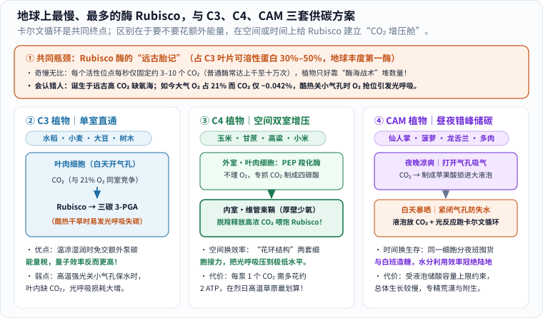

抱起一截沉甸甸的橡木柴火，或者仰望一棵几十吨重的参天大树，不妨先问一个看似幼稚、却困住了人类两千年的问题：**树越长越大，凭空多出来的这几吨坚硬木头，到底是从哪儿变出来的？**

“从土里长出来的呗！”——这是几乎所有人的第一反应。就连古希腊哲人亚里士多德也深信，植物就像把嘴巴埋在地下的动物，靠根系一点点“吃掉泥土”长出枝干。

可如果你仔细看一眼公园里几百岁古树的树根周围，地面并没有陷出一个几吨重的大深坑！真相说出来像变魔术一样反直觉：**整片森林的参天树干、你碗里的米饭和身上的棉衣，它们绝大部分的固体骨架，竟然是从看不见、摸不着的空气里“抓”出来的！** 植物有机物里的碳（$$\mathrm{C}$$），来自空气中含量仅约 **0.042%** 的二氧化碳（$$\mathrm{CO_2}$$）；而把这种极其稳定的气体锻造成高能有机物的动力，来自一亿五千万千米外的太阳光。

更妙的是，那束阳光本身并没有变成一克碳原子，而是帮碳原子换了一种高能量的化学处境；你我此刻吸进肺里的每一口氧气（$$\mathrm{O_2}$$），也不是从二氧化碳身上拆下来的，而是叶片用光能强行劈开水分子（$$\mathrm{H_2O}$$）留下的副产品！

要真正看懂这台支撑了地球 99% 生态系统的纳米级分子机器，死背“二氧化碳加水生成葡萄糖和氧气”的总式子毫无用处。今天，我们先跟着三百年科学侦探史去抓一次“真凶”，再钻进一片绿叶，把光合作用的**两份核心账本——“能量从哪来”和“碳往哪里去”**——一笔一笔算得明明白白。

### 先看总账单：不用背满屏酶名，先分清两套车间

_先读第一格的“能量账”（类囊体膜上的光反应），再读第二格的“碳账”（基质里的卡尔文循环），最后看第三格三碳产物的去向。橙色箭头依次描出一次表示上下游衔接关系，不代表真实分子反应速率。[单独打开，刷新可重播](/assets/images/archive-guides/photosynthesis.svg)。_

在正式出发前，先立下一个清晰的坐标：本文聚焦**绿色植物与藻类的产氧光合作用**。地球上还有没有叶绿体却同样能产氧光合的**蓝细菌**（叶绿体的远古祖先！），也有利用硫化氢（$$\mathrm{H_2S}$$）等物质、不释放氧气的厌氧光合细菌——千万别把自然界所有光合生物都硬塞进同一张叶绿体图纸里。

---

## 一、三百年科学侦探案：人类怎样一步步查清“树吃什么长大”？

今天课本上一行轻描淡写的光合作用方程，在科学史上其实是十几代实验家接力破获的一桩悬案。最精彩的莫过于其中四幕反转（相关实验脉络可对照 [OpenStax 生物学教材第 8 章](https://openstax.org/books/biology-2e/pages/8-1-overview-of-photosynthesis)）：

_从左往右读三座关键证据碑：① 1648 年海尔蒙特用天平推翻“吃土说”；② 1882 年恩格尔曼用三棱镜和好氧细菌找出叶绿素最爱吃的红光与蓝紫光；③ 1941 年鲁宾与卡门用重氧同位素 $$^{18}\mathrm{O}$$ 铁证氧气来自裂解水。[单独打开大图](/assets/images/photo-science/helmont-engelmann-ruben.svg)。_

### 1. 第一幕（1648）：海尔蒙特的五年柳树称重，与一个“美丽的误判”

十七世纪上半叶，佛兰德斯医生兼化学家**扬·巴普蒂斯塔·范·海尔蒙特（Jan Baptist van Helmont）**决定不再听古人空谈，而是搬出一杆真天平（实验结果于 1648 年遗著《医学起源》*Ortus Medicinae* 出版）。

他把 **200 磅（约 $$90.72\ \mathrm{kg}$$）** 泥土放进炉子里彻底烘干称重，装进大陶盆，种下一截重 **5 磅（约 $$2.27\ \mathrm{kg}$$）** 的柳树枝条。为了防止空中落灰掺假，他专门在盆口盖上打孔的镀锡铁板，整整 **5 年**里除了浇灌纯净雨水或蒸馏水，什么都不加。

五年后，海尔蒙特把长成小树的柳树连根拔起洗净称重，再把盆里的泥土重新烘干复秤——两组数字让全欧洲目瞪口呆：

- 柳树从 $$2.27\ \mathrm{kg}$$ 暴涨到了 **169 磅 3 盎司（约 $$76.8\ \mathrm{kg}$$）**，净增重约 **$$74.5\ \mathrm{kg}$$**；
- 陶盆里的干土重 **199 磅 14 盎司（约 $$90.66\ \mathrm{kg}$$）**——五年只少了区区 **2 盎司（约 $$57\ \mathrm{g}$$，还不到一颗鸡蛋重！）**！

柳树增加的体重，是泥土损失量的 **1300 多倍**！“植物靠吃泥土长出木头”的千年教条当场崩塌（顺便一提，泥土少掉的那 $$57\ \mathrm{g}$$ 并非毫无意义的误差——里面恰恰藏着植物不可或缺的氮、磷、钾、镁等**矿质元素**！土壤虽然不管供碳，却是水库和矿质营养仓库）。

有趣的是，海尔蒙特自己也掉进了一个时代盲区：既然泥土没少，他又只浇过水，于是他顺理成章宣布——“这 $$74.5\ \mathrm{kg}$$ 木头、树皮和根，全都是水直接变成的！”尽管海尔蒙特本人恰恰是发明“气体（gas）”一词的学者，在 17 世纪中叶他仍未意识到，柳树每天正张开成千上万个微孔，大口吞食着空气里看不见的二氧化碳。

### 2. 第二幕（1771–1779）：钟罩里的薄荷、老鼠，与“只在阳光下开工”的秘密

又过了一百多年，英国化学家**约瑟夫·普里斯特利（Joseph Priestley）**在 1771–1772 年做了一个轰动一时的密封玻璃钟罩实验：把一支点燃的蜡烛放进密封钟罩，火焰很快熄灭；放进一只小鼠，小鼠很快窒息昏迷——按当时的说法，空气被燃烧和呼吸“弄脏损伤”了。但如果往这团“坏空气”里放进一株活薄荷枝条，过几天再伸进蜡烛，蜡烛竟然又能重新熊熊燃烧，小鼠也能自如呼吸！

奇怪的是，当普里斯特利和其他学者重复这个实验时，有时灵验，有时却彻底失败，薄荷非但没救活空气，反而让空气更糟了。

谜底在 **1779 年**被荷兰医生**扬·英根豪斯（Jan Ingenhousz）**揭开。他在一个夏天里一口气做了五百多次严格对照实验，出版《植物实验》（*Experiments upon Vegetables*），一举抓住了两个此前没人留心的变量：

1. **必须有阳光！** 薄荷只有在阳光照射下才能净化空气（释放氧气）；一旦关进黑暗房间或到了夜晚，植物不仅停止造氧，还会像动物一样进行呼吸作用消耗氧气、呼出二氧化碳！普里斯特利之所以有时失败，正是因为把钟罩放在了阴暗角落。
2. **只有绿色部位才管用！** 花朵、果实、树根和木质茎干就算晒太阳也不会产氧，真正干活的只有叶片和嫩茎里的**绿色组织**。

随后在 18 世纪末至 1804 年，瑞士学者塞内比埃（Jean Senebier）与索绪尔（Nicolas-Théodore de Saussure）进一步用定量气体与干重天平证明：植物在阳光下吸收固定的是**二氧化碳**，同时水也实实在在参与了增重——海尔蒙特当年漏掉的那一半空气拼图，终于严丝合缝地扣上了。

### 3. 第三幕（1882）：恩格尔曼的三棱镜与“活体细菌传感器”

到了 1882 年，德国植物生理学家**西奥多·恩格尔曼（Theodor Wilhelm Engelmann）**想搞清楚一个更精细的问题：**阳光由红橙黄绿蓝靛紫七彩波长混合而成，叶绿体到底是来者不拒，还是“挑食”特定颜色的光？**

换作今天，你有高灵敏度溶氧电极和质谱仪；可在 1882 年，怎样测量一根头发丝般细的显微藻丝在不同颜色光斑下吐出的微量氧气？恩格尔曼想出了生物学史上最拍案叫绝的实验设计之一：

他在显微镜载玻片的水滴里放进一根细长的丝状绿藻（恩格尔曼在 1882 年论文及系列实验中使用过刚毛藻 *Cladophora* 与带螺旋叶绿体的水绵 *Spirogyra*），再往水里撒入一群**极度嗜好氧气的运动细菌**，封严盖玻片并排空原有空气。接着，他让一束白光穿过微型**三棱镜**，化作一道微缩彩虹，沿着藻丝从一端铺到另一端（从 $$400\ \mathrm{nm}$$ 紫光一路排到 $$700\ \mathrm{nm}$$ 红光）。

一开灯，奇迹出现了：原本四处游荡的好氧细菌，迅速像闻到香味的蜜蜂一样涌向藻丝，但它们并没有均匀排队，而是密密麻麻**挤成了两座高峰——一座在约 $$430\sim 460\ \mathrm{nm}$$ 的蓝紫光区，另一座在约 $$650\sim 670\ \mathrm{nm}$$ 的红光区；而中间 $$500\sim 560\ \mathrm{nm}$$ 的绿光地段却冷冷清清，几乎没几个细菌光顾！**

没有任何电子芯片，恩格尔曼借一群细菌的趋氧本能，亲手画出了人类第一张**光合作用产氧作用光谱（action spectrum）**，精准锁定了叶绿素吃光的胃口！

### 4. 第四幕（1941–1950s）：重氧 $$^{18}\mathrm{O}$$ 翻转百年直觉，与卡尔文的“棒棒糖”烧瓶

进入 20 世纪，还剩最后两道终极谜题：**氧气到底是从 $$\mathrm{CO_2}$$ 里拆出来的，还是从 $$\mathrm{H_2O}$$ 里拆出来的？二氧化碳钻进叶子后，第一步变成了什么分子？**

在长达一百多年里，连顶尖化学家都误以为：光合作用是把二氧化碳（$$\mathrm{CO_2}$$）劈成碳（$$\mathrm{C}$$）和氧气（$$\mathrm{O_2}$$），再让碳和水（$$\mathrm{H_2O}$$）抱在一起变成“碳水化合物（$$\mathrm{CH_2O}$$）”——你看，“碳水化合物”这个流传至今的名字本身就是当年那个猜想的活化石！

第一个敲响警钟的是微生物学家**科内利斯·范·尼尔（Cornelis van Niel）**。他在 1931 年对比紫硫细菌时发现：这类细菌做光合作用不吃水，而是吃硫化氢（$$\mathrm{H_2S}$$）和 $$\mathrm{CO_2}$$，结果吐出来的不是氧气，而是一颗颗黄色的单质**硫磺（$$\mathrm{S}$$）**！按类比推理：既然细菌吐出的硫来自 $$\mathrm{H_2S}$$，那绿色植物吐出的氧，岂不是应该来自 **$$\mathrm{H_2O}$$**？！

推理想法再漂亮，也得靠铁证拍板。**1941 年**，加州大学伯克利分校的**塞缪尔·鲁宾（Samuel Ruben）、马丁·卡门（Martin Kamen）**与同事利用比普通氧原子（$$^{16}\mathrm{O}$$）多两个中子的稳定重氧同位素 **$$^{18}\mathrm{O}$$**，给小球藻（*Chlorella*）设计了两组无可辩驳的追踪实验（发表于《美国化学会志》*JACS*）：

- **甲组（给水挂上重氧车牌）**：提供重氧水 $$\mathrm{H_2{}^{18}O}$$ 和普通 $$\mathrm{C{}^{16}O_2}$$ ——质谱仪测出吐出来的氧气全是沉甸甸的 **$$^{18}\mathrm{O_2}$$**！
- **乙组（给二氧化碳挂重氧车牌）**：提供普通水 $$\mathrm{H_2{}^{16}O}$$ 和重氧 $$\mathrm{C{}^{18}O_2}$$ ——最初吐出来的氧气全是普通的 **$$^{16}\mathrm{O_2}$$**！

案子彻底破了：**地球大气里供万物呼吸的氧气，100% 来自光系统对水分子的裂解！**

紧接着在 1940 年代末至 1950 年代初，同样在伯克利的**梅尔文·卡尔文（Melvin Calvin）、安德鲁·本森（Andrew Benson）与詹姆斯·巴萨姆（James Bassham）**接过了放射性碳同位素 **$$^{14}\mathrm{C}$$** 的接力棒。他们把单细胞绿藻装进一只扁平透明、长得酷似“棒棒糖（lollipop）”的玻璃薄瓶里照光，打入一针放射性 $$^{14}\mathrm{CO_2}$$，每隔 **30 秒、10 秒、甚至短短 2 秒**就拧开底部阀门，把绿藻直接放进滚烫的甲醇里瞬间“喊停”所有酶反应，再用双向纸层析和X光胶片显影抓捕带放射性的分子——结果发现哪怕只照光几秒钟，$$^{14}\mathrm{C}$$ 就已经稳稳钻进了一个**三碳化合物（3-磷酸甘油酸，3-PGA）**里！卡尔文也因此独享了 [1961 年诺贝尔化学奖](https://www.nobelprize.org/prizes/chemistry/1961/calvin/facts/)。

---

## 二、走进叶肉车间，顺便解开一个怪问题：叶子为什么是绿色而不是全黑？

破完了三百年历史悬案，现在我们把镜头推进一片活生生的绿叶内部，去看看分子机器到底摆在哪儿：

_先认出右上叶肉细胞里一颗颗绿色的叶绿体，再读下方叶绿体剖面：一摞摞叠像铜钱扁囊的是**类囊体**（不是许多小叶绿体），膜围住的内部窄缝叫**类囊体腔**，扁囊外头、叶绿体双层包膜里头的液态空间叫**基质**。各层为看清结构分别放大，不能直接量图上尺寸算真实比例。[单独放大看结构](/assets/images/deep-science/leaf-map.svg)。_

原料进门走的就不是同一条通道：

- **二氧化碳**走“气路”：穿过叶片表皮（多集中在较阴凉的叶背面以减少暴晒失水）由一对保卫细胞把守的**气孔（stomata）**，经细胞间隙扩散进叶绿体**基质**；
- **水**走“水路”：由根系从土壤吸收，顺木质部导管一路抽上叶脉，送进类囊体；
- **光子**走“光路”：穿透透明表皮，直接撞上镶嵌在**类囊体膜**上的光合色素。

就在这里，许多爱动脑筋的读者都会停下来问一个极犀利的问题：**既然植物靠吃太阳光过日子，太阳光谱在绿光附近（约 $$500\sim 550\ \mathrm{nm}$$）明明能量很充沛，树叶为什么不干脆长成漆黑一片，把 100% 可见光全吞进肚子里，偏偏要把绿光反射出来变成绿色呢？**

_先看左图横轴的可见光波长（$$400\sim 700\ \mathrm{nm}$$）：实线叶绿素 a（乙醚中峰值约 $$430\ \mathrm{nm}$$、$$662\ \mathrm{nm}$$）与虚线叶绿素 b（约 $$453\ \mathrm{nm}$$、$$642\ \mathrm{nm}$$）联手吃掉蓝紫光与红橙光，点线类胡萝卜素补吃蓝绿光，唯独在中间 $$500\sim 560\ \mathrm{nm}$$ 留出一道低吸收窗口。右图解释为什么“全黑叶片”在真实自然界反而吃亏，以及秋叶变黄变红的养分回收账。[单独打开大图](/assets/images/photo-science/chlorophyll-spectrum-autumn.svg)。_

### 1. 为什么不长成黑色？整片叶子的“上下楼分光术”与正午防烧伤

把色素提取到试管有机溶剂里测光谱（活体类囊体膜内由于色素与蛋白质结合，吸收峰会比乙醚溶剂略微向长波红移 $$10\sim 20\ \mathrm{nm}$$，这才有了后面专门吸收 $$680\ \mathrm{nm}$$ 和 $$700\ \mathrm{nm}$$ 的反应中心），叶绿素确实对绿光胃口最小。但植物生理学家测量**整片完整活叶**时发现，这里藏着两层精妙的工程权衡（详见 [OpenStax 8.2 光反应与色素章节](https://openstax.org/books/biology-2e/pages/8-2-the-light-dependent-reactions-of-photosynthesis)）：

1. **红蓝光喂饱“楼上”，绿光穿透喂饱“楼下”！** 一片叶子并不是单层平面，而是有好几层细胞厚的立体工厂：紧贴上表皮的是排列紧密的栅栏组织叶肉细胞，下面是疏松多缝隙的海绵组织叶肉细胞。叶绿素对蓝光和红光吸收太猛，阳光刚照进表层头一两层叶绿体，90% 以上的红蓝光子就被抢光了！如果叶绿素对绿光也同样死死拦截，叶片上半截会撑得消化不良，下半截叶肉细胞却会终日伸手不见五指“饿肚子”。正因为单颗叶绿素对绿光吸收率低，绿光子才能在细胞壁与气隙间反复折射散射、深入叶片下半层——算总账时，**一片健康厚绿叶其实照样吸收掉了约 70%～80% 的入射绿光**，只把剩下那一两成反射和透射出来，在人眼看来就成了柔和的翠绿！
2. **正午强光不是“嫌少”，而是“怕撑爆”！** 晴朗夏日的正午，阳光光子洪流远超叶绿体下游固碳酶（特别是慢吞吞的 Rubisco）的处理上限。如果叶片当真做成吸光率 100% 的黑体，多余光能既会导致叶温飙升、迫使气孔关闭或剧烈蒸腾失水，还会让来不及交接的高能激发态叶绿素把能量误传给氧气，生成极具破坏力的单线态活性氧（光氧化漂白损伤）！事实上，类囊体膜上的**类胡萝卜素**除了帮忙补吸蓝紫光，最重要的本职工作就是充当“防过载泄洪阀”（非光化学猝灭 NPQ）：在强光暴晒时把过剩激发能安全转成热能散掉。至于远古海洋早期光合生物为何最初选定叶绿素这套分子骨架，也有学者提出过“早期嗜盐古菌视紫红质先占领绿光波段、蓝细菌祖先错位利用两侧红蓝光”的演化生态位假说——历史路径与现代叶片光学分工共同塑造了这抹绿色。

### 2. 顺手破案：秋天树叶变黄、变红，不是“冻坏了”，是在忙着搬家！

看懂了上面的色素光谱图，孩子每年秋天捡落叶时必问的另一个问题也迎刃而解：**秋天树叶为什么会变黄、变红？**

- **为什么变黄（银杏、杨树、梧桐）？那是“拆绿棚、露黄底”的节俭搬家！** 仔细看叶绿素的分子结构，它中央嵌着一颗镁离子（$$\mathrm{Mg^{2+}}$$），四周卟啉环上更镶着 **4 个宝贵的氮原子（$$\mathrm{N}$$）**——对陆生植物来说，土壤里的有效氮是最稀缺的营养硬通货！入秋日照变短、气温转凉，落叶树在丢弃叶片过冬前，绝不会败家地把满叶子的氮白白扔进泥土，而是启动一套精密程序，主动拆解叶绿素分子，把超过一半的氮和镁回收运回树枝和树干储存起来，留待明年春天发新芽；而只由碳和氢（或少量氧）组成、不含氮的**类胡萝卜素（叶黄素、$$\beta$$-胡萝卜素）**平时一直都在叶子里，只是夏天被浓重的绿色盖住了，叶绿素一撤退，原本的金黄色底牌就亮了出来！
- **为什么变红（枫树、黄栌、乌桕）？那是临时新撑起的“红色防晒伞”！** 许多变红树种的叶片在夏天并没有花青素，而是在秋日“白天阳光依然刺眼、夜晚低温让运输变慢”的拆迁期，专门在细胞液泡里**新合成出红色的花青素（anthocyanins）**。为什么快落叶了还要费力造红衣服？主流植物生理学解释（光保护假说）指出：失去叶绿素协调的衰老叶肉极易被秋日强光晒出活性氧损伤，花青素能挡掉多余蓝绿光，像一把遮阳伞掩护叶肉细胞把最后一批氮、磷养分安全撤回树干！

---

## 三、第一份账（能量账）：水的电子怎样靠两颗光子爬上“Z 字形”悬崖？

找准了类囊体膜这个主舞台，我们正式翻开第一本账：**光反应（Light-dependent reactions）到底用阳光干了什么？**

先把最容易误导人的比喻扫清：阳光照进类囊体，既不是“把水烧热拆开”，也不是让同一个电子像跑马拉松一样从树叶边缘跑到树叶中央。真实发生的事情，是一场受热力学严格支配的**跨膜电子攀岩赛**。

### 1. 算一笔电压账：为什么水不会自己把电子送给 $$\mathrm{NADP^+}$$？

化学家衡量不同分子“抓电子有多紧”，用的是 pH 7 条件下的**标准氧化还原电位 $$E_0'$$（单位：伏特 $$\mathrm{V}$$）**。规则非常直观：

- **电位 $$E_0'$$ 越正**，说明这个体系越贪婪地抓紧电子（强氧化剂，电子待在里面能量很低、很安稳）；
- **电位 $$E_0'$$ 越负**，说明电子待在高能山顶上，随时准备往下跳去还原别人（强还原剂，富含可用化学自由能）。

现在看看绿色植物面对的“地狱级开局”：

- 植物选定的电子原料是地球上到处都有的**水（$$\mathrm{H_2O}$$）**。可水分子极其稳定，$$\mathrm{\frac{1}{2}O_2 / H_2O}$$ 电对的电位高达 **$$E_0' = +0.82\ \mathrm{V}$$**——氧原子把电子攥得死死的！
- 而植物要把二氧化碳还原成糖，需要先把电子塞给辅酶 $$\mathrm{NADP^+}$$ 制成高能还原力载体 **$$\mathrm{NADPH}$$**，它的电位高高悬在 **$$E_0' = -0.32\ \mathrm{V}$$**！

从 $$+0.82\ \mathrm{V}$$ 硬往上推到 $$-0.32\ \mathrm{V}$$，净逆坡跨度高达 **$$\Delta E_0' = -1.14\ \mathrm{V}$$**！按电化学自由能公式 $$\Delta G^{\circ\prime} = -n F \Delta E_0'$$（法拉第常数 $$F \approx 96.5\ \mathrm{kJ/(mol\cdot V)}$$），每裂解 2 个水分子放出 1 个 $$\mathrm{O_2}$$ 要搬运 $$n = 4$$ 个电子，光这一项标准自由能门槛就高达 **$$+440\ \mathrm{kJ/mol}$$**，更别提中途还得顺手泵氢离子制造另一笔硬通货 **ATP**！

一颗 $$680\ \mathrm{nm}$$ 的红光光子（能量约 $$1.82\ \mathrm{eV}$$，折合 $$176\ \mathrm{kJ/mol}$$），在扣掉防止电子倒流复合所必需的能量损耗后，既要造出比 $$+0.82\ \mathrm{V}$$ 更狠的超级氧化剂去抢水的电子，又要一路推上 $$-0.32\ \mathrm{V}$$ 还要留余力造 ATP，单靠一套光系统根本力不从心。

可是在二十世纪中叶，科学家还没法给纳米级的膜蛋白直接拍高清照片，他们是怎么发现叶绿体里藏着**两套**串联光系统的呢？这又要归功于美国植物生理学家**罗伯特·爱默生（Robert Emerson）**抓到的一个反常怪象：

- **“红降现象”（Red Drop，Emerson & Lewis, 1943）**：当实验人员用单色光一档一档往长波方向测试绿藻产氧效率时，发现波长一旦越过 **$$680\ \mathrm{nm}$$** 进入远红光区（比如 $$700\ \mathrm{nm}$$），尽管叶绿素明明还在吸收一部分光，光合产氧效率却突然像踩空台阶一样断崖式暴跌！
- **“双光增益效应”（Emerson Enhancement Effect，1957 年发表于 *PNAS*）**：更神奇的事情发生了！单独照一束 $$700\ \mathrm{nm}$$ 远红光，产氧慢得可怜；单独照一束 $$650\ \mathrm{nm}$$ 短波红光，产氧速度中等；**可如果把这两束光同时打在绿藻上，总产氧速度竟然远远超过了“两束光单独照射之和”（$$1 + 1 > 2$$）！**

为什么两束不同波长的光凑在一起会互相“解锁”？**1960 年**，英国生物化学家**罗宾·希尔（Robin Hill）与费伊·本德尔（Fay Bendall）**在《自然》（*Nature*）杂志上给出了石破天惊的解答：因为类囊体膜上根本不是只有一台光机器，而是**两台胃口略有不同的光系统前后串联**！第一台（反应中心峰值约 $$680\ \mathrm{nm}$$，叫 **P680 / 光系统 II**）吃不了 $$700\ \mathrm{nm}$$ 的远红光；第二台（反应中心峰值约 $$700\ \mathrm{nm}$$，叫 **P700 / 光系统 I**）却能吃 $$700\ \mathrm{nm}$$！只照 $$700\ \mathrm{nm}$$ 时，下游二号车间空转，上游一号车间停工断货；一旦补上 $$650\ \mathrm{nm}$$ 红光喂饱上游一号车间，整条串联流水线瞬间全速贯通！由于科学史上先分离鉴定出含 P700 的光系统 I、后摸清含 P680 的光系统 II，才留下了**“光系统 II 先上场、光系统 I 后接力”**这个有趣的命名倒置。

这就是自然界最精妙的双级串联接力方案——**“Z 字形”能量阶梯（Z-scheme）**！

_纵轴越往上电位 $$E_0'$$ 越负、电子能量越高。顺着左下角水的 $$+0.82\ \mathrm{V}$$ 出发：先被 $$+1.20\ \mathrm{V}$$ 的 $$\mathrm{P680^+}$$ 夺走电子 → 橙色竖箭头（光子①）第一次托举到 $$-0.80\ \mathrm{V}$$ → 蓝色斜坡顺势滑向 $$\mathrm{Cyt\ b_6f}$$ 泵氢离子产 ATP → 绿色竖箭头（光子②）第二次托举到 $$-1.25\ \mathrm{V}$$ → 最终落入 $$-0.32\ \mathrm{V}$$ 合成 $$\mathrm{NADPH}$$！[单独打开大图](/assets/images/photo-science/z-scheme-redox.svg)。_

再把这张“能量高低图”贴回真实的**类囊体膜空间剖面**上对照着读，你就再也不会搞混电子和氢离子的路线了：

_结合上一张电位图一起读：横向蓝色实线（配橙色描线动画）是电子在膜蛋白间的传递去向；纵向虚线是 $$\mathrm{H^+}$$ 从外部基质泵入内部类囊体腔的方向。两套光系统编号按科学史发现先后命名，因此**光系统 II（PSII）先出场，光系统 I（PSI）后接棒**。[单独打开，刷新可重播](/assets/images/deep-science/light-reactions.svg)。_

让我们跟着水的电子走完这惊心动魄的四步：

1. **第一跳（光系统 II，P680）：造出地球生物界最强氧化剂，劈开水分子！**
   周围几百个天线色素分子吸收光子后，像接力敲钟一样把**激发能**（注意：传的是能量，不是电子本身在乱跑！）汇聚到反应中心一对特殊的叶绿素 a 分子 **P680** 上。吸收一颗光子能量的 $$\mathrm{P680^*}$$ 电位瞬间跃升到约 **$$-0.80\ \mathrm{V}$$**，把高能电子交出去；失去电子后的空穴 **$$\mathrm{P680^+}$$** 电位高达恐怖的 **$$+1.20\ \mathrm{V}$$**——这是已知生物世界里抢电子最凶狠的氧化剂，比水的 $$+0.82\ \mathrm{V}$$ 还要强出一大截！
   在含锰钙簇（$$\mathrm{Mn_4CaO_5}$$）的**放氧复合体**催化下，四次单电子夺取累积起来，在类囊体腔一侧把两分子水拆开：

   $$
   2\mathrm{H_2O} \longrightarrow \mathrm{O_2} + 4\mathrm{H^+} + 4e^-
   $$

   自己动手核对一次原子和电荷守恒：左边 4 个氢、2 个氧、总电荷为 0；右边 1 个氧分子（$$\mathrm{O_2}$$）、4 个留在类囊体腔里的氢离子（$$4\mathrm{H^+}$$）和 4 个补进反应中心的电子（$$4e^-$$），分毫不差！这也再次印证：**1 个水分子拆不出 1 个氧气分子，必须拆开 2 个 $$\mathrm{H_2O}$$ 搬走 4 个电子，才能凑齐 1 个 $$\mathrm{O_2}$$；而在两套光系统串联下，搬运 4 个电子至少需要吸收 $$4 + 4 = 8$$ 颗光子！**

2. **中段滑坡（质体醌 PQ → 细胞色素 $$\mathrm{b_6f}$$ → 质体蓝素 PC）：顺坡发电攒质子！**
   从 $$\mathrm{P680^*}$$（$$-0.80\ \mathrm{V}$$）交出来的电子，顺着电位斜坡一路往下传到光系统 I 的 $$\mathrm{P700}$$（$$+0.43\ \mathrm{V}$$）。这段下坡释放的自由能没有白白浪费——脂溶性的质体醌（PQ）与跨膜蛋白复合体 **$$\mathrm{Cyt\ b_6f}$$** 配合，把叶绿体基质里的氢离子（$$\mathrm{H^+}$$）源源不断泵进狭窄的类囊体腔里！

3. **第二跳（光系统 I，P700）：冲顶制造还原力 $$\mathrm{NADPH}$$！**
   到了光系统 I，第二颗光子（波长直至 $$700\ \mathrm{nm}$$）再次发力，把 $$\mathrm{P700}$$ 猛然托举到约 **$$-1.25\ \mathrm{V}$$** 的 $$\mathrm{P700^*}$$ 高峰！电子随后交给铁氧还蛋白（$$\mathrm{Fd}$$，$$-0.43\ \mathrm{V}$$），在基质一侧由酶催化合成 **$$\mathrm{NADPH}$$**（$$-0.32\ \mathrm{V}$$）。
   如果基质里卡尔文循环急需更多 ATP、而 $$\mathrm{NADPH}$$ 暂时够用怎么办？植物还会聪明地切一部分电子走图上紫色虚线的**循环电子流（Cyclic electron flow）**：让铁氧还蛋白把电子绕回 $$\mathrm{Cyt\ b_6f}$$ 再滑一次坡，**只额外泵氢离子多造 ATP，不产 $$\mathrm{NADPH}$$ 也不放氧**，灵活配平下游账单！

### 2. 为什么要隔一层膜？叶绿体与线粒体共用的“分子水轮机”

现在，类囊体腔里既攒了裂解水留下的 $$\mathrm{H^+}$$，又攒了传递链从基质泵进来的 $$\mathrm{H^+}$$（照光时腔内可酸化到 $$\mathrm{pH}\approx 5.5\sim 6.0$$，而外头基质升至 $$\mathrm{pH}\approx 8.0$$，氢离子浓度相差上百倍！）。

英国生物化学家彼得·米切尔（Peter Mitchell，1978 年诺贝尔化学奖得主）提出的**化学渗透学说（Chemiosmotic theory）**揭示了生命世界最伟大的通用设计：

_先看上半图叶绿体：$$\mathrm{H^+}$$ 被泵进封闭的类囊体腔，再顺电化学势差冲过膜上的 **ATP 合酶**回到叶绿体基质，驱动 ADP 与磷酸合成 ATP；再对照下半图线粒体：$$\mathrm{H^+}$$ 积累在内外膜之间的膜间隙，回流线粒体基质同样驱动 ATP 合酶！两套细胞器的空间朝向按各自结构定义，背后的物理机制如出一辙。[单独打开膜示意图](/assets/images/archive-guides/proton-gradient.svg)。_

**为什么这层脂质膜绝不能破洞漏气？** 因为只有膜把两侧严密隔开，攒起来的**跨膜电化学质子梯度**（既包含 $$\mathrm{H^+}$$ 浓度差 $$\Delta\mathrm{pH}$$，也包含带正电离子造成的跨膜电势差 $$\Delta\psi$$）才不会瞬间白白漏光。当氢离子唯一能走的出口只剩下镶在膜上的纳米级旋转马达——**ATP 合酶（ATP synthase）**时，离子洪流就会像水流推动水轮机转子一样，以每秒上百圈的转速扭动蛋白构象，把机械能压进化学键里，源源不断合成 **ATP**！

到这里，光反应的账单圆满交卷：阳光被转化成了基质里寿命极短、随时待命的两样硬通货——**偏重供能的 ATP**，和**携带高能电子提供还原力的 $$\mathrm{NADPH}$$**。

---

## 四、第二份账（碳账）：跟着 18 个碳圆点，算懂卡尔文循环为什么“造六份只拿走一份”

带着热乎的 ATP 和 $$\mathrm{NADPH}$$，我们转身走进类囊体膜外头的**叶绿体基质**。这里正在运转第二本账：**卡尔文循环（Calvin–Benson cycle）**（详见 [OpenStax 8.3 卡尔文循环章节](https://openstax.org/books/biology-2e/pages/8-3-using-light-energy-to-make-organic-molecules)）。

先替它摘掉一顶耽误了无数学生的旧帽子——**千万别再叫它“暗反应”并误以为它只在半夜干活！** 它确实不直接吸收光子，但在真实绿叶里，卡尔文循环恰恰主要在**白天有光时**高速运转：一方面光反应制造的 ATP 和 $$\mathrm{NADPH}$$ 寿命极短（微秒到毫秒级周转），一旦关灯断供，循环几十秒内就会停摆；另一方面，卡尔文循环里的好几种关键酶本身就需要光反应引发的基质 $$\mathrm{pH}$$ 升高、镁离子涌出和硫氧还蛋白还原开关来“点火激活”！

那么，二氧化碳（$$\mathrm{CO_2}$$）里的碳原子处在最高氧化态（$$+4$$ 价），怎样用 ATP 和 $$\mathrm{NADPH}$$ 把它焊接成高能糖骨架？如果一个碳一个碳零散着数，很容易数迷糊；**只要一次拿 3 个 $$\mathrm{CO_2}$$ 进场，盯着全部 18 个碳圆点数一遍，小学生也能当场看穿它的奥秘！**

_每个实心圆点代表 1 个碳原子。先数第一格：3 个橙色碳（来自 $$3\ \mathrm{CO_2}$$）加上 3 串五碳受体 RuBP（$$3\times 5 = 15$$ 个绿色碳），合计 **18 个碳**；第二格：劈成 $$6\times 3 = 18$$ 个碳的三碳分子并还原为 6 份 G3P；第三格最关键：**只净拿走左边 1 份三碳 G3P（3 个碳）**，右边剩下的 5 份（15 个碳）必须花 3 个 ATP 重新拼回 3 个五碳 RuBP！[单独打开碳账图](/assets/images/deep-science/calvin-carbon.svg)。_

跟着三格画面，把三步账单拍在桌上：

1. **第一步：碳固定（$$3 + 15 = 18$$ 个碳）**
   基质里早就准备好了 3 个五碳“接货托盘”——**1,5-二磷酸核酮糖（RuBP，每个含 5 个碳）**。在 **Rubisco 酶**催化下，3 个一碳的 $$\mathrm{CO_2}$$ 一对一扣到 3 个五碳 RuBP 上；不稳定的六碳中间体瞬间一分为二，裂成 **6 个三碳分子——3-磷酸甘油酸（3-PGA）**。数数碳总数：$$3\times 1 + 3\times 5 = 6\times 3 = 18$$，一颗碳没丢！
2. **第二步：还原（砸下 6 ATP + 6 NADPH，充能成高能三碳糖）**
   6 个 3-PGA 能量还不够高。先由 **6 个 ATP** 各送上一份高能磷酸基团，再由 **6 个 $$\mathrm{NADPH}$$** 送上高能电子完成还原，摇身一变成为 **6 个甘油醛-3-磷酸（G3P，三碳糖磷酸）**。注意，此时碳点总数依然是 $$6\times 3 = 18$$ 个。
3. **第三步：分流与受体再生（为什么造出 6 份，却只准拿走 1 份？！）**
   这是全书最精妙的一笔账！明明手头已经有 6 个 G3P 了，为什么植物不贪心地把 6 个全搬走去造葡萄糖？
   **因为如果把 6 份全搬空，工厂里接下一批 $$\mathrm{CO_2}$$ 用的五碳托盘 RuBP 就彻底归零，整条流水线下一秒就会瘫痪！** 为了让机器生生不息地转下去，植物只从 18 个碳里**净领走 1 个三碳 G3P（3 个碳，正好等于本轮新吸进来的 3 个 $$\mathrm{CO_2}$$ 碳数！）**；剩下 **5 个三碳 G3P（$$5\times 3 = 15$$ 个碳）**留在车间里，再花掉 **3 个 ATP**，经过一连串巧妙的五碳、六碳、七碳重排，分毫不差地重新组装成 **3 个五碳 RuBP（$$3\times 5 = 15$$ 个碳）**，回到起点迎接下一批二氧化碳！

现在合上账本算净成本：

- 每**净赚 1 个三碳 G3P**（转了 3 圈固定 3 个 $$\mathrm{CO_2}$$），还原阶段花 6 个 ATP + 6 个 $$\mathrm{NADPH}$$，再生阶段再花 3 个 ATP，合计消耗 **9 个 ATP 和 6 个 $$\mathrm{NADPH}$$**（比例正好是 $$3:2$$！）。
- 如果要拼出 1 个我们熟悉的**六碳葡萄糖（$$\mathrm{C_6H_{12}O_6}$$）骨架**，就需要攒够 **2 个净产出的 G3P**——也就是固定 **6 个 $$\mathrm{CO_2}$$**，消耗 **18 个 ATP 和 12 个 $$\mathrm{NADPH}$$**！而 G3P 运出叶绿体后，既可以拼成蔗糖沿着韧皮部送往树根和果实，也可以留在叶绿体里聚合成淀粉过夜，或者做成支撑整棵参天大树挺拔不倒的**纤维素**细胞壁。

### 回头再看那行课本总方程：为什么严谨写该配“12 个水”？

算清了两份账，我们再回头看中学课本里最眼熟的那行净概括式：

$$
6\mathrm{CO_2} + 6\mathrm{H_2O} \xrightarrow{\text{光能}} \mathrm{C_6H_{12}O_6} + 6\mathrm{O_2}
$$

只查左右两边净原子总数，它确实配平了；**但如果你还记得前面鲁宾和卡门的 $$^{18}\mathrm{O}$$ 重氧追踪铁证，立刻就能揪出这行简写式藏起来的一个大秘密！**

右边放出了 $$6\ \mathrm{O_2}$$，一共 **12 个氧原子**。既然实验已经证明释放的氧气 **100% 来自水**，那么左边只有 $$6\ \mathrm{H_2O}$$（总共才 6 个水氧原子！）怎么够凑出 12 个氧原子呢？！

真相是：每合成一分子六碳糖当量，光反应其实至少要**劈开 12 个水分子**才能放出 $$6\ \mathrm{O_2}$$；与此同时，卡尔文循环还原 $$\mathrm{CO_2}$$ 中的氧原子时，又在产物一侧**新生成了 6 个水分子**！把两边抵消前的真实来去写全，总反应式其实是：

$$
6\mathrm{CO_2} + 12\mathrm{H_2O^*} \xrightarrow{\text{光能}} \mathrm{C_6H_{12}O_6} + 6\mathrm{O_2^*} + 6\mathrm{H_2O}
$$

星号 `$$*$$` 标出的氧原子全部来自原料水！这就是为什么不能把净化学方程式当成“一步碰撞反应”来硬背——看懂了电子账和同位素账，一行普通式子背后藏着的原子迁徙史立刻活了过来。

### 一张表核对两份总账：谁在哪儿交接了什么？

走到这里，不妨停下来用一张总对账表，把叶绿体里两套车间的进出货物一次锁死，再也不会把电子、氢离子和碳原子搅成一锅粥：

| 对账维度 | 第一份账：光反应（能量账） | 第二份账：卡尔文循环（碳账） | 最容易踩空的误区 |
|---|---|---|---|
| **工作车间** | 类囊体膜（水裂解与质子积累在**类囊体腔**，ATP 与 $$\mathrm{NADPH}$$ 生成于膜外侧） | **叶绿体基质**（类囊体外、叶绿体内膜里的液态空间） | 别把类囊体腔和基质搞反，也别以为光线直接照在 $$\mathrm{CO_2}$$ 上造糖 |
| **核心输入** | 光子（至少 8 颗/$$\mathrm{O_2}$$）、$$\mathrm{H_2O}$$、$$\mathrm{ADP + P_i}$$、$$\mathrm{NADP^+}$$ | $$3\ \mathrm{CO_2}$$、$$9\ \mathrm{ATP}$$、$$6\ \mathrm{NADPH}$$（以净产 1 个 G3P 计） | 卡尔文循环虽不直接吸光，但依赖光反应产物与光激活调控，主要在白天运转 |
| **核心输出** | $$\mathrm{O_2}$$（排向大气或供呼吸）、**ATP**、**$$\mathrm{NADPH}$$** | **净产 1 个三碳 G3P**，并把 $$\mathrm{ADP + P_i}$$ 和 $$\mathrm{NADP^+}$$ 退回类囊体膜循环充电 | 6 个 G3P 里必须留 5 个（15 碳）再生 3 个五碳 RuBP 托盘，不能全拿走 |
| **元素追踪** | 水中的**氧**全部变成 $$\mathrm{O_2}$$；电子与氢参与还原力传递 | $$\mathrm{CO_2}$$ 中的**碳和部分氧**进入糖骨架，多余氧结合氢新生成水 | 呼吸的氧气不是从 $$\mathrm{CO_2}$$ 上拆下来的！ |

---

## 五、地球上最慢、最多的酶 Rubisco，与玉米、仙人掌的“增压外挂”

按理说，叶绿体这套系统已经运转了二三十亿年，应该早就被自然选择打磨得十全十美了吧？

恰恰相反！整套光合流水线上最核心的第一步——负责抓二氧化碳的 **Rubisco 酶**（全名：1,5-二磷酸核酮糖羧化酶/加氧酶），竟然有一身让人哭笑不得的“老毛病”！

_先读顶部橙色横幅理解共同瓶颈：Rubisco 既慢又容易把 $$\mathrm{O_2}$$ 错当成 $$\mathrm{CO_2}$$；再横向对比下方三栏方案：② C3 植物（水稻、小麦）单室直通；③ C4 植物（玉米、甘蔗）用两层细胞做**空间增压**；④ CAM 植物（仙人掌、菠萝）用黑夜与白昼做**时间错峰**。[单独打开大图](/assets/images/photo-science/c3-c4-cam-pumps.svg)。_

### 1. 演化留下的历史包袱：为什么 Rubisco 既慢又“脸盲”？

把生物体内的酶拉出来比手速：人体和植物里处理碳酸平衡的碳酸酐酶，每个活性位点每秒能催化 **$$10^5\sim 10^6$$ 个**分子；许多常见代谢酶每秒也能轻松干掉几百到几千个分子。而堂堂 Rubisco 呢？**每个活性位点每秒钟只能慢吞吞固定约 3～10 个 $$\mathrm{CO_2}$$ 分子！**

为了弥补单个工人的慢手速，植物只好使出最笨也最震撼的“酶海战术”：在一片普通菠菜或小麦叶子里，**光 Rubisco 一种酶就占了叶片全部可溶性蛋白质的 30%～50%！** 定量生物学家（如 Bar-On & Milo 2019 等统计）估算，全球陆地与海洋里的 Rubisco 加起来总重达数千万至上亿吨级，稳坐**地球上含量最丰富的蛋白质头把交椅**。

更要命的是它的第二个毛病——**“脸盲”（全名里那个“加氧酶 oxygenase”暴露了案底）**：

Rubisco 诞生在三十多亿年前的远古海洋里（可参看本站姊妹篇《[为什么地球能孕育生命]()》）：当年空气和海水里到处是高浓度 $$\mathrm{CO_2}$$，游离氧气几乎为零，它根本不需要演化出严防氧气的识别能力。没想到蓝细菌和植物自己太能干，硬生生把今天的大气改造成了 **约 21% 氧气、仅约 0.042% 二氧化碳**（氧气浓度是二氧化碳的约 500 倍！）的世界！

结果在今天，每当酷暑烈日当头，水稻、小麦等植物为了防止叶片干死而关小气孔时，叶肉内部 $$\mathrm{CO_2}$$ 越用越少，光反应吐出的 $$\mathrm{O_2}$$ 却越积越多——“脸盲”的 Rubisco 就会频频抓错人，把 **$$\mathrm{O_2}$$** 焊到五碳 RuBP 上！这就触发了高代价的**光呼吸（Photorespiration）**：植物不得不调动叶绿体、过氧化物酶体和线粒体三大车间联合抢救，倒贴 ATP 和还原力，还把好不容易固定下来的碳又以 $$\mathrm{CO_2}$$ 形式白白放跑了一截（高温下可折损 C3 植物 25% 以上的固碳潜力；当然光呼吸在高光强下也能帮着耗散部分过剩能量、参与氮硫代谢，不能简单骂成“毫无用处的纯bug”）。

### 2. C3、C4 与 CAM：三种植物怎样按气候环境算经济账？

既然改不动 Rubisco 这颗千年老心脏的结构，在炎热草原和极端荒漠里闯荡的植物，干脆在它外围加装了两套绝妙的 **“$$\mathrm{CO_2}$$ 涡轮增压泵”**：

1. **C3 植物（单室直通派：水稻、小麦、大豆、棉花与绝大多数乔木）**
   $$\mathrm{CO_2}$$ 进叶肉细胞直接交由 Rubisco 固定成三碳 3-PGA（所以叫 C3）。在**温和、凉爽、水分充足**的环境里，气孔敞开，光呼吸本来就不高，C3 植物不用交任何额外的“泵碳电费”，利用弱光的量子效率反而比 C4 更高！
2. **C4 植物（空间双室增压派：玉米、甘蔗、高粱、小米）**
   切开一片玉米叶，你会看到维管束周围裹着一圈厚壁的**维管束鞘细胞**，外头再围一圈**叶肉细胞**（俗称“花环结构” Kranz anatomy）。外室叶肉细胞根本不放 Rubisco，而是派出一员专情猛将——**PEP 羧化酶**：它对 $$\mathrm{O_2}$$ 完全免疫，专挑 $$\mathrm{CO_2}$$（以 $$\mathrm{HCO_3^-}$$ 形式）抓，合成**四碳有机酸**（所以叫 C4），再泵进内室密闭少氧的维管束鞘细胞里集中脱羧放出高浓度 $$\mathrm{CO_2}$$，把里面的 Rubisco 喂得饱饱的！虽然每泵 1 个 $$\mathrm{CO_2}$$ 大约要多花 **2 个 ATP** 的跑腿费，但在夏日烈日高温下，省下来的光呼吸损耗远超门票钱——难怪盛夏玉米地疯长得像青纱帐！
3. **CAM 植物（昼夜错峰派：仙人掌、菠萝、龙舌兰、景天科多肉）**
   如果到了白天四十多度、开一秒气孔都嫌浪费水的沙漠怎么办？景天酸代谢（Crassulacean Acid Metabolism，简称 **CAM**）植物干脆把“外室和内室”拆成了**“夜班和白班”**：
   - **凉爽夜晚**：打开气孔吸进 $$\mathrm{CO_2}$$，同样用 PEP 羧化酶固定成四碳**苹果酸（malic acid）**，统统锁进细胞中央的大液泡里过夜（早在 1815 年，博物学家本杰明·海恩就好奇地发现：多肉植物落地生根的叶子**清晨尝起来是酸溜溜的，到了下午却不酸了**——那就是一整夜攒下的苹果酸！）；
   - **暴晒白天**：大门紧闭（气孔封严，滴水不漏！），液泡把苹果酸搬出来拆回高浓度 $$\mathrm{CO_2}$$，就着白天的阳光跑光反应和卡尔文循环造糖！虽然受限于液泡每晚能塞多少苹果酸，仙人掌长得慢，但论“每消耗一克水能换回多少克干物质”的节水本领，CAM 是陆地植物界当之无愧的冠军。

看清这三套方案，我们也就瞬间明白了为什么园艺和农业里**“晒得越猛”绝不等于“长得越快”**：

- **只有烈日、缺 $$\mathrm{CO_2}$$（例如高温干旱气孔紧闭）**：光反应空转积压高能电子，卡尔文循环断粮，紧接着就是光抑制与叶片灼伤；
- **水分或矿质氮镁不足**：连裂解水的原料、气孔膨压和制造叶绿素与 Rubisco 的零件都凑不齐；
- **光照强度曲线有天花板**：弱光下光合速率随光强爬坡，但一旦跨过**光饱和点**，瓶颈就卡在了固碳酶速率与 $$\mathrm{CO_2}$$ 供应上，再往上猛晒只会逼植物启动自保刹车。植物从来不是插电就无限加速的铁皮机器，而是在光、水、碳、温之间走钢丝的精密生命系统。

### 3. 再算一笔真实效率账：一片庄稼地到底存下了多少太阳能？

聊到这里，很多有工程背景的读者会好奇：**如果拿一块屋顶商用硅太阳能电池板（光电转换效率约 20% 左右）和一块庄稼地比效率，绿叶到底能拿几分？**

千万别被“量子效率很高”给骗了——算整片农田的**全年真实太阳能转化率**，绿叶要挨好几刀折扣：

1. **光谱折扣（砍掉约一半）**：太阳辐射里超过一半是红外线和紫外线，不在 $$400\sim 700\ \mathrm{nm}$$ 的光合有效辐射（PAR）范围内，叶绿素根本没法用；
2. **光子到化学键的热力学损耗**：就算在可见光内部，蓝光光子多余的能量会先以热能散到红光能级，再加上 8～10 颗光子才能固定 1 个 $$\mathrm{CO_2}$$ 的多步跨膜损耗，理论峰值大约降到总太阳辐射的 **4.6%（C3 植物）到 6.0%（C4 植物）**（Zhu, Long & Ort, 2008）；
3. **呼吸自用、光呼吸与季节折扣**：植物自己活着要消耗掉相当一部分有机物做细胞呼吸，再加上干旱、低温和未封垄漏掉的阳光——**真实大田里，水稻、小麦等 C3 作物一个生长季存进生物质里的能量通常只占入射太阳能的约 1%～2%，高产玉米、甘蔗等 C4 作物也大多在 2%～4% 左右！**

读到这里先别替绿叶泄气！硅光伏板虽然能把 20% 的阳光变成电线里的电流，但它不能靠雨水、空气和一把泥土**自己长出第二块光伏板**，不能在被冰雹砸破后自己愈合，更不能把电流直接变成人类能吃进肚子的淀粉、蛋白质与维生素！

不过，这 1%～2% 与理论上限之间的空间，确实点燃了当代农业科学家的雄心：国际科研团队正在推进**“C4 水稻计划”**（尝试把玉米那套花环双室 $$\mathrm{CO_2}$$ 增压泵装进 C3 水稻叶片里），也有团队尝试把蓝细菌用来浓缩二氧化碳的蛋白微舱（羧酶体 carboxysome）或更快速的光保护开关导入作物（如 RIPE 项目），甚至研发出了不靠叶绿体、先用光伏电解水制氢或一氧化碳再化学合成淀粉的实验室人工路线。当然，实验室概念验证与大田稳产、风味、抗病和生态安全之间还隔着漫长考验，不能把一篇论文突破夸张成“明天就不用种地了”；但看懂光合作用里的每一个瓶颈，正是人类向大自然学习又尝试改进它的起点。

---

## 六、把一片绿叶，连回你的午饭与三亿年前的阳光

合上两本账单，低头看看今天餐桌上的热米饭、脆苹果、炸鸡腿，再看看冬天壁炉里的煤炭或汽车油箱里的燃料——它们在原子与能量层面上，全都指向同一片安静的绿叶（或海洋浮游藻类与蓝细菌）：

1. **物质在兜圈子（原子守恒循环）**：植物通过光合作用把空气里的 $$\mathrm{CO_2}$$ 和土壤里的 $$\mathrm{H_2O}$$ 组装成糖、淀粉、油脂、氨基酸骨架并放出 $$\mathrm{O_2}$$；动物和植物自身的线粒体再通过**细胞呼吸**（详见姊妹篇《[可视化理解呼吸作用]()》）吸进 $$\mathrm{O_2}$$ 拆解有机物，把碳和氢重新变回 $$\mathrm{CO_2}$$ 和 $$\mathrm{H_2O}$$ 还给天空。甚至连三亿年前石炭纪沼泽森林未能腐烂埋入地层的木质素与纤维素，也是把远古阳光锁进了煤层里。
2. **可用能量却是一张“单程票”（热力学不可逆）**：千万别把“植物造糖放氧、呼吸吃糖耗氧”误读成一台不用插电的永动机！碳原子和氧原子可以一轮接一轮循环复用，但每一次能量转换（从光子到 ATP/$$\mathrm{NADPH}$$，从糖到线粒体 ATP，再到肌肉收缩与大脑思考）都会根据热力学第二定律散逸掉相当一部分热红外辐射飞向太空。**碳可以在地球生物圈里永远兜圈，可用自由能却不能免费兜圈——一旦太阳熄火，整座生命大厦的动力源就会枯竭。**

注意一个常考也常错的生活细节：**植物并不是“白天只做光合作用，天黑才开始呼吸作用”！** 只要细胞还活着，无论白天黑夜，根、茎、叶、花里的线粒体每分每秒都在做细胞呼吸供能；只是晴朗白天叶片光合作用产氧吸碳的速率远大于呼吸速率，净收支表现为吸 $$\mathrm{CO_2}$$ 放 $$\mathrm{O_2}$$ 而已（所以在卧室摆几盆普通绿植，既不会在夜里“抢光你的氧气把人憋醒”，也不可能在白天吸光整间屋子的二氧化碳）。

---

## 和孩子的一次动手观察：十分钟看见“水下吐出的氧气泡”

周末在家不用去实验室，只需准备一只透明玻璃杯、一株水族店常见的金鱼藻或伊乐藻（*Elodea* / 水蕴草）、一小撮食用小苏打（碳酸氢钠）和一盏不发热的冷光 LED 台灯，就能亲眼复刻英根豪斯与恩格尔曼的经典现场：

1. **配置微量的“水中碳源”**：在清水中捏入极少量小苏打（约四分之一茶匙即可，溶解释放少量碳酸氢根补足水中碳源；切勿加太多变成高盐碱水伤到植物），把水草剪口朝上浸没在杯底。
2. **拉近与拉远台灯（检验光强对产氧的影响）**：先把杯子放在昏暗角落观察两分钟——茎切口几乎没有气泡；再把冷光 LED 台灯移近照射（注意隔离热源，保持水温不变！），一两分钟后，水草切口或叶面就会像串珍珠一样，咕嘟咕嘟冒出一连串晶莹的小氧气泡！把灯拉远一倍，数一数每分钟冒泡数量怎样变化。
3. **秋天捡三片落叶排排坐**：秋天散步时，捡一片还没全褪绿的半黄银杏叶、一片火红的枫叶，对照上面的色素光谱图考考孩子：“银杏叶里的黄色是秋天新画上去的，还是原本就藏在绿色底下的？大树落叶前忙着往树干里搬回什么宝贝？”

下次路过小区楼下安静晒太阳的树冠，你可以指着那片翠绿告诉孩子：**它里面没有噪音，也没有黑烟囱；但就在这一秒钟里，几万亿台比灰尘还小的纳米泵正在劈开水分子，两颗光子接力把电子送上山顶，18 个碳圆点在基质里排着队拼装糖果——地球上几乎所有热闹的生命故事，都从这片安静的绿叶开始。**

---

## 参考与延伸

本文中的历史实验质量、色素吸收波长、标准氧化还原电位与卡尔文循环物料收支均核对自原始科学史文献与大学生物学教材：

1. [OpenStax Biology 2e, 8.1：Overview of Photosynthesis](https://openstax.org/books/biology-2e/pages/8-1-overview-of-photosynthesis)——叶肉、气孔、类囊体腔与叶绿体基质的空间分工，以及光合作用在生物圈能量流中的核心地位。
2. [OpenStax Biology 2e, 8.2：The Light-Dependent Reactions of Photosynthesis](https://openstax.org/books/biology-2e/pages/8-2-the-light-dependent-reactions-of-photosynthesis)——可见光波长能量关系、叶绿素 a/b 与类胡萝卜素吸收光谱、光保护耗散及光系统 II 与光系统 I 的协作机制。
3. [OpenStax Biology 2e, 8.3：Using Light Energy to Make Organic Molecules](https://openstax.org/books/biology-2e/pages/8-3-using-light-energy-to-make-organic-molecules)——卡尔文循环固定、还原、RuBP 再生三阶段（$$3\ \mathrm{CO_2} + 9\ \mathrm{ATP} + 6\ \mathrm{NADPH} \to 1\ \mathrm{G3P}$$）及沙漠植物节水适应。
4. 光合作用经典实验一手文献脉络：
   - Jan Baptist van Helmont (1648), *Ortus Medicinae*（五年柳树定量称重实验：柳树由 5 磅增至 169 磅 3 盎司，200 磅干土仅减 2 盎司）；
   - Joseph Priestley (1774), *Experiments and Observations on Different Kinds of Air*，及 Jan Ingenhousz (1779), *Experiments upon Vegetables*（证明仅绿色组织在阳光下释放氧气净化空气，黑暗中植物同样耗氧呼吸）；
   - Theodor W. Engelmann (1882), *Über Licht- und Chlorophyllwirkung*, *Botanische Zeitung*, 40, 419–426（三棱镜微光谱照射丝状绿藻与好氧细菌聚集实验）；
   - Samuel Ruben, Merle Randall, Martin Kamen & James L. Hyde (1941), *Heavy Oxygen ($$\mathrm{O^{18}}$$) as a Tracer in the Study of Photosynthesis*, *Journal of the American Chemical Society*, 63(3), 877–879（重氧同位素证明产氧光合释放的 $$\mathrm{O_2}$$ 来自水裂解）。
5. [The Nobel Prize in Chemistry 1961：Melvin Calvin](https://www.nobelprize.org/prizes/chemistry/1961/calvin/facts/)——卡尔文、本森与巴萨姆利用放射性 $$^{14}\mathrm{CO_2}$$ 与双向纸层析解析碳同化循环的诺贝尔奖官方档案。
6. Robert Emerson, Ruth V. Chalmers & Carl Cederstrand (1957), *Some factors influencing the long-wave limit of photosynthesis*, *PNAS*, 43(1), 133–143；以及 Robin Hill & Fay Bendall (1960), *Function of the two cytochrome components in chloroplasts: a working hypothesis*, *Nature*, 186, 136–137——双光增益效应与两套光系统串联 Z-scheme 模型的提出。
7. Yinon M. Bar-On & Ron Milo (2019), *The global mass and average rate of rubisco*, *PNAS*, 116(10), 4738–4743；以及 Xin-Guang Zhu, Stephen P. Long & Donald R. Ort (2008), *What is the maximum efficiency with which photosynthesis can convert solar energy into biomass?*, *Current Opinion in Biotechnology*, 19(2), 153–159——Rubisco 全球丰度、周转速率（$$k_{\mathrm{cat}}\approx 3\sim 10\ \mathrm{s^{-1}}$$）及 C3/C4 太阳能转换效率上限。
8. 站内姊妹篇延伸阅读：《[可视化理解呼吸作用]()》（看葡萄糖里的化学能怎样在线粒体里重新变成 ATP）、《[为什么地球能孕育生命]()》（看蓝细菌产氧与内共生如何改写地球大气与复杂生命史）。
