我想收集的，不只是“AI 又强了多少”，而是另一个更靠近生活的问题：**当工具越来越会做事，我们会怎样改变？**

这是一份持续增补的阅读札记，部分收藏晚于文章最初的发表日期。旧版把很长的摘录、转述和我的括号评论混在一起，容易让人分不清是谁的观点。这次改为自己的概括与问题，保留阅读入口，不把未经逐句核实的转述当名人原话。

### 先给观点分三层

先看第一格，再往下读。比如“某模型这次通过一道题”，是可以检查的观察；“它会取代所有工作”，是还要补许多条件的推断；“我愿不愿把判断交给它”，又涉及人的价值选择。

这三层都可以讨论，但不能互相冒充。

### 哲学的问题：省掉过程以后，还留下什么？

此前收藏过陈嘉映相关的[这篇媒体文章](https://news.qq.com/rain/a/20250101A03BQ900)。它在这里作为阅读线索，而不是已经核对过的逐字引文依据。

真正让我想继续追问的是：我们不只是消费结果，也在过程中建立能力和关系。

拿陪孩子做纸飞机来说，若只追求“得到一架最稳的飞机”，买一个现成模型可能更快。但一起折歪、调整、再试一次，这些过程本身也构成了陪伴。

这不意味着家务越累越高尚，也不意味着应该拒绝洗衣机、导航或 AI。**把不想做的事交给工具，和把在乎的经验全部交出去，是两种选择。** 关键不在有没有用工具，而在有没有意识到自己换来了什么、又放弃了什么。

### 工程师的问题：能力变强，不等于容易用好

[Simon Willison 的 2024 年大模型回顾](https://simonwillison.net/2024/Dec/31/llms-in-2024/)记录了模型竞争、价格、推理能力、评估和使用门槛的变化。读这种年度总结，最重要的是记住它的**时间坐标**：某年某榜单的排名，不是永远有效的能力刻度。

他的文章把环境影响同时分成改善和恶化的方面讨论。这比一句“每次提问都不必内疚”更值得保留：

- 单次任务的能耗与模型、硬件、上下文和运行方式相关。
- 训练一次的消耗，不等于部署后推理的总消耗。
- 单位效率改善，也不保证使用规模增长后总用电下降。

因此，这里不再沿用没有充分解释边界的“训练等于几趟航班”类比。想做比较，应先统一任务、统计范围和能源结构，而不是挑一个顺眼的数字。

### 程序员的问题：如果工具会写代码，我还剩什么？

原来收藏的[一则编程身份讨论](https://simonwillison.net/2025/Jul/3/adam-gordon-bell/)和[一位作者的 AI 身份危机随笔](https://dusty.phillips.codes/2025/06/08/my-ai-driven-identity-crisis/)提醒我：技能变化不只是效率问题，也会影响“我是谁”的感受。它们是个人经验与评论，不是整个职业群体的调查结论。

可以把一次编程任务拆开，就不容易被“会不会被替代”这个大问题压住：

| 环节 | AI 可以帮忙的例子 | 仍需有人负责的事 |
|---|---|---|
| 定义问题 | 列出方案与遗漏 | 决定真正要解决什么 |
| 形成初稿 | 代码、文案、测试样例 | 检查是否符合实际需求 |
| 验证结果 | 辅助找错、解释失败 | 看证据，承担部署和使用后果 |
| 后续维护 | 搜索与修改建议 | 理解边界，处理新变化 |

这不是保证某个岗位永远安全，而是把抽象焦虑换成可观察的工作内容。AI 能让人尝试以前做不了的项目，也可能让人过早相信自己已经掌握了全部细节。

### 几句很响亮的话，最好停一下再读

**“数学已经没有好问题了。”** 这类[个人评论](https://medium.com/@jpolak/math-is-running-out-of-problems-14f2911fa46b)可以刺激讨论，不代表数学界的事实共识。黎曼猜想、P 与 NP 等公开问题仍在，也不断出现新问题。专业化难以进入，与领域已经没有问题，是不同判断。

**“ChatGPT 出现以后，再没有干净的新数据。”** AI 生成内容确实带来数据溯源和质量挑战，但不能据此断言所有新数据都已被污染。实验测量、明确记录来源的数据与不同采集流程，需要分别判断。

**“人没有经济贡献，就没有价值。”** 这是把市场收入偷换成了人的价值。照护、陪伴、社区关系和生活本身，不应由薪水单独定价。即使讨论自动化的极端假设，也不该把人的尊严一起删掉。

**“AI 不会创造任何东西。”** 与“AI 无所不能”一样过于绝对。更有用的办法是说清任务、评价标准和证据，而不是靠“真正的创造”几个字结束讨论。

### 家庭里的一次小实验：别只比较答案好不好看

选一个不含隐私、风险低的问题，比如“为什么纸飞机会转弯”。先让孩子说自己的猜想，再看 AI 的回答，最后用折纸或可信资料核查其中一条。

可以留下三句话：

1. 我原来以为……
2. AI 提醒了我……
3. 我验证后发现……

若没有查证，只写“暂时不知道”。不要把输出流畅等同于真实，也不要让孩子向公共工具提交姓名、学校、照片或家庭住址。

### 奶爸的一点思考

我仍然在意好奇心、同理心、判断力和创造力。但把它们描述成“AI 永远不可能拥有、因此孩子只要练这些就安全”，同样是一种未经证明的承诺。

更实际的愿望是：孩子能提出问题、愿意动手、敢于承认不知道，也知道什么时候应该向人求助。

工具可以让尝试的范围变大。**不让尝试、判断与承担责任的能力变小**，是我更愿意持续提醒自己的事。

### 阅读入口与来源边界

- [Willison：Things we learned about LLMs in 2024](https://simonwillison.net/2024/Dec/31/llms-in-2024/)——已打开核对的年度观察，不作为当前榜单或普遍能耗定论。
- [陈嘉映相关媒体文章](https://news.qq.com/rain/a/20250101A03BQ900)——原有收藏线索；本文不作逐字引文。
- [编程与身份的讨论](https://simonwillison.net/2025/Jul/3/adam-gordon-bell/)——个人评论入口。
- [Dusty Phillips 的随笔](https://dusty.phillips.codes/2025/06/08/my-ai-driven-identity-crisis/)——个体经验，不代替就业统计。
- [本站：AI 的边界]()——区分不可判定、资源困难与模型当前表现。
