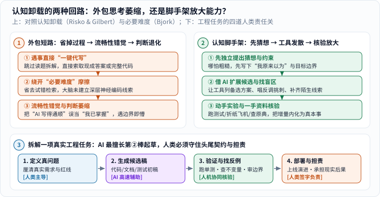
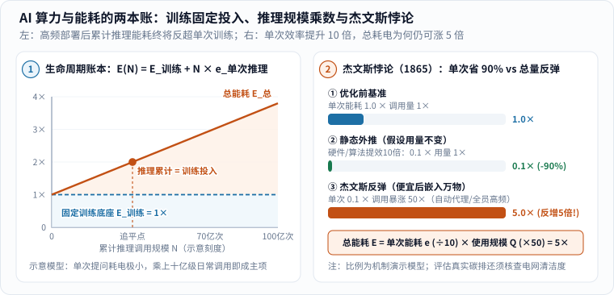

我想收集和追问的，从来不只是“AI 这个月又刷高了哪张榜单”，而是另一个更贴近日常生活的真问题：**当工具越来越会替人做事，作为使用工具的人，我们的思考方式、社会账本与自我认同会怎样改变？**

> **阅读札记与来源说明**
>
> 这是一份持续增补的读书与观察笔记（部分收藏材料晚于文章最初归档日期）。早期草稿曾把大段媒体转述与随手批注混排在一起，读者很容易分不清哪句是受访学者的原话、哪句是记者的归纳、哪句只是我自己的延伸。这次重修全部改用我自己的结构重述，保留原有阅读入口，**绝不把未经逐字核对的二手报道当成学者原话引用**；涉及认知心理学、能源经济学与软件工程的机制解释，则全部查证落回可公开核验的原始文献。

---

## 一、讨论 AI 之前，先给满天飞的观点分好三层证据

每次大模型发布新版本，社交网络上总会在同一天涌出两股完全相反的浪潮：一边宣称“某某行业彻底终结，人类只剩半年窗口期”，另一边断言“不过是高级复读机，永远不可能真正理解世界”。为什么同一件技术进展，会让聪明人吵出截然相反的结论？

很多时候，是因为大家把**三种性质完全不同的命题**混在了同一个麻袋里：

_按从上到下的顺序读三格：① 第一格是**可复现的具体观察**（能拿同一道题和评分标准复查）；② 第二格是**带隐藏前提的趋势外推**（必须追问时间尺度、成本、监管与长尾容错条件）；③ 第三格是**人自己的价值选择**（即便工具能代劳，我愿不愿意把这件事交出去）。[单独打开图片](/assets/images/archive-guides/ai-evidence.svg)。_

### 1. 第一层与第二层：可检验的单次观察 vs 带条件的外推预测

先把前两层剥开看清楚：

- **第一层是“具体观察”（事实层）**：例如“某模型在 2024 年某套公开数学竞赛题上答对了 83%”“某团队用 AI 辅助把一段单元测试编写时间缩短了一半”。这类说法有明确的时间、样本和度量口径，原则上谁都可以复查，对就是对，错就是错。
- **第二层是“带条件的未来推断”（预测层）**：例如“既然今年能写单测，三年后全世界的软件工程师都会失业”。从“能做对部分子任务”跳到“整个职业消亡”，中间跨过了需求复杂度、责任归属、安全合规、维护成本以及新需求扩张等十几个未证前提。不把这些前提摊在桌面上，预测就只是情绪宣泄。

### 2. 第三层不是预测题，而是人自己的价值选择

最容易被技术讨论忽略的，是图里的**第三层**：就算某一天工具真的能以 95 分的水准替你写完给伴侣的道歉信、替孩子写完读后感、或者替你做完人生重大决定——**你愿不愿意把这件事交出去？**

这道题没有任何基准测试能替我们回答。前两层关乎“工具能不能做到”，第三层关乎“我们想成为什么样的人”。三层都可以认真讨论，但绝不能拿第一层的跑分去冒充第三层的答案。

---

## 二、哲学与认知科学的追问：把“过程”外包出去以后，大脑里发生了什么？

此前我收藏过一篇围绕哲学家陈嘉映展开的[媒体访谈报道](https://news.qq.com/rain/a/20250101A03BQ900)（此处仅作问题意识的阅读线索，不作逐字引文依据）。那篇阅读留给我最深的一个叩问是：**人活在世上，并不只是在签收一个个干瘪的“最终结果”；恰恰是在笨拙摸索、犯错修正的过程里，我们长出了自己的手艺，也建立起人与人之间温热的联结。**

如果我们把目光转向近二十年的实验心理学与认知神经科学，会发现哲学家的直觉背后，真有一套扎实的脑科学机制在支撑。

### 1. 认知卸载（Cognitive Offloading）：从心算、搜资料到车载导航的经验教训

2016 年，认知科学家伊万·里斯科（Evan F. Risko）与山姆·吉尔伯特（Sam J. Gilbert）在《认知科学趋势》（*Trends in Cognitive Sciences*）上发表综述，系统梳理了人类的**“认知卸载（Cognitive Offloading）”**行为：每当外部工具（备忘录、计算器、搜索引擎、GPS 导航）能以更低费力度完成一项脑力任务时，人类大脑就会本能地把内部记忆与推演负担卸载到体外设备上。[1]

认知卸载本身绝不是坏事——如果没有文字纸笔帮人类卸载工作记忆，我们根本算不出多位数乘法，也写不出长篇科学论著。但实验同样揭示了硬币的另一面：

- **“谷歌效应”与记忆路径转移**：2011 年贝琪·斯帕罗（Betsy Sparrow）等人在《科学》（*Science*）上的实验发现，当受试者预期某条信息以后随时能在电脑里搜到时，他们对信息内容本身的回忆率显著下降，转而只记住“去哪个文件夹找它”；[2]
- **长期依赖逐向导航与空间地图萎缩**：多项针对出租车司机与普通驾驶者的空间认知研究显示，长期完全照着 GPS“前方两百米右转”口令开车的人，大脑海马体构建全局心理地图、辨认陌生路标关系的能力明显弱于自己看图认路的人——一旦手机没电，哪怕在这座城市开了三年车，依然分不清东西南北。

### 2. 比约克的“必要难度”与“流畅性错觉”：为什么看懂答案不等于长出能力？

为什么“自己卡壳想半小时”和“一秒钟读完 AI 给出的漂亮解答”，在大脑里留下的痕迹天差地别？

加州大学洛杉矶分校记忆学者罗伯特·比约克（Robert A. Bjork）在 1994 年提出过一个深刻影响教育心理学的概念——**“必要难度（Desirable Difficulties）”**：[3]

_先对比上方左右两条学习回路：左栏（橙色）跳过独立拆解直接“一键代写”，省掉了卡壳摩擦，却极易掉进“流畅性错觉”；右栏（绿色）先写下自己的粗糙猜想，再拿 AI 当发散陪练与找反例工具，最后亲手实验核验，把外部信息内化成真本领。再看下方横跨四格的工程链条：AI 最擅长第 2 棒高速起草，但头尾的“定义真问题”与“上线担责”依然绑在具体的人身上。[单独打开大图](/assets/images/ai-impact/cognitive-offloading-loop.svg)。_

对照图上方的两条回路，一步步看清大脑受骗的全过程：

1. **短路回路（左栏：省掉摩擦 → 掉进流畅性错觉）**：当你面对一道难题或一篇空白报告，连五分钟都不肯自己憋，直接点“一键生成”时，屏幕上瞬间流淌出结构工整、滴水不漏的段落。你从头到尾顺畅读完，连连点头觉得“太清楚了，我全懂了！”——认知心理学把这种错觉称为**加工流畅性错觉（Illusion of Explanatory Depth / Processing Fluency）**：大脑把“阅读别人现成逻辑时的毫不费力”，误判成了“我自己已经具备组织这套逻辑的能力”。一旦合上屏幕让你独自面对新变体，脑海里立刻一片空白。
2. **脚手架回路（右栏：保留必要难度 → 借工具放大视野）**：反过来，如果你哪怕花十分钟先在白纸上画出自己磕磕绊绊的初步思路、标出卡住的死结，**提取与检索的吃力感本身就在强化神经突触重联**；这时再请 AI 出场列举备选视角、挑出你推理里的漏洞，最后由你去翻阅原始文献或跑实验拍板——工具就没有抽走你的骨架，反而成了帮你够到更高处的脚手架。

### 3. 折纸飞机的启示：外包不想做的苦差，还是交出最在乎的经验？

回到日常生活，这就好比周末陪孩子在客厅折纸飞机。

如果唯一的考核指标是“五分钟内得到一架滑翔最稳的飞行器”，直接网购一架碳纤维成品航模肯定最快；但如果把一起把机翼折歪、一头栽进沙发底下、讨论为什么要把机头折厚一点配重、再欢呼着试飞成功的全过程都“优化省掉”，**被省掉的就不是麻烦，而是父子相处的童年本身。**

当然，这绝不意味着“家务越苦越崇高”，更不是呼吁大家砸掉洗衣机、关掉导航或抵制 AI。**把消耗精力的机械苦差事（比如批量改表格格式、查陌生报错日志）交给工具，与把自己在乎的思考品味和亲密经验统统打包外包，完全是两码事。** 真正的分水岭不在于你用没用 AI，而在于按下回车前，你清不清楚自己换来了什么空闲、又主动让渡了哪块历练。

---

## 三、工程师与能源的两本账：能力更强不等于更好用，单次更省电也不等于总用电下降

聊完了人的大脑，再把镜头拉远到工程落地与地球资源账本。开源开发者西蒙·威利森（Simon Willison）在他的[2024 年大模型年度技术盘点](https://simonwillison.net/2024/Dec/31/llms-in-2024/)里，详细记录了模型价格跳水、多模态演进、推理模式兴起与本地部署门槛的变化。[4]

### 1. 读技术年度盘点的时间坐标：榜单名次有保质期，工程约束更长久

读这类一线工程师年度总结，最要紧的是看清它的**时间坐标**：某个月份哪个模型排在竞技场第一名、哪套提示词技巧最灵验，往往半年后就会洗牌过时；真正值得长期留心的，是背后的结构性矛盾——**模型跑分越来越高，但要把一个概率生成系统安全、可控、低成本地嵌进真实业务流程，防提示词注入、防静默编造、做回归评测的工程门槛一点也没有自动消失。**

### 2. 拆开生命周期能耗账：一次性训练固定投入 vs 十亿级日常推理乘数

威利森在那篇回顾里，还特意把 AI 的能源与环境影响拆成“效率改善”与“规模扩张”两面同时审视。这比网上非黑即白的两派口号——要么喊“每问 AI 一句话都在烧干湖泊”，要么喊“单次提问耗电极小，永远不必内疚”——都要诚实得多。

要算清这笔物理账，不能靠煽情比喻，必须先把大模型全生命周期的总能耗 $$E_{\text{总}}$$ 拆成两项：

$$
E_{\text{总}}(N) = E_{\text{训练}} + N \times e_{\text{单次推理}}.
$$

_先看左栏生命周期线性示意账本：蓝色虚线是一次性预训练投入 $$E_{\text{训练}}$$（研发阶段的固定沉没成本），橙色斜线是叠加日常推理后的累计总能耗——哪怕单次推理 $$e_{\text{单次推理}}$$ 很小，一旦乘上数十亿乃至上百亿次调用规模 $$N$$，推理累计耗电终会追平并反超训练投入。再看右栏杰文斯悖论对比：当算法与芯片让单次能耗骤降 90%（变为 $$0.1\times$$）时，若调用规模因廉价易用而暴涨 $$50\times$$，总能耗反而会攀升到原来的 $$5.0\times$$！图中数值为说明机制的归一化模型，非单一数据中心实测。[单独打开大图](/assets/images/ai-impact/jevons-energy-ledger.svg)。_

对照左栏图像，我们可以把三个常被混为一谈的变量彻底理顺：

1. **单次任务的颗粒度差异极大**：让一个轻量级 7B 小模型在笔记本上做一次文本分类，与唤醒一个千亿参数推理模型花 40 秒生成几千个思维链词元、甚至生成一段高清视频，背后的浮点运算次数与耗电量可以相差成百上千倍；
2. **训练是“建厂房”，推理是“天天开流水线”**：早年大家只盯着“训一次大模型相当于多少户家庭一年用电”，却忽略了当模型服务全球数亿日活用户、每天后台自动跑百亿次搜索摘要与代码补全时，右边的乘积项 $$N \times e_{\text{单次推理}}$$ 才是长期增长的大头；
3. **电网碳强度因地而异**：同样消耗 1 度电（$$1\ \mathrm{kWh}$$），数据中心建在水电风光充沛的清洁电网，还是建在燃煤调峰电网，折算出的二氧化碳排放量截然不同。因此本文删去了早期未经边界核实的“训一次模型等于几趟跨洋航班”类比——**不统一任务口径、统计边界与电力结构，挑一个顺眼的数字吓人或洗白都没有意义。**

### 3. 1865 年蒸汽机煤耗之谜：为什么芯片效率提升 10 倍，总用电仍可能上涨？

紧接着看图右栏，这里藏着经济学与技术史上最著名的反直觉定律之一——**杰文斯悖论（Jevons Paradox）**。

**1865 年**，英国经济学家威廉·斯坦利·杰文斯（William Stanley Jevons）出版《煤炭问题》（*The Coal Question*）。当时很多人都乐观地以为：既然瓦特改良蒸汽机大幅降低了每输出一马力所需的烧煤量，英国的煤炭消耗总量一定会稳步下降。杰文斯翻开统计账本却发现事实恰恰相反：**英国的煤炭总消耗量在改良蒸汽机普及后迎来了爆炸式飙升！**[5]

原因算一笔乘法账就懂了：当早期纽科门蒸汽机极其费煤昂贵时，全英国只有煤矿抽水这一两个场景用得起它；瓦特把热效率大幅提高后，蒸汽动力变得空前划算，纺织厂、钢铁厂、火车头和远洋轮船一拥而上全部改用蒸汽机——**单位能耗虽然除以了 10（$$0.1\times$$），但全社会的使用规模却乘上了 50（$$50\times$$），两者相乘，总耗煤量反而涨到了原来的 5 倍！**

今天的 AI 算力正站在完全相同的十字路口：模型蒸馏、量化压缩与新一代加速卡确实让“每百万词元的推理电耗”一年比一年低；但恰恰因为便宜又快，过去根本不会调用大模型的地方——每封邮件自动润色、每次搜索自动总结、每个后台智能体 24 小时循环读日志——瞬间铺满全网。承认这笔双面账，我们才会既支持算法与硬件的节能创新，又认真对待数据中心清洁电力配套与克制无意义的算力空转。

---

## 四、程序员与知识工作者的身份重塑：如果工具会写代码，人还负责哪一截？

再把视角拉近到具体职业现场。此前收藏的[一则播客与编程身份讨论](https://simonwillison.net/2025/Jul/3/adam-gordon-bell/)以及软件工程师 Dusty Phillips 的个人随笔[《我的 AI 驱动身份危机》](https://dusty.phillips.codes/2025/06/08/my-ai-driven-identity-crisis/)，细腻地道出了许多老手心底的微妙失落——请注意，这类文章属于个体从业者的真诚自白，不能直接当成全行业就业统计，但它们触碰到了一个真切痛点：**当一个人把二十年职业自豪感建立在“我能徒手写出漂亮代码”上时，工具突然一秒写出八成初稿，冲击的不仅是工时，更是“我是谁”的认同感。**

### 1. 当“手敲代码的工匠感”遇上自动生成

过去学编程，从查手册、调语法报错到一行行敲出循环结构，每一行能跑通的代码都是亲手垒起来的砖石，成就感直接而纯粹。引入 AI 编程助手之后，许多人的日常从“亲手执笔的作者”变成了“全天候审稿的值班主编”：表面上产出变快了，心里却容易空落落的——有时是看着大片并非自己深思熟虑写出的代码感到陌生心虚，有时是被迫花大量精力去排查 AI 埋在角落里的微妙逻辑幻觉。

### 2. 把一项工程任务拆成四棒：起草可以很快，定义契约与签字担责不能外包

与其被一句笼统的“程序员会不会被淘汰”压得喘不过气，不如像前面图下方画的那样，把一次真实的软件交付拆成首尾相连的四个环节，逐项看清谁能代劳、谁必须兜底：

| 工程环节 | AI 工具擅长的辅助工作 | 依然必须由人把关并承担后果的事 |
|---|---|---|
| **① 定义真问题** | 梳理需求草案、提示常见遗漏场景、对比备选技术栈 | 判断业务到底要解决什么真痛点，划定安全、预算与合规红线 |
| **② 生成候选初稿** | 快速生成函数实现、样板配置、SQL 查询、接口文档与测试骨架 | 审视架构是否过度复杂，拒绝看似能跑却埋下技术债的拼凑写法 |
| **③ 验证边界与证据** | 辅助定位报错堆栈、补充边界测试样例、解释陌生代码逻辑 | 核查测试是否真正覆盖核心不变量（而非用错的测试去测错的代码！） |
| **④ 线上部署与维护** | 检索历史变更记录、草拟重构补丁与故障排查清单 | 对生产环境停机、数据一致性与用户资损签字担责，跟进长期需求演进 |

举一个最实在的例子：假设线上支付对账模块要改一行税率舍入逻辑。AI 可以在两秒钟内给你写出三个版本的函数，甚至顺手生成十个全绿通过的单元测试；但**“分账尾差一分钱时究竟该归入商户账户还是平台准备金账户”**，这不是一道语法题，而是现实商业契约与财务法规问题；万一上线后算错十万笔订单，没有任何法庭或客户会接受“这是大模型建议我这么写的”作为免责理由。

AI 确实让一个人敢去尝试以前因缺少前端或运维经验而搁置的完整小产品，但也极容易诱发一种危险错觉——**以为代码跑通了 Demo，就等于自己已经吃透了系统在极端并发与异常输入下的全部边界。** 未来更有生命力的工程师，往往不是跟机器比谁背 API 更快的人，而是最懂定义问题契约、设计严密验证网并为结果兜底的人。

---

## 五、听见四句斩钉截铁的流行口号，不妨先踩一脚刹车

在整理阅读笔记的过程中，我还陆续遇到过几句传播极广、听起来振聋发聩的“金句”。把它们单拎出来逐句做一次事实与逻辑体检，是极好的防忽悠练习：

### 1. 辨析前两句关于人类知识前沿与数据生态的绝对断言

- **口号一：“数学已经没有好问题可做了。”**
  这类发表在博客平台上的[个人随笔观点](https://medium.com/@jpolak/math-is-running-out-of-problems-14f2911fa46b)可以拿来激发讨论，但绝不代表数学界的事实共识。且不说黎曼猜想、P 与 NP 问题、纳维—斯托克斯方程光滑解等千禧年大奖难题至今悬而未决（详见本站《[P和NP：为什么答案好检查，却可能不好找？]()》），单是计算复杂性、代数几何与形式化机器证明交叉地带每年都在生长出全新的深刻问题。**“现代数学分支高度专业化、初学者要爬很长的阶梯才能看懂前沿问题”，与“这座山峰已经没有未解之谜了”，完全是两个不同的判断。**
- **口号二：“ChatGPT 出现以后，互联网上再也没有干净的新数据了。”**
  AI 批量生成的低质农场内容确实给公开网页抓取、数据溯源以及后续模型迭代（学界讨论的“模型自噬 / Model Collapse”风险）带来了严峻挑战；但据此一竿子打翻所有数据并不符合事实。天文望远镜巡天光谱、医院临床双盲试验记录、工业传感器实测波形、带加密签名与版本审计的软件仓库及权威统计年鉴，依然在持续产生高价值一手数据。真正需要做的是区分采集渠道与来源核验，而不是宣布“世上再无真数据”。

### 2. 辨析后两句关于人的尊严与创造力的极端标签

- **口号三：“如果一个人未来没有经济产出，他就失去了存在价值。”**
  这是四句话里最值得警惕的一处概念偷换——**它把“劳动力市场上的薪水定价”暗中掉包成了“人作为生命个体的全部尊严与价值”**。父母对幼儿的照护、子女对病榻老人的陪伴、邻里朋友间的守望相助、一个人安静欣赏晚霞或认真活好平凡一天的权利，从来就不由 GDP 或代码提交行数单独定价。即便做最极端的自动化思想实验，讨论的也应该是社会财富如何更公平地分配与公共保障如何托底，而绝不该把人的尊严一并从账本上划掉。
- **口号四：“AI 骨子里只是拼贴抄袭，永远不可能创造任何新东西。”**
  这句话刚好和“AI 无所不能”构成了镜像式的偷懒。与其围着“什么才配叫真正的灵魂创造”打没有尽头的文字官司，不如把标准摊开：在蛋白质折叠结构预测、芯片布线优化或棋类新定式探索中，算法确实找出了人类此前未曾想到的有效组合；而在需要真实生命痛感、历史处境与道德承担的文学艺术与制度设计里，统计采样又有其显而易见的空洞之处。**说清具体任务、评价标准与实测证据，永远比贴一张“会不会创造”的绝对封条更有信息量。**

---

## 六、家庭里的三句话小实验，与奶爸的一点提醒

### 1. 十分钟亲子实验：折一架纸飞机，跑通“先猜想 → 再借脑 → 亲手验”

如果家里有正在上小学或初中的孩子，周末完全不用讲枯燥的大道理，挑一个**不涉及任何个人隐私、安全低风险**的生活小问题——比如“为什么我折的纸飞机总是飞出去两米就往左歪着栽下来？”——花十分钟做一次三步实验：

1. **第一步（先捂住手机，写下自己的猜想）**：让孩子仔细看一眼手里的纸飞机，大胆猜一个原因（比如“是不是左边翅膀折宽了？”或者“机头太轻了？”）；
2. **第二步（打开 AI 当参谋，挑一条可验证的建议）**：把问题问给 AI，看它列出的空气动力学原因（左右机翼迎角不对称、尾翼垂直安定面歪斜、重心偏后失速等），请孩子从中挑出**最怀疑或最好测的一条**；
3. **第三步（回到客厅试飞验证，记下三行诚实笔记）**：亲手把右翼后缘稍微往上折起一点点，连飞五次观察轨迹变化，在便签纸上留下三句话：
   - **我原来以为**……
   - **AI 提醒了我**……
   - **我亲手试过（或查过可靠资料）之后发现**……

如果当天手头条件没法验证，第三行就老老实实写上**“目前暂时还没核实”**。这短短一行留白价值千金——它能从小帮孩子立下两条护身铁律：第一，**话写得再通顺漂亮，未经验证前也只是待核实的线索，不自动等于事实**；第二，**严守隐私边界，绝不向公共大模型对话框上传真实姓名、学校班级、家人照片、身份证件或家庭住址。**

### 2. 别许诺“练好某几样就一劳永逸”，守住提问、动手与担责的底气

作为父亲，我依然非常珍视孩子身上的好奇心、同理心、审美直觉与独立判断力。但我也提醒自己：不要轻易跟孩子许诺“因为 AI 永远不会拥有某某能力，所以你只要学好这一招就一辈子高枕无忧”——那同样是一张未经严格证明的空头支票（关于逻辑不可判定性与算力边界的严格区分，可接着读本站《[阅读笔记｜从姚期智相关报道谈AI的威力与局限]()》）。

比起替二十年后的就业市场算命，我更踏实的愿望只有几件小事：希望孩子遇到怪现象时敢自己先猜一猜，愿意挽起袖子动手试错，不知道的时候坦然承认“我还不懂”，知道什么时候该用工具提效、什么时候必须向真实的人求助并信守承诺。

强大的工具确实能把一个人尝试新事物的半径撑大十倍。**在半径变大的同时，守护好我们亲自尝试、审慎判断与坦然担责的肌肉不萎缩**——这就是我在技术喧嚣里最想留给自己和孩子的一份清醒。

---

## 参考资料与阅读边界

1. Evan F. Risko & Sam J. Gilbert (2016)，*Cognitive Offloading*，*Trends in Cognitive Sciences*, 20(9), 676–688——系统界定人类如何借助外部物理与数字工具分担内部认知负荷及其对记忆与元认知判断的双面影响。
2. Betsy Sparrow, Jenny Liu & Daniel M. Wegner (2011)，*Google Effects on Memory: Cognitive Consequences of Having Information at Our Fingertips*，*Science*, 333(6043), 776–778——实验展示随时可检索预期如何改变人对内容本身与检索路径的记忆分配。
3. Robert A. Bjork (1994)，*Memory and Metamemory Considerations in the Training of Human Beings*，载于 *Metacognition: Knowing about Knowing* (MIT Press, pp. 185–205)——提出“必要难度（Desirable Difficulties）”框架，区分当场阅读/练习的流畅感与长期迁移掌握度。
4. [Simon Willison：Things we learned about LLMs in 2024](https://simonwillison.net/2024/Dec/31/llms-in-2024/)——已核对的一线开发者年度技术回顾，支持模型成本演进、应用工程挑战及能耗双面性讨论，不作为永久榜单或单一能耗定论。
5. William Stanley Jevons (1865)，*The Coal Question: An Inquiry Concerning the Progress of the Nation, and the Probable Exhaustion of Our Coal-Mines* (London: Macmillan)——提出著名的杰文斯悖论：改良蒸汽机提升燃料效率后，因应用范围急剧扩张反而推高全社会煤炭总消耗。
6. 阅读线索与个体评论入口（保留问题意识，不作逐字引文或行业普查统计）：
   - [陈嘉映相关媒体访谈报道](https://news.qq.com/rain/a/20250101A03BQ900)——关于做事过程、经验意义与结果导向的思考入口；
   - [Adam Gordon Bell 相关编程与身份讨论](https://simonwillison.net/2025/Jul/3/adam-gordon-bell/) 与 [Dusty Phillips：My AI-Driven Identity Crisis](https://dusty.phillips.codes/2025/06/08/my-ai-driven-identity-crisis/)——程序员个体面对编码方式剧变时的真实心理记录；
   - [个人评论随笔：Math is running out of problems](https://medium.com/@jpolak/math-is-running-out-of-problems-14f2911fa46b)——正文中作为需辨析的个人观点示例，不代表数学界共识。
7. 站内延伸阅读：《[阅读笔记｜从姚期智相关报道谈AI的威力与局限]()》（厘清逻辑不可判定、计算复杂性与当前模型表现三道边界）、《[机器到底是怎么学会“思考”的？从一条直线到大模型与视频生成]()》（从底层算术看懂大模型为何会生成流畅幻觉）。
