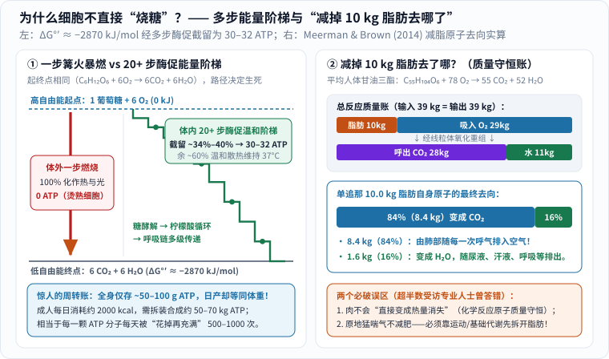
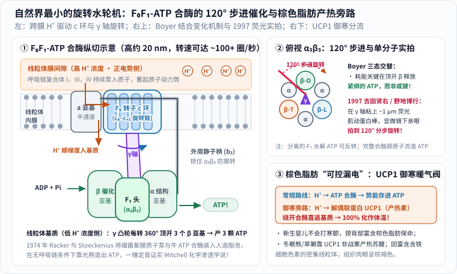
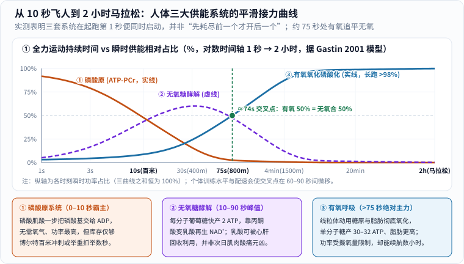

你吸进了一口氧气。它钻进血液、抵达细胞以后，是直接掏出打火机点燃葡萄糖吗？

当然不是。但日常聊天里那句“把卡路里烧掉”太顺口，常常让我们漏掉了生命世界最精巧的一场工程奇迹：**细胞既没有炉膛，也经不起明火；它靠二十多道温和的酶促台阶，把食物分子里的化学自由能一点点截留下来，再通过一台比头发丝细近万倍的“纳米旋转水轮机”，源源不断地压出供全身使用的能量货币——ATP。**

在正式出发前，先和孩子算两笔足以让人瞪大眼睛的真实数字账。

### 开篇两笔奇账：一天造出“一个自己”重的 ATP，减掉的肉 84% 被呼进了空气！

**第一笔账：你全身此刻只有几十克 ATP，一天却要合成跟体重一样重的 ATP。**

1929 年，德国化学家卡尔·洛曼（Karl Lohmann）在肌肉提取物中发现了**三磷酸腺苷（ATP）**；1939 至 1941 年间，弗里茨·李普曼（Fritz Lipmann，1953 年诺贝尔生理学或医学奖得主）阐明它是活细胞通用的“能量零钱”。很多科普书喜欢把 ATP 比作“蓄电池”，可如果你去称一称自己全身上下所有细胞此刻存着的 ATP 总量，结果会吓你一跳：**在任意一秒钟，一个成年人体内的 ATP 总重只有约 $$50\text{—}100\ \text{g}$$（约 $$0.1\text{—}0.2\ \text{mol}$$）——还不如你手心里握着的一小把葡萄干重！**

库存这么少，怎么够大脑思考、心脏跳动、肌肉收缩一整天？答案是**极速循环周转**。一个成年人每天静息加日常活动大约消耗 $$2000\ \text{kcal}$$（约 $$8400\ \text{kJ}$$）能量；在细胞内生理条件下，每拆开并重新合成 $$1\ \text{mol}$$（约 $$507\ \text{g}$$）ATP 大约传递 $$50\text{—}54\ \text{kJ}$$ 自由能。正如瑞典皇家科学院在 [1997 年诺贝尔化学奖新闻公报](https://www.nobelprize.org/prizes/chemistry/1997/press-release/)中指出的那样：**人在安静状态下，每天合成与消耗的 ATP 总质量就相当于体重的一半到一倍（约 $$50\text{—}70\ \text{kg}$$）；若是跑一场马拉松或从事重体力劳动，一天的周转量甚至逼近半吨到一吨！** 折算下来，你身体里的**每一颗 ATP 分子，每天都要被“花掉成为 ADP，再充回电变成 ATP”足足 $$500\text{—}1000$$ 次**。它根本不是囤粮的仓库，而是秒级流转的快递周转箱。

**第二笔账：“爸爸，减肥减掉的 10 斤肉，到底去哪儿了？是变成汗流走了，还是变成热量散掉了？”**

别小看孩子的这个问题。2014 年，澳大利亚物理学家鲁本·米尔曼（Ruben Meerman）与新南威尔士大学生物化学家安德鲁·布朗（Andrew Brown）在《英国医学杂志》（*BMJ*）发表了一篇轰动学界的论文（见 [新南威尔士大学官方解读](https://www.unsw.edu.au/newsroom/news/2014/12/when-we-lose-weight--where-does-the-fat-go--)）。他们调查了 150 位医生、营养师和健身教练，结果**超过一半的专业人士都答错了**——最常见的错误答案正是“脂肪变成了能量或热量”！

为什么这个顺口的答案一定是错的？因为化学反应遵守**质量守恒定律**：反应前有多少颗碳原子、氢原子、氧原子，反应后一颗都不会少，它们绝不可能像核裂变那样凭空“变成纯热量消失”。人体白色脂肪组织里储存的甘油三酯，平均分子式可写为 $$\mathrm{C_{55}H_{104}O_6}$$（摩尔质量约 $$861.4\ \text{g/mol}$$）。当它通过有氧呼吸被彻底氧化时，严格的原子配平式是：

$$
\mathrm{C_{55}H_{104}O_6 + 78\,O_2 \rightarrow 55\,CO_2 + 52\,H_2O}
$$

按原子量逐一过秤：要想彻底氧化减掉 **$$10\ \text{kg}$$ 人体脂肪**，你需要从空气里吸入约 **$$29\ \text{kg}$$ 氧气**（输入总质量 $$10 + 29 = 39\ \text{kg}$$），最终生成约 **$$28\ \text{kg}$$ 二氧化碳**和 **$$11\ \text{kg}$$ 水**（输出总质量 $$28 + 11 = 39\ \text{kg}$$，分毫不差！）。如果单独追踪原本属于那 $$10\ \text{kg}$$ 脂肪自身的碳、氢、氧原子去向（按米尔曼与布朗对酯基氧的化学计量追踪，6 个氧原子中 4 个随碳进入 $$\mathrm{CO_2}$$、2 个进入 $$\mathrm{H_2O}$$）：

- **约 $$84\%$$（$$8.4\ \text{kg}$$）变成了看不见的二氧化碳气体，经由你的肺，随着每一次呼气飘进了空气里！**
- **约 $$16\%$$（$$1.6\ \text{kg}$$）变成了水**，随后混入体液，通过尿液、汗液、粪便、呼吸水汽或眼泪排出体外。

换句话说，**肺才是减脂最主要的“排泄器官”**！但紧接着必须给孩子打个补丁：**既然肉是呼出去的，坐在沙发上拼命大喘气能不能减肥？绝对不能！** 如果肌肉和器官没有先提高代谢速率去拆解脂肪、消耗 ATP，你原地猛喘气并不会多拆一颗甘油三酯分子，反而会把血液里的 $$\mathrm{CO_2}$$ 排得过低，引发**过度通气（呼吸性碱中毒）**，让人头晕、手指发麻甚至晕厥。要想把锁在脂肪或糖里的碳原子合法地送进肺里呼出去，唯一的正道是走通细胞里的**呼吸作用流水线**。

---

## 一、为什么细胞不点“一把篝火”，非要走二十多级小台阶？

### 1. 2870 千焦自由能：一步暴燃会烧毁细胞，分步下楼才能截留 ATP

肺里的吸气、呼气（生理学叫“外呼吸”），和细胞里的“细胞呼吸”，是紧密相连却截然不同的两件事：前者负责搬运气体，后者才是真正拆解有机物、提取能量的生化车间。

在标准生化条件下（$$\mathrm{pH}=7$$，$$25^\circ\mathrm{C}$$），彻底氧化 $$1\ \text{mol}$$ 葡萄糖（$$180\ \text{g}$$，大约小半碗米饭转化的糖量）释放的吉布斯自由能高达：

$$
\Delta G^{\circ\prime} \approx -2870\ \text{kJ/mol}.
$$

如果像在空气里点燃方糖一样，让葡萄糖和氧气一步直接撞在一起，这 $$2870\ \text{kJ}$$ 能量会在一瞬间全部变成滚烫的热和刺眼的光——细胞里的蛋白质酶瞬间被煮熟变性，几纳米厚的脂质膜当场熔毁，半颗 ATP 都留不下。

_先看左图两条下坡路：起点同样是 1 分子葡萄糖加 6 分子氧，终点同样是二氧化碳和水，但左侧一步暴燃把 2870 kJ/mol 全变成热与光，右侧经 20 余步酶促小台阶截留出 30—32 颗 ATP，余热温和维持 37°C 体温；再看右图质量条，核对 10 kg 脂肪如何吸入 29 kg 氧气，并将自身质量的 84%（8.4 kg）化作 CO₂ 由肺呼出。[单独打开大图](/assets/images/resp-motor/bonfire-vs-staircase.svg)。_

### 2. 破除“断键放能”误区：40%—50% 能量捕获率与 37°C 恒温地暖

顺便在这里帮孩子避开一个流传极广的顺口误区：**“把高能化学键剪断，锁在里面的能量就自动蹦出来了。”** 在化学与物理上，**打断任何化学键本身都需要吸收能量**，形成更稳定的新化学键才会释放能量！葡萄糖氧化之所以总体放能，是因为反应物（葡萄糖中的 $$\mathrm{C{-}C}$$、$$\mathrm{C{-}H}$$ 键与 $$\mathrm{O_2}$$ 中的双键）电子排布能量较高，而产物（$$\mathrm{CO_2}$$ 与 $$\mathrm{H_2O}$$ 中的极性共价键）整体处于自由能低得多的稳定深谷。同样，ATP 也不是靠“剪断磷酸键发光”，而是它与水反应生成 ADP 和无机磷酸（$$\mathrm{P_i}$$）并耦合特定酶促反应时，体系整体自由能显著下降（标准态 $$\Delta G^{\circ\prime} \approx -30.5\ \text{kJ/mol}$$；活细胞内因 $$[\mathrm{ATP}]/[\mathrm{ADP}]$$ 比值维持在高位，实际释放自由能可达约 $$-50\text{—}-54\ \text{kJ/mol}$$）。

按标准态保守估算，$$32$$ 颗 ATP 截留了约 $$32 \times 30.5 \approx 976\ \text{kJ/mol}$$（约 **$$34\%$$**）；若按活细胞内的实际浓度条件核算，能量捕获效率甚至达到 **$$40\%\text{—}50\%$$**——这已经超过了许多内燃机发电机的效率！而剩下的那约 $$50\%\text{—}60\%$$ 没有变成 ATP 的自由能也绝非“白白浪费”：对于人类这样的恒温哺乳动物，这股平缓散出的微热恰好成了维持 **$$37^\circ\mathrm{C}$$ 恒定体温**的天然地暖，让我们身体里的上千种酶时刻工作在最佳温度区间。

现在，就让我们请出两位主角同时出发：**一位是从食物消化吸收而来的六碳葡萄糖，一位是你刚吸进肺里的氧。** 它们绝不是肩并肩走进同一个炉膛——葡萄糖要经历漫长的逐步拆解与脱电子，而氧则一直耐心地守在电子接力的最末端。

---

## 二、先给三位“演员”发名牌，再跟着 6 个碳走一遍

先看碳数，再看电子，最后才数 ATP。箭头按讲解顺序描出一次；真实细胞中许多反应同时发生，并不是一分子糖等前一格“播完”才进入下一格。[单独打开，刷新可重播](/assets/images/archive-guides/respiration.svg)。

本文以**典型真核细胞中葡萄糖的有氧分解**为主线。但大自然远比单一模板丰富：细菌等原核生物没有线粒体，却能直接利用自身的细胞膜（质膜）完成呼吸链跨膜泵质子；而人体成熟的红细胞为了腾出最大空间装载血红蛋白，把细胞核和线粒体全丢掉了——它们明明全身泡在氧气里、专门替别人送氧，自己却一丁点氧气都不用，全靠第一步“糖酵解”维持生存！所以千万不能说“所有活细胞都在线粒体里做一模一样的呼吸”。

上场前，先给三位核心“演员”发好名牌，防止张冠李戴：

1. **ATP 不是长期粮仓，而是随赚随花的“零钱”**：它通过磷酸基团转移或构象变化与耗能反应偶联，驱动肌肉肌球蛋白划桨、神经细胞钠钾泵跨膜搬运离子（光这一项就吃掉安静状态下全身约三分之一的 ATP！）以及大分子合成，随后立刻由 ADP 和无机磷酸再生。
2. **$$\mathrm{NADH}$$ 与 $$\mathrm{FADH_2}$$ 不是 ATP 的别名，而是“满载电子的摆渡车”**：$$\mathrm{NAD^+}$$（烟酰胺腺嘌呤二核苷酸，由饮食中的烟酸即维生素 $$\mathrm{B_3}$$ 衍生而来）在脱氢酶协助下接走两颗高能电子和一颗质子（还原当量 $$2e^- + \mathrm{H^+}$$），变成 $$\mathrm{NADH}$$；等它去线粒体内膜卸完货，又变回空车 $$\mathrm{NAD^+}$$ 循环接客。$$\mathrm{FAD/FADH_2}$$（源自核黄素即维生素 $$\mathrm{B_2}$$）同样负责接送两颗电子，但它通常像固定工位一样紧绑在酶蛋白（如复合体 II）上，不能都想成满屋子乱跑的同款游离小车。
3. **吸进来的氧，并不是呼出去的 $$\mathrm{CO_2}$$ 里那颗碳的搭档**：呼吸放出的 $$\mathrm{CO_2}$$，碳原子百分之百来自被拆解的糖、脂肪或氨基酸骨架，里面的氧原子也来自有机物本身和参与反应的水分子；而你吸进肺里的 $$\mathrm{O_2}$$，要到整条电子传递链的终点才接走电子结合 $$\mathrm{H^+}$$ 变成 $$\mathrm{H_2O}$$。吸入 $$\mathrm{O_2}$$ 与呼出 $$\mathrm{CO_2}$$ 不是“给同一个氧气分子贴上一颗碳再吐出来”那么简单！

### 1. 第一步：在细胞质基质里，“先花 2 颗、再赚 4 颗”拆开大包裹

**糖酵解（Glycolysis）**发生在细胞质基质中，由 10 步连续的酶促反应组成，把一个六碳葡萄糖拆成两个三碳的**丙酮酸（Pyruvate）**。

这一步最像做小生意——**得先投本钱，后面才能收账**：

- **准备投资期（前 5 步）**：细胞先掏出 **$$2$$ 颗 ATP**，给六碳糖两端各贴上一个磷酸基团（生成果糖-1,6-二磷酸）。为什么要花这笔冤枉钱？一来带负电的磷酸基团让糖分子再也没法偷溜出细胞膜；二来它把原本对称稳定的六碳环“拉紧到容易脆断”的高能状态，顺势劈成两份可互变的三碳磷酸糖。
- **收获结算期（后 5 步）**：两份三碳糖各自交出一对高能电子给 $$\mathrm{NAD^+}$$（共收获 **$$2\ \mathrm{NADH}$$**），并通过**底物水平磷酸化**（由酶直接把高能中间物上的磷酸基团递给 ADP，还不涉及膜梯度）各自产出 $$2$$ 颗 ATP，两份合计产出 $$4$$ 颗 ATP。

拿收入减去本钱：**$$4 - 2 = 2$$**！所以每分子葡萄糖经糖酵解**净赚 $$2\ \text{ATP}$$ 和 $$2\ \mathrm{NADH}$$**。全程 10 步反应完全不需要氧气直接参与——这也解释了为什么一旦突然缺氧，细胞不会在零点几秒内当场断电，糖酵解还能立刻顶上救急。

### 2. 第二步：三碳变二碳，再借一辆“四碳摆渡车”转两圈

如果氧气充足，两个三碳丙酮酸会穿过线粒体外膜与内膜上的专用转运蛋白，进入**线粒体基质**。在丙酮酸脱氢酶复合体手中，每个三碳丙酮酸先脱掉一个羧基变成 **$$\mathrm{CO_2}$$** 飘走，顺手装满一辆 $$\mathrm{NADH}$$，剩下的二碳片段挂在辅酶 A（维生素 $$\mathrm{B_5}$$ 泛酸衍生物）上，成为大名鼎鼎的**乙酰辅酶 A（Acetyl-CoA）**——它不仅是糖分解的必经关口，也是脂肪酸 $$\beta$$-氧化拆成二碳片段后汇入主干道的总枢纽！

接着，二碳乙酰基驶入 1937 年由英籍德裔生化学家汉斯·克雷布斯（Hans Krebs，1953 年与李普曼同获诺贝尔奖）拼通的**三羧酸循环（柠檬酸循环，TCA Cycle）**。按一分子葡萄糖拆成两份输入来算总账：

| 代谢阶段 | 发生场所 | 碳骨架的净账本 | 直接 ATP 与满载电子车 |
| :--- | :--- | :--- | :--- |
| **1. 糖酵解** | 细胞质基质 | $$6\mathrm{C} \rightarrow 2 \times 3\mathrm{C}$$（无 $$\mathrm{CO_2}$$ 释放） | 净 **$$2\ \text{ATP}$$**、$$2\ \mathrm{NADH}$$ |
| **2. 丙酮酸氧化** | 线粒体基质 | $$2 \times 3\mathrm{C} \rightarrow 2 \times 2\mathrm{C} + \mathbf{2\,CO_2}$$ | $$2\ \mathrm{NADH}$$ |
| **3. 三羧酸循环（转两轮）** | 线粒体基质 | $$2 \times 2\mathrm{C}$$ 并入循环，净排 **$$\mathbf{4\,CO_2}$$** | 约 **$$2\ \text{ATP}$$** 当量（GTP/ATP）、$$6\ \mathrm{NADH}$$、$$2\ \mathrm{FADH_2}$$ |
| **前三站合计** | — | **$$6$$ 个碳全部结清为 $$6\,\mathrm{CO_2}$$** | **约 $$4\ \text{ATP}$$ 当量 + $$10\ \mathrm{NADH}$$ + $$2\ \mathrm{FADH_2}$$** |

_先数圆点，再读每格旁边的载体与 ATP。第三格右侧两个金色点已经作为 CO₂ 离开；第四格记录循环的净排出量，不是把上一格同样的点当轮原样吐出来。反应之间只描线一次，真实细胞并不按动画秒数排队。[单独打开碳路线图](/assets/images/deep-science/respiration-carbon.svg)。_

好奇的孩子看到这里常问：**“既然只剩两个碳了，一刀切碎变成两个 $$\mathrm{CO_2}$$ 不就完了吗？为什么要绕那么大一圈？”**

因为在温和的水溶液里，直接把二碳乙酰基硬拆成两个 $$\mathrm{CO_2}$$ 在化学动力学上极其困难。细胞的巧思是**“借车拆件，用完还车”**：二碳乙酰基一进门，先和基质里等候的一辆四碳“摆渡车”——**草酰乙酸（$$4\mathrm{C}$$）**——拼成六碳的**柠檬酸（$$6\mathrm{C}$$）**；随后经过异构、两次氧化脱羧（依次吐出两个 $$\mathrm{CO_2}$$，变成五碳再到四碳），再经过底物水平磷酸化和连续脱氢，最后把那辆四碳草酰乙酸完好无损地修整归位，继续迎接下一份乙酰辅酶 A！

这里还藏着一个同位素示踪实验揭示的精妙细节：**第一轮循环吐出去的那两颗碳原子，其实来自上一轮留下的四碳草酰乙酸骨架，刚进门的那两颗新碳要到后续轮次才会被排走**；但从整个车间每转一圈“进 2 碳、出 2 碳、四碳摆渡车总数不变”的净收支看，一分子葡萄糖的 6 个碳至此已彻底清零！这一“再生受体才能让循环不停转”的逻辑与卡尔文循环异曲同工，但两者的酶、方向与能量收支完全不同，绝不是同一台机器倒着转。

数到这里，悬念来了：**6 个碳已经全变成 $$\mathrm{CO_2}$$ 散伙了，可账面上才赚到区区 $$4$$ 颗 ATP！那剩下的二十多颗 ATP 藏在哪儿？** 答案就在那 **$$10$$ 辆 $$\mathrm{NADH}$$ 和 $$2$$ 辆 $$\mathrm{FADH_2}$$** 满载的 $$24$$ 颗高能电子身上。

---

## 三、“氧化磷酸化论战”与自然界最小的旋转水轮机

这 $$12$$ 辆电子摆渡车驶向了皱褶重重的**线粒体内膜**（折叠成“嵴”正是为了在有限体积里铺开巨大的膜面积，塞进成千上万套呼吸链装置）。在这里上演的**氧化磷酸化**，曾引发 20 世纪生物化学史上最激烈的一场长达二十年的科学论战。

### 1. 先看清内膜上的三个连贯动作

_先沿横向箭头找电子，再沿虚线看 H⁺ 被送到哪一侧，最后看右侧 ATP 合酶。图为局部拓扑示意，省略复合体 II 和部分载体结构；横线不是“所有复合体都泵质子”的意思。电子接力、泵质子和 ATP 合成实际耦联进行，不是播完一步才开下一步。[单独打开，刷新可重播](/assets/images/deep-science/respiration-membrane.svg)。_

沿着这张展平的内膜图，只需抓住三个核心动作（对照 [OpenStax 氧化磷酸化章节](https://openstax.org/books/biology-2e/pages/7-4-oxidative-phosphorylation) 与 [Nature Education 线粒体专题](https://www.nature.com/scitable/topicpage/mitochondria-14053590/)）：

1. **逐级传电子（氧化还原接力）**：$$\mathrm{NADH}$$ 把电子交给庞大的**复合体 I**（由 40 多条多肽链组成），经脂溶性移动载体**泛醌（辅酶 Q）**传给**复合体 III**，再由水溶性蛋白**细胞色素 c** 摆渡给**复合体 IV**，最后交给守在终点的氧气：

   $$
   \mathrm{O_2 + 4e^- + 4H^+ \rightarrow 2H_2O}.
   $$

   注意，$$\mathrm{FADH_2}$$ 的电子能量略低，它从**复合体 II** 直接汇入泛醌 Q，绕过了复合体 I。为什么氧气必须守在最末端？因为氧的电负性极强（氧化还原电位最高，对电子“吸引力”最大），像站在滑梯最底端的接球手。一旦缺氧（或被氰化物、高浓度一氧化碳堵死复合体 IV），终点没人接电子，整条呼吸链瞬间像晚高峰连环追尾一样全线堵死——上游 $$\mathrm{NADH}$$ 卸不下电子变不回 $$\mathrm{NAD^+}$$，连看似不直接用氧的柠檬酸循环也会因缺乏 $$\mathrm{NAD^+}$$ 而迫停！

2. **跨膜泵质子（建立电化学势差）**：电子顺着电位阶梯往低处滑落时释放自由能，驱动**复合体 I、III、IV** 充当质子泵（大约每对来自 $$\mathrm{NADH}$$ 的电子共泵出约 $$10$$ 个 $$\mathrm{H^+}$$，而绕过复合体 I 的 $$\mathrm{FADH_2}$$ 只驱动 III 和 IV 泵出约 $$6$$ 个 $$\mathrm{H^+}$$；**复合体 II 本身不跨膜泵质子**），把氢离子源源不断从线粒体基质泵进狭窄的**膜间隙**。由于线粒体内膜疏水核心对带电离子高度不通透，膜间隙很快攒起了**更高的 $$\mathrm{H^+}$$ 浓度（$$\Delta\mathrm{pH}$$ 化学梯度）**与**外正内负的跨膜电位差（$$\Delta\psi$$ 电学梯度，约 $$140\text{—}180\ \text{mV}$$）**。

3. **顺梯度回流发电（驱动 ATP 合成）**：被拦在大坝高处的 $$\mathrm{H^+}$$ 迫切想顺着这股电化学推力流回基质，而内膜上为它留出的主泄洪道，正是**$$\mathrm{F_0F_1}$$-ATP 合酶**！

### 2. 二十年寻找“幽灵分子”未果，米切尔与“人造紫膜泡泡”如何破局？

今天我们觉得“泵质子建梯度再造 ATP”顺理成章，可在 20 世纪 40 到 60 年代初，这却是被主流权威嘲笑的“异端邪说”！当时几乎所有顶尖生化学家都按照糖酵解底物水平磷酸化的经验，坚信电子传递链一定会先造出某种神秘的**“高能磷酸化化学中间物 $$X\sim P$$”**，再由它把磷酸基团递给 ADP。十几座世界级实验室苦苦搜寻了近二十年，连半个 $$X\sim P$$ 分子的影子都没抓到（科学史称之为**“氧化磷酸化大战” OxPhos Wars**）。

**1961 年**，离开剑桥体制、在英国康沃尔郡自筹建立格林研究所的**彼得·米切尔（Peter Mitchell）** 在 *Nature* 发表短文，抛出了惊世骇俗的**化学渗透学说（Chemiosmotic Theory）**：大家别再找那个幽灵分子了！把呼吸链和 ATP 合酶连起来的根本不是某个化学基团，而是完整的脂双层膜与跨膜**质子动力势（Proton-Motive Force，米切尔甚至仿照电力 Electricity 造了个词叫“质子力 Proticity”）**（见 [1978 年诺贝尔化学奖公报](https://www.nobelprize.org/prizes/chemistry/1978/press-release/)）。

怎样才能让最挑剔的怀疑者心服口服？**1974 年，埃弗拉伊姆·拉克（Efraim Racker）与瓦尔特·施托克纽斯（Walther Stoeckenius）完成了一项堪比“分子乐高”的传世实验**（*J. Biol. Chem.*, 1974）：他们把两种在自然界八竿子打不着的蛋白质，同时嵌进了人造磷脂小泡（脂质体）的膜上——

- 第一种零件，取自极端嗜盐古菌紫膜上的**细菌视紫红质（Bacteriorhodopsin）**：它根本不是呼吸链，而是一台纯粹的“光控质子泵”，只要一照光就把 $$\mathrm{H^+}$$ 往泡泡里泵；
- 第二种零件，取自**牛心脏线粒体的 $$\mathrm{F_0F_1}$$-ATP 合酶**！

人造泡泡里既没有复合体 I—IV，也没有任何假想的中间酶。当实验室的灯光亮起，细菌视紫红质泵入质子建起跨膜梯度，牛的 ATP 合酶立刻在试管里欢快地造出了大量 ATP；一旦加入戳穿膜梯度的质子载体让 $$\mathrm{H^+}$$ 漏光，ATP 合成当即停止！这场跨界拼装实验彻底终结了二十年论战，也为米切尔捧回了 1978 年诺贝尔化学奖。

### 3. 拆开直径 10 纳米的旋转水轮机：120° 步进与显微镜下的荧光螺旋桨

那质子流过 ATP 合酶时，究竟是怎么把 ADP 和无机磷酸“捏”在一起的？这就要请出斩获 [1997 年诺贝尔化学奖](https://www.nobelprize.org/prizes/chemistry/1997/press-release/)的**保罗·博耶（Paul Boyer）**、**约翰·沃克（John Walker）**，以及拍下人类首部单分子旋转电影的日本科学家团队了（结构全貌可对照 [RCSB PDB 每月分子第 72 期：ATP 合酶](https://pdb101.rcsb.org/motm/72)）：

_先读左图纵切面：膜间隙高浓度 H⁺ 经静子 a 亚基半通道推转膜内 F₀ 转子 c 环，带动中央不对称 γ 轴旋转，在外周静子柄 b₂ 防跟转固定下依次顶开基质侧 F₁ 头部的 3 个 β 催化亚基；再看右上俯视图理解 Boyer 三态循环及 1997 年粘上荧光肌动蛋白棒实拍 120° 步进；最后看右下棕色脂肪如何靠 UCP1 让 H⁺ 绕开合酶直接产热。[单独打开大图](/assets/images/resp-motor/atp-synthase-rotary.svg)。_

这台总高仅约 $$20\ \text{nm}$$、头部直径约 $$10\ \text{nm}$$ 的分子机器，由上下两台耦联的纳米马达组成：

1. **嵌在膜里的 $$\mathrm{F_0}$$ 质子涡轮（转子 $$\mathrm{c}$$ 环 + 静子 $$\mathrm{a}$$ 亚基）**（注：下标原为英文字母 o，指对寡霉素 Oligomycin 敏感）：膜间隙的 $$\mathrm{H^+}$$ 从 $$\mathrm{a}$$ 亚基的上半通道钻进来，中和 $$\mathrm{c}$$ 环亚基上一颗关键的天冬氨酸/谷氨酸负电荷，迫使由 $$8\text{—}15$$ 个亚基拼成的 $$\mathrm{c}$$ 环（哺乳动物线粒体为精巧的 **$$\mathrm{c_8}$$ 八聚环**）像旋转门一样拧过一格；转满几乎一整圈后，$$\mathrm{H^+}$$ 再从 $$\mathrm{a}$$ 亚基通往基质的下半通道释放出去。
2. **伸进基质的 $$\mathrm{F_1}$$ 化学发电机（中央不对称 $$\gamma$$ 凸轮轴 + 外周 $$\alpha_3\beta_3$$ 六瓣橘子头）**：$$\mathrm{c}$$ 环正中央死死连着一根形状歪斜不对称的 **$$\gamma$$ 转轴**，插在由 3 个 $$\alpha$$ 亚基和 3 个 $$\beta$$ 催化亚基交替围成的六聚体圆筒中心；与此同时，外侧有一根坚固的**外周静子柄（$$\mathrm{b_2}$$ / OSCP 支架）**像扳手一样牢牢摁住 $$\alpha_3\beta_3$$ 外壳，防止外壳跟着转轴一起空转！
3. **博耶的“结合变化机制（Binding Change Mechanism）”**：博耶通过巧妙的氧同位素交换实验发现了一个极度反直觉的事实——一旦 ADP 和 $$\mathrm{P_i}$$ 被关进紧缩态（**T 态**）的 $$\beta$$ 亚基口袋里，**合成 ATP 化学键这一步本身几乎不需要额外输入能量**；真正需要消耗质子动力势的，是中央歪斜的 $$\gamma$$ 轴每转过 **$$120^\circ$$**，像凸轮顶气门一样强行把紧缩的 $$\beta$$ 口袋撬成开放态（**O 态**），把死死咬住的新鲜 ATP“弹射”出去！3 个 $$\beta$$ 亚基轮流在 **松弛纳料（L）$$\rightarrow$$ 紧缩成键（T）$$\rightarrow$$ 开放释出（O）** 三态间切换，**$$\gamma$$ 轴每转满一整圈（$$360^\circ = 3 \times 120^\circ$$），就精准压出 $$3$$ 颗 ATP**，生理状态下每秒钟可飞速旋转 **$$100$$ 圈以上（每分钟超 $$6000$$ 转）**！

1994 年沃克团队用 X 射线晶体学拍清了 $$\mathrm{F_1}$$ 的原子级结构，完美印证了三态不对称；但最震撼视觉的铁证出现在 **1997 年春天**：日本东京工业大学吉田贤右（Masasuke Yoshida）与庆应义塾大学木下一彦（Kazuhiko Kinosita Jr.）团队的**野地博行（Hiroyuki Noji）、安田凉平（Ryohei Yasuda）** 在 *Nature* 发表里程碑论文（并在 1998 年 *Cell* 进一步测清分步细节）。他们把 $$\mathrm{F_1}$$ 马达倒扣固定在玻片上，在看不见的纳米 $$\gamma$$ 转轴顶端粘上一根长达约 **$$1\ \mu\text{m}$$（比酶本身长约 100 倍！）的红色荧光标记肌动蛋白丝**，喂入 ATP 让马达反向运转——透过荧光显微镜，全世界科学家第一次亲眼看见那根红色荧光棒像灯塔指针一样一格 **$$120^\circ$$** 旋转起来，测算出的能量转换机械效率接近惊人的 **$$100\%$$**！

### 4. 一颗葡萄糖究竟能换多少颗 ATP？（顺手把跨膜算术核对到底）

有了旋转水轮机的真实齿轮数，我们终于能看懂教材上为什么不再写老掉牙的“固定 38 颗 ATP”，而是严谨地写 **约 $$30\text{—}32\ \text{ATP}$$** 了：

- 在哺乳动物线粒体中，$$\mathrm{c_8}$$ 环转满一圈消耗 $$8$$ 个 $$\mathrm{H^+}$$ 合成 $$3$$ 颗 ATP（平均每颗约 $$2.67$$ 个 $$\mathrm{H^+}$$），再加上把细胞质里的无机磷酸 $$\mathrm{P_i}$$ 运进基质、把合成好的 $$\mathrm{ATP}^{4-}$$ 与 $$\mathrm{ADP}^{3-}$$ 跨膜交换还要额外花掉约 $$1$$ 个 $$\mathrm{H^+}$$ 的电化学代价，**在基质里每净造并送出 $$1$$ 颗 ATP，大约要花掉 $$3.7\text{—}4$$ 个跨膜 $$\mathrm{H^+}$$**！
- 于是：每份基质 $$\mathrm{NADH}$$ 泵出约 $$10$$ 个 $$\mathrm{H^+}$$，折合约 $$10 \div 4 = \mathbf{2.5\ \text{ATP}}$$；每份 $$\mathrm{FADH_2}$$ 泵出约 $$6$$ 个 $$\mathrm{H^+}$$，折合约 $$6 \div 4 = \mathbf{1.5\ \text{ATP}}$$。

拿前两站的账单套进来一算（可对照 [LibreTexts 完整氧化葡萄糖能量收支表](https://chem.libretexts.org/Courses/Brevard_College/CHE_301_Biochemistry/08%3A_Metabolism_of_carbohydrates/8.07%3A_Energy_yield_by_complete_oxidation_of_glucose)）：

$$
4\ (\text{底物水平}) + 10 \times 2.5\ (\mathrm{NADH}) + 2 \times 1.5\ (\mathrm{FADH_2}) = 32\ \text{ATP}.
$$

那为什么有时又是 **$$30$$ 颗** 呢？秘密出在糖酵解留在细胞质里的那 $$2$$ 辆 $$\mathrm{NADH}$$ 身上——线粒体内膜不让胞质 $$\mathrm{NADH}$$ 整车直接开进去，只能靠“穿梭系统”把电子隔墙递进去：

- 在心脏、肝脏和肾脏细胞中，主要走**苹果酸—天冬氨酸穿梭**，电子隔墙递给基质里的 $$\mathrm{NAD^+}$$，不打折扣，算出来约 **$$32\ \text{ATP}$$**；
- 在骨骼肌和大脑部分细胞中，为了追求传递速度改走**甘油-3-磷酸穿梭**，电子直接递给膜上的 $$\mathrm{FAD}$$ 汇入泛醌 Q（绕过了复合体 I），每辆少换约 $$1$$ 颗 ATP，两辆合少 $$2$$ 颗，总账便落在约 **$$30\ \text{ATP}$$**！

记住：**$$2.5$$ 和 $$1.5$$ 是跨膜质子齿轮比的统计折算率，绝不是细胞会吐出“半颗切开的 ATP”**；真实细胞里还存在自然质子泄漏以及中间产物被抽走去合成氨基酸、脂质的分流，所以 `30—32` 是一份优雅的理论上限近似账。我们还能用电子总数做一次漂亮的交叉验算：$$10$$ 份 $$\mathrm{NADH}$$ 加 $$2$$ 份 $$\mathrm{FADH_2}$$ 共运送 $$12 \times 2 = 24$$ 颗电子；总反应式 $$\mathrm{C_6H_{12}O_6 + 6O_2 \rightarrow 6CO_2 + 6H_2O}$$ 里 $$6$$ 个氧分子各接 $$4$$ 颗电子，$$6 \times 4$$ 正好也是 **$$24$$ 颗电子**，严丝合缝！

这次先看下半图：$$\mathrm{H^+}$$ 被送到膜间隙，再通过 ATP 合酶回到线粒体基质。上半图用来与光合作用比较，不是把一套装置搬进另一种细胞器。$$\mathrm{H^+}$$ 数量与时间均为示意；[单独打开可放大阅读](/assets/images/archive-guides/proton-gradient.svg)。

---

## 四、身体的聪明调度：婴儿的棕色脂肪暖气阀、百米飞人与马拉松

读懂了质子梯度与纳米水轮机，日常生活中许多让人着迷的生理谜题便迎刃而解。

### 1. 刚出生的婴儿不会打寒颤，靠什么保命御寒？——棕色脂肪与 UCP1“暖气旁路”

大人冬天冻得发抖，是靠骨骼肌快速收缩消耗 ATP（战栗产热）来救场。可刚离开妈妈 $$37^\circ\mathrm{C}$$ 子宫的新生小宝宝肌肉还没发育好，几乎不会打寒颤，体表面积相对体重又大、散热极快；冬眠的棕熊、旱獭更要在冰冷洞穴里不靠剧烈运动把体温重新拉起来——它们靠什么活下来？

靠的是分布在新生儿颈部、肩胛间与肾周（以及冬眠哺乳动物体内，成年人锁骨上窝等处也保留少量并在冬季增强活性，见 [Diabetes 临床影像研究 PMC2768171](https://pmc.ncbi.nlm.nih.gov/articles/PMC2768171/)）的特殊组织——**棕色脂肪（Brown Adipose Tissue，BAT）**！平时储油的白色脂肪细胞里只有一个大油滴，线粒体寥寥无几；而棕色脂肪细胞里全是细碎的小油滴，塞满了密密麻麻的线粒体——因为线粒体呼吸链的细胞色素富含铁血红素，肉眼看去整块脂肪竟呈现出深棕褐色！

更绝的是，一旦寒冷信号通过交感神经传到棕色脂肪，线粒体内膜上一种叫**解偶联蛋白 1（UCP1，又名产热素 Thermogenin）**的专属通道就会打开（回看前面水轮机图的右下角）：它相当于在大坝旁边故意凿开了一条**受控泄洪旁路**！呼吸链照常全速烧脂肪酸、拼命往膜间隙泵 $$\mathrm{H^+}$$，但 $$\mathrm{H^+}$$ 不再去推 ATP 合酶水轮机，而是顺着 UCP1 直接哗啦啦滑回基质——原本用来压制 ATP 的质子电化学势能，**$$100\%$$ 转化为救命的非战栗体温**，使棕色脂肪单位质量产热功率高达普通组织的近 $$300$$ 倍！

> **安全警示：千万别把“人工戳漏线粒体”当减肥捷径！**
>
> 生物体内的 UCP1 只在棕色脂肪特定细胞里表达，且受神经激素与核苷酸精密调控，热够了随时关阀。20 世纪 30 年代曾有人把工业化学品 **2,4-二硝基苯酚（DNP）** 当减肥药吃——它能钻进全身所有器官的线粒体内膜乱搬质子、无差别消除梯度，结果导致全身细胞 ATP 枯竭、不可控的致命超高热（体温飙破 $$42^\circ\mathrm{C}$$）甚至死亡，早已被各国药监机构严令禁止。大自然的精妙，恰恰在于“可控”二字。

### 2. 博尔特 9 秒 58 冲刺 vs 2 小时马拉松：三套供能引擎怎样接力？

再看运动场上的另一个经典误会：很多人以为跑步时身体像换电池一样，“前 10 秒只用磷酸肌酸，用光了再开无氧糖酵解，跑过几分钟才慢吞吞打开有氧呼吸”。运动生理学家保罗·加斯廷（Paul B. Gastin）在 2001 年综合大量人体全力运动实测后指出：**真相并非排队轮班，而是发令枪响的第 1 秒，三套供能系统便同时踩下油门，只是各自的功率上限与续航曲线截然不同！**

_先沿横轴（对数时间尺）找到 10 秒百米冲刺、75 秒 800 米跑和 2 小时马拉松三个路标，再看三根曲线在对应时刻的高度：起跑瞬间橙色磷酸原系统独占鳌头，30 秒附近紫色无氧糖酵解登顶，而约 75 秒处蓝色有氧曲线已追平无氧总和（各占 50%），到马拉松阶段有氧供能超过 98%。[单独打开供能曲线](/assets/images/resp-motor/sprint-vs-marathon-fuel.svg)。_

- **$$0\text{—}10$$ 秒极速爆发（百米冲刺、举重抓举）——磷酸原系统（ATP-PCr）唱主角**：肌肉细胞里除了存着够用约 $$1\text{—}2$$ 秒的现成 ATP，还备着高能小分子**磷酸肌酸（PCr）**。肌酸激酶只需**一步反应**就能把磷酸基团拍给 ADP 再生 ATP，连糖酵解的 10 步都不用等，输出功率冠绝全场，但库存极薄——博尔特跑完百米的后半程，无氧糖酵解已经迅速顶上来分担了四成以上功率。
- **$$10\text{—}90$$ 秒高强冲刺（200 米、400 米跑）——无氧糖酵解登顶**：肌肉对 ATP 的索取速度远超心肺送氧与线粒体接单的速度上限。此时细胞质狂飙糖酵解，虽然每分子糖只净赚 $$2$$ 颗 ATP，胜在出货极快！
- **跨过约 $$75$$ 秒均势点（800 米中跑 $$\rightarrow$$ 马拉松）——有氧氧化磷酸化全面接管**：过去老教材常把有氧追平无氧的交界线画在三四分钟之后，而现代气体交换与肌活检实测表明，全力运动仅约 **$$75$$ 秒（1 分 15 秒左右）**，有氧呼吸与无氧系统的瞬时贡献就达到了 **$$50\% : 50\%$$**！到了 2 小时马拉松，超过 **$$98\%$$** 的能量全靠线粒体有氧氧化糖原与脂肪酸稳稳供给。

### 3. 没有氧时：把“发酵”和“厌氧呼吸”分清，再替乳酸平个反

中文基础读物有时把发酵也统称作“无氧呼吸”，但若孩子以后读到微生物学，提前分清下面三张桌子会清爽得多（对照 [OpenStax 7.5 无氧代谢章节](https://openstax.org/books/biology-2e/pages/7-5-metabolism-without-oxygen)）：

| 代谢方式 | 有无跨膜呼吸电子传递链 | 最终谁在终点接走电子？ | 每分子糖的 ATP 量级 |
| :--- | :--- | :--- | :--- |
| **有氧呼吸** | **有**（线粒体内膜或细菌质膜） | **氧气（$$\mathrm{O_2}$$）**，生成水 | 约 **$$30\text{—}32\ \text{ATP}$$** |
| **厌氧呼吸** | **有**（常见于深海、淤泥原核微生物） | **硝酸盐、硫酸盐、碳酸盐或铁离子**等无机物 | 高于发酵，低于有氧呼吸 |
| **发酵** | **无**（全程在细胞质基质内完成） | **内源有机分子**（如丙酮酸或乙醛） | 仅靠糖酵解净赚 **$$2\ \text{ATP}$$** |

无论是人类冲刺时的**乳酸发酵**（丙酮酸接过 $$\mathrm{NADH}$$ 的电子变成乳酸），还是酵母发面酿酒时的**酒精发酵**（丙酮酸先脱掉一个 $$\mathrm{CO_2}$$ 鼓起松软的气孔，变成乙醛后再接电子生成乙醇），后半截发酵反应本身**一分钱新 ATP 都不赚**！它唯一的生死使命，是**帮满载的 $$\mathrm{NADH}$$ 赶紧卸货变回空车 $$\mathrm{NAD^+}$$，好让前面的糖酵解不至于因“没有空车接电子”而停摆**。

最后还要替**乳酸**洗刷一个背了几十年的黑锅：乳酸绝不是一无是处的“疲劳废毒”，更不是你跑完步第二天腿酸下不了楼的罪魁祸首！血液里的乳酸在运动结束后一小时内就会被迅速清除——心肌、慢肌纤维非常喜欢拿乳酸直接氧化发电，肝脏还能通过**科里循环（Cori Cycle）**把它重新合成为葡萄糖。运动次日才浮现的酸痛，医学上叫**延迟性肌肉酸痛（DOMS）**，主要源于肌纤维在离心收缩中产生的微小机械损伤与随后的局部修复炎症反应。

---

## 五、光合作用和呼吸：像反方向，但不是倒放录像

### 1. 全球碳氧循环的双生引擎：共享质子水轮机，却不是“倒放录像带”

如果把本文和上一篇《[可视化理解光合作用]()》并排摊在餐桌上，你会看到大自然最壮丽的全球物质大循环：叶绿体借阳光把水和 $$\mathrm{CO_2}$$ 推上高自由能的糖山坡并吐出氧气；线粒体再让糖顺着阶梯滑落，借氧气接电子合成 ATP，把 $$\mathrm{CO_2}$$ 和水归还天地。（别忘了：**植物自己晚上和白天也每时每刻都在进行细胞呼吸**，根系泡水烂根正是因为缺氧窒息，绝不是“植物只做光合、动物只做呼吸”！）

尽管两者的净化学方程式看上去互为逆写，而且都用上了“电子传递链 + 跨膜质子梯度 + 旋转 ATP 合酶”这套祖传法宝，但具体的酶复合体、隔离腔室与反应路径截然不同，绝不等于把线粒体的录像带倒着放就变成了叶绿体。

### 2. 开放系统的热力学账单：细胞维持精密秩序为何不违背熵增定律？

同样，活细胞靠呼吸作用每秒钟合成成千上万颗 ATP、维持高度精密的内部秩序，也丝毫没有违背**热力学第二定律**：因为细胞是一个时刻与外界交换物质与能量的**开放系统**——它摄取低熵的葡萄糖与氧气，排出更多分子数的气体 $$\mathrm{CO_2}$$、水以及约 $$60\%$$ 的环境废热，**细胞自身减少的熵，远远小于它向周围环境增加的熵，宇宙总熵依然在稳步上升**。

---

## 奶爸说：今晚和孩子玩一局“双色纸片拆糖桌游”

深呼吸——感受一下刚才这口空气里，有多少颗氧原子正准备去线粒体内膜终点接棒，又有多少颗昨天晚饭留下的碳原子正随你的呼气重返天空。

你完全不需要强迫孩子背下“异柠檬酸脱氢酶”或“泛醌细胞色素 c 氧化还原酶”这些拗口长词。周末在餐桌上剪 **$$6$$ 张绿色圆纸片（代表碳原子）**、**$$12$$ 张双面蓝色小卡（正面写空车 $$\mathrm{NAD^+/FAD}$$，翻面写满载 $$\mathrm{NADH/FADH_2}$$）**，再拿一盒回形针当 **ATP**，就能和孩子亲手演完这场生命接力：

1. 先把 6 张绿纸片排成一排当葡萄糖，先交出 2 枚回形针“买门票”，劈成两串三碳丙酮酸，收回 4 枚回形针并翻亮 2 张蓝卡；
2. 拿走每串里的 1 张绿纸片喊一声“呼气排走 $$\mathrm{CO_2}$$！”，再借 4 张黄色纸片当“草酰乙酸摆渡车”，把剩下的绿纸片全部送走，把 12 张蓝卡统统翻到满载面；
3. 最后让 12 张蓝卡去桌沿“内膜大坝”卸货，每转一圈纸杯做的“$$120^\circ$$ 水轮机”，就哗啦啦发出回形针！

当孩子不再把“烧卡路里”想成肚子里点了一团火，而是能笑着指给你看**“碳从肺里飞走了，电子去终点找氧气变成水了，纳米小水轮机正在每秒转一百圈给我全身充电”**——这台运转了数十亿年的生命机器，就在他心里真正活过来了。

---

## 参考与延伸

- [OpenStax *Biology 2e*，第 7 章：Cellular Respiration（7.1—7.5）](https://openstax.org/books/biology-2e/pages/7-introduction)——涵盖[糖酵解（7.2）](https://openstax.org/books/biology-2e/pages/7-2-glycolysis)、[丙酮酸氧化与柠檬酸循环（7.3）](https://openstax.org/books/biology-2e/pages/7-3-oxidation-of-pyruvate-and-the-citric-acid-cycle)、[氧化磷酸化（7.4）](https://openstax.org/books/biology-2e/pages/7-4-oxidative-phosphorylation)及[无氧代谢与发酵（7.5）](https://openstax.org/books/biology-2e/pages/7-5-metabolism-without-oxygen)的权威开源教材。
- [1978 年诺贝尔化学奖新闻公报（Peter Mitchell）](https://www.nobelprize.org/prizes/chemistry/1978/press-release/)——详解米切尔 1961 年提出化学渗透学说、质子动力势（Proton-Motive Force）及终结氧化磷酸化争论的历史脉络。
- [1997 年诺贝尔化学奖新闻公报（Paul D. Boyer, John E. Walker & Jens C. Skou）](https://www.nobelprize.org/prizes/chemistry/1997/press-release/)——详解人体每日与体重相当的 ATP 周转量、博耶“结合变化机制”、沃克 $$\mathrm{F_1}$$ 晶体结构及钠钾泵耗能占比。
- [RCSB PDB Molecule of the Month #72：ATP Synthase](https://pdb101.rcsb.org/motm/72)——基于真实蛋白质晶体学结构（PDB `1E79`、`1C17` 等）拆解 $$\mathrm{F_0}$$ 与 $$\mathrm{F_1}$$ 双旋转马达与静子支架（需联网浏览）。
- Noji, H., Yasuda, R., Yoshida, M., & Kinosita, K. Jr. (1997). *Direct observation of the rotation of $$\mathrm{F_1}$$-ATPase*. *Nature*, 386, 299–302；及 Yasuda et al. (1998), *Cell*, 93, 1117–1124——用荧光肌动蛋白丝在单分子水平直接拍到 $$\gamma$$ 亚基 $$120^\circ$$ 分步旋转的经典实验。
- Racker, E., & Stoeckenius, W. (1974). *Reconstitution of purple membrane vesicles catalyzing light-driven proton uptake and adenosine triphosphate formation*. *Journal of Biological Chemistry*, 249(2), 662–663——紫膜细菌视紫红质与牛线粒体 ATP 合酶人工脂质体重构实验。
- [UNSW Sydney 对 Meerman & Brown (2014, *BMJ* 349:g7257) 的官方解读](https://www.unsw.edu.au/newsroom/news/2014/12/when-we-lose-weight--where-does-the-fat-go--)——算清减掉 $$10\ \text{kg}$$ 脂肪需吸入 $$29\ \text{kg}$$ 氧、$$84\%$$ 经肺呼出为 $$\mathrm{CO_2}$$、$$16\%$$ 变为水排出的质量守恒账。
- [Nature Education Scitable：Mitochondria](https://www.nature.com/scitable/topicpage/mitochondria-14053590/) 与 [LibreTexts：完整氧化葡萄糖的能量收支](https://chem.libretexts.org/Courses/Brevard_College/CHE_301_Biochemistry/08%3A_Metabolism_of_carbohydrates/8.07%3A_Energy_yield_by_complete_oxidation_of_glucose)——核对线粒体双膜拓扑与 $$30\text{—}32\ \text{ATP}$$ 穿梭系统分项计算。
- [Au-Yong et al. (2009), *Diabetes*（PMC2768171）：人类棕色脂肪与 UCP1 非战栗产热](https://pmc.ncbi.nlm.nih.gov/articles/PMC2768171/)；以及 Gastin, P. B. (2001), *Sports Medicine*, 31(10), 725–741——棕色脂肪 UCP1 生理机制与全力运动三大供能系统约 75 秒交叉点实测综述。
- [本站姊妹篇：可视化理解光合作用]()——把叶绿体与线粒体这两套能量转换装置对照着读。
