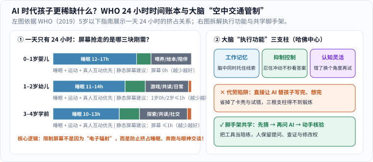

每隔十几年，总有商业咨询或媒体机构给新出生的孩子起一个响亮的新代号。名字听起来像一张通往未来的入场券，但孩子并不会因为同一年出生，就自动拥有同一种大脑和同一种人生。

这篇除了拆解那些热闹的“世代预言”，更想替好奇又略带焦虑的爸妈往深处追问两句：**第一，在孩子最关键的头几年，权威医学机构真正有证据支持的“一天 24 小时分配法”到底是什么？第二，当 AI 已经能一秒钟写作文、画图、解题时，孩子身上哪样底层能力反而最珍贵、最不能被一键代劳？**

### “Beta 世代”：先看清它只是一家研究机构的命名框架

2025 年初，不少媒体刷屏了一条消息：“2025 年起出生的孩子叫 Beta 世代（Generation Beta）！”追查源头，这是澳大利亚社会研究与咨询机构 [McCrindle Research 发布的一篇趋势文章](https://mccrindle.com.au/article/generation-beta-defined/)，它把 `2010–2024` 年称为 Generation Alpha，把 `2025–2039` 年称为 Generation Beta。[1]

读这类文章时，先在心里放一把尺子：**这是某家机构为方便商业与人口传播采用的 15 年固定切分，不是全球统一的发育科学分期，更不是写进基因里的人格说明书。** 同样在 2025 年出生，生活在不同城市与乡村、拥有不同家庭陪伴方式和教育资源的孩子，面对的真实世界可能天差地别。（旧版流传的外部“七个世代”信息图既容易让人误以为是国际公认标准，也缺少明确的免费转载授权，因此这里用文字核对原始定义与边界。）

下面用我们自己的话把原文的几个预测方向和阅读边界拆开：

| 原文的判断方向 | 可以怎样理性理解 | 还不能直接推出的结论 |
|---|---|---|
| AI 与自动化全面融入日常 | 值得关注学习方式、医疗与未来职业结构的变化 | 所有孩子都会自然、平等地学会驾驭这些工具 |
| 数字世界与线下生活深度交织 | 更需要早早建立隐私意识、信息核查习惯与真人关系 | 越早给低龄幼儿配齐电子屏幕就越“赢在起跑线” |
| 可持续发展与气候议题突出 | 能源、气候与生态将成为他们成年后的公共议题 | 某一代人天生就比上一代更有环保责任感 |

原文还提到一组调查数字：36% 的 Z 世代父母、30% 的较年长千禧一代父母“强烈同意”限制孩子屏幕时间是优先事项。[1] 这可以作为该机构的调查线索来读，但原文并未充分披露抽样国家、样本量与问卷细节，**不宜拿它给全球父母画像，更不必拿来评判哪一代父母更称职**。

### 硬核证据一：一天只有 24 小时，屏幕真正抢走的是什么？

既然聊到屏幕与数字时代，很多家长最纠结的是：“完全不看动画片怕他跟小朋友没共同语言，看多了又怕伤眼睛、坐不住——科学上到底怎么定？”

其实，**世界卫生组织（WHO）在 2019 年发布的《5 岁以下儿童身体活动、久坐行为和睡眠指南》**给出了一个比单纯“防近视”深刻得多的视角——**“24 小时整体账本”**（图 1 左）：[2]

_图 1：左图依据 WHO（2019）指南绘制——一天固定只有 24 小时，静态屏幕时间之所以要严控（1 岁以下与 1 岁幼儿不建议看静态屏幕，2–4 岁每日不超过 1 小时且越少越好），核心是保护睡眠、身体活动与真人共读不被挤占；右图拆解哈佛儿童发展中心的“执行功能”三支柱。[单独打开图片](/assets/images/early-curiosity/child-24h-executive.svg)_

对照 WHO 专家组评估全球证据后给出的具体建议，账本一下就清楚了：[2]

- **1 岁以下婴儿**：每天多次地板互动玩耍（尚不能爬行时，清醒状态下累计至少 **30 分钟趴卧练习 Tummy time**）；每次在婴儿车、餐椅里受限久坐不超过 1 小时；保证 **14–17 小时**（0–3 月龄）或 **12–16 小时**（4–11 月龄）优质睡眠；**不建议接触屏幕**。
- **1–2 岁幼儿**：全天累计至少 **180 分钟（3 小时）**各种强度的身体活动；保证 **11–14 小时**规律睡眠；**1 岁仍不建议静态屏幕时间**（注：与远方亲人视频通话除外），**2 岁起每天静态屏幕不超过 1 小时，越少越好**；安静坐着时，优先由大人陪着读绘本、讲故事、玩拼图。
- **3–4 岁学龄前儿童**：全天至少 **180 分钟**身体活动（其中至少 **60 分钟**是跑跳骑车等中高强度运动！）；保证 **10–13 小时**睡眠；每天静态屏幕同样**不超过 1 小时，越少越好**。[2]

看懂了吗？科学界限制低龄儿童刷屏幕，并不是因为屏幕会发射什么神秘的“变笨射线”，而是因为**小宝宝的一天也只有 24 小时**——多刷一小时自动连播短视频，就必然挤掉一小时在阳光下疯跑协调四肢、在绘本前跟爸妈指认问答、或者在深度睡眠里巩固记忆突触的黄金时间！

### 硬核证据二：当 AI 能秒出答案，孩子最怕丢掉“大脑空中交通管制”

再往远看一步：等孩子上小学、中学，AI 工具已经像自来水一样随手可用。那时候，什么能力最容易在不知不觉中退化，又最决定一个人走多远？

哈佛大学儿童发展中心用了一个非常传神的比喻——大脑里的**“空中交通管制系统”**，心理学上称为**执行功能与自我调节（Executive Function & Self-Regulation）**，它由三根核心支柱撑起（图 1 右）：[3]

1. **工作记忆（Working Memory）**：在脑海里同时托住好几条线索并建立联系（比如一边记住故事开头埋的伏笔，一边推演结尾）；
2. **抑制控制（Inhibitory Control）**：管住“马上要点开爽一下、马上要看现成答案”的冲动，在遇到卡壳时耐住性子多想两步；
3. **认知灵活性（Cognitive Flexibility）**：发现第一条路走不通时，不崩溃耍赖，而是换个角度调整策略再试一次。[3]

这三项能力**没有人生来就有，但每个孩子都天生具备练出它们的潜力**——前提是大人不能把“练习的机会”全替他包办了！[3]

在 AI 时代，最大的分水岭恰恰就在这里：

- **“一键代劳”陷阱**：作业不会做，拍照搜题直接抄；作文不想憋，让 AI 生成一篇背下来；刚无聊十秒钟，立刻递上算法精准投喂的短视频。结果表面上交出去的作业漂漂亮亮，但大脑里最关键的“卡壳—思索—试错—修正”回路一次都没通电。
- **“脚手架式”共学**：把工具变成放大好奇心的望远镜，而不是替孩子走路的轮椅。

### 把“未来会怎样”换成“今天家里能做的三件小事”

_图 2：从上往下看——先确认真正发生的事，再检查推断成立的条件，最后落回家庭自己的选择。[单独打开阅读卡](/assets/images/archive-guides/ai-evidence.svg)_

与其把孩子想象成需要提前安装插件的“未来产品”，不如从今晚就能落地的三个小习惯开始（关于我们大人自己面对 AI 的心态，也可同读本站《[人工智能对人的影响]()》与《[机器到底是怎么学会思考的？从一条直线到大模型]()》）：

1. **先猜后问，一起核查**：孩子问“为什么月亮有时候白天也在天上？”，别急着秒查答案念给他听。先反问一句：“你猜呢？”等他画出歪歪扭扭的猜想，再一起问 AI 或翻科普书，并挑出其中一条到阳台上亲眼核对——让他从小知道，**AI 说得再流利也只是参考线索，真假要靠证据说话**。
2. **让孩子当“总导演”，工具只当“画笔”**：如果要用工具编故事或做小卡片，让孩子自己口述情节转折、挑出哪里不合逻辑要重改，把审美与拍板权留在人手里，同时严守底线——不向公共工具上传孩子的真实姓名、人脸照片、学校和住址。
3. **理直气壮地留出“无屏幕、允许无聊”的空白**：周末去泥地里捡树叶、骑车追风、跟小伙伴自己制定捉迷藏规则（哪怕为规则吵一架再和好，也是顶级的执行功能训练！[3]）。不要被“不早点玩平板就会被时代淘汰”的话术绑架——触屏界面本来就是照着直觉设计的，十岁学和两岁学都能十分钟上手；但错过了在真实世界摸爬滚打、学会专注与抗挫的童年，才真的难补回来。

### 奶爸的一点思考

我们的父辈担心电视毁掉下一代，我们这一代经历过互联网网瘾的争论，现在轮到我们面对 AI。技术浪潮一浪高过一浪，既不必恐慌得把孩子关进真空罐子，也不能盲目相信“船到桥头自然直”。

作为父母，我更愿意守住几件不会过时的朴素小事：给孩子稳稳的睡眠、奔跑流汗的下午、认真听他把半截问题问完的耐心，允许他慢一点、允许他试错，也帮他看见屏幕之外活生生的人。

教育公平、社会支持与时代环境当然都会塑造未来，**不能把一个时代的不确定性，统统压在孩子小小的肩膀上要求他“内心足够强大”。**

拥抱不需要等 2039 年的预言兑现。今天晚饭后放下手机、牵起小手下楼散步的这半个小时，本身就已经是实实在在的未来了。

### 来源与阅读边界

1. [McCrindle Research：Welcome Gen Beta](https://mccrindle.com.au/article/generation-beta-defined/)——核对 Generation Beta（2025–2039）命名区间与原文调查表述；本文将其作为一家机构的命名视角介绍，不视作科学定论。
2. [WHO（世界卫生组织，2019）：To grow up healthy, children need to sit less and play more](https://www.who.int/news/item/24-04-2019-to-grow-up-healthy-children-need-to-sit-less-and-play-more)——5 岁以下儿童每日身体活动、受限久坐、静态屏幕时间与睡眠时长的官方循证指南。
3. [Harvard Center on the Developing Child：A Guide to Executive Function](https://developingchild.harvard.edu/resource-guides/guide-executive-function/)——大脑“空中交通管制系统”（工作记忆、抑制控制、认知灵活性）及其在童年早期通过真实互动与游戏培养的机制。
4. [UNICEF：Child development](https://www.unicef.org/parenting/child-development)——将宏大未来议题拉回儿童当下发展与回应性陪伴的实用参考。
