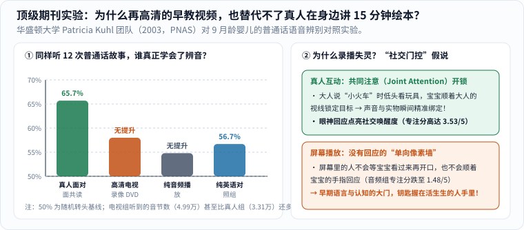
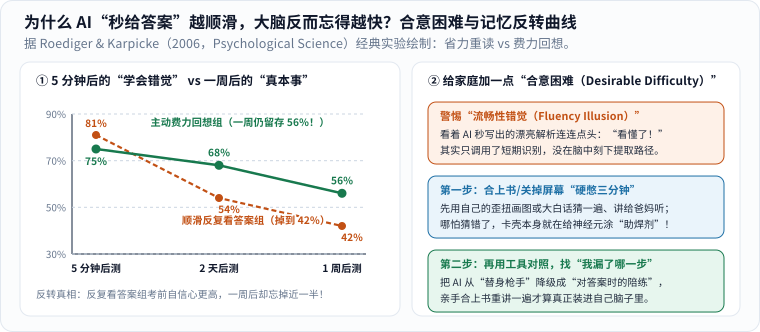

每隔十几年，总有商业咨询或媒体机构给新出生的孩子起一个响亮的新代号。名字听起来像一张通往未来的入场券，但孩子并不会因为同一年出生，就自动拥有同一种大脑和同一种人生。

这篇除了拆解那些热闹的“世代预言”，更想用**四项硬核的发育与认知科学证据**，替好奇又略带焦虑的爸妈回答三个最实际的问题：

1. **“早教视频和点读平板做得那么精致，能不能代替真人在地毯上陪读 15 分钟？”**
2. **“世界卫生组织为什么要严控低龄屏幕时间？一天 24 小时里真正被挤走的是什么？”**
3. **“当 AI 已经能一秒钟写作文、画图、给标准答案时，为什么越‘省力顺滑’的工具反而越容易让大脑忘得精光？”**

---

### 先拆标签：“Beta 世代”只是一家研究机构的命名框架

2025 年初，不少媒体刷屏了一条消息：“2025 年起出生的孩子叫 Beta 世代（Generation Beta）！”追查源头，这是澳大利亚社会研究与咨询机构 [McCrindle Research 发布的一篇趋势文章](https://mccrindle.com.au/article/generation-beta-defined/)，它把 `2010–2024` 年称为 Generation Alpha，把 `2025–2039` 年称为 Generation Beta。[1]

读这类流行文章时，先在心里放一把尺子：**这是某家机构为方便商业与人口传播采用的 15 年固定切分，不是全球统一的发育科学分期，更不是写进基因里的人格说明书。** 同样在 2025 年出生，生活在不同城市与乡村、拥有不同家庭陪伴方式和教育资源的孩子，面对的真实世界可能天差地别。（旧版流传的外部“七个世代”信息图既容易让人误以为是国际公认标准，也缺少明确的免费转载授权，因此这里用文字核对原始定义与边界。）

下面用我们自己的话把原文的几个预测方向和阅读边界拆开：

| 原文的判断方向 | 可以怎样理性理解 | 还不能直接推出的结论 |
|---|---|---|
| AI 与自动化全面融入日常 | 值得关注学习方式、医疗与未来职业结构的变化 | 所有孩子都会自然、平等地学会驾驭这些工具 |
| 数字世界与线下生活深度交织 | 更需要早早建立隐私意识、信息核查习惯与真人关系 | 越早给低龄幼儿配齐电子屏幕就越“赢在起跑线” |
| 可持续发展与气候议题突出 | 能源、气候与生态将成为他们成年后的公共议题 | 某一代人天生就比上一代更有环保责任感 |

原文还提到一组调查数字：36% 的 Z 世代父母、30% 的较年长千禧一代父母“强烈同意”限制孩子屏幕时间是优先事项。[1] 这可以作为该机构的调查线索来读，但原文并未充分披露抽样国家、样本量与问卷细节，**不宜拿它给全球父母画像，更不必拿来评判哪一代父母更称职**。

---

### 硬核证据一：顶刊《PNAS》著名实验——为什么超清视频教不会 9 个月宝宝辨音？

很多爸妈都动过这样的念头：“我普通话/英语发音没播音员标准，讲故事也没动画片生动，给小宝宝放制作精良的名师早教视频，效果岂不是更好？”

2003 年，华盛顿大学脑与学习科学中心主任帕特里夏·库尔（Patricia K. Kuhl）团队在《美国国家科学院院刊》（*PNAS*）上发表了一项震撼整个早期教育界的经典实验，正面回答了这个问题（图 1）：[5]

我们知道，刚出生的婴儿是“世界公民”，能分辨全球所有语言的细微发音差别；但到了 **6–12 个月**，大脑开始针对母语做“神经修剪”，对母语里没有的外语辅音（比如英语家庭宝宝听普通话里的舌面音 `x` 对比 `q`，如“西”和“七”的声母差异）辨别力会急剧下降。[5]

Kuhl 团队找来 **9 个月大**的纯英语家庭健康婴儿，把他们分成四组，在四周内各安排 **12 次、每次 25 分钟**的语言接触：

1. **真人面对面互动组**：由母语为普通话的老师坐在地毯上，看着宝宝的眼睛、叫宝宝名字，一起翻绘本、玩小火车玩具讲普通话；
2. **高清电视视频（DVD）组**：用专业影棚把**同一批老师、同一套绘本和玩具**按婴儿平视视角拍成高清特写视频（画面光线极佳，连老师的口型都一清二楚！），在同样距离的电视上放给宝宝看；
3. **纯音频组**：只播放同一套普通话录音；
4. **纯英语对照组**：同样真人陪玩 12 次，但只说英语。[5]

更绝的一个实验细节是：事后统计录音字数发现，因为视频没有停顿打岔，**电视组宝宝听到的普通话音节总数（平均 `49,866` 个音节）甚至比真人组（平均 `33,120` 个音节）还多了整整 50%！**[5]

可四周结束一测普通话语音辨别率，结果让所有人倒吸一口凉气（图 1 左）：

_图 1：华盛顿大学 Kuhl 团队（2003，PNAS）实测数据——尽管高清电视组听到的普通话音节数比真人组还多出近一半，但电视组和纯音频组的语音学习效果几乎为零（与从未听过普通话的英语对照组 56.7% 无统计学差异），唯独真人面对面互动组飙升至 65.7%，一举追平了在台北土生土长的同龄母语宝宝！[单独打开图片](/assets/images/early-curiosity/kuhl-live-vs-video.svg)_

- **真人面对面组**：辨音准确率跃升至 **`65.7%`**，不仅显著高于英语对照组（`56.7%`，接近 `50%` 盲猜基线），而且**和从小在台湾听普通话长大的同龄宝宝水平旗鼓相当**！哪怕停课十几天后再测，记忆依然稳稳保留；
- **高清电视组与纯音频组**：**完全没有产生任何语音学习效果**（与从没听过普通话的英语对照组 `P > 0.10` 毫无差别）！[5]

为什么多听了近两万个标准音节，屏幕却失灵了？Kuhl 提出了著名的**“社交门控（Social Gating）”假说**（图 1 右）：[5]

当活生生的大人坐在地垫上说“看，小火车！”时，大人会先看一眼宝宝、再看向手里的小火车；9 个月大的宝宝顺着大人的眼珠转过去锁定火车（**共同注意 Joint Attention**），大脑的社交奖赏与注意开关“咔哒”一声打开（实测真人组专注度评分高达 `3.53/5`，而音频组跌至 `1.48/5`），声音与意义瞬间焊在一起！[5] 而电视里的人再高清，也是一面不会等宝宝看过来再开口、不会顺着宝宝手指回应的单向像素墙。

这项实验给所有父母吃了一颗定心丸：**哪怕你普通话带点家乡口音、讲绘本磕磕巴巴，你坐在孩子身边有眼神来回的那 15 分钟，含金量也碾压市面上最昂贵的录播早教课！**（注：与外地爷爷奶奶打实时视频电话属于双向真人回应，美国儿科学会与 CDC 均将其明确排除在被动屏幕限制之外。）

---

### 硬核证据二：一天只有 24 小时，WHO 算清了屏幕抢走的“三样刚需”

顺着“社交门控”再看**世界卫生组织（WHO）2019 年发布的《5 岁以下儿童身体活动、久坐行为和睡眠指南》**，你就不会觉得它的数字苛刻了——WHO 专家组算的是一笔**“24 小时零和账”**（图 2 左）：[2]

_图 2：左图依据 WHO（2019）循证指南绘制——一天固定只有 24 小时，严控静态屏幕时间的核心目的是保护睡眠、身体活动与真人共读不被挤占；右图拆解哈佛儿童发展中心的“执行功能”三支柱。[单独打开图片](/assets/images/early-curiosity/child-24h-executive.svg)_

对照指南原文的年龄段建议：[2]

- **1 岁以下婴儿**：每天多次地板互动玩耍（尚不能爬行时，清醒状态下累计至少 **30 分钟趴卧练习 Tummy time**）；每次在婴儿车、餐椅里受限久坐不超过 1 小时；保证 **14–17 小时**（0–3 月龄）或 **12–16 小时**（4–11 月龄）优质睡眠；**不建议接触屏幕**。
- **1–2 岁幼儿**：全天累计至少 **180 分钟（3 小时）**各种强度的身体活动；保证 **11–14 小时**规律睡眠；**1 岁仍不建议静态屏幕时间**，**2 岁起每天静态屏幕不超过 1 小时，越少越好**；安静久坐时，优先和照护者一起读绘本、讲故事、玩拼图。
- **3–4 岁学龄前儿童**：全天至少 **180 分钟**身体活动（其中至少 **60 分钟**是跑跳骑车等中高强度运动！）；保证 **10–13 小时**睡眠；每天静态屏幕同样**不超过 1 小时，越少越好**。[2]

科学界限制低龄刷屏，真不是因为屏幕会发射什么神秘辐射，而是因为**孩子的一天也只有 24 小时**：睡眠占去一半，跑跳攀爬占去 3 小时，吃饭洗漱再占去几小时——多刷一小时自动连播短视频，就必然从“深度睡眠、户外奔跑、真人眼神对话”这三块大脑发育基石上硬生生挖走一小时！

---

### 硬核证据三：当 AI 能一秒交卷，警惕“流畅性错觉”，留一点“合意困难”

再往远看一步：等孩子上小学、中学，生成式 AI 已经像自来水一样随手可用。那时候，什么能力最容易在不知不觉中退化，又最决定一个人走多远？

哈佛大学儿童发展中心把大脑前额叶主导的**执行功能与自我调节（Executive Function）**比作繁忙机场的**“空中交通管制系统”**（图 2 右）：[3]

1. **工作记忆（Working Memory）**：在脑海里同时托住好几条线索并自己建立联系；
2. **抑制控制（Inhibitory Control）**：管住“马上要点开爽一下、马上要看现成答案”的本能冲动，在遇到卡壳时耐住性子多想两步；
3. **认知灵活性（Cognitive Flexibility）**：发现第一条路走不通时，不摔笔崩溃，而是换个策略再试一次。[3]

为什么“拍照搜题秒抄”或“让 AI 直接代写作文/总结”对这三根支柱杀伤力极大？认知心理学里有一条极其反直觉的定律——罗伯特·比约克（Robert Bjork）提出的**“合意困难（Desirable Difficulties）”**，以及心理学家 Roediger 与 Karpicke 在 2006 年发表于《心理科学》（*Psychological Science*）的著名**记忆反转实验**（图 3）：[6]

_图 3：左图还原 Roediger & Karpicke（2006）经典记忆实验——学完立刻（5 分钟）测验时，省力反复看原文的同学略占上风（81% vs 75%），自我感觉也极好；可仅仅过了一周，当初合上书“费力硬想”的同学记忆留存率（56%）大幅反超被动重读组（42%）！右图给出家庭防“AI 流畅性错觉”的三步法。[单独打开图片](/assets/images/early-curiosity/desirable-difficulty-retention.svg)_

在实验里，两组大学生学习同一篇科普短文：一组连续读四遍原文（就像今天看着 AI 秒吐出的丝滑解析连连点头：“哇，写得太清楚了，我全懂了！”）；另一组只读一遍，剩下时间合上纸**在没有任何提示的情况下苦思冥想把记得的内容默写出来**。[6]

结果出现了一个惊人的大反转：

- **5 分钟后立刻考**：反复看答案组考了 `81%`，比费力回想组（`75%`）还高一点，而且反复看答案的学生自信心爆棚，坚信自己一周后肯定记得更牢——心理学称之为**“流畅性错觉（Fluency Illusion）”**；
- **1 周后再考**：当初顺滑看答案的那组断崖式跌到了 **`42%`**（忘掉超过一半！），而当初合上书抓耳挠腮“硬憋”出来的那组，一周后依然稳稳记住了 **`56%`**！[6]

道理其实跟练肌肉一模一样：**坐观光电梯上十楼当然又快又省力，但你的腿部肌肉一根纤维都不会长；正是“先合上答案自己卡壳、猜想、提取”的那一点点摩擦感（合意困难），才真正给大脑突触涂上了长期记忆的焊锡！**

---

### 把“未来会怎样”换成“今天家里能做的三件小事”

_图 4：从上往下看——先确认真正发生的事，再检查推断成立的条件，最后落回家庭自己的选择。[单独打开阅读卡](/assets/images/archive-guides/ai-evidence.svg)_

与其把孩子想象成需要提前安装插件的“Beta 世代产品”，不如从今晚就能落地的三个小习惯开始（关于大人自己如何与 AI 协作，也可同读本站《[人工智能对人的影响]()》与《[机器到底是怎么学会思考的？从一条直线到大模型]()》）：

1. **守住“先猜三分钟”的黄金摩擦期**：孩子问“为什么月亮有时候大白天也在天上？”或者做题卡住时，忍住别秒掏手机念答案。先笑着反问一句：“你先瞎猜一个原因，画在纸上看看？”等他自己动脑筋搭完哪怕错漏百出的小假说，再去翻书或问 AI，并挑出其中一条到阳台上亲眼核对——既破除了“AI 流畅性错觉”，又让他从小知道**真假要靠证据说话**。
2. **让孩子当“总导演”，工具只当“画笔”**：大一点的孩子如果要用 AI 辅助编故事或查资料，约定好三条规矩：① 先口述自己的提纲；② 挑出 AI 回答里至少一处不满意或可疑的地方动手核实修改；③ 合上屏幕能用自己的大白话给爸妈讲明白才算过关。同时严守隐私底线——绝不向公共模型上传孩子的真实姓名、人脸照片、学校与家庭住址。
3. **理直气壮地保护“流汗、睡眠与允许无聊”**：周末去泥地里捡树叶、骑车追风、跟小伙伴自己制定捉迷藏规则（哈佛指南特别指出：孩子们自己商量游戏规则、轮流等待、甚至为规则争执再和好，正是顶级的执行功能训练场！[3]）。千万别被“不早点给两岁娃配平板就会被时代淘汰”的焦虑营销唬住——图形和语音界面本来就是照着直觉设计的，十岁学和两岁学都能十分钟上手；但错过了在真实世界里摸爬滚打、练出专注力与抗挫力的童年，才真的难补回来。

### 奶爸的一点思考

我们的父辈担心电视毁掉下一代，我们这一代经历过互联网的争论，现在轮到我们面对 AI。技术浪潮一浪高过一浪，既不必恐慌得把孩子关进真空罐子，也不能盲目相信“船到桥头自然直”。

作为父母，我更愿意守住几件不会随算法迭代而贬值的朴素小事：给孩子稳稳的睡眠、奔跑流汗的下午、坐在地垫上看着他眼睛读绘本的十五分钟，允许他慢一点、允许他先卡壳再想通，也帮他看见屏幕之外活生生的人。

教育公平、社会支持与时代环境当然都会塑造未来，**不能把一个时代的不确定性，统统压在孩子小小的肩膀上要求他“内心足够强大”。**

拥抱不需要等 2039 年的预言兑现。今天晚饭后放下手机、牵起小手下楼散步的这半个小时，本身就已经是实实在在的未来了。

### 来源与阅读边界

1. [McCrindle Research：Welcome Gen Beta](https://mccrindle.com.au/article/generation-beta-defined/)——核对 Generation Beta（2025–2039）命名区间与原文调查表述；本文将其作为一家机构的命名视角介绍，不视作科学定论。
2. [WHO（世界卫生组织，2019）：To grow up healthy, children need to sit less and play more](https://www.who.int/news/item/24-04-2019-to-grow-up-healthy-children-need-to-sit-less-and-play-more)——5 岁以下儿童每日身体活动、受限久坐、静态屏幕时间与睡眠时长的官方循证指南。
3. [Harvard Center on the Developing Child：A Guide to Executive Function](https://developingchild.harvard.edu/resource-guides/guide-executive-function/)——大脑“空中交通管制系统”（工作记忆、抑制控制、认知灵活性）及其在童年通过真实互动与游戏培养的机制。
4. [UNICEF：Child development](https://www.unicef.org/parenting/child-development)——将宏大未来议题拉回儿童当下发展与回应性陪伴的实用参考。
5. Kuhl, P. K., Tsao, F.-M., & Liu, H.-M. (2003). *Foreign-language experience in infancy: Effects of short-term exposure and social interaction on phonetic learning*. *PNAS*, 100(15), 9096–9101.（PMCID `PMC166444`）——9 月龄婴儿 12 次普通话接触对照实验：真人互动组辨音率达 65.7%，而高清 DVD 视频与纯音频组均无学习效果。
6. Roediger, H. L., & Karpicke, J. D. (2006). *Test-enhanced learning: taking memory tests improves long-term retention*. *Psychological Science*, 17(3), 249–255.（PubMed 编号 `16507066`）——被动重复阅读（5 分钟 81% → 一周后 42%）与主动检索回想（5 分钟 75% → 一周后 56%）的记忆反转实验。
