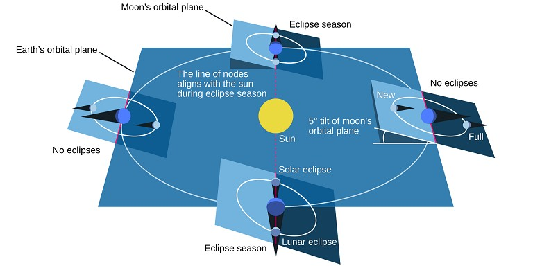
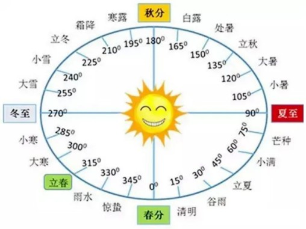

我们每天都在用日历，但你有没有想过：为什么春节每年都不一样？为什么有的年份会有"闰二月"？为什么满月有时在十五，有时在十六，甚至十七？

这背后，是人类用了几千年时间，和太阳、月亮"对表"的故事。

### 农历和公历介绍

世界上的历法主要分三类：
* **阳历**：跟着太阳走，比如我们现在用的公历
* **阴历**：跟着月亮走，比如伊斯兰历
* **阴阳历**：既跟着太阳又跟着月亮，就是我们的农历

农历要同时协调两种周期，所以规则更复杂。不同历法服务于不同目的，不能简单评出一种“最精确”的冠军。

先比较两条柱子的右端，再看差值：一个月的平均长度并不整除一年。**公历闰年补一天，农历闰年增加一个月**，解决的不是同一个问题。[单独打开大图](/assets/images/archive-guides/calendar.svg)。

#### 农历来历

农历是中国人用了几千年的智慧结晶。

我们的祖先发现：
* 月亮从缺到圆再到缺，一次是29.53天，这就是一个"月"
* 太阳从冬至到下一个冬至，是365.24天，这就是一个"年"

问题来了：12个月 × 29.53天 = 354天，比太阳年少了11天！

如果一直不补这个差，月份相对季节会逐渐漂移，约十几年就可能错开半个年头。

古代历法曾采用**19年7闰法**：
每19年插入7个闰月，用235个月来凑够19个太阳年
它们非常接近，却不是“完美相等”：235 个平均朔望月与 19 个平均回归年仍有约 0.087 天之差。现代农历按天文计算排定朔和节气，不能把十九年当成永不变化的固定模板。平均周期和历法类别可参看[香港天文台的农历说明](https://www.hko.gov.hk/en/gts/time/calendarinfo.htm)。

> 💡 为什么叫"农历"？
> 
> 因为它与传统农业生活密切相关。节气帮助描述季节，但各地气候和作物不同，不能拿某地的农时直接指导所有地区，更不是遗传在 DNA 里的知识。

#### 公历来历

公历的前身是古罗马凯撒大帝制定的儒略历。

儒略历采用平年 365 天、每四年一闰的规则，平均一年 365.25 天，比回归年稍长。网上常见“奥古斯都从二月偷一天给八月”“二月因行刑而不吉利”的故事，不宜当作可靠的历法史来记。

长期累积后，历法日期与季节逐渐错位。1582年，教皇格里高利十三世推动历法改革：
* 首批采用改革的地区，在 10 月 4 日之后直接记为 10 月 15 日；其他地区并非同时改历
* 改成"400年97闰"的更精确规则

这就是我们今天全世界通用的"格里高利历"——公历。

判断闰年可以跟着例子走：2024 能被 4 整除，是闰年；1900 虽能被 4 整除，但整百年不能被 400 整除，不闰；2000 能被 400 整除，仍然闰。因此 400 年里有 97 个闰年，平均一年为 365.2425 天。这是接近回归年的规则，不是每天都重新观测后决定二月有几天。

### 农历和公历转换

公历的月长按规则固定；农历是**阴阳历**，月从包含“朔”的那一天开始，小月 29 天，大月 30 天。平年 12 个月，闰年 13 个月，所以不能说每个农历年都只有约 354 天。

回归年与季节循环相关；相对遥远恒星绕太阳一周的恒星年稍长，两者不能混为一谈。

现代农历编排的一条关键规则是：**冬至所在月定为十一月**。若两个相邻的十一月之间有 13 个农历月，按规则把其中第一个不含中气的月安排为闰月，沿用前月月名。这里还涉及朔、节气的精确时刻和使用的时区，不能只靠“每月加 30 天”算出来。

实际查某一天，最稳妥的入门办法是用[香港天文台公历与农历对照表](https://www.hko.gov.hk/en/gts/time/conversion.htm)，再对照节气理解规则。不要拿平均朔望月反推某年春节的准确日期。

#### 月相

月相，是由地球上所观看之月光形态。月球本身不发光，月球直接被太阳照射之部分反射太阳光，才可见发亮，其阴影部分是月球自己之阴暗面。根据天文学，月球环绕地球公转时，地球、月球、太阳之相对位置不断规律地变化，使观测者从不同角度看到月球被太阳照明之部分，造成月相盈亏圆缺之变化。

月球在天空中大致位于太阳的相反方向时，我们看见接近完整的亮面，称为满月；位于太阳方向附近时，朝向我们的主要是暗面，称为朔。天文学中的“新月”常指朔，日常也有人用它称细弯的月牙，要结合语境。

上弦和下弦附近，从地球看日月的角距离约为 90°，我们看到月面约有一半被照亮。月相取决于观察方向，不是月球本身忽然少了一半。

月相更替的平均周期约为 29.53 天，称为一个朔望月，也是农历月的天文依据。它比月球相对遥远恒星绕地球一周的恒星月（约 27.32 天）长：月球绕了一圈时，地球也已沿太阳轨道前进，月球还得多走一段，才能恢复相似的日月地相对位置。

月相的变化不是地球的影子在月亮上移动；那是另一类现象——月食。月球绕地球公转的轨道面（[白道面](https://zh.wikipedia.org/wiki/白道面)）与地球绕太阳公转的轨道面（[黄道面](https://zh.wikipedia.org/wiki/黄道面)）之间约有5°夹角。因此多数朔、望时，月球会从相应影子的上方或下方错过；只有在轨道交点附近、排列足够接近时，才可能发生日食或月食，并不要求三个天体中心数学上完全共线。

#### 日食和月食

**日食看的是月球遮住太阳；月食看的是月球进入地球的影子。** “食”也常写作“蚀”，不是另外一种现象。

对某地的观察者，太阳圆面被完全遮住是日全食，被遮住一部分是日偏食；若月球的视圆面较小，留下明亮的太阳环，就是日环食。真实分类还包括沿路径变化的全环食。

月球全部或部分进入地球本影，分别形成月全食或月偏食；只进入半影则是半影月食。**月全食不是地球挡住我们看月球的视线**，而是地球遮住了照向月球的直射阳光。部分经过地球大气折射的阳光仍能到达月球，所以月全食中的月亮常呈暗红色，不保证完全不可见。

| 特征 | 日食 | 月食 |
|------|------|------|
| **成因** | 月球遮挡太阳 | 地球遮挡太阳光 |
| **可见范围** | 地表一定区域 | 发生相应阶段时，月球在地平线以上的地区有机会看见 |
| **持续时间** | 全食阶段常为数分钟，偏食过程可持续数小时 | 整个过程可持续数小时 |

---

### 二十四节气

二十四节气（廿四节气）是中国人通过观察太阳周年运动，认知一年中时令、气候、物候等方面变化规律形成的知识体系和社会实践，是上古农耕文明的产物，千年以来指导着中国传统农业生产和日常生活。

现代二十四节气按太阳视黄经每增加 **15°** 划分一次，不是严格每过 15 天就轮换。春分为 0°，清明为 15°，谷雨为 30°，依次排列。由于地球公转速度并不恒定，相邻节气的时间间隔也不同。

十二个“节”和十二个“中气”交替出现。中气包括春分、谷雨、小满、夏至、大暑、处暑、秋分、霜降、小雪、冬至、大寒、雨水。不能理解成“每个农历月固定有两个节气，第二个必然是中气”——无中气月恰恰与置闰问题有关。参见[香港天文台：二十四节气](https://www.hko.gov.hk/en/gts/time/24solarterms.htm)。

### 和孩子动手“对表”

找一张当年的日历，标出一个月初一与十五，再查当天月相。问：“日期能不能直接等同于月相发生的精确时刻？”朔发生在某个时刻，而历日是一整天，加上月球运动速度变化，所以满月不保证永远落在十五。

再圈出今年的两个节气，数一数间隔是不是恰好 15 天。用一个真实反例，比背一串节气名称更容易理解规则。观察日食必须使用合适的太阳观测设备；普通墨镜不能保护眼睛。

---

### 奶爸说

下次和孩子一起看月亮的时候，别忘了告诉他/她：

我们的祖先，看着同一个月亮，
数了几千年的阴晴圆缺，
才把时间的秘密，写进了我们的日历里。📅

今天的孩子拿着电子手表看时间，
但他们更应该知道：
时间，不是手机屏幕上跳动的数字，
而是太阳升起又落下，
月亮缺了又圆了，
庄稼种了又收了...

是我们和这个古老星球之间，最美妙的约定。

---

### 参考文献

1. [月相](https://zh.wikipedia.org/zh-sg/月相). Wikipedia.
2. [二十四节气](https://zh.wikipedia.org/wiki/二十四节气). Wikipedia.
3. [香港天文台：农历](https://www.hko.gov.hk/en/gts/time/calendarinfo.htm)——朔望月、回归年及阴阳历。
4. [香港天文台：二十四节气](https://www.hko.gov.hk/en/gts/time/24solarterms.htm)——太阳黄经与中气。
5. [香港天文台：公历与农历对照表](https://www.hko.gov.hk/en/gts/time/conversion.htm)——实际日期查询入口。
