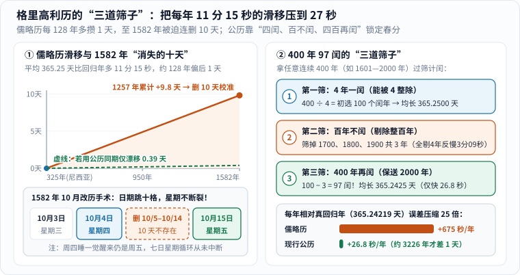
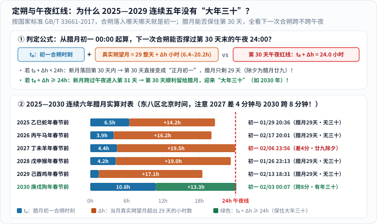
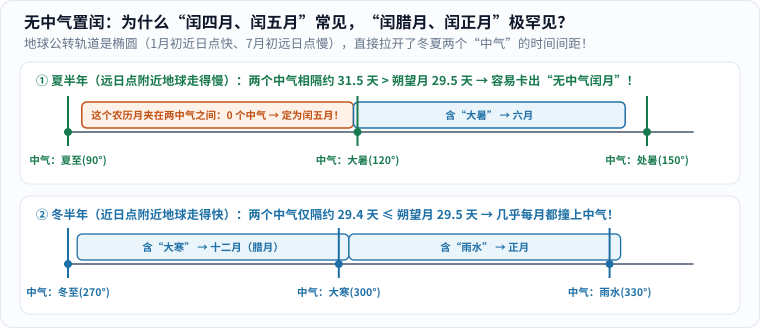
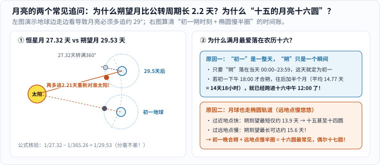
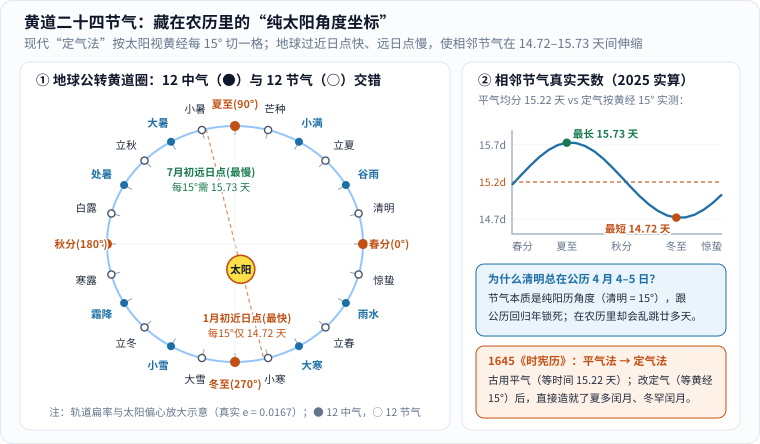
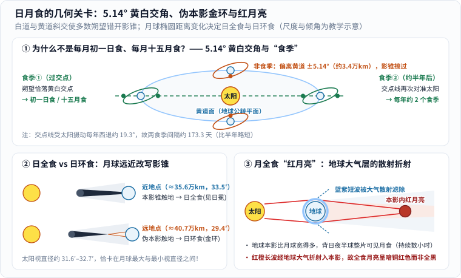
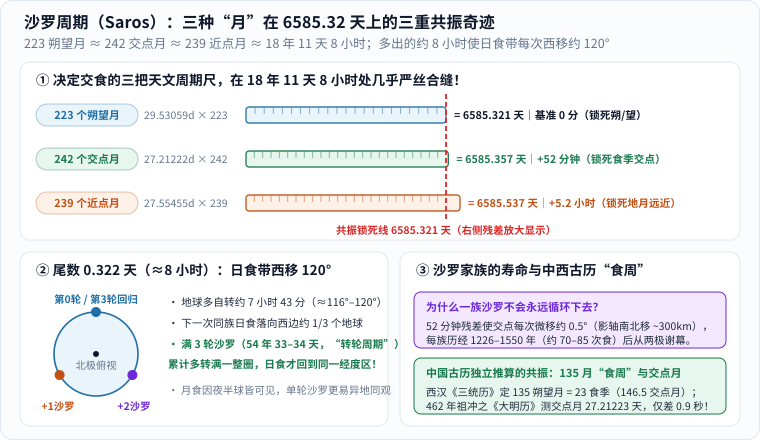

我们每天都在翻日历，可只要稍微留心，一连串奇妙的问号就会冒出来：

- 为什么春节每年在公历 1 月 21 日到 2 月 20 日之间跳动，却从不跑到 3 月？
- 为什么从 **2025 年到 2029 年，我们将连续五年过不上“大年三十”**，除夕全停在腊月二十九？
- 为什么有的年份冒出“闰二月”“闰六月”，到了 **2033 年甚至会撞见几百年难遇的“闰十一月”**？
- 为什么满月最常落在农历十六甚至十七？为什么清明总在公历 4 月 4—5 日，却在农历二月和三月间乱窜？为什么不是每月初一都有日食、每月十五都有月食？

这背后没有半点玄学，而是人类用了几千年时间，拿着整数格子的日历去和太阳、月亮“对表”的硬核数学故事。今天我们就备好纸笔，用最朴素的加减乘除，把这本挂在墙上的宇宙说明书彻底算清楚。

---

## 一、老天爷发给地球人的“三块合不拢的表”

### 1. 太阳日、朔望月与回归年：12 个阴历月为什么每年短 10.88 天？

制定历法，人类抬头能借用的天然钟表只有三块：

1. **地球自转一圈（平均太阳日）**：昼夜更替一次，定义为 $$1$$ 天（$$24$$ 小时 $$= 86400$$ 秒）；
2. **月相圆缺一轮（平均朔望月）**：从看不见月亮的“朔”到满月“望”再回到“朔”，现代测定平均为 **$$29.53059$$ 天**（$$29$$ 天 $$12$$ 小时 $$44$$ 分 $$03$$ 秒）[1][2]；
3. **四季循环一周（平均回归年）**：太阳从春分回到下一个春分，平均为 **$$365.24219$$ 天**（$$365$$ 天 $$5$$ 小时 $$48$$ 分 $$45$$ 秒）[1]。

> **概念避坑：回归年 vs 恒星年**
>
> 地球相对遥远恒星真正公转 $$360^\circ$$ 的周期叫**恒星年**（约 $$365.25636$$ 天），比**回归年**长了约 $$20$$ 分 $$24$$ 秒。原因是地轴像倾斜的陀螺一样缓慢进动（**岁差**），使春分点每年西移约 $$50.3''$$，太阳没转满一整圈就提前迎上了春分点。历法必须服从决定寒暑农时的**回归年**，否则每过约 71 年季节就会错后 1 天。

麻烦就在这儿：**$$1$$、$$29.53059$$、$$365.24219$$ 彼此全除不尽！** 拿 $$12$$ 个平均朔望月乘一下：

$$
12 \times 29.53059 = 354.36708\ \text{天},
$$

比一个回归年足足短了 **$$10.87511$$ 天**（近 $$11$$ 天）[1]！

_图 1：先比较两条时间柱的右端，再看差值——12 个平均朔望月比回归年短 10.875 天。**公历闰年补 1 天，校准的是太阳年 0.2422 天的小数尾巴；农历闰年加 1 个月，填补的是阴历年与太阳年 10.875 天的鸿沟**，解决的并非同一问题。[单独打开大图](/assets/images/archive-guides/calendar.svg)_

### 2. 纯阳历、纯阴历与阴阳合历：人类文明的三条对表路线

面对这三块合不拢的宇宙钟表，人类文明走出了三条路线：

| 历法类型 | 代表历法 | 核心锚点 | 每年长度与真实表现 |
| :--- | :--- | :--- | :--- |
| **纯阳历** | 现行公历（格里高利历） | 只跟**太阳回归年** | 平年 $$365$$ 天、闰年 $$366$$ 天；四季极准，但彻底放弃月相（公历 15 号也可能是新月）。 |
| **纯阴历** | 伊斯兰历（希吉拉历） | 只跟**月相朔望月** | 严格 $$12$$ 个月（$$354$$ 或 $$355$$ 天，不置闰月）；斋月每年提前约 $$11$$ 天，约 **33 个公历年**倒着走完春夏秋冬一圈！ |
| **阴阳合历** | 中国农历、希伯来历 | **既锁月相，又锁四季** | 平年 $$12$$ 个月（$$353\text{–}355$$ 天），闰年 $$13$$ 个月（$$383\text{–}385$$ 天）；初一十五应潮汐，节气应农时。 |

为什么中国古人不嫌麻烦，非要走最复杂的“阴阳合历”？因为季风大陆种庄稼离不开太阳节令，而夜间纪日与沿海渔民赖以避险的**天文大潮**（初一“朔”与十五“望”引潮力叠加达峰）又全看月亮脸色。两头都不能丢，才逼出了这套精妙的双轨历法。

---

## 二、公历的“外科手术”：从凯撒的 11 分钟漏洞到 1582 年消失的十天

### 1. 儒略历每年多算 11 分 15 秒：1257 年攒出近 10 天滑移

公历的前身，是公元前 45 年古罗马统帅**儒略·凯撒**采纳天文学家索西琴尼建议颁行的**儒略历**[3]。它规定平年 365 天、每 4 年一闰（366 天），平均年长 $$365.25$$ 天。（顺便辟个谣：网上常传“奥古斯都从 2 月偷一天给 8 月”只是 13 世纪学者编出的段子，古罗马壁画历表证实凯撒改历时 8 月已是 31 天。）

拿儒略历和真回归年做个减法，漏洞就露出来了：

$$
365.25000 - 365.24219 = 0.00781\ \text{天/年} \approx 11\ \text{分}\ 15\ \text{秒/年}.
$$

每年多算 $$11$$ 分 $$15$$ 秒，取倒数 $$1 \div 0.00781 \approx 128$$ 年——**每过 128 年，日历就比真太阳慢整整 1 天**！从公元 **325 年尼西亚公会议**（当时春分在 3 月 21 日，教会据此定复活节）到 **1582 年**，过了 $$1257$$ 年，误差攒到了 $$1257 \times 0.00781 \approx 9.82$$ 天，真春分一路退到了 3 月 11 日 [3]。

### 2. 格里高利历的两刀手术：削去 10 天积欠与“400 年 97 闰”三道筛子

1582 年 2 月 24 日，教皇**格里高利十三世**颁布训谕《首要议题》（*Inter gravissimas*），采纳利利乌斯（Aloysius Lilius）的方案与数学家克拉维乌斯（Christopher Clavius）的阐释，果断动了两刀 [3]：

_图 2：左图按真实斜率绘出公元 325—1582 年间儒略历累计 9.82 天的滑移，以及 1582 年 10 月“跳过十个日期但不断开星期”的切口；右图展示公历“三道筛子”如何从 400 年初选 100 闰筛成 97 闰，将年误差压到 26.8 秒。[单独打开图片](/assets/images/calendar-astronomy/gregorian-leap-sieve.svg)_

1. **一刀削去 10 天积欠**：首批改历国在 **1582 年 10 月 4 日（星期四）** 次日直接跳到 **10 月 15 日（星期五）**！注意图 2 左下角：虽然跳过了 10 个日期编号，但**周四次日仍是周五，七日星期序列从未中断**。（英国拖到 1752 年才改历，删了 11 天；俄国 1918 年才改历，删了 13 天——所以俄历 10 月 25 日爆发的“十月革命”对应公历 11 月 7 日。）
2. **立下“400 年 97 闰”的三道筛子（图 2 右）**：每 400 年原本有 $$100$$ 个 4 的倍数；若把 4 个整百年全剔除只剩 $$96$$ 闰，均长 $$365.2400$$ 天反而比回归年短了 $$3$$ 分 $$09$$ 秒。于是规定**“四年一闰，百年不闰，四百年再闰”**（如 `1700`、`1800`、`1900` 不闰，`1600`、`2000` 仍闰）：

   $$
   365 + \frac{1}{4} - \frac{1}{100} + \frac{1}{400} = 365 + \frac{97}{400} = 365.2425\ \text{天}.
   $$

   残差骤降为 **$$+0.00031$$ 天/年（约 $$26.8$$ 秒/年）**，大约要过 **$$3226$$ 年** 才会再差出 1 天！

---

## 三、连分数里的东方智慧：从“19 年 7 闰”到祖冲之“391 年 144 闰”

### 1. 连分数展开与春秋“19 年 7 闰”：为什么 19 岁生日常常双历重逢？

再看中国农历：为了守住“初一必是新月”，不能零碎补几天，只能攒够差额后整月塞入**闰月**。每年少掉的 $$10.87511$$ 天占一个朔望月的比例为：

$$
r = \frac{365.24219 - 12 \times 29.53059}{29.53059} \approx 0.368266\ \text{个闰月/年}.
$$

用数论里的**连分数**不断取倒数展开，历史上人类试过的置闰法便逐级浮现：

$$
0.368266 = \cfrac{1}{2 + \cfrac{1}{1 + \cfrac{1}{2 + \cfrac{1}{1 + \cfrac{1}{1 + \cfrac{1}{17 + \cdots}}}}}}
$$

- **3 年 1 闰**（$$1/3 \approx 0.3333$$）：3 年还欠约 $$3.09$$ 天，十几年就歪了；
- **8 年 3 闰**（$$3/8 = 0.3750$$）：8 年又多补了约 $$1.59$$ 天；
- **19 年 7 闰**（$$7/19 \approx 0.368421$$，中国春秋时期已确立“章法”，早于古希腊默冬百余年 [1]）：因为下一级分母出现了大数 $$17$$，这一截断准得惊人——$$19$$ 个回归年共 **$$6939.6016$$ 天**，而 $$19 \times 12 + 7 = 235$$ 个朔望月共 **$$6939.6887$$ 天**，**19 年仅相差约 $$2$$ 小时 $$05$$ 分** [1][4]！

> **算术彩蛋：为什么你 19 岁、38 岁、57 岁生日时，公历和农历常常重逢在同一天？**
>
> 算一笔整数账就明白了：19 个公历年若跨过 **5 个公历闰年**，总天数恰好是 $$19 \times 365 + 5 = 6940$$ 天；若跨过 **4 个公历闰年**，总天数是 $$6939$$ 天。而 $$235$$ 个朔望月的总长 $$6939.69$$ 天正巧夹在 $$6939$$ 与 $$6940$$ 之间！因此每过 19 年，你出生那天的月相几乎必定落回同一个公历日期（或仅因大小月与闰日排布前后相差 1 天）。同理，这也解释了开篇第一个问题——**为什么春节只在 1 月 21 日到 2 月 20 日之间折返跑**：平年 12 个月（约 354 天）比公历短约 11 天，春节就会比上一年**提前 10—12 天**（如 2024 龙年春节在 2 月 10 日 $$\to$$ 2025 蛇年春节提前到 1 月 29 日）；一旦再退就要跌破 1 月 21 日时，当年必定触发置闰（如 2025 乙巳年置**闰六月**，全年长达 384 天），把下一年春节猛地**往后推迟 18—19 天**（2026 马年春节弹回 2 月 17 日）[6]！

### 2. 祖冲之《大明历》“391 年 144 闰”：领先欧洲千年的 50 秒精度

可中国古代数学家并未止步于“19 年 7 闰”：每 19 年多出 2 小时，约 219 年也会偏离 1 天。公元 **462 年**，33 岁的**祖冲之**上表**《大明历》**（载于《宋书·律历志》）[5]，不仅**首次把“岁差”引入中国历法**，更打破千年章法，将 $$20$$ 组“19 年 7 闰”与 $$1$$ 组“11 年 4 闰”调和成 **“391 年 144 闰”**：

$$
\frac{20 \times 7 + 4}{20 \times 19 + 11} = \frac{144}{391} \approx 0.368286\ \text{个闰月/年}!
$$

他据此测算的回归年为 $$365\frac{9589}{39491} \approx 365.242815$$ 天，与现代值仅差约 **50 秒**，比欧洲格里高利历改革早了整整 **1120 年**！

---

## 四、拆开现代农历的“源代码”：国标 GB/T 33661-2017

今天我们的农历早已不套用固定周期表，而是由**中国科学院紫金山天文台**按精密星历计算，写入国家标准 **GB/T 33661-2017《农历的编算和颁行》** [5]，核心只有四条铁律：

1. **时区铁律**：统一采用**东八区北京时间（UTC+8）**，`00:00:00` 为日界；
2. **定朔定初一**：日月地心视黄经相等的瞬间为**“朔”**，包含“朔”的公历日即为农历**初一**；
3. **冬至锁十一月**：包含**冬至**（黄经 $$270^\circ$$）的农历月，固定定为**农历十一月（冬月）**；
4. **无中气置闰**：若相邻两个十一月之间（不含后者）只有 **12 个农历月**，平年不置闰；若有 **13 个农历月**，则将其中**第一个不含“中气”**的月定为闰月，沿用前月月名（“闰前不闰后”）。

掌握这四句话，三大热门历法谜题迎刃而解！

### 1. 破案一：为什么 2025—2029 连续五年没有“大年三十”？

农历大月（30 天）和小月（29 天）从不死板交替——受月球和地球双椭圆轨道拉扯，真实朔望月长度会在 **$$29.27$$ 天（$$29\text{天}+6.4\text{小时}$$）到 $$29.84$$ 天（$$29\text{天}+20.2\text{小时}$$）** 间摆动 [2]。因此农历不仅常有**连续三个大月**（如 2025 年九、十、十一月），甚至会出现罕见的**连续四个大月**（如 1990 年九至十二月、2036 年十一月至 2037 年二月）。

那为什么 **2025 至 2029 年连续五年除夕都是腊月廿九**？设某年腊月初一合朔在当天凌晨后 $$t_0$$ 小时，当月真实朔望月为 $$29\text{天} + \Delta h\text{小时}$$。从初一 `00:00` 数起，第 30 个日历日要想保住“腊月三十”，下一次合朔就绝不能落进这第 30 天内，必须跨过第 30 天末的 `24:00` 午夜红线：

$$
\begin{cases}
t_0 + \Delta h < 24\ \text{小时} & \Longrightarrow\ \text{新月落回第 30 天内，该日升格为正月初一，腊月仅 29 天（无年三十）！} \\
t_0 + \Delta h \ge 24\ \text{小时} & \Longrightarrow\ \text{新月跨过午夜进入第 31 天，第 30 天保住大年三十！}
\end{cases}
$$

_图 3：上图给出判定腊月大小月的午夜红线 `t₀ + Δh = 24.0h`；下图按天体力学实算 2025—2030 六年春节前腊月的每一笔时间账（北京时间）。2025—2029 年总和全停在红线左侧（2027 年 `23:56` 仅差 4 分钟惜败！），直至 2030 年 `00:08` 跨过红线 8 分钟迎回大年三十。[单独打开图片](/assets/images/calendar-astronomy/continuous-no-30-chuxi.svg)_

把这六年的北京时间真实星历列成账本，两场扣人心弦的“午夜读秒绝杀”一目了然 [6]：

| 春节年份 | 腊月初一合朔时刻（$$t_0$$） | 真实朔望月（$$29\text{天}+\Delta h$$） | 下次合朔时刻（$$t_0+\Delta h$$） | 除夕落点 |
| :--- | :--- | :--- | :--- | :--- |
| **2025 蛇年春节前** | `2024-12-31 06:27`（$$6.5\text{h}$$） | $$29$$ 天 $$14.2$$ 小时 | `2025-01-29 20:36`（$$20.6\text{h} < 24\text{h}$$） | 1月28日·腊月廿九 |
| **2026 马年春节前** | `2026-01-19 03:52`（$$3.9\text{h}$$） | $$29$$ 天 $$16.2$$ 小时 | `2026-02-17 20:02`（$$20.0\text{h} < 24\text{h}$$） | 2月16日·腊月廿九 |
| **2027 羊年春节前** | `2027-01-08 04:25`（$$4.4\text{h}$$） | $$29$$ 天 $$19.5$$ 小时 | **`2027-02-06 23:56`（$$23.9\text{h}$$，差 4 分！）** | **惜败！** 2月5日·腊月廿九 |
| **2028 猴年春节前** | `2027-12-28 04:13`（$$4.2\text{h}$$） | $$29$$ 天 $$19.0$$ 小时 | `2028-01-26 23:13`（$$23.2\text{h}$$，差 47 分） | 1月25日·腊月廿九 |
| **2029 鸡年春节前** | `2029-01-15 01:25`（$$1.4\text{h}$$） | $$29$$ 天 $$17.1$$ 小时 | `2029-02-13 18:32`（$$18.5\text{h} < 24\text{h}$$） | 2月12日·腊月廿九 |
| **2030 狗年春节前** | `2030-01-04 10:50`（$$10.8\text{h}$$） | $$29$$ 天 $$13.3$$ 小时 | **`2030-02-03 00:08`（$$24.1\text{h}$$，跨 8 分！）** | **回归！** 2月2日·大年三十 |

特别细品表里最戏剧性的两行：
- **2027 羊年春节前**：虽然当月真实朔望月长达 $$29$$ 天 $$19.5$$ 小时，可惜初一凌晨起跑太早，下次合朔停在 **`2027-02-06 23:56`**——**距午夜仅差 4 分钟**！就差这 4 分钟没跨过去，2 月 6 日整天被划走当了正月初一，大年三十遗憾出局；
- **2030 狗年春节前（顺手粉碎网传假口诀）**：网上常传“腊月初一合朔早于 `11:15:56` 必无年三十”，那是拿平均朔望月算的假门槛！2030 年前夕腊月初一合朔在 `2030-01-04 10:50`（明明早于 `11:16`！），但因冬季真实朔望月长达 $$29$$ 天 $$13.3$$ 小时，下次合朔落在 **`2030-02-03 00:08`**，压线跨过午夜 8 分钟，迎回阔别五年的大年三十！

### 2. 破案二：为什么夏闰常见、冬闰罕见，而 2033 年会冒出“闰十一月”？

为什么闰四月、闰五月常见（如 2020 闰四月、2025 闰六月），“闰腊月、闰正月”却几百年难遇？谜底就是**开普勒第二定律**（图 4）：

_图 4：每隔 $$30^\circ$$ 黄经是一个“中气”。7 月初地球过远日点走得慢，两中气相隔约 $$31.4\text{–}31.5$$ 天，宽于 $$29.5$$ 天农历月，极易卡出不含中气的闰月；1 月初过近日点跑得快，两中气仅隔约 $$29.4$$ 天，农历月几乎必撞中气，故冬季极难置闰。[单独打开图片](/assets/images/early-curiosity/lunar-leap-zhongqi.svg)_

正因冬闰罕见，即将到来的 **2033 年“闰十一月”** 才格外传奇（早年不少劣质万年历曾误印成“闰七月”）[6]：在 2033 癸丑年里，8 月底和 12 月底各有一个“无中气月”。但按国标先切冬至段一数——**2032 冬至月到 2033 冬至月**（`2033-11-22` 至 `12-21`，月初小雪、月末冬至，一月双中气！）之间**只有 12 个月**，不许置闰，8 月底那个无中气月只能当正规八月；而 **2033 冬至月到 2034 冬至月之间有 13 个月**，其中首个无中气月紧跟在十一月之后（`2033-12-22` 起），于是诞生了自 1642 年以来时隔近四百年的**闰十一月**！

### 3. 破案三：恒星月 vs 朔望月，与“十五的月亮十六圆”

月球本身不发光，朝向太阳的半面反光发亮。注意**月相盈亏绝不是地球影子挡月亮**（那是月食！），上弦月和下弦月（日月角距 $$90^\circ$$）只是我们侧看月球昼夜分界线。

月球相对恒星绕地球一周（**恒星月**）仅需 $$27.32166$$ 天，可从新月回到新月（**朔望月**）却要 $$29.53059$$ 天 [2]。如图 5 左所示：月球转满 $$360^\circ$$ 期间，地球已带着月球绕太阳前进了约 $$29^\circ$$，月球必须多追 $$2.21$$ 天才能重新对准太阳，满足角速度差公式：

$$
\frac{1}{T_{\text{朔望}}} = \frac{1}{T_{\text{恒星}}} - \frac{1}{T_{\text{地球恒星年}}} \quad\Longrightarrow\quad \frac{1}{27.32166} - \frac{1}{365.25636} = \frac{1}{29.53059}.
$$

_图 5：左图演示地球公转前进使朔望月比恒星月长 2.21 天；右图拆解“十五的月亮十六圆”的两笔时间账。[单独打开图片](/assets/images/early-curiosity/synodic-fullmoon-16.svg)_

顺着图 5 右半边，“为什么满月最爱落在十六、偶尔到十七”也一清二楚：
1. **初一是 24 小时整天，朔只是一瞬间**：若合朔落在初一下午或晚上，哪怕往后加平均半个月（$$14.77$$ 天 $$= 14$$ 天 $$18$$ 小时），满月时刻早已跨进**十六白天或夜晚** [1]；
2. **月球椭圆轨道偏心率高达 $$0.0549$$** [2]：从朔到望若经过远地点慢半圈，最长需磨蹭约 **$$15.6$$ 天**（过近地点最快仅约 $$13.9$$ 天）。“初一晚合朔 ＋ 远地点慢半圈”，就会把最圆时刻稳稳推到**农历十六甚至十七**！

---

## 五、二十四节气：藏在农历身体里的“纯太阳钟”

### 1. 黄道 15° 阳历坐标：为什么清明在公历固定，在农历里却乱跳？

很多人以为二十四节气是“阴历日子”，其实恰恰相反：**二十四节气与月亮毫无关系，它是镶嵌在农历里的纯正“阳历角度坐标”** [4]！

_图 6：左图展示“定气法”将地球公转黄道按 $$15^\circ$$ 等角切为 24 份，● 为 12 中气，○ 为 12 节气（椭圆扁率放大示意，真实 $$e=0.0167$$）；右图实算 2025 年相邻节气天数（14.72—15.73 天），对比古历“平气法”均线。[单独打开图片](/assets/images/calendar-astronomy/ecliptic-24-solarterms.svg)_

如图 6 左所示，以春分为太阳视黄经 $$0^\circ$$，每走 **$$15^\circ$$** 定一气（奇数倍为 12“节气”，$$30^\circ$$ 整数倍为锚定农历月名的 12“中气”）[4]。这立刻解释了两个常见疑问中的第一个：

- **为什么清明总在公历 4 月 4—5 日，在农历里却乱跳？** 因为太阳走到黄经 $$15^\circ$$（清明）在纯阳历公历上天然固定；而在农历里，2025 年 4 月 4 日清明是**三月初七**，经闰六月推迟春节后，2026 年 4 月 5 日清明就跳到了**二月十八**，一年差出 19 天 [6]！所谓“无春年”“双春年”，也只是 $$354$$ 天平年与 $$384$$ 天闰年相对立春点的正常吞吐，与吉凶无关。

### 2. 1645 年《时宪历》“平气改定气”：为什么北半球夏半年比冬半年长 7.6 天？

紧接着再看图 6 右半边的天数曲线，第二个关键细节也浮出水面：

- **1645 年《时宪历》“平气改定气”**：古历“平气法”把回归年均分 24 等份（每气固定 $$15.22$$ 天）；清初《时宪历》改按真实黄经 $$15^\circ$$“定气法”后，1 月近日点走一气仅需 **$$14.72$$ 天**，7 月远日点则需 **$$15.73$$ 天**（图 6 右），使北半球夏半年（春分至秋分约 $$186.4$$ 天）比冬半年（约 $$178.8$$ 天）足足长了 **$$7.6$$ 天**！（顺便一提，西方黄道十二宫最早也是从春分 $$0^\circ$$ 每 $$30^\circ$$ 一切，所以星座交界日总与 12 中气相差不到 1 天 [4]。）

---

## 六、当日月在交点相遇：日食、月食与“沙罗预言”

日食必在农历初一（朔），月食必在十五或十六前后（望）[1]。可为什么不是月月都有日月食？

### 1. $$5.14^\circ$$ 黄白交角、伪本影金环与红月亮

月球白道面与地球黄道面斜交了平均 **$$5.145^\circ$$** [2]（图 7 上）！在平均地月距离 $$38.44$$ 万千米处，$$\pm 5.145^\circ$$ 意味着新月或满月最高可偏离黄道面：

$$
384400 \times \sin 5.145^\circ \approx 34470\ \text{千米},
$$

几乎是地球直径（$$12742$$ 千米）的近三倍！大多数月份里，影锥都从地球或月球上下方几万千米外擦空而过；只有当太阳靠近**黄白交点**、开启约每 $$173.3$$ 天一次的**“食季”**时，才会发生交食 [2]。

_图 7：上图展示 $$5.14^\circ$$ 黄白交角使交食仅发生在半年一次的“食季”交点附近；左下对比近地点本影触地的日全食与远地点伪本影触地的日环食；右下展示地球大气散射蓝光、折射红光形成暗红月全食（尺度与倾角为放大示意）。[单独打开图片](/assets/images/calendar-astronomy/eclipse-5deg-nodes.svg)_

更奇妙的是**“400 倍巧合”**（图 7 左下）：太阳直径约是月球的 $$400$$ 倍，日地距离也约是地月距离的 $$400$$ 倍，两者视直径都卡在 $$30'$$（半度）左右！太阳视直径在 $$31.6'\text{–}32.7'$$ 间微变，而月球视直径在近地点（约 $$35.64$$ 万 km）达 **$$33.5'$$**、远地点（约 $$40.67$$ 万 km）缩至 **$$29.4'$$** [2]：
- **近地点合朔**（$$33.5' >$$ 太阳）：月球**本影锥（Umbra）**触地，白昼骤暗露出珍珠色日冕，形成**日全食**；
- **远地点合朔**（$$29.4' <$$ 太阳）：本影锥半空提前收尖，地面落入**伪本影（Antumbra）**，漏出一圈金边形成**日环食**（临界时同一食带兼有两种，称**全环食**；外围**半影区**见**日偏食**）[7]。

而在**月全食**中（图 7 右下），月亮并非被地球挡住视线，而是钻进了地球宽大的本影锥。阳光擦过地球大气层时，短波蓝紫光被**瑞利散射**滤除，长波红橙光经大气折射弯入本影照亮月面，化作一轮迷人的暗铜色**“红月亮”**。

| 对比维度 | 日食（初一·朔） | 月食（十五/十六·望） |
| :--- | :--- | :--- |
| **成因与分类** | 月挡日：日全食、日环食、全环食、日偏食 | 地影遮月：月全食、月偏食、半影月食（地影宽，绝无月环食） |
| **可见范围与时长** | 全食/环食带仅宽百余千米，持续数分钟 | 背日夜半球整片同观，全程可持续 $$3\text{–}4$$ 小时 |
| **观测安全** | **严禁肉眼/墨镜直视！** 须配 ISO 12312-2 巴德膜 | **完全安全**，肉眼或望远镜可直接欣赏 |

### 2. 三重周期共振：沙罗周期（Saros）的 18 年预言

古人不靠计算机怎样预报交食？靠的是三把月亮尺子的最小公倍共振——古巴比伦人在泥板记录中发现、1691 年哈雷命名的**沙罗周期（$$223$$ 个朔望月）**[8]：

$$
\begin{aligned}
223 \times 29.53059\ \text{天（朔望月·锁相位）} &= \mathbf{6585.321\ \text{天}}\quad (18\ \text{年}\ 11\ \text{天}\ 07\ \text{时}\ 43\ \text{分}), \\
242 \times 27.21222\ \text{天（交点月·锁交点）} &= \mathbf{6585.357\ \text{天}}\quad (\text{仅差}\ \mathbf{52\ \text{分钟!}}), \\
239 \times 27.55455\ \text{天（近点月·锁远近）} &= \mathbf{6585.537\ \text{天}}\quad (\text{仅差}\ \mathbf{5.2\ \text{小时!}}).
\end{aligned}
$$

_图 8：上图展示 223 朔望月、242 交点月与 239 近点月在 6585.321 天处精密咬合；左下解释 `.321` 天（约 8 小时）尾数使同族日食带每次西移约 $$120^\circ$$、满 3 轮（54 年 34 天）重返原地；右下说明沙罗家族寿命与中国《三统历》《大明历》交食推算成就。[单独打开图片](/assets/images/calendar-astronomy/saros-resonance-lock.svg)_

每过 **18 年 11 天 8 小时**（若跨 5 个公历闰年则为 18 年 10 天 8 小时），地月日几何几乎原样重演！多出的 **`.321` 天（约 8 小时）** 让地球多自转约 $$120^\circ$$，使日食带每次向西搬家三分之一个地球；连等 **3 轮沙罗（54 年 34 天，“转轮周期”）** 就会转回原经度 [8]。因 $$52$$ 分钟残差令影轴每次南北微移约 $$300$$ 千米，每族沙罗历时 1226—1550 年（约 69—87 次食）后从两极谢幕。而在中国，西汉《三统历》早已独立发现 **135 朔望月 $$= 146.5$$ 交点月**的食周，祖冲之《大明历》更将交点月测准到 **$$27.21223$$ 天**，与现代激光测月值误差不足 **$$0.9$$ 秒** [2][5]！

---

## 七、周末和孩子动手“对表”

找一张日历，周末就能和孩子分两步做三个天文“对表”小实验：

### 1. 翻日历抓周期：验证“19 岁生日重逢”与地球公转快慢

1. **验证“19 岁生日重逢”**：打开[香港天文台公历与农历对照表](https://www.hko.gov.hk/en/gts/time/conversion.htm)（需联网）[6]，查查爸妈 19 岁、38 岁那年公历生日对应的农历日期，再算算孩子 19 岁生日会不会双历重合。
2. **数出地球公转快慢**：在日历上数出“夏至 $$\to$$ 小暑”（16 天）和“冬至 $$\to$$ 小寒”（14—15 天）的间隔，亲手抓到地球椭圆轨道的证据。

### 2. 抬头对月相与针孔投影：找满月时刻与日食护眼铁律

3. **找满月与安全看日食**：对照天文台公布的“望”时刻，看看当月是不是“十五的月亮十六圆”。切记：**观测任何日食偏食/环食阶段绝不可肉眼或戴普通墨镜直视太阳** [7]，用硬纸板扎小孔在地面看弯月形太阳投影，既安全又充满惊喜！

---

## 奶爸说

下次和孩子一起看月亮的时候，别忘了告诉他/她：

我们的祖先，看着同一个月亮，
数了几千年的阴晴圆缺，
才把时间的秘密，写进了我们的日历里。📅

今天的孩子拿着电子手表看时间，
但他们更应该知道：
时间，不是手机屏幕上跳动的数字，
而是太阳升起又落下，
月亮缺了又圆了，
庄稼种了又收了...

是我们和这个古老星球之间，最美妙的约定。

---

## 参考文献与核查说明

1. **香港天文台**：[《农历》（The Chinese Agricultural Calendar）](https://www.hko.gov.hk/en/gts/time/calendarinfo.htm)——核查回归年、朔望月、春秋“19 年 7 闰”章法及日月食与朔望对应关系。
2. **Fred Espenak (NASA GSFC)**：[*Eclipses and the Moon's Orbit*](https://eclipse.gsfc.nasa.gov/SEhelp/moonorbit.html)——核查恒星月、近点月、交点月、$$5.145^\circ$$ 白道倾角、真实朔望月波动（$$29.27\text{–}29.84$$ 天）及地月视直径极值。
3. **格里高利历改革文献**：教皇训谕 *Inter gravissimas*（1582，参见 [Wikipedia 考据](https://en.wikipedia.org/wiki/Inter_gravissimas)）——核查 325 年尼西亚春分基准、1582 年 10 月 4 日（周四）跳至 10 月 15 日（周五）及 `400 年 97 闰` 规则。
4. **香港天文台**：[《二十四节气》（The 24 Solar Terms）](https://www.hko.gov.hk/en/gts/time/24solarterms.htm)——核查太阳黄经 $$15^\circ$$ 划分、12 中气表及与黄道十二宫同源关系。
5. **国家标准与古历史料**：**GB/T 33661-2017《农历的编算和颁行》**（中科院紫金山天文台起草）核查北京时间定朔、冬至锁十一月及无中气置闰规则；《宋书·律历志下》核查公元 462 年祖冲之《大明历》“391 年 144 闰”与交点月数据。
6. **香港天文台**：[《公历与农历对照表（1901—2100 年）》](https://www.hko.gov.hk/en/gts/time/conversion.htm)（`T2024e.txt`—`T2034e.txt`）及 Jean Meeus *Astronomical Algorithms*——逐日核查 2025—2029 连续五年无大年三十、2030 年回归及 2033 年闰十一月。
7. **Fred Espenak (NASA GSFC)**：[*Glossary of Solar Eclipse Terms*](https://eclipse.gsfc.nasa.gov/SEhelp/SEglossary.html)——核查本影、伪本影、半影定义与日食护眼规范。
8. **Fred Espenak (NASA GSFC)**：[*Eclipses and the Saros*](https://eclipse.gsfc.nasa.gov/SEsaros/SEsaros.html)——核查沙罗周期 $$223/242/239$$ 三重共振、$$120^\circ$$ 西移、转轮周期及沙罗家族寿命。
