如果你对着一盏台灯说：“帮我算一下 13＋7。”

它不会。

可电脑也靠电工作，里面同样没有一个藏着算盘的小人，为什么能把结果显示出来？

“因为它只有 0 和 1。”这个回答听起来专业，却还没有回答问题：**两个符号，怎么就会算账、放电影、让我们打游戏了？**

我们今天不从整张主板背起，只完成一件事：把 **13＋7** 算成 **20**，再让这个结果变成屏幕上的文字。沿路找出每一层究竟多做了什么。

## 一、先别找数字：电路只需要分清两种状态

想象一盏只允许关、开的灯。你和孩子约定：关代表 0，开代表 1。

灯本身不知道“零”和“一”是什么；你们给两种状态分配了意义。真实数字电路里，常用不同的**电压范围**表示逻辑低、高，不必是“完全没电”和“有电”。

为什么不直接用十种电压代表 0 到 9？可以设计多状态系统，但区分的状态越密，对噪声、制造波动等就越敏感。二进制给区分状态留出了余量，也方便把简单逻辑模块组合起来。它不是宇宙只允许两个数字。

晶体管可以在电路中控制电流，构成逻辑门、存储单元等。把它暂时叫“受控开关”有助于入门，但不能当成机械开关的缩小照片：器件的材料、结构和电学行为都很重要，晶体管也远不只一种用途。

**第一层魔法：让物理装置可靠地区分状态，再用状态代表符号。**

## 二、0 和 1 不够用？那就让位置也说话

十进制的 `20` 不是“2 和 0 两个东西并排放”，而是两份十加零份一。二进制做同一件事，只是位权换成：

| 从右往左 | 第1位 | 第2位 | 第3位 | 第4位 | 第5位 |
|---|---:|---:|---:|---:|---:|
| 对应权重 | 1 | 2 | 4 | 8 | 16 |

所以：

```text
13 = 8 + 4 + 1 = 01101（二进制）
 7 = 4 + 2 + 1 = 00111（二进制）
20 = 16 + 4    = 10100（二进制）
```

多写一个开头的 0，只是为了对齐五位，不改变这里的非负整数值。五位能表示 32 种组合；八位能表示 256 种组合。**一个二进制位叫 bit，八个 bit 通常组成一个 byte（字节）。**

但一串位没有自带的说明书。同样的 `01000001`，可以按无符号整数读成 65，也可以在某种字符编码下对应 A；放在别的上下文里还可能是指令或颜色数据的一部分。

这里先只处理小的非负整数，不把负数、浮点数、溢出一起塞进第一口饭。

## 三、电路怎么做出“1＋1＝10”？

关键不是让电路理解算术，而是找到一个**对每种输入都明确规定输出的连接规则**。

先只加两位，不考虑更低位传来的进位：

| 输入 a | 输入 b | 本位结果 | 向左进位 |
|---:|---:|---:|---:|
| 0 | 0 | 0 | 0 |
| 0 | 1 | 1 | 0 |
| 1 | 0 | 1 | 0 |
| 1 | 1 | 0 | 1 |

最后一行正是二进制的 `10`。

观察“本位结果”这一列：**两输入不同时为 1，相同时为 0。** 这叫异或（XOR）。

观察“向左进位”这一列：**两输入都是 1 时才为 1。** 这叫与（AND）。


_先对照 1、1 那一行：异或输出 0，与输出 1，合起来就是二进制 10。这是半加器，不能直接冒充能接收前级进位的全加器；交叉线只示意逻辑连接。[单独打开看电路](/assets/images/deep-science/computer-adder.svg)。_

把进位也当成第三个输入，再组合逻辑门，就能构成**全加器**。多位加法可以由这类模块组织起来，真实处理器也可以采用更复杂的进位设计来提高速度。

现在手算我们的例子，从最右边开始：

```text
    01101   （13）
  + 00111   （ 7）
  -------
    10100   （20）
```

最右一位 1＋1，本位写 0，进 1。下一位是 0＋1＋进位1，仍写 0、进 1。第三位是 1＋1＋进位1，即二进制 11，本位写 1、继续进 1。第四位 1＋0＋进位1，写 0、进 1。最后得到左边的 1。

它看上去像你在心里“逢二进一”，硬件则用连接好的逻辑关系实现输出，**没有一位工程师在每次加法时躲在芯片里拨开关**。

[Nand2Tetris 的布尔逻辑](https://www.nand2tetris.org/project01)和[算术逻辑单元项目](https://www.nand2tetris.org/project02)，正是从这些简单模块逐步搭到 ALU。ALU是算术逻辑单元，不是整颗 CPU。

## 四、会算加法，还差一位“记住下一步”的搭档

加法器本身不负责决定今天算哪两个数、结果放哪里、下一步要不要跳转。这里就轮到存储与控制。

先认识三个词：

**内存**按地址组织运行时的数据。地址像编号，编号与编号里存的值是不同的：`[20] = 13` 表示“地址20处存着13”，不是“20等于13”。

**寄存器**是处理器内部用于保存当前数据、地址或状态的小型存储部件。下面的玩具机器只有一个特别重要的寄存器 ACC，暂存当前参与计算的值。

**程序计数器 PC**记录要取哪条指令。顺序执行时它前进；跳转、调用等会改变后续位置。现代 CPU 更复杂，但这个主线足够让我们把第一次程序跑完。

### 亲自跑完四条指令

这是一套**为本文自定义的玩具指令**，不是手机或电脑可直接运行的真实汇编，也不是 Nand2Tetris 的 Hack 指令集：

```text
地址0：LOAD  [20]   把地址20里的值读入ACC
地址1：ADD   [21]   把地址21里的值加到ACC
地址2：STORE [22]   把ACC里的值写到地址22
地址3：HALT         停止

初始数据：[20]=13，[21]=7，[22]=0；ACC=0，PC=0
```


_先看内存初态，再逐行读“执行后”。加法完成时 ACC已经是20，但直到 STORE 才把20写入结果地址。箭头描线一次，全部状态始终保留；一格不代表真实CPU的一个时钟周期。[单独打开执行过程](/assets/images/deep-science/computer-execution.svg)。_

在第一步里，CPU先按 PC找到 `LOAD [20]`，把它取出来；控制逻辑解释这是一次读内存操作；读到13后更新 ACC，再准备下一条。第二步才让 ALU把13和7相加。

这就是简化的**取指—译码—执行**。指令不是随意一句中文：真实机器必须约定指令的编码、操作数位置和行为。程序和数据也都可以以位模式存储，但它们在执行时扮演不同角色。

时钟帮助许多同步数字电路协调状态更新，不是“每响一下就完整算一道题”。现代处理器有缓存、流水线、乱序执行和多核等设计，不能把本文的串行玩具轨迹当成其内部实况。

**第二层魔法：把逻辑计算、存储和控制组合起来，让每一步能接着上一步做。**

## 五、写下一句代码，为什么不用手填这些地址？

程序员可能写的是“读入两个数，再把它们相加”。编译器或解释器等工具把较高层的描述，转成底层能够执行或进一步处理的形式；具体路线因语言和实现而不同。

顺便避开一个陷阱：真实编译器看见固定表达式 `13 + 7`，可能在编译时就算成20，并不一定生成本文的四步。因此这里把13和7视作**运行时已经放进内存的输入**，目的是解释机制，不是在反推某个编译器的实际产物。

CPU、内存、SSD、操作系统又如何分工？

| 对象 | 在这个故事中的职责 |
|---|---|
| CPU | 按指令处理数据、更新状态和控制后续动作 |
| RAM内存 | 运行时工作区域，常见RAM断电后不保留内容 |
| SSD等存储 | 跨断电保存程序和文件，访问方式、性能与RAM不同 |
| 操作系统 | 管理进程、内存、文件与设备，提供应用使用资源的接口 |
| 驱动程序 | 参与操作系统与具体设备之间的控制和数据交换 |

“CPU是大脑、内存是桌面、SSD是书柜”可以帮助第一次记忆，但不是电脑的工作原理。**真正解释了行为的，是数据在哪里、谁能访问、按什么规则更新。**

## 六、内存里有20，屏幕为什么不会自动亮出“20”？

因为**一个数的存储表示，不等于它的文字写法，更不等于文字的像素**。

应用先把数值20格式化成两个字符：`2` 和 `0`。在 UTF-8 里，这两个字符的字节是十六进制 `32 30`。而用一个字节保存无符号整数20时，其值是十六进制 `14`。二者用途不同，不能混着解释。

可以用更熟悉的 A 拆开后两层：


_左边是身份与编码，右边才是一个刻意粗糙的字形。右图仅用5×7格教学，不是复制某套字体，也不是真实显示系统唯一的栅格。字形可以换，字符身份可以不变。[单独打开字符图](/assets/images/deep-science/computer-display.svg)。_

排版系统选取字体与字形、计算位置，渲染过程产生图形结果，再经过窗口合成、显示相关硬件等环节，最终在屏幕上呈现。真实系统还会处理缩放、抗锯齿、颜色与刷新等；像素不是只会黑白两态，字形也不一定预存为一张位图。

Unicode码点描述字符身份，UTF-8等编码形式规定如何用字节表示；**码点、字节和字形是三层事**。汉字、组合字符、表情还会遇到更多细节，不能从一个 A 推断“每个字都占一个字节”。见 [Unicode 官方技术介绍](https://www.unicode.org/standard/principles.html)。

## 七、那按键、声音、游戏和AI，是不是另一套魔法？

不是完全换了底层世界，而是在这些层上继续组织。

按键产生事件，系统结合键盘布局、修饰键和输入法解释，应用更新数据。声音可用采样等数字表示，经设备转换为物理声波；图像可以存成像素数据，也可以用压缩格式表示，再解码显示。**表示方法不同，不等于每种内容都要造一种截然不同的电子。**

游戏还要不断处理输入、更新游戏状态并生成画面。AI也运行计算和数据处理，只是模型、算法、数据量与并行硬件等组织方式不同。“由0和1实现”不等于简单，也不能仅凭这个事实就判断它有没有理解或意识。

输入到输出的总路线可以再看这张简图：


_这是跨层路线，不是硬件连线图。字母A的例子不能代替所有输入法和字符处理。_

## 八、今晚就能做一台“纸上计算机”

准备四张指令卡、三张写着地址20、21、22的纸，再各准备一张 ACC 和 PC 纸。

把13、7、0写入三个地址。一个人当控制器，只能按 PC取卡；另一个人当执行者，只能按卡更新对应的值。跑完后检查地址22是不是20。

然后做一个小改动：把7换成9。**不修改程序，结果能不能变成22？** 再恢复初态，把地址2的 STORE卡换成 HALT卡，让机器算完后直接停止，问为什么 ACC里已经有结果，但结果地址还是旧值。

这两个变化，比背一串部件缩写更接近“理解”：同一套规则能处理不同数据；而计算结果与保存结果不是同一个动作。孩子执行错了也只是调试的起点，不是给孩子打能力分。

真正通电后，固件、启动程序和操作系统又要把硬件与软件准备好，才能进入我们习惯的应用世界。不同设备的启动路线并不相同，不存在适用于所有电脑的一张万能流程图。

## 奶爸说

台灯之所以不算13＋7，不是因为它缺少一点“聪明电流”。它缺少的是我们刚刚搭起的层层组织：可靠状态、逻辑连接、可保存的状态、指令与控制，以及把结果解释成人可读内容的规则。

**不是0和1自己长出了魔法，是人把简单规则一层层搭成了可创造的世界。**

理解原理不会自动解决屏幕使用问题。内容、使用情境、睡眠、运动与线下陪伴仍要一起考虑。但从“只会点开一个应用”，走到“敢问它怎样工作”，是很值得走的一步。

## 参考与延伸

- [Nand2Tetris，项目1：布尔逻辑](https://www.nand2tetris.org/project01)——逻辑门的接口与测试，从简单门组合功能。
- [Nand2Tetris，项目2：布尔算术](https://www.nand2tetris.org/project02)——加法器与ALU；本文逻辑门图为原创教学示意。
- [Nand2Tetris，项目4：机器语言](https://www.nand2tetris.org/project04)——指令、汇编、模拟执行与输入输出。本文玩具指令不是Hack指令。
- [Nand2Tetris，项目5：计算机体系结构](https://www.nand2tetris.org/project05)——将CPU、内存、输入与显示部件连接成计算机。
- [Unicode：技术介绍](https://www.unicode.org/standard/principles.html)——码点、编码形式与文字处理。
- [Scratch家长入口](https://scratch.mit.edu/parents/)——把精确指令做成可修改的小作品；网页编辑器依赖JavaScript，社区使用需注意账号与隐私。
