按一下键盘，屏幕上出现一个字。这个动作太平常，反而像魔法。

今天不急着拆开整台电脑，就跟着一个字母 **A**，走一小段旅程。

### 一次按键，至少经过三层翻译

先看输入，再看处理，最后看显示。箭头依次描出一次，静态文字保留完整过程。[单独打开，刷新可重播](/assets/images/archive-guides/computer.svg)。

**第一层：按键不是一张字母照片。** 键盘报告按键事件，系统结合键盘布局、Shift 等修饰键和输入法解释。同一个物理按键，在不同布局中未必产生同一个字符。

**第二层：字符需要约定编码。** 大写 A 的 Unicode 码点是十进制 65，写成八位二进制是 `01000001`。这是一个适合入门的例子，不代表所有汉字、表情都只有一个字节。Unicode 的码点、UTF-8 的字节序列和屏幕上的字形，是不同概念。

**第三层：程序把字符变成像素。** 程序保存文本，布局系统选择字体里的字形，渲染过程把它画到屏幕。换一种字体，A 的样子可以变，但字符身份不一定变。

编码的约定见 [Unicode 官方技术介绍](https://www.unicode.org/standard/principles.html)。先记住一句就够：**电脑存的是按约定解释的数据，不是每个字天然自带的形状。**

### 0 和 1 到底是什么？

它们可以表示电路中区分开的逻辑状态，不必粗暴理解成“有电和完全没电”。具体硬件会使用电压范围等物理状态。

八个二进制位能表示 256 种组合，因为每一位有两种可能。用位权验算 `01000001`：64 + 1 = 65。

同样一串位，可以被解释成数字、字符、颜色或指令的一部分。**数据的意义来自编码和程序上下文，不是那串 0 和 1 自己会说话。**

### CPU、内存、硬盘：谁在干什么？

| 部件 | 可以先这样理解 | 比喻的边界 |
|---|---|---|
| CPU | 按指令处理数据、作逻辑判断和控制 | 不只会加法，也不是拥有主观理解的大脑 |
| 内存 | 运行时存放程序和数据的工作区域 | 不等于长期存档 |
| SSD 等存储 | 保存程序、照片和文件 | 不能直接替代所有内存职责 |
| 操作系统 | 管理资源，让程序访问设备和文件 | 不替每个应用决定全部行为 |
| 显示设备 | 把输出变成人可见的画面 | 画面不等于程序的全部状态 |

取指、解释和执行，是理解处理器的简化主线。现代处理器有缓存、流水线和并行执行等复杂设计，不必为了入门先把这些细节全部背下来。

### 一个不用电脑的小游戏

让孩子当“处理器”，成人只给下面三种指令：向前一步、右转、重复。

先在纸上画一条路线，再把指令写出来。执行时不允许“凭感觉抄近路”。如果终点不对，检查究竟是哪条指令或哪次重复出了问题。

这不是完整 CPU 模拟，却能体验**精确定义的指令、状态变化和调试**。不要把孩子故意误解指令当成能力评判。

### 按下电源后，又发生什么？

大致是固件初始化硬件、选择启动路径，再加载操作系统及其组件，最终运行应用。不同设备、固件和系统有不同细节。

原来收藏的[《Linux启动过程：从电源按钮到内核》](https://www.0xkato.xyz/linux-boot/)可以作为进阶阅读；它讨论的是一类系统的启动路径，不是所有电脑唯一的流程。

### 奶爸说

理解原理并不会自动解决屏幕使用问题。内容、使用情境、睡眠、运动与线下陪伴都要一起考虑。

但把“只会点开一个应用”，变成“敢问它怎样工作”，仍然是很值得走的一步。**屏幕里的魔法，人可以理解，也可以创造。**

### 参考与延伸

- [Unicode：技术介绍](https://www.unicode.org/standard/principles.html)——字符、编码形式与文字处理。
- [Scratch 家长入口](https://scratch.mit.edu/parents/)——把指令组合成可以修改的小作品；网页编辑器依赖 JavaScript。
- [Linux启动过程](https://www.0xkato.xyz/linux-boot/)——原文保留的进阶收藏，不代表所有系统。
