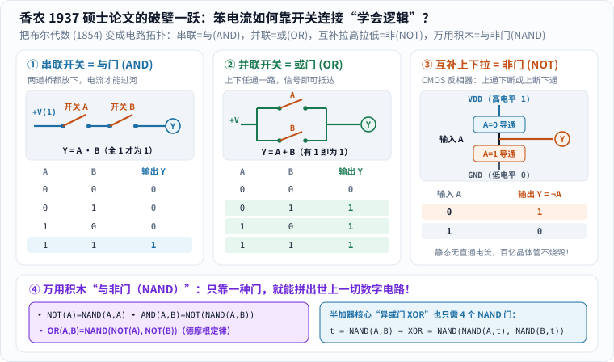
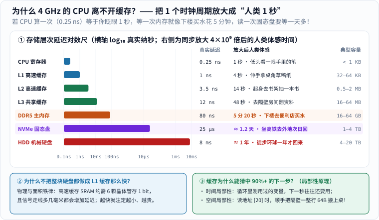

如果你对着书桌上的一盏台灯说：“帮我算一下 $$13 + 7$$。”

它当然一动不动。

可电脑和手机同样靠电工作，铜线和硅片里流过的也是同一种电子，机箱里更没有躲着一个拨算盘的小人——**为什么同样的电流进了芯片，就会算账、修图、放电影、陪我们打游戏甚至跑人工智能大模型了？**

很多大人会顺口回答孩子：“因为电脑里全都是 `0` 和 `1` 呀！”这句话没错，却只停在了门口：**两个冷冰冰的符号，凭什么能自己做决定、算减法、记住上一步，再把结果变成五彩斑斓的画面？**

今天我们不背枯燥的主板说明书，只跟孩子一起完成一件贯穿到底的小事：**把 $$13 + 7$$ 算成 $$20$$（顺手看懂 $$5 - 3$$ 为什么不用减法器、$$0.1 + 0.2$$ 为什么会多出一条小尾巴），存进内存，再赶在屏幕一眨眼的 $$16.7$$ 毫秒里把它点亮成彩色文字。** 沿着这条路往上爬七级台阶，你会发现：每往上一层，人类都没有发明什么“聪明电流”，只是多搭了一层精巧的组织规则。

---

## 一、第一级台阶：从布尔代数到香农 21 岁的硕士论文——“笨电流”怎样学会逻辑？

想象墙上有一盏只分“灭”和“亮”的灯。你和孩子约好：灯灭记作 `0`，灯亮记作 `1`。

灯泡自己根本不知道什么叫“零”和“一”；是人给两种可区分的物理状态赋予了符号意义。在真实的现代数字芯片里，工程师通常用两个留有安全缓冲区的**电压范围**代表逻辑低电平（`0`，如接近 $$0\ \mathrm{V}$$）与逻辑高电平（`1`，如约 $$0.7\text{—}1.2\ \mathrm{V}$$），而不是非得“彻底断电”和“满格高压”。

孩子常问：**“人类平时习惯十进制，为什么不直接用 $$0.1\ \mathrm{V}$$、$$0.2\ \mathrm{V}$$……一直到 $$1.0\ \mathrm{V}$$ 这十档电压代表 `0` 到 `9` 呢？”** 并非物理定律禁止多值电路（现代固态硬盘的 TLC/QLC 闪存就在一个存储单元里区分 8 种或 16 种电荷状态来塞进更多数据！），但在每秒翻转几十亿次的运算电路里，温度波动、电磁串扰和制造误差无处不在。把状态压成“高、低”两档，就像把十条狭窄的独木桥改成两条超宽的高速车道，获得了宝贵的**抗噪容限（Noise Margin）**——哪怕电压抖动了一小截，只要没跨过警戒线，`0` 就依然稳稳是 `0`。

可光有 `0` 和 `1` 两种状态，电路怎么会“推理”呢？这场破壁一跃，跨越了整整 83 年：

- **1854 年**，英国自学成才的数学家**乔治·布尔（George Boole）** 出版了《思维规律研究》（*An Investigation of the Laws of Thought*）。他发现人类日常推理里的“并且（AND）”“或者（OR）”“并非（NOT）”，居然可以写成一套只取 `0`（假）和 `1`（真）两个值的代数方程！但在当时，所有人都只把它当成哲学系与数学系的纯纸面智力体操。
- **1937 年**，美国麻省理工学院（MIT）一位年仅 **21 岁**的硕士研究生在实验室摆弄电话交换机的电磁继电器时，突然拍案顿悟：**继电器开关的“断开”与“闭合”，不正好对应布尔代数里的 `0` 和 `1` 吗？！** 这位年轻人名叫**克劳德·香农（Claude Shannon）**。他写下的硕士论文《继电器与开关电路的符号分析》（*A Symbolic Analysis of Relay and Switching Circuits*，见 [MIT 图书馆数字馆藏原件](https://dspace.mit.edu/handle/1721.1/11173)），后来被科学史家霍华德·加德纳等人誉为**“可能是 20 世纪最重要、最著名的一篇硕士论文”**！

香农在论文里揭示的秘密，今天你在餐桌上画三张小图就能让孩子一眼看穿：


_先看上半部三列开关拓扑：左列两开关串联构成与门（全闭合才通），中列两开关并联构成或门（任一闭合即通），右列上下互补开关构成现代 CMOS 非门（输入 0 拉高为 1，输入 1 拉低为 0）；再看底部紫色与蓝色框，核对为什么仅靠“与非门 NAND”一种零件就能搭出一切逻辑门乃至异或门。[单独打开逻辑门大图](/assets/images/comp-arch/shannon-switches-to-gates.svg)。_

1. **两个开关串联 = 与门（AND，$$Y = A \cdot B$$）**：就像过河要连跨两座吊桥，只有开关 A 闭合（`1`）**并且**开关 B 也闭合（`1`），电源的高电平才能流到输出端 $$Y$$（得 `1`）；只要任一断开，输出就是 `0`。
2. **两个开关并联 = 或门（OR，$$Y = A + B$$）**：两条岔路通向同一个终点，只要开关 A 闭合（`1`）**或者**开关 B 闭合（`1`），电流就能绕过断开的那一路抵达终点 $$Y$$（得 `1`）。
3. **上下互补推挽开关 = 非门 / 反相器（NOT，$$Y = \lnot A$$）**：怎样让“输入 `0` 反而输出 `1`”？现代芯片里的**晶体管（MOSFET）**有两类脾气恰好相反的兄弟——上方接电源 `VDD(1)` 的 **PMOS 管**遇到输入 `0` 时导通，下方接地线 `GND(0)` 的 **NMOS 管**遇到输入 `1` 时导通。两者一上一下拼成 **CMOS（互补金属氧化物半导体）** 反相器：当 $$A=0$$ 时上通下断，把输出 $$Y$$ 稳稳拉高到 `1`；当 $$A=1$$ 时上断下通，把 $$Y$$ 稳稳拉低到 `0`！

> **工程大哉问：为什么手机芯片塞进上百亿颗晶体管，摸起来却不会瞬间烧红？**
>
> 功劳正要记在 **CMOS“互补”** 二字头上！仔细看图右上角的反相器：无论输入是 `0` 还是 `1`，上下两只开关永远处于**“一只导通、另一只断开”**的状态，电源 `VDD` 到地线 `GND` 之间没有直通漏电回路！只有在 `0` 与 `1` 切换的那短短几十皮秒瞬间才会消耗微小电荷。如果没有这项精妙设计，几百亿颗晶体管同时待机漏电，指甲盖大的芯片不到一秒就会被几百瓦高热烧穿。

更妙的是图底部的第四条结论——**万用积木“与非门（NAND，先做与再取反）”**：只要把与门的输出反相，你就得到了一块具有**功能完备性（Functional Completeness）**的超级乐高积木！把它的两个输入拧在一起就是 `NOT`；后面再接一个它自己就变回 `AND`；利用德摩根定律 $$\lnot(\lnot A \cdot \lnot B) = A + B$$ 拿 3 个它就能拼出 `OR`；拿 4 个它就能拼出加法器的灵魂 `XOR`（见 [Nand2Tetris 项目 1：布尔逻辑](https://www.nand2tetris.org/project01)）。整座数字大厦，真的可以从同一种最朴素的门电路生长出来！

---

## 二、第二级台阶：让“位置”替数字说话，再亲手搭出 `1 + 1 = 10`

只靠一位 `0` 或 `1` 只能数两个数，怎么表示 $$13$$、$$7$$ 和 $$20$$？办法跟十进制一模一样：**让位置也拥有权重**。

十进制写下 `20`，意思不是“2 和 0 并排坐”，而是“$$2$$ 份十加 $$0$$ 份一”。二进制做完全相同的事，只是把“逢十进一”改成**“逢二进一”**，从右往左每一位的权重依次翻倍：

| 从右往左数 | 第 5 位（$$2^4$$） | 第 4 位（$$2^3$$） | 第 3 位（$$2^2$$） | 第 2 位（$$2^1$$） | 第 1 位（$$2^0$$） |
| :--- | ---: | ---: | ---: | ---: | ---: |
| **对应位权** | **$$16$$** | **$$8$$** | **$$4$$** | **$$2$$** | **$$1$$** |

于是我们的主角瞬间换上了二进制外衣：

```text
13 = 8 + 4 + 1 = 01101（二进制）
 7 = 4 + 2 + 1 = 00111（二进制）
20 = 16 + 4    = 10100（二进制）
```

在 $$13$$ 和 $$7$$ 前面补写一个 `0`，只是为了对齐五位宽度，并不改变非负整数的大小。$$5$$ 个二进制位能区分 $$2^5 = 32$$ 种状态；**$$1$$ 个二进制位叫 $$1\ \text{bit}$$（比特），$$8$$ 个 bit 编成一组叫 $$1\ \text{Byte}$$（字节）**，共有 $$2^8 = 256$$ 种组合。

但请务必提醒孩子一句关键真言：**芯片里躺着的一串比特，身上并没有自带标签！** 同样一串 `01000001`，按无符号整数读它是 `65`；按 ASCII / UTF-8 文本编码读它是大写字母 `A`；放进指令寄存器它可能代表某条机器操作码；放进显存它又只是某颗像素红色分量的四分之一亮度。**意义，全看后续电路和软件约定按哪本规则书去解释它。**

现在最神奇的一刻到了：死板的逻辑门，怎么算得出二进制加法里的 `1 + 1 = 10`（本位写 `0`、向左进 `1`）？

把两位单比特相加的全部四种可能列成一张表，秘密当场揭晓：

| 输入 $$a$$ | 输入 $$b$$ | 本位结果 $$S$$ | 向左进位 $$C$$ |
| ---: | ---: | ---: | ---: |
| `0` | `0` | `0` | `0` |
| `0` | `1` | `1` | `0` |
| `1` | `0` | `1` | `0` |
| `1` | `1` | **`0`** | **`1`** |

盯住右边两列结果跟第一节的逻辑门对号入座：

- **“本位结果 $$S$$”这一列**：两个输入不同时为 `1`，相同时为 `0`——这不就是**异或门（XOR）**吗！
- **“向左进位 $$C$$”这一列**：只有两个输入都是 `1` 时才输出 `1`——这不就是**与门（AND）**吗！


_先对照 1、1 那一行：异或输出 0，与输出 1，合起来就是二进制 10。这是半加器，不能直接冒充能接收前级进位的全加器；交叉线只示意逻辑连接。[单独打开看电路](/assets/images/deep-science/computer-adder.svg)。_

把一个 `XOR` 门和一个 `AND` 门并联接在同一对输入线上，你就造出了一台**半加器（Half Adder）**！如果再把右边低位传上来的进位 $$C_{\text{in}}$$ 当成第三个输入，拿两个半加器加一个或门拼起来，就升级成了能串成一排的**全加器（Full Adder）**。把 5 个（或现代 CPU 里的 64 个）全加器并排连好（真实高性能处理器还会加上**超前进位电路 Carry-Lookahead**，提前并行算出各级进位，免得进位像多米诺骨牌一样慢吞吞从最右传到最左），就能在不到十亿分之一秒内拍出 `13 + 7` 的总和：

```text
进位：  11110
       01101   （13）
     + 00111   （ 7）
     -------
       10100   （20 = 16 + 4）
```

从最右一位算起：`1 + 1` 得本位 `0` 进 `1`；第二位 `0 + 1 + 进位 1` 得 `0` 进 `1`；第三位 `1 + 1 + 进位 1`（等于三，二进制 `11`）得本位 `1` 进 `1`；第四位 `1 + 0 + 进位 1` 得 `0` 进 `1`；第五位接住进位得 `1`——`10100`（十进制 $$20$$）稳稳落袋！硬件并没有“动脑筋背口诀”，只是电压顺着连接好的门电路跑了一趟，正确的加法结果就成了唯一可能的物理输出（可对照 [Nand2Tetris 项目 2：布尔算术与 ALU](https://www.nand2tetris.org/project02) 动手拼装）。

---

## 三、第三级台阶：负数怎么存？为什么几乎所有电脑算 `0.1 + 0.2` 都不等于 `0.3`？

学会了正整数加法，敏锐的孩子马上会追问两个刁钻问题：**“那减法和负数怎么办？还有小数点怎么办？”** 这恰恰藏着计算机体系结构里最让人拍案叫绝的巧思——以及程序员最常踩中的一个经典大坑。

### 1. 六十秒看懂“二进制补码”：借一块里程表圆盘，省掉整套减法器！

如果让你用 4 个比特表示正负数，最天真的想法是拿最左边第一位当“正负号”（`0` 正 `1` 负，叫“原码”）：比如 `0011` 是 `+3`，`1011` 是 `-3`。可这么干马上会惹来两场灾难：第一，`0000`（`+0`）和 `1000`（`-0`）居然冒出了两个零；第二，如果你把 `+5 (0101)` 和 `-3 (1011)` 直接送进刚才造好的加法器，算出来是 `0000`（错得离谱！），你不得不额外再设计一套极其复杂的“减法器电路”！

现代计算机是怎么偷懒的？来看看挂在墙上的 **12 小时时钟**（或者满 16 归零的 **4 位二进制里程表**）：现在指针指在 **5 点钟**，你想让它退到 **2 点钟（算 $$5 - 3$$）**，除了逆时针倒拨 $$3$$ 格，还有什么办法？**顺时针往前拨 $$12 - 3 = 9$$ 格！** 因为 $$5 + 9 = 14$$，跨过 12 点整自动回绕一圈，指针不偏不倚正好停在 **2 点钟**！


_先读左图 16 格二进制时钟轮：从顶部 0000(0) 逆时针退 1 格就是 1111(−1)，退 3 格就是 1101(−3)；算 5−3 时，直接把 0101(+5) 与 1101(−3) 送进同一个加法器得 [1]0010，最高位进位自然溢出归零，剩下的 0010 正好是 +2！右图三原色子像素留到第六节点亮屏幕时对照阅读。[单独打开大图](/assets/images/comp-arch/twos-complement-rgb.svg)。_

这就是统治了现代所有 CPU 的**二进制补码（Two's Complement）**：

- 在 $$4$$ 位二进制圆盘上共有 $$2^4 = 16$$ 个刻度。我们把右半圈 `0000` 到 `0111` 分给 `0` 到 `+7`（最高位 MSB 为 `0`）；从 `0000` **逆时针倒退 1 格**，里程表直接翻成全一的 **`1111`——我们就规定它是 `-1`**！倒退 3 格落到 **`1101`，它就是 `-3`**；一直退到正底部 `1000`，就是 `-8`（彻底消灭了 `-0`，还能多存一个负数！）。
- 怎么快速写出 `-3` 的补码？记住课本上那句神秘口诀**“按位取反，末位加 1”**背后的小学算术：在 4 位二进制里，全一的 `1111` 等于 $$15 = 2^4 - 1$$；拿 `1111` 减去 `+3 (0011)`，每一位根本不用借位，正好等价于把 `0` 变 `1`、`1` 变 `0`（得到反码 `1100`）；最后再补上 $$+1$$，就得到了 $$2^4 - 3 = 13$$ 的二进制 **`1101`**！
- 现在把 $$5 - 3$$ 改写成 $$5 + (-3)$$，直接丢进第二节造好的**同一台普通加法器**：

$$
0101_{(+5)} + 1101_{(-3)} = \mathbf{[1]}\,0010.
$$

  因为寄存器只有 4 位宽，冒出去的第 5 位进位 `[1]`（代表绕满了一整圈 $$16$$）自然掉落消失，留下的四位正是 **`0010`（`+2`）**！同理，`1111 (-1) + 0001 (+1) = [1]0000` 归零！**凭这一个模算术妙计，全世界几十亿颗 CPU 全都省掉了独立的减法器，同一套加法电路通吃加减！**（当然也要注意边界：如果算 `+7 + 1 = 0111 + 0001 = 1000`，正数越界闯进左半圈就会瞬间翻成 `-8`，这就是程序员必须提防的**整数溢出**。）

### 2. 为什么 Python 或浏览器里算 `0.1 + 0.2`，会蹦出 `0.30000000000000004`？

如果你晚上打开电脑上的 Python 或浏览器控制台，敲入 `0.1 + 0.2`，屏幕往往会诚实地吐出：

```text
0.30000000000000004
```

孩子看到一定会乐坏了：“哈哈，几千块钱的电脑连一年级小数加法都会算错！”

电脑真的算错了吗？一点都没错——**这是用有限位二进制去装十进制分数时，数学上必然出现的“无限循环截断”**！

先在十进制里想一个熟悉的例子：把 $$1 \div 3$$ 写成小数，是 $$0.333333\dots$$ 永远写不完。假设你的计算器屏幕只允许存 4 位小数，$$\frac{1}{3}$$ 只能截断存成 `0.3333`，三个加在一起得 `0.9999`，差了一点点才到 `1`。为什么在十进制里 $$\frac{1}{2} = 0.5$$、$$\frac{1}{10} = 0.1$$ 能除尽，$$\frac{1}{3}$$ 却除不尽？因为十进制的底数 $$10 = 2 \times 5$$，只有分母只含质因数 $$2$$ 和 $$5$$ 的分数才能写成有限十进制小数！

现在换到**二进制**：底数变成了 $$2$$，**只有分母是 $$2$$ 的幂（$$\frac{1}{2}, \frac{1}{4}, \frac{1}{8}, \frac{1}{16}\dots$$）的分数，才能写成有限位二进制小数**！而看似温顺的十进制 $$0.1 = \frac{1}{10} = \frac{1}{2 \times 5}$$，分母里混进了一个质因数 **$$5$$**！把它展开成二进制，立刻变成一串永无止境的循环小数：

$$
0.1_{10} = (0.000110011001100110011\dots)_2.
$$

按照国际通用的 **IEEE 754 双精度浮点数标准**（64 bit：1 位正负号 + 11 位指数 + 52 位尾数，类似二进制科学计数法 $$\pm 1.\text{尾数} \times 2^{\text{指数}}$$），芯片最多只能保留 $$53$$ 位有效二进制数字，后面的无限尾巴必须四舍五入截断。于是：

- 存进去的 `0.1`，真身其实是略大一丁点的 `0.10000000000000000555...`；
- 存进去的 `0.2`，真身也是略大一丁点的 `0.20000000000000001110...`；
- 两个略大的近似值相加再按 53 位舍入，结果就落在了离真值最近的可表示格点 `0.3000000000000000444...` 上，与单独截断存储的 `0.3`（`0.29999999999999998889...`）差了最末一个比特（约 $$4 \times 10^{-17}$$）！

所以银行、支付系统在写记账代码时，绝不会直接拿二进制浮点数去存“几块几毛几分钱”，而是改用**整数直接存“多少分钱”**（比如 `10 分 + 20 分 = 30 分` 绝对精确！），或者调用专门的十进制高精度算术库。

---

## 四、第四级台阶：光会算还不够——靠寄存器、PC 与“取指—译码—执行”接力跑起来

回到我们的主线任务。现在算术逻辑单元（**ALU**，包揽加减与逻辑运算的核心车间）已经能在瞬间算出 `13 + 7 = 20` 了。可新的问题来了：ALU 本身是个“没有记忆的急性子”——输入电压一撤，输出瞬间消失；它也不知道今天该加哪两个数、算完放在哪、下一步该干嘛。

要让计算变成一段能自动往下走的**程序**，电路必须学会**“锁住状态”**（用几个与非门交叉反馈搭成**触发器 Flip-Flop**，在时钟节拍边沿把 `0` 或 `1` 稳稳锁住），并请出三位默契配合的搭档：

1. **内存（RAM）**：按门牌号（**地址 Address**）整齐排列的大储物柜。务必帮孩子分清“柜子门牌号”和“柜子里放的苹果数”：`[20] = 13` 的意思是**“第 20 号柜子里存着数值 13”**，绝不是“20 等于 13”！
2. **寄存器（Registers）**：紧挨在 ALU 手边、速度最快的几只贴身小口袋。为了看得最清爽，下面这台玩具机器只设一只核心累加寄存器 **ACC**，专门暂存当前正在加工的数字。
3. **程序计数器（PC，Program Counter）**：CPU 手里的“书签尺”，专门记录**下一条要去哪个地址取指令**。平时每做完一步自动加 `1`；一旦遇到条件判断或循环（如“如果血量归零就跳到游戏结束画面”），直接改写 PC 的值，程序就能在代码间自由跳转！

### 亲眼盯完四条玩具指令的“心跳轨迹”

下面是一套**专为本文教学设计的极简玩具指令**（并非手机 ARM 或电脑 x86 的真实机器码，也不同于 [Nand2Tetris 项目 4](https://www.nand2tetris.org/project04) 的 Hack 汇编，但精准浓缩了现代冯·诺依曼计算机“程序与数据同住一片内存”的灵魂）：

```text
地址 0：LOAD  [20]   把内存地址 20 里的值读入寄存器 ACC
地址 1：ADD   [21]   把内存地址 21 里的值与 ACC 相加，结果写回 ACC
地址 2：STORE [22]   把寄存器 ACC 里的值存入内存地址 22
地址 3：HALT         停机休息

初始状态：内存 [20]=13，[21]=7，[22]=0；寄存器 ACC=0，书签 PC=0
```


_先看内存初态，再逐行读“执行后”。加法完成时 ACC 已经是 20，但直到 STORE 才把 20 写入结果地址。箭头描线一次，全部状态始终保留；一格不代表真实 CPU 的一个时钟周期。[单独打开执行过程](/assets/images/deep-science/computer-execution.svg)。_

跟着上面的状态表走一遍，你就摸到了所有处理器永不停歇的三拍心跳——**取指（Fetch）$$\rightarrow$$ 译码（Decode）$$\rightarrow$$ 执行（Execute）**：

- **第 1 轮心跳（`PC = 0`）**：控制器按 `PC` 去地址 `0` 取出指令 `LOAD [20]`（真实芯片里它同样是一串像 `0001 00010100` 这样的二进制编码！）；译码电路认出操作码 `0001` 代表“读内存装入 ACC”；于是去 20 号柜子取出 `13` 锁进 `ACC`，顺手把 `PC` 拨到 `1`。
- **第 2 轮心跳（`PC = 1`）**：取出 `ADD [21]`；译码后通知 ALU 把 `ACC` 里的 `13` 与 21 号柜子读出的 `7` 相加；瞬间算出的 `20` 锁回 `ACC`（注意看图：此时内存 `[22]` 里还是 `0`！），`PC` 拨到 `2`。
- **第 3 轮心跳（`PC = 2`）**：取出 `STORE [22]`；把 `ACC` 里的 `20` 正式写进 22 号结果柜，`PC` 拨到 `3`。
- **第 4 轮心跳（`PC = 3`）**：读到 `HALT`，体面收工！

这就是计算机科学的**第二重破壁魔法**：不用改动任何一根电线，只要换掉内存前几格里存着的“指令食谱”，同一块硅片这一秒在算加减法，下一秒就能去给照片调色、给飞船算轨道！

---

## 五、第五级台阶：为什么 4 GHz 的 CPU 非要配三级缓存？——把 0.25 纳秒放大成“人类 1 秒”！

读完上面的四步指令，细心的读者马上会生出一个疑惑：**“既然内存（RAM）已经有几十个 GB 那么大，干嘛还要在 CPU 里搞什么寄存器、L1 缓存、L2 缓存、L3 缓存？直接每次去内存柜子里拿数据不省事得多吗？”**

答案藏在一道肉眼看不见、却让无数芯片架构师夜不能寐的鸿沟里——**速度差得太悬殊了！**

今天一台主流家用电脑或旗舰手机的处理器主频常在 **$$4\ \text{GHz}$$** 左右，意思是它的内部时钟每秒钟跳动 **$$40$$ 亿次**，每跳一次（1 个时钟周期）只有 **$$0.25\ \text{ns}$$（纳秒，十亿分之一秒）**。$$0.25$$ 纳秒有多短？连宇宙间跑得最快的光（每秒 30 万公里），在这 $$0.25$$ 纳秒里也只能往前爬 **$$7.5$$ 厘米**——还跨不出半张主板！

人类对“纳秒”没有体感，但只要做一个等比例放大实验（灵感源自 Google 研究总监 [Peter Norvig 著名的程序员延迟表](https://www.norvig.com/21-days.html)，结合现代 DDR5 与 NVMe 实测数据），把 **CPU 的 1 个时钟周期（$$0.25\ \text{ns}$$）放大 $$40$$ 亿倍，当成你坐在书桌前眨眼算一道心算题的“$$1$$ 秒钟”**，整个计算机存储世界立刻变成了一幅震撼的时间地图：


_先注意横轴是对数坐标（每往右一大格慢 10 倍！），再逐行对照右侧放大 40 亿倍后的人类体感：寄存器 1 秒、L1 缓存 4 秒、L3 缓存 48 秒，一旦漏到 DDR5 主内存就要苦等 5 分 20 秒，读一次 NVMe 固态硬盘更像坐高铁出差 1.2 天才回来！[单独打开延迟标尺图](/assets/images/comp-arch/cpu-memory-time-scale.svg)。_

请带孩子一行行读完这张换算表，保证终身难忘：

- **CPU 寄存器（约 $$0.25\ \text{ns}$$）$$\rightarrow$$ 人类 $$1$$ 秒**：就像低头看一眼攥在手心里的钢笔，立等可取，但全核只有几十只寄存器口袋（不到 $$1\ \text{KB}$$）。
- **L1 一级缓存（约 $$1\ \text{ns}$$）$$\rightarrow$$ 人类 $$4$$ 秒**：伸手去书桌一角拿张草稿纸，几乎不断思路，容量约 $$32\text{—}64\ \text{KB}$$。
- **L2 / L3 二三级缓存（约 $$3.5\ \text{ns} / 12\ \text{ns}$$）$$\rightarrow$$ 人类 $$14$$ 秒 / $$48$$ 秒**：起身去身后书架抽本书，或走到隔壁房间翻份文件夹，容量从几 MB 到几十 MB。
- **DDR5 主内存 RAM（约 $$80\ \text{ns}$$）$$\rightarrow$$ 人类 $$5$$ 分 $$20$$ 秒！** 如果没有三级缓存，心算神童每算一步加法（$$1$$ 秒），都得放下笔、穿鞋下楼去街角便利店买瓶水（傻等 **320 秒**）才能算下一步！这道把超快处理器饿得团团转的鸿沟，就叫**“存储墙（Memory Wall）”**。
- **NVMe 固态硬盘随机读（约 $$25\ \mu\text{s} = 25{,}000\ \text{ns}$$）$$\rightarrow$$ 人类 $$27.8$$ 小时（约 $$1.2$$ 天）！** 相当于坐高铁去外省取个快递，第二天下午才回到书桌前——这也彻底解释了为什么点开一个大型游戏或软件时，操作系统必须先把程序文件从固态硬盘“加载（搬运）”进内存 RAM，断电会丢数据的 RAM 和断电不丢数据的 SSD 根本没法互相替代！
- **传统 HDD 机械硬盘磁头寻道（约 $$8\ \text{ms} = 8{,}000{,}000\ \text{ns}$$）$$\rightarrow$$ 人类 $$370$$ 天（整整 $$1$$ 年）！** 难怪十几年前把老电脑的机械硬盘换成固态硬盘时，开机速度会像换了一台新电脑一样脱胎换骨。

为什么不干脆把整块内存都用 L1 缓存那种超快电路（SRAM，每存 1 bit 要花约 6 颗晶体管）来做？因为面积太大、造价太贵，而且**光速有限**——一旦存储阵列铺到几厘米宽，光信号跑个来回都要花掉好几个纳秒！幸运的是，绝大多数程序都天然遵守**局部性原理**：刚用过的变量下一秒往往还要用（**时间局部性**），刚读了地址 `[20]` 紧接着大概率要读隔壁的 `[21]` 和 `[22]`（**空间局部性**，所以 CPU 每次去内存进货从不抠门地只拿 1 个字节，而是顺手把相邻一整条 **$$64\ \text{Byte}$$ 缓存行 Cache Line** 全搬上书桌！）。靠着这套精明的分级预取，现代缓存命中率往往高达 **$$90\%\text{—}99\%$$**，让 CPU 绝大多数时候只需伸手 $$4$$ 秒就能拿到原料。

顺便把软件层面的分工也串成一张清晰名片：程序员平时写的是 Python、C 或 Java 这样的高级语言（注意：真实编译器如果看到写死的常量 `13 + 7`，在编译期就会直接优化折叠成 `20`，只有面对运行时才输入的变量才会生成读取相加的机器指令）；**编译器 / 解释器**负责把高级语言翻译成底层机器指令；而**操作系统（Windows、macOS、Linux、Android、iOS）**则像整栋大楼的大管家，通过虚拟内存与硬件**驱动程序**，替成百上千个同时运行的进程公平调度 CPU 时间片、隔离各自的内存空间，防止一个网页崩溃把整台电脑拖下水。

---

## 六、第六级台阶：内存里有了 `20`，屏幕怎样用三原色点亮 `1677 万种颜色`？

现在，内存 22 号柜子里已经躺着运算结果 `20`（一个字节的无符号二进制 `00010100`，十六进制 `0x14`）了。为什么显示器不会自动亮出漂亮的阿拉伯数字“20”？

因为**“数值 20 的二进制存档”“字符 `'2'` 和 `'0'` 的文本编码”以及“屏幕上发光的像素点阵”，完全是住在三层不同世界里的东西！**

1. **第一层（数值转文本编码）**：应用程序先做一次格式化除法，把整数 `20` 拆成十位字符 `'2'` 和个位字符 `'0'`。在通用的 UTF-8 / ASCII 编码表里，`'2'` 对应字节 `0x32`（十进制 50），`'0'` 对应字节 `0x30`（十进制 48）——跟刚才代表数值二十的 `0x14` 长得完全不一样！
2. **第二层（Unicode 码点与 UTF-8 变长编码）**：全世界有英文、汉字、阿拉伯文乃至 Emoji 表情，怎么统一身份证号？国际 **Unicode 标准**（见 [Unicode 官方技术导论](https://www.unicode.org/standard/principles.html)）给超过 14 万个字符各发了一个全球唯一的编号，叫**码点（Code Point）**：比如拉丁字母 `A` 是 `U+0041`，汉字 `中` 是 `U+4E2D`。而在网络与文件传输最常用的 **UTF-8 变长编码**里，英文 `A` 只占 **1 个字节**（`41`），汉字 `中` 占 **3 个字节**（`E4 B8 AD`），一个笑脸 Emoji `😀`（`U+1F600`）则占 **4 个字节**——所以千万别从英文字符推断“一个字永远等于一个字节”！
3. **第三层（从字符身份到字体栅格像素）**：有了码点还看不见模样。排版与字体引擎会去字库文件（如 TrueType / OpenType 里的数学贝塞尔曲线轮廓）里查出 `'2'`、`'0'` 或 `'A'` 在当前字号下的几何形状，再通过**光栅化（Rasterization）与抗锯齿**，算出每一小格像素该涂多亮：


_左边是身份与编码，右边才是一个刻意粗糙的字形。右图仅用 5×7 格教学，不是复制某套字体，也不是真实显示系统唯一的栅格。字形可以换，字符身份可以不变。[单独打开字符图](/assets/images/deep-science/computer-display.svg)。_

如果把手机或显示器屏幕凑到放大镜底下（强烈建议周末滴一小滴水珠在旧手机钢化膜上当简易放大镜给孩子看，擦干即可！），你会看到更神奇的一幕——请翻回第三节那张双联图的右半边（[点此单独打开子像素图对照](/assets/images/comp-arch/twos-complement-rgb.svg)）：

屏幕上的**每一颗像素（Pixel）**，其实都不是一盏会变魔术的七彩灯，而是由紧挨在一起的三根极细微的发光条——**红（Red）、绿（Green）、蓝（Blue）三原色子像素**——并排组成的！显示控制器给每根子像素分配 **1 个字节（8 bit，即 `0` 到 `255` 共 256 级亮度台阶）**：

- 当 `(R, G, B) = (0, 0, 0)` 时，三灯全灭，呈现深邃的**黑**；
- 当 `(R, G, B) = (255, 255, 255)` 时，三灯全满，人眼三种视锥细胞同时受激，融合成明亮的**白**；
- 当 `(R, G, B) = (255, 136, 26)`（十六进制 `#FF881A`）时，红灯满格、绿灯亮一半多、蓝灯微亮，因为子像素尺寸只有几十微米，人眼分辨不出三根细条，大脑会自动把它们融合感知为一颗温暖的**橙色光点**！

拿乘法算一算 3 个字节（**24-bit 真彩色 True Color**）一共能调出多少种颜色：

$$
256 \times 256 \times 256 = 2^{24} = 16{,}777{,}216\ \text{种颜色！}
$$

足足 **1677 万多种颜色**，全都不过是一排排 `0` 到 `255` 的二进制数字！再顺手帮孩子算一算为什么玩游戏、看高清视频非得配一块强大的**显卡（GPU，图形处理器）**：一块普通的 `1920 × 1080` 全高清屏幕，一帧画面就有 $$1920 \times 1080 = 2{,}073{,}600$$（约 **207.36 万**）颗像素，光存一幅未压缩 RGB 画面就要占约 **$$6.22\ \text{MB}$$**；在 $$60\ \text{Hz}$$ 刷新率下每秒要重画 $$60$$ 幅（**每秒吞吐 $$373.2\ \text{MB}$$**），到了如今手机常见的 **$$120\ \text{Hz}$$ 高刷屏**（每秒 120 幅，4K 分辨率更要再翻四倍！），每秒钟光往屏幕搬运像素就要狂吞数 GB 数据！只有让拥有几千个并行小算术核心的 GPU 像千手观音一样同时给几百万颗像素算光照和颜色，才能撑起这片流动的视觉海洋。

---

## 七、第七级台阶：指尖轻点一次屏幕，在 `16.7 毫秒` 预算里发生了什么？

把前面六级台阶全部串起来，我们终于可以回答：当你敲下键盘上的一个键、或者手指在 `60 Hz` / `120 Hz` 手机屏幕上轻轻一点时，这不到一眨眼的时间（人类眨一次眼约 `100–300 ms`，而 `60 Hz` 屏幕两帧之间只有 **$$1000 \div 60 \approx 16.67\ \text{ms}$$**，`120 Hz` 更是只有苛刻的 **$$8.33\ \text{ms}$$**！）里，机箱和手机内部究竟上演了怎样一场极速接力？


_这是跨层路线，不是硬件连线图。字母 A 的例子不能代替所有输入法和字符处理。[单独打开路线图](/assets/images/archive-guides/computer.svg)。_

1. **物理传感化作电信号（第 `0–2 ms`）**：手指触碰电容屏改变玻璃表面微弱的静电场分布（或机械键盘闭合行列开关矩阵），触控芯片在几百微秒内扫描算出 `(x, y)` 坐标，顺着总线向 CPU 拍出一条**硬件中断（Interrupt）**信号——相当于举手喊：“报告，有外部新事件！”
2. **操作系统接管与派发（第 `2–4 ms`）**：正在忙别的任务的 CPU 在纳秒间保存当前寄存器现场，跳进操作系统内核的中断处理程序与设备驱动；窗口管理服务算清这一指头戳在了哪个 App 的哪颗按钮上（如果是键盘敲击，还要结合大写锁定、快捷键和中文输入法词库做转换），把打包好的“点击/输入事件”投递进目标应用的事件队列。
3. **应用逻辑与缓存冲刺（第 `4–8 ms`）**：应用程序醒来，执行我们第四节那样的机器指令——比如把购物车金额加上 `7` 变成 `20`，或者更新游戏主角起跳的速度向量，把改写后的数据刷进 L1/L2 缓存与内存，并通知界面框架：“这片区域的画面脏了，需要重绘！”
4. **GPU 光栅合成与子像素点亮（第 `8–16.7 ms`）**：排版与图形引擎把新字形和图层交给 GPU 并行渲染进**帧缓冲区（Framebuffer）**；等到显示器发来下一次垂直同步（VSync）节拍，显示控制器按行扫描帧缓冲里的 24 位 RGB 字节，驱动几百万组红绿蓝子像素精准调节亮度——光子飞进你的视网膜，你觉得“屏幕立刻响应了我”！

那**声音、视频和如今火热的人工智能（AI）**，难道又是另一套魔法吗？完全不是！

- **声音**是麦克风每秒钟对空气压力波测量 $$44{,}100$$ 次或 $$48{,}000$$ 次（采样），每次用 $$16$$ 位二进制补码记下振幅高低，播放时再由数模转换器（DAC）推着扬声器振膜还原成声波；
- **人工智能大模型**看似能写诗画画，拆到最底层依然没有任何玄学：它先把词语切分成编号（Token），映射成几千维的浮点数向量，再在 GPU 成千上万个矩阵核心里做天文数字次数的**“二进制浮点数乘法与加法”**，算出下一个词出现的概率分布。“由 `0` 和 `1` 实现”既不意味着它简单低级，也不能单凭这一点就断言机器拥有了人类的主观意识与情感。

---

## 八、今晚就能玩的“纸上计算机”亲子实验（含补码升级关！）

别只让原理停在眼睛里。今晚吃完晚饭，花十分钟剪几张便签纸，就能和孩子在餐桌上亲手造出一台货真价实的**“人肉双核纸上计算机”**：

- 准备 **4 张指令卡**（照抄第四节的 `LOAD [20]`、`ADD [21]`、`STORE [22]`、`HALT`）；
- 准备 **3 张内存地址纸**（标上 `[20]`、`[21]`、`[22]`），以及 **1 张 `ACC` 纸**、**1 张 `PC` 书签纸**。

让孩子当**控制器**（严格只准按 `PC` 上的门牌号去翻指令卡，每翻完一张把 `PC` 加 1），你当没有感情的**执行器 ALU**（只准照卡片字面搬运或相加数字，绝不抢答）。先把 `13`、`7`、`0` 放进三个地址跑通第一遍，检查 `[22]` 有没有变成 `20`；接着玩三个层层递进的“黑客改装挑战”：

1. **数据与程序分离关**：一字不改那 4 张指令卡，只把 `[21]` 里的 `7` 换成 `9`——机器能不能自动算出 `22`？孩子立刻明白：**好程序不用为每次新输入重写代码！**
2. **计算不等于保存关**：恢复初态，把地址 2 的 `STORE [22]` 偷偷换成 `HALT`——跑完后问孩子：“为什么 `ACC` 里明明已经算出 `20` 了，结果格 `[22]` 里却还是冷冰冰的 `0`？”很多初学编程的孩子总把“算出了表达式”和“赋值保存进变量/文件”混为一谈，这一关三秒钟治本！（就算中间哪一步拿错了纸片也别批评，笑着告诉孩子：恭喜你遇到了人生第一个 **Bug**，找出来的过程就叫 **Debug**！）
3. **补码无减法器隐藏关（适合大一点的孩子）**：画一个 0 到 99 的两位数汽车里程表圆盘，约定 `00–49` 是正数，`50–99` 代表负数（比如 `97` 就是 `-3`，因为 `97 + 3 = [1]00` 归零！）。把 `[20]` 放进 `13`，`[21]` 放进 `97 (-3)`，**依然只准做加法**——`13 + 97 = [1]10`，划掉百位溢出的 `1`，留下的 `10` 正好就是 `13 - 3`！

---

## 奶爸说

现在再看书桌上那盏沉默的台灯：它之所以算不出 $$13 + 7$$，从来不是因为流过它的电子比电脑里的电子“笨”，而是因为它只有第零层开关，缺少后面人类耗费一个多世纪一层层搭起来的精妙阶梯——**抗噪的二值状态 $$\rightarrow$$ 香农的开关逻辑门 $$\rightarrow$$ 位权与补码算术 $$\rightarrow$$ 可锁存状态与取指执行循环 $$\rightarrow$$ 跨越纳秒鸿沟的多级缓存 $$\rightarrow$$ 字符编码与三原色子像素渲染**。

**从来不是 `0` 和 `1` 自己长出了魔法，而是人类用最诚实的数学与工程，把极度简单的物理规则一层层叠成了可以自由创造的世界。**

当然，弄懂计算机怎么工作，并不会自动替我们解决“孩子每天该看多久屏幕”的育儿难题——优质内容、护眼距离、充足睡眠、户外奔跑与父母真实的眼神陪伴，永远在屏幕之外。但当孩子面对手机和电脑时，眼里不再只有被动刷屏的迷恋或敬畏，而是敢指着屏幕问一句**“我点下去的这十几毫秒里，里面哪一层正在干活？”**——他就从数字世界的乘客，迈出了成为建造者的第一步。

---

## 参考与延伸

- Shannon, C. E. (1937/1940). [*A Symbolic Analysis of Relay and Switching Circuits*（MIT DSpace 馆藏硕士论文原件）](https://dspace.mit.edu/handle/1721.1/11173)——香农在 21 岁完成的划时代硕士论文，首次将乔治·布尔（1854）符号逻辑系统地映射为开关与继电器电路设计科学。
- [Nand2Tetris（从与非门到俄罗斯方块）开源课程主页](https://www.nand2tetris.org/course)——强烈推荐与大孩子一起动手的硬核神课：涵盖[项目 1：由单一 NAND 门搭出全部布尔逻辑门](https://www.nand2tetris.org/project01)、[项目 2：半加器、全加器、补码与 ALU](https://www.nand2tetris.org/project02)、[项目 4：机器语言](https://www.nand2tetris.org/project04)及[项目 5：拼装完整计算机体系结构](https://www.nand2tetris.org/project05)（网页模拟器需启用 JavaScript；本文四步玩具指令为简化教学模型，非 Hack 原生指令）。
- Goldberg, D. (1991). *What Every Computer Scientist Should Know About Floating-Point Arithmetic*. *ACM Computing Surveys*, 23(1), 5–48——系统阐释 IEEE 754 二进制浮点数表示、舍入误差及 `0.1 + 0.2 ≠ 0.3` 数学根源的计算机科学经典文献。
- [Peter Norvig：*Teach Yourself Programming in Ten Years*（附经典计算机各级延迟对照表）](https://www.norvig.com/21-days.html)——将纳秒级指令周期、L1/L2 缓存、主内存与磁盘寻道跨数量级对比的经典出处。
- [The Unicode Standard：A Technical Introduction](https://www.unicode.org/standard/principles.html)——官方详解字符身份（码点）、UTF-8/UTF-16/UTF-32 变长编码形式与字形渲染的分层原则。
- [MIT Scratch 家长指南入口](https://scratch.mit.edu/parents/)——让孩子用积木拼出顺序、循环、变量与事件响应，直观体会“指令精确性”（在线编辑器依赖网络与 JavaScript，使用社区功能请注意儿童账号隐私保护）。
