今天整理十个亲子探索入口，以及一个延伸收藏。不必一口气注册十个账号：先挑一个孩子今天真的好奇的问题，再让网页帮我们动手做一点事。

先看第一格选问题，再从下面目录找工具。比如听一段鸟声后，画出你觉得声音像什么；不必先背出鸟名。[单独打开大图](/assets/images/archive-guides/guide-play.svg)。

> **使用边界：** 年龄是本文的选题建议，不是平台官方适龄认证。外站可能改版、收费、要求账号或含用户内容；家长先浏览，核对当时条款与隐私设置。下面保留原有收藏，不声称本次逐个完成注册、付费功能或儿童安全测试。

---

## 一、🎨 创意与想象

### 1. BeddyStories - 全球经典睡前故事

> 🔗 [https://beddystories.com/](https://beddystories.com/)

收集全球经典儿童睡前故事，提供跨文化的阅读与倾听体验。

**✨ 核心亮点：**
- 🌍 **文化多样性**：来自不同地区与文化背景的民间与经典故事
- 📚 **故事脉络清晰**：保留传统叙事结构，适合睡前共读讨论
- 🎭 **声音与画面感**：适合关小灯光、放慢语速一起听或读

**👨‍👩‍👧 怎么跟孩子一步步玩透（适合参考：3–8 岁）：**
1. **先猜想**：只念故事标题和故事发源地，让孩子猜主角今天会遇到什么难题。
2. **改一个条件讨论**：读到故事转折处暂停 30 秒，问问“如果主角换一种选择，结局会变成什么样？”再听完原版结尾对比。
3. **离开屏幕动手验证**：第二天用蜡笔把印象最深的一幕画成单页连环画，不要求复述得与原文一字不差。

---

### 2. DIY.org - 全球儿童创作者社区

> 🔗 [https://diy.org/](https://diy.org/)

儿童创作与项目社区。涉及账号和公开分享时，应先由家长检查年龄要求、审核机制和隐私设置，不能仅凭“儿童社区”就保证安全。

**✨ 核心亮点：**
- 🛠️ **主题挑战丰富**：围绕手工、绘画、工程等具体任务展开
- 👥 **社区交流边界**：发布前务必由家长核查当时的分享范围与审核规则
- 🎯 **项目导向**：鼓励从想法、备料到动手完成的完整过程

**👨‍👩‍👧 怎么跟孩子一步步玩透（适合参考：6–15 岁）：**
1. **先猜想**：浏览一个手工或小发明挑战题目，先不看别人怎么搭，让孩子在草稿纸上画出自己的结构草图。
2. **改一个变量观察**：对比页面里两份不同思路的示范，找出一处材料或结构差异，讨论哪种更结实、更好找材料。
3. **离开屏幕动手验证**：关掉网页，只用家里的废纸盒、胶带和彩笔做出实物原型；如需拍照记录，保存在家庭相册即可，不上传含孩子正脸、校服或门牌背景的照片。

---

## 二、🔬 科学与探索

### 3. 地球天气可视化（Zoom Earth）

> 🔗 [https://zoom.earth/maps/temperature/](https://zoom.earth/maps/temperature/)

展示卫星影像、天气观测或预报图层。先看图层、时间和单位；一张天气图不能代表长期气候变化，预报也不等于实测。

**✨ 核心亮点：**
- 🌎 **全球气象图层**：可切换温度、风场、云图与降水视图
- 📊 **读数直观**：支持点击具体经纬度查看当时的网格估算温度
- 🔄 **时间轴对照**：能回看过去数小时至数天的天气系统移动

**👨‍👩‍👧 怎么跟孩子一步步玩透（适合参考：8 岁以上）：**
1. **先猜想**：在地球仪或纸地图上挑两个同纬度或不同纬度的城市，先猜“此刻哪座城市更暖和”。
2. **改一个图层观察**：先看温度图层核对读数，再切换到地形或云层风向图层，讨论海拔、海陆位置和昼夜时差如何影响气温——赤道总体获得更多太阳辐射，不代表每个时刻都比所有高纬地点热。
3. **离开屏幕动手验证**：在阳台阴凉通风处放一支普通温度计，连续三天同一时刻记下自家读数，和网页上的区域估算值做对照。

---

### 4. 引擎运作机制（Mechanical GIFs）

> 🔗 [https://mechanicalgifs.com/](https://mechanicalgifs.com/)

用简明循环动画演示齿轮、连杆与各类机械机构的联动原理。

**✨ 核心亮点：**
- ⚙️ **传动关系清楚**：把遮在金属外壳里的啮合与往复运动直接摊开
- 🎬 **节奏可跟读**：短循环动图便于盯住单一零件看清运动轨迹
- 🔧 **工程直觉启蒙**：直观理解“旋转运动怎样变成直线往复运动”

**👨‍👩‍👧 怎么跟孩子一步步玩透（适合参考：10 岁以上）：**
1. **先猜想**：遮住文字说明，盯着主动轮顺时针转，让孩子先用手指比划从动轮会往哪边转、转得更快还是更慢。
2. **改一个关注点观察**：第一遍只盯大小齿轮的齿数比，第二遍改盯连杆铰链的死点位置，画出“谁带动谁”的箭头链条。
3. **离开屏幕动手验证**：用硬纸板剪两个不同大小的圆盘或用积木齿轮搭一组传动模型验证转向；若拆解旧玩具，仅选成人确认安全、已彻底断电取出电池且无发条／电容危险储能的适龄模型，细小零件远离低龄幼儿，绝不拆解家用电器。

---

## 三、🎵 音乐与艺术

### 5. B站鹅妈妈儿歌童谣

> 🔗 [https://www.bilibili.com/video/BV1oM4m1R7YM](https://www.bilibili.com/video/BV1oM4m1R7YM)

全 113 集的鹅妈妈经典英语儿歌童谣合集，适合低龄阶段磨耳朵与律动游戏。

**✨ 核心亮点：**
- 🎶 **押韵节奏鲜明**：传统童谣充满重复句式与尾韵，容易跟唱模仿
- 🌐 **双语对照线索**：结合画面动作理解日常动词与声音词
- 📺 **单集短小**：每首仅一两分钟，容易控制单次屏幕时长

**👨‍👩‍👧 怎么跟孩子一步步玩透（适合参考：2–6 岁）：**
1. **先猜想**：第一遍把屏幕扣过去只听声音，让孩子听节拍猜这是一首快活蹦跳的歌，还是摇篮哄睡的歌。
2. **改一种速度跟唱**：每周只选一首，试着用“慢动作乌龟版”和“快节奏小兔版”各拍手唱一遍，找找每句末尾押韵的词。
3. **离开屏幕动手验证**：关掉视频，用塑料碗、木勺或拍手跺脚当打击乐器，全家排演一分钟客厅小剧场。

---

### 6. 制作3D植物（Plantarium）

> 🔗 [https://github.com/jim-fx/plantarium](https://github.com/jim-fx/plantarium)

开源的参数化 3D 植物生成项目（仓库内附项目说明与在线演示线索），通过节点参数生成形态各异的虚拟植物。

**✨ 核心亮点：**
- 🌱 **植物形态拆解**：把茎干分枝角度、叶片排列和弯曲度变成可调参数
- 💻 **参数化思维**：直观看到一组数字规则怎样长出自然的树冠结构
- 🎨 **创意设计**：能创造现实里不存在的奇幻植物造型

**👨‍👩‍👧 怎么跟孩子一步步玩透（适合参考：8 岁以上）：**
1. **先猜想**：动手调滑块前，先问孩子“如果只把分枝夹角调大，这棵植物会长成高塔形还是大伞形？”
2. **改一个变量观察**：保持茎干高度和叶片数量不变，每次只改动分枝角度或重力下垂度一项参数，观察整株轮廓怎样剧变。
3. **离开屏幕动手验证**：带一张白纸下楼观察两棵真实的灌木或行道树，看看树枝是“对生”还是“互生”，对比真实植物与程序规则的异同。

---

## 四、🐦 自然观察

### 7. eBird - 全球鸟类观察数据库

> 🔗 [https://ebird.org/home](https://ebird.org/home)

由康奈尔鸟类学实验室运营的全球鸟类观察记录库。[eBird 的官方介绍](https://ebird.org/about)详细说明了清单记录、数据审查与科学保护用途。

**✨ 核心亮点：**
- 🐦 **真实分布记录**：按地区与月份查询常见鸟种的目击频率
- 📈 **迁徙时空图景**：直观看到候鸟随季节南北往返的规律
- 🌍 **公民科学规范**：强调观察时间、地点、路线长度与完整清单

**👨‍👩‍👧 怎么跟孩子一步步玩透（适合参考：10 岁以上）：**
1. **先猜想**：周末去公园前，先让孩子猜“冬天／夏天我们小区附近最常见的三种鸟是什么”。
2. **改一个月份对比**：在区域探索页保持地点不变，把月份从 1 月切到 5 月或 10 月，观察哪些鸟全年都在（留鸟），哪些鸟只在特定季节出现（候鸟）。
3. **离开屏幕动手验证**：带纸笔和望远镜去公园安静站定 15 分钟，按“几点、什么环境、几只、在做什么”记一份纸面清单；若由成人协助上传记录，注意隐藏家庭住址等精确私人位置。

---

### 8. Xeno-Canto - 鸟类声音数据库

> 🔗 [https://xeno-canto.org/](https://xeno-canto.org/)

收录世界各地自然观察者录制的野生鸟类鸣唱与呼叫声数据库。

**✨ 核心亮点：**
- 🔊 **纯听觉入口**：同一鸟种常可听到“求偶鸣唱”与“短促警戒叫声”的区别
- 📊 **声谱图辅助**：录音旁配有频率随时间起伏的声谱图，让声音“看得见”
- 🔍 **开放科研共享**：每条录音标注了录制地点、生境与许可协议

**👨‍👩‍👧 怎么跟孩子一步步玩透（适合参考：8 岁以上）：**
1. **先猜想**：选一种本地常见鸟（如乌鸫或珠颈斑鸠），先不看声谱图闭眼听 10 秒，让孩子用高低起伏的线条在纸上画出“声音的形状”。
2. **改一段录音对比**：打开网页声谱图对照刚才画的线，再换听同一种鸟在不同季节或情境下的另一条录音，听听节奏有什么变化。
3. **离开屏幕动手验证**：出门散步时闭眼安静听一分钟树冠里的动静，尝试分辨有几种不同的鸟叫；**严守自然观察底线：绝不在野外外放录音诱鸟，以免干扰鸟类育雏与领地防卫。**

---

## 五、🧩 游戏、百科与财商隐喻

### 9. BritannicaGame - 大英百科全书游戏

> 🔗 [https://www.britannica.com/quiz/browse](https://www.britannica.com/quiz/browse)

大英百科全书网站推出的主题知识小测验目录，涵盖地理、自然、历史与科学常识。

**✨ 核心亮点：**
- 📚 **百科词条支撑**：题目背后有对应的百科背景条目可供延伸核查
- 🎮 **轻量问答互动**：适合茶余饭后挑一组十道题轻松抢答
- 👶 **家长把关选题**：先由家长浏览具体题目与语言难度，不把普通趣味测验当成儿童能力分龄测评

**👨‍👩‍👧 怎么跟孩子一步步玩透（适合参考：6–15 岁）：**
1. **先猜想**：挑一组动物或地球主题测验，点开选项前全家各自在纸上写下猜测答案和“为什么这么猜”。
2. **改一个追问角度**：遇到答错的题不急着翻下一题，把题干里的一个条件换掉（比如“如果把北极熊换成企鹅呢？”），点开关联词条核实原因。
3. **离开屏幕动手验证**：让孩子挑今天学到的一个冷知识，自己设计一道“三选一真假难辨题”，晚饭时考考没参与的家人。

---

### 10. JRMF - 数学游戏网站

> 🔗 [https://jrmf.org/](https://jrmf.org/)

茱莉亚·罗宾逊数学节（Julia Robinson Mathematics Festival）的开放数学探索谜题库，门槛低、天花板高。

**✨ 核心亮点：**
- ➕ **低门槛高上限**：几秒钟就能读懂规则，却藏着深层的奇偶性与不变量规律
- 🎲 **探索重于刷题**：没有倒计时焦虑，鼓励反复试错寻找结构特征
- 🧠 **推理习惯养成**：从“碰巧凑出来”走向“我知道什么时候一定无解”

**👨‍👩‍👧 怎么跟孩子一步步玩透（适合参考：6–12 岁）：**
1. **先猜想**：选一个入门谜题，先用最简单的 3 个棋子或 2×2 小格子开局，猜猜先手还是后手更容易赢。
2. **改一个规模观察**：把格子从 3 格扩到 4 格、5 格，保持规则不变，观察胜负规律是交替变化还是一直不变。
3. **离开屏幕动手验证**：关掉浏览器，拿家里的围棋子、硬币或豆子在餐桌上摆出刚才的游戏，两人互换先后手各玩三局，比一比谁能讲清楚背后的“必胜小窍门”，而不只比分数。

---

### 11. 特别推荐：The Waterworks of Money - 金钱世界的水厂隐喻

> 🔗 [https://www.waterworksofmoney.com/](https://www.waterworksofmoney.com/)

用一整幅精巧的“城市自来水厂与管网”插画隐喻金融与货币流动，让抽象经济概念变得具体可感。

**✨ 核心亮点：**
- 🎨 **视觉叙事细腻**：水泵、蓄水池、阀门与家庭水龙头层层对应经济角色
- 💧 **系统关联直观**：一眼看清储蓄、借贷、税收与公共支出怎样循环连接
- 🌐 **批判性思考起点**：适合讨论科学模型与经济学比喻的适用边界

**👨‍👩‍👧 怎么跟孩子一步步玩透（适合参考：9 岁以上）：**
1. **先猜想**：放大插画一角，先遮住注释，让孩子猜图里的“大水库、增压泵和漏水点”分别代表现实社会里的什么机构或现象。
2. **改一个阀门推演**：顺着一根管道追到底，讨论“如果把借贷阀门突然拧紧或拧太大，下游的工厂和家庭水池会发生什么？”同时提醒比喻失真之处：通胀涉及供需、生产成本与预期等多重因素，不能简单等同于“水厂放水太多”。
3. **离开屏幕动手验证**：拿一张白纸画出自家一周的“零花钱／家庭买菜小水池”，标出流入（收入）与流出（必要开支、储蓄、心愿储蓄罐），做一次真实的家庭小预算讨论。

---

## 六、亲子共玩三步法：怎样不让好网站吃灰

收藏夹里攒满链接并不会自动带来好奇心，把网页变成家庭里的真实互动，可以按下面三步落地：

### 1. 第一步：按年龄与当天好奇心只挑一个入口

每次周末或睡前只打开**一个**网站，用 15—20 分钟玩透一件事，绝不连刷十个页面：

| 参考年龄段 | 优先尝试的入口 | 陪伴关注重点 |
|---|---|---|
| **2–6 岁** | BeddyStories、鹅妈妈童谣 | 倾听韵律、猜结局、肢体表演，严格控制看屏时长 |
| **6–10 岁** | BritannicaGame、JRMF、Xeno-Canto | 动手摆棋子、闭眼辨声音、比较解题思路而非拼高分 |
| **10–15 岁** | Zoom Earth、Mechanical GIFs、Plantarium、eBird、DIY.org、Waterworks of Money | 核对数据单位与时间图层、分析传动因果、识别模型与比喻的边界 |

### 2. 第二步：坚持“先猜想，再改一个条件”

不管玩科学地图还是数学谜题，都把鼠标慢半拍点下去：先让孩子说出自己的直觉预测，再每次只改一个条件（换一个月份、改一个齿轮大小、扩一格棋盘）。预测错了恰恰是最有意思的时刻——“咦，为什么跟我们想的不一样？”这句追问本身就比背下标准答案更珍贵。

### 3. 第三步：关掉屏幕，留下一件纸面或户外小痕迹

网页只是引子，离开屏幕后的那一步才让体验真正长在孩子身上：
- **今天选故事**：听完后给结局画一幅单格小画，贴在冰箱上。
- **周末选自然**：先在家听熟录音，再去公园安静寻访，遵守不诱鸟、不惊扰的野外礼仪。
- **雨天玩数学与机械**：把屏幕上的谜题或连杆变成餐桌上的硬币和纸板模型。

网址只是推开门的那一下，门外真实的观察、追问和动手，才是亲子时光本身。
