育儿资料太多，有时越收藏越焦虑。今天不再比哪一本书“评分最高”，先问：**我此刻需要的是健康判断、日常方法，还是有人一起讨论？**

这三种需求，适合去的地方并不相同。

### 先看一张分流图

按问题选入口，不是按名气排名。图中三格不是诊断步骤：遇到急症要及时就医，不必从头读完任何指南。[单独打开大图](/assets/images/archive-guides/guide-parenting.svg)。

### 第一类：健康和发展问题，先找对渠道

| 入口 | 适合查什么 | 不能替你做什么 |
|---|---|---|
| 本地儿童保健门诊、儿科 | 生长、喂养、发育担忧和转介 | 不同问题未必一次检查就有全部答案 |
| [UNICEF 儿童发展](https://www.unicef.org/parenting/child-development) | 按阶段阅读发展与日常互动 | 不能在线诊断个别孩子 |
| [CDC：有发展担忧怎么办](https://www.cdc.gov/act-early/families/concerned.html) | 如何记录、交流和寻求评估 | 美国转介制度不能直接照搬到本地 |

没有一张网页清单能成为所有家庭的“唯一官方标准”。发展监测、经过验证的筛查和专业诊断，是不同的工作。**里程碑清单不是筛查工具的替代品，筛查结果也不等于诊断。**

如果孩子丧失已经掌握的技能，或你对其玩耍、表达、行动持续担忧，应及时与医生交流，不用等网上建议的“下一个观察周期”。

### 第二类：五本常见书，怎么挑一本来读

下面是阅读方向，不是疗效排行。购买前查清作者、译者、版次和适用年龄；旧版本的健康、安全建议可能已经过时。

| 书籍 | 可以带着什么问题读 | 应保留的边界 |
|---|---|---|
| 《美国儿科学会育儿百科》 | 常见健康与照护问题如何系统查阅？ | 版本覆盖年龄不同，医疗建议还要结合本地现行指南 |
| 《斯波克育儿经》 | 如何在众多建议中保留观察与判断？ | 经典不是每条建议永远有效的证明 |
| 《西尔斯亲密育儿百科》 | 怎样回应孩子、建立亲密联系？ | 某种育儿理念不等于所有实践都获同等证据支持 |
| 《正面管教》 | 怎样把尊重与清楚的规则放在一起？ | 方法要适配年龄，不能拿口号代替理解需求 |
| 《童年的秘密》 | 怎样观察儿童兴趣与自主活动？ | 历史教育思想不等于现代发展评估标准 |

**尤其不要因为一本书强调“亲密”，就自行推导某种睡眠安排必然安全。** 医疗、喂养与睡眠安全要查现行专业指南；亲密关系并不只有一种实现方式，也不该成为责备无法做到某种照护模式的父母的理由。

### 一本书的读法：不要抄满一整页金句

这周只选一件反复发生的小事，比如离开游乐场前容易争执。家人分别读一小段，再一起写：

1. 孩子当时可能在表达什么？把猜测标成猜测。
2. 哪条规则确实不能变？说清原因。
3. 我们下次想试哪一句具体的话？先约定一致，再观察是否合适。

这只是家庭讨论示例，不保证用一句话就能停止哭闹。对于婴儿，更不能把哭泣一律理解成故意挑战规则。

### 第三类：记录要帮你看清，不是增加考核

可以用一本纸质本子，记下“日期—具体观察—想问的问题”。不必把每天拆成几十项分数，也不必上传孩子的照片、姓名和健康信息到陌生应用。

| 可以记 | 不急着下的结论 |
|---|---|
| 在什么情境下出现某种表达 | “他就是性格有问题” |
| 多久、几次，有没有变化 | “比别人晚就是落后” |
| 哪些支持让相处更轻松 | “一种方法必须适用所有孩子” |

专业人员需要的往往是具体观察，而不是家长自己算出的“脑发育评分”。这里不再提供没有依据的资源星级，也不把机构名字包装成并不存在的家庭自测产品。

### 今晚就能做的一件事

从 [UNICEF 的儿童发展入口](https://www.unicef.org/parenting/child-development)选一个当前阶段的话题，和照护者各读一遍，只商量一项可行改变：例如减少连续追问，留一点时间等孩子回应。

如果今天已经很累，也可以什么都不新增，先商量如何轮换休息。**育儿资料应该帮家庭减轻负担，而不是再开一张必须完成的清单。**

### 参考与阅读状态

上述 UNICEF 与 CDC 页面已打开核对。书籍表是选书问题清单，不声称本次逐版审核了全部书籍。机构内容也需要结合日期、适用人群和当地专业建议来读。
