今天给大家整理 10 个科学可视化领域的宝藏网站，从微观理论尺度一路跨越到可观测宇宙，让原本停留在公式里的抽象概念变得清晰可感。不过，互动动画越漂亮，越容易让人一路狂拖滑块看个热闹，关上网页却忘了刚才到底发现了什么。

先选一个问题，不用一次把十个网站全部逛完。比如在 [oPhysics 的投射运动](https://www.ophysics.com/k8.html)中保持初速度不变，比较不同发射角，并先看清“同高起落、忽略空气阻力”的模型前提。动画给的是**理想模型的结果**，不代表现实中站在高台扔铅球或顶风踢足球都在 45° 最远。[单独打开导读图](/assets/images/archive-guides/guide-science.svg)。

> **使用与核查边界：** 本目录为收藏整理，已打开核对 [oPhysics 模拟目录](https://www.ophysics.com/)及 [PhET 官方平台](https://phet.colorado.edu/)等核心入口，不声称对其余外站全部功能完成逐项验收。多数交互依赖 JavaScript 与现代浏览器图形支持；无法加载时可用本文的预测思路和纸笔继续推演。账号、语言、费用与版权许可以各官网当时说明为准。

---

## 一、🔬 宇宙与尺度探索

### 1. Scale of the Universe — 从原子到宇宙的极致缩放

> 🔗 [https://scaleofuniverse.com/](https://scaleofuniverse.com/)

滑动滚轮即可从极微小的理论物理尺度一路放大到整个可观测宇宙，直观建立数量级直觉。

**✨ 核心亮点：**
- 体验跨越数十个数量级（约 10⁻³⁵ 米至 10²⁷ 米）的对数尺度缩放
- 适合区分“人类已直接观测／测量的对象”与“理论推演尺度”（例如量子泡沫不能当成已经拍到的显微照片）
- 同一画面内并列日常物品与天体、细胞，方便横向参照

**👨‍👩‍👧 怎么跟孩子一步步玩透：**
1. **先猜想**：滑动前先让孩子猜一猜——“一根头发的直径，大约能并排摆下多少个红细胞？”或者“地球到太阳的距离，比太阳本身的直径大多少倍？”
2. **改一个数量级观察**：每次只推动一格数量级（10 倍），留意屏幕下方指数的变化，理解“对数刻度上走同样一小段，实际尺寸是翻了十倍而不是加了十米”。
3. **离开屏幕动手验证**：拿一把毫米刻度尺在桌面量出 1 米（客厅瓷砖）和 1 毫米（铅笔尖），在纸上试试连续“缩小十倍”画三次，体会尺度迅速超出肉眼极限的感觉。

---

### 2. Solar System Scope — 3D太阳系探索

> 🔗 [https://solarsystemscope.com/](https://solarsystemscope.com/)

运行在浏览器里的三维太阳系天象仪，支持切换观测视角、轨道比例与时间流逝速度。

**✨ 核心亮点：**
- 行星与轨道比例可在“便于观察的放大视图”与“真实比例视图”之间切换
- 支持时间加速、倒退与定格，观察行星公转周期差异
- 内置夜空星座连线与天体基本物理参数对照

**👨‍👩‍👧 怎么跟孩子一步步玩透：**
1. **先猜想**：先问孩子“地球绕太阳转完一整圈的功夫，水星转了几圈？木星能走多远？”
2. **改一个视图变量观察**：先在放大行星视图下加速时间核对内圈快、外圈慢的节奏；再把设置切换为“真实大小与距离比例”，观察行星瞬间缩成茫茫太空里几乎看不见的小点，理解课本插图为什么要刻意放大行星尺寸。
3. **离开屏幕动手验证**：在走廊或小区空地上，用一颗玻璃珠代表地球、一粒胡椒籽代表月球，按比例量出它们之间约 30 个地球直径的距离，亲眼感受太空有多“空旷”。

---

## 二、🌍 地球与物理探索

### 3. Zoom Earth — 实时地球天气可视化

> 🔗 [https://zoom.earth/maps/temperature/](https://zoom.earth/maps/temperature/)

结合气象卫星云图与数值模式图层，直观呈现全球云系、气温、风速与降水分布。

**✨ 核心亮点：**
- 近实时卫星云图，可清楚辨认台风眼、锋面云带与气旋旋转方向
- 支持在温度、风场、气压与降水图层之间同屏切换
- 时间轴支持回放过去几天的天气系统演变过程

**👨‍👩‍👧 怎么跟孩子一步步玩透：**
1. **先猜想**：找一个太平洋上的热带气旋（台风）和南半球的气旋，在打开风向动画前，先猜它们的云系分别是顺时针转还是逆时针转。
2. **改一个图层观察**：先看风速图层确认北半球逆时针、南半球顺时针辐合的差异，再切回温度图层观察昼夜交界线扫过大陆与海洋时的升温快慢差异。
3. **离开屏幕动手验证**：连续两天在窗边同一角度观察云的移动方向，对照网页上的高空与地面风向，并向孩子说明“单日天气实况”与“数十年气候趋势”不是同一个概念。

---

### 4. oPhysics — 互动物理实验室

> 🔗 [https://www.ophysics.com/](https://www.ophysics.com/)

由物理教师制作的轻量互动模拟合集，覆盖运动学、力学、波的干涉、几何光学等经典中学物理模型。

**✨ 核心亮点：**
- 单页聚焦一个明确物理模型，没有花哨干扰，参数滑块一目了然
- 可独立调节质量、初速度、倾角、折射率或频率，实时看到轨迹与矢量变化

**👨‍👩‍👧 怎么跟孩子一步步玩透：**
1. **先猜想**：打开抛体运动或斜面滑块模拟，动手前先在纸上写下预测——例如“把发射点抬高到悬崖上，最远落点还会正好是 45° 吗？”
2. **改一个变量观察**：严格锁定初速度与其它参数不变，先在平地起落条件下测试 30°、45°、60°（发现 30° 与 60° 落点重合、45° 最远），再只把发射初始高度调高，观察最佳角度怎样向小于 45° 偏移。
3. **离开屏幕动手验证**：在浴室或阳台水池边用软水管以极小水流试不同仰角喷水（注意防滑），看看有空气阻力和高度差时水柱落点怎样变化。

---

### 5. PhET 互动模拟 — 诺奖得主的科学课堂

> 🔗 [https://phet.colorado.edu/](https://phet.colorado.edu/)

由诺贝尔物理学奖得主 Carl Wieman 发起、科罗拉多大学博尔德分校持续维护的免费科学互动模拟库。

**✨ 核心亮点：**
- 覆盖物理、化学、数学、地球科学与生物，支持中文等多语种筛选
- 经过教育研究反复打磨，能把微观电荷移动或分子碰撞可视化呈现
- 基础网页模拟免费开放，无需安装重型客户端

**👨‍👩‍👧 怎么跟孩子一步步玩透：**
1. **先猜想**：进入“直流电路实验室”，搭好两只串联小灯泡前，先猜“如果在其中一只灯泡两端再并联一根导线，两只灯会一起变亮、变暗还是熄灭？”
2. **改一处连线观察**：先搭标准两灯串联，记录亮度与电子流速；再改成两灯并联对比亮度差异，并在模拟器里安全观察“局部短路时电流激增”的警示效果。
3. **离开屏幕动手验证**：对照家里墙上的开关和顶灯，讨论家里各个房间的电灯为什么是并联而不是串联（关掉卧室灯客厅不会跟着黑）；**严守安全红线：绝不用真实金属丝短接电池，绝不触碰或拆改家用市电插座！**

---

## 三、🔢 数学与抽象思维

### 6. Desmos — 数学也可以很美

> 🔗 [https://www.desmos.com/](https://www.desmos.com/)

响应迅速的在线函数绘图计算器与数学探索工具（具体课堂功能入口可能随平台更新调整）。

**✨ 核心亮点：**
- 输入代数方程、参数方程、极坐标或不等式即可实时绘出曲线，并支持自动生成参数滑块
- 需注意数值采样、定义域和缩放窗口会影响局部显示细节，**画出的漂亮图像能启发猜想，但不能代替严格数学证明**

**👨‍👩‍👧 怎么跟孩子一步步玩透：**
1. **先猜想**：先在极坐标模式下输入 `r = sin(3θ)` 看到三瓣玫瑰线，然后捂住屏幕问孩子：“如果改成 `r = sin(4θ)`，会长出四瓣还是八瓣花瓣？”
2. **改一个整数参数观察**：把括号里的系数做成整数滑块 `n = 1, 2, 3, 4, 5, 6`，逐一拖动，惊喜地发现奇数 `n` 得到 `n` 瓣、偶数 `n` 却长出 `2n` 瓣，顺着角度 `θ` 从 `0` 走到 `2π` 找找为什么奇数瓣刚好重叠描了两遍。
3. **离开屏幕动手验证**：拿量角器和直尺在方格纸上每隔 30° 算几个特殊点连成草图，亲手验证曲线不是电脑变出来的魔术，而是每一个点算出来的结果。

---

### 7. GeoGebra — 让数学动起来

> 🔗 [https://www.geogebra.org/](https://www.geogebra.org/)

融合平面几何、代数方程、立体图形与微积分的动态数学作图环境。

**✨ 核心亮点：**
- 支持按严格几何约束作图（如中垂线、角平分线、圆切线），拖动自由顶点时保持几何关系不变
- 从小学图形拼搭到高中圆锥曲线、空间截面均可直观验证

**👨‍👩‍👧 怎么跟孩子一步步玩透：**
1. **先猜想**：在平面画布上任意画一个不退化的三角形并作出三条中线（连接顶点与对边中点），先猜任意拽动一个顶点时，三条中线会不会散开成三个交点。
2. **改一个顶点位置观察**：把一个顶点从锐角拖成极扁的钝角三角形，观察三条中线始终交于同一点（重心），再量一量重心把每条中线分成的两段长度比是不是稳定保持 `2 : 1`；同时提醒动态测量用于建立直觉，普遍成立仍需几何证明，且换到球面几何上三角形内角和规则也会改变。
3. **离开屏幕动手验证**：拿一块均匀硬纸板剪出任意三角形，描出三条中线找到交点，用铅笔尖或手指顶住这个交点——纸板稳稳平衡不倒！

---

### 8. 看见概率论 — 让抽象概念变得直观

> 🔗 [https://probability.visualized.fun/](https://probability.visualized.fun/)

布朗大学团队发起的交互式概率统计可视化教材（Seeing Theory），把反直觉的概率定理变成可亲手抽样的实验。

**✨ 核心亮点：**
- 涵盖基础概率、复合概率、蒙提霍尔三门问题、大数定律与中心极限定理
- 支持单次慢速抽样与成百上千次快速累计统计同屏对照
- 视觉语言克制清晰，容易看懂“单次偶然”与“长期频率”的区别

**👨‍👩‍👧 怎么跟孩子一步步玩透：**
1. **先猜想**：打开“三门问题（Monty Hall）”模块，主持人打开一扇山羊门后，先让全家各自押注：“坚持原来的门”和“换另一扇门”，胜率真的都是五五开吗？
2. **改一种策略重复观察**：先用“坚决不换门”策略连做 30 次记录获奖比例，再切换为“每次都换门”连做 30 次，观察频率条如何逐渐逼近 `1/3` 与 `2/3`。
3. **离开屏幕动手验证**：拿三张扑克牌（两张黑牌当山羊、一张红桃 A 当汽车）在餐桌上一人当主持人、一人当参赛者实测 15 轮，把全部三种初始选法列在纸上彻底数清为什么“换门等于赌自己第一次没挑中汽车（概率 2/3）”。

---

## 四、💡 跨学科启发

### 9. Beautiful Chemistry — 化学反应之美

> 🔗 [https://www.beautifulchemistry.net/](https://www.beautifulchemistry.net/)

由中国科学技术大学与清华大学出版社合作推出的科学传播项目，用微距摄影与三维结构渲染展现化学之美。需分清：微距镜头拍到的是宏观沉淀、气泡与晶体生长过程，并不等于用相机直接拍到了单个原子与分子键断裂的瞬间。

**✨ 核心亮点：**
- 去除烧杯刻度遮挡的高清微距视频，呈现金属置换、沉淀生成、晶体生长与显色反应
- 搭配历史上经典化学仪器与分子对称结构的三维展示

**👨‍👩‍👧 怎么跟孩子一步步玩透：**
1. **先猜想**：点开“金属置换”或“晶体生长”短片前，先让孩子猜金属锌片放进特定盐溶液里，长出来的金属结晶会是圆球形还是像树枝雪花一样的分形？
2. **改换观察类别对比**：对比“快速沉淀反应”与“缓慢结晶过程”两段视频，讨论反应快慢与生成物形态有什么不同。
3. **离开屏幕动手验证**：**绝不照着视频在家混合洁厕灵、漂白水或未知化学试剂！** 若想体验结晶，只用厨房安全的食盐或白糖配一杯温热饱和水溶液，挂一根棉线静置几天观察小晶粒慢慢长出（全程禁止误食实验溶液）。

---

### 10. The Waterworks of Money — 金钱如水的经济学启蒙

> 🔗 [https://www.waterworksofmoney.com/](https://www.waterworksofmoney.com/)

把现代金融与财政体系绘制成一座庞大的水力管网工程，让看不见的资金流向有迹可循。

**✨ 核心亮点：**
- 细节极丰富的信息可视化艺术作品，支持逐块放大阅读
- 清晰展示个人劳动、商业银行信贷、中央银行与公共财政之间的连接路径

**👨‍👩‍👧 怎么跟孩子一步步玩透：**
1. **先猜想**：遮住图例，先指着蓄水池和水泵问孩子：“如果钱像水一样流动，存进银行的钱是一直锁在属于你的那个小抽屉里不动吗？”
2. **改一个环节追踪观察**：顺着储蓄管道看水怎样流向企业贷款与基础设施，再专门找一处**水厂比喻不能照搬现实的地方**——现实中的商业银行信贷会派生存款，货币总量并不是自然界里固定不变的一池水，通货膨胀也受供给瓶颈、成本与心理预期共同影响。
3. **离开屏幕动手验证**：让孩子用三只透明水杯分别贴上“日常花销、储蓄应急、帮助他人／心愿目标”标签，用弹珠模拟一个月零花钱的分配比例。

---

## 五、亲子共玩三步法：把“拖滑块看热闹”变成真实验

想让这 10 个网站真正帮孩子建立科学思维，每次探索只需守住三个动作：

### 1. 第一步：动手前先把预测写在纸上

在点击“运行”或拖动滑块之前，先在便签纸左栏写下自己直觉猜的结果（哪怕猜错也完全保留）。没有事前预测，人很容易在看到动画后产生“我早就知道会这样”的后见之明错觉；有了白纸黑字的预测，反差才会激发出真正的好奇。

### 2. 第二步：每次只改一个变量，看清模型假设

科学实验最核心的基本功叫**控制变量**。如果同时把初速度、发射角、质量和空气阻力四个滑块一起乱拉，就算落点变远了，也没人说得清到底是谁起的作用。每次只允许改动**一个**参数，同时问一句：“这个模拟器默认省略了现实里的什么因素（摩擦、风阻、球面曲率）？”

### 3. 第三步：填一张“三列表”，守住家庭实验安全底线

关掉网页前，和孩子花两分钟留下一张超简短的三列表：**我的预测 — 我只改了什么 — 观察结果与模型限制**。把危险留给虚拟模拟（如短路电流、重金属盐反应），把安全可做的验证带回餐桌与阳台；同时尊重数字版权——网站免费开放浏览，不代表其中的高清摄影、交互程序或视频可以不查许可就随意搬运商用。
