---
title: "亲子宝藏网站｜AI科技：值得收藏的10个神奇网站"
author: 奶爸-Liang
date: 2025-10-22 21:15:00 +0800
categories: [亲子时间, AI启蒙]
tags: [亲子时间, AI, 人工智能, 可视化]
toc: true
---

今天给大家推荐10个AI科技前沿的宝藏网站，从神经网络可视化到大模型评测，每一个都经过精心筛选，适合亲子共同探索。科技不再遥远，你可以亲手"看见"它是如何工作的。

### 先做一个小实验，别先追排行榜

第一站建议选 [TensorFlow Playground](https://playground.tensorflow.org/)：先用预设圆环数据，猜线性边界能否分开，再逐步改变网络。保留相同数据、参数设置，多试几次随机初始化，区分网络结构的影响和随机差异。[单独打开导读图](/assets/images/archive-guides/guide-ai.svg)。

**特别提醒：** 模型内部数值图不是“读到 AI 的主观思想”，偏好榜单也不是所有任务的客观智商榜。公共聊天、例句和创作工具不上传儿童照片、姓名、学校、住址或健康资料；先查年龄、地区、账号与数据使用规则。以下是原有收藏，不声称每项服务已完成账号或付费功能测试。

### 🧠 理解AI的工作原理

#### 1. Transformer可视化 — 大语言模型的工作原理

> 🔗 [https://bbycroft.net/llm](https://bbycroft.net/llm)

这是一个大语言模型（LLM）的教学可视化工具，用交互式图形展示Transformer的部分关键计算结构，而不是穷尽所有架构与实现细节。

**✨ 核心亮点：**
- 可视化展示注意力机制、多头注意力、前馈网络等核心组件
- 可以输入文本，观察模型逐层处理的过程
- 配色和动效精美，信息密度极高

**👨‍👩‍👧 亲子玩法：**
观察示例 token、矩阵和层之间怎样关联。先以当前页面实际支持的输入和模型为准，不把教学可视化当成任意商业模型的内部实录。

**适合：** 了解基础编程概念的中学生及以上。

---

#### 2. TensorFlow Playground — 神经网络的视觉解释

> 🔗 [https://playground.tensorflow.org/](https://playground.tensorflow.org/)

在浏览器中直接玩神经网络！无需安装任何软件。

**✨ 核心亮点：**
- 选择页面提供的预设数据分布，调整训练比例、噪声等设置
- 调整神经网络的层数、神经元数量、学习率等参数
- 实时观察训练过程中决策边界的变化

**👨‍👩‍👧 亲子玩法：**
选择预设螺旋数据，先用简单网络，再只改一项结构。比较训练与测试误差，不以某次跑出的最漂亮边界证明泛化能力。

---

#### 3. 神经网络的视觉解释

> 🔗 [https://visualrambling.space/neural-network/](https://visualrambling.space/neural-network/)

用动画的方式解释"什么是神经网络"，从最基础的概念讲起。

**✨ 核心亮点：**
- 循序渐进的动画讲解，无需数学基础
- 从单个神经元到多层网络的逐步构建
- 比教科书更直观，比视频更可操控

**👨‍👩‍👧 亲子玩法：**
从第一个神经元开始，一步步"搭建"一个简单的神经网络。

**适合：** 小学高年级及以上，对"AI是怎么思考的"感到好奇的孩子。

---

### 🎓 AI教育与应用

#### 4. KhanMigo — 可汗学院的AI教育助手

> 🔗 [https://www.khanmigo.ai/](https://www.khanmigo.ai/)

可汗学院的 AI 教育助手，强调引导式学习。底层模型、收费、地区与家庭使用要求可能变化，不能保证永远不直接给答案或永远答对。

**✨ 核心亮点：**
- 设计强调通过提问引导学习；实际回答仍需核查，不能保证永远不直接给答案
- 支持数学、科学、编程等多学科辅导
- 可以帮你制定学习计划和复习策略

**👨‍👩‍👧 亲子玩法：**
让孩子向KhanMigo问一道数学题，观察它是如何一步步引导而非直接给答案的。

---

#### 5. Chatbot Arena — AI大模型擂台赛

> 🔗 [https://lmarena.ai/](https://lmarena.ai/)

一个专注于展示和评测大型语言模型性能的在线平台。

**✨ 核心亮点：**
- 盲测模式：输入同一个问题，两个匿名AI模型同时回答，你来投票哪个更好
- 查看当前样本中的用户偏好排名，留意样本量、区间和题目分布
- 直观感受不同AI模型的能力差异

**👨‍👩‍👧 亲子玩法：**
由成人先检查年龄与使用条款，再比较一个具体任务的两份回答：哪份更准确，哪份只是更讨喜？不要把一次投票升级成“谁在所有任务上最聪明”的结论。

**适合：** 对AI感兴趣的中学生及以上。

---

#### 6. AI辅助背单词 — 职业场景定制化记忆

> 🔗 [https://prowords.zeabur.app/](https://prowords.zeabur.app/)

基于AI技术，根据你的职业背景生成贴合实际工作场景的英语例句。

**✨ 核心亮点：**
- 不是死记硬背，而是通过职业场景的例句来记忆
- AI根据你的行业和岗位定制例句
- 让单词记忆更有意义、更高效

**👨‍👩‍👧 亲子玩法：**
为孩子选择一个他们感兴趣的职业方向，看看这个行业的人是怎么用英语的。

---

### 🛰️ 太空与电子工程

#### 7. LEOLabs — 近地轨道卫星实时追踪

> 🔗 [https://platform.leolabs.space/visualization](https://platform.leolabs.space/visualization)

LeoLabs 的近地轨道可视化入口。轨道图与神经网络不是同一种技术主题，这里作为太空工程延伸收藏；可见物体和更新时间以页面说明为准。

**✨ 核心亮点：**
- 3D实时显示地球周围的数千颗卫星
- 可以观察卫星轨道、星座编队、太空碎片
- 数据来自真实的卫星追踪系统

**👨‍👩‍👧 亲子玩法：**
一起数数轨道上有多少颗卫星，讨论太空垃圾问题为什么越来越严重。

---

#### 8. Diode — 面包板在线电路模拟器

> 🔗 [https://www.withdiode.com/](https://www.withdiode.com/)

在网页上用各种电子元件，可视化模拟面包板电路项目。

**✨ 核心亮点：**
- 拖拽式操作，像搭积木一样搭电路
- 支持LED、电阻、电容、传感器等常见元件
- 模拟电流流动，直观理解电路原理

**👨‍👩‍👧 亲子玩法：**
设计一个简单的LED闪烁电路，理解电子是如何"工作"的。

---

#### 9. Falstad 电路模拟器 — 经典电路教学工具

> 🔗 [https://www.falstad.com/circuit/](https://www.falstad.com/circuit/)

全球最知名的在线电路模拟器，被无数大学和中学用于电子教学。

**✨ 核心亮点：**
- 用动画显示电流方向和大小
- 支持模拟示波器的功能
- 预置了数百个经典电路示例

**👨‍👩‍👧 亲子玩法：**
看看电容器充电放电的过程，直观理解这个最基础的电子元件。

---

#### 10. Wokwi — Arduino与树莓派模拟器

> 🔗 [https://wokwi.com/](https://wokwi.com/)

在浏览器中模拟Arduino、树莓派Pico、ESP32等嵌入式开发板。

**✨ 核心亮点：**
- 代码写完立刻运行，无需硬件
- 支持连接各种传感器和显示屏
- 提供可在浏览器使用的模拟服务；套餐、项目隐私和收费范围请查看当前条款，不能把服务与部分开源组件混为一谈

**👨‍👩‍👧 亲子玩法：**
写几行代码，让模拟的LED灯按照你想要的节奏闪烁。

---

### 💭 写在最后

这些科技网站的共同价值：
1. **看见**科技是如何工作的，而不只是听说
2. **理解**背后的基本原理，消除神秘感
3. **思考**科技对我们生活的影响，培养批判性思维

科技发展日新月异，我们不需要成为专家，但可以和孩子一起保持对未来的好奇心！

### 一次体验的记录

写下“我选的数据、我改的一项设置、测试误差怎样变了”。如果只是看懂了配色，还没理解训练，也完全没关系：下一次从更简单的数据开始。

[Playground 官方说明](https://playground.tensorflow.org/)解释了点、背景色、权重与数据集；这是本次已打开核对的核心实验入口。电路和嵌入式部分先用模拟，不把网页里能运行当作真实接线必然安全，更不接市电。
