今天整理 10 个创意编程与动手造物的宝藏网站，从积木式编程到参数化 3D 建模，从用代码敲出鼓点到创客手工教程。带孩子入门编程最怕一上来就抄几百行复杂游戏，第一件作品越微小、越容易改出奇怪的“错误”，孩子越能体会自己掌控规则的快乐。

建议从 [Scratch](https://scratch.mit.edu/) 开始：先让小猫角色复位位置和朝向，拼出“移动 50 步—右转 90 度”并重复 4 次（不加载画笔扩展也能看清走位，想留下线条轨迹再从左下角添加“画笔”扩展）。点绿旗前先在纸上画出预测路线；接着把重复 4 次故意改成 3 次或把 90 度改成 120 度，看看为什么回不到起点或变成了三角形——这个“没按预期走”的瞬间，正是最好的调试启蒙。[单独打开大图](/assets/images/archive-guides/guide-coding.svg)。

> **运行环境与安全边界：** 本目录分两类——Scratch、[Chrome Music Lab](https://musiclab.chromeexperiments.com/)（官方说明基础实验无需注册账号）等可直接在浏览器体验；Sonic Pi、BrickLink Studio、OpenSCAD 通常需在电脑端下载安装桌面程序。本次核对了 [Scratch 家长指南入口](https://scratch.mit.edu/parents/)与 Chrome Music Lab，其余链接保留为收藏线索，不声称已逐一安装测试全部软件。浏览公开作品社区时请由家长先行把关，分享作品时不填入真实姓名、学校与照片；免费下载、开源代码与公开作品版权分属三种不同授权，请留意官网说明。

---

## 一、💻 编程启蒙与入门

### 1. Scratch — 积木式编程，孩子的第一行代码

> 🔗 [https://scratch.mit.edu/](https://scratch.mit.edu/)

由麻省理工学院媒体实验室发起维护的图形化编程环境，把循环、条件判断与事件广播做成了带凹槽的彩色积木。

**✨ 核心亮点：**
- 主干控制逻辑可通过拖拽积木拼接（变量命名、对话文本与数值参数仍需键盘输入）
- 能把绘画、录音、动画故事与小游戏装进同一个舞台里
- 免费开放并支持简体中文界面，自带丰富的离线／在线入门卡片

**👨‍👩‍👧 怎么跟孩子一步步玩透：**
1. **先猜想**：搭一个最简单的“猜 1 到 20 秘密数字”小脚本，在运行前问孩子：“如果最多只许猜 5 次，乱蒙容易赢，还是每次都从正中间劈一半去猜更容易赢？”
2. **改一个判断条件观察**：先把提示积木写成“猜大了／猜小了”跑通第一版；再试着只改一处范围（把 `1–20` 扩到 `1–100`），测试二分猜法是不是最多 7 次依然稳赢。
3. **离开屏幕动手验证**：关掉电脑，一个人在掌心写好 `1–50` 里的秘密数字，另一个人只能问“比 X 大吗？”，拿纸统计几次能锁定答案，把算法直觉装进脑子里。

---

### 2. Code.org — 人人都能学编程

> 🔗 [https://code.org/](https://code.org/)

面向全球中小学与零基础家庭的非营利计算机科学教育平台，“编程一小时”（Hour of Code）的核心入口之一。

**✨ 核心亮点：**
- 闯关目标极明确，按识字前儿童、小学、初高中分层设计路径
- 设有迷宫寻路、舞蹈派对、像素画等主题式短挑战，部分课程提供中文翻译界面
- 自动统计“用了几块积木完成任务”，自然引出“用循环精简重复代码”的需求

**👨‍👩‍👧 怎么跟孩子一步步玩透：**
1. **先猜想**：打开一关迷宫路线图，先别急着拖积木，让孩子伸手指在屏幕上走一遍，数清楚要“向前几步、左转还是右转”（注意区分角色面朝方向的左右与我们自己身体的左右！）。
2. **改一种写法对比**：第一遍允许用笨办法连排六个“向前移动”过关；第二遍挑战**只用一块“重复执行”积木**把代码缩到最短，对比两段程序运行效果是否完全一致。
3. **离开屏幕动手验证**：在客厅地板瓷砖上放一只毛绒玩具当终点，孩子当“程序员”只准喊口令（前进一格、右转 90 度），爸爸妈妈蒙眼或严格照口令当“机器人”走过去，一旦撞上沙发就当场停下一起“修 Bug”。

---

### 3. Sonic Pi — 用代码演奏音乐

> 🔗 [https://sonic-pi.net/](https://sonic-pi.net/)

由剑桥大学计算机实验室 Sam Aaron 开发的开源现场编码（Live Coding）音乐合成器，需下载安装桌面端运行。

**✨ 核心亮点：**
- 使用简洁易读的 Ruby 风格语句（如 `play 60`、`sleep 0.5`）实时发声
- 天然把编程里的“顺序执行、循环（` times do`）、并发线程（`live_loop`）”对应成旋律、节拍与多声部合奏
- 跨平台开源免费，音乐反馈比纯文字输出更有成就感

**👨‍👩‍👧 怎么跟孩子一步步玩透：**
1. **先猜想**：输入两行最简代码 `play 60`、`play 64`（中间故意不写 `sleep`），点击运行前先让孩子猜：这两个音会一前一后唱出来，还是“嘭”地一下同时响成和弦？
2. **改一个休止时间观察**：听完同时发声的和弦后，在两行中间加上 `sleep 0.5` 变成先后旋律；再只把 `0.5` 改成 `0.25`，听听整段旋律倍速奔跑的感觉。
3. **离开屏幕动手验证**：在纸条上用数字简谱写一小节《小星星》（`1 1 5 5 6 6 5 -`），边打拍子边标出哪个字后面要停半拍、哪个字要停一整拍，体会曲谱其实就是人类最早的“时间程序”。

---

## 二、🎨 设计与3D创造

### 4. Tinkercad — 3D设计与电子模拟

> 🔗 [https://www.tinkercad.com/](https://www.tinkercad.com/)

Autodesk 旗下专为初学者打造的网页端三维建模与电路仿真工作台，把复杂的三维布尔运算简化成了“实心积木加一加、透明孔洞挖一挖”。

**✨ 核心亮点：**
- 拖拽基础几何体（长方体、圆柱、圆锥）即可组合造型，支持调整毫米级精确尺寸
- 同一平台还内置 Arduino 与基础电子电路模拟模块
- 模型可导出 `.stl` 等标准网格格式，衔接学校或创客空间的 3D 打印机

**👨‍👩‍👧 怎么跟孩子一步步玩透：**
1. **先猜想**：想做一个带穿绳圆孔的姓名钥匙牌，先问孩子：“怎么在实心长方体上掏出一个上下贯通的圆洞？如果把透明圆柱悬在半空没插到底，合并后会变成盲孔还是通孔？”
2. **改一个对齐视图观察**：只从一个斜角看三维画面特别容易产生视觉错位；试着拖动顶部视角立方体切换到“正俯视图”和“前视图”，观察刚才以为对齐的字母是不是其实飘在半空中。
3. **离开屏幕动手验证**：拿一块橡皮泥捏出小牌子，用吸管戳一个通孔、用牙签刻上首字母，拿尺子量一量多厚的边缘才不容易一拽就断，理解数字模型要变成真实物品必须考虑结构强度。

---

### 5. BrickLink Studio — 乐高虚拟设计工坊

> 🔗 [https://www.bricklink.com/v3/studio/download.page](https://www.bricklink.com/v3/studio/download.page)

桌面端数字积木搭建与渲染软件，让你不受家里现有零件数量和颜色限制，自由测试结构创意。

**✨ 核心亮点：**
- 内置庞大的标准积木零件库，支持自动吸附与碰撞干涉提示
- 支持稳定性检查与分步搭建说明书生成，还能渲染出逼真的光影效果图

**👨‍👩‍👧 怎么跟孩子一步步玩透：**
1. **先猜想**：搭一堵四层高的积木窄墙，先猜“上下两层砖缝完全对齐叠罗汉”和“上下交错压缝砌墙”，哪一种轻轻一推就会散架？
2. **改一种拼搭咬合观察**：在软件里分别搭出“直缝对齐”和“交错互锁”两种小桥墩，打开结构连接检查视图对比悬空与薄弱点。
3. **离开屏幕动手验证**：翻出家里任意现成积木块（哪怕只有十几块），照着刚才设计的交错结构亲手拼一座能托起一本故事书的小桥，实测承重本领。

---

### 6. OpenSCAD — 程序员的3D建模软件

> 🔗 [https://openscad.org/](https://openscad.org/)

不用鼠标捏造型、纯粹靠写代码指令和几何变换（平移 `translate`、旋转 `rotate`、差集 `difference`）生成精确三维零件的开源桌面软件。

**✨ 核心亮点：**
- 参数化设计利器：在开头定义变量 `wall = 3;`，改一个数字就能让整个盒子的壁厚自动重算更新
- 把中学空间直角坐标系 `(x, y, z)` 变成肉眼可见的立体方块，非常适合学过基础编程的大孩子与成人

**👨‍👩‍👧 怎么跟孩子一步步玩透（适合参考：具备基础编程与三维坐标概念的大孩子）：**
1. **先猜想**：写出 `difference() { cube(20); sphere(13); }`，渲染前先让孩子闭眼想象：一个边长 20 的正方体，被挖掉一个半径 13 的球体后，剩下的角长什么样？
2. **改一个半径参数观察**：保持正方体 `20` 不变，把球体半径从 `10` 一点点改到 `14`、`16`，观察什么时候六个面刚好被捅出圆窗、什么时候整个方块只剩八个尖角。
3. **离开屏幕动手验证**：用三根互相垂直的铅笔在桌角摆出 `X / Y / Z` 三个坐标轴方向，拿一块魔方或小纸盒比划“沿 Z 轴向上平移 10 毫米再绕 Z 轴转 45 度”后的真实姿态。

---

## 三、🎵 音乐与艺术创造

### 7. Patatap — 键盘打击乐

> 🔗 [https://patatap.com/](https://patatap.com/)

打开网页按下字母键 `A–Z`（按空格键切换音色组），每一次敲击都会同步绽放独特的合成器音效与几何视觉动画。

**✨ 核心亮点：**
- 零识谱门槛，把电脑键盘直接变成一套声光联动的节奏合成器
- 需要注意画面几何闪烁较快，光线较暗时请开好房间顶灯并避免长时间紧盯屏幕

**👨‍👩‍👧 怎么跟孩子一步步玩透：**
1. **先猜想**：先试按一圈 26 个字母键，挑出哪两个键像低沉的底鼓（咚），哪两个键像清脆的军鼓或击掌（哒）。
2. **改换音色组观察**：记住刚才选定的三个字母键（比如 `A - S - K`），按一下空格键切换整套配色与音色包，听听完全相同的按键节奏在换了一套乐器音色后气氛有什么不同。
3. **离开屏幕动手验证**：关上网页，把刚才编好的“咚—哒—咚咚—哒”节奏移植到桌面、水杯侧壁和手掌上，全家一人负责一个声部合奏 30 秒不乱拍！

---

### 8. Chrome Music Lab — 音乐实验室

> 🔗 [https://musiclab.chromeexperiments.com/](https://musiclab.chromeexperiments.com/)

Google 推出的轻量互动音乐科学实验合集，直接在浏览器里把音高、频率、泛音和节拍变成彩色的图形格子。

**✨ 核心亮点：**
- 内含 Song Maker（编曲格）、Spectrogram（声谱仪）、Sound Waves（声波振动）十余个独立微实验
- 官方说明基础实验免登录即开即玩，非常适合连接音乐听感与物理声学

**👨‍👩‍👧 怎么跟孩子一步步玩透：**
1. **先猜想**：打开 `Strings`（弦长与音高）或 `Sound Waves` 实验，先问孩子：“把一根绷紧的琴弦按住正中间只让一半长度振动，发出的声音会变高还是变低？”
2. **改一行节奏或速度观察**：切到 `Song Maker` 画一条上台阶旋律，保持旋律格子完全不动，只把底部的速度滑块（Tempo）拉快或把乐器从马林巴木琴换成弦乐，比较听感变化；若打开需要麦克风权限的声谱实验，由家长判断是否临时授权，并向孩子解释图像只是频率分布的一种画法，不是声音唯一的“长相”。
3. **离开屏幕动手验证**：找三只一模一样的玻璃杯，分别倒进“少半杯、大半杯、快满杯”清水，用金属小勺轻轻敲击杯壁，先猜哪只杯子音调最高再亲耳验证！

---

## 四、🔧 创客与工程

### 9. DIY.org — 全球儿童创作者社区

> 🔗 [https://diy.org/](https://diy.org/)

围绕数十种动手技能（折纸、定格动画、园艺、搭桥等）设计的儿童项目挑战平台。

**✨ 核心亮点：**
- 把大技能拆成周末一下午就能做成的小任务清单
- 带有社区展示属性——注册与使用前务必由家长核查当前年龄门槛、内容审核机制、订阅条款及隐私设置

**👨‍👩‍👧 怎么跟孩子一步步玩透（适合参考：6–15 岁）：**
1. **先猜想**：挑一个“纸桥承重”或“四格定格小动画”题目，不看示范视频，先让孩子说说自己准备拿家里什么现成废旧材料来做。
2. **改一处结构重测**：做出粗糙的第一版后（比如一张平铺 A4 纸连一块橡皮都托不住），只改一个折法——把纸折成波浪瓦楞形或卷成圆筒，再放硬币测试承重翻了几倍。
3. **离开屏幕动手验证**：用一页纸给作品写一张“造物复盘卡”（用了什么材料、哪里失败过一次、怎么修好的），夹进家庭文件夹珍藏，不必非要公开发表凑点赞数。

---

### 10. Instructables — 全球最大的DIY教程社区

> 🔗 [https://www.instructables.com/](https://www.instructables.com/)

汇集全球手工达人、工程师与教师实拍分步图文教程的创客宝库，从一张卡纸机关到复杂木工电子无所不包。

**✨ 核心亮点：**
- 每篇教程通常配有材料工具清单（Supplies）与一步一图的拆解说明
- 评论区常有其他制作者分享的改进方案与踩坑提醒

**👨‍👩‍👧 怎么跟孩子一步步玩透：**
1. **先猜想**：由家长先筛选一篇纯纸板或橡皮筋动力小制作，遮住制作步骤只看成品动图，让孩子猜里面的隐藏机关是怎么拉动卡纸摇摆的。
2. **改用替代材料试制**：对照清单找家里现有的瓦楞快递盒、吸管或棉签替代专用配件，边做边调整孔位松紧度。
3. **离开屏幕动手验证（严守创客安全红线）**：绝不因为教程标题带有“Kids / 亲子”字样就放松警惕——**美工刀裁切、热熔胶枪防烫、电烙铁通风防灼伤、强磁铁与纽扣电池防误吞（对幼儿有致命消化道灼伤风险）**必须全程由成年人严格评估并亲自操作高危工序！

---

## 五、亲子共玩三步法：从“第一版小错误”走到真实作品

带孩子用好这 10 个创造类工具，不靠报班刷进度，靠的是保护孩子“敢试、敢错、敢改”的手感：

### 1. 第一步：上机前先用纸笔或身体走一遍指令

无论是写 Scratch 角色移动还是在 Tinkercad 里挖孔，先花两分钟在草稿纸上画个火柴人草图，或者站起身按口令走两步。先把脑子里的模糊念头变成清楚的步骤，再坐到键盘前，孩子就不会面对空白画布发呆。

### 2. 第二步：同时存下“第一版”和“改过版”，不急着给成品打分

作品跑起来以后，别急着夸“真聪明”或挑剔“画得歪”。请孩子指着屏幕讲两件事：**“哪一个细节是你自己拿主意定的？”**以及**“刚才哪里出了错、你是怎么把它调好的？”**把有瑕疵的 `v1` 版本和修好后的 `v2` 版本并排存下来，孩子看见的才是真实的工程进步。

### 3. 第三步：把虚拟逻辑搬回桌面，严守工具安全与数字隐私

屏幕里的旋转和电流不会扎手，但现实里的刻刀、热胶与电池需要敬畏。养成“先看材料风险、先护个人信息、再享受动手乐趣”的家风，孩子收获的就不只是一件小手工，而是一辈子受用的创造者习惯。
