---
title: "亲子宝藏网站｜自然观察：值得收藏的10个神奇网站"
author: 奶爸-Liang
date: 2026-04-12 10:00:00 +0800
categories: [亲子时间, 自然教育]
tags: [亲子时间, 观鸟, 自然, 生物, 植物]
toc: true
---

今天给大家推荐10个自然观察领域的宝藏网站，从观鸟到天文，从博物识别到公民科学，每一个都经过精心筛选，适合亲子共同探索。这些网站可以帮你打开一扇更大的窗。

### 先观察，再请软件给候选答案

第一次出门只认一棵树、一只常见鸟就够了。先记时间、环境、形状和行为，再查候选名称。AI 给出的名字是线索，不是鉴定证书。[单独打开导读图](/assets/images/archive-guides/guide-nature.svg)。

**自然观察底线：** 不捕捉、不投喂、不播放鸟声诱鸟；远离巢穴。照片不公开住宅学校位置和敏感物种坐标。识别工具不能用于判断野生植物、蘑菇能否食用。账号年龄、定位和上传权限由家长先查；下面不声称所有网站均已完成登录或功能测试。

### 🐦 观鸟与鸟类学

#### 1. eBird — 全球观鸟者的圣地

> 🔗 [https://ebird.org/home](https://ebird.org/home)

由康奈尔鸟类学实验室管理的全球鸟类观察项目，有众多合作机构。不要把历史合作关系直接当成当前运营结构。

**✨ 核心亮点：**
- 全球鸟类的出现记录可按地点、时间精确查询
- 上传你自己的观鸟记录，参与公民科学
- 热力图展示某种鸟类在特定区域的分布密度
- 每年的数据，见证全球观鸟活动数据

**👨‍👩‍👧 亲子玩法：**
周末去公园观鸟，回来把记录上传到eBird，看看全球鸟友都看到了什么。

---

#### 2. Xeno-Canto — 聆听鸟类的声音

> 🔗 [https://xeno-canto.org/](https://xeno-canto.org/)

鸟类声音数据库，收录来自世界各地的鸟类鸣叫声。

**✨ 核心亮点：**
- 通过声音识别鸟类
- 欣赏自然的音乐
- 支持鸟类研究和保护

**👨‍👩‍👧 亲子玩法：**
闭眼听鸟叫猜鸟名，这是极好的听觉训练游戏。

---

#### 3. Merlin Bird ID — 智能鸟类识别助手

> 🔗 [https://merlin.allaboutbirds.org/](https://merlin.allaboutbirds.org/)

康奈尔鸟类学实验室开发的免费鸟类识别应用。

**✨ 核心亮点：**
- 可以通过照片、声音，甚至描述来识别鸟类
- 全球几千种鸟类的数据库
- 离线可用的野外指南功能

**👨‍👩‍👧 亲子玩法：**
拍一张鸟的照片，让AI帮忙识别鸟名。

---

### 🌿 博物与公民科学

#### 4. iNaturalist — 全球最大的自然观察社区

> 🔗 [https://www.inaturalist.org/](https://www.inaturalist.org/)

自然观察与公民科学社区，可利用照片、地点和社区讨论辅助识别。机构与运营信息可能更新，以官方说明为准。

**✨ 核心亮点：**
- AI辅助识别照片中的生物
- 全球数百万博物爱好者的社区
- 拍照上传，社区专家会帮忙确认物种
- 符合条件的观察可能用于研究；并非每次上传都会被采纳，社区鉴定也可能修订

**👨‍👩‍👧 亲子玩法：**
在小区里拍10种不同的植物，上传识别，然后一起研究。

---

#### 5. 中国生物多样性信息中心

> 🔗 [https://www.cfh.ac.cn/](https://www.cfh.ac.cn/)

以自然标本及观察记录为线索的中文博物资源入口。使用时检查页面所列运营信息、物种著录和图片来源，不把它与其他植物图像库混为一谈。

**✨ 核心亮点：**
- 收录中国境内的植物物种信息
- 大量高清植物照片
- 适合在国内做自然观察的参考工具

**👨‍👩‍👧 亲子玩法：**
搜索你家楼下最常见的5种植物，了解它们的名字和习性。

---

#### 6. BugGuide — 昆虫识别指南

> 🔗 [https://bugguide.net/](https://bugguide.net/)

北美最大的昆虫爱好者网站。

**✨ 核心亮点：**
- 按形态特征一步步识别昆虫
- 大量高清昆虫照片
- 活跃的爱好者社区

**👨‍👩‍👧 亲子玩法：**
不抓取，远距离拍下昆虫的形态与环境，再比对特征。BugGuide 侧重北美，不能把相似照片直接套在中国观察到的物种上。

---

### 🌌 天文与星空

#### 7. Stellarium Web — 口袋里的天文馆

> 🔗 [https://stellarium-web.org/](https://stellarium-web.org/)

免费开源的天文软件的网页版。

**✨ 核心亮点：**
- 输入你的位置，精确显示头顶的星空
- 实时追踪行星、星座、银河
- 时间旅行功能，看到过去或未来的星空

**👨‍👩‍👧 亲子玩法：**
睡前用它找今晚能看到的星座。

---

#### 8. NASA Kids' Club — NASA儿童科普

> 🔗 [https://www.nasa.gov/kidsclub/index.html](https://www.nasa.gov/kidsclub/index.html)

美国宇航局专门为儿童设计的官方网站。

**✨ 核心亮点：**
- 游戏、互动、视频
- 真正的太空照片
- 来自太空人的声音

**👨‍👩‍👧 亲子玩法：**
找找看今天国际空间站飞到哪里了。

---

### 🐠 海洋生物

#### 9. WoRMS — 世界海洋物种名录

> 🔗 [https://www.marinespecies.org/](https://www.marinespecies.org/)

主要用来查学名、分类和接受名称，不是仅凭一张照片给孩子识别所有海洋生物的工具。

**✨ 核心亮点：**
- 超过24万种海洋生物的权威记录
- 每种生物的分类、分布、学名信息
- 定期更新，是海洋生物研究的标准参考

**👨‍👩‍👧 亲子玩法：**
和孩子一起搜索"章鱼"，看看这个星球上到底有多少种神奇的头足类动物。

---

#### 10. 世界蜘蛛名录

> 🔗 [https://wsc.nmbe.ch/](https://wsc.nmbe.ch/)

全球蜘蛛物种数据库。

**✨ 核心亮点：**
- 全球已知的所有蜘蛛物种的权威名录
- 可以查询蜘蛛的分类、分布信息
- 了解蜘蛛的多样性

**👨‍👩‍👧 亲子玩法：**
先记录外形，再查候选分类。蜘蛛常需细节甚至专业检视才能定种，不必为了填上名字去触碰、捕捉或把不确定结论写成确定答案。

---

### 💭 写在最后

自然观察的真正价值：
1. **培养专注力**：学会安静地观察一只蚂蚁搬家
2. **建立连接**：理解我们和自然是一个整体
3. **保持好奇**：永远对身边的世界保持追问

这些网站只是开始——真正的大自然，就在你家楼下，在周末的公园里。

### 一张不必上传的观察卡

| 记录项 | 示例写法 |
|---|---|
| 我看见的 | 叶缘有齿，叶子两片相对；只写确实看见的 |
| 候选解释 | 软件给了两个候选名，还没有确认 |
| 下次想看 | 同一棵树的新叶、花或果实 |

[eBird 官方介绍](https://ebird.org/about)已打开核对，说明了时间、地点、方式与清单，以及异常记录审核。记录完整、诚实保留“不知道”，比一次猜中很多名字更有科学价值。观星选安全场地，不用望远镜或双筒镜直接看太阳。
