---
title: "亲子宝藏网站｜全球视野：教育资源探索指南"
author: 奶爸-Liang
date: 2025-12-18 20:45:00 +0800
categories: [亲子时间, 全球视野]
tags: [亲子时间, 科学, 数学, 编程, 教育, 百科, 艺术]
toc: true
description: "按问题选择科学、数学、编程与艺术资源，用一次小探索代替无止境收藏，并说明来源、费用与使用边界。"
---

教育资源最容易出现的错觉是：收藏夹越长，学习就越多。这里保留原来的 15 个重点介绍和八类速查入口，改成按问题使用的地图，不再宣称正文实际没有列出的“300+”。部分服务有免费内容，部分课程、借阅或功能需要账号、订阅或地区条件，逐项以官网为准。

原有收藏的一条线索是 [RefSeek 参考目录](https://www.refseek.com/directory/)。目录可以帮助发现资源，但不为每个链接的真实性、无广告、儿童适宜性或免费范围作保证；本文也不再把“收录”写成已完成深度评测。

> **核查范围：** 本次打开了 RefSeek 目录及 Frontiers for Young Minds 的期刊说明等重点来源；并未逐个登录和测试全部外站。链接可访问不代表功能可用，访问失败也可能来自地区或反自动访问限制。具体使用先由成人确认条款、费用、语言和隐私。

## 先拿走一张地图，而不是又收藏一长页

从今天的问题入场：想知道彩虹怎么来，去找物理模拟；想做一个故事，去找创作工具；想确认一句话是真是假，去找原始机构和日期。[单独打开大图](/assets/images/archive-guides/guide-world.svg)。

**一个周末的最小计划：** 先选一条“为什么”，猜一个答案，用一个模拟或一篇资料检查，最后在纸上画一张说明图。只完成这一件，就比注册十个平台更像学习。不得复制来源不明的图片做成自己的作品；儿童的姓名、照片、学校和精确位置不上传到陌生服务。

---

## 🌟 第一部分：15个重点入口（按兴趣选一项）

### 🎯 重量级平台

#### 1. Frontiers for Young Minds — 诺奖得主为孩子写论文

> 🔗 [https://kids.frontiersin.org/](https://kids.frontiersin.org/)

它的特色是**由科学家写稿，由 8—15 岁的青年审稿人在科学导师帮助下参与审阅**。

**✨ 核心亮点：**
- 有诺贝尔奖得主参与写作的专题，但不是每篇文章都由诺奖得主撰写
- 青年审稿人帮助作者发现难懂之处；不代表每篇文章都适合所有年龄的孩子
- 覆盖天文、物理、生物多样性、化学、地球科学、神经科学等领域
- 完全免费开放阅读，配有精美插图

**👨‍👩‍👧 亲子玩法：**
选一个孩子感兴趣的主题，先看图猜文章在解释什么，再用正文核对。读不懂的词也可以成为给作者提问的起点。

---

#### 2. 中国科普博览 — 中科院的免费科普宝库

> 🔗 [https://www.kepu.net.cn/](https://www.kepu.net.cn/)

中国科学院的科普资源入口，可以按主题寻找材料；难度、更新情况和页面功能要看具体栏目。

**✨ 核心亮点：**
- 查看具体作者、栏目来源、日期和参考资料；机构背景不能代替逐条核查
- 先从能直接阅读的公开页面入手，不为收藏而批量注册
- 读视频说明，确认主题和时长，不把看完短片当成已经掌握
- 遇到术语时，先用自己的话复述，再回到原文检查

**👨‍👩‍👧 亲子玩法：**
选择一个适合孩子程度的栏目，一起画出“问题—证据—解释”三格笔记；如果页面没有文字稿，不要把自动字幕当成经过校订的原文。

---

#### 3. Wonderopolis — 每天一个"为什么"

> 🔗 [https://wonderopolis.org/](https://wonderopolis.org/)

每天回答一个来自社区的好奇提问，涵盖科学、数学、语言、历史、文化。

**✨ 核心亮点：**
- 问题来自真实的孩子："为什么火是热的？""闪电能击中同一个地方两次吗？"
- 每个回答都配有互动测验和词汇表
- 适合作为每日亲子对话的"话题启动器"
- 内容简短，3-5分钟可读完

**👨‍👩‍👧 亲子玩法：**
每天早餐时打开 Wonderopolis，一起读今天的"为什么"，开启一天的好奇心。

---

#### 4. Exploratorium — 旧金山探索博物馆的线上实验室

> 🔗 [https://www.exploratorium.edu/](https://www.exploratorium.edu/)

旧金山探索博物馆是全球最著名的互动科学博物馆之一，其网站同样精彩。

**✨ 核心亮点：**
- 数百个"自己动手做"的科学实验和活动
- 涵盖科学、艺术和人类感知的交叉领域
- 视频和互动内容质量极高
- 不只是看，而是鼓励你动手做

**👨‍👩‍👧 亲子玩法：**
选择一个"Kitchen Science"实验——用厨房里的材料就能完成，比如用牛奶和食用色素做表面张力实验。

---

### 🔬 科学深度探索

#### 5. Learn Genetics — 犹他大学的遗传学课堂

> 🔗 [https://learn.genetics.utah.edu/](https://learn.genetics.utah.edu/)

犹他大学制作的互动遗传学教育平台，把DNA、基因、遗传讲得清晰直观。

**✨ 核心亮点：**
- 用3D动画展示DNA复制、转录、翻译的过程
- 互动模拟让你亲手操作"虚拟实验室"
- 可从页面中的细胞、DNA 和遗传主题选择一个活动
- 从基础概念到前沿研究，循序渐进

**👨‍👩‍👧 亲子玩法：**
找一张细胞与 DNA 的关系图，让孩子解释“基因在哪里”。具体可用活动以当前网站为准，不把其他平台的果蝇模拟算成这里的功能。

---

#### 6. HHMI BioInteractive — 霍华德·休斯医学研究所的生物课堂

> 🔗 [https://www.biointeractive.org/](https://www.biointeractive.org/)

霍华德·休斯医学研究所（HHMI）出品，免费提供高质量的教学视频和互动资源。

**✨ 核心亮点：**
- 由全球最大生物医学研究基金会之一出品
- 高质量纪录片级视频，如"The Day the Mesozoic Died"（恐龙灭绝的故事）
- 互动在线工具，如"进化证据分析器"
- 所有资源免费供教师和学生使用

**👨‍👩‍👧 亲子玩法：**
看"The Day the Mesozoic Died"，了解科学家是如何像侦探一样找到恐龙灭绝证据的。

---

#### 7. Quanta Magazine — 科学新闻的文学高度

> 🔗 [https://www.quantamagazine.org/](https://www.quantamagazine.org/)

一本专注于数学、物理、计算机科学和生命科学前沿的在线杂志。

**✨ 核心亮点：**
- 文章由专业科学记者撰写，文笔堪比文学
- 配有精美的插图和动画解释复杂概念
- 不需要专业背景也能读懂前沿研究
- 多篇文章获得美国科学促进会（AAAS）新闻奖

**👨‍👩‍👧 亲子玩法：**
挑选一篇关于AI或宇宙的文章，和孩子聊聊科学前沿正在发生什么。

**适合：** 有一定英语阅读能力的中学生及以上。

---

#### 8. Zooniverse — 真正的科学家需要你的帮助

> 🔗 [https://www.zooniverse.org/](https://www.zooniverse.org/)

全球最大的公民科学平台，你可以在家里帮助真实的科学研究。

**✨ 核心亮点：**
- 数十个活跃项目：从识别野生动物相机陷阱中的动物，到标注星系图像
- 合格贡献可能用于研究；不保证每次参与都会单独署名或被论文引用
- 不需要任何专业背景，简单的教程就能上手
- 适合8岁以上孩子参与

**👨‍👩‍👧 亲子玩法：**
选择"Snapshot Safari"项目，帮科学家识别非洲野生动物相机拍摄的照片——你可能在一张照片中发现一只罕见的花豹！

---

### 🎨 创意与趣味

#### 9. DK Find Out — DK出版社的互动百科

> 🔗 [https://www.dkfindout.com/](https://www.dkfindout.com/)

英国DK出版社——那个以精美图文闻名的百科全书品牌——为孩子打造的在线互动学习平台。

**✨ 核心亮点：**
- DK标志性的高清图片和精美排版
- 恐龙、太空、动物、自然、历史等主题全覆盖
- 互动测验和小游戏让孩子参与其中
- 视觉设计堪称教科书级别

**👨‍👩‍👧 亲子玩法：**
如果当前页面能打开，就选两种恐龙，分别记下体长和身高，再画比例尺比较；不要把体长误当成站立高度。

**适合年龄：** 6-12岁

---

#### 10. Nautilus — 科学与哲学的优雅交汇

> 🔗 [https://nautil.us/](https://nautil.us/)

一本探索科学、社会学和文化交叉领域的在线杂志，每期一个主题。

**✨ 核心亮点：**
- 文章深度远超一般科普，但语言优美易读
- 每期围绕一个主题（如"时间""混沌""边界"）多角度探讨
- 设计精美，阅读体验极佳
- 适合培养跨学科思维

**👨‍👩‍👧 亲子玩法：**
选择一个感兴趣的主题，和孩子进行一场深度的哲学对话。

**适合：** 高中生及以上，对深度思考感兴趣的人。

---

#### 11. Science Friday — 周五科学时光

> 🔗 [https://www.sciencefriday.com/](https://www.sciencefriday.com/)

科学广播与教育项目。不要把曾经或正在通过某广播网络分发，直接写成归该网络所有；更新与收听入口以官网说明为准。

**✨ 核心亮点：**
- 3分钟到30分钟不等的播客和视频
- 话题从量子计算到蜜蜂舞蹈，无所不包
- 音频节目适合通勤或做家务时收听
- 教育板块提供免费课堂活动

**👨‍👩‍👧 亲子玩法：**
周五晚上，一家人围坐一起听一期Science Friday的播客，然后讨论你最感兴趣的部分。

---

### 🌍 自然与地球

#### 12. NASA JPL Education — 喷气推进实验室的教育资源

> 🔗 [https://www.jpl.nasa.gov/edu/learn/](https://www.jpl.nasa.gov/edu/learn/)

NASA喷气推进实验室（JPL）——负责火星探测器和旅行者号的地方——提供的教育资源。

**✨ 核心亮点：**
- 由真正探索太空的科学家参与制作
- 按年级和主题分类的科学活动
- "如何建造一个火星漫游车"这类项目式学习
- 大量免费下载的教学资源

**👨‍👩‍👧 亲子玩法：**
试试"Build a Cardboard Rover"项目——用纸板和橡皮筋做一个迷你火星车。

---

#### 13. Project Noah — 全球野生动物照片地图

> 🔗 [https://www.projectnoah.org/](https://www.projectnoah.org/)

一个社区驱动的野生动物摄影平台，汇集了全球用户提交的动物照片。

**✨ 核心亮点：**
- 观察记录可能包含地点、时间和鉴定信息，完整程度取决于上传者
- 可以按地理位置浏览当地的野生动物
- 社区成员互相帮助鉴定物种
- "任务"系统鼓励用户参与特定主题的观察

**👨‍👩‍👧 亲子玩法：**
在公园远距离观察一种昆虫，记下两项特征。需要分享时，由家长先查平台现状、年龄和隐私条款，隐藏住宅、学校及敏感物种坐标；社区鉴定不是保证正确的结论。

---

### 🧩 跨界创新

#### 14. Brilliant — 像玩游戏一样学数学和科学

> 🔗 [https://brilliant.org/](https://brilliant.org/)

一个用互动问题代替视频讲课的学习平台，让你"在做中学"。

**✨ 核心亮点：**
- 不看视频、不读文章，直接"动手解题"学知识
- 从基础数学到量子计算，循序渐进的学习路径
- 每道题都有即时反馈和提示
- 免费体验与完整课程权限不同，开始前先查当前套餐及年龄要求

**👨‍👩‍👧 亲子玩法：**
一起做"逻辑推理"章节的每日挑战题，锻炼思维的同时也很有趣。

---

#### 15. Howtosmile — STEM动手活动目录

> 🔗 [https://www.howtosmile.org/](https://www.howtosmile.org/)

一个汇集 STEM 动手活动的资源库，可尝试按年龄、耗时和材料费用寻找；活动数量和筛选功能以当前页面为准。

**✨ 核心亮点：**
- 每个活动都标注了适合年龄、所需时间、材料成本
- 可以按主题（化学、物理、天文等）筛选
- 来自全球顶级博物馆和教育机构
- 很多活动只需家里常见的材料

**👨‍👩‍👧 亲子玩法：**
尝试寻找一个短活动，先由成人检查材料与风险，再一起完成。留下“我猜—我看到—我改了什么”三行记录，不以一年做满多少个为目标。

---

## 📂 第二部分：八类资源速查表

### 🔬 一、科学资源

| 分类 | 网站 | 网址 | 核心亮点 |
|------|------|------|----------|
| **顶级机构** | BioInteractive (HHMI) | [https://www.biointeractive.org/](https://www.biointeractive.org/) | 霍华德·休斯医学研究所出品 |
| | JPL Education (NASA) | [https://www.jpl.nasa.gov/edu/learn/](https://www.jpl.nasa.gov/edu/learn/) | 火星车、太空任务主题活动 |
| | Cal Academy | [https://www.calacademy.org/learn-explore](https://www.calacademy.org/learn-explore) | 旧金山科学院互动资源 |
| | Smithsonian Science | [https://ssec.si.edu/](https://ssec.si.edu/) | Smithsonian K-12科学课程 |
| **科普杂志** | Scientific American | [https://www.scientificamerican.com/](https://www.scientificamerican.com/) | 科学报道与评论，部分内容有订阅门槛 |
| | Quanta Magazine | [https://www.quantamagazine.org/](https://www.quantamagazine.org/) | 数学物理计算机科学前沿 |
| | Science Friday | [https://www.sciencefriday.com/](https://www.sciencefriday.com/) | 科学广播、播客与教育活动 |
| | Science News for Students | [https://www.sciencenewsforstudents.org/](https://www.sciencenewsforstudents.org/) | 青少年版科学新闻 |
| **生物自然** | Project Noah | [https://www.projectnoah.org/](https://www.projectnoah.org/) | 野生动物摄影社区 |
| | PlantNet | [https://identify.plantnet.org/](https://identify.plantnet.org/) | 植物识别工具 |
| | Wonderopolis | [https://wonderopolis.org/](https://wonderopolis.org/) | 每天一个"为什么" |
| | DK Find Out | [https://www.dkfindout.com/](https://www.dkfindout.com/) | DK出版社儿童互动百科 |

---

### 🧮 二、数学资源

| 分类 | 网站 | 网址 | 适用 | 核心亮点 |
|------|------|------|------|----------|
| **学习平台** | Brilliant | [https://brilliant.org/](https://brilliant.org/) | 依年龄条款 | 做题学数学，完整课程可能收费 |
| | Khan Academy Math | [https://zh.khanacademy.org/](https://zh.khanacademy.org/) | 依课程 | 数学讲解与练习；AI产品的资格、地区和费用另查 |
| | Math is Fun | [https://www.mathsisfun.com/](https://www.mathsisfun.com/) | K-5 | 简单语言解释数学 |
| | Socratic by Google | [https://socratic.org/](https://socratic.org/) | K-12 | 拍照解题，视觉化解释 |
| | MathTV | [https://www.mathtv.com/](https://www.mathtv.com/) | 初中+ | 专业教师录制的视频 |
| **数学游戏** | Bedtime Math | [http://bedtimemath.org/](http://bedtimemath.org/) | 全年龄 | 每天一个睡前数学题 |
| | Math Playground | [https://www.mathplayground.com/](https://www.mathplayground.com/) | K-8 | 互动数学游戏 |
| | Coolmath | [https://www.coolmath.com/](https://www.coolmath.com/) | 依主题 | 数学讲解；与 Coolmath Games 不是同一个站点 |

---

### 💻 三、编程教育

| 网站 | 网址 | 核心亮点 |
|------|------|----------|
| **Scratch** | [https://scratch.mit.edu/](https://scratch.mit.edu/) | 积木式编程与作品社区 |
| **Code.org** | [https://code.org/](https://code.org/) | "编程一小时"活动发起者 |
| **Codecademy** | [https://www.codecademy.com/](https://www.codecademy.com/) | 交互式编程学习 |
| **freeCodeCamp** | [https://www.freecodecamp.org/](https://www.freecodecamp.org/) | 完全免费，项目导向 |
| **W3Schools** | [https://www.w3schools.com/](https://www.w3schools.com/) | Web教程与练习，不是 W3C 标准组织 |
| **MakeCode** | [https://www.makecode.com](https://www.makecode.com) | 微软青少年编程平台 |
| **Hour of Code** | [https://hourofcode.com/](https://hourofcode.com/) | 全球编程启蒙活动 |

---

### 👩‍🏫 四、教师资源

| 分类 | 网站 | 网址 | 核心亮点 |
|------|------|------|----------|
| **教案平台** | BetterLesson | [https://betterlesson.com/](https://betterlesson.com/) | K-12完整教案，顶尖教师分享 |
| | CK-12 | [https://www.ck12.org/teacher/](https://www.ck12.org/teacher/) | 免费教科书与教学工具 |
| | PBS LearningMedia | [https://pbslearningmedia.org/](https://pbslearningmedia.org/) | K-12标准对齐资源 |
| | TED-Ed | [https://ed.ted.com/](https://ed.ted.com/) | 用视频构建教案 |
| | OER Commons | [https://www.oercommons.org/](https://www.oercommons.org/) | 教师共享开放教育资源 |
| **互动工具** | Kahoot | [https://kahoot.com/](https://kahoot.com/) | 课堂互动问答游戏 |
| | Quizizz | [https://quizizz.com/](https://quizizz.com/) | 趣味测验平台 |
| | ClassDojo | [https://www.classdojo.com/](https://www.classdojo.com/) | 课堂行为管理 |
| | Quizlet | [https://quizlet.com/](https://quizlet.com/) | 闪卡与记忆工具 |

---

### 🩺 五、健康医学

| 网站 | 网址 | 核心亮点 |
|------|------|----------|
| **MedlinePlus** | [https://medlineplus.gov/](https://medlineplus.gov/) | 美国国立卫生研究院患者教育 |
| **Mayo Clinic** | [https://www.mayoclinic.org/](https://www.mayoclinic.org/) | 全球顶级医院健康信息 |
| **KidsHealth** | [https://kidshealth.org/teen](https://kidshealth.org/teen) | 儿童青少年健康指南 |
| **CDC** | [https://www.cdc.gov/](https://www.cdc.gov/) | 美国疾控中心权威信息 |
| **BabyCenter** | [https://www.babycenter.com/](https://www.babycenter.com/) | 育儿与母婴健康 |

---

### 📚 六、百科全书与参考

| 网站 | 网址 | 核心亮点 |
|------|------|----------|
| **Britannica** | [https://www.britannica.com/](https://www.britannica.com/) | 大英百科全书在线版 |
| **Stanford Encyclopedia** | [https://plato.stanford.edu/](https://plato.stanford.edu/) | 斯坦福哲学百科，权威深度 |
| **Scholarpedia** | [http://www.scholarpedia.org/](http://www.scholarpedia.org/) | 学者撰写的百科，同行评审 |
| **HowStuffWorks** | [https://www.howstuffworks.com/](https://www.howstuffworks.com/) | 万事万物如何运作 |
| **World Digital Library** | [https://www.loc.gov/collections/world-digital-library](https://www.loc.gov/collections/world-digital-library) | 美国国会图书馆中的历史项目收藏入口 |

---

### 🎨 七、艺术与博物馆

| 分类 | 网站 | 网址 | 核心亮点 |
|------|------|------|----------|
| **艺术教育** | Smarthistory | [https://www.smarthistory.org/](https://www.smarthistory.org/) | 艺术史，博物馆替代教材 |
| | Google Arts & Culture | [https://artsandculture.google.com/](https://artsandculture.google.com/) | 虚拟逛遍全球博物馆 |
| **顶级博物馆** | 卢浮宫 | [https://www.louvre.fr/](https://www.louvre.fr/) | 法国 |
| | 大都会艺术博物馆 | [http://www.metmuseum.org](http://www.metmuseum.org) | 美国 |
| | 大英博物馆 | [https://www.britishmuseum.org/](https://www.britishmuseum.org/) | 英国 |
| | MoMA现代艺术 | [https://www.moma.org/](https://www.moma.org/) | 美国 |

---

### 🎬 八、视频学习平台

| 网站 | 网址 | 核心亮点 |
|------|------|----------|
| **TED** | [https://www.ted.com/](https://www.ted.com/) | 思想传播，18分钟演讲 |
| **Khan Academy** | [https://www.khanacademy.org/](https://www.khanacademy.org/) | 全学科系统课程 |
| **TED-Ed** | [https://ed.ted.com/](https://ed.ted.com/) | 教育动画与课程 |
| **BrainPOP** | [https://www.brainpop.com/](https://www.brainpop.com/) | 动画解释各种学科概念 |
| **Coursera** | [https://www.coursera.org/](https://www.coursera.org/) | 全球名校在线课程 |
| **edX** | [https://www.edx.org/](https://www.edx.org/) | 哈佛MIT联合平台 |

---

### 💭 写在最后

这份八类导航，希望做到的不是“终极”，而是让下一次探索有一个明确起点：

1. **按问题选**：先决定做什么，再挑工具
2. **看原始来源**：机构、作者、日期和证据都值得检查
3. **看实际门槛**：免费页面、免费账号和免费完整课程不是一回事
4. **全球视野**：跨越国界和语言，连接世界顶级教育资源
5. **分层呈现**：重点介绍与速查表分开，不把简介当作完整产品评测

至此，「亲子宝藏网站」系列就完整了。希望这些资源能为你和孩子打开通往世界的大门 —— 好的教育，从不出错的好奇心开始。🌟

> **用完以后：** 让孩子指出“我改变的一件事”和“我还没弄懂的一件事”。跳过不合适、打不开或需要不必要个人信息的服务，也是一种好选择，不必为了用完目录而坚持。

### 来源与下一站

- [RefSeek Directory](https://www.refseek.com/directory/)——已打开的分类目录，仅作为发现入口。
- [Frontiers for Young Minds：期刊介绍](https://kids.frontiersin.org/about/journal)——已核对科学家与 8—15 岁青年审稿人协作的机制；不是所有文章都由诺奖得主写作。
- [科学可视化导读]()——先猜、只改一项、再解释。
- [创意编程导读]()——从一个可完成的小作品开始。
- [自然观察导读]()——先记录证据，再判断候选名称。
