> **来源状态说明**
>
> 这篇笔记的线索来自此前收藏的 [Zaker 页面](https://www.myzaker.com/article/6a60252f8e9f094b4d106689)。本次核查该页遇到验证码，未能取得可核对的报道正文，也尚未找到能确认原文所标演讲日期、场次和逐字措辞的一手记录。因此这里不再标作“演讲全文转载”，也不把下文当成姚期智的直接引语。原文件名和发表日期保留，以免破坏旧链接。

AI 到底什么都能做，还是只会重复已有答案？这两个极端都不太有助于理解。

相关报道引出的好问题是：**我们说“做不到”时，到底在说哪一种做不到？** 以下是结合计算理论资料整理的独立解释，不是未经核对的演讲复述。

### 三种边界，要分开看



图中三格并不是从弱到强的排行榜：一项是理论结论，一项涉及资源与假设，还有一项只是当前表现。把它们混在一起，就会从“这次没答好”跳到“永远不可能”，或从“数学有定理”跳到“产品绝不会出错”。

### 第一种：不存在包办全部情况的算法

停机问题可以这样问：给定**任意程序以及它的输入**，能否造出一个算法，总在有限时间内正确判断它会不会停止？

答案是否定的。但注意“任意”和“总能”这两个限定。

下面这个例子，我们很容易判断会停：

```python
for _ in range(3):
    print("你好")
```

而一个没有退出条件的简单循环，也往往可以分析。不可判定性不是“每个具体程序都无法判断”，而是不存在一个对**全部程序—输入对**都适用的通用判定器。

把现代机器学习程序加入数据和工具，并不会让标准可计算模型自动获得解决不可判定问题的能力。这也不是人类因此天然拥有同一种通用判定能力。背景可读[斯坦福哲学百科：可计算性](https://plato.stanford.edu/entries/computability/)。

### 第二种：可算，不等于现实中算得动

枚举一个很大的有限空间，与解决不可判定问题不是一回事。前者在原则上可能有算法，但所需资源可能超出实际能力。

密码学安全常讨论：在指定假设成立、攻击者资源受限、攻击模型明确的条件下，攻击成功概率能否被限制得足够小。

所以“有安全证明”不等于“数学已经证明任何攻击者都绝不可能破解”。以标准 ElGamal 为例，选择明文安全性需要合适群上的判定 Diffie–Hellman 等假设；它也不自动提供选择密文安全性。

就算数学模型成立，实现漏洞、随机数、密钥管理和协议组合仍可能出问题。AI 不是万能破译器，也不是安全证明的免检章。[Boneh 与 Shoup 的密码学教材](https://crypto.stanford.edu/~dabo/cryptobook/)按攻击模型和假设组织这些概念，可以作为进阶入口。

### 第三种：当前模型的表现，不是永久能力上限

一个模型这次没解出题，可能与知识、推理、上下文、工具使用或题目表述有关。它证明的是**这个系统在这次条件下没有做好**，不是“任何算法都不可能”，也不自动证明人类永远做不到。

反过来，一次答对也不等于通用可靠。先固定任务与比较条件，明确怎样判对错，再看多次结果和失败类型，才有理由讨论改善。给模型接计算器有时能修正算术，但这仍不等于能绕过前面的不可判定性或资源限制。

### 再分清：物理原理，不等于整套产品无漏洞

量子密钥分发（QKD）在明确的模型和条件下，可以对密钥建立过程给出基于量子物理的安全保证。

但它仍然需要认证，实际设备也有噪声、损耗、实现差异和系统集成问题。“窃听会带来可检测的统计影响”，不等于“任何窃听都会立刻亮一盏绝不出错的报警灯”。

[英国 NCSC 的量子网络技术说明](https://www.ncsc.gov.uk/paper/quantum-networking-technologies)特别强调认证和实现问题。它给出了该机构的工程安全立场，不等于否定量子信息理论。

**量子计算与量子通信也不是同一个东西。** 标准量子计算可能加速某些问题，还会改变部分密码体制的风险判断，但不会因此消除停机问题这样的不可判定性。

### 从“AI for Science”到“Science for AI”

一个方向是用 AI 辅助科学研究；另一个方向是用数学、物理和计算理论改善 AI 本身。两个方向都值得关注。

不过，观察到某类量子算法有潜在优势，不等于已经证明“量子 AI 在所有任务上都会超过经典 AI”。数据输入、硬件误差、规模和比较基线都很重要。没有能核对的一手出处，也不应把“未来五到十年必然突破”写成某位学者的承诺。

### 奶爸的感悟：让孩子练习问清条件

下次看到“AI 永远做不到”或“AI 已经无所不能”，可以一起问：

| 先问 | 为什么重要 |
|---|---|
| 是一个具体任务，还是所有任务？ | 单次成功不能证明万能 |
| 是理论证明，还是一次测试？ | 测试与普遍命题不同 |
| 需要哪些假设和资源？ | 结论不能脱离条件 |
| 谁说的，原文在哪里？ | 转述可能把限定语丢掉 |

理解边界，并不是给好奇心泼冷水。恰恰相反，知道哪些是结论、哪些还是问题，才更有空间继续探索。

### 延伸阅读

- [可计算性：Stanford Encyclopedia of Philosophy](https://plato.stanford.edu/entries/computability/)——可判定性与计算复杂性之别。
- [A Graduate Course in Applied Cryptography](https://crypto.stanford.edu/~dabo/cryptobook/)——攻击模型、安全定义和数论假设。
- [NCSC：Quantum networking technologies](https://www.ncsc.gov.uk/paper/quantum-networking-technologies)——QKD 的认证、模型和实现边界。
- [人工智能对人的影响]()——把技术能力与人的选择放在一起讨论。
- [AI科技网站]()——动手观察小模型，不上传个人敏感信息。
