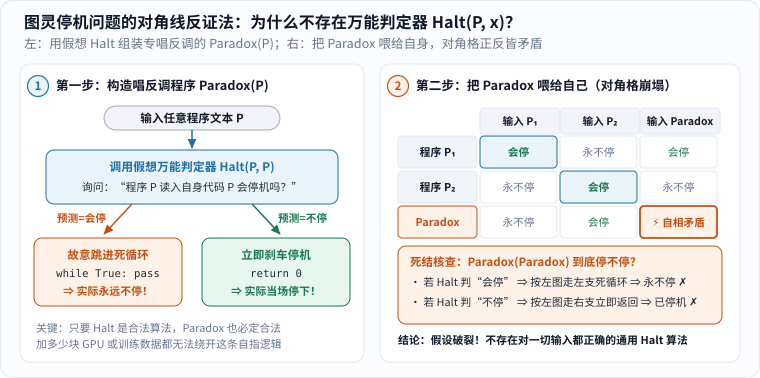

> **来源状态说明**
>
> 这篇笔记的最初线索来自此前收藏的 [Zaker 资讯页面](https://www.myzaker.com/article/6a60252f8e9f094b4d106689)。在核查订正时，该页面弹出验证拦截，未能取得可核对的报道正文，同时亦未检索到能交叉印证该篇报道所涉演讲具体日期、场次与逐字原话的一手官方记录。因此，本文明确**不作为演讲全文转载，也不将正文任何论述冒充姚期智先生的直接引语**；原文件名与发表日期予以保留以免破坏既有站内链接。下文所有数学证明、密码学安全定义与量子通信机制，均依据经典计算机科学原著与权威机构技术文档独立推导撰写。

每当大模型解出一道奥数题或在某项测试上夺冠，舆论场上总会迅速分化出两种极端声音：一种觉得“只要算力和数据继续翻倍，AI 迟早无所不能”；另一种则抓住它数错字母或编造文献的截图，断定“AI 不过是拼贴障眼法，永远跨不过真正的逻辑门槛”。

其实，相关科学讨论真正引出的好问题是：**当我们说计算机或 AI“做不到某件事”时，我们嘴里的“做不到”到底属于哪一种物理与数学性质？**

把这把尺子擦亮，许多看似深奥的争论一下子就会变得清清楚楚。

---

## 一、当我们说“AI 做不到”时，其实在谈论三种完全不同的边界

### 1. 一张坐标图分清：逻辑不可判定、计算资源受限与当前经验短板

先看下面这张总览图。图中并列的三格**绝不是“从轻度困难到重度困难”的同一把尺子**，而是横跨了数理逻辑、计算复杂性与工程现状三个完全不同的维度：


_从左往右逐格区分三类“做不到”：① 第一格是**逻辑不可判定**（数学定理已证明不存在通用算法，堆多少算力都没用）；② 第二格是**计算复杂性受限**（有限空间原则上可枚举，但所需时间或硬件远超现实宇宙预算）；③ 第三格是**当前模型经验表现**（只是今天这套架构、分词或训练数据没做好，不代表永久理论上限）。[单独打开图片](/assets/images/archive-guides/ai-limits.svg)。_

### 2. 为什么混用这三层边界会同时制造盲目狂热与盲目轻视？

一旦在讨论里把这三格搅在一起，立刻就会生出两种常见的逻辑滑坡：

- **把“第三格”滑坡成“第一格”**：看到某个版本的大模型数不清单词里有几个字母 `r`，或者解错一道几何辅助线题，就匆忙宣布“数学已经证明神经网络永远不可能推理”——这是把**某套特定软件当前的工程短板**，误当成了永久的数理不可能定理；
- **把“第二格”或“安全证明”当成免检金牌**：听说某个密码系统“有数学可证明安全性”，或者某套通信设备用了“量子物理原理”，就以为“哪怕代码写得乱七八糟、哪怕黑客拿到物理设备也绝对攻不破”——这是忘记了数学定理永远只在**明确的前提假设与模型边界内**生效。

接下来，我们就顺着这三道边界，一步步把里面的硬核机制亲手算明白。

---

## 二、第一道边界（逻辑不可判定）：哪怕算力无限，也不存在包办一切的万能算法

### 1. 先区分“看懂一个具体小程序”与“通判天下一切程序”

1936 年，年仅 24 岁的艾伦·图灵（Alan Turing）在伦敦数学学会会刊发表了奠定现代计算机科学根基的论文《论可计算数及其在判定问题上的应用》[1]，回答了一个直击本质的问题：**世上是不是每一个表述清楚的数学或程序问题，都能写出一套固定算法，在有限步内给出“是”或“否”的准确答案？**

图灵证明的答案是：**不！** 最经典的代表就是**停机问题（Halting Problem）**：

> 给定**任意一段程序代码 $$P$$** 以及它的**任意输入数据 $$x$$**，能不能造出一个万能检查算法 `Halt(P, x)`，不用掉进死循环傻等，总能在有限步内百分之百准确地判断“$$P$$ 在输入 $$x$$ 上最终会停机，还是会永远跑下去”？

在动手证明之前，千万先看准定义里的四个字——**“任意”**和**“总能”**！

比如看下面这段只有两行的 Python 小程序：

```python
for _ in range(3):
    print("你好")
```

小学生扫一眼都知道：它打印三次“你好”就稳稳停机了。再看 `while True: pass`，谁都能一眼断定它永不停机。甚至很多复杂的工业软件，形式化验证工具也能针对特定模块证明其必定终止。

**“停机问题不可判定”绝不是说“人类或 AI 面对任何一个具体程序都无法判断它停不停”**，而是说：**绝对不存在同一把万能尺子 `Halt`，能对世间所有可能写出来的程序—输入组合（包括那些把未解数学猜想编进去的程序，乃至故意跟判定器唱反调的程序）全都给出无懈可击的有限步判决！**

### 2. 跟读图灵的对角线反证法：为什么 `Paradox(Paradox)` 必然自相矛盾？

为什么哪怕未来造出银河系那么大的超级计算机，也写不出这个万能 `Halt(P, x)`？不用高深符号，我们用中学反证法跟着下图走完两步，就能亲眼见证逻辑撞墙的瞬间：


_先顺着左栏从上往下看怎样拿假想的万能判定器 `Halt` 组装出“杠精程序” `Paradox(P)`：预测会停就故意跳进死循环，预测不停就当场刹车；再看右栏程序与输入的二维对照表——一旦在右下角对角格把 `Paradox` 自己的源代码喂给 `Paradox` 自己，无论 `Halt` 猜哪一边都会当场自打耳光！[单独打开大图](/assets/images/ai-impact/halting-diagonal-proof.svg)。_

我们把图里的两步写成清清楚楚的伪代码账本：

1. **第一步（顺着对方假设搭桥）**：假设某家公司宣称他们训出了一个从不犯错的完美算法 `Halt(P, x)`——当程序 `P` 处理输入 `x` 最终会停时，它一定在有限时间内返回 `True`；永不停时一定返回 `False`。
2. **第二步（造一个专门抬杠的外壳程序 `Paradox`）**：既然程序源代码本身就是一串普通文本字符串，我们完全可以把 `Halt` 当成现成零件，写出下面这个合法的 5 行新程序：

```python
def Paradox(P):
    if Halt(P, P) == True:   # 问万能预言家：P 读入它自己的代码会停吗？
        while True:          # 预言家说“会停”，我就偏偏死循环永不停！
            pass
    else:
        return 0             # 预言家说“永不停”，我就偏偏立刻停机退出！
```

3. **第三步（致命一击：执行 `Paradox(Paradox)`，把杠精喂给杠精自己！）**：
   - **情形甲**：如果内部的 `Halt(Paradox, Paradox)` 判定结果为 `True`（预测它会停机），那么按第 3 行代码，`Paradox` 立刻跳进 `while True` 死循环——**实际结果是永远不停！预言家判错了！**
   - **情形乙**：如果内部的 `Halt(Paradox, Paradox)` 判定结果为 `False`（预测它永不停机），那么按第 6 行代码，`Paradox` 当场执行 `return 0` 结束运行——**实际结果是立刻停了！预言家又判错了！**

总共只有“停”与“不停”两种客观结局，两条路全部撞得粉碎！唯一的解释就是第一步的前提根本不成立——**万能判定器 `Halt` 在逻辑上根本不可能存在。**（顺着这一结果往前半步，就是软件工程里著名的**莱斯定理 Rice's Theorem**：任何关于程序运行语义的非平凡性质——比如“这段任意代码会不会在某个极端输入下发生数组越界或泄漏密钥”——同样不存在零漏报且零误报的全自动通用判定算法！）

### 3. 为什么喂更多训练数据、接外部工具或换神经网络都跨不过这道墙？

有人可能会问：“图灵当年说的是手写规则的机器，今天的大语言模型靠海量数据学概率，会不会打破停机问题？”

答案依然是否定的，而且两边都要把话说公道：[2]

- 一方面，无论神经网络叠了一千层还是塞进十万亿参数，只要它运行在数字电子计算机（或标准量子计算机）上，它的每一次矩阵乘法与词元采样本身就是一段**完全受图灵可计算模型支配的计算过程**。给它接上搜索引擎、代码解释器或海量语料，能极大提升它分析常见业务代码 bug 的实用本领，但面对任意构造的复杂程序，它依然只能在“偶尔误判”“遇到难题超时弃权”之间做权衡，绝无可能化身全知全能的 `Halt`；
- 另一方面，**这也绝不意味着人类大脑就天然拥有超图灵神力！** 面对一台把哥德巴赫猜想或科拉茨猜想编码进去的小图灵机（详见本站《[这是世界上增长最快的数列]()》），全人类最顶尖的数学家苦思几十年，同样还没判出某些短短几十行规则的程序究竟会不会停。逻辑边界对硅基芯片和碳基大脑一视同仁。

---

## 三、第二道边界（计算复杂性与现代密码学）：原则上可算，不等于宇宙寿命内算得完

跨出第一道“根本不存在算法”的墙，我们来到第二道更常在现实工程里露面的墙：**有些问题明明白白存在有限步精确算法，但算完它所需的步数或能量，把整个可观测宇宙掏空也付不起！**

### 1. 算一笔穷举账：$$2^{128}$$ 把密钥在物理世界意味着什么？

对比一下“停机问题”与“暴力破解一个 128 位对称加密密钥（如 AES-128）”：

后者绝不是不可判定问题——密钥长度固定只有 128 个 `0` 或 `1`，候选钥匙总数是一个板上钉钉的有限正整数：

$$
2^{128} \approx 3.4028 \times 10^{38}.
$$

原则上，你写一个三行循环从全 `0` 试到全 `1`，总有一天能试出正确钥匙。可这一天到底有多远？不妨掏出计算器算一笔乐观到极点的物理账（对照下图左栏第一行）：

- 假设全地球凑出一座每秒钟能试 **$$10^{18}$$ 把密钥（百亿亿次/秒，Exascale 量级）**的专用超算阵列；
- 一年约有 $$3.1558 \times 10^7$$ 秒，一年最多能试约 $$3.16 \times 10^{25}$$ 把；
- 把全部 $$2^{128}$$ 把钥匙试完，需要的时间约为：

$$
\frac{3.4028 \times 10^{38}}{3.1558 \times 10^{25}} \approx 1.08 \times 10^{13}\ \text{年} \quad (\text{即约 } 10.8\ \text{万亿年！})
$$

而宇宙大爆炸至今的年龄总共才约 **138 亿年（$$1.38 \times 10^{10}$$ 年）**——也就是说，哪怕每秒狂试百亿亿次，穷举完 128 位密钥也要花掉**宇宙年龄的约 780 倍**！如果换成 256 位密钥（$$2^{256}$$），连热力学兰道尔擦除极限（Landauer's Principle）允许的银河系总能量都远远不够把计数器翻完一遍。

### 2. 密码学里的“可证明安全”到底证明了什么？

正因为“原则可算”与“现实算得动”之间横亘着指数级鸿沟，现代密码学才得以建立在**计算复杂性安全（Computational Security）**之上（系统定义可参阅斯坦福大学 Dan Boneh 与 Victor Shoup 的公开教材《应用密码学研究生教程》[3]）。

但每当你在产品白皮书上读到“本系统具有数学可证明安全性（Provable Security）”这几个字时，一定要在脑海里自动补齐它的**三道严格限定框**：

1. **它大多是“条件归约证明”，而非无条件绝对定理**：密码学家通常证明的是——“如果在多项式时间内存在某个攻击算法能以不可忽略的优势攻破这套加密方案，那么我们就能拿这个攻击算法当零件，在多项式时间内顺手解开某道公认极难的数学题（例如大整数质因数分解、或特定群上的判定性 Diffie–Hellman 假设 DDH）”。一旦底层困难假设选错群参数，或者未来某天有人找到了解那道数学题的快算法，大厦地基就会跟着松动（顺便注意，即便著名的 $$P \neq NP$$ 成立，也只是保住了最坏情况困难性，密码学还需要**平均情况困难性**与单向函数假设，详见《[P和NP：为什么答案好检查，却可能不好找？]()》）。
2. **安全等级严格绑定具体的“攻击者能力模型”**：比如标准教科书版的 ElGamal 公钥加密在合适群上的 DDH 假设下具备**选择明文攻击安全（CPA）**，但它天生具有乘法同态延展性——攻击者截获密文后直接把密文乘上 2，解密出来的明文也会跟着乘 2！因此如果业务场景允许攻击者利用解密反馈（**选择密文攻击 CCA**），原版方案当场就会失效，必须升级带完整性校验的混合加密设计。[3]
3. **数学锁无懈可击，不代表门框和钥匙盒没漏洞**：现实世界里 99% 的安全事故并不是黑客造出了攻破 AES 的神仙算法，而是伪随机数生成器熵源不足、服务器返回报错的微秒级时间差泄漏了密钥位（计时与功耗侧信道攻击）、协议拼接不当，或是管理员被一封钓鱼邮件骗走了明文口令。**AI 既不是能凭空违背信息论猜中真随机密钥的读心术，安全证明也不是替烂代码兜底的免死金牌。**

---

## 四、第三道边界（现有模型的经验表现）：今天答错一道题，不等于永远的理论天花板

看清了前两道硬桥硬马的理论高墙，再回头看日常新闻里最热闹的第三类现象：**“某某大模型今天在一道小学脑筋急转弯或编程题上翻车了！”**

### 1. 拆解一次大模型翻车的五种工程成因

当一个模型在某次测试中没有给出正确答案时，它严格证明的只有一件事：**“这一个特定版本的系统，在当前提示词、分词方式与无工具配置下，这次没做好。”** 它既不能自动上升为“任何人工智能永远做不到”，也不能反证“只有人类灵魂才解得开”。

把常见翻车现场拆开检查，背后往往是很具体的工程原因：

- **表示颗粒度盲区**：例如前文提过的数单词字母或做多位长乘法——模型接收的是合并后的词元（Token）整数编号，并且单步前向传播层数固定，硬逼它不打草稿一口报出二十位乘法积，就像逼人类不拿草稿纸心算一样吃亏；一旦允许它输出中间步骤或调用一行 Python `len([c for c in "strawberry" if c == "r"])`，错误立刻消失；
- **上下文窗口与注意力稀释**：把几万字的合同塞进窗口后，夹在正中间的一句不起眼免责条款可能被大量无关文本稀释掉权重；
- **训练语料截止与分布外外推（OOD）**：问它昨天刚修订的软件接口文档，不联网检索就只能靠旧记忆瞎猜；
- **题目本身存在歧义**：许多网上疯传的“戏耍 AI 神题”（比如故意偷换前提的洗车店距离脑筋急转弯），换个人类匆忙扫一眼也常常顺着常见语境答偏。

### 2. 单次惊艳不等于通用可靠：怎样像做对照实验一样评估 AI？

反过来，看到别人晒出一张“AI 一句话写出完整小游戏”或“AI 猜中罕见病”的截图，同样不能立刻跳到“它已经彻底替代医生和架构师”。

科学的评估方法永远遵循对照实验规矩：**先固定任务边界与评判标准，控制提示词与外部工具变量，在足够大且防泄题的新测试集上看整体成功率，更要仔细拆解它犯错时的失败分布（是偶尔差一点点，还是一旦出错就给出致命反向建议？）。** 只有分清经验短板与理论上限，我们才知道哪里该靠改进工程架构去攻克，哪里必须给系统装上人工复核刹车。

---

## 五、量子物理遇上信息科学：分清量子通信（QKD）与量子计算的真实威力

一谈到计算与安全的终极物理边界，“量子”几乎是绕不开的热词，却也是营销话术重灾区。最要紧的第一件事，就是先把**量子密钥分发（量子通信的重要分支）**与**量子计算**这两件目标截然不同的事彻底分清：


_左栏梳理经典密码在算力与量子算法下的三条边界：128 位密钥对经典穷举稳如磐石，公钥密码（RSA/ECC）面临 Shor 算法指数级威胁需迁移抗量子密码，而对称密码（AES）面对 Grover 算法仅受平方根影响、加倍密钥即可抵御。右栏一步步算清 BB84 量子密钥分发为什么能让拦截重发窃听暴露出 `25%` 误码率，同时标出英国 NCSC 强调的经典认证与物理侧信道工程边界。[单独打开大图](/assets/images/ai-impact/crypto-qkd-boundaries.svg)。_

### 1. 手算一次 BB84 量子密钥分发：为什么窃听者必留 `25%` 误码率把柄？

1984 年，查尔斯·贝内特（Charles H. Bennett）与吉尔·布拉萨德（Gilles Brassard）提出了著名的 **BB84 协议**[4]。它并不是用量子纠缠“超光速传文件”，而是利用单光子的量子叠加与测量坍缩特性，让收发双方（Alice 与 Bob）隔着光纤或自由空间协商出一串**一旦有人半路偷看就会留下统计铁证的共享随机密钥**。

跟着上图右栏，只用两个偏振滤光片就能算懂它的精妙抓贼逻辑：

1. **两套互不兼容的偏振标尺**：Alice 发送单光子时，随机选用两套基之一编码比特 `0` 和 `1`——**十字基 `+`**（竖直 `↑` 记 `0`，水平 `→` 记 `1`）或**对角基 `×`**（右上 `↗` 记 `0`，左上 `↖` 记 `1`）。根据量子力学基本原理：如果用十字基 `+` 去测量一颗原本按对角基 `×` 制备的光子，光子态会以各 **50%** 的概率随机坍缩成 `↑` 或 `→`，原有信息被不可逆地扰乱，且未知量子态**不可精确克隆（No-Cloning Theorem）**！
2. **Bob 盲测与公开对基**：Bob 收到每颗光子时，也独立随机选 `+` 或 `×` 去测。整批光子发完后，两人在普通公开电话里只报“我第几号光子用了哪套基”（绝不报测出的 `0/1` 结果！），把双方碰巧选了**同一套基**的那约一半比特留作候选密钥，其余全部丢弃。若无窃听且理想无噪，留下的比特双方必定 100% 一致。
3. **窃听者 Eve 插手会怎样？** 假设窃听者 Eve 半路截住光子测量再补发一颗给 Bob（拦截—重发攻击）。对于后来 Alice 和 Bob 选了同一套基（比如都是 `+` 基、Alice 发 `↑=0`）的那些位置：
   - Eve 有 **50%** 概率蒙对了 `+` 基：她测出 `↑` 原样发走，Bob 仍测得 `0`，这一颗没露馅；
   - Eve 有 **50%** 概率蒙错了 `×` 基：光子瞬间坍缩成对角态 `↗` 或 `↖`！等这颗被测歪的光子传到用 `+` 基守候的 Bob 手里时，Bob 就有 **50%** 的概率测出错误的 `→=1`！
   - 把两步概率一乘，只要 Eve 对光子下手，同基筛选后的**量子比特误码率（QBER）立刻飙升到**：

$$
\mathrm{QBER} = \frac{1}{2} \times \frac{1}{2} = 25\%.
$$

Alice 和 Bob 只需从候选密钥里随机抽出几百位公开比对数值：假设抽查 $$k=200$$ 位都被窃听，Eve 侥幸全部蒙混过关不触发半点错位的概率只有 $$(1 - 0.25)^{200} = 0.75^{200} \approx 10^{-25}$$！发现误码率异常超标，两人当场作废这批密钥即可，真机密正文根本还没发出去！

### 2. 物理原理很美，为什么工程安全机构依然强调“认证与实现边界”？

听完上面的 `25%` 抓贼算术，很多人会以为“装上 QKD 盒子就万事大吉、黑客彻底绝迹了”。但[英国国家网络安全中心（NCSC）关于量子网络技术的白皮书](https://www.ncsc.gov.uk/paper/quantum-networking-technologies)专门给工程界泼了一盆冷静的清水[5]——请注意，这并不是否定量子力学定理，而是指出了理论模型落到真实铁盒子时的三道必考题：

1. **QKD 无法凭空解决“对面到底是不是真 Bob”的身份认证**：如果中间人 Eve 从第一秒就切断线路，左边假扮 Bob 跟 Alice 做一套 QKD，右边假扮 Alice 跟真 Bob 做另一套 QKD，两边误码率全都是漂亮的 `0%`！因此 QKD 启动前，**依然必须依赖预先共享的初始密钥或后量子数字签名来完成身份认证**；
2. **现实器件不是理想单光子数学点**：真实激光源偶尔会一脉冲吐出两颗相同光子（光子数分裂攻击风险，需靠诱骗态协议修补），单光子探测器也可能被强光致盲操控（探测器侧信道），传统软件栈照样可能有缓冲区溢出；
3. **光纤损耗限制中继距离**：量子态不能像经典光电信号那样直接用普通放大器复制中继。因此，在大多数互联网日常应用里，基于经典数学困难假设升级的**抗量子公钥密码（PQC，如基于格密码的 NIST 标准）**与 QKD 各有完全不同的部署成本与适用边界，绝不能把“用了物理定律”吹嘘成“整套产品无条件绝对无敌”。

### 3. 量子计算与“Science for AI”：加速特定结构，而非抹平一切不可能

再看图左栏下半部分的**量子计算**：它利用量子态的相干叠加与干涉，改变的是**特定数学结构问题**的计算复杂性边界，而不是违背图灵可计算性：

- **指数级加速（局部颠覆）**：1994 年彼得·秀尔（Peter Shor）提出 **Shor 算法**，证明容错大规模量子计算机能在多项式时间内完成大整数质因数分解与离散对数求解——这意味着一旦足够多逻辑量子比特的容错硬件建成，今天广泛保护网银与 HTTPS 握手的 RSA 和椭圆曲线密码将被攻破，全球必须在那之前平稳迁移到抗量子密码（PQC）；
- **平方根加速（温和推进）**：1996 年洛夫·格罗弗（Lov Grover）提出无结构搜索的 **Grover 算法**，把在 $$N$$ 个无序候选项里找目标的步数从 $$N$$ 降到 $$\sqrt{N}$$（且已证明这是量子无结构搜索的理论最优阶！）。所以面对 256 位对称密码 AES-256，量子搜索也只能把复杂度降到 $$2^{128}$$ 量级，把密钥长度翻倍就稳稳守住了防线；
- **至于不可判定问题**：标准量子电路同样可以用经典图灵机精确模拟（只是慢指数倍），因此**量子计算机面对图灵停机问题，和经典计算机一样束手无策！**

这也让我们能更平实地看待当下热门的两个交叉方向：一个是 **AI for Science**（用深度学习辅助蛋白质结构预测、材料筛选与偏微分方程求解），另一个是 **Science for AI**（用统计物理、高维几何与计算复杂性理论反过来剖析和改进黑箱模型）。两个方向都前景广阔，但即便观察到某类特定量子线路在人造数据集上有加速潜力，距离“证明量子 AI 在一切日常任务上全面碾压经典大模型”还隔着数据加载瓶颈（QRAM）、纠错硬件规模与严格经典基线对比等重重关卡。没有可核对的一手学术证据，绝不该把“未来五到十年必然全面颠覆”塞进任何一位严肃科学家的嘴里。

---

## 六、奶爸的思考：教孩子练习“先把限定条件问清楚”

### 1. 读科技大新闻时的四句追问清单

下次和孩子一起刷到“AI 已经彻底攻克某某难题”或者“科学证明 AI 永远做不到某某事”的热搜标题时，不用急着站队表态，不妨拿下面这张四问小卡片当家庭侦探游戏一起核对：

| 先停下来问一句 | 为什么要卡住这一关？ |
|---|---|
| **1. 说的是某一个具体子任务，还是所有同类任务？** | 在围棋或固定考题上拿满分，不能自动外推成“通用全知” |
| **2. 依据是严格的数学不可能定理，还是一次实测翻车？** | 停机问题是永久逻辑墙；而今天数错字母可能明天加个工具就修好了 |
| **3. 结论背后藏着哪些算力、噪声与攻击模型假设？** | 脱离“多长时间、什么硬件、有没有侧信道”谈绝对安全都是耍流氓 |
| **4. 到底是谁说的，能查到未经删改的原始论文或原话吗？** | 自媒体三手转述最爱删掉科学家小心翼翼加上的“在……条件下” |

### 2. 看见边界不是给好奇心泼冷水，而是找到真正值得探索的旷野

很多大人担心：跟孩子讲“不可判定性”“计算资源上限”，会不会打击他们对科学技术的热情？

恰恰相反！科学史上每一次真正的飞跃，几乎都始于看清旧边界的那一刻：正是看清了永动机违背热力学定律，工程师才不再浪费生命造空转齿轮，转而开创出高效热机与现代电力工业；正是图灵为了证明“什么算不出来”，才顺手画出了通用计算机的蓝图；正是密码学家摸准了哪些问题“好检查却极难倒推”，才护住了今天互联网上的亿万次安全通信。

知道哪堵墙是逻辑铁律、哪堵墙只是今天手艺还不够巧，孩子才不会被夸张的口号吓住，留出真正开阔的好奇心去探索未知的世界。

---

## 参考资料与延伸阅读

1. Alan M. Turing (1936–1937)，*On Computable Numbers, with an Application to the Entscheidungsproblem*，*Proceedings of the London Mathematical Society*, s2-42(1), 230–265——通用图灵机与判定问题（现代停机问题）不可判定性的奠基论文。
2. [Stanford Encyclopedia of Philosophy：Computability and Complexity](https://plato.stanford.edu/entries/computability/)——系统区分丘奇—图灵可计算性边界（什么能算）与计算复杂性理论（什么在现实资源下算得动）。
3. [Dan Boneh & Victor Shoup：A Graduate Course in Applied Cryptography](https://crypto.stanford.edu/~dabo/cryptobook/)——现代密码学公开教材，详解计算安全性定义、攻击模型（CPA / CCA）、ElGamal 与判定性 Diffie–Hellman 假设及实现侧信道边界。
4. Charles H. Bennett & Gilles Brassard (1984)，*Quantum Cryptography: Public Key Distribution and Coin Tossing*，*Proceedings of IEEE International Conference on Computers, Systems and Signal Processing*, 175–179（及 2014 年 *Theoretical Computer Science* 560, 7–11 重印版）；Peter W. Shor (1994, FOCS) 与 Lov K. Grover (1996, STOC)——BB84 量子密钥分发协议、大数分解指数级量子加速与无结构搜索平方根量子加速原始文献。
5. [UK National Cyber Security Centre (NCSC)：Quantum security technologies / Quantum networking technologies](https://www.ncsc.gov.uk/paper/quantum-networking-technologies)——阐述量子密钥分发在真实工程部署中仍须解决的身份认证、物理器件侧信道与抗量子密码（PQC）比较立场。
6. 站内关联阅读：
   - 《[人工智能对人的影响]()》——把技术能力边界与人的认知卸载、价值选择放在一起讨论；
   - 《[P和NP：为什么答案好检查，却可能不好找？]()》——深挖计算复杂性核心的 P、NP、NP-Hard 与归约网；
   - 《[AI科技网站]()》——在浏览器里安全动手观察小模型，不上传个人敏感信息。
