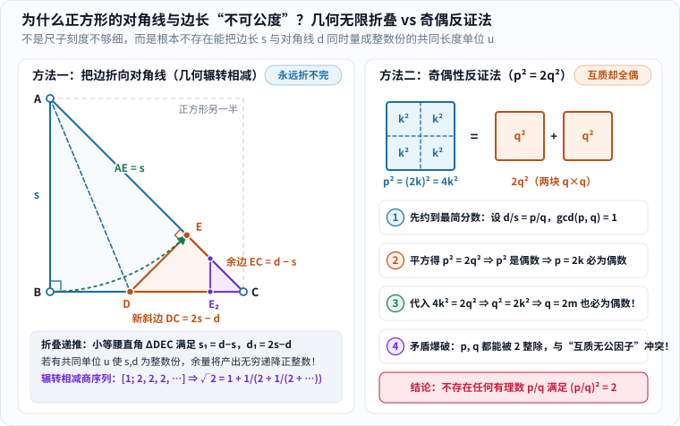
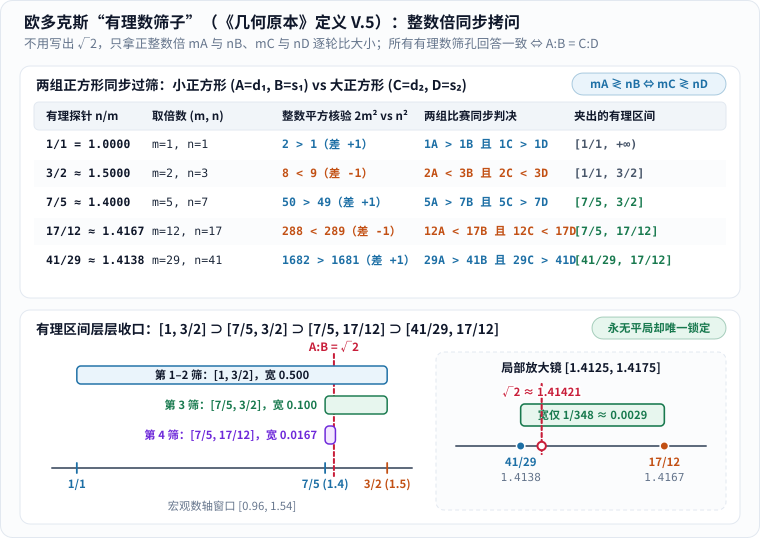
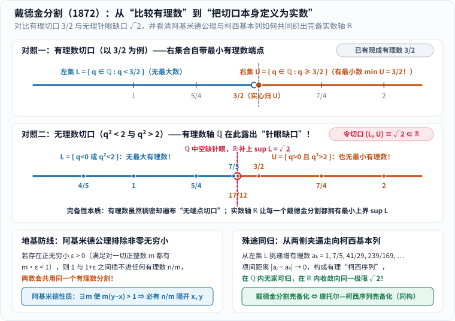

如果不用小数，也不事先承认“$$\sqrt{2}$$”已经是一个现成的数，我们还能理直气壮、滴水不漏地说出下面这句初中几何常识吗？

> **小正方形的对角线与边长之比，严格等于大正方形的对角线与边长之比。**

这看起来像一句不言自明的废话，底下却埋着整个古希腊数学最烫手的一颗地雷：**当一个比例根本写不成两个整数之比时，我们究竟凭什么定义它和另一个比例“相等”？**

公元前四世纪的古希腊天文学家兼数学家**欧多克斯（Eudoxus of Cnidus）**给出了一个领先时代两千多年的惊人回答：根本不必先把那个神秘比例“算成一个数”，只需考察各种可以明确比大小的对象——**各个量的正整数倍**。

他的定义后来被欧几里得郑重收录在《几何原本》第五卷开头。第一次翻开原典读到那些“第一量与第三量取任意等倍、第二量与第四量取任意等倍”的句子时，几乎所有人都会觉得像在念绕口令；可一旦把外壳剥开，里面跳动着一颗无比清澈的现代灵魂：

**一个几何比例与全体有理数的大小关系，足以像指纹一样把它唯一锁定下来。**

今天，我们就从两根绳子找共同尺子出发，亲手拆开正方形不可公度的几何与算术双重铁证，一步步走过欧多克斯的“有理数筛子”，再看十九世纪的戴德金与康托尔如何跨出最后一步，把数轴上无穷无尽的“无理数针眼”织成完备的现代实数体系（顺便先立一条史学规矩：我们会借现代符号帮忙翻译古代思想，但绝不把古希腊的“几何之比”硬说成他们当年已经造好了现代实数）。

---

## 一、两根绳子能不能共用一把尺子？正方形引爆的不可公度之谜

在谈“无理数”之前，我们先回到古希腊人最直观的日常动作：拿一把短尺子去量两根长绳子。

### 1. 什么叫“可公度”？共同长度单位与整数比的等价性

假设桌上有两根绳子，长度分别是 $$15$$ 厘米和 $$9$$ 厘米。我们剪下一小段 $$3$$ 厘米长的木条去量：第一根刚好量满 $$5$$ 次，第二根刚好量满 $$3$$ 次，两头严丝合缝，没有半点零头剩余。

在《几何原本》第十卷定义 1 的语言里，这两根绳子就叫作**可公度的（commensurable）**，那段小木条就是它们的一把**共同度量（common measure）**。

注意，这里真正起决定作用的并不是“厘米”这个人为单位，而是下面这层结构：存在某一个正的长度单位 $$u$$，以及两个正整数 $$p, q$$，使得

$$
A = pu,\qquad B = qu
$$

用今天的分数记号一除，单位 $$u$$ 当场约掉：

$$
\frac{A}{B} = \frac{p}{q}
$$

反过来也完全成立：只要两个正长度的比能写成正整数之比 $$p/q$$，我们只需把第一根绳子平分成 $$p$$ 等份（或把第二根平分成 $$q$$ 等份），取其中一份作为 $$u$$，就能把两根绳子同时量成整数份！因此：

> **两个正同类量可公度，当且仅当它们的比是一个正有理数。**

看懂了这个等价关系，“**不可公度（incommensurable）**”就半点也不玄乎了：它绝不是抱怨工匠手里的尺子刻度还不够细，而是断言**哪怕把尺子缩到一亿分之一毫米、缩到任何你能想象的正长度单位 $$u$$，也永远不可能把这两根线段同时量成整数份**！

### 2. 几何折叠证明：把边折向对角线，为什么永远减不完？

古希腊毕达哥拉斯学派原本笃信“万物皆数（整数及其比）”，认为世上任意两条线段只要把共同单位切得足够碎，总能找到一把公共尺子——直到他们在最规矩、最简单的**正方形**面前撞了南墙！

为什么正方形的对角线 $$d$$ 与边长 $$s$$ 一定没有共同尺子？在动用代数方程之前，古希腊几何学家其实有一招更直观、连平方都不用算的杀手锏——**几何辗转相减折叠法**（《几何原本》第十卷命题 2 专门给出了这条判据：如果拿较大量反复减去较小量的“辗转相减”过程永不终止，两个量就必定不可公度，古希腊语称 *anthyphairesis*）：

_图 1：左栏展示正方形左下半边等腰直角 $$\Delta ABC$$ 的无限折叠——把直角边 $$AB = s$$ 折向斜边 $$AC = d$$ 截出 $$AE = s$$，余下橙色小等腰直角 $$\Delta DEC$$（新边长 $$d-s$$、新斜边 $$2s-d$$），继而又折出紫色更小 $$\Delta D_2E_2C$$，永无止境；右栏展示算术面积 $$p^2 = 2q^2$$ 引发的“最简分数分子分母同为偶数”矛盾。[单独打开大图](/assets/images/eudoxus/square-incommensurable.svg)。_

跟着图 1 左栏，拿一张正方形纸片沿对角线 $$AC$$ 裁开，留下等腰直角三角形 $$\Delta ABC$$（其中 $$\angle B = 90^\circ$$，两条直角边 $$AB = BC = s$$，斜边 $$AC = d$$）：

1. **第一折（量一次边长，看剩多少零头）**：
   以顶点 $$A$$ 为圆心（或沿着 $$\angle BAC$$ 的角平分线 $$AD$$ 折叠），把竖直直角边 $$AB$$ 严丝合缝地折贴到斜边 $$AC$$ 上，落点记作 $$E$$。于是 $$AE = AB = s$$，斜边右下角多出来一小截没盖住的余量：**$$EC = d - s$$**。
2. **认出藏在角落里的“缩小版自己”**：
   因为折叠把 $$\angle B = 90^\circ$$ 原封不动搬到了 $$E$$ 处，所以 $$\angle AED = 90^\circ$$，补角 $$\angle DEC = 90^\circ$$，并且折痕两侧对称给出 $$DE = DB$$。
   再看右下角那个橙色小三角形 **$$\Delta DEC$$**：它既有一个直角 $$\angle DEC = 90^\circ$$，又保留了原正方形对角线的底角 $$\angle C = 45^\circ$$——**它居然又是一个不折不扣的等腰直角三角形！**
   因此它的两条直角边相等：$$DE = EC = d - s$$；再顺手算出它的新斜边 $$DC$$：

   $$
   DC = BC - BD = s - (d - s) = 2s - d
   $$

3. **无穷递降爆破“共同尺子”假设**：
   现在假设世上真有一把神奇的共同长度单位 $$u$$，能把原边长 $$s$$ 和原对角线 $$d$$ 都量成正整数份，比如说 $$s = q_0 u,\ d = p_0 u$$（$$p_0, q_0$$ 是正整数）。
   看一眼橙色小等腰直角三角形 $$\Delta DEC$$：它的新直角边 $$s_1 = d - s = (p_0 - q_0)u$$ 和新斜边 $$d_1 = 2s - d = (2q_0 - p_0)u$$，**居然也是同一把尺子 $$u$$ 的正整数倍**，而且严格变短了（$$0 < s_1 < s$$）！
   既然 $$\Delta DEC$$ 也是等腰直角三角形，我们完全可以在它肚子里的紫色区域 $$\Delta D_2E_2C$$ 再折第二次、第三次、第一万次……每折一次，都会白捡一组更小、却依然必须是**正整数**的份数：

   $$
   q_0 > q_1 > q_2 > q_3 > \cdots > 0
   $$

   可正整数的世界是有地板（最小是 $$1$$）的！任何一串严格递减的正整数最多走有限步就必然撞底，绝不可能无限减小下去！**唯一可能的解释就是：从一开始，那把假想的共同尺子 $$u$$ 就根本不存在！**

顺带还能白捡一串宝贝：如果记录每次大段减掉几份小段——第一步 $$d = 1\cdot s + s_1$$（商为 **$$1$$**），第二步因为 $$s = d_1 + s_1 = (s_1 + s_2) + s_1 = 2\cdot s_1 + s_2$$（商为 **$$2$$**），往后每一步自相似全都是商 **$$2$$**——这就直接吐出了 $$\sqrt{2}$$ 著名的无限循环连分数展开 $$[1; 2, 2, 2, \dots]$$：

$$
\sqrt{2} = 1 + \cfrac{1}{2 + \cfrac{1}{2 + \cfrac{1}{2 + \ddots}}}
$$

### 3. 算术奇偶反证法：为什么最简分数平方不可能是 2？

除了几何折叠，亚里士多德在《前分析篇》中也提到过另一条流传千古的**算术奇偶反证法**（对应图 1 右栏）。由勾股定理知道正方形满足 $$d^2 = 2s^2$$；假设 $$d$$ 与 $$s$$ 可公度，把它们的公因子全部约干净，写成**互质**的正整数比：

$$
d = pu,\qquad s = qu\qquad (\gcd(p, q) = 1)
$$

代入 $$d^2 = 2s^2$$ 并约去 $$u^2$$，立刻得到面积等式：

$$
p^2 = 2q^2
$$

跟着图 1 右栏的四块多米诺骨牌往下推：

1. 右边 $$2q^2$$ 是 $$2$$ 的倍数（偶数），所以左边的 $$p^2$$ 必为偶数；
2. 奇数的平方永远是奇数（$$(2k+1)^2 = 4k^2 + 4k + 1$$），所以 **$$p$$ 本身必定是偶数**！令 $$p = 2k$$（把 $$p\times p$$ 大正方形十字切成 $$4$$ 块 $$k\times k$$ 小正方形）；
3. 代回原式得 $$4k^2 = 2q^2$$，两边除以 $$2$$ 竟然翻出了一个一模一样的式子：**$$q^2 = 2k^2$$**！
4. 同样的理由，**$$q$$ 也必定是偶数**！可我们明明在一开头已经把 $$p, q$$ 约成了没有公因子的最简分数（$$\gcd(p, q) = 1$$），怎么可能两个数同时都是 $$2$$ 的倍数？！

逻辑当场炸裂。结论板上钉钉：**正方形的对角线与边长严格不可公度，没有任何有理数的平方等于 $$2$$。** 拿游标卡尺或激光测距仪去量，顶多只能读出 $$1.4142\dots$$ 这样的有理近似值，永远代替不了这短短四行“不可能存在”的严格证明。

---

## 二、“数”与“量”为什么要分家？比例不是分数时什么叫相等？

今天的中学生看到 $$d^2 = 2s^2$$，一秒钟就会写下 $$d/s = \sqrt{2}$$，心安理得地把 $$\sqrt{2}$$ 当成一个数装进口袋。可在两千多年前的古希腊，这恰恰是最不能蒙混过关的地方。

### 1. 古希腊的严格区分：由单位组成的“数”与连续的几何“量”

在欧几里得《几何原本》的精密语汇里，**“数（arithmos）”**和**“量（megethos）”**住在两间规矩截然不同的屋子里：

- **“数”**（见第七至第九卷）特指“由单位组成的多”，也就是 $$2, 3, 4, \dots$$ 这样的正整数（连单位“$$1$$”都被当作数的源头而单独看待，现代意义上的分数更没有直接获得与整数平起平坐的独立“数”籍）；
- **“量”**（见第五卷）则是像**线段、平面面积、立体体积、角、时间**这样的连续几何对象。同类量之间可以首尾拼接相加、可以取正整数倍（$$2A, 3A, \dots$$）、可以直接比谁大谁小，却不需要预先变成一串阿拉伯数字。

而且古希腊人对“同类量”守得极严：两条线段可以比长短，两块面积可以比大小，但“一条线段大于一块面积”是毫无意义的胡话；拿两条线段做长和宽拼出矩形，得到的是另一类对象（面积），而不是线段乘出了一条新线段。

**把数和量区分开，绝不等于古希腊人“被无理数吓破了胆、彻底抛弃了算术”！** 顺便澄清一句数学史常识：后世通俗读物津津乐道的“第一次数学危机导致整个学派瞬间崩塌”“希帕索斯因泄露不可公度秘密被扔进大海淹死”等戏剧化桥段，大多混杂了晚期新毕达哥拉斯主义者的神秘主义传说，不宜当作确凿无疑的信史。真实发生的历史要建设性得多：古希腊数学家没有掩耳盗铃，而是迎难而上，建立了一套**不依赖把每个几何量预先写成数、却照样能严密推理所有比例**的宏伟理论！

### 2. 当比例写不成分数：为什么“交叉相乘看面积”还不够基础？

让我们把聚光灯打回全篇最核心的难题上。

如果两组线段都可公度，验证比例相等简直小菜一碟：为什么 $$15 : 9 = 10 : 6$$？因为第一组按 $$3$$ 厘米量是 $$5 : 3$$，第二组按 $$2$$ 厘米量也是 $$5 : 3$$，化简成同一个整数比就结了。

可现在桌上有两个大小不同的正方形：小正方形的对角线是 $$A$$、边长是 $$B$$；大正方形的对角线是 $$C$$、边长是 $$D$$。刚才我们已经铁证如山，$$A : B$$ 根本化不成任何整数比 $$p : q$$！如果“比例相等”的旧定义只认“化成同一个整数比”，那么连 $$A : B = C : D$$ 这样天经地义的几何命题，都会瞬间沦为**没有定义的非法句子**；整座相似三角形、圆面积之比、立体体积之比的几何大厦，地基全得悬空！

有的现代读者会灵机一动：“嗨，不用分数，交叉相乘看矩形面积 $$A\cdot D = B\cdot C$$ 不就行了？”

如果四个量恰好全是**线段**，把乘积解释成矩形面积确实能走通一截；**但如果第一组 $$A, B$$ 是两个立体体积（比如两个球），第二组 $$C, D$$ 是两个圆的面积呢？** 在三维几何里，“球体积乘以圆面积”是个什么怪物？根本没法直接画出来！

欧多克斯的高明之处就在这里：他决定退到最底层，**只使用同类量内部最合法的三样基本功——相加、取正整数倍、比大小（$$>, =, <$$）**，铸造一把能通杀一切可公度与不可公度、通杀线段面积与体积的万能比例定义！

---

## 三、欧多克斯的“有理数筛子”：用整数倍同步拷问锁死比例

翻开《几何原本》第五卷定义 5（可直接核对 [David E. Joyce 的《几何原本》第五卷在线英译与评注](https://mathcs.clarku.edu/~djoyce/elements/bookV/defV5.html)），把那段著名的古希腊长句拆成现代符号，你会立刻拍案叫绝。

### 1. 拆解《几何原本》第五卷定义 5：两场整数倍比赛胜负永远同步

给定四个正的几何量 $$A, B, C, D$$，只要求 $$A$$ 与 $$B$$ 是同类量（比如都是线段）、$$C$$ 与 $$D$$ 是同类量（比如都是线段，或者都是面积）。

现在任取**任意两个正整数 $$m, n$$**，把第一量和第三量同时放大 $$m$$ 倍（得 $$mA$$ 与 $$mC$$），把第二量和第四量同时放大 $$n$$ 倍（得 $$nB$$ 与 $$nD$$），同时举办两场比大小比赛：

| 第一赛场（比较 $$mA$$ 与 $$nB$$） | 第二赛场必须同步出现的结果（比较 $$mC$$ 与 $$nD$$） |
|---|---|
| 若 $$mA > nB$$（第一场左胜） | 必有 $$mC > nD$$（第二场也左胜） |
| 若 $$mA = nB$$（第一场打平） | 必有 $$mC = nD$$（第二场也打平） |
| 若 $$mA < nB$$（第一场右胜） | 必有 $$mC < nD$$（第二场也右胜） |

欧多克斯庄严宣布：**如果对一切正整数对 $$(m, n)$$，两场比赛的胜、平、负结果永远一模一样，我们就定义这两组量的比相等，记作 $$A : B = C : D$$！**

注意原典里“等倍（equimultiples）”这个词的精确含义：它是说 $$A$$ 和 $$C$$ 乘同一个整数 $$m$$、$$B$$ 和 $$D$$ 乘同一个整数 $$n$$，**绝不是要求 $$m = n$$**！

先拿最熟悉的有理比例 $$A = 15,\ B = 9$$ 与 $$C = 10,\ D = 6$$ 热个身：比较 $$15m$$ 与 $$9n$$（同除以 $$3$$ 就是比 $$5m$$ 与 $$3n$$），跟比较 $$10m$$ 与 $$6n$$（同除以 $$2$$ 也是比 $$5m$$ 与 $$3n$$），不管你挑 $$m=1, n=1$$（两边都大于）、挑 $$m=3, n=5$$（两边 $$45=45$$ 与 $$30=30$$ 都打平），还是挑 $$m=1, n=2$$（两边都小于），胜平负天然 100% 同步！旧的有理比例被完美包进了新定义里。

### 2. 实战演练：拿 (1,1)、(3,2)、(7,5)、(17,12)、(41,29) 一步步筛出 √2

那么，遇到永远打不出“平局”的无理比例——比如小正方形 $$(A, B)$$（满足 $$A^2 = 2B^2$$）与大正方形 $$(C, D)$$（满足 $$C^2 = 2D^2$$）——这把筛子是怎么干活的？

先注意一个极易把分子分母写反的小机关：在现代实数视角下，因为量为正，

$$
mA \gtrless nB \quad\Longleftrightarrow\quad \frac{A}{B} \gtrless \frac{n}{m}
$$

也就是说，如果你想拿某个正有理数探针 $$r = p/q$$（比如 $$1/1, 3/2, 7/5, 17/12, 41/29$$）去拷问对角线与边长之比 $$A:B$$，在欧多克斯的公式里只需取 **$$m = q$$（分母）、$$n = p$$（分子）**，去比较 **$$qA$$ 与 $$pB$$**！而比较两个正线段 $$mA$$ 与 $$nB$$ 谁长，等价于比较它们围出的正方形面积 $$(mA)^2 = 2m^2 B^2$$ 与 $$(nB)^2 = n^2 B^2$$——**全程只需算纯整数平方 $$2m^2$$ 与 $$n^2$$ 的大小，半个根号都不用写！**

_图 2：上栏按连分数最佳有理逼近（佩尔渐进分数）$$1/1, 3/2, 7/5, 17/12, 41/29$$ 依次取整数倍 $$(m, n)$$，只靠纯整数比较 $$2m^2$$ 与 $$n^2$$（每次仅相差 $$\pm 1$$！）就让大小两个正方形给出完全一致的胜负判决；下栏展示有理区间 $$[1, 3/2] \supset [7/5, 3/2] \supset [7/5, 17/12] \supset [41/29, 17/12]$$ 像钳子一样层层收口夹住 $$\sqrt{2}$$。[单独打开大图](/assets/images/eudoxus/eudoxus-rational-sieve.svg)。_

跟着图 2 上下两栏，亲手过五道最锋利的有理数筛孔（注意看 $$2m^2$$ 与 $$n^2$$ 惊心动魄的“只差 $$1$$”拉锯战——这正是数论里著名的**佩尔方程 $$2m^2 - n^2 = \pm 1$$** 解序列！）：

1. **第一筛：探针 $$1/1$$（取 $$m = 1,\ n = 1$$）**
   算整数平方：$$2\times 1^2 = 2 > 1 = 1^2$$。因此小正方形满足 $$1A > 1B$$，大正方形也同步满足 $$1C > 1D$$！两边异口同声回答：“我们的比都**大于 $$1$$**！”
2. **第二筛：探针 $$3/2 = 1.5$$（取 $$m = 2,\ n = 3$$）**
   算整数平方：$$2\times 2^2 = 8 < 9 = 3^2$$（只差 $$-1$$！）。因此 $$2A < 3B$$ 且 $$2C < 3D$$！两边同步回答：“我们的比都**小于 $$3/2$$**！”此时比例已被关进宽度 $$0.5$$ 的有理笼子 **$$[1,\ 3/2]$$**。
3. **第三筛：探针 $$7/5 = 1.4$$（取 $$m = 5,\ n = 7$$）**
   算整数平方：$$2\times 5^2 = 50 > 49 = 7^2$$（只差 $$+1$$！）。因此 $$5A > 7B$$ 且 $$5C > 7D$$！左边界瞬间右推，笼子收紧到 **$$[7/5,\ 3/2] = [1.4,\ 1.5]$$**，宽度缩为 $$0.1$$！
4. **第四筛：探针 $$17/12 \approx 1.4167$$（取 $$m = 12,\ n = 17$$）**
   算整数平方：$$2\times 12^2 = 288 < 289 = 17^2$$（又只差 $$-1$$！）。因此 $$12A < 17B$$ 且 $$12C < 17D$$！右边界大幅左压，笼子收紧到 **$$[7/5,\ 17/12]$$**，宽度仅剩 $$1/60 \approx 0.0167$$！
5. **第五筛：探针 $$41/29 \approx 1.4138$$（取 $$m = 29,\ n = 41$$）**
   算整数平方：$$2\times 29^2 = 1682 > 1681 = 41^2$$（依然只差 $$+1$$！）。因此 $$29A > 41B$$ 且 $$29C > 41D$$！如图 2 右下角局部放大镜所示，笼子进一步锁死在 **$$[41/29,\ 17/12]$$** 内，缝隙宽度暴跌至 **$$1/348 \approx 0.00287$$**！

### 3. 为什么这不是循环论证，也不用真的做无限次实验？

读到这里，爱较真的读者一定会连珠炮似地抛出三个好问题——把它们挨个砸碎，你就真正懂了欧多克斯：

- **疑问一：“你刚才用 $$A/B > n/m$$ 解释筛子，这不是偷偷假定无理数除法已经存在，搞循环论证吗？”**
  答：**完全没有循环！** $$A/B > n/m$$ 只是我们站回现代实数视角写的“场外解说词”。在古希腊几何现场，欧多克斯根本不写除法，他只拿圆规把线段 $$A$$ 接成 $$m$$ 段长（$$mA$$）、把 $$B$$ 接成 $$n$$ 段长（$$nB$$），再把两条长线段并排比长短——这两步在纯几何里 100% 合法，半点不需要预先承认 $$\sqrt{2}$$ 是个数！
- **疑问二：“既然不可公度，永远不会出现 $$mA = nB$$ 的平局，光靠大于和小于够用吗？”**
  答：**完全够用！** 如果存在正整数使 $$mA = nB$$，令 $$u = A/n = B/m$$ 就成了共同尺子，与不可公度矛盾。正因为永远没有平局，全体正有理数才一个不落地裂成“全答大于”和“全答小于”两大阵营，两边合力照样把目标夹得纹丝不动。
- **疑问三：“正整数 $$m, n$$ 有无穷多对，难道做一次几何证明要算到宇宙毁灭？”**
  答：**千万分清“定义判据”和“逐个枚举算法”！** 证明 $$A : B = C : D$$ 绝不是挨个试一万亿组数字，而是用一条普遍推理**一次性包干所有 $$(m, n)$$**！比如在两个正方形里，对**任意**正整数 $$m, n$$：

  $$
  mA \gtrless nB \iff (mA)^2 \gtrless (nB)^2 \iff 2m^2 B^2 \gtrless n^2 B^2 \iff 2m^2 \gtrless n^2
  $$

  而大正方形那边同样归结为同一个整数不等式 $$2m^2 \gtrless n^2$$！只用这一行代数恒等变形（在《几何原本》里则对应相似形或等倍同增减的一般几何论证），无穷多对 $$(m, n)$$ 就被**一网打尽**了！

---

## 四、为什么所有答案一致就必然相等？稠密性与阿基米德防线

前面我们看到：如果两个比例相等，它们对所有有理数探针的回答必然一致。但更致命的反向拷问是：**万一有两个明明一高一低、略有不同的比例，它们会不会侥幸对所有有理数探针都给出完全相同的答案，从而把欧多克斯的筛子糊弄过去？**

### 1. 有理数的稠密性：只要 x < y，中间必能塞进一个有理探针 n/m

站在现代实数轴上检验一下：假设有两个不相等的正实数比值 $$x = A/B$$ 与 $$y = C/D$$，不妨设 $$x < y$$。

有理数在实数轴上拥有一条威力无穷的看家本领——**有理数的稠密性（density of $$\mathbb{Q}$$ in $$\mathbb{R}$$）**：

> **任意两个不相等的实数 $$x < y$$ 之间，无论缝隙窄到一亿亿分之一，总能找到至少一个（实际上是无穷多个！）有理数 $$r = n/m$$ 插在它们正中间：**

$$
x < \frac{n}{m} < y
$$

一旦抓出这个夹在中间的有理探针 $$n/m$$，把它换回欧多克斯的整数倍赛场，立刻原形毕露：

- 左边 $$A/B < n/m \implies mA < nB$$（第一赛场判**小于**）；
- 右边 $$C/D > n/m \implies mC > nD$$（第二赛场判**大于**）！

两份答卷当场撕裂！逆否命题随即锁死：**只要两个正比例对全体正有理数给出的大小答卷毫无分歧，它们之间就连一个有理数也插不进去，因而绝不可能一高一低，只能严格相等！**

### 2. 惊险实战：用 1.41421 把 1.4142 与 √2 当场拆穿

口说无凭，我们挑一对肉眼几乎分辨不出的“孪生兄弟”——有限小数（有理数）**$$1.4142$$** 与真正的 **$$\sqrt{2}$$**——现场做一次审讯：

- 问第 ① 题：“你们比 $$1.4$$（即 $$7/5$$）大吗？”——两者齐声答：“都大于！”（分不出！）
- 问第 ② 题：“你们比 $$1.415$$（即 $$283/200$$）小吗？”——两者又齐声答：“都小于！”（还是分不出！）

难道筛子失灵了吗？没有，只是筛眼还不够密！换上第三枚更精细的有理探针 **$$1.41421 = \frac{141421}{100000}$$**，根本不用按计算器的根号键，直接手算整数平方就能当场破案：

$$
1.41421^2 = 1.9999899241 < 2
$$

于是严格不等式链水落石出：

$$
1.4142 < 1.41421 < \sqrt{2}
$$

_图 3：三次有理数拷问依次浮现并停留在终态。前两问答案相同只说明探针还没插进两者微小的夹缝里；第三问用 $$1.41421$$ 精准刺入夹缝，左边答“小于”，右边答“大于”，伪装当场告破。底部局部数轴放大到窗口 $$[1.41420,\ 1.41422]$$，并非从 $$0$$ 起算。[单独打开，刷新可重播](/assets/images/irrational-comparison/rational-questions.svg)。_

### 3. 藏在定义 V.4 里的地基：阿基米德性质如何挡住“非零无穷小”？

不过，为什么只要 $$x < y$$，中间就**一定**能塞进一个分数 $$n/m$$ 呢？欧多克斯和欧几里得早就料到了这一层，所以在《几何原本》第五卷**定义 4**（紧挨在定义 5 前面！）预先埋下了一道至关重要的门槛：

> **只有当两个同类量“各自乘以某个整数倍后能够超过对方”时，才说它们彼此成比。**

翻译成今天的分析学术语，这就是大名鼎鼎的**阿基米德性质（Archimedean property）**：没有哪个正量小到“翻多少整数倍都追不上单位 $$1$$”！

看看它是怎样亲手帮我们造出探针 $$n/m$$ 的：既然 $$y - x > 0$$，只要取足够大的正整数 $$m$$，总能让 $$m(y - x) > 1$$，也就是把步长 $$1/m$$ 缩得**比缝隙宽度 $$y - x$$ 还要短**（$$\frac{1}{m} < y - x$$）！你拿着步长比门槛还窄的小碎步 $$1/m, 2/m, 3/m, \dots$$ 从 $$0$$ 一格格往右跨，绝不可能一脚从 $$x$$ 左边直接跨到 $$y$$ 右边而不踩中区间 $$(x, y)$$ 内部——必定至少有一脚 $$n/m$$ 稳稳踩在 $$(x, y)$$ 正中间！

反过来，如果在一个违反阿基米德公理、允许存在**正无穷小量 $$\varepsilon > 0$$**（满足对一切正整数 $$m$$ 都有 $$m\varepsilon < 1$$，如现代非标准分析里的超实数系）的世界里，$$1$$ 和 $$1 + \varepsilon$$ 明明不相等，它们之间却**一个有理数都没有**！在那种奇异数系里，单靠有理数筛子就分辨不出 $$1$$ 和 $$1 + \varepsilon$$ 了。欧多克斯先立定义 4、再立定义 5，两千四百年前的逻辑严密程度实在令人肃然起敬。

---

## 五、从“比较比例”跨越到“造出实数”：戴德金分割与完备性

欧多克斯漂亮地回答了：“当几何图形已经把两条线段摆在你面前时，怎样判断它们的比例相等？”

可到了十九世纪，微积分的严格化（例如证明“单调有界数列必有极限”“连续函数过零点必有根”）逼着数学家回答一个更彻底的问题：**能不能彻底甩掉几何图形这根拐杖，单凭我们手里已有的有理数 $$\mathbb{Q}$$，从零造出一个没有任何缝隙的“实数系 $$\mathbb{R}$$”？**

**1872 年**，德国数学家**理查德·戴德金（Richard Dedekind）**发表名篇《连续性与无理数》（*Stetigkeit und irrationale Zahlen*），把欧多克斯的“有理数答卷”往前猛推了决定性的一步！

_图 4：上栏展示有理切口 $$3/2$$（右集 $$U$$ 自带最小有理数 $$3/2$$）；中栏展示无理切口 $$q^2 < 2$$ 与 $$q^2 > 2$$ 在有理数轴 $$\mathbb{Q}$$ 上暴露出的“针眼缺口”，戴德金直接将切口 $$(L, U)$$ 本身定义为新实数 $$\sqrt{2} = \sup L$$；下栏左解释阿基米德公理如何排除无穷小，右连接康托尔—柯西基本列构造。[单独打开大图](/assets/images/eudoxus/dedekind-cut-line.svg)。_

### 1. 1872 年戴德金的关键转身：只用有理数把 ℚ 切成左集 L 与右集 U

戴德金说：假设此刻世界上**只有全体有理数 $$\mathbb{Q}$$**，连半个无理数的影子都还不许提。我们拿一把剪刀，把 $$\mathbb{Q}$$ 一刀切成左右两个集合 $$(L, U)$$，只要满足下面三条铁律，就叫一个**戴德金分割（Dedekind cut）**：

1. **不空不漏**：左集 $$L$$ 与右集 $$U$$ 都非空，且每一个有理数非左即右（$$L \cup U = \mathbb{Q},\ L \cap U = \varnothing$$）；
2. **左小右大**：左集 $$L$$ 里的每一个有理数，都严格小于右集 $$U$$ 里的每一个有理数；
3. **左集无最大数**：在左集 $$L$$ 内部找不到最大的元素（这是一条人为统一端点的干净约定，防止同一个有理数出现“归左”和“归右”两种重复档案）。

先拿图 4 上栏的普通有理数 **$$3/2$$** 试一刀：

$$
L_{3/2} = \{ q \in \mathbb{Q} : q < 3/2 \},\qquad U_{3/2} = \{ q \in \mathbb{Q} : q \geq 3/2 \}
$$

左集 $$L_{3/2}$$ 没有最大数（任何 $$q < 3/2$$，取它和 $$3/2$$ 的平均值 $$\frac{q + 3/2}{2}$$，还是有理数且更靠近 $$3/2$$）；而**右集 $$U_{3/2}$$ 里站着一个现成的最小有理数——正是 $$3/2$$ 本人**！这种“右集自带最小有理数”的分割，只不过是给老朋友有理数拍了一张新身份证。

### 2. 对准 q² = 2 的针眼缺口：把“没有有理端点的切口”本身定义为新数！

真正的魔法发生在图 4 中栏这一刀！我们全程**绝口不提 $$\sqrt{2}$$**，只用有理数的加减乘除和平方，写下左右两份名单：

$$
L = \{ q \in \mathbb{Q} : q < 0 \ \text{或}\ q^2 < 2 \},\qquad U = \{ q \in \mathbb{Q} : q > 0 \ \text{且}\ q^2 > 2 \}
$$

先检查两个最容易犯嘀咕的细节：

- **为什么要专门补上“$$q < 0$$”？** 因为 $$(-3)^2 = 9 > 2$$！如果偷懒只写 $$L = \{ q \in \mathbb{Q} : q^2 < 2 \}$$，所有小于 $$-\sqrt{2}$$ 的负有理数就会跑进右集 $$U$$，违背“左小右大”铁律！补上 $$q \le 0$$ 全归左集（其中 $$0^2 = 0 < 2$$ 已在 $$q^2 < 2$$ 内），才精准对准了正方向的那个缺口。
- **会不会漏掉某个满足 $$q^2 = 2$$ 的边界有理数？** 不会！第一章的奇偶反证法已经证明那样的有理数根本不存在，所以 $$\mathbb{Q}$$ 被分得一干二净！

更妙的是，我们甚至不用借助实数，只靠一行**纯有理数分式**就能严格证明：**左集 $$L$$ 没有最大有理数，右集 $$U$$ 也没有最小有理数！**

随便从 $$L$$ 里挑一个正有理数 $$q$$（满足 $$q^2 < 2$$），我们用它算出一个新有理数：

$$
q' = \frac{2q + 2}{q + 2}
$$

做两次初中通分就能验明正身：

$$
q' - q = \frac{2 - q^2}{q + 2} > 0,\qquad 2 - (q')^2 = \frac{2(2 - q^2)}{(q + 2)^2} > 0
$$

你看！因为 $$q^2 < 2$$，新造出来的有理数 $$q'$$ 既**严格比 $$q$$ 更大**（比如代入 $$q = 1$$ 得 $$q' = 4/3$$，再代一次得 $$7/5$$！），同时它的平方又**依然严格小于 $$2$$**（所以 $$q'$$ 还在 $$L$$ 里）！同理，若从右集 $$U$$ 里任取 $$q^2 > 2$$，同一个公式算出的 $$q'$$ 就会严格变小且平方仍大于 $$2$$！

这意味着：在有理数轴 $$\mathbb{Q}$$ 上，$$L$$ 和 $$U$$ 交界的地方露出了一个**既不属于左边、也不属于右边的“针眼缺口”**！

就在这一刻，戴德金完成了数学史上最伟大的观念翻转：**不要再去几何图形里借一根对角线来堵洞了——我们干脆规定，每一个合法的戴德金分割 $$(L, U)$$ 本身，就叫作一个“实数”！**

- 当右集 $$U$$ 有最小数 $$r \in \mathbb{Q}$$ 时，它就是原有的有理数；
- 当右集 $$U$$ 没有最小数时，这刀分割本身就被命名为**无理数**（上面那刀分割的名字就叫 **$$\sqrt{2}$$**）！
- 接着只需用集合包含定义大小（$$L_x \subseteq L_y \iff x \le y$$），用元素相加定义加法（$$L_{x+y} = \{ a + b : a \in L_x,\ b \in L_y \}$$），再按正负定义乘法并验算交换律、结合律、分配律——一整套不靠半点几何直觉撑腰的现代实数大厦，就这样拔地而起了！

### 3. 稠密不等于无缺口：最小上界完备性与柯西基本列的殊途同归

走到终点回头望去，欧多克斯与戴德金跨越两千两百年的遥相呼应，以及“有理数明明已经那么密了，为什么还非要造实数不可”的终极疑问，终于可以放在同一张清晰地图上拍板了：

| 对比维度 | 欧多克斯比例论（《几何原本》第 V 卷） | 戴德金分割构造（1872） |
|---|---|---|
| **出发起点** | 已给定的连续几何量（线段、面积等）及其正整数倍 | 纯粹的有理数集 $$\mathbb{Q}$$ 及其大小次序 |
| **核心使命** | 严格定义两个比 $$A:B$$ 与 $$C:D$$ **何时相等、谁大谁小** | 从有理数出发**无中生有构造出包含无理数的实数系 $$\mathbb{R}$$** |
| **有理数的角色** | 充当检验并区分不同比例的“外部比较筛子” | 直接充当拼装新数的“建筑原材料” |
| **历史边界** | 奠定了不可公度量比例推理的严密基础，但未建立实数四则算术 | 配合运算定义与公理验证，完整建成现代实数系（但史学上不宜把思想神似直接等同于单线师承） |

这也彻底解开了许多初学者的困惑：**“稠密性（density）”绝不等于“完备性（completeness）”！**

- **有理数集 $$\mathbb{Q}$$ 是稠密的，却是“漏勺”**：随便拿两个有理数，中间确实还有无穷多个有理数；但像 $$S = \{ q \in \mathbb{Q} : q \ge 0,\ q^2 < 2 \}$$ 这样非空且有上界（如 $$2$$）的集合，在 $$\mathbb{Q}$$ 内部偏偏找不到**最小上界（supremum）**——想在 $$\mathbb{Q}$$ 里做微积分，极限随时可能一脚踩进针眼缺口里掉下去！
- **实数集 $$\mathbb{R}$$ 才真正拥有完备性**：每一个非空有上界的实数子集，在 $$\mathbb{R}$$ 里都必定拥有最小上界（$$\sup S = \sqrt{2}$$），数轴上再也没有漏风的针眼！
- **与康托尔—柯西序列路线的殊途同归**：就在戴德金发表分割构造的同一年（1872），格奥尔格·康托尔（Georg Cantor）沿着奥古斯丁-路易·柯西（Augustin-Louis Cauchy）的极限思想走通了另一条大路（详见本站姊妹篇《[柯西和他的数学发现]()》）：从图 4 左集里顺手挑出一串越靠越拢的有理数逼近列——比如佩尔下界列 $$a_k = 1,\ \frac{7}{5},\ \frac{41}{29},\ \frac{239}{169},\ \dots$$——项与项之间的距离 $$|a_j - a_k| \to 0$$，构成一列**有理柯西基本列（Cauchy sequence）**。把指向同一个针眼缺口的等价柯西列打包定义为一个实数，造出来的完备阿基米德有序域，与戴德金分割造出来的实数轴 $$\mathbb{R}$$ 在数学结构上**唯一同构、分毫不差**！

合上这段跨越两千四百年的思想长征，我们可以把整件事浓缩成三句最值得带走的话：

1. **尺子有极限**：正方形的对角线与边长无论用几何折叠还是奇偶反证，都证明不存在共同度量单位；
2. **关系定身份**：欧多克斯发现，哪怕一个比例写不成分数，只要让它接受全体整数倍（全体有理数筛孔）的大小拷问，就能严丝合缝地判定相等；
3. **切口即新数**：戴德金与康托尔进一步把“有理数的分割切口”和“有理柯西列的归宿”本身升格为数，把千疮百孔的有理数筛子锻造成了连续完备的现代实数轴。

真正的数学突破，往往不在于把小数点后面多算出一百位，而在于像欧多克斯那样先停下来想清楚：**当我们说两个看不见摸不着的东西“一模一样”时，究竟凭的是什么？**

---

## 原典与延伸阅读

本文的公式与分步算例采用现代数学符号辅助解说；涉及古希腊与十九世纪概念的严格历史边界，均可直接核对以下一手原典与权威评注：

1. **欧几里得《几何原本》第五卷，定义 4 与定义 5**：定义 4 给出同类量成比的阿基米德式前提（取倍数能相互超过），定义 5 给出归于欧多克斯的任意等倍比例相等判据。可直接查阅 [David E. Joyce 的《几何原本》第五卷在线版](https://mathcs.clarku.edu/~djoyce/elements/bookV/bookV.html) 及 [对定义 V.5 与戴德金分割关系的专题评注](https://mathcs.clarku.edu/~djoyce/elements/bookV/defV5.html)。
2. **欧几里得《几何原本》第十卷，定义 1 与命题 2**：定义 1 以共同度量界定可公度量与不可公度量；命题 2 给出“辗转相减（*anthyphairesis*）永不终止则两量不可公度”的几何判据。参见 [Joyce《几何原本》第十卷在线版](https://mathcs.clarku.edu/~djoyce/elements/bookX/bookX.html)。
3. **理查德·戴德金（Richard Dedekind, 1872）：*Stetigkeit und irrationale Zahlen*（《连续性与无理数》）**：第 III 节论述直线的连续性本质，第 IV 节正式用有理数的分割（Schnitt）定义无理数并证明大小次序与完备性。英译本收录于 Project Gutenberg 公开文献 [*Essays on the Theory of Numbers*](https://www.gutenberg.org/ebooks/21016)。
4. **站内姊妹篇与现代分析关键词**：关于柯西收敛准则如何催生康托尔的实数基本列构造，推荐连读本站姊妹篇《[柯西和他的数学发现]()》；进一步研读现代数学分析教材（如 Walter Rudin《数学分析原理》第 1 章附录）可对照检索“阿基米德有序域”“最小上界完备性（Least-upper-bound property）”与“戴德金分割算术”。
