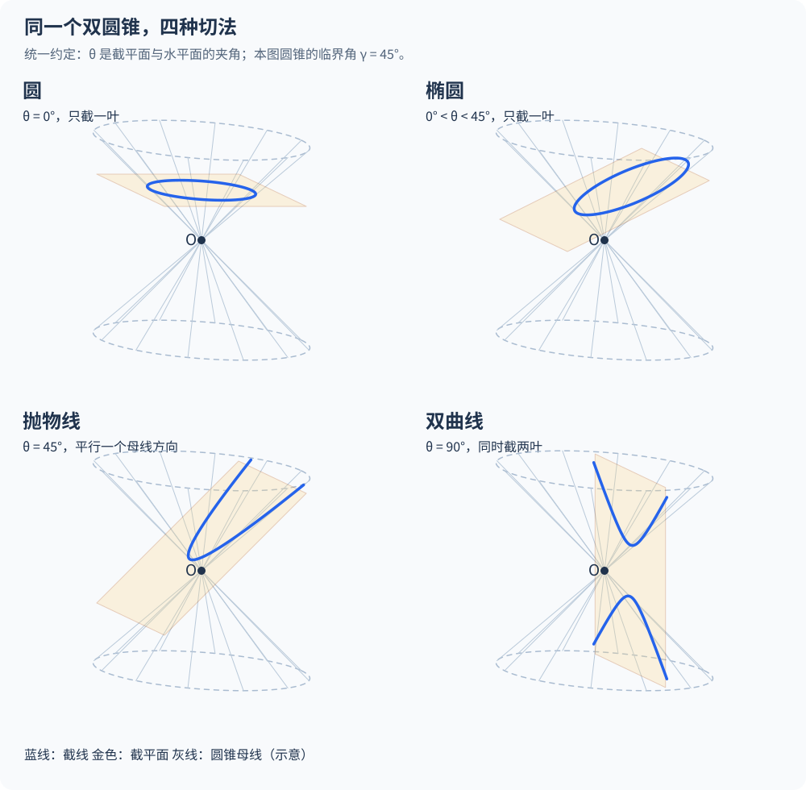
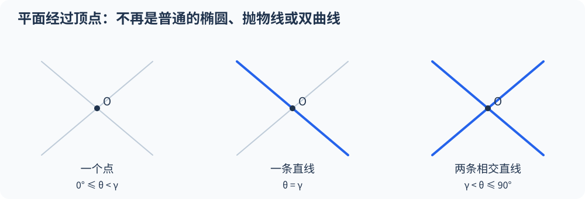
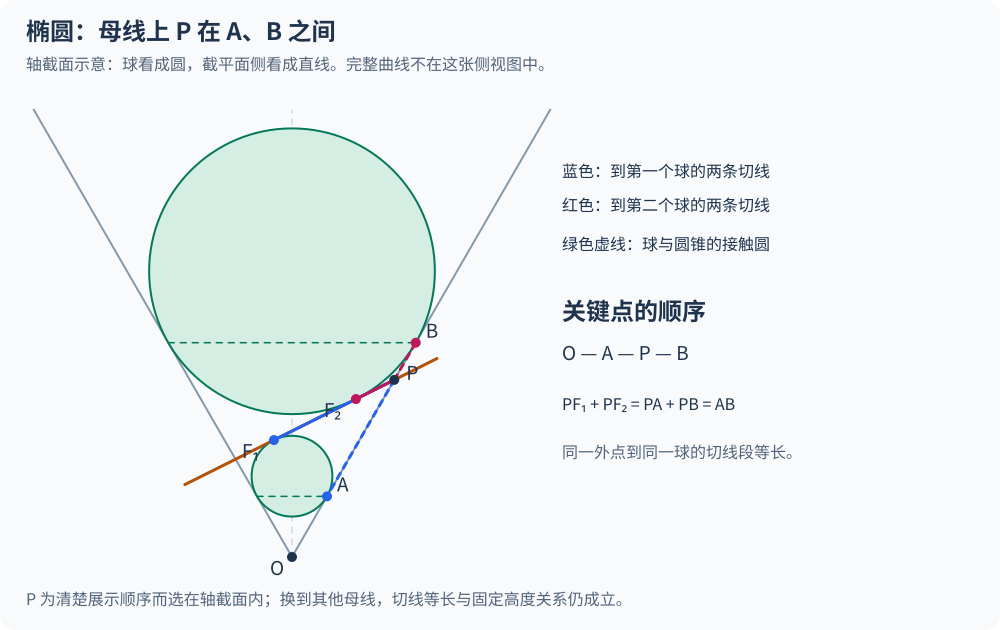
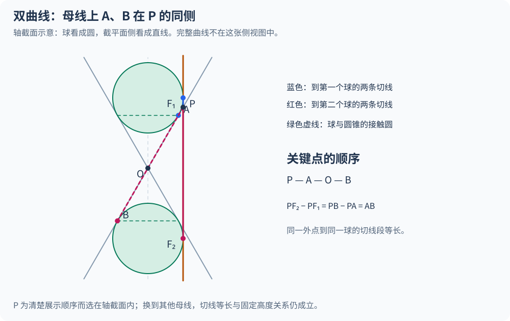
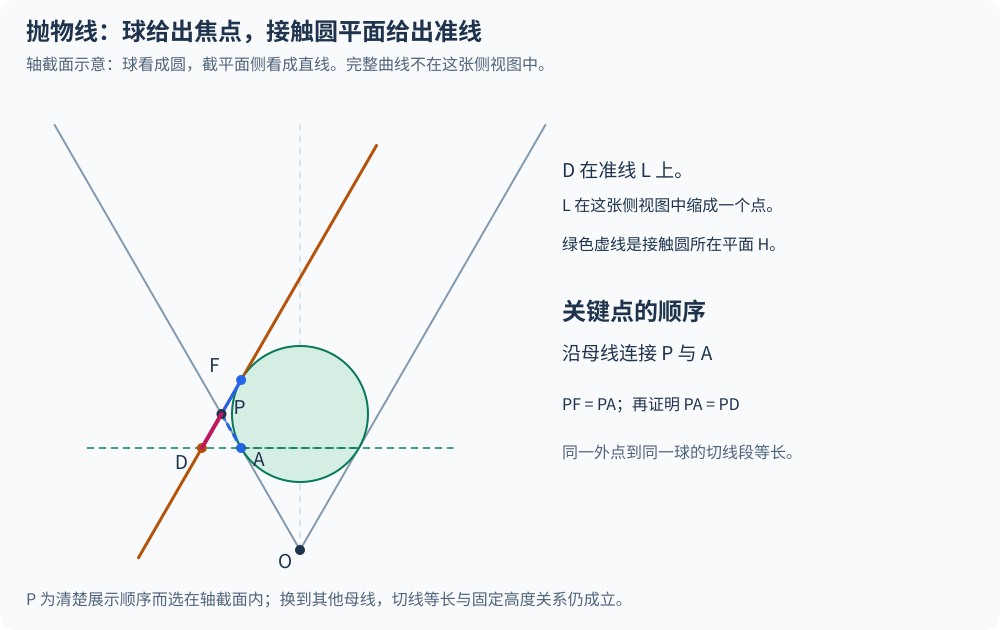
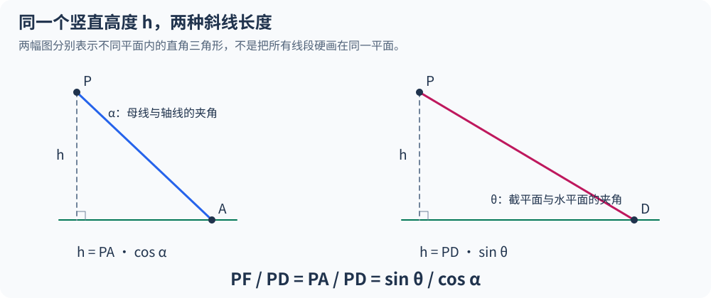
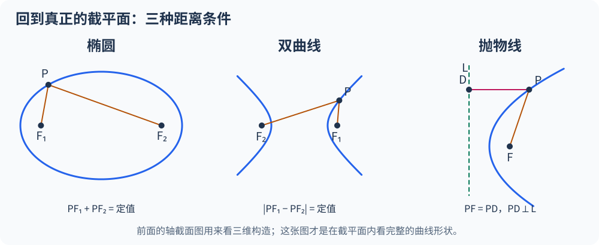

拿一张平整的薄片去切圆锥，为什么水平切下去是一个正圆，稍微斜一点就拉成封闭的椭圆，再斜到一个微妙的临界角度突然豁开缺口变成抛物线，继续立起来竟会一分为二、变成遥遥相对的两支双曲线？

更让人拍案称奇的是：明明只是三维空间里干净利落的一刀，切出来的平面曲线却自带严苛得像暗号一样的“距离家规”——

- **椭圆**上的每一点，到平面内两个定点（焦点）的距离之和恒定不变；
- **双曲线**上的每一点，到两个定点的距离之差的绝对值恒定不变；
- **抛物线**上的每一点，到一个定点与到一条定直线（准线）的距离分毫不差地相等。

学解析几何时，很多同学都忍不住犯嘀咕：**这三条奇特的距离规则，到底是数学家为了列方程硬塞进课本的人为规定，还是拿刀切圆锥的那一瞬间就已经自动锁死在几何空间里了？**

答案是后者！早在公元前 200 年左右，古希腊几何学家阿波罗尼奥斯（Apollonius of Perga）就在巨著《圆锥曲线论》里用纯几何方法证明了这些性质，但古希腊的面积折算步骤相当繁复；直到两千年后的 **1822 年**，比利时数学家兼工程师**热尔米纳尔·皮埃尔·丹德林（Germinal Pierre Dandelin）**想出了一个神来之笔——往圆锥肚子里塞进一两个刚刚好贴壁的圆球（**丹德林球**），原本苦思冥想的距离奥秘，竟然只需要初中几何的“切线等长”和两个直角三角形，就能在几分钟内一眼看穿！

今天这篇文章完全不靠死算坐标方程。我们先在脑海里搭起准确的双圆锥空间模型，再一步步推演丹德林球怎样变出焦点与准线，用离心率把三大家族收进同一个公式，最后再去看看医院碎石机、汽车大灯和哈勃太空望远镜怎样借用这套两千年前的曲线聚焦光线。

---

## 一、先把模型说准确：我们切的不是实心冰激凌筒

动手切圆锥之前，如果空间模型在脑海里差了一毫厘，后面讨论双曲线和退化情形时就会处处卡壳。我们先用最严格的几何语言，把“被切的对象”立稳。

### 1. 顶点、轴线与母线：怎样转出一张无限延伸的双圆锥面？

想象空间里有一条竖直固定的直线，再取另一条与它相交于点 $$O$$ 的斜直线（既不与竖直轴重合，也不与它垂直）。让这条斜直线绕着竖直直线旋转整整一圈，它在空间里扫出来的曲面，就叫**正圆双圆锥面（right circular double cone）**。

请认准这张曲面上的三个核心角色：

1. **顶点 $$O$$**：旋转斜直线与固定轴线的唯一交点，它把曲面上下一分为二；
2. **轴线**：整张圆锥面的旋转对称中心线；
3. **母线（generator）**：圆锥面上任意一条穿过顶点 $$O$$ 的直线。注意，数学上的直线没有尽头——顺着任意一条母线往上走，它在上方围出一个开口朝上的漏斗；穿过顶点 $$O$$ 继续往下延伸，它又在下方围出一个倒扣的对称漏斗。

这两个漏斗分别叫圆锥的**上叶**和**下叶**（two nappes）。这里有两个最容易踩空的直觉陷阱，必须先扫清：

- **我们切的是“无限薄的空心曲面”，不是装满奶油的实心冰激凌蛋筒！** 平面去切实心圆锥体，得到的是涂满颜色的一整块“平面区域”；平面去切空心圆锥面，交集才是一条一维的**曲线**。
- **母线向两端无限延伸，没有封底！** 手工课折出来的纸圆锥总有一个圆形底面，而且只有单边一叶；但如果不保留上下完整的双圆锥面，你永远无法解释为什么一刀下去，双曲线会天然长出彼此分离、遥相呼应的**两支**。

### 2. 圆锥曲线到底算三种、四种还是五种？先把“过不过顶点”分清楚

很多科普问答会问“平面切圆锥能切出哪五种曲线”，却只列出圆、椭圆、抛物线、双曲线四个名字，把初学者弄得一头雾水。在现代几何学中，最清晰、最不打架的分法是按**截平面是否穿过顶点 $$O$$** 切成两半来记账：

- **第一组：非退化圆锥曲线（截平面不过顶点 $$O$$）**——统共**三大类**：**椭圆、抛物线、双曲线**。其中，**圆**并不是独立于椭圆之外的第四大家族，而是椭圆在两个焦点合二为一时的**零离心率特例**；如果日常教学把圆单独拎出来点名，就会听到“四种常见截线”的说法。
- **第二组：退化圆锥曲线（截平面恰好穿过顶点 $$O$$）**——此时弯曲的圆弧或开口曲线瞬间消失，只剩下**一个点、一条直线、或两条相交直线**三种退化形态。

为了不被例外情形打断主线，我们在第二、三章先约定**截平面不经过顶点 $$O$$**，专心看清非退化曲线怎样变形；到第四章再单独回来看穿过顶点那一刀会发生什么。

---

## 二、角度标尺一定要统一，否则椭圆和双曲线会彻底判反

读不同教材或网文时，最让人抓狂的莫过于：甲书说“平面倾角**小于**母线角时是椭圆”，乙书却信誓旦旦写着“平面夹角**大于**母线角时才是椭圆”！难道有一本书印错了吗？

并没有印错，而是作者偷懒没说清**“跟谁量的夹角”**——一个量的是与**水平面**的夹角，另一个量的是与**竖直轴线**的夹角！

### 1. 水平倾角 $$\theta$$：以水平桌面作基准的四档判据

为了在脑海里拥有最直观的“端平与立起”手感，我们先把圆锥轴线竖直立在桌面上，统一定义三个毫不歧义的角度：

$$
\alpha = \text{母线与竖直轴线的锐角（圆锥半顶角）},
$$

$$
\gamma = 90^\circ - \alpha = \text{母线与水平面的夹角（母线坡度角）},
$$

$$
\theta = \text{截平面与水平面的夹角},\qquad 0^\circ \leq \theta \leq 90^\circ.
$$

一旦选定了一个圆锥，半顶角 $$\alpha$$ 和母线水平坡度角 $$\gamma$$ 就彻底固定了；你手里那把“平面刀”端得越平，$$\theta$$ 就越接近 $$0^\circ$$；立得越陡，$$\theta$$ 就越接近 $$90^\circ$$。对照 $$\theta$$ 与临界坡度 $$\gamma$$ 的大小，四种非退化截线一锤定音：

| 截平面的水平倾角 $$\theta$$ | 与竖直轴线夹角 $$\beta = 90^\circ - \theta$$ | 切出的非退化曲线 | 是否同时切到上下两叶 |
|---|---|---|---|
| $$\theta = 0^\circ$$ | $$\beta = 90^\circ$$ | **圆** | 否（水平横切单叶） |
| $$0^\circ < \theta < \gamma$$ | $$\alpha < \beta < 90^\circ$$ | **非圆椭圆** | 否（斜切单叶封闭） |
| $$\theta = \gamma$$ | $$\beta = \alpha$$ | **抛物线** | 否（平行单条母线敞开） |
| $$\gamma < \theta \leq 90^\circ$$ | $$0^\circ \leq \beta < \alpha$$ | **双曲线** | **是**（上下两叶各出一支） |

_图 1：统一用“截平面与水平面的夹角 $$\theta$$”判断四类截线。本图取圆锥半顶角 $$\alpha = 45^\circ$$（即临界水平倾角 $$\gamma = 45^\circ$$）；灰线母线和敞开曲线均只画出有限局部，图中的上下圆口并非圆锥的真实封底。_

### 2. 轴线夹角 $$\beta$$：为什么两套常见教材的不等号正好相反？

很多大学立体几何与射影几何教材不喜欢引入水平面，只保留圆锥自身的对称轴，直接定义**截平面与竖直轴线的夹角 $$\beta$$**（$$0^\circ \leq \beta \leq 90^\circ$$）。

看看直角余角关系：既然轴线垂直于水平面，那么截平面越接近水平（$$\theta$$ 越小），它跟竖直轴线就越接近垂直（$$\beta = 90^\circ - \theta$$ 反而**越大**）！

不妨代一组具体数字感受一下：假设手头有一个瘦高的圆锥，母线与竖直轴夹角 $$\alpha = 30^\circ$$，那么母线与水平面的坡度角就是 $$\gamma = 90^\circ - 30^\circ = 60^\circ$$：

- 当你拿一把倾角 $$\theta = 20^\circ$$ 的缓坡平面去切时，按水平标尺是 $$\theta = 20^\circ < 60^\circ = \gamma$$；换算成轴线夹角则是 $$\beta = 90^\circ - 20^\circ = 70^\circ > 30^\circ = \alpha$$——两句话描述的是**完完全全同一个椭圆截面**！
- 当你把平面立陡到 $$\theta = 80^\circ$$ 时，按水平标尺是 $$\theta = 80^\circ > 60^\circ = \gamma$$；换算成轴线夹角则是 $$\beta = 90^\circ - 80^\circ = 10^\circ < 30^\circ = \alpha$$——两句话描述的都是**双曲线**！

记住这条防坑铁律：**“平面越立越陡”，意味着水平倾角 $$\theta$$ 变大，同时意味着轴线夹角 $$\beta$$ 变小。** 后面第九章推导离心率公式时，我们会看到 $$\sin\theta$$ 与 $$\cos\beta$$ 正好相等，两套语言会在同一个分式里握手言和。

---

## 三、从闭合到敞开：四种非退化截线怎样一步步变形？

盯住图 1，我们把截平面从完全水平（$$\theta = 0^\circ$$）慢慢往上扳陡，用“经过轴线的正侧视图”来追踪交线是怎样从封闭圆环一步步被扯开成两支的。

### 1. 圆（$$\theta = 0^\circ$$）与椭圆（$$0^\circ < \theta < \gamma$$）：同一叶内两侧收口

先让截平面保持严格水平（$$\theta = 0^\circ$$），且避开顶点 $$O$$，比如切在上方距离顶点高度为 $$z_0$$ 的位置。由于整个正圆锥面绕竖直轴旋转不变，同一高度 $$z_0$$ 上所有圆锥点到轴线的水平距离全都等于 $$z_0 \tan\alpha$$。旋转对称性被原封不动继承下来，交线必然是一个以轴线交点为圆心、半径 $$R = z_0 \tan\alpha$$ 的**正圆**。上下平移水平面，圆的半径随之缩放，形状始终是圆。

现在把平面轻轻抬起一角，使 $$0^\circ < \theta < \gamma$$。我们站到侧面，沿着包含竖直轴线、且正对截平面最陡上坡方向的竖直切面看过去：

- 圆锥上叶在侧视图里呈现为一个开口朝上的“$$\mathrm{V}$$”字形两条斜边，坡度角都是 $$\gamma$$；
- 截平面在侧视图里退化成一条坡度角为 $$\theta$$ 的斜直线。
- 因为 $$\theta < \gamma$$，这条斜线比“$$\mathrm{V}$$”字的两条边都更平缓——它从左边斜穿进上叶内部，往上爬得没有右侧母线快，所以**必定会在同一叶的右侧母线上再次穿出圆锥**！

把视线拉回三维空间，无论沿截平面往哪个方向走，交线都被上叶稳稳兜住、处处收口，围成一圈一头略宽？——慢着！很多初学者凭直觉瞎猜：“圆锥上面宽、下面窄，斜切出来的椭圆是不是高处那头胖、低处靠近顶点那头尖，像颗鸡蛋一样？”

**这是一个流传极广的视觉错觉！** 稍后丹德林球的严格证明会直接告诉你：斜切正圆锥得到的椭圆，关于长轴中点**严格前后对称、左右对称**，高处那头和低处那头的弯曲程度分毫不差！之所以有人觉得像鸡蛋，是因为把“截线距离顶点的远近”误当成了“对称轴两侧的不对称”。

### 2. 抛物线（$$\theta = \gamma$$）：平行母线的临界敞开，为什么没有渐近线？

继续扳陡截平面，直到它的水平倾角不偏不倚撞上母线坡度：

$$
\theta = \gamma.
$$

再看刚才那张“$$\mathrm{V}$$”字侧视图：截平面化作的斜线，如今与上叶**右侧母线严格平行**！它在左侧母线穿入圆锥后，往右上方向永远追不上平行的右侧母线，再也没法在有限远处收口闭合；与此同时，由于平行直线永不相交，它也绝不会越过顶点去触碰下叶。交线向着一个方向无限敞开，这就是**抛物线**。

这里同样要纠正一个极其常见的画图误区：**抛物线的两条远端并不是越走越接近两条平行直线，更没有渐近线！**

我们可以用最简单的尺度关系看穿它：若顺着平行于母线的对称轴往远方走出距离 $$u$$，圆锥在该高度处的横截面圆半径随高度线性增大（正比于 $$u$$），而截平面离圆锥边缘的深度固定，由勾股弦长关系可知抛物线的横向开口半宽正比于 $$\sqrt{u}$$。当 $$u \to \infty$$ 时：

- 开口宽度 $$2\sqrt{pu} \to \infty$$，说明两条臂之间的距离无限张开，绝不会收敛成固定宽度的两条平行线；
- 切线斜率虽越远越平缓，但曲线到任何固定斜直线的距离都会发散到无穷大，因此**抛物线没有任何直线渐近线**。

### 3. 双曲线（$$\theta > \gamma$$）：同时切入上下两叶，倾角管形状、平移管大小

再把平面往竖直方向推一把，跨过临界角进入 $$\gamma < \theta \leq 90^\circ$$。

此时截平面比圆锥母线还要陡！在侧视图里，这条陡峭的斜线不仅切穿了上叶的一侧，往反方向延伸出去后，还无可避免地**一头扎进了顶点下方的另一叶**！上叶贡献一支朝上敞开的曲线，下叶贡献一支朝下敞开的曲线，两支合在一起才是一条完整的**双曲线**。

最直观的例子莫过于墙边的圆柱形台灯罩（光束从灯泡向上下打出双圆锥）：不经过灯泡中心的**竖直墙面**（$$\theta = 90^\circ > \gamma$$）同时截到上下两团光锥，墙上立刻浮现出上下对称的两支柔和光弧——那就是你卧室里现成的双曲线！

观察完整轮变形，还能顺手抓到一条漂亮的缩放定律：圆锥面关于顶点 $$O$$ 具有天然的**位似缩放对称性**（把圆锥上每一点到 $$O$$ 的距离放大 $$k$$ 倍，图形仍在同一个圆锥面上）。因此，只要保持截平面的法向量方向（即倾角 $$\theta$$）不变，仅仅把截平面平行推远或拉近（不经过 $$O$$），切出来的曲线只是按比例放大或缩小，**弯曲胖瘦的“形状”（即后面要讲的离心率）丝毫不变**！一句话总结：

> **对于固定圆锥，“切得多陡（$$\theta$$）”决定曲线长什么形状；“离顶点多远”只决定把这张图放大多少倍。**

---

## 四、如果这一刀恰好经过顶点 $$O$$：三种退化截线

前面我们特意绕开了顶点 $$O$$。现在把这层限制揭开：假如持刀手一偏，截平面不偏不倚穿过了圆锥顶点 $$O$$，刚才那四类优美的弯曲曲线会变成什么样？

### 1. 为什么一旦过顶点，弯曲线就瞬间“拉直”或缩成一点？

只用两句话就能完成严格推理：

1. 既然截平面已经包含顶点 $$O$$，倘若圆锥面上还有**哪怕一个异于 $$O$$ 的点 $$P$$** 也落在这张截平面内，那么连接两点 $$O$$ 与 $$P$$ 的**整条直线 $$OP$$** 就必然完整躺在截平面里（平面的基本公理：两点在平面内，则连线全在平面内）；
2. 可连接圆锥顶点 $$O$$ 与圆锥面上点 $$P$$ 的直线 $$OP$$，按定义恰恰就是圆锥的一条**母线**，它也完整躺在圆锥面上！

这就意味着：**过顶点的平面与圆锥面的交集，除了顶点 $$O$$ 本身之外，只能由一整条或几整条笔直的母线拼成，绝对不可能再出现任何弯曲的圆弧！** 按倾角 $$\theta$$ 对号入座，刚好对应三种退化图形：

| 过顶点截平面的水平倾角 $$\theta$$ | 空间相交状态 | 几何交集（退化圆锥曲线） |
|---|---|---|
| $$0^\circ \leq \theta < \gamma$$ | 平面比所有母线都平缓，卡在上下两叶之间的空隙里 | **唯一一个点**（仅顶点 $$O$$） |
| $$\theta = \gamma$$ | 平面刚好贴住上下贯通的一条母线（与圆锥面相切） | **一条直线**（代数重数计作“二重直线”） |
| $$\gamma < \theta \leq 90^\circ$$ | 平面比母线更陡，直接劈进圆锥内部 | **两条相交于 $$O$$ 的直线**（两条母线） |

_图 2：截平面经过顶点 $$O$$ 时的实际几何点集。左图只碰到顶点 $$O$$；中图沿单条母线与圆锥相切；右图劈开圆锥得到两条相交母线。_

### 2. 从空间退化看代数方程：为什么相交直线也是二次曲线的亲戚？

平时在代数课上看到方程 $$x^2 - y^2 = 0$$（即 $$(x - y)(x + y) = 0$$，代表两条相交直线）或者 $$x^2 + y^2 = 0$$（仅代表原点 $$(0,0)$$）也被归入“二元二次方程曲线”时，常觉得像硬凑数。放到双圆锥空间里一看，前因后果瞬间通透：

- 拿一族平行的缓坡平面（$$0^\circ \leq \theta < \gamma$$）切上叶，原本切出一圈圈椭圆 $$\frac{x^2}{a^2} + \frac{y^2}{b^2} = k^2$$；当你把平面慢慢推向顶点 $$O$$（$$k \to 0$$），椭圆越缩越小，穿过 $$O$$ 的一刹那就缩成了单点 $$\frac{x^2}{a^2} + \frac{y^2}{b^2} = 0$$！
- 拿一族竖直平面（$$\theta = 90^\circ > \gamma$$）向轴线平移推进，原本切出上下两支双曲线 $$\frac{z^2}{a^2} - \frac{x^2}{b^2} = k^2$$；随着平面逼近顶点 $$O$$（$$k \to 0$$），双曲线上下两支的尖顶越靠越近，穿过轴线的一瞬间两支尖顶撞在 $$O$$ 点合并拉直，刚好退化成那两条交叉的母线 $$\frac{z^2}{a^2} - \frac{x^2}{b^2} = 0$$——而把这张母线图平移回原平面看，正是双曲线永不相交却无限贴近的**两条渐近线**！

---

## 五、从空间切割走到焦点：1822 年丹德林塞进圆锥里的球

搞清了截线的开合与退化，整篇文章最核心的悬念登场了：**圆锥面上既没有钉图钉，也没有画准线，截平面切出来的曲线凭什么会自动生出“焦点”？**

让我们复刻丹德林在 1822 年的绝妙构造。

### 1. 丹德林球怎样放进去？用轴截面角平分线确认球的存在性

对于任意一个**不经过顶点 $$O$$** 的非退化截平面，我们往圆锥腔体里塞入一个球，要求这个球同时做到两件事：

1. **与圆锥侧面内切**：由于球心放在圆锥对称轴上，球与圆锥都绕轴线旋转对称，因此它们相贴的痕迹必然是一整圈**水平的接触圆（tangent circle）**，接触圆所在的平面严格垂直于圆锥轴线；
2. **与截平面相切**：一个球与一张平面相切，有且仅有**唯一一个切点**。

满足这两条要求的球就叫**丹德林球（Dandelin sphere）**。而整套证明最石破天惊的剧透就是：**丹德林球与截平面的那个切点，分毫不差就是圆锥曲线的焦点！**

严谨的读者一定会先问一句：“慢着！你凭什么保证圆锥里一定能塞进这样一个既贴圆锥壁、又刚好贴住斜截面的球？万一卡不住或者漏过去怎么办？”

别急，我们切到包含圆锥轴线、且垂直于截平面水平走向的**正轴截面（二维平面）**里验证一下：

- 在这张二维侧视图里，圆锥的一叶退化成两条相交于 $$O$$ 的母线直线 $$l_1, l_2$$，截平面退化成一条不经过 $$O$$ 的直线 $$m$$；
- 对于椭圆截面（$$0^\circ < \theta < \gamma$$），直线 $$m$$ 与 $$l_1, l_2$$ 围成一个封闭的三角形 $$\triangle OUV$$！初中几何早就证过：任何三角形内部都有唯一一个**内切圆**（圆心在顶角 $$\angle UOV$$ 平分线——即圆锥轴线——与底角平分线的交点），三角形外侧夹在 $$l_1, l_2$$ 延长线之间还有唯一一个**旁切圆**（圆心同样在轴线与外角平分线的交点）！
- 把侧视图里这一小一大两个圆绕着圆锥轴线旋转一圈：因为轴线到 $$l_1, l_2$$ 对称，旋转出来的两个球天然紧贴整个圆锥面；又因为截平面垂直于侧视图，侧视图里圆与直线 $$m$$ 相切，就保证了三维球面与整个截平面恰好相切于一点！
- 同理，双曲线截面（$$\theta > \gamma$$）可以在上叶和下叶各作出一个与 $$l_1, l_2, m$$ 相切的圆，还原成上下两叶里的两个丹德林球；抛物线截面（$$\theta = \gamma$$）中 $$m$$ 平行于一条母线，利用角平分线与平行线交点同样能唯一确定一个相切圆，还原成唯一一个丹德林球。

存在性板上钉钉，一处漏洞都没有！

### 2. 唯一需要的预备定理：球外一点切线段等长（$$\mathrm{HL}$$ 直角三角形全等）

丹德林球之所以能四两拨千斤，是因为全篇推导只需要用到立体几何里一条极其朴素的定理：

> **球面切线等长定理**：从球外任意一点 $$P$$ 向**同一个球**引出任意两条切线，设两个切点分别为 $$T_1$$ 和 $$T_2$$，则两条切线段的长度严格相等：$$PT_1 = PT_2$$。

很多教材把孤立球体的球心记作 $$O$$（证 $$\mathrm{Rt}\triangle POT_1 \cong \mathrm{Rt}\triangle POT_2$$）；为了不与前文圆锥顶点 $$O$$ 重名，我们把球心记作 $$S$$（半径记作 $$r$$），分三小步把这个定理证得明明白白：

1. **找直角**：过点 $$P$$、球心 $$S$$ 和切点 $$T_1$$ 作一张平面，它把球切成过球心的大圆。因为直线 $$PT_1$$ 与球相切于 $$T_1$$，它在切平面内必然垂直于过切点的球半径 $$ST_1$$，即 $$\angle PT_1S = 90^\circ$$。同理，在平面 $$PST_2$$ 内也有 $$\angle PT_2S = 90^\circ$$。
2. **比条件**：把两个直角三角形 $$\mathrm{Rt}\triangle PST_1$$ 和 $$\mathrm{Rt}\triangle PST_2$$ 拎出来对比（即便它们不在同一个平面内，欧氏空间中的全等判定依然完全适用）：
   - 斜边公共：$$PS = PS$$；
   - 直角边同为同一个球的半径：$$ST_1 = ST_2 = r$$。
3. **得全等**：由直角三角形“**斜边、直角边（$$\mathrm{HL}$$）**”全等判定定理，$$\mathrm{Rt}\triangle PST_1 \cong \mathrm{Rt}\triangle PST_2$$（若独立看球、球心写作 $$O$$，便是大家熟悉的 $$\mathrm{Rt}\triangle POT_1 \cong \mathrm{Rt}\triangle POT_2$$）！对应直角边自然相等，也可以顺手用勾股定理一行写穿：

$$
PT_1 = \sqrt{PS^2 - ST_1^2} = \sqrt{PS^2 - r^2} = \sqrt{PS^2 - ST_2^2} = PT_2.
$$

请一定在心里给“**同一个球**”四个字画上粗红线！不同大小的丹德林球半径 $$r_1 \neq r_2$$、球心位置也不同，绝不能把甲球的切线拿去等于乙球的切线。

这条定理在丹德林证明里扮演的是**“空间折尺转换器”**：它能把原本躺在斜截平面里、随动点 $$P$$ 忽长忽短的焦点距离 $$PF$$，原封不动翻折成**圆锥母线上的一段笔直长度**！

---

## 六、椭圆：为什么两个焦点距离相加恰好等于常数？

现在正式进入全场高潮。对于椭圆截面（$$0^\circ < \theta < \gamma$$），按第五章的构造，我们在圆锥**同一叶**里放入上下两个丹德林球：小一点的球卡在截平面与顶点 $$O$$ 之间，大一点的球托在截平面另一侧。

设两个球与截平面的切点分别为 $$F_1$$ 和 $$F_2$$；两个球与圆锥侧面的水平接触圆分别为 $$C_1$$ 和 $$C_2$$。我们在截出来的椭圆曲线上**随便挑一个点 $$P$$**（注意：是三维截线上任意一点，不局限于对称轴端点！），连接圆锥顶点 $$O$$ 与 $$P$$ 画出穿过 $$P$$ 的那条母线。这条母线紧贴圆锥外壁一路向上走，必然先后穿过第一圈接触圆 $$C_1$$ 上的某点 $$A$$、椭圆上的点 $$P$$、以及第二圈接触圆 $$C_2$$ 上的某点 $$B$$（不少几何书也把母线上的这两个接触点记作 $$G_1, G_2$$）。

顺着母线从顶点 $$O$$ 往外数，四个点的排列次序铁板钉钉是：

$$
O \longrightarrow A \longrightarrow P \longrightarrow B.
$$

_图 3：为看清两个球、斜截平面和母线上点序 $$O - A - P - B$$，这里画出轴截面，球显示为圆，截平面侧看成一条斜直线。图中特意把 $$P$$ 标在轴截面边缘以便展示共线次序；正文的三步推理对完整椭圆上的任意一点 $$P$$ 普遍成立，切勿把侧视图里的斜线段误当成椭圆本身。_

现在，跟着下面严丝合缝的三步，亲眼见证 $$PF_1 + PF_2$$ 是怎样变成常数的：

### 1. 第一步（同球切线换算）：把平面内的 $$PF_1, PF_2$$ 翻折到母线上

先盯住第一个丹德林球（图 3 蓝色标注）：

- 点 $$P$$ 躺在截平面上，而截平面与第一个球相切于点 $$F_1$$，所以过切点 $$F_1$$ 的平面直线 $$PF_1$$ 是从球外点 $$P$$ 引向第一个球的**第一条切线段**；
- 点 $$P$$ 同时躺在圆锥母线上，整条母线紧贴圆锥面，在接触圆 $$C_1$$ 的点 $$A$$（即 $$G_1$$）处与第一个球相切，所以母线段 $$PA$$ 是从同一个点 $$P$$ 引向**同一个球**的**第二条切线段**！

调用第五章刚证好的球面切线等长定理，立刻拿到第一把等号锁：

$$
PF_1 = PA \quad (\text{若记母线切点为 } G_1 \text{，即 } PF_1 = PG_1).
$$

再把目光移到第二个丹德林球（图 3 红色标注），完全相同的逻辑再来一遍：平面内的 $$PF_2$$ 与母线上的 $$PB$$（即 $$PG_2$$）都是从点 $$P$$ 引向**第二个球**的切线段，于是拿到第二把等号锁：

$$
PF_2 = PB \quad (\text{即 } PF_2 = PG_2).
$$

把两式左右相加，斜平面里看似复杂的两段折线和，瞬间转移到了同一条笔直的圆锥母线上：

$$
PF_1 + PF_2 = PA + PB \quad (= PG_1 + PG_2).
$$

### 2. 第二步（共线点序拼接）：为什么 $$P$$ 夹在中间就能合二为一？

为什么刚才我们要反复强调母线上的点序是 $$O - A - P - B$$？

因为整张椭圆截平面都横亘在第一圈水平接触圆 $$C_1$$ 和第二圈水平接触圆 $$C_2$$ **之间**！无论点 $$P$$ 在椭圆上跑到哪个角落，穿过 $$P$$ 的母线在圆锥同一叶上总是先经过 $$C_1$$ 上的点 $$A$$，再穿过截平面上的点 $$P$$，最后到达 $$C_2$$ 上的点 $$B$$。

既然点 $$P$$ 在同一直线上严格位于线段 $$AB$$ 内部，两段小线段首尾相接，严丝合缝拼成一整段母线截距：

$$
PA + PB = AB \quad (\text{即 } PG_1 + PG_2 = G_1G_2).
$$

代回上一步，得到：

$$
PF_1 + PF_2 = AB.
$$

### 3. 第三步（母线定长锁定）：动点 $$P$$ 绕椭圆跑一圈，为什么 $$AB$$ 寸步不改？

到了这里，千万别停笔！严谨的读者还会追问最后一句：“当点 $$P$$ 绕着椭圆走动时，穿过 $$P$$ 的母线也在绕着圆锥转圈，切点 $$A$$ 和 $$B$$ 分别在上下两个接触圆上跟着跑——变成新位置的 $$A'B'$$ 之后，你怎么知道 $$A'B'$$ 和刚才的 $$AB$$ 一样长呢？”

这正是正圆锥旋转对称性发威的地方：

1. 第一圈接触圆 $$C_1$$ 躺在一张固定的水平面 $$H_1$$ 内，第二圈接触圆 $$C_2$$ 躺在另一张固定的水平面 $$H_2$$ 内。两张平行水平面之间的**竖直高度差 $$h_0$$** 是一个与母线方位完全无关的定值！
2. 圆锥面上的**每一条母线**，与竖直轴线的夹角全都等于同一个半顶角 $$\alpha$$。
3. 在以母线段 $$AB$$ 为斜边、竖直高度差 $$h_0$$ 为邻边的直角三角形里，永远有 $$AB \cos\alpha = h_0$$，即：

$$
\boxed{PF_1 + PF_2 = AB = G_1G_2 = \frac{h_0}{\cos\alpha} = \text{常数（记作 } 2a\text{）}.}
$$

右边的 $$h_0$$ 和 $$\cos\alpha$$ 里半个 $$P$$ 的影子都没有！这就铁证如山地说明：**椭圆截线上所有点到两个切点 $$F_1, F_2$$ 的距离之和，恒等于两接触圆之间的母线定长 $$2a$$！**（顺便一提：因为 $$F_1, F_2$$ 是平面上的两个不同点，当 $$P$$ 不在直线 $$F_1F_2$$ 上时，由三角形两边之和大于第三边立得 $$2a = PF_1 + PF_2 > F_1F_2$$；而在长轴两端点处，对称性也立刻粉碎了前文“椭圆一头胖一头瘦像鸡蛋”的错觉！）

_分步回放：① 蓝色同球切线换算 $$PF_1 = PA$$；② 红色同球切线换算 $$PF_2 = PB$$；③ 利用 $$P$$ 夹在 $$A, B$$ 之间，把两段拼成固定母线段 $$AB$$。本图沿用图 3 的同一轴截面，不是球或截平面移动的动画；关闭动态效果时直接显示完整三步线索。[单独打开，刷新可重播](/assets/images/conic-sections/08-dandelin-steps.svg)。_

如果你在三维脑补时偶尔眼花，只需盯住图里的红蓝双色：**蓝色只跟蓝色比（同属一号球），红色只跟红色比（同属二号球）**，最后在母线上首尾一拼，证明就结束了（可对照 [Wolfram MathWorld 的丹德林球条目](https://mathworld.wolfram.com/DandelinSpheres.html)核查这一经典路线）。至于水平横切（$$\theta = 0^\circ$$）的正圆情形，上下两个球与水平截面的切点在轴心处合二为一（$$F_1 = F_2 = F$$），$$PF_1 + PF_2 = 2a$$ 自然退化成 $$2PF = 2a \implies PF = a$$，圆作为椭圆家族的特例无缝归位。

---

## 七、双曲线：为什么同一套切线戏法把“和”变成了“差”？

看懂了椭圆的三步曲，双曲线几乎不用重新费脑筋——**工具分毫不改，仅仅因为两个球住进了不同叶，母线上的点序一翻身，加号就自动变成了减号！**

### 1. 上下两叶各放一球：母线点序 $$P - A - O - B$$ 怎样反转加减号？

当截平面立陡到 $$\theta > \gamma$$ 时，它同时劈开上叶与下叶。这次我们在**上叶**放一个与截平面相切于 $$F_1$$ 的丹德林球（接触圆为 $$C_1$$），在**下叶**放另一个与截平面相切于 $$F_2$$ 的丹德林球（接触圆为 $$C_2$$）。

先在**上叶那一支双曲线**上任取一点 $$P$$，连接 $$P$$ 与顶点 $$O$$ 作出整条无限延伸的母线。顺着这条直线从上往下数，依次穿过的点变成了（图 4）：

$$
P \longrightarrow A \longrightarrow O \longrightarrow B.
$$

_图 4：双曲线的两个丹德林球分居上下两叶。图中在上叶一支选取点 $$P$$，母线穿过顶点 $$O$$ 一直延伸到下叶接触圆切点 $$B$$；由于 $$A, B$$ 落在 $$P$$ 的同一侧，两段切线相减恰好消去 $$PA$$，留下定长母线段 $$AB$$。_

睁大眼睛对比图 3 和图 4 最本质的差别：**在椭圆里，$$P$$ 夹在 $$A$$ 和 $$B$$ 中间；而在双曲线里，因为截平面比母线更陡，上叶截线位于上接触圆上方（或外侧），导致两个母线切点 $$A, B$$（即 $$G_1, G_2$$）全都排在了点 $$P$$ 的同一侧！**

现在重走一遍刚才的三步曲：

1. **同球切线换算（完全不变）**：上叶一号球给出 $$PF_1 = PA$$（即 $$PG_1$$）；下叶二号球给出 $$PF_2 = PB$$（即 $$PG_2$$）。注意母线作为直线穿过顶点 $$O$$ 笔直通向下叶，$$PB$$ 依然是从球外点 $$P$$ 引向二号球的一整条切线段！
2. **共线点序相减（加号变减号！）**：沿着母线看点序 $$P - A - O - B$$，点 $$A$$ 夹在 $$P$$ 与 $$B$$ 之间，因此整段 $$PB = PA + AB$$！移项相减，多出来的 $$PA$$ 瞬间抵消：

$$
PF_2 - PF_1 = PB - PA = (PA + AB) - PA = AB \quad (= G_1G_2).
$$

3. **母线定长锁定**：上接触圆平面 $$H_1$$（过 $$O$$ 上方）与下接触圆平面 $$H_2$$（过 $$O$$ 下方）之间的总竖直距离 $$h_0$$ 固定不变，每条贯通上下两叶的母线与轴线夹角仍为 $$\alpha$$，故 $$AB = AO + OB = \frac{h_0}{\cos\alpha}$$ 依然是与 $$P$$ 无关的固定常数（记作 $$2a$$）！

### 2. 换到下叶另一支与常数检验：为什么必须加绝对值 $$|PF_1 - PF_2| = 2a$$？

刚才点 $$P$$ 选在上叶一支，离上焦点 $$F_1$$ 近、离下焦点 $$F_2$$ 远，算出的是正数 $$PF_2 - PF_1 = AB = 2a$$。

如果把动点 $$P$$ 换到**下叶另一支**上呢？沿着母线从下往上数，点序立刻倒过来变成 $$P - B - O - A$$：此时点 $$P$$ 离下焦点 $$F_2$$ 更近、离上焦点 $$F_1$$ 更远，$$PA - PB = AB$$，算出的是 $$PF_1 - PF_2 = AB = 2a$$（即 $$PF_2 - PF_1 = -2a$$）！

要把上下两支双曲线大大方方写进同一个充要距离条件里，就必须加上**绝对值符号**：

$$
\boxed{\left|PF_1 - PF_2\right| = \left|PG_1 - PG_2\right| = AB = \frac{h_0}{\cos\alpha} = 2a\ (\text{常数}).}
$$

顺手用三角形不等式验一下这个常数 $$2a$$ 的大小范围：在 $$\triangle PF_1F_2$$ 中，两边之差小于第三边，所以 $$0 < 2a = |PF_1 - PF_2| < F_1F_2$$。

回头把椭圆和双曲线摆在一起，两千年来让学生死记硬背的“一加一减”，原来只是同一根母线上最朴素的排队常识：

> **动点 $$P$$ 夹在两个接触点 $$A, B$$ 中间，两段就相加（椭圆）；两个接触点 $$A, B$$ 站到动点 $$P$$ 同一侧，两段就相减（双曲线）！**

---

## 八、抛物线：只有一个丹德林球，怎样凭空带出一条准线？

椭圆有两个球给出两个焦点，双曲线也有两个球给出两个焦点。轮到临界倾角 $$\theta = \gamma = 90^\circ - \alpha$$ 的**抛物线**时，截平面只切一叶且一头敞开，同一叶里只能放进与截平面和圆锥都相切的焦点球（切点记作 $$F$$；其实另一侧还有一个与截平面背面的球，但它的切点在抛物线外部，这里只取包在抛物线弯口内的这颗丹德林球）。

只有一个焦点 $$F$$，没法凑“两焦点距离和”也没法凑“距离差”，那课本上大名鼎鼎的**准线（directrix）$$L$$** 又是从哪儿冒出来的？

### 1. 准线 $$L$$ 的真实身份：接触圆水平面 $$H$$ 与截平面的交线

请看图 5，认清空间里两张平面的相交关系：

- 丹德林球与圆锥侧面相切的那一圈接触圆，躺在一张固定的**水平平面 $$H$$** 内；
- 我们的抛物线躺在倾斜角为 $$\theta = \gamma > 0^\circ$$ 的**截平面**内；
- 两张不平行的平面在空间里相交，必定交出一条笔直的**交线 $$L = H \cap \text{截平面}$$**！

**这条水平面 $$H$$ 与斜截平面的交线 $$L$$，就是抛物线真正的准线！** 千万别把准线误当成球的接触圆本身（接触圆是弯的圆，准线是截平面内的直线），也别误以为准线是焦点 $$F$$ 往水平面投下的影子。因为 $$H$$ 是水平面，交线 $$L$$ 本身是一条躺在斜截平面里的**水平直线**（所以在图 5 的正侧视图里，垂直于纸面的直线 $$L$$ 刚好缩成了一个点 $$D$$）。

_图 5：球与截平面切于焦点 $$F$$；绿色虚线为接触圆所在的水平平面 $$H$$，它与截平面的交线就是准线 $$L$$（垂直于侧视图纸面，故投影缩成点 $$D$$）。对抛物线上一般的动点 $$P$$，它在截平面内向 $$L$$ 所作的垂足 $$D$$ 会沿整条直线 $$L$$ 移动。_

### 2. 两个直角三角形共用竖直高 $$h$$：一步步算出 $$PF = PD$$

现在在抛物线上任取一点 $$P$$，在**截平面内**过 $$P$$ 向准线 $$L$$ 作垂线，垂足记作 $$D$$（所以线段 $$PD$$ 就是点 $$P$$ 到准线 $$L$$ 的距离）。同时连接顶点 $$O$$ 与 $$P$$ 画出圆锥母线，它在接触圆上的切点记作 $$A$$。

我们要证明 $$PF = PD$$。按四小步拆解，每一步都清晰得像搭积木：

1. **第一步（切线等长）**：$$PF$$（截平面内切线）与 $$PA$$（母线上切线）都是从球外点 $$P$$ 引向这颗丹德林球的切线段，故立即有：

$$
PF = PA.
$$

   接下来只要证明母线段 $$PA$$ 等于截平面垂线段 $$PD$$，大功就告成了！
2. **第二步（向接触圆平面作垂线，架起公共高 $$h$$）**：因为母线切点 $$A$$ 躺在水平面 $$H$$ 内，准线上的垂足 $$D$$ 也躺在同一个水平面 $$H$$ 内（别忘了 $$L \subset H$$！），我们从空间点 $$P$$ 向水平面 $$H$$ 直直放下一条铅垂线，设垂足为 $$Q$$，铅垂高度记作 $$h = PQ$$。于是 $$\angle PQA = 90^\circ$$，且 $$\angle PQD = 90^\circ$$——我们在空间里搭出了**两个共用直角边 $$PQ = h$$ 的直角三角形**：$$\mathrm{Rt}\triangle PQA$$ 与 $$\mathrm{Rt}\triangle PQD$$！
3. **第三步（在第一个直角三角形 $$\mathrm{Rt}\triangle PQA$$ 中算 $$h$$）**：斜边 $$PA$$ 是圆锥母线，铅垂线 $$PQ$$ 平行于竖直圆锥轴线，因此母线 $$PA$$ 与铅垂线 $$PQ$$ 的夹角就是圆锥半顶角 $$\alpha$$（即 $$\angle QPA = \alpha$$）。由余弦定义得：

$$
h = PQ = PA \cos\alpha.
$$

4. **第四步（在第二个直角三角形 $$\mathrm{Rt}\triangle PQD$$ 中算 $$h$$）**：已知截平面内 $$PD \perp L$$，而 $$PQ \perp \text{平面 } H$$（自然也垂直于 $$H$$ 内的交线 $$L$$）。根据立体几何**三垂线定理逆定理**，平面 $$PQD$$ 垂直于棱 $$L$$，故 $$QD \perp L$$！这就说明 $$\angle PDQ$$ 正好是截平面与水平面 $$H$$ 所成二面角的**平面角**，即 $$\angle PDQ = \theta$$！（直观说：截平面内垂直于水平交线 $$L$$ 的方向，正是这个斜坡的**最大坡度方向**。）在 $$\mathrm{Rt}\triangle PQD$$ 中由正弦定义得：

$$
h = PQ = PD \sin\theta.
$$

现在迎来最美妙的一击：在抛物线的临界倾角下，$$\theta = \gamma = 90^\circ - \alpha$$，由诱导公式立得 **$$\sin\theta = \sin(90^\circ - \alpha) = \cos\alpha$$**！把两式中的公共高度 $$h$$ 连起来：

$$
PA \cos\alpha = h = PD \sin\theta = PD \cos\alpha.
$$

因为 $$0^\circ < \alpha < 90^\circ$$，$$\cos\alpha > 0$$，两边约去 $$\cos\alpha$$ 立得 $$PA = PD$$！再接回第一步的 $$PF = PA$$：

$$
\boxed{PF = PD.}
$$

没有任何坐标展开，只靠同一根铅垂线 $$h$$ 在两个直角三角形里的投影，抛物线“到焦点距离等于到准线距离”的铁律就水落石出了！

---

## 九、用两个直角三角形统一三大家族：离心率 $$e$$ 的几何真身

写完第八章的四步证明，不妨倒吸一口凉气回头看一眼：**刚才搭出来的两个直角三角形 $$\mathrm{Rt}\triangle PQA$$ 和 $$\mathrm{Rt}\triangle PQD$$，哪一步非得要求 $$\theta = 90^\circ - \alpha$$ 才能成立吗？**

前三步完全不需要！无论截平面切出的是椭圆、抛物线还是双曲线（只要 $$\theta > 0^\circ$$ 不水平、且不过顶点 $$O$$），那两块直角三角形照样稳稳立在空间里！

### 1. 向接触圆平面作垂线：四步推出离心率公式 $$e = \dfrac{\sin\theta}{\cos\alpha} = \dfrac{\cos\beta}{\cos\alpha}$$

让我们把刚才的构造直接推广到**任意非水平、非退化的圆锥截线**：任选一颗与该截平面和圆锥都相切的丹德林球，球与截平面切点记为焦点 $$F$$，球与圆锥的接触圆所在水平面记为 $$H$$，令交线 $$L = H \cap \text{截平面}$$ 为对应于焦点 $$F$$ 的**准线**。

在截线上任取一点 $$P$$，母线切球于 $$A$$，截平面内作 $$PD \perp L$$ 于 $$D$$，再过 $$P$$ 向接触圆水平面 $$H$$ 作垂线 $$PQ \perp H$$（垂足为 $$Q$$，竖直高 $$h = PQ$$）：

1. **球面切线等长**：$$PF = PA$$；
2. **母线侧直角三角形 $$\mathrm{Rt}\triangle PQA$$**：母线与铅垂线夹角为半顶角 $$\alpha$$，故 $$h = PA \cos\alpha$$；
3. **准线侧直角三角形 $$\mathrm{Rt}\triangle PQD$$**：由三垂线关系知 $$\angle PDQ$$ 为截平面与水平面夹角 $$\theta$$；若改用第二章介绍的“截平面与竖直轴线夹角 $$\beta = 90^\circ - \theta$$”，则 $$\sin\theta = \sin(90^\circ - \beta) = \cos\beta$$（即 $$\angle QPD = \beta$$），故 $$h = PD \sin\theta = PD \cos\beta$$；
4. **消去公共铅垂高 $$h$$**：令 $$PA \cos\alpha = PD \sin\theta = PD \cos\beta$$，再把 $$PA$$ 换回 $$PF$$，一步解出比值：

$$
\boxed{e = \frac{PF}{PD} = \frac{\sin\theta}{\cos\alpha} = \frac{\cos\beta}{\cos\alpha}.}
$$

_图 6：统一三大家族的核心几何图像。左图 $$\mathrm{Rt}\triangle PQA$$ 与右图 $$\mathrm{Rt}\triangle PQD$$ 一般位于两个不同的竖直平面内，但共享同一条铅垂高度边 $$PQ = h$$（当 $$P$$ 跑遍整条曲线时，$$h$$ 随位置改变，但两个角度 $$\alpha, \theta$$ 纹丝不动，故斜边之比恒定）。_

看看这个极其干净的分式：右边无论是写成水平倾角版的 **$$\dfrac{\sin\theta}{\cos\alpha}$$**，还是写成大学教材偏爱的轴线夹角版 **$$\dfrac{\cos\beta}{\cos\alpha}$$**，里面都没有半点动点 $$P$$ 的坐标！这个只由“刀切得有多斜”和“圆锥张得有多开”共同决定的无量纲常数 $$e$$，就是统领整个家族的**离心率（eccentricity）**！

既然 $$\cos\alpha = \sin(90^\circ - \alpha) = \sin\gamma$$，我们把角度大小代进去，三大曲线立刻排成整整齐齐的一队（以 $$\alpha = 30^\circ$$，即 $$\cos\alpha = \frac{\sqrt{3}}{2} \approx 0.866,\ \gamma = 60^\circ$$ 为例算几个真数看看）：

| 曲线家族 | 水平倾角 $$\theta$$ | 轴线夹角 $$\beta$$ | 离心率 $$e = \dfrac{\sin\theta}{\cos\alpha} = \dfrac{\cos\beta}{\cos\alpha}$$ | $$\alpha = 30^\circ$$ 时的具体算例 |
|---|---|---|---|---|
| **圆**（极限特例） | $$\theta = 0^\circ$$ | $$\beta = 90^\circ$$ | $$e = 0$$ | $$\theta = 0^\circ \implies e = 0$$ |
| **非圆椭圆** | $$0^\circ < \theta < \gamma$$ | $$\alpha < \beta < 90^\circ$$ | $$0 < e < 1$$ | $$\theta = 30^\circ\ (\beta = 60^\circ) \implies e = \dfrac{0.5}{\sqrt{3}/2} = \dfrac{1}{\sqrt{3}} \approx 0.577$$ |
| **抛物线** | $$\theta = \gamma$$ | $$\beta = \alpha$$ | $$e = 1$$ | $$\theta = 60^\circ\ (\beta = 30^\circ) \implies e = \dfrac{\sqrt{3}/2}{\sqrt{3}/2} = 1$$ |
| **双曲线** | $$\gamma < \theta \leq 90^\circ$$ | $$0^\circ \leq \beta < \alpha$$ | $$e > 1$$ | $$\theta = 90^\circ\ (\beta = 0^\circ) \implies e = \dfrac{1}{\sqrt{3}/2} = \dfrac{2}{\sqrt{3}} \approx 1.155$$ |

更妙的是，对于椭圆和双曲线，由于两颗丹德林球各自拥有一个接触圆平面 $$H_1, H_2$$，因此椭圆和双曲线天然拥有**对称的两条准线 $$L_1, L_2$$**，分别配对两个焦点 $$F_1, F_2$$，且两套焦点—准线算出来的比值都是同一个 $$e = \frac{\sin\theta}{\cos\alpha}$$！

### 2. 两个最容易踩空的边界：圆的 $$e = 0$$ 为什么没有有限准线？固定圆锥能切出所有双曲线吗？

手握 $$e = \dfrac{\sin\theta}{\cos\alpha}$$，两个平时连优秀学生都容易答错的刁钻问题当场迎刃而解：

1. **为什么圆的离心率 $$e = 0$$，却不能在纸上画出圆的准线？**
   当截平面渐渐放平（$$\theta \to 0^\circ$$）时，角度公式确实平滑趋向 $$e = \frac{\sin 0^\circ}{\cos\alpha} = 0$$；但请看空间里的两张平面：截平面与球接触圆平面 $$H$$ 越来越接近平行，它们的交线（准线 $$L$$）以 $$PD = \frac{PF}{e}$$ 的距离一路退向无穷远处！到了严格水平（$$\theta = 0^\circ$$）那一刻，截平面与 $$H$$ 彻底平行，欧氏平面内**根本不存在有限准线 $$L$$**。如果有人机械套用有限准线公式 $$PF = e\cdot PD$$ 硬代入 $$e = 0$$，只会算出 $$PF = 0$$（一个孤零零的圆心点），而画不出半径为 $$R$$ 的圆！只有走到射影几何（把无穷远直线看作圆的准线），这个极限才在形式上闭合。
2. **给你一个固定开口的正圆锥，能切出全世界所有胖瘦形状的双曲线吗？**
   仔细看上面算例表最后一行！因为 $$\sin\theta$$ 最大只能取到 $$1$$（即竖直切下去，$$\theta = 90^\circ,\ \beta = 0^\circ$$），所以在半顶角为 $$\alpha$$ 的固定圆锥上，你能切出来的离心率有一个铁打的天花板：

$$
e = \frac{\sin\theta}{\cos\alpha} \leq \frac{1}{\cos\alpha}.
$$

   比如在 $$\alpha = 30^\circ$$ 的瘦圆锥上，无论你怎么挥刀，顶多只能切出 $$e \leq \frac{2}{\sqrt{3}} \approx 1.155$$ 的窄开口双曲线，连最常见的**等轴双曲线**（两条渐近线互相垂直，离心率 $$e = \sqrt{2} \approx 1.414$$）都切不出来！要想切出 $$e = \sqrt{2}$$ 的等轴双曲线，圆锥本身至少得张开到 $$\cos\alpha \leq \frac{1}{\sqrt{2}}$$，即半顶角 $$\alpha \geq 45^\circ$$（顶角 $$2\alpha \geq 90^\circ$$）才行！所以，固定圆锥能切齐**全部离心率 $$0 \leq e \leq 1$$ 的圆、椭圆和抛物线**，但要集齐所有大离心率的宽开口双曲线，必须允许圆锥的张角 $$\alpha$$ 跟着放大。

---

## 十、回到纸面与动手实验：绳子、绝对值与折纸包络线

走完三维丹德林球之旅，我们重新低头看桌面上的平整白纸（图 7），课本里那三条平面轨迹定义再也不是从天上掉下来的天书了。

_图 7：前面的轴截面图用来拆解三维构造；这张图才是在截平面内直接平视完整的椭圆、双曲线与抛物线轨迹。_

顺带补上一句严谨的数学逻辑：前文丹德林球直接证明的是“**凡在圆锥截线上的点 $$P$$，必满足对应距离等式**”（必要性）；反过来，“平面内凡满足该距离等式的点，也必定全落在这条截线上、不会多出别的分支”（充分性），在 $$2a > F_1F_2$$（椭圆）、$$0 < 2a < F_1F_2$$（双曲线）及 $$F \notin L$$（抛物线）的非退化条件下同样严格成立——若平面上某点 $$Q$$ 落在截线外侧或内侧，连接圆锥顶点或沿射线交截线于 $$P$$，用三角形两边之和大于第三边即可推出矛盾。因此，空间截线与平面轨迹是百分之百等价的同一条曲线！

### 1. 园丁拉绳画椭圆与双曲线两支：从空间母线回到平面轨迹

周末在家找一块硬纸板、两枚图钉和一根无弹性的棉线，就能把空间里的母线定长 $$AB = 2a$$ 搬到桌面上：

- **两枚图钉加棉线画椭圆**：把棉线两头系在距离为 $$2c = F_1F_2$$ 的两枚图钉上（绳长 $$2a > 2c$$），用铅笔尖绷紧棉线绕一圈。笔尖走过的每一点都满足 $$PF_1 + PF_2 = \text{绳长 } 2a$$。试着把两枚图钉越钉越近（$$c \to 0$$），椭圆就越来越圆；合在同一枚图钉上时，就是正圆！
- **双曲线为什么要盯紧 $$0 < 2a < 2c$$ 和绝对值？** 在平面上给定 $$F_1, F_2$$（间距 $$2c$$），若只写 $$PF_2 - PF_1 = 2a > 0$$，画出来的只有包住 $$F_1$$ 的半边一支；必须写 $$|PF_1 - PF_2| = 2a$$ 才能同时召回左右两支。还要留心两个退化极端：若常数取成 $$2a = 0$$（即 $$PF_1 = PF_2$$），轨迹变成线段 $$F_1F_2$$ 的垂直平分线；若常数取成 $$2a = 2c$$，轨迹退化成线段 $$F_1F_2$$ 向两端无限延伸的两条射线；若 $$2a > 2c$$，平面上一个点都画不出来！

### 2. 一张纸折出抛物线切线族：为什么每一道折痕都是精准切线？

没有圆规也没关系，随便拿一张长方形A4打印纸，把底边当成**准线 $$L$$**，在纸面中间偏下点一个黑点当成**焦点 $$F$$**，就能徒手“折”出一条精准的抛物线，而且顺手证明它的切线性质！

跟着做三步：

1. 在底边准线 $$L$$ 上随便选一个点 $$D$$，把纸翻折过来，让底边上的点 $$D$$ **精准叠合到焦点 $$F$$ 上**，用指甲用力刮出一道清晰的折痕 $$m$$；
2. 展开白纸，过刚才的 $$D$$ 作底边 $$L$$ 的垂线，设它与折痕 $$m$$ 相交于点 $$P$$。因为折痕 $$m$$ 是连接线段 $$FD$$ 的**垂直平分线**，折痕上每一点到 $$F$$ 和到 $$D$$ 的距离都相等，自然有 $$PF = PD$$！又因为 $$PD \perp L$$，点 $$P$$ 百分之百落在抛物线上！
3. **为什么整条折痕 $$m$$ 恰好与抛物线相切于 $$P$$、绝不会穿进抛物线肚子？** 在折痕 $$m$$ 上任取另一个异于 $$P$$ 的点 $$Q$$（$$Q \neq P$$），设 $$Q$$ 到底边 $$L$$ 的真正垂足为 $$D'$$。因为 $$Q$$ 仍在 $$FD$$ 的垂直平分线 $$m$$ 上，故 $$QF = QD$$；可在直角三角形 $$\triangle QDD'$$ 中，斜边 $$QD$$ 严格大于直角边 $$QD'$$（垂线段最短）！串联起来就是：

$$
QF = QD > QD' = \operatorname{dist}(Q, L).
$$

   这说明：**折痕 $$m$$ 上除了点 $$P$$ 恰好满足 $$PF = PD$$ 落在抛物线上之外，其余所有点到焦点 $$F$$ 的距离都严格大于到准线 $$L$$ 的距离，统统落在抛物线外侧！** 整条直线 $$m$$ 只在唯一一点 $$P$$ 轻轻托住抛物线而不穿越它——按几何定义，折痕 $$m$$ 就是抛物线在点 $$P$$ 处的**精确切线**！

在底边 $$L$$ 上每隔半厘米换一个点 $$D_1, D_2, D_3, \dots$$，连续折上二三十道折痕，你会惊喜地看到：虽然你从头到尾只折出了一条条笔直的折痕，这群切线却像编竹篮一样，在纸中央自动包络出了一道光滑漂亮的抛物线弧！

---

## 十一、光线为什么偏爱圆锥曲线？从回音壁、碎石机到卡塞格林望远镜

如果圆锥曲线仅仅是纸面上的优美图案，它还不至于成为现代物理、医学与天文工程的宠儿。真正让工程师离不开它的原因，是刚才丹德林球与切线垂直平分线直接派生出的**三大光学反射定律**（声波、电磁波与光线在光滑曲面上同样遵循“入射角等于反射角”）。

下面我们不跳步地把椭圆、抛物线、双曲线的反射机制逐一证穿，看看它们怎样走进医院手术室、高速公路和太空轨道！

### 1. 椭圆的“点对点精准聚焦”：耳语回音廊与体外冲击波碎石机

**几何定理**：从椭圆一个焦点 $$F_1$$ 发出的任何一束光（或声波），撞到椭圆内壁任意一点 $$P$$ 反射后，**必定分毫不差地汇聚到另一个焦点 $$F_2$$**；而且无论走哪条路线，总路程 $$F_1P + PF_2 = 2a$$ 完全相等，所有波前将在同一时刻抵达 $$F_2$$！

**三步初等几何证明**：

1. 在椭圆上任取反射点 $$P$$，连接 $$F_1P$$ 并向椭圆外延长至点 $$F_1'$$，使延长段 $$PF_1' = PF_2$$。于是整段直线距离 $$F_1F_1' = F_1P + PF_1' = PF_1 + PF_2 = 2a$$；
2. 作线段 $$F_2F_1'$$ 的垂直平分线 $$TT'$$（它必然穿过等腰三角形 $$\triangle PF_2F_1'$$ 的顶点 $$P$$）。在直线 $$TT'$$ 上任取异于 $$P$$ 的另一点 $$Q$$，由垂直平分线性质知 $$QF_2 = QF_1'$$；而在 $$\triangle QF_1F_1'$$ 中，两边之和严格大于第三边（因为 $$Q \neq P$$ 不在直线段 $$F_1F_1'$$ 上），故：

$$
QF_1 + QF_2 = QF_1 + QF_1' > F_1F_1' = 2a.
$$

   这证明整条直线 $$TT'$$ 除点 $$P$$ 外全在椭圆外部，因此 **$$TT'$$ 正是椭圆在点 $$P$$ 处的切线**！
3. 因为切线 $$TT'$$ 平分等腰 $$\triangle PF_2F_1'$$ 的顶角，所以 $$\angle T'PF_2 = \angle T'PF_1'$$；又因对顶角 $$\angle T'PF_1' = \angle TPF_1$$，立即得到：

$$
\angle TPF_1 = \angle T'PF_2.
$$

   入射光线与切线的夹角严格等于反射光线与切线的夹角——满足反射定律！

**两大现实工程杰作**：

- **建筑声学里的“耳语廊（椭球拱顶聚焦）”**：在椭球形穹顶大厅（如美国国会大厦雕像厅等经典声学拱顶；注意北京天坛回音壁主要利用的是圆形围墙的多次掠射贴壁传播，俗称回音壁模态，而严格“站在甲点轻声耳语、几十米外乙点听得清清楚楚、中间人却听不见”的点对点隔空传音，正是椭圆双焦点反射的拿手好戏！）里，站在焦点 $$F_1$$ 轻轻叹一口气，向四面八方散开的声波撞上拱顶后全部同相叠加回焦点 $$F_2$$。
- **不开刀击碎肾结石：体外冲击波碎石机（ESWL）**：20 世纪 80 年代问世的医疗革命设备，核心就是一个金属半椭球反射碗！医生把高能电火花或电磁冲击波发生器固定在反射碗内的第一焦点 $$F_1$$，借助 X 光或超声定位，把病人体内的肾结石精准挪到碗外的**第二焦点 $$F_2$$**（中间用声阻抗接近人体组织的水囊耦合）。冲击波穿过皮肤和肌肉时能量分散、毫发无伤；唯独在焦点 $$F_2$$ 处，四面八方的反射波在同一微秒猛烈会师，产生极高的局部应力把坚硬结石震成细沙随尿液排出，全程不用动一刀手术！

### 2. 抛物线的“平行光与点光源互转”：射电望远镜与汽车远光灯

**几何定理**：凡是平行于抛物线对称轴射入的光线，经抛物面内壁反射后**全部穿过唯一焦点 $$F$$**；反过来，在焦点 $$F$$ 放一颗点光源，所有撞向抛物面反射碗的光线都会变成**笔直平行的光束**射向远方！

**两行秒证（直接复用第十章折纸切线！）**：

还记得第十章第 2 节刚证过的结论吗？过抛物线上点 $$P$$ 作准线 $$L$$ 的垂线 $$PD$$，则**点 $$P$$ 处的切线 $$m$$ 正好是 $$\angle FPD$$ 的角平分线**（即 $$FD$$ 的垂直平分线）！

1. 因为准线 $$L$$ 垂直于抛物线对称轴，而 $$PD \perp L$$，所以直线 $$DP$$（及其向弯口外延长的射线 $$PR$$）**严格平行于抛物线对称轴**！
2. 切线 $$m$$ 平分 $$\angle FPD$$，意味着 $$PF$$ 与切线 $$m$$ 的夹角，等于 $$PD$$ 与切线 $$m$$ 的夹角；再由对顶角相等，也就等于外部平行入射光线 $$RP$$ 与切线 $$m$$ 的夹角！

证毕！甚至可以把抛物线看成“把椭圆第二个焦点 $$F_2$$ 一路推向无穷远处”的极限：飞向无穷远焦点 $$F_2$$ 的光线，自然就成了平行于对称轴的平行光束！

**两大现实工程杰作**：

- **接收端（平行波 $$\to$$ 焦点 $$F$$）：卫星电视锅、太阳灶与射电天线**：来自几万千米外同步卫星或几十亿光年外星系的电磁波，到达地球时已经是极其微弱的平面平行波。抛物面大锅（注意：中国天眼 FAST 主反射面平时是球面，但在观测特定天体时，会通过几千根促动器在照明口径内实时拉拽变形出一块直径 $$300$$ 米的**瞬时旋转抛物面**！）把整片大面积截获的微弱信号一滴不漏反射汇聚到焦点 $$F$$ 处的馈源舱里，信噪比瞬间放大成千上万倍。
- **发射端（焦点 $$F$$ $$\to$$ 平行光）：探照灯、手电筒与汽车远近光灯**：把高亮 LED 或卤素灯丝精准安放在抛物面反光碗的焦点 $$F$$ 处，向四周散射的灯光撞碗后立刻整队成一束射程极远的平行**远光灯**；而切换**近光灯**时，只需启用偏离焦点 $$F$$ 前方一小段距离的第二组发光体并配合遮光罩，反射光线就会略微向下聚拢倾泻在车前几十米路面上，既照亮道路又不会晃花对向司机的眼睛！

### 3. 双曲线的“虚焦点改道”与卡塞格林望远镜：把十米长焦距叠进短镜筒

如果说椭圆和抛物线人人耳熟能详，双曲线的光学本领则是天文望远镜设计师秘而不宣的王牌。

**几何定理**：从双曲线外侧朝着**凸面背后那个焦点 $$F_1$$** 瞄准射来的光线，在撞上靠近 $$F_1$$ 这一支双曲面外壁的点 $$P$$ 时，反射光线**必定精准改道射向另一支的焦点 $$F_2$$**！

**三步初等几何证明**：

1. 设点 $$P$$ 在靠近 $$F_1$$ 的一支上，满足 $$PF_2 - PF_1 = 2a$$。在线段 $$PF_2$$ 上截取点 $$F_1'$$，使 $$PF_1' = PF_1$$，则剩余段 $$F_2F_1' = PF_2 - PF_1' = 2a$$；
2. 作线段 $$F_1F_1'$$ 的垂直平分线 $$TT'$$（必过等腰 $$\triangle PF_1F_1'$$ 的顶点 $$P$$，即 $$\angle F_1PF_2$$ 的内角平分线）。对 $$TT'$$ 上任意异于 $$P$$ 的点 $$Q$$，有 $$QF_1 = QF_1'$$；在 $$\triangle QF_2F_1'$$ 中由两边之差小于第三边得 $$|QF_2 - QF_1| = |QF_2 - QF_1'| < F_2F_1' = 2a$$，说明 $$Q$$ 不在双曲线上，故 **$$TT'$$ 正是双曲线在 $$P$$ 处的切线，且平分 $$\angle F_1PF_2$$**！
3. 把线段 $$F_1P$$ 向凸面外侧反向延长成入射光线 $$RP$$：对顶角相等配合角平分线，立即说明**朝着镜后焦点 $$F_1$$ 奔来的入射光线 $$RP$$，撞上凸双曲面反射后，分毫不差地拐向镜前的实焦点 $$F_2$$**！

**天文工程巅峰之作——卡塞格林反射望远镜（Cassegrain telescope）**：

1672 年法国学者洛朗·卡塞格林提出了一个让现代大型天文望远镜受用至今的黄金组合——**“凹抛物面主镜 + 凸双曲面副镜”双剑合璧**：

1. **第一棒（抛物面主镜聚平行光）**：遥远恒星发出的平行星光钻进镜筒，撞上底部巨大的**凹抛物面主镜**。如果不加阻拦，主镜会把所有星光汇聚到镜筒前方的抛物面焦点 $$F_1$$；但要把沉重的相机、光谱仪吊在镜筒最前端不仅遮挡光线、造成镜筒头重脚轻，而且想获得超长焦距就得把镜筒造得像烟囱一样长！
2. **第二棒（双曲面副镜接力折返）**：工程师在星光即将抵达 $$F_1$$ 之前，半路拦腰放上一小块**凸双曲面副镜**，并做了一个绝妙对齐——**让双曲面背后的虚焦点，与抛物面主镜的焦点 $$F_1$$ 严丝合缝重合在同一个点上！**
3. **完美收官**：原本全速奔向 $$F_1$$ 的整束汇聚星光，一头撞上凸双曲面副镜后，立刻按双曲线反射定律整齐折返，穿过主镜正中央预留的小圆孔，稳稳聚焦到镜筒尾部的**双曲线第二焦点 $$F_2$$** 上！

不仅彻底消除了球面像差，凸双曲面副镜还在折返途中把光锥发散角变缓，等效于把十几米长的有效焦距硬生生“折叠”塞进了一两米长的紧凑镜筒里！从地面大型天文台，到深空探测器高分辨率相机，再到哈勃与韦布太空望远镜采用的改进型里奇—克莱琴（Ritchey–Chrétien，主副镜双双升级为高阶双曲面以同时消除彗差）系统，全都流淌着圆锥曲线家族的几何血脉。

### 4. 一张总表收束整趟旅行：空间切角、平面轨迹与光学反射

走到这里，我们终于可以用一张全景对照表，把三维空间的一刀、丹德林球的母线、离心率公式与现代光学工程串成一条晶莹剔透的珍珠链：

| 曲线名称 | 空间切法（不过顶点 $$O$$） | 丹德林球母线点序 | 平面焦点距离规则 | 离心率 $$e = \dfrac{\sin\theta}{\cos\alpha} = \dfrac{\cos\beta}{\cos\alpha}$$ | 光学反射绝技与代表工程 |
|---|---|---|---|---|---|
| **圆** | $$\theta = 0^\circ$$（$$\beta = 90^\circ$$） | 两球切点重合于圆心 | $$PF = R$$ | $$e = 0$$（准线退至无穷远） | 球心光线原路返回 |
| **椭圆** | $$0^\circ < \theta < \gamma$$（$$\beta > \alpha$$） | 同叶两球：$$O - A - P - B$$ | $$PF_1 + PF_2 = 2a$$ | $$0 < e < 1$$ | $$F_1$$ 发散波 $$\to$$ 同相汇聚 $$F_2$$（体外碎石机、耳语拱顶） |
| **抛物线** | $$\theta = \gamma$$（$$\beta = \alpha$$） | 单球 + 接触圆交线 $$L$$ | $$PF = PD$$ | $$e = 1$$ | 平行波 $$\leftrightarrow$$ 焦点 $$F$$（射电天线、卫星锅、汽车远光灯） |
| **双曲线** | $$\gamma < \theta \leq 90^\circ$$（$$\beta < \alpha$$） | 两叶两球：$$P - A - O - B$$ | $$\lvert PF_1 - PF_2\rvert = 2a$$ | $$e > 1$$（固定锥 $$\le \frac{1}{\cos\alpha}$$） | 奔向镜后 $$F_1$$ 的光 $$\to$$ 改道汇聚 $$F_2$$（卡塞格林望远镜副镜） |

回望整趟旅行，圆锥曲线最动人的地方从来不是满黑板的展开化简，而是**“三维空间里的一个倾斜角，经过丹德林球的切线翻译，必然变成二维平面里的一条距离守恒律”**。当你先在脑海里亲手摸过那两颗贴壁圆球和那两个共高直角三角形，再去翻开解析几何课本写下 $$\frac{x^2}{a^2} \pm \frac{y^2}{b^2} = 1$$ 时，每一个字母都会在你眼前立体地活过来。

---

## 参考与延伸阅读

本文的空间角度判据、丹德林球构造历史、焦点—准线投影推导及光学工程应用均核查自经典几何文献与权威数学百科：

1. Germinal Pierre Dandelin (1822), *Mémoire sur quelques propriétés remarquables de la focale parabolique*, *Nouveaux mémoires de l'Académie royale des sciences et belles-lettres de Bruxelles*, 2, 171–200——丹德林首次发表利用圆锥内切球证明圆锥截线焦点性质的原始论文；古典渊源可对照阿波罗尼奥斯（Apollonius of Perga，约公元前 200 年）《圆锥曲线论》（*Conics*），注意阿波罗尼奥斯的纯几何面积法早于丹德林球两千年，二者不应混为同一时期的证明。
2. [Wikipedia：Dandelin spheres（丹德林球）](https://en.wikipedia.org/wiki/Dandelin_spheres)——可对照核查球面切线等长、母线接触点次序、接触圆平面与截平面交出准线及离心率 $$e = \sin\theta / \cos\alpha = \cos\beta / \cos\alpha$$ 的完整几何链条。
3. [Wolfram MathWorld：Dandelin Spheres](https://mathworld.wolfram.com/DandelinSpheres.html)——椭圆双丹德林球切线等长与距离和恒定的简明数学综述（作为内容核查参考，非本文配图来源）。
4. Eugene Hecht, *Optics*（《光学》第 5 版，有关非球面反射镜与费马等光程原理章节）——椭圆等光程聚焦、抛物面准直/汇聚反射以及 1672 年卡塞格林（Cassegrain）抛物面主镜配双曲面副镜望远镜系统的光学推导。
5. 站内延伸阅读：如果对“先不急着掏出小数与方程，而是让几何与序关系自己说话”的思路感兴趣，欢迎接着读本站姊妹篇[《无理数怎么比较？一把“有理数筛子”的巧妙办法》](/posts/无理数怎么比较一把有理数筛子的巧妙办法/)。

_说明：本文八幅示意图（含一幅支持 `prefers-reduced-motion` 的分步动画）均为本站原创 SVG。轴截面图与截平面内的曲线图各司其职；开放曲线与无限延伸的双圆锥面在画布中均仅展示有限局部范围。_
