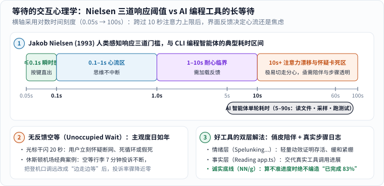

深夜改代码卡壳，你在命令行终端里敲下一句需求交给 AI 编程助手。回车按下，光标旁边的星号小图标滴溜溜转了起来；过了五秒钟，旁边突然蹦出一个让人忍俊不禁的英文单词：

> **Spelunking...**

再等几秒，它又面不改色地换成了 **Marinating...**，偶尔甚至冷不丁冒出一声 **Honking...**！

它到底是在帮你查 Bug，还是趁你不注意跑去钻山洞、腌牛排、学大鹅叫了？

这类出现在等待动画旁边的动态分词，在前端设计里常被称为 **spinner verbs（加载状态动词）**。它们看似只是程序员顺手埋下的彩蛋，实则像一张精心设计的性格名片：如果把底层大模型的编码与推理硬实力看作一款工具的**“第一人设”**，那么在漫长等待间隙里陪你解闷、给你交代的这套微文案，就是它的**“第二人设”**。

今天我们就顺着这只闯进终端的“大鹅”，先后打开两扇门：第一扇门通向**人机交互（HCI）研究了半个世纪的等待心理学**，看看为什么跨过 `10 秒` 大关后界面必须“有话讲”；第二扇门直接**掀开命令行引擎盖**，看看屏幕上面蹦出俏皮动词的那十几秒里，底下的模型、JSON 指令与本地沙箱到底在忙活什么。

---

## 一、终端里冒出的一只“大鹅”：认识 AI 编程工具的“第二人设”

### 1. 从 `Spelunking...` 到 `Honking...`：把干巴巴的等待写成小剧场

在众多命令行与编辑器 AI 工具里，Claude Code 的等待状态词格外让人印象深刻。许多开发者在日常使用或翻看前端包时收集过不少让人会心一笑的词例：

| 终端状态词 | 英文原意 | 放在改代码现场读起来像什么 |
|---|---|---|
| `Grooving...` | 踩准节拍、跟着音乐摇摆 | 手感正热，代码写得顺风顺水 |
| `Spelunking...` | 钻进天然洞穴探险 | 戴着头灯钻进老旧代码库深处摸索 |
| `Ruminating...` | 反刍、反复思量 | 把棘手的报错放在脑子里多嚼几遍 |
| `Brewing...` | 冲泡、慢火酿造 | 修复方案正在壶里咕嘟咕嘟煮出来 |
| `Marinating...` | 腌制入味 | 让刚想到的重构思路再浸润一会儿 |
| `Clauding...` | 把自家名字动词化的俏皮造词 | 正在施展专属的“Claude 式手艺” |
| `Honking...` | 大鹅引颈鸣叫 | 一只大鹅毫无征兆地大步迈进了你的终端 |

除此之外，社区分享过的截图里还能见到太空漫步（`Moonwalking...`）、随手拨弄（`Noodling...`）乃至磨洋工（`Dilly-dallying...`）等五花八门的说法——硬生生把枯燥的编译等待写成了一场融合探险、烹饪与冷幽默的微型脱口秀。

这里先立下一条严谨的事实边界：网上曾有技术博客通过拆解某一版安装包里的字符串数组，数出过“超过 180 个状态词”的说法[3]；但这**并不是官方对外承诺的固定技术规格**——随着客户端版本迭代、节日彩蛋或不同终端模式切换，内置词表与抽词逻辑随时可能增删变化。更重要的是，正如我们将在第三章拆解的那样：**跳出 `Spelunking...` 绝不代表模型此刻真在执行某步名叫“深层代码洞穴扫描”的专用算法，跳出 `Honking...` 也绝不代表它撞见了什么特殊异常。**

### 2. 横向看常见编程工具：幽默陪伴风与工程透明风的不同取舍

把市面上常见的几款 AI 编程入口摆在一起观察，会发现不同团队在“怎么打发用户等待时间”这道题上交出了气质迥异的答卷（注意：界面细节会随产品版本与使用入口——如命令行 CLI、IDE 侧边栏对话或行内补全——动态变化，下表对比的是**交互信息呈现的设计倾向**，而非底层模型能力排名）：

| 工具与入口倾向 | 常见的等待反馈方式 | 传递给开发者的主观感受 |
|---|---|---|
| **幽默剧场派（如 Claude Code 终端）** | 高频轮换俏皮动词，同时在展开栏或工具行打印具体读写动作 | 像一位带点冷幽默的搭档坐在旁边，冲淡了黑底白字命令行的冰冷紧绷感 |
| **流程融合派（如 GitHub Copilot 各入口）** | 依入口展示 `Thinking`、正在搜索仓库索引、正在编辑某文件等克制提示 | 尽量保持与原有 IDE 状态栏一致的工业秩序感，不抢代码的视觉焦点 |
| **白盒摊牌派（如 Cursor Agent 视图）** | 直接实时滚动展开“检索了哪几个词、读了第几行、正在应用哪块补丁” | 把后台每一步动作摊在台面上，强调“别急，你看得见我正干到哪一步” |

一句俏皮话让人嘴角上扬，一行精确到文件名的日志让人心里有底——这两种设计为什么会在 AI 编程时代同时爆发？答案就藏在人类大脑对“等待”的生理极限里。

---

## 二、等待的人机交互科学：为什么超过 10 秒，人的大脑就开始坐立不安？

### 1. 尼尔森的三道人类感知门槛：`0.1 秒 / 1.0 秒 / 10 秒`

为什么十年前写普通网页按钮或早期代码自动补全时，没人费尽心思编一百多个加载动词，偏偏到了今天的 AI 编程智能体（Coding Agent）时代，等待文案突然成了兵家必争之地？

人机交互（HCI）大师**雅各布·尼尔森（Jakob Nielsen）**在 1993 年出版的经典著作《可用性工程》（*Usability Engineering*）第 5 章中（承接 Robert Miller 1968 年与 Xerox PARC Card 等人 1991 年的认知实验），总结出了历经三十年依然稳固的**人类感知响应时间三道铁律**[4]——因为只取决于人类神经系统与工作记忆的生物构造，哪怕芯片算力翻了一万倍，这三道门槛也分毫不差：


_先顺着上方对数时间轴（$$0.05\ \mathrm{s} \to 100\ \mathrm{s}$$）从左往右读四段色带：`0.1 秒`以内是手指按键直出的瞬时操控感；`0.1～1 秒`虽能察觉停顿但心流不断；`1～10 秒`已是耐心临界区；一旦跨过 **`10 秒`警戒线**，人的工作记忆极易漂移分心，并开始怀疑程序卡死！偏偏底部黑色括号标出的 AI 编程智能体单轮耗时（`5～90 秒`），正好一头扎进了最难熬的橙色高危区。再看下方两格，对比“无反馈空白死等”与“情绪+事实双层反馈”的心理落差。[单独打开大图](/assets/images/ai-impact/hci-latency-thresholds.svg)。_

对照图上方的对数刻度尺，我们看看 AI 编程工具经历了怎样一次惊险的“跨区跳跃”：

1. **$$\le 0.1\ \text{秒}$$（瞬时直觉区）**：敲下键盘字母立刻跳上屏幕，大脑感觉是手指自己推出了字，完全意识不到中间隔着软件；
2. **$$0.1 \sim 1.0\ \text{秒}$$（心流连贯区）**：早期单行代码补全（Tab 补全半行函数）拼命把延迟压在 `200～400 毫秒`以内，就是为了死守这条线——你能感觉到它顿了一下，但脑子里的编程思路不会断线；
3. **$$1.0 \sim 10\ \text{秒}$$（注意力挽留临界区）**：超过 1 秒，人就会明显感到“我在等电脑干活”；接近 10 秒时，短期工作记忆里的上下文开始消散；
4. **$$> 10\ \text{秒}$$（注意力漂移与怀疑假死区）**：今天的 Agent 不再只补半行代码，而是接到一句“帮我把登录接口改成支持刷新令牌并补齐测试”后，要连读七八个文件、生成几百个推理词元、打补丁再跑测试套件——**动辄耗时 `15 秒`到 `60 秒`以上！**

跨过 `10 秒`大关，如果终端里只有一个冷冰冰的光标一动不动干闪，程序员脑海里三秒钟就会冒出三个致命问号：**“是公司断网了？是 API 超时挂了？还是工具掉进死循环卡死了，我要不要按 `Ctrl+C` 强行杀掉重来？”**

### 2. 休斯顿机场行李转盘与电梯镜子：“空白死等”为什么比真实秒数难熬得多？

一旦物理上的硬延迟（网络往返 + 大模型逐词采样 + 本地跑测试）暂时降不进 1 秒以内，交互设计师还能怎么办？管理学者大卫·迈斯特（David Maister）在著名的《等待的心理学》（*The Psychology of Waiting Lines*, 1985）里点破过两条黄金定律：**第一，无所事事的“空等时间（Unoccupied Time）”体感远比有事可看的“占用时间”漫长；第二，不确定还要等多久的焦虑，远比已知状态的等待折磨人。**

运筹学史上有一个脍炙人口的真实工程案例（见上图左下格）：早年美国休斯顿机场接到潮水般的旅客投诉，抱怨下飞机后在行李转盘前等行李的时间太长。机场起初砸钱升级搬运人手，把总时长压到了行业优秀的 **8 分钟**，没想到投诉信照样雪片般飞来！工程师去现场蹲点计时才恍然大悟：原来下飞机走到转盘只需 **1 分钟**，剩下 **7 分钟**旅客全都两手空空站在转盘边干瞪眼死等。

后来机场做了一个没花多少钱的改动：把停机廊桥调远，让旅客下飞机后得走上 **6 分钟**才能抵达行李大厅，刚走到转盘边不到 **2 分钟**箱子就滚出来了——总耗时一秒没少，关于等待过长的投诉率却瞬间骤降到几乎为零！（写字楼在慢速电梯厢里装一面大镜子让大家整理衣领头发，用的也是同一个认知心理学原理。）

放到命令行终端里，`Grooving...` 和 `Spelunking...` 扮演的正是那面“电梯镜子”与“存活心跳包”：每隔几秒轻轻变一下词、闪一下微光，不仅明确告诉你“进程还活着、没卡死，别乱按 `Ctrl+C`”，还用一点恰到好处的幽默把干瞪眼的紧绷感松弛下来。

### 3. 陪伴层 vs 交代层：为什么算不准完成比例时，绝不该编造“假进度条”？

不过，光有幽默陪伴就够了吗？对照下面这张双栏动态示意，立刻就能看出纯俏皮话与真实操作日志的分工边界：


_原创概念分步图（非任何商业软件真实截图）。先看左栏：旋转图标配合 `Spelunking...` 提供了生动的存活陪伴，但你并不知道它改没改你的文件；再看右栏：分步浮现“读取文件 → 应用修改 → 运行检查”交代了可核查的客观动作。动画仅播放一次并定格完整状态；开启系统“减少动态效果”时直接静态呈现完整步骤。[单独打开，刷新可重播](/assets/images/ai-status/feedback-layers.svg)。_

仔细对比左右两栏，还能带走两条极其重要的可用性工程准则（详见 Nielsen Norman Group 关于进度指示器的经典研究说明[4]）：

- **诚实底线——没有确定分母时，绝不伪造百分比进度条！** 下载一个已知大小 `100 MB` 的压缩包，已下载 `62 MB`，画一条 `62%` 的确定性进度条（Determinate Progress Bar）非常科学；但 AI 智能体修一个未知的 Bug，它自己都不知道等会儿跑测试会不会报错返工——此时如果为了哄用户开心，硬画一条匀速爬到 `99%` 然后卡住不动的假进度条，反而会彻底摧毁用户信任。用不带虚假百分比的动态指示器（Indeterminate Spinner）配合真实已完成的步骤日志，才是最诚实的设计。
- **动作可见不等于结果正确**：就算右栏清清楚楚印出了 `✓ 已读取 3 个文件`、`✓ 已修改 auth.ts`，也只证明“I/O 动作执行完了”，**不自动证明它改对了业务逻辑**。最终验货永远要看真实测试结果与代码差异。

---

## 三、掀开终端引擎盖：屏幕转圈的那 15 秒，底下到底发生了什么？

### 1. 上下两层彻底隔离：前端本地抽词定时器 vs 云端—本地 ReAct 闭环

很多刚接触命令列 AI 工具的朋友看着屏幕上的词跳来跳去，心里难免犯嘀咕：*“它刚才显示 `Ruminating...`（反复思量），现在突然变成 `Spelunking...`（钻洞探险），是不是大模型内部刚好从思考切换到了全盘扫描？”*

掀开引擎盖看一眼架构图，谜底其实干脆利落——**上下两层之间根本没有接任何“读心翻译电线”！**


_先看上方紫色表层卡片：终端 UI 只是一个跑在你本地电脑上的前端渲染循环，在等待网络流式响应的空档里，定时器从内置字符串列表里抽取 `Spelunking...`、`Honking...` 轮播保活。跨过中间橙色隔离线往下看，才是真正消耗十几秒时间的 **ReAct（推理—行动—观测）四步工程闭环**。[单独打开大图](/assets/images/ai-impact/agent-tool-loop-vs-spinner.svg)。_

### 2. 一步步跟完一次真实的改 Bug 之旅：十几秒时间到底花在了哪四棒？

目前主流的 CLI 编程智能体，底层大多遵循普林斯顿与 Google 研究者 Yao 等人在 2023 年系统总结的 **ReAct（Reasoning + Acting，推理与行动交织）**循环范式[5]。当你敲完需求按下回车、盯着大鹅 `Honking...` 的那 15 秒里，底下正紧锣密鼓地跑着下面这四棒接力：

1. **第 ① 棒（本地组装上下文包裹，耗时约几十毫秒）**：你电脑上的 CLI 客户端把系统指令规范（System Prompt）、当前 Git 分支与目录摘要、刚才对话的历史记录以及你刚敲下的需求打包成一个结构化请求，通过加密网络连接发往云端大模型推理集群。
2. **第 ② 棒（云端 Transformer 逐词元概率采样，耗时常占几秒到十几秒）**：这是最容易产生“漫长沉默等待”的一棒！尤其当模型开启了**扩展思考（Extended Thinking / 隐藏推理草稿）**时，模型要先在后台一个词元接一个词元地自回归采样出几百上千字的推理草稿，再严格按照工具 Schema 语法吐出一段结构化 JSON 指令，例如：
   ```json
   {"tool": "grep", "arguments": {"pattern": "refreshToken", "glob": "src/**/*.ts"}}
   ```
   注意：在模型把这段内部草稿和完整工具参数算出来之前，前端界面可能还没拿到可展示的文件改动，于是表层的 `Spelunking...` 就负责在这段网络静默期里转圈陪你！
3. **第 ③ 棒（本地沙箱工具真实执行，耗时视命令从几十毫秒到数十秒不等）**：CLI 客户端收到那串 JSON 指令后，经过你的权限策略校验，真刀真枪在你本地机器上调用 `grep` 搜代码、`view` 读具体行号、`edit` 替换代码片段，或者启动子进程跑 `pytest` / `npm test`——此时好的界面会把表层虚词切换或并列显示为真实的 `Running pytest tests/test_auth.py...`。
4. **第 ④ 棒（捕获退出码与报错回传，决定继续修还是交卷）**：如果第 ③ 棒测试返回非零退出码（比如报了一行 `TypeError`），客户端就会把标准错误输出（`stderr`）原封不动塞回消息列表，**自动跳回第 ② 棒开启下一轮推理修复**；直到测试通过、修改就绪，才把最终改动说明打印到你面前。

### 3. 破除迷思：状态词既不是模型的思维链（CoT），也不是它的内部情绪

把上面四棒看穿之后，两件事就板上钉钉了：

- **Spinner 状态词 ≠ 思维链（Chain-of-Thought）**：思维链是模型在第 ② 棒概率采样出来的真实中间推理词元序列（有的产品会折叠展示为灰色思考摘要，有的出于延迟或商业策略隐藏不显）；而 `Marinating...` 只是前端程序员写进 UI 组件里的装饰文案；
- **模型也没有因为卡住而“烦躁鸣叫”**：大语言模型在每一次 API 请求之间都是无状态的数学函数调用（见《[机器到底是怎么学会“思考”的？从一条直线到大模型与视频生成]()》），屏幕上冒出 `Honking...` 纯粹是随机数种子摇到了那一行字符串，跟这道 Bug 难不难毫无因果关系。

---

## 四、警惕拟人化的双刃剑：从 1966 年“伊丽莎效应”到代码验货铁律

### 1. 魏泽鲍姆的惊讶：人类有多容易给几行字符串脑补出“灵魂”？

为什么明明只是一排随机轮播的英文单词，却能让我们觉得这个冷冰冰的命令行工具“像个懂我的活人搭档”？

这在计算机科学史上有一个著名的名字——**伊丽莎效应（ELIZA Effect）**。早在 **1966 年**，麻省理工学院（MIT）计算机科学家约瑟夫·魏泽鲍姆（Joseph Weizenbaum）用区区两百来行模式匹配规则，写出了早期聊天程序 **ELIZA**（其中最出名的脚本模仿罗杰斯学派心理咨询师：当你输入 `"我很担心我的工作"`，它只做简单的代词翻转和句式套用，回一句 `"为什么你说你很担心你的工作？"`）。[6]

魏泽鲍姆原本只想演示自然语言表面匹配的浅薄，结果却让他大吃一惊：许多明知代码原理的实验室人员甚至他自己的秘书，都对着终端一聊就是好几个钟头，甚至请求魏泽鲍姆离开房间“好跟它说点悄悄话”！人类大脑天生是一台极度敏感的**社交意图投射机**——只要外部系统给出一丁点儿拟人化的语言线索（一句自嘲的 `Dilly-dallying...`、一个歪头思考的表情、一句诚恳的“你说得完全正确！”），我们就会情不自禁地脑补对面坐着一位深思熟虑、知冷知热的真人专家。

### 2. 让“第二人设”负责开心，让 `git diff` 和测试退出码负责把关

理解了“伊丽莎效应”，我们也就看清了 AI 编程工具“第二人设”的正确打开方式——**它在缓和等待焦虑上是加分项，但一旦让你放松工程警惕，就会变成隐蔽的陷阱**：

- **错觉一：把俏皮修辞当成工作深度证明**。看到 `Spelunking...`（洞穴深潜）和 `Ruminating...`（深思熟虑）转了半分钟，心理上就觉得“它一定已经把整个仓库的上下游依赖全都摸透了”，结果它可能只读了一个同名旧文件就自信满满地下手改错了地方；
- **错觉二：被讨喜的语气软化了代码审查标准**。当工具用特别谦逊可爱的口吻汇报“大功告成！所有问题已完美修复”时，人很容易不好意思再像审陌生补丁那样逐行挑刺，顺手就敲下了 `git commit`。

因此，每次和会跳舞、会挖洞、会学大鹅叫的 AI 编程工具搭档时，不妨在心里默念三条最朴素的**验货铁律**：

1. **情绪归情绪，事实归事实**：看到 `Honking...` 尽管开心地笑一笑，但判断进展只看它**实际调用了哪些工具、读了哪几个真实文件路径**；
2. **只认 `git diff`，不认漂亮总结**：模型最后写出的中文总结再诚恳，也可能漏提它顺手删掉的一行关键边界判断——合入前永远亲眼扫一遍真实的代码差异；
3. **只认测试退出码与高危命令审批**：遇到带副作用的命令（删文件、改数据库迁移、推远程分支）绝不闭眼放行，没亲眼看见测试套件跑出干净的退出码 `0`，就不算真正完工。

### 3. 一张速查对照表：把“界面气氛组”与“工程硬凭证”彻底分开

无论以后编程工具的“第二人设”进化出多少新花样——是变成像素小宠物、语音播报员，还是三维全息助手——我们都可以用下面这张四行对照表，一眼看穿屏幕上的信息究竟属于“安抚情绪的糖衣”，还是“支撑决策的硬证据”：

| 终端上看到的信号 | 它在架构里的真实身份 | 能不能作为代码可靠性的证据？ | 工程师真正该核对的硬指标 |
|---|---|---|---|
| `Spelunking...` / `Honking...` | 客户端本地随机轮播字符串 | **绝不能**（纯属心跳保活与情绪缓和） | 展开工具调用日志，看实际访问了哪些文件与行号 |
| “已为您彻底排查所有潜在隐患！” | 自回归语言模型采样的礼貌结语 | **绝不能**（礼貌语气与准确率零相关） | 亲手执行 `git diff` 逐块核查删改边界与异常分支 |
| 漂亮的静态百分比假进度条 | 前端按经验曲线估算的视觉动画 | **不能**（推理步数事先不可精确预知） | 关注已消耗 Token 数、工具重试次数与是否原地打转 |
| `pytest: 42 passed (exit code 0)` | 本地操作系统子进程真实返回结果 | **能（前提是测试本身覆盖了改动！）** | 确认新增测试真正测到了本次修改的边界条件而非空跑 |

把陪伴与轻松交给俏皮的“第二人设”，把方向盘和刹车片牢牢踩在自己脚下——这大概就是今天和 AI 一起写代码最舒服、也最踏实的默契。

---

## 参考资料

1. [Claude Code 官方项目仓库](https://github.com/anthropics/claude-code) 与 [Claude Code 官方技术文档](https://code.claude.com/docs/en/overview)——命令行智能体工具调用、权限确认与交互工作流参考。
2. Jakob Nielsen (1993)，*Usability Engineering* (Morgan Kaufmann, Chapter 5: Response Times: The Three Important Limits)——确立 `0.1 秒`（瞬时操控感）、`1.0 秒`（心流连贯上限）与 `10 秒`（注意力维持上限）三道经典人机交互响应阈值。
3. [Claude's Thinking Words: The Hidden Personality Behind the Spinner Verbs](https://agnamihira.medium.com/claudes-thinking-words-the-hidden-personality-behind-the-spinner-verbs-ed21384ec8ec)——第三方开发者对客户端等待状态词表的观察整理（词表随版本动态变化，非官方固定规格）。
4. [Nielsen Norman Group：Progress Indicators Make a Slow System Less Insufferable](https://www.nngroup.com/articles/progress-indicators/)；以及 David H. Maister (1985)，*The Psychology of Waiting Lines*——区分不确定等待指示器（Spinner）与确定百分比进度条的诚实设计原则，以及“空等时间 vs 占用时间”心理学。
5. Shunyu Yao et al. (2023)，*ReAct: Synergizing Reasoning and Acting in Language Models*，*ICLR*（arXiv:2210.03629）——现代语言模型智能体交替进行推理规划、外部工具调用与环境结果观测的核心架构范式。
6. Joseph Weizenbaum (1966)，*ELIZA—A Computer Program For the Study of Natural Language Communication Between Man and Machine*，*Communications of the ACM*, 9(1), 36–45——早期对话程序与“伊丽莎效应（人类向简单程序投射深层理解与情感）”的经典源头。
