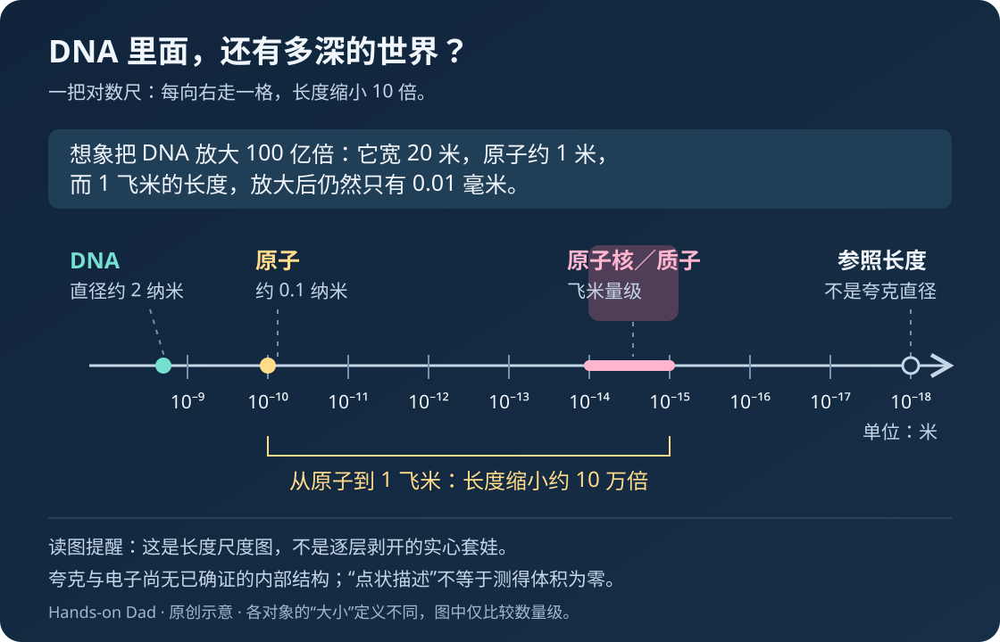

如果孩子问你：“DNA 已经小得看不见了，里面还能装下什么？”

你可能会回答：“原子。”

“那原子里面呢？”

“原子核、电子。”

“那原子核里面呢？”

好，今晚的睡前故事，突然从生物课拐进了粒子物理。

这篇文章的灵感，来自[一则关于 DNA 与微观尺度的帖子](https://x.com/mathemetica/status/2116757070657789973)。它抛出一个很有吸引力的问题：

> 一条只有 2 纳米宽的 DNA，为什么还包含比它小 20 亿倍的结构？

先别急着被“20 亿”震住。这个说法需要补上重要的科学限定，我们稍后会拆开看。

真正有趣的是：**小，不是一个终点。我们觉得已经小到极限的东西，换一把尺子，可能又成了一片辽阔的世界。**

现在，想象我们有一台不会失焦的超级变焦镜头。它不是现实中某一种显微镜，而是帮助理解尺度的思想工具。

第一站，对准 DNA。

## 一、2 纳米说的是宽，不是长

DNA 的经典形象，是一架扭转起来的梯子。

两边的“扶手”由糖和磷酸基团交替连接，横向的“梯级”是成对的碱基：A 与 T 配对，G 与 C 配对。沿着梯子的顺序，就能记录遗传信息。

常见的 **B 型 DNA 双螺旋，直径大约是 2 纳米**。这里说的是整条双螺旋横过来有多宽，不是其中一条单链的固定直径，更不是一整条 DNA 的长度。

纳米究竟有多小？

$$
1\text{ 纳米}=10^{-9}\text{ 米}=\text{十亿分之一米}.
$$

假设一根头发直径约 80 微米，那么头发的粗细大约是 DNA 双螺旋直径的 **4 万倍**。不同人的头发粗细不一样，这只是帮助建立直觉的估算。

但细，不代表短。

一份人类单倍体核基因组约有 30 亿个碱基对。沿着 B 型 DNA 的轴线，相邻碱基对的间隔约为 0.34 纳米。粗略相乘：

$$
3\times10^9\times0.34\times10^{-9}\text{ 米}
\approx1\text{ 米}.
$$

典型的、有细胞核的人体二倍体细胞中，两套核基因组的 DNA 全部伸展开，总长大约 **2 米**。这些 DNA 分布在多条染色体上，并不是一根完整不断的两米绳子；不同细胞的情况也不完全相同。

它们能待在微米尺度的细胞核里，要靠与蛋白质结合、折叠和组织。

**DNA 更像极细、极长、会被精心收纳的线，而不是一颗 2 纳米大的小球。**

## 二、把 DNA 放大到一座楼那么宽

直接看一串负指数，很难产生感觉。我们换一种玩法：

**把 2 纳米宽的 DNA，放大成 20 米宽。**

这相当于把所有长度统一放大 **100 亿倍**。注意，只是做一个统一比例的模型，不是说真实物质可以这样变大而保持原来的性质。

在这个模型世界里：

| 真实世界中的长度 | 放大后的长度 | 可以怎样想象 |
|---|---|---|
| DNA 双螺旋直径约 2 纳米 | 20 米 | 一座楼的宽度 |
| 相邻碱基对的轴向间隔约 0.34 纳米 | 3.4 米 | 接近一层楼高 |
| 一个原子的典型尺度约 0.1 纳米 | 1 米 | 日常家具的尺度 |
| 取约 1～10 飞米的核尺度作示意 | 0.01～0.1 毫米 | 从细小尘粒到细发粗细的量级 |
| 用 $$10^{-18}$$ 米作参照长度 | 10 纳米 | 仍远小于肉眼可见的尺度 |

最后一行只是长度换算，**不是说我们已经量出了夸克的直径**。

_分步图：先看 DNA，再看原子，最后看选取的核尺度。三张卡片使用同一个长度放大倍数，但卡片本身并不按物体大小绘制；这里的 1 飞米是选取的核尺度示意，不代表所有原子核。动画播放一次后保留完整换算，减少动态效果时直接显示结果。[单独打开，刷新可重播](/assets/images/dna-scale/uniform-zoom.svg)。_

跟着图算一次就够了：$$1$$ 飞米是 $$10^{-15}$$ 米，乘上 $$10^{10}$$ 后变成 $$10^{-5}$$ 米，也就是 **0.01 毫米**。同一个放大镜让 DNA 变成楼那么宽，却仍没让核尺度变成肉眼容易辨认的大物件。这说明不能把“DNA、原子、原子核”画成每层只缩小一点的套娃。

现在，想象你走进这条 20 米宽的“DNA 大楼”。

构成它的原子，在这个比例下已经有家具那么大。可原子核依然只是微小尘粒级的东西。至于 $$10^{-18}$$ 米的参照长度，即使经过这番夸张放大，也不过 10 纳米。

这才是微观世界最让人吃惊的地方：

> **把第一层放大到能走进去，并不意味着更深的一层就能被眼睛看见。**

## 三、这架“微观楼梯”，台阶并不一样高

把镜头重新拉回真实尺度，我们可以画出一张路线图。

_原创尺度示意图。横轴每前进一大格，长度缩小 10 倍；各对象的大小定义并不相同，不能把它们都当作有硬边界的小球。_

| 观察对象 | 典型长度或尺度 | 这一层在讲什么 |
|---|---|---|
| B 型 DNA 双螺旋 | 直径约 $$2\times10^{-9}$$ 米 | 遗传信息的分子载体 |
| 碱基、糖等局部结构 | 几个 $$10^{-10}$$ 米到约 $$10^{-9}$$ 米 | 化学组成与连接方式 |
| 原子 | 约 $$10^{-10}$$ 米的量级 | 原子核与电子的量子结构 |
| 原子核 | 约 $$10^{-15}$$～$$10^{-14}$$ 米的量级 | 质子、中子组成的核 |
| 质子 | 约 $$10^{-15}$$ 米的量级 | 具有内部结构的复合粒子 |
| 夸克、电子 | 没有已测出的内部结构或有限半径 | 标准模型中按基本粒子描述 |

这不是一张“精确尺寸排行榜”。原子的大小要看如何定义，原子核的尺度随核种变化；质子常用的电荷半径，也不等于硬球表面的半径。

例如，NIST 给出的质子均方根电荷半径约为 **0.84 飞米**。飞米是 $$10^{-15}$$ 米。这个数描述的是电荷分布的特征尺度，不是在说质子外面包着一层坚硬球壳。

还有两个容易被图画掩盖的细节。

**第一，DNA 本身就是分子。** “DNA → 分子 → 原子”并不是三种互不重叠的物质类别。更准确的说法是：从一整个生物大分子，转向它的局部化学结构，再看参与这些结构的原子。

**第二，从原子到原子核，是一次特别大的跳跃。** 从 $$10^{-10}$$ 米走到 $$10^{-15}$$ 米，长度缩小了 10 万倍。这远不是每次都缩小两三倍的均匀楼梯。

所谓“数量级”，就是提醒我们：**先数清跨过了多少个十倍，再讨论细节。**

### 沿着这张截图，再走一遍

读者补充的那张图，把 DNA、分子、原子、原子核、质子和夸克用箭头串在一起。这种“镜头向里推”的路线很有感染力。不过，来源与具体转载许可尚未核实，下面**借鉴它提出问题的方式，重新绘制两张中文图**，不直接复制截图。

先走进化学这一段：

_先认出左侧对象，再读右边的限定。每格都单独放大，不能比较画出来的直径。水分子只用来提醒“小分子也有不同大小”，不是把 DNA 拆开后必须经过的下一层。原子用电子云示意，不再画行星轨道。[单独打开化学段](/assets/images/deep-science/dna-chemistry.svg)。_

截图中有一幅红球连着两个白球的图，它表达的是水分子常见的球棍模型。可“分子”并不是一个统一大小的盒子：水、碱基、蛋白质和 DNA 都可以是分子，长度跨度很大。**标出“分子约1纳米”，只能当某些对象的数量级示例，不能当全部分子的身份证。**

还有一点需要特别说明：DNA在水环境中发挥作用，也确实与水相互作用，但**水分子不是DNA骨架的重复单元**。箭头在这里是阅读路线，不是一条“把DNA拆成水，再拆成某一种原子”的化学反应式。

然后走进核与粒子这一段：

_上格是核子组成的结构示意，中格仅标出质子的价夸克组成，下格只留定位符号，不给夸克画一个仿佛量过大小的圆球。质子的三枚字母不表示它只有三个静止成分；电子另有支路，并不由夸克组成。[单独打开粒子段](/assets/images/deep-science/dna-particles.svg)。_

截图的启发值得保留，但有四件事必须在旁边讲清楚：

1. **2纳米是DNA双螺旋的典型宽度。** 不是整条DNA的长度，也不是一个基因的大小。
2. **原子图上的轨道线不是电子真实跑道。** 电子云也只是状态与概率分布的可视化，不是拍到了一团蓝烟。
3. **原子核和质子不是一套固定大小的上下级盒子。** 普通氢核就是一个质子；其他核的尺度随核种改变。质子的约0.84飞米是均方根电荷半径，别和另一幅图中“直径量级”不加区分地排队。
4. **“小于某个长度”与“量出了大小”完全不同。** 夸克画成一颗漂亮紫球，会让人误以为它有已知表面；实际上正文后面讨论的正是实验分辨尺度、模型假设和未确证内部结构之间的区别。

对数尺负责**比较长度**，这两张图负责**辨认层次与组成**。把两种任务分开，既能保留截图的想象力，也不把一张示意图读成显微镜拍下的逐层实况。

## 四、原子里那么“空”，桌子为什么还这么硬？

这是尺度旅行中最自然的一个问题。

如果原子核那么小，原子的大部分空间岂不都是“空”的？那手为什么不能穿过桌子？

问题出在：我们不知不觉把原子想成了一个大盒子，中央摆着一颗小珠子，剩余地方全是可以随便通过的走廊。

真实情况不是这样。

原子中的电子不是绕着原子核奔跑的小行星。量子力学用电子的状态来描述它们，常见的“电子云”，表达的是电子在空间中出现的概率分布，而不是一团普通的烟雾。

当手接近桌面时，双方原子中的电子状态和电荷分布开始相互影响。**电磁相互作用，以及电子服从的泡利不相容原理，共同决定了把物质继续挤压在一起需要付出能量。**

你感受到的“硬”，正是这种微观结构在宏观上的表现。

所以：

> 原子核只占很小的尺度，不等于原子的其余区域“什么物理作用也没有”。

原子之间可以保持距离，也可以通过化学键组成稳定结构。桌子不需要由一颗颗毫无缝隙的实心钢珠堆成，才能托住一本书。

同样，DNA 也不是一条缩小版的塑料绳。它的形状、柔性、配对和识别，来自分子层面的相互作用，还受到水、离子和温度的影响。

## 五、再往里走：质子不是三颗弹珠装在一个袋子里

大多数原子核由质子和中子组成；最常见的氢原子核，则只有一个质子。

再向内看，质子与中子又不是没有结构的终点。

我们经常听到：

- 质子的价夸克组成为两个上夸克、一个下夸克；
- 中子的价夸克组成为一个上夸克、两个下夸克。

这是很有用的入门描述，但不要把它画成三颗安静的小弹珠。

质子内部是一个活跃的量子系统，除了价夸克，还涉及胶子以及夸克—反夸克等成分。胶子参与传递强相互作用，夸克与胶子的动力学不能用普通机械零件的直觉理解。

这里还要把两种“绑在一起”分开：

**在质子、中子内部，夸克受到强相互作用的束缚；在原子核里，核子之间的结合通常用残余强相互作用来描述。**

而把原子组织成 DNA 这样的分子，主要是电子参与的化学作用，本质上属于电磁相互作用的范畴。

不能把整条 DNA 想成“被强核力粘起来的绳子”。

顺便，旅行路线在这里还有一条岔路：

**电子并不由夸克组成。** 在标准模型里，电子与夸克都属于基本粒子，但属于不同类别。微观世界不是所有东西都沿同一条套娃路线拆到底。

## 六、“比 DNA 小 20 亿倍”，到底哪里需要小心？

现在可以回头拆解开篇那句话了。

如果比较 2 纳米与 $$10^{-18}$$ 米这两个长度，算术没有问题：

$$
\frac{2\times10^{-9}}{10^{-18}}
=2\times10^9
=20\text{ 亿}.
$$

**问题不在除法，而在分母代表什么。**

对于 DNA 的直径，我们有明确的结构与测量背景。对于夸克，却不能直接拿出一把尺子，说：“它就是 $$10^{-18}$$ 米宽。”

在标准模型中，夸克被当作没有内部结构的点状基本粒子来描述。实验至今也没有确证夸克具有可分辨的内部结构。

但下面两句话并不等价：

> 在某种理论和实验精度下，没有发现内部结构。

> 已经证明自然界中的它具有严格为零的几何体积。

前者是我们能够有依据地讨论的结论，后者不能仅凭“目前没看见”就推出。

而且，“没有看见”的精细程度，与实验过程、分析方式及采用的模型有关。关于夸克半径、复合结构或新物理的限制，也不能随意混成一个通用的直径数值。

因此，本文把 $$10^{-18}$$ 米仅用作一个**展示尺度差距的参照长度**，不把它写成夸克的实测尺寸，也不把它当作所有实验共享的统一界限。

更稳妥的说法是：

> **DNA 的直径，与比它小 20 亿倍的参照长度之间，隔着约九个数量级；但夸克究竟有没有有限大小，不能用这道除法回答。**

这并没有削弱故事的震撼力。恰恰相反：它让我们看清，科学不仅在告诉我们什么，还在标出我们尚未知道什么。

## 七、科学家怎么“看”到比光还细的结构？

如果这些东西小得离谱，我们凭什么知道它们存在？

先拆掉一个误会：**科学中的“看见”，不总等于拍到一张普通照片。**

普通可见光的波长大约是 400～700 纳米。常规远场光学显微镜受衍射限制，难以直接分辨 DNA 双螺旋横向约 2 纳米的细节。

我们可以给 DNA 加荧光标记，让它的位置显现出来；但“能检测到它在哪里”，与“能分开看清它横向的内部结构”，是两件事。超分辨技术可以突破常规光学方法的一些限制，也不意味着任何细节都能无限放大。

研究更小的结构，需要换工具和提问方式：电子显微镜、X 射线衍射、扫描探针，以及高能粒子散射等，各有适用对象与条件。

高能散射的思路，有点像隔着幕布研究一个看不见的目标：向它发射探针，统计探针怎样偏转，以及产生了什么。

这只是比喻；实际分析依赖量子理论、探测器和大量数据。但它抓住了关键：

**我们能从相互作用留下的痕迹，推断被研究对象的结构。**

在合适的散射条件下，较大的动量转移对应较短的可探测距离尺度。因此，粒子物理学家需要高能量，不是为了“把照片照得更亮”，而是为了研究更精细的结构和可能的新过程。

LHC 用质子或离子束进行高能碰撞，研究强相互作用、基本粒子等问题。它并不是从 DNA 上取下一个碱基，再对着那个碱基拍一张夸克特写。

不过，你我身体中的质子，和加速器研究的质子，遵循的是同样的物理规律。

## 八、基因剪刀、核磁共振和芯片，怎样遇见这架楼梯？

这段旅程不是一串与生活无关的零。

但把科技项目放在一张尺度图上，不等于它们使用了同一种机制。三个例子，正好说明这件事。

### 基因剪刀：靠分子识别，不靠看清一个小黑点

以常见的 CRISPR-Cas9 系统为例，引导 RNA 帮助寻找与目标序列匹配的 DNA，相关蛋白还需要识别合适的邻近序列等条件，才能在特定位置切割。

这不是一把纳米剪刀配上一台超级摄像头，而是**利用分子配对与相互作用来定位**。

能在某个位点进行编辑，也不等于“每次都精准无误地换掉一个字母”。脱靶、递送以及细胞如何修复切口，都影响最终结果；不同编辑工具的机制也不同。

生命早就在用分子识别完成复制、读取和修复。我们是在理解这些机制之后，学着把其中一些改造成工具。

### 核磁共振：利用核的性质，不是拍到核的轮廓

常见的临床 MRI 主要利用人体中氢原子核的磁性，在磁场和射频脉冲作用下产生、检测信号，再结合空间编码重建图像。

普通氢原子核就是一个质子。但 MRI 图像里显示的，是组织中的大量原子核共同提供的信息，**不是一颗颗质子的照片**。

某些对比剂会改变附近水中氢核的弛豫行为，从而影响组织对比；它们不是简单地给原子核“涂上更亮的颜色”。

“利用微观性质”与“把图像分辨率做到同样微观”，是完全不同的概念。

### 2 纳米芯片：这个数字不能直接当尺子

DNA 宽约 2 纳米。芯片也叫“2 纳米”。所以，一个晶体管正好跟 DNA 一样宽？

**不能这样推。**

今天的“2 纳米”“3 纳米”等，主要是半导体制造的工艺节点名称，不对应整个晶体管的统一实际尺寸。晶体管有栅长、沟道厚度、纳米片宽度等不同参数，不能压缩成一个数字。

一个很直观的例子是：IBM 在介绍其 2021 年的 2 纳米研究芯片时，写到所实现的**栅长为 12 纳米**，并明确说明节点名称代表工艺代际。

这不是说“2 纳米技术是假的”，而是说：**代际名称不是结构尺寸说明书。**

真正令人惊叹的，是工程师在纳米尺度控制材料和结构，同时处理漏电、发热、制造波动等问题。芯片确实进入了必须认真对待原子与量子效应的世界，但不能据此把每个晶体管都画成 DNA 那么宽。

## 九、今晚可以和孩子做的“十倍旅行”

不需要显微镜，拿一张纸，画一条长线。

在线上依次写：

**1 米 → 10 厘米 → 1 厘米 → 1 毫米 → 0.1 毫米 → 10 微米 → 1 微米 → 100 纳米 → 10 纳米 → 1 纳米。**

每跨一步，长度缩小 10 倍。然后，把头发、细胞、DNA 和原子的大致尺度标到合适的位置；原子还需要再往后走一格左右。

孩子可能会问：“为什么每一格画得一样长，实际差距却那么大？”

这正好引出**对数尺**：相同的图上距离，表示相同的倍数变化，不是相同的米数变化。前面的原创示意图，用的就是这种思路。

接着可以留三个问题，让想象继续：

- 如果 DNA 变成 20 米宽，原子大约多大？原子核呢？
- 看见一根会发光的 DNA，是否等于看清了它的双螺旋？
- 两个东西都带“2 纳米”这个数字，是不是就能直接比较大小？

答案分别藏在比例换算、分辨率和尺寸定义里。

这也是读科普时特别好用的三个习惯：**先问比的是什么，再问怎么知道，最后问哪些地方还不知道。**

## 十、最深的一层，不一定是最合适的解释

走到夸克，似乎离“生命是什么”更近了。

但如果孩子问：“为什么 A 通常与 T 配对，而不是与 C 配对？”

此时从夸克开始讲，反而不是最有效的路线。我们需要讨论碱基的化学结构、配对几何、氢键以及整体分子环境。

如果要研究 DNA 怎样折叠，就还要考虑链的柔性、静电作用、溶液条件和蛋白质。

如果要研究一个基因什么时候表达，又需要把目光移向细胞中的调控网络。

**更底层的规律给出了约束，但不同层次有不同的好问题，也有不同的好工具。**

就像理解一本故事书：知道纸张由原子构成很重要，可若想知道主角为什么难过，继续拆原子并不能代替读故事。

DNA 的迷人之处，也正在这里。

它一方面是遵守物理规律的物质，另一方面又以碱基的排列参与生命信息的保存与传递。同样的原子，可以组成不同的分子；同样的碱基，可以排成不同的序列。

从原子到生命，变化的不只是尺寸，还有**组织方式**。

所以下次再看到那架扭转的梯子，不妨停一下：

**这条只有 2 纳米宽的分子，一头连着生命的信息，一头连着微观世界的物理。**

而我们居然能用实验、数字和想象，沿着它，一层层走进去。

---

## 资料与延伸阅读

本文中的长度用于建立数量级直觉。DNA 构象、分子环境及不同“大小”的定义，都会影响具体数值；文中的放大模型不是按真实物理条件放大物质的实验。

- [灵感来源：@mathemetica 的尺度帖子](https://x.com/mathemetica/status/2116757070657789973)：本文从中提出问题，但对夸克尺度、相互作用及芯片节点作了区分，没有把原帖表述全部当作已证实结论。
- [OpenStax：DNA Structure and Sequencing](https://openstax.org/books/biology-2e/pages/14-2-dna-structure-and-sequencing)：DNA 的核苷酸组成、双螺旋与约 0.34 纳米的碱基对间隔。
- [NHGRI：Double Helix](https://www.genome.gov/genetics-glossary/Double-Helix)：双螺旋的糖—磷酸骨架与碱基配对。
- [NHGRI：Chromosomes Fact Sheet](https://www.genome.gov/about-genomics/fact-sheets/Chromosomes-Fact-Sheet)：DNA 与组蛋白的包装，以及人类细胞中 DNA 的总长度。
- [NIST：Proton rms charge radius](https://physics.nist.gov/cgi-bin/cuu/Value?rp)：质子均方根电荷半径，2022 CODATA 推荐值。
- [CERN：The Standard Model](https://home.cern/science/physics/standard-model) 与 [Subatomic particles](https://home.cern/science/physics/subatomic-particles)：夸克、轻子与基本相互作用。
- [CERN：The Large Hadron Collider](https://home.cern/science/accelerators/large-hadron-collider)：LHC 的粒子束、碰撞与探测。
- [NHGRI：CRISPR](https://www.genome.gov/genetics-glossary/CRISPR)：CRISPR 技术的入门介绍。
- [NIBIB：Magnetic Resonance Imaging](https://www.nibib.nih.gov/science-education/science-topics/magnetic-resonance-imaging-mri)：MRI 的原理与医学应用。
- [IBM Research：The nanosheet transistor is the key to 2 nm technology](https://research.ibm.com/blog/2-nm-chip)：2 纳米工艺节点、12 纳米栅长，以及节点名称与实际尺寸的区别。

文中对数尺、统一放大分步图和两张微观层次图均为本站原创；层次图受读者提供的 @mathemetica 水印截图启发，重新设计了中文解释与科学限定，未直接转载。对数尺比较数量级，层次图辨认组成，都不是分子或粒子的真实照片。
