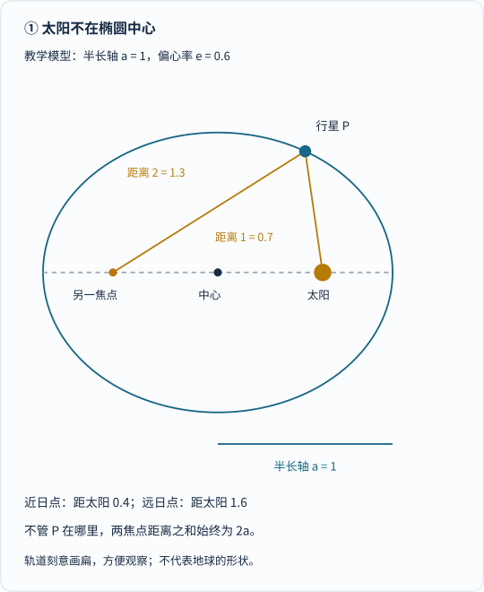
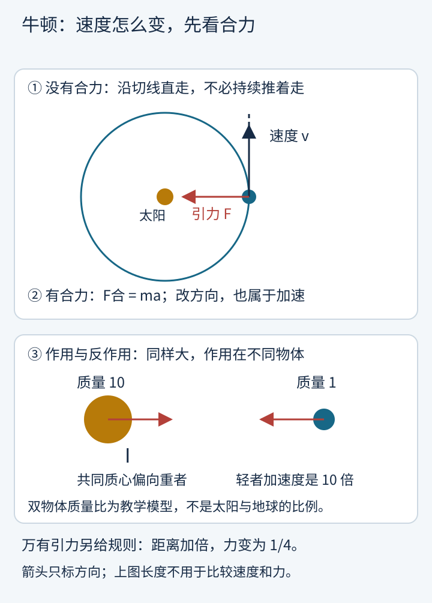
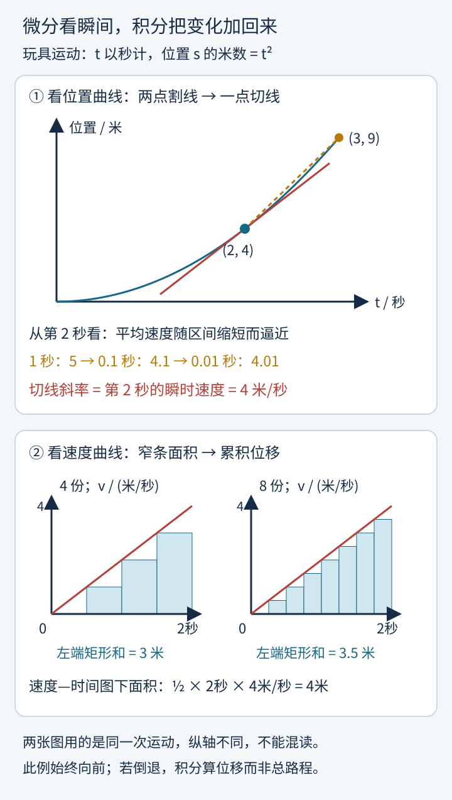
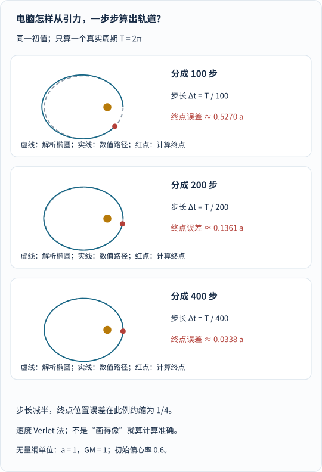
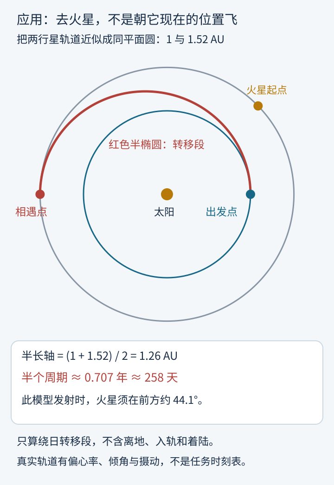

太阳一直拉着地球，地球为什么没有掉进去？

一个常见答案是：“因为地球在转。”

可这还没解释完：为什么转起来就不掉？为什么越靠近太阳，行星跑得越快？如果想让飞船去火星，是对准那个红点踩油门，还是得往一块暂时空着的地方飞？

这些问题，会把我们带过三道门：

**开普勒找出轨道里的规律，牛顿把规律接到力上，微积分则让人能从某一瞬间，一直算到未来。**

先提醒一个特别容易记混的地方：

| 名字里都有“三定律” | 它们主要回答什么 |
| --- | --- |
| 开普勒三定律 | 轨道什么形状？哪里快、哪里慢？一圈要多久？ |
| 牛顿运动三定律 | 没有合力时怎样运动？受力后如何改变？两个物体怎样相互作用？ |
| 万有引力定律 | 两个物体之间的引力，具体有多大、朝哪里？ |

最后一条**不是牛顿运动第三定律**。它是另一条物理规律，需要和运动定律配合使用。

我们不从背六条定义开始，而从一颗不肯听话的火星开始。

## 一、开普勒遇到的麻烦：火星不肯住进漂亮的圆里

想象你接手了一份特别难伺候的工作：

有人几十年如一日记录星星的位置，现在把一大摞记录交给你，让你找出天上究竟在演什么。

这位观测者是第谷·布拉赫，接手火星问题的人是约翰内斯·开普勒。

这里的“位置记录”，并不是太空探测器从太阳系上空拍来的轨道照片，而主要是**从地球上看到的天体方向与角度**。地球自己也在动，开普勒要从一个移动的观测台，反推出另一个移动天体的轨迹。

难度很像：你坐在行驶的车里，看见另一辆车时前时后，还得推断它到底绕着什么路线走。

过去的天文学可以用圆与圆的组合拟合天体位置。开普勒也不是一上来就宣布“我讨厌圆”。他不断拿候选模型去对照更多观测，最后接受了一个不那么“完美”、却更合数据的答案：

**火星的轨道是椭圆，太阳在它的一个焦点上。**

1609年，《新天文学》发表了后来称作第一、第二定律的结果；1619年，《世界的和谐》又给出了第三定律。这不是同一天冒出来的三句口诀，而是长时间计算、试错与比较的结果。[史料：圣安德鲁斯大学开普勒传记](https://mathshistory.st-andrews.ac.uk/Biographies/Kepler/)

## 二、第一定律：太阳偏着坐，却不是随便偏

**在理想化的行星运动描述中，轨道是椭圆，太阳位于一个焦点。**

“焦点”和“中心”不是同一个东西。

你可以拿一根松紧适当的细绳，套住两枚固定的图钉，用铅笔绷紧绳子绕一圈。铅笔到两枚图钉的距离之和始终不变，画出来的就是椭圆。两枚图钉所在的位置，就是两个焦点。

太阳占据其中一个；另一个不需要再放一颗太阳。

_先认中心，再认太阳所在的焦点，最后沿两条金色线加距离。这张图采用半长轴为1、偏心率为0.6的教学模型，刻意画扁，方便辨认；不是地球轨道的真实形状。_

图里有一个后面会反复用到的量：**半长轴**，记作 \(a\)，就是椭圆最长直径的一半。

另一个量叫**偏心率**，记作 \(e\)。对椭圆来说，\(0\le e<1\)；\(e=0\) 时是圆，越接近1越狭长。

太阳到近日点、远日点的距离分别是：

$$
r_{\text{近}}=a(1-e),\qquad r_{\text{远}}=a(1+e)
$$

在图中的模型里，\(a=1\)、\(e=0.6\)，所以这两个距离是0.4和1.6。

轨道不是在太阳外面铺好的一圈铁轨。这只是描述物体将怎样运动的曲线，接下来还得解释：**它凭什么沿着这条曲线走？**

> **先把近似说清楚**
>
> 把太阳画成不动，是因为研究行星时，太阳通常比行星重得多。严格的孤立二体问题中，两个天体都绕共同质心运动；第三定律的一般形式也要计入双方质量。真实太阳系还会受到其他天体的扰动。[教材：OpenStax，开普勒行星运动定律](https://openstax.org/books/university-physics-volume-1/pages/13-5-keplers-laws-of-planetary-motion)

想更细地认识椭圆与圆锥曲线，可以接着看站内的[圆锥曲线与丹德林球]()。这里先让行星跑起来。

## 三、第二定律：宇宙的节拍器，量的居然是面积

如果在椭圆上每隔同样长的时间拍一张照片，行星不会均匀排开。

靠近太阳时，相邻照片里的位置隔得远；远离太阳时，则挤得近。

开普勒找到的规律很巧妙：

**太阳与行星的连线，在相等时间内扫过相等面积。**

这里量的不是走过的弧长，也不是转过的角度，而是那条连线像雨刷一样扫过的**弯曲扇形面积**。

_先看红、蓝两个阴影区：各用八分之一周期扫成，面积相等。再看四个标记时刻，便能发现行星近处走得快、远处走得慢。动画等待1秒后，用8秒演示一圈，只播放一次；它不是沿椭圆匀速滑动。_

[单独打开等面积动画，刷新可重播](/assets/images/kepler-newton/equal-time.svg)。如果滚到这里时动画已经结束，静态的阴影区与等时刻标记仍然保留全部要点；系统开启“减少动态效果”时不播放。

可以这样理解“同面积”：

- **近处，雨刷柄短。** 想在同样时间扫出足够面积，得转得更快，行星也要走过更长的弧。
- **远处，雨刷柄长。** 连线稍微转一点，就能扫出一块面积，行星走得慢一些。

但别把“雨刷”比喻用过头：真实轨道的扫掠区有弧形边界，**不能随便用一个有限大小的三角形代替，再说面积严格相等**。

在近日点与远日点，速度都恰好垂直于太阳—行星连线，可以写出：

$$
r_{\text{近}}v_{\text{近}}=r_{\text{远}}v_{\text{远}}
$$

于是图中的模型有：

$$
\frac{v_{\text{近}}}{v_{\text{远}}}
=\frac{1.6}{0.4}=4
$$

**同一颗行星，在这条教学轨道上，近日点速度是远日点的4倍。** 不需要发动机忽然加大油门，原因稍后揭晓。

## 四、第三定律：搬得更远，一年会长得比你想的更快

前两条主要描述同一颗行星在一条轨道上怎么走，第三条开始比较不同轨道：

**绕同一中心天体运动时，周期的平方与半长轴的立方成正比。**

周期 \(T\)，就是绕一圈需要的时间。

$$
T^2\propto a^3
$$

这意味着，轨道尺寸加倍，并不是一年变成两年：

$$
\frac{T_2}{T_1}
=\left(\frac{a_2}{a_1}\right)^{3/2}
$$

例如，半长轴从1变成2，周期变为 \(2^{3/2}\approx2.828\) 倍；从1变成4，周期会变为8倍。

_先比较三根表示半长轴的线段，再读右边的周期。上下并不是同一颗行星随意换轨的动画，而是在比较同一中心天体下的三种轨道。_

这条规律非常实用：只要知道一类轨道的“时钟标尺”，就能用距离估计另一类轨道的周期。

不过，**不同中心质量不能直接混算**。绕太阳与绕地球，比例系数不同；双星等双方质量都不可忽略的系统，还需要更完整的公式。

现在我们有了一张漂亮的“宇宙交通统计表”：

椭圆、等面积、平方立方。

可统计表还没告诉我们：**谁在改方向？为什么偏偏有这种速度变化？**

## 五、牛顿接棒：先别问轨道，先问“凭什么转弯”

1687年，牛顿的《自然哲学的数学原理》出版，把运动定律与引力理论用于解释天体运动。

这不是说此前没人想过太阳如何影响行星。开普勒本人就在寻找物理原因，胡克等人也讨论过吸引力。牛顿的重要贡献，是把这些问题纳入能够定量推导和检验的力学框架。[历史脉络：牛顿传记](https://mathshistory.st-andrews.ac.uk/Biographies/Newton/)

### 第一条：维持运动，不需要一直推

日常经验很会骗人。

你推一下小车，它慢慢停下，于是容易以为：“运动需要持续施力。”

但小车停下，是摩擦等作用改变了运动。**在惯性参考系中，如果合外力为零，物体会保持静止，或保持匀速直线运动。**

关键词是：**直线**。

如果此刻不再受引力作用，行星不会沿着原来的弧继续绕，也不会自动停在空中，而会沿当时的速度方向——轨道切线——飞走。这是一个用来理解惯性的思想实验，不是说引力能真的被按开关关闭。[教材：牛顿第一定律](https://openstax.org/books/university-physics-volume-1/pages/5-2-newtons-first-law)

### 第二条：力不是负责“让你动”，而是负责“让速度变”

对质量不变的物体：

$$
\mathbf F_{\text{合}}=m\mathbf a
$$

\(\mathbf F_{\text{合}}\) 是合外力，\(m\) 是质量，\(\mathbf a\) 是加速度。

加速度不只指“越来越快”。**只要速度的大小或者方向发生变化，就有加速度。**

匀速绕圆就是典型例子：速率虽然不变，速度方向却一直在变，因此仍然需要向圆心的合力。

同样2牛顿的合力，作用在1千克物体上，加速度是2米每二次方秒；作用在2千克物体上，则是1米每二次方秒。[教材：牛顿第二定律](https://openstax.org/books/university-physics-volume-1/pages/5-3-newtons-second-law)

### 第三条：地球拉太阳，并不比太阳拉地球轻

太阳拉地球时，地球也拉太阳；这两个力**大小相等、方向相反**。

“太阳那么大，地球的拉力怎么可能一样大？”

力一样大，不等于运动变化一样大。第二定律告诉我们，在同样大小的力下，质量越大，加速度越小。

更重要的是：两个力分别作用在**两个不同物体上**，不能在地球的受力图里直接抵消。

_上半图只讨论行星的运动：速度沿切线，引力向内。下半图切换成质量比10∶1的教学两体，受力相等，而轻者的加速度是重者的10倍；共同质心更靠近重者。不要把下图的质量比当成太阳与地球的实际比例。_

严格说，太阳也会“晃”，双方围绕共同质心运动。“太阳不动、行星绕它转”，是质量悬殊时很好用的近似，不是第三定律突然放了太阳一马。[教材：牛顿第三定律](https://openstax.org/books/university-physics-volume-1/pages/5-5-newtons-third-law)

### 还差一块拼图：引力到底多大？

运动三定律没有单独告诉我们太阳的引力数值。要加上万有引力定律：

$$
F=G\frac{Mm}{r^2}
$$

\(G\) 是引力常量，\(M,m\) 是两个物体的质量，\(r\) 是它们的间距；力沿连线相互吸引。对球对称天体之间的外部引力，\(r\) 可取两者球心距离；其他情形使用这一简式需要相应近似。

距离变成2倍，引力变成原来的 \(1/4\)；距离变成4倍，则只剩 \(1/16\)。

**运动定律规定“受力后怎样变”，引力定律提供“此刻受到什么力”。** 两者接好，才能开始计算轨道。[教材：万有引力定律](https://openstax.org/books/university-physics-volume-1/pages/13-1-newtons-law-of-universal-gravitation)

## 六、所以，地球究竟为什么没掉进太阳？

答案有点出人意料：

**它就在自由落体，只是带着足够的侧向运动，不断错过太阳。**

想象一个没有阻力的空间：

第一步，给物体一个侧向初速度。没有力的话，它会沿直线离开。

第二步，加上朝向太阳的引力。它在向前走的同时，速度被持续改变，路径向太阳弯。

第三步，不停地做这件事，合适的初始位置与速度就会形成绕行轨道。

这里没有“惯性向外推、引力向内拉，两股真实力抵消”的必要。**惯性不是一根向外的绳子。** 在我们采用的惯性系和二体近似下，行星的合力没有抵消，正因为有向内加速度，才不断转弯。

但“有引力”也不保证一定绕成椭圆：

侧向速度太小，物体可能撞向中心天体；初始能量足够高，则可以沿开放轨道飞走。在理想反平方引力中，非退化的束缚轨道是椭圆，圆是特殊情形。

牛顿这套框架，还能把开普勒的三条规律串起来：

| 看到的开普勒规律 | 在牛顿框架中如何理解 |
| --- | --- |
| 椭圆轨道 | 反平方引力结合合适的初始条件，产生束缚的椭圆运动 |
| 等时间扫等面积 | 引力沿太阳—行星连线，对太阳的力矩为零，角动量守恒 |
| 周期平方正比半长轴立方 | 引力强弱与运动所需的加速度共同限定了轨道的时间尺度 |

第二行尤其值得留意：**任何指向固定中心、力矩为零的力，都可以给出等面积规律；不能只凭等面积，就断定它必然是反平方引力。**

对于忽略行星质量的模型，角动量守恒给出：

$$
\frac{dA}{dt}=\frac{L}{2m}
$$

\(A\) 是扫过的面积，\(L\) 是行星对太阳的角动量大小。右边不变，就意味着单位时间扫过的面积不变。

这个小小的 \(dA/dt\)，已经把我们带到了下一道门前。

## 七、微积分出场：行星每一瞬间都在变，怎么算？

力随距离变，距离又随运动变。

用一分钟前的引力，去推测一分钟后的全部路程，往往不够准确。你会忍不住说：

> 那就把时间切短一点。短到这一小段里，变化比较容易处理，再把所有小段接起来。

这个直觉，正走向微积分。但微积分并不只是“切得很碎”：

**微分研究变化率在极限中是什么，积分研究许多小贡献的和在极限中是什么；二者还有一座可证明的桥。**

### 1. 微分：一瞬间的速度，不是“零除以零”

先离开太阳系，做个小实验。

一辆小车沿直线向前，时间 \(t\) 以秒计，位置 \(s\) 的米数等于 \(t^2\)。用带单位的形式写：

$$
s(t)=(1\,\mathrm{m/s^2})t^2
$$

第2秒，小车在4米处；第3秒，在9米处。

这1秒的平均速度是：

$$
\frac{9-4}{3-2}=5\,\mathrm{m/s}
$$

可是第2秒**那一瞬间**，到底多快？

把观察窗口缩短：

| 从第2秒开始，再看多久 | 这段时间的平均速度 |
| --- | --- |
| 1秒 | 5米/秒 |
| 0.1秒 | 4.1米/秒 |
| 0.01秒 | 4.01米/秒 |
| 0.001秒 | 4.001米/秒 |

它们越来越接近4米/秒。这里要找的不是在分母里硬塞一个0，而是问：**时间间隔趋近0时，比值趋向哪里？**

这就是导数的想法：

$$
v(t)=\frac{ds}{dt}
=\lim_{\Delta t\to0}\frac{s(t+\Delta t)-s(t)}{\Delta t}
$$

对这辆小车，有 \(v(t)=(2\,\mathrm{m/s^2})t\)，所以 \(v(2\,\mathrm s)=4\,\mathrm{m/s}\)。

在位置—时间图上，平均速度是两点间**割线的斜率**；瞬时速度则是这一点**切线的斜率**。

_上半图先读坐标：第2秒在4米处，第3秒在9米处；金色虚线是割线，红色实线是切线。下半图换成速度—时间图，纵轴已经不是位置：把每一小段“速度×时间”加起来，得到位移。_

### 2. 积分：把一瞬间一瞬间的运动，重新拼成路程

如果反过来，只知道这辆小车每时每刻的速度呢？

在一个很短的时间段里，可以先近似认为速度没怎么变：

$$
\text{这一小段位移}\approx v(t)\,\Delta t
$$

把0到2秒分成4份，每份0.5秒。用每份**起点**的速度估计，会得到：

$$
(0+1+2+3)\,\mathrm{m/s}\times0.5\,\mathrm s=3\,\mathrm m
$$

为什么偏小？因为小车越来越快，每段都拿较慢的起点速度代替了后面的速度。

分成8份，结果变成3.5米；继续细分，会趋近4米。

在图上，这就是窄矩形面积之和，趋近速度曲线下方的面积。积分把这个极限写成：

$$
s(2\,\mathrm s)-s(0)
=\int_0^{2\,\mathrm s}v(t)\,dt
=4\,\mathrm m
$$

此例的速度图是一条直线，面积刚好是三角形：底为2秒，高为4米/秒，面积为4米。

**这里位移与路程相同，是因为小车一直向前。** 如果中途倒退，速度的积分算的是带方向的位移；要算总路程，需要累计速率。

### 3. 真正惊人的，是这两件事互相接上了

位置求导得到速度，速度积分又能找回位置的变化。

这不是碰巧在一辆小车上成立。微积分基本定理，在连续等相应条件下，把“求变化率”和“求累积量”这两类问题联系起来。

知道速度还不够确定绝对位置：你仍要给一个初始位置。知道加速度后，要重建运动，也得给初速度。

于是，预测轨道的链条终于完整：

**当前位置 → 计算引力与加速度 → 更新速度 → 更新位置 → 再计算下一刻。**

或者，用连续的语言说：从加速度积分得到速度，再由速度积分得到位置，同时满足引力方程与初始条件。[教材：微积分基本定理](https://openstax.org/books/calculus-volume-1/pages/5-3-the-fundamental-theorem-of-calculus)

## 八、微积分是谁发现的？别把一个世纪压成一个苹果

到这里很容易脑补一幅画面：

牛顿被苹果一砸，灵光一闪，发明微积分，然后当天算出了太阳系。

这幅画面很省事，也很误导。

研究曲线、面积、体积和切线的工具，经过了很长时间的积累。阿基米德、开普勒、卡瓦列里、费马、巴罗等人的工作，分别提供了重要前史。费马不只会在书页边缘“留题”，也研究过切线与极值；可以和那篇[费马的故事]()一起读。

牛顿与莱布尼茨的关键贡献，是各自发展出更系统、普遍适用的方法。**独立发展、写下手稿、正式发表，是三件不同的事。**

| 时间 | 更准确的说法 |
| --- | --- |
| 1660年代，尤其1665—1666年前后 | 牛顿发展其微积分思想，后来称为“流数法”；并非当时就发表了一本现代微积分教材 |
| 1671年 | 牛顿写成流数方法的著作，但未立即出版；其英译本到1736年才问世 |
| 1670年代 | 莱布尼茨独立发展微积分，1675年的手稿已使用积分相关记号 |
| 1684年 | 莱布尼茨发表微分方法论文 |
| 1686年 | 莱布尼茨发表积分相关论文，积分号进入印刷出版物 |
| 1687年 | 牛顿《原理》出版，系统呈现力学与引力理论；不能把它等同于今天用导数、积分符号编排的教材 |

我们今天熟悉的 \(d\) 与 \(\int\) 记号，主要沿袭莱布尼茨的体系。上面用极限解释导数，是便于今天读者理解的现代讲法，不能倒过来说两人当时已经完整采用后来严格化的极限理论。

牛顿的工作也不是凭空长出来的。剑桥大学图书馆对其数学手稿的介绍，具体展示了笛卡尔、沃利斯等人的影响，以及后来围绕手稿与通信时间发生的优先权争论。

故事的精彩，不必靠把其他人的名字全擦掉来制造。[史料：微积分发展史](https://mathshistory.st-andrews.ac.uk/HistTopics/The_rise_of_calculus/)、[莱布尼茨传记](https://mathshistory.st-andrews.ac.uk/Biographies/Leibniz/)、[剑桥大学图书馆展览文献，PDF](https://wwwe.lib.cam.ac.uk/CUL/exhibitions/Footprints_of_the_Lion/calculation.pdf)

## 九、从牛顿推回开普勒：先算一条圆轨道

现在可以做一次很短的“验收”，看看这套理论是不是真能接回开普勒。

为了不被椭圆的变化速度绊住，先算圆轨道，半径记作 \(r\)，中心质量记作 \(M\)，忽略绕行物体的质量对中心运动的影响。

圆周运动需要的向心加速度是 \(v^2/r\)，引力提供的加速度是 \(GM/r^2\)，所以：

$$
\frac{v^2}{r}=\frac{GM}{r^2}
\quad\Longrightarrow\quad
v=\sqrt{\frac{GM}{r}}
$$

距离越远，圆轨道速度越小。而周期是“圆周长÷速度”：

$$
T=\frac{2\pi r}{v}
\quad\Longrightarrow\quad
T^2=\frac{4\pi^2}{GM}r^3
$$

**平方与立方，真的从力学里出来了。**

但请守住边界：上面只推导了圆轨道，不能把 \(r\) 换成 \(a\)，就当作已经证明一般椭圆。

完整的二体理论对椭圆给出：

$$
T^2=\frac{4\pi^2}{G(M+m)}a^3
$$

这里 \(a\) 是**两体相对轨道的半长轴**；当 \(m\ll M\) 时，才近似回到分母为 \(GM\) 的常见写法。

同一个公式既保留开普勒的观测规律，又告诉我们那条规律的系数从何而来。并不是所有“绕一圈”的系统，都共用同一个常数。[教材推导与二体修正](https://openstax.org/books/university-physics-volume-1/pages/13-5-keplers-laws-of-planetary-motion)

## 十、今天的电脑，也在做“切短一点，再算下一步”

对理想二体问题，可以求出解析轨道。可把更多天体、推力与其他影响加进去，计算就不一定能靠一条简洁公式完成。

这时，数值积分会派上用场。

“每一步都按牛顿定律算”，听起来很可靠，但还有一个陷阱：**步子太大，误差会积累。**

为了把误差看清，我们仍用前面的椭圆模型，令半长轴与引力参数在所选单位下都为1。真实周期就是 \(2\pi\)；从近日点开始，一个真实周期后，解析解应回到起点。

现在只改一件事：把同样长的时间，分别切成100、200、400步，使用同一种速度Verlet数值积分方法。它先用步首加速度推进位置，再计算新位置的加速度，用步首与步尾加速度的平均值更新速度；不是把整个周期当作一次匀加速运动。

_先看虚线的解析椭圆，再看实线与红色终点。右侧比较的是“一个真实周期之后的终点位置误差”，不是轨道所有位置的最大误差，也不是长期可靠性的证明。_

这个例子中，步长减半，终点位置误差约缩为原来的四分之一，符合这类二阶方法在该算例中的收敛表现。

所以，好的模拟不能只满足于“看起来绕成了一圈”。还要比较不同步长、核对已知解析解，并检查角动量等应有性质。

这张图是本文脚本直接积分得到的教学实验，不是历史上的牛顿算法，也不是某次航天任务的真实导航结果。

## 十一、最后来真的：用开普勒的时钟，算一条去火星的路

现在把前面那些东西装到一艘想象中的飞船上。

地球和火星都在绕太阳转。你要追的不是静止靶子，也不是火星“现在”的位置，而是它在飞船到达时将出现的位置。

先做一个明确的简化：

把两颗行星的轨道看作同一平面上的圆，半径分别取1和1.52天文单位；忽略行星质量对绕日轨道的影响。1天文单位约为地球与太阳的距离尺度，1.52是这里采用的近似参数，不是说火星到太阳的距离始终不变。

一种经典方案叫**霍曼转移**：用一条近日点贴着内圈、远日点贴着外圈的椭圆，把两个圆轨道连接起来，飞船只走其中半圈。

_先从右侧蓝色出发点沿红线读到左侧相遇点，再看右上方的火星起点：飞船出发时，火星必须提前“站好位”，在约258天后赶到相遇处。太阳位于转移椭圆的焦点，不是它的中心。_

转移椭圆的近日点距离为1，远日点距离为1.52，所以：

$$
a=\frac{1+1.52}{2}=1.26\,\mathrm{AU}
$$

在把1天文单位圆轨道的周期取作1年的归一化模型里，开普勒第三定律告诉我们：

$$
T=(1.26)^{3/2}\,\text{年}\approx1.414\,\text{年}
$$

飞船只走半圈，因此：

$$
t_{\text{转移}}
=\frac{T}{2}
\approx0.707\,\text{年}
\approx258\,\text{天}
$$

最后一步按一年365.25天换算，数值取近似。

在同一模型里，火星的周期约为 \(1.52^{3/2}\approx1.874\) 年。转移期间，它会前进约136度；为了在太阳另一侧相遇，发射时应领先地球约44度。图中的44.1度就是按这些参数算出来的，不是为了让构图好看而摆的位置。

**这还不是完整的火星任务方案。** 它只估算绕日转移段，没有计算离开地球、被火星捕获和着陆，也没有包含真实轨道的倾角、偏心率与其他天体扰动。

但它已经解释了两件很反直觉的事：

第一，飞船不必一路“油门焊死”。获得所需速度后，可以在引力作用下自由飞行，必要时再修正。

第二，发射日期是轨道问题的一部分。光有一条能碰到火星轨道的曲线还不够，**还得让火星准时出现在那个交点上**。

NASA的航天基础教材正是用这种转移轨道与移动靶子的思路，解释星际飞行的时机问题；实际任务当然会采用更完整的模型。[NASA：轨迹与霍曼转移](https://science.nasa.gov/learn/basics-of-space-flight/chapter4-1/)

## 尾声：不是六条口诀，而是一种理解世界的接力

开普勒面对一摞观测，问：“有没有一种规律，能让这些位置同时说得通？”

牛顿接着问：“什么样的运动规则和相互作用，能产生这些轨迹？”

微积分补上第三个问题：“如果变化在每一瞬间发生，怎样把这一瞬间，接到下一瞬间？”

于是，天上的一点红光，不再只是神秘地绕来绕去。它变成了可以量、可以解释、可以预测，甚至可以约好时间去相遇的对象。

我们从“地球为什么没掉进去”开始，最后竟然算出了一条去火星的路线。

**所谓科学的厉害，不只是给星空起名字，而是能把“下一刻会怎样”，一步步算出来。**

当然，牛顿模型也不是最后一层：真实太阳系存在多体摄动，高精度或强引力问题还需相对论等修正。模型有边界，不会抹掉它的价值；知道边界在哪里，才更能可靠地使用它。

---

## 参考资料与配图说明

本文按实际打开的资料组织叙事，而非照搬搜索摘要。各来源支持的内容如下：

- [圣安德鲁斯大学 MacTutor：开普勒传记](https://mathshistory.st-andrews.ac.uk/Biographies/Kepler/)：第谷观测、火星计算、1609与1619年的发表节点，以及开普勒并非只关心几何拟合。
- [NASA：轨道与开普勒定律](https://science.nasa.gov/solar-system/orbits-and-keplers-laws/)：轨道规律与历史概览；本文用弯曲扫掠区而非有限三角形说明等面积，并以教材限定二体适用条件。
- [OpenStax《大学物理》13.5：开普勒行星运动定律](https://openstax.org/books/university-physics-volume-1/pages/13-5-keplers-laws-of-planetary-motion)：椭圆、面积速度、角动量、周期公式、中心质量近似与一般二体修正。
- [OpenStax：牛顿第一定律](https://openstax.org/books/university-physics-volume-1/pages/5-2-newtons-first-law)、[第二定律](https://openstax.org/books/university-physics-volume-1/pages/5-3-newtons-second-law)、[第三定律](https://openstax.org/books/university-physics-volume-1/pages/5-5-newtons-third-law)：惯性系、合力与加速度、不同受力物体，以及作用反作用不在单物体上抵消。
- [OpenStax：万有引力定律](https://openstax.org/books/university-physics-volume-1/pages/13-1-newtons-law-of-universal-gravitation)：反平方关系与点质量、球对称情形的适用条件。
- [MacTutor：牛顿传记](https://mathshistory.st-andrews.ac.uk/Biographies/Newton/)、[莱布尼茨传记](https://mathshistory.st-andrews.ac.uk/Biographies/Leibniz/)、[微积分发展史](https://mathshistory.st-andrews.ac.uk/HistTopics/The_rise_of_calculus/)：前人积累、独立发展、手稿与发表的区别，1684年微分论文、1686年积分论文与1687年《原理》。
- [剑桥大学图书馆《Footprints of the Lion》展览文献：Calculation and Controversy，PDF](https://wwwe.lib.cam.ac.uk/CUL/exhibitions/Footprints_of_the_Lion/calculation.pdf)：牛顿早期手稿、笛卡尔与沃利斯的影响、1676年通信和后来的优先权争论。
- [OpenStax《微积分》5.3：微积分基本定理](https://openstax.org/books/calculus-volume-1/pages/5-3-the-fundamental-theorem-of-calculus)：变化率与累积量的联系，以及连续性等条件。
- [NASA：航天基础，第4章“轨迹”](https://science.nasa.gov/learn/basics-of-space-flight/chapter4-1/)：霍曼转移、切向变速、飞行中自由滑行，以及必须瞄准移动目标的发射时机。

七幅中文SVG均为原创计算图，生成脚本为 `python tools/visuals.py build kepler-newton`。脚本核对焦点距离和、相等扫掠面积、周期比例、质心关系、矩形和、数值积分收敛与转移时间；数值轨道采用速度Verlet法，与解析二体解直接比较。

轨道动画按等时间采样求解开普勒方程，再以960个小时间段作线性插值；不是把行星沿椭圆周长匀速拖动。动画只播放一次，支持“减少动态效果”，初态与终态都有完整静态路线。图中天体大小为便于识别的符号，不按真实直径比例绘制；实际天文观测图与历史实物请在原始来源页面查看。
