假如把你熟悉的元素周期表卷起来，带进一间俄罗斯化学教室，你可能会遇到一件有趣的事：

**讲台旁那张表，好像被人从两头往中间挤了一下。**

我们熟悉的版本横向展开，顶部从1数到18，中间住着一大片金属；另一种版本却挂着I、II、III……VIII八个大标题，铁、钴、镍挤在同一个大标题下面，长长的周期还被折成上下两行。

第一反应很容易是：

> 难道俄罗斯还在用门捷列夫的老版本，其他地方已经换成了美国人的新版？

这条线索确实有意思，但真正的故事，比“俄版对美版”还好玩。

**它不是两套不同的元素，也不是两国分别规定了一套自然规律，而是同一套周期关系，被画成了不同的地图。**

我们先找一张真的，再来拆这张地图。

## 一、不是网上传说：2026年的俄罗斯化学示例卷里，真有短表

这次查资料，我没有只停在“听说俄罗斯教科书如此”，而是打开了俄罗斯联邦教育测量研究所——**FIPI**——发布的2026年化学统一国家考试示例材料。

在[官方材料下载页](https://fipi.ru/ege/demoversii-specifikacii-kodifikatory)的[2026年化学压缩包](https://doc.fipi.ru/ege/demoversii-specifikacii-kodifikatory/2026/hi_11_2026.zip)中，示例试卷PDF的**第3页**附有一张周期表。它的标题写着：

**Периодическая система химических элементов Д. И. Менделеева**

意思是“门捷列夫化学元素周期系统”。口语里也常简称“门捷列夫表”。

这张附表的确使用I—VIII的大族标题，第四、第五等长周期分成上下两行；Fe、Co、Ni在VIII的宽标题下并排。它甚至已经列出118号元素Og：**画法传统，不等于元素名单停在19世纪。**

这个实物证据能说明：**短表今天仍然出现在俄罗斯正式中学考试材料中**。但它不能自动证明“俄罗斯每本教材都只用短表”，更不能证明“俄罗斯人不接受长表”。同一压缩包的考纲还明确列出“现代原子模型”、s、p、d元素与电子排布：旧版式与现代知识，并不是只能二选一。

这里还有一个容易被忽略的小坑：**“八个大族标题”，不等于“每行只有八个元素格”。** VIII可以横跨几个小列；稀有气体在不同年代、不同短表里，也有过不同的安置方式。

所以我们不拿一句“只有8列”，代替亲眼看看它究竟怎么排。

## 二、动手展开：18个元素，怎样住进八个大标题？

不必一次背完118个元素。我们只拆**第四周期**，从钾K走到氪Kr。

在常见的长表中，它是一整行：

```text
K  Ca | Sc Ti V Cr Mn Fe Co Ni Cu Zn | Ga Ge As Se Br Kr
  2个 |             10个             |        6个
```

总共18个。竖线只是帮助分段，没有把它变成三个周期。

在刚才那张俄罗斯短表里，同一批元素被安排成：

```text
旧大族： I   II   III  IV   V    VI   VII |     VIII
上行：   K   Ca   Sc   Ti   V    Cr   Mn  | Fe  Co  Ni
下行：   Cu  Zn   Ga   Ge   As   Se   Br  |         Kr
```

注意，**这里的上下两行合起来，仍然只是第四周期**。不是多出来了一个周期，也没有把铜变成第二种钾。


_先读上方长行的K→Kr，再读下方的上行、下行，检查没有少掉一个元素。上图角标是现代族号，下图角标是原子序数，二者别混。下图依据FIPI示例卷的第四周期位置原创重绘，不是教材截图，也不是所有历史短表的统一模板。描线只提示阅读次序，不模拟原子运动。[单独打开，刷新可重播](/assets/images/periodic-table/fold-period-four.svg)。_

你可能已经发现，短表并不是把长表像纸一样随便对折：

**它是在用另一套分组逻辑，把两支元素放到同一个旧大族标题下面。**

比如旧I大族，既能容纳碱金属这一支，也能容纳铜、银、金这一支。展开到现代长表时，它们分别住在第1族和第11族。

旧VIII大族更有个性：铁、钴、镍三列常被放在一起；它们在现代长表里分别属于第8、9、10族，氪则在第18族。可见“8”和“18”不是拿尺子量宽窄得到的两个随意数字，背后牵着分类方法的变化。

## 三、为什么把钾和铜放在“同一栋楼”？

先别急着说旧表把元素“塞错了”。我们回到一个还没有电子排布图的年代。

假如你是一位19世纪化学家，不能打开原子看看里面有几层电子，你仍然可以做许多事情：

称量物质，分析化合物的组成，比较反应，寻找相似的氧化物和氢化物。

这些实验像一份份“家庭档案”：某些元素形成的化合物比例很像，某些元素的性质反复出现。

例如，钾能形成K₂O，铜能形成Cu₂O。若在这两种氧化物中把氧的氧化数记为−2，那么钾与铜都体现+1：

**两份“+1”，与一份“−2”配平。**

这提供了一条可以比较的线索。但铜还能形成CuO，其中铜为+2；它的许多反应、单质性质及电子结构，也与碱金属显著不同。


_先看共同的旧标题，再沿两条箭头读现代族号。下面两种氧化物说明“为什么能联系起来”，不是证明“所有性质一样”。图中电子式取中性钾、铜原子的基态，[Ar]表示氩核芯；它不是原子里真的住着另一个氩原子。[单独打开对照图](/assets/images/periodic-table/one-heading-two-families.svg)。_

于是，短表里的主、副族区别就很重要：**同楼，不等于同一家。**

长表把这些分支分别展开成独立的列，让主族元素和中间的d区更容易一眼区分。

还有一件老课本使用者会头疼的事：历史上的**A/B族标记并不是全球始终一套**，不同传统可能把同一个字母用在不同位置。所以看旧表，不能光凭一个“IIIA”就不看图例、年代和体系。本文尽量写现代1—18族号，避免拿一套旧标签硬套所有版本。

## 四、短表在看什么？它擅长提醒你看化合物的比例

门捷列夫时代重要的线索，不只是元素按原子量从小到大站队，还有**性质和化合物组成的重复**。

拿一组氧化物看，就能感到这种“重复中的变化”：


_先读中间的化学式，再读右边的氧化态。以Al₂O₃为例：两个铝各记+3，三个氧各记−2，总和为零。这里的P₂O₅是常用经验式，常见分子形式写作P₄O₁₀；图是化学计量比较，不是分子的真实形状。[单独放大看化合物比例](/assets/images/periodic-table/oxide-clues.svg)。_

不认识所有符号，也可以只看数字：Na₂O、MgO、Al₂O₃、SiO₂……像一节节不同配比的台阶。

这些比例为什么值得研究？因为它们能帮助化学家判断：

**哪几种元素可能属于相近的家族？一个尚未发现的成员，大概会形成什么样的化合物？**

但别把这张图学成新的万能口诀。

氧化数是约定的电子归属账，不等于每种化合物里都存在相应的裸离子；它也不能与“原子实际带多少电”“形成几根键”在所有情形下一一等同。氧、氟等有重要例外，过渡元素还常有多个氧化态。

因此，“旧族号与一些较高氧化态有关”，不等于“每个元素的最高价永远等于族号”。同样，**长表并没有丢掉化合物的比例关系**，短表也不妨碍人讲电子结构。只是不同排法，把不同联系摆在更醒目的位置。

这甚至不是俄、美独享的差别：德明自己在长表中采用A/B编号时，也有让两类族的特征氧化物相互对应的考虑。两边并非各守一个互不相干的化学世界。[周期表史资料库对其1923年表的介绍](https://www.meta-synthesis.com/webbook/35_pt/pt_database.php?PT_id=360)保留了这一细节。

## 五、长表在看什么？为什么中间偏偏多出十格？

现在把镜头从化合物，移向原子的电子结构。

现代周期表首先按**原子序数**排列，也就是原子核里的质子数。中性原子的电子数与之相同；随着序数增加，基态电子排布呈现出有规律的变化。

可以暂时把不同亚层想成几类“座位区”，但记住：这不是电子绕核跑的停车场，而是量子态的入门比喻。

| 亚层 | 轨道数 | 每轨道最多2电子，共可容纳 |
|---|---:|---:|
| s | 1 | 2 |
| p | 3 | 6 |
| d | 5 | 10 |
| f | 7 | 14 |

于是，第四周期的常见区块结构就不神秘了：

**左边2格的4s区，中间10格的3d区，右边6格的4p区，合起来18格。**


_先数各排方框，再看每框的两枚箭头，最后读底部的2＋10＋6。方框是轨道的符号表示，箭头表示自旋态，不是电子的运动方向；上下四排是容量示例，不是在画某一个原子的完整电子排布。[单独打开轨道容量图](/assets/images/periodic-table/orbital-widths.svg)。_

这就是18列长表很直观的地方：**不同区块在横向上铺开，电子结构与分类的联系更容易显出来。**

不过，别让这个漂亮解释说过头：

第四周期不是“第四电子层单独装了18个电子”。4s、3d、4p的数字已经提醒我们：**周期长度与某一电子层的最大容量，不是同一个问题。** 第二、第三周期各有8个元素，也不意味着第三层最多只能装8个。

真实基态排布还存在例外，例如铬、铜，不能把简单填充口诀当成对所有原子都精确的机械步骤。氦的电子排布是1s²，按排布属于s的情形，却通常为了体现稀有气体的化学关系放在第18族最右边。

关于轨道、排布及例外，可对照[OpenStax《化学》6.4节](https://openstax.org/books/chemistry-2e/pages/6-4-electronic-structure-of-atoms-electron-configurations)。长表展示的是结构规律，不是把量子化学所有细节都装进了一张海报。

### 表底下那两排，为什么像被安排坐“小板凳”？

镧系、锕系常被另列在主表下方，很多孩子会以为：“这两排是不太重要的补充？”

并不是。它们属于相应的第六、第七周期，**搬到下面主要是为了让表别宽得不方便印刷、张贴和阅读**。展开相关区块，可以画出32列的形式：2＋14＋10＋6。

这里也有不同的边界与摆法，尤其第3族及相关元素如何衔接，不能把所有版本都画成没有争议的唯一答案。本文只解释为何会有14格的f区，不在一张入门图里裁定这些分类细节。

换句话说：

**你熟悉的“长表”，本身也已经做过排版上的折叠。**

笑话来了：我们拿着一张把两排搬到楼下的表，觉得另一张把长周期拆成两行的表“怎么没有完全展开”。

## 六、门捷列夫的伟大，不是发明了“八列”这种版式

把时间拨回1869年。

门捷列夫正在写化学教材，面前是一堆需要组织的元素知识。怎样让学生不只背一串零散物质，而能看见联系？

他并不是第一个试图分类元素的人。洛塔尔·迈耶等人的工作，也属于这段历史。门捷列夫尤其重要的贡献，是把周期关系发展为**能够安排未知、提出预测的研究工具**。

当一行知识对不上，他没有只想着“把表格挤满”，而是敢说：

> 这里可能还缺一个元素。

镓在1875年、锗在1886年被发现，后来与他预言中的相应空位和性质相呼应，给周期体系带来了重要支持。这里不必把每一个预测都讲成零误差的神迹；关键是，**表格开始对未知世界提出可以检验的要求**。[OpenStax对这段历史的概述](https://openstax.org/books/chemistry-2e/pages/2-5-the-periodic-table)把分类与预测这两件事分开讲得很清楚。

更有意思的是，他自己也不断修订表格。1869年的早期排列、1871年的版本，以及后来加入新知识的表，并不完全一样。[俄亥俄州立大学的化学史文章](https://origins.osu.edu/index.php/milestones/mendeleev-periodic-table-UN-chemistry-radioactivity-noble-gases)特别提醒：他一生都在继续画修订版本。

有兴趣可以对照[1871年表的历史图像页](https://commons.wikimedia.org/wiki/File:Mendelejevs_periodiska_system_1871.png)：里面的空位、当时采用的原子量与化合物通式，比“与今天长得像不像”更值得看。

稀有气体这支家族，也是在19世纪90年代的发现中逐渐进入人们视野的。今天短表里的氦、氖、氩等，当然不能被当成“1871年就这样原封不动放好的”。**短表是一类不断更新的画法，不是一张被冻结的老照片。**

所以，“门捷列夫固守短表”，很容易让人误以为他已经面对今天完整的电子理论、118个元素与18族编号，然后拒绝改版。

**这把后来的问题，倒塞回了一个更早的年代。**

他的伟大不是死守某种格子宽度，而是从不完整的知识里，找到能继续生长的秩序。

## 七、德明做了什么？把一张好表，带进了许多人的课堂

那么，美国化学家霍勒斯·德明，又出现在故事的哪一段？

1923年，他的《普通化学》采用了长表。这是现代常见课堂表式传播史上的重要节点，但不是说他在这一年独自创造了此前不存在的全部结构。

更早的展开式排列已经存在。例如，阿尔弗雷德·维尔纳在1905年提出的表，就把过渡元素和稀土相关部分展开得很像后来的长表，虽然其中的数量、空位及推测仍有后来被纠正的地方。[历史表式资料库](https://www.meta-synthesis.com/webbook/35_pt/pt_database.php?PT_id=64)展示了这个版本：**看起来接近现代，不等于每一格都已经正确。**

德明的重要性，还有一层很“接地气”的原因：

**一张好用的表，需要有人把它印出来，送到学生和老师手里。**

据俄亥俄州立大学的历史介绍，Merck在20世纪20年代将其用于推广分发，科学仪器供应商把它做成挂图、页大小版本和口袋版本；后来又进入常用化学手册与教材。

这件事让我觉得很有趣：你教室墙上那张看起来“天然就该如此”的表，背后不只站着化学家，还站着教材作者、编辑、印刷商和仪器供应商。


_从上往下看各节点解决了什么问题：分类、预测、展开、原子序数、传播、编号。它们不是一场“俄国发明、美国接管”的比赛，也不是完整的贡献者名单。[单独打开历史时间线](/assets/images/periodic-table/history.svg)。_

至于“美国人定下长表，其他国家都照着用”，又把**一种表式的流行**说成了**一个国家制定自然科学标准**。

国际纯粹与应用化学联合会IUPAC在官方周期表页面写得很明确：

> 自1988年起，推荐把族简单编号为1至18。

它同时说明，**并不推荐某一种特定图形形式**，并举18列、32列为例。[原文的“Group 1–18”和“Yours to use”两节](https://iupac.org/what-we-do/periodic-table-of-elements/)可以一起读。

标准化的是交流时的重要标识，不是强迫全世界把海报画成同一张脸。

## 八、俄罗斯为什么还用短表？先分清“看到什么”与“猜到什么”

查到这里，最容易顺手写出一句：

“因为俄罗斯人崇拜门捷列夫，所以舍不得换。”

它听起来很有故事性，却把复杂的教学传统变成了对整个国家心理的推测。

我们能直接确认的是：**短表延续在一些俄罗斯教学语境和正式考试材料里；门捷列夫的名字也确实出现在表的名称中。**

我们也能从图上分析：短表让主、副族的旧对应关系、化合物配比等线索集中在较紧凑的布局里；长表则更容易把各列与电子区块展开比较。

但本次查到的材料，并不能证明“民族自豪感”是采用短表的主要原因，更没有给出全国教材使用比例。教材沿革、课程安排和考试衔接都值得研究，不能只靠一张表，给一种文化下结论。

一个更耐人寻味的理解是：

**同一份知识，一旦与教材、习题、老师熟悉的讲法连在一起，版式就不仅是美术选择，也成为教学语言的一部分。**

这不意味着它不能变，而是说，“为什么还这么画”往往比“谁比谁落后”更值得问。

## 九、今晚不用碰试剂，也能把周期表玩明白

用18张纸片，写下第四周期的元素符号和原子序数19—36。

先按原子序数排成一行，再照本文第一张图，摆成短表的上下两行。全部摆完，问三个问题：

**第一，有没有新造出、删掉或者改名一个元素？** 没有。变化的是位置与分组的呈现。

**第二，哪张更容易看出从K走到Kr的完整次序？** 长行很直接；短表则要知道什么时候换到下行。

**第三，哪张更容易让你注意到钾与铜曾被放在同一个旧大族标题下？** 这次短表把那条历史联系摆得更醒目。

不需要选一个永远的冠军。让孩子用不同颜色或边框，圈出“同一周期”“同一现代族”“同一旧大族”，再看：**同样的纸片，为什么能讲出不同的关系？**

还可以逛逛[科学史研究所的周期表馆藏](https://digital.sciencehistory.org/focus/periodic-tables)。那里有圆形、螺旋、立体等不同设计。网页浏览需要网络，部分交互可能依赖JavaScript；不必把外站打开，本文的排卡活动也能完成。

## 奶爸说：地图可以换，山川不会跟着搬家

一张元素周期表，乍看像考试前要背的密密麻麻的名单。

可它其实藏着三种很不一样的智慧：

从实验中找亲戚，在空白处预言未知，再把深层结构画给别人看。

短表与长表的差别，让我们看到：科学知识并不是发现以后，就永远固定成一张标准海报。人们会换一种排法，让某些联系显出来，也会因此把另一些联系藏起来。

**表不是自然本身，而是我们理解自然的一种工具。**

俄罗斯课堂里的短表、许多教室墙上的18列表，还有展开成32列或绕成螺旋的版本，都值得拿来问同一个好问题：

**这张图，想让我先看见什么？**

## 参考资料与图像说明

- [FIPI：统一国家考试示例、说明与考纲下载页](https://fipi.ru/ege/demoversii-specifikacii-kodifikatory)，以及[2026年化学材料ZIP](https://doc.fipi.ru/ege/demoversii-specifikacii-kodifikatory/2026/hi_11_2026.zip)：本次实际打开示例试卷PDF第3页，核对I—VIII标题、第四周期分行与118号元素；这是一份正式材料，不是全国教材普查。
- [IUPAC：Periodic Table of Elements](https://iupac.org/what-we-do/periodic-table-of-elements/)：“Group 1–18”节给出1988年编号建议，“Yours to use”节说明不指定唯一表式。官网页面还涉及原子量版本与第3族问题，阅读时应区分这些不同任务。
- [俄亥俄州立大学Origins：Mendeleev’s Periodic Table](https://origins.osu.edu/index.php/milestones/mendeleev-periodic-table-UN-chemistry-radioactivity-noble-gases)：门捷列夫教材背景、持续修订，以及德明1923年教材和供应商传播史。
- [OpenStax《化学》2.5：周期表](https://openstax.org/books/chemistry-2e/pages/2-5-the-periodic-table)：现代原子序数与族、主族分类、镓和锗的发现对周期体系的支持。
- [OpenStax《化学》6.4：原子的电子结构](https://openstax.org/books/chemistry-2e/pages/6-4-electronic-structure-of-atoms-electron-configurations)：亚层、轨道容量、周期表区块及铬、铜等排布例外。
- [Mark R. Leach周期表史资料库：1923年德明表](https://www.meta-synthesis.com/webbook/35_pt/pt_database.php?PT_id=360)：历史表式及A/B标记与特征氧化物的关系；属于历史资料整理，不是国际规范文件。
- [同一资料库：1905年维尔纳排列](https://www.meta-synthesis.com/webbook/35_pt/pt_database.php?PT_id=64)：德明之前的展开式版本，以及其中后来被纠正的推测；列有原始发表文献信息。
- [Wikimedia Commons：1871年门捷列夫表历史图像页](https://commons.wikimedia.org/wiki/File:Mendelejevs_periodiska_system_1871.png)：供对照旧表中的空位与化合物通式；本文不直接复制该图片。
- [科学史研究所：周期表数字馆藏](https://digital.sciencehistory.org/focus/periodic-tables)：不同年代和布局的实物资料，适合继续探索“同一规律，不同地图”。

本文五幅图均为原创教学SVG，生成脚本保留在`python tools/visuals.py build periodic-table`，核对第四周期元素、氧化物电荷账与轨道容量。两幅短动画只为引导阅读，播放一次后保留完整信息，支持系统“减少动态效果”；没有把电子画成沿轨道跑动的小球。
