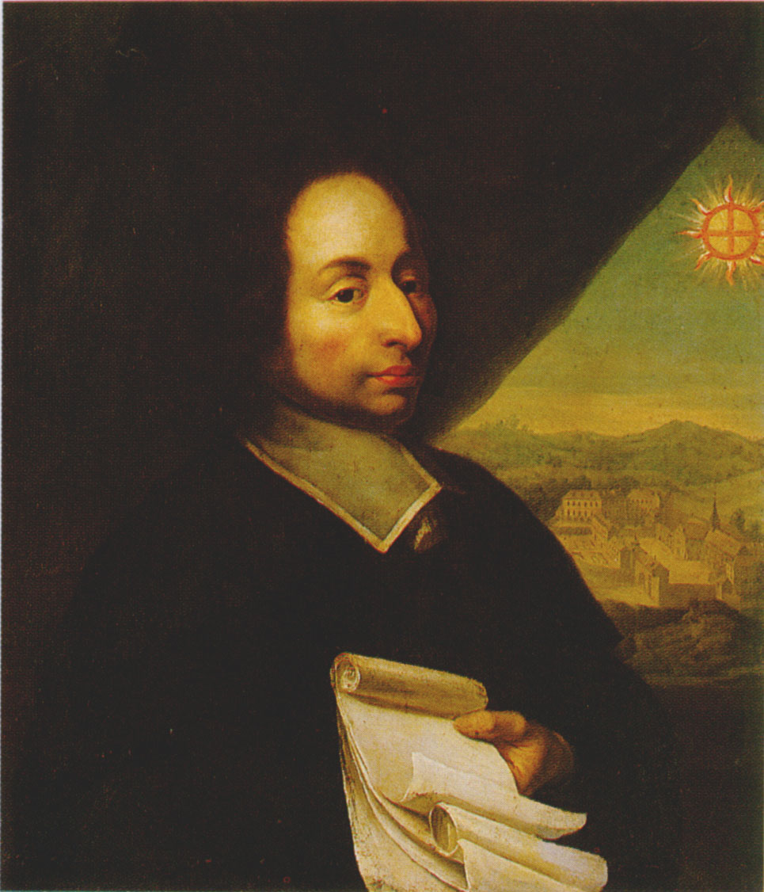
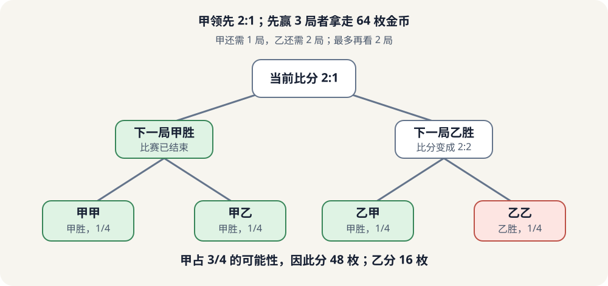
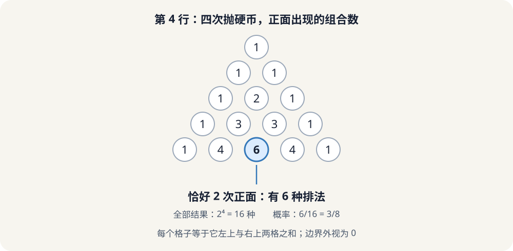
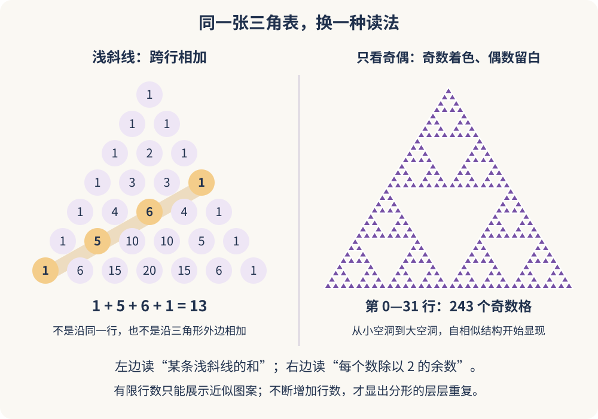

如果一场比赛打到一半突然被叫停，奖金该怎么分？

按当前比分分？把已经赢的局数换算成金币？还是干脆退回本金？

1654 年，法国数学家布莱兹·帕斯卡收到了一道来自赌徒圈的问题。它看上去像是在问“谁该拿钱”，其实逼着人们回答一个更深的问题：

> **还没发生的事，能不能用数学说清楚？**

帕斯卡把问题写信交给数学家皮埃尔·德·费马。接下来的通信里，两人分别从“把未来列出来”和“从结局往回算”入手。一次赌局，成了概率论发展史上最著名的起点之一。


_图 1：这幅帕斯卡肖像为 17 世纪作品，作者不详，现藏于法国图卢兹总主教区。图片来自 [Wikimedia Commons](https://commons.wikimedia.org/wiki/File:Blaise_Pascal_2.jpg)，该页面标注为公有领域。_

## 一、先别急着分：这不是一道新出现的赌徒难题

“比赛没结束，奖金怎么分？”这道题比帕斯卡早得多。

1494 年，意大利数学家卢卡·帕乔利已经在数学著作中讨论过中止比赛后的赌注分配。后来，吉罗拉莫·卡尔达诺也研究过骰子和赌博中的机会问题。他关于机会游戏的著作写于 16 世纪，却直到 1663 年才出版。

所以，概率论并不是帕斯卡某天凭空“发明”的。真正让 1654 年显得特别的，是帕斯卡和费马把这类问题推进成了清晰、系统的数学推理：不是凭感觉切分奖金，而是分析剩下的比赛，比较每个人获胜的机会。

当年，法国贵族、赌徒安托万·贡博（Chevalier de Méré）向帕斯卡请教“点数问题”（problem of points）。帕斯卡在 1654 年夏天与费马通信讨论此题。现存信件的日期集中在当年 7 月；它们不是一本成熟的概率论教科书，却把后来的关键方法摆到了桌面上。

## 二、一场 2 比 1 的比赛，公平分账是多少？

甲乙两人各出 32 枚金币，约定谁先赢满 3 局，谁就拿走全部 64 枚。比赛突然中止时，甲以 2 比 1 领先。

甲只差一局就夺冠；乙还得连赢两局，才有机会翻盘。把金币按当前比分分成 2:1，显然没有认真考虑这段差距。

我们来把比赛接着想一小步：

| 下一局结果 | 接下来的局面 | 甲最终应得 |
|---|---|---:|
| 甲赢 | 甲达到 3 胜，立即夺冠 | 64 枚 |
| 乙赢 | 比分变成 2:2，最后一局定胜负 | 32 枚 |

假设每局双方胜率相同，甲的公平份额就是这两种未来结果的平均：

$$
\frac{64+32}{2}=48.
$$

所以甲分 48 枚，乙分 16 枚。这里的“公平”不是说两人拿一样多，而是说：如果把这场比赛重复很多次，按当前局面分配的奖金与各自最终赢下整场的机会相称。

注意，这个推理有模型前提：每一局甲乙机会相同，各局之间没有影响。若甲明显比乙强，下一局甲胜的概率就不该设成 \(1/2\)，分账也会改变。

## 三、费马的办法：把“未来”排成四条路

甲还差一局，乙还差两局。最多再看两局，比赛必然有结果。

把甲赢记作“甲”，乙赢记作“乙”，未来的四种等可能序列是：

```text
甲甲    甲乙    乙甲    乙乙
甲胜    甲胜    甲胜    乙胜
```

严格来说，第一局若甲胜，比赛当场就结束，不会真的再打第二局。为了让四种序列的长度一致，我们把结束后剩下的结果当作“补位”：这种补位不改变赢家，却让所有路径都能放在同一个两局框架里计数。

四种可能里有三种是甲最终获胜，因此：

$$
P(\text{甲获胜})=\frac{3}{4},
\qquad
P(\text{乙获胜})=\frac{1}{4}.
$$

64 枚金币按这个比例分，就是甲 48 枚、乙 16 枚。


_图 2：把两局可能结果补齐后，四条路径等可能，其中三条对甲有利。这是费马式“枚举可能结果”的直观版本；甲第一局获胜后，图中的第二局只是补位，不代表比赛还会继续。_

这个小例子揭示了组合概率最基本的一招：

$$
\text{概率}
=\frac{\text{符合条件的可能数}}{\text{全部等可能的可能数}}.
$$

费马的思路很像清点所有路线：不预测哪条路会发生，只把每条路都公平地算进去。

## 四、帕斯卡的办法：不必走到终点，往回推就行

帕斯卡看重的另一条路，是把每一步的胜率从终点往回推。

设甲还需要 \(a\) 胜、乙还需要 \(b\) 胜。记 \(P(a,b)\) 为甲最终获胜的概率。若双方每局胜率都是一半，下一局只有两种可能：

- 甲赢：状态变成 \(P(a-1,b)\)；
- 乙赢：状态变成 \(P(a,b-1)\)。

于是：

$$
P(a,b)
=\frac12P(a-1,b)+\frac12P(a,b-1).
$$

已经达到目标时，答案当然是确定的：

$$
P(0,b)=1,\qquad P(a,0)=0.
$$

这条递推关系说得很朴素：**现在的胜率，就是下一步各个局面的胜率，按各自发生机会加权平均。**

回到甲领先 2:1 的例子，甲还差 1 胜、乙还差 2 胜。甲若下一局赢，甲就赢下比赛；乙若下一局赢，双方都还差一局。后一个局面下甲的胜率是 \(1/2\)，所以

$$
P(1,2)=\frac12\times1+\frac12\times\frac12
=\frac34.
$$

答案还是 \(3/4\)。这就是“动态规划”或“递推期望”会让现代读者感到熟悉的地方：一个复杂的大问题，拆成更简单的相邻状态，再从已知的结局倒推回来。这里用现代语言解释历史思路，不表示帕斯卡当年使用了今天这套术语。

## 五、帕斯卡三角：概率计算的“组合计数器”

上面四条路线，恰好能由一张数字表一眼数出来。

帕斯卡认真研究过这张表，系统整理了它的性质与应用；今天英语常称它为 **Pascal’s triangle**。在中国，它通常叫**杨辉三角**。名字不同，不是说三角形有两种，而是数学史在不同地方留下了自己的记录。

按从第 0 行开始编号，它长这样。我们把数字放进朝上的小三角形，让“谁在谁的肩膀上”更容易看清：


_图解：根据读者提供的三角形排布截图重新绘制，增加了中文行号、整行之和与“3＋3＝6”的描边演示，未直接转载来源不明的截图。动画只播放一次，结束后保留完整图；关闭动态效果时也能直接读图。[单独打开此图，刷新可重播](/assets/images/pascal/triangle-tiles.svg)。_

先别急着看公式，只做三件事：从最上面的 1 往下读；看看两条外边为什么一直是 1；最后盯住橙色的两个 3，它们正下方就是绿色的 6。**白色倒三角只是排版留下的空隙，不代表那里有一个数值 0。**

每个数等于左上、右上两数之和；边缘缺少的数当作 0。数学上，第 \(n\) 行第 \(k\) 个数是二项式系数：

$$
\binom{n}{k}.
$$

它的意思是：从 \(n\) 个位置里挑 \(k\) 个位置，有多少种挑法。公式写作：

$$
\binom{n}{k}=\frac{n!}{k!(n-k)!}.
$$

例如，抛 4 次公平硬币，恰好 2 次正面，相当于从 4 个位置中挑出 2 个放正面：

$$
\binom{4}{2}=6.
$$

第 4 行正是 \(1,4,6,4,1\)，分别对应 0、1、2、3、4 次正面；这一行的和是 \(16=2^4\)，等于所有硬币序列数。因此恰好两次正面的概率是 \(6/16=3/8\)。

### 不只知道“3＋3＝6”，还要知道这六种怎么来的

把四次抛硬币的最后一次单独拎出来。要凑够两个正面，只有两类互不重叠的办法：

| 最后一次是什么？ | 前三次需要什么？ | 完整序列，竖线后是最后一次 |
|---|---|---|
| 正面 | 恰好一个正面，共 3 种 | 正反反｜正、反正反｜正、反反正｜正 |
| 反面 | 恰好两个正面，共 3 种 | 正正反｜反、正反正｜反、反正正｜反 |

这就把上一行的两个 3，变成下一行的 6。**相加不是数字表的任意规定，而是在合并“最后一次正面”和“最后一次反面”这两类排法。** 一般的组合数递推，也是在做同一件事：按最后一个位置选或不选，把所有情况分成两类。

右侧的整行之和为什么翻倍？因为每一条旧序列，下一次都能接“正”或“反”，一条变两条。增加一次抛掷，全部排法就从 \(2^n\) 变成 \(2^{n+1}\)。不过，**排法有多少种**和**每种排法的概率多大**是两回事：只有在硬币公平且各次独立时，才能直接用“有利排法数÷全部排法数”算概率。


_图 3：第 4 行的系数从左到右分别数出 0 到 4 次正面的排法。中间的 6 是“从四次里挑两次”的组合数。_

现在，前面的赌局也能直接用三角形来算。甲还差 1 胜、乙还差 2 胜，最多再看 2 局。第 2 行是 \(1,2,1\)：甲在两局中赢 1 次或 2 次的序列数分别是 2 和 1，合计 3；全部序列数是 \(2^2=4\)，所以甲胜率为 \(3/4\)。

一般地，甲还差 \(a\) 胜、乙还差 \(b\) 胜。令

$$
N=a+b-1.
$$

如果把尚未结束的比赛补齐到 \(N\) 局，甲获胜等价于这 \(N\) 局里甲至少赢 \(a\) 局。因此，在每局公平且独立时：

$$
P(\text{甲获胜})
=\frac{\displaystyle\sum_{k=a}^{N}\binom{N}{k}}{2^N}.
$$

例如甲还差 2 胜、乙还差 4 胜，\(N=5\)。第 5 行为 \(1,5,10,10,5,1\)，甲至少赢 2 局的组合数是

$$
10+10+5+1=26.
$$

所以甲获胜概率为 \(26/32=81.25\%\)，乙为 \(18.75\%\)。若赌金共 64 枚，按期望份额分，甲应得 52 枚、乙得 12 枚。

如果甲每局获胜概率是 \(p\)，而不是 \(1/2\)，组合数还在，但每种序列不再同样可能，公式就变为：

$$
P(\text{甲获胜})
=\sum_{k=a}^{N}\binom{N}{k}p^k(1-p)^{N-k}.
$$

这就是二项分布的累积概率。**三角形负责数序列，\(p\) 负责给序列称重。**

## 六、名字里的历史：为什么中国叫“杨辉三角”？

把这个三角形叫“帕斯卡三角”，容易让人误会帕斯卡是第一个发现它的人；其实不是。

历史学家根据现存文献指出，中国数学家贾宪在 11 世纪已经掌握类似的数字排列与生成方法。贾宪的原著已佚；南宋数学家杨辉在 1261 年的著作中记录并说明了相关成果，也提到更早的来源。因此，在中文数学传统中称它为**杨辉三角**，是有历史依据的。

帕斯卡的重要性不在于给这张表“抢先命名”，而在于他在 17 世纪欧洲系统研究了这张三角表，把组合数、二项式展开与赌博问题联系起来。不同文明都对这个结构作出过贡献；这篇文章的主角仍是帕斯卡和他与费马对概率推理的推进。

再补一个容易混淆的年份：帕斯卡的《算术三角论》（*Traité du triangle arithmétique*）通常被认为写于 1654 年，但在他去世后于 1665 年出版。它讨论了算术三角及其应用，包括组合与机会问题。**写成的年份和正式印行的年份，不是一回事。**

## 七、概率论不是一夜诞生：帕斯卡之后还有谁？

把概率论的起源讲成“帕斯卡一个人发明概率”并不准确。更好的说法是：帕斯卡与费马在 1654 年的通信是现代概率论的一块重要奠基石；在它之前已有赌博数学，在它之后还有理论整理和推广。

| 时间 | 数学史上的一站 |
|---|---|
| 1494 年 | 帕乔利在著作中讨论中止赌局的分配问题 |
| 16 世纪 | 卡尔达诺研究骰子与机会游戏；相关著作后来才出版 |
| 1654 年 | 帕斯卡与费马通信讨论点数问题 |
| 1657 年 | 惠更斯出版专门讨论机会游戏的早期概率著作 |
| 1665 年 | 帕斯卡的《算术三角论》在其身后出版 |

惠更斯（Christiaan Huygens）的《论机会游戏中的推理》（*De ratiociniis in ludo aleae*，1657）把机会游戏的推理写成了可学习的系统内容。之后，雅各布·伯努利等人继续推进概率理论，讨论重复试验与大量观察。概率论从“赌局怎样分”慢慢扩展到“如何描述不确定性”，最终走进统计、保险、科学实验和经济学。

因此，帕斯卡和费马不是独自造出了一整座概率大厦；他们更像是找到了几块关键的地基：未来状态可以枚举，路径可以比较，公平份额可以由胜率和期望来定义。

## 八、这张三角表的几条彩蛋

### 斜着相加，会遇见斐波那契数列

沿着帕斯卡三角的浅斜线逐条相加，会得到 \(1,1,2,3,5,8,13,\ldots\)，也就是斐波那契数列。组合数的不同排列，恰好把同一个递推关系藏在斜线上。


_读图：左边的浅斜线穿过不同的行，右边只保留数的奇偶性。两种玩法都来自同一张三角表，却回答完全不同的问题。_

左图高亮的四个数，依次来自**第 6 行的第 0 项、第 5 行的第 1 项、第 4 行的第 2 项、第 3 行的第 3 项**；行、项都从 0 开始数。它们是 \(1,5,6,1\)，相加得到 13。不要误读成“把第 6 行全部加起来”：那样得到的是 64，不是 13。

把同样的浅斜线从顶端逐条挪下来，得到的和是：

```text
1，1，1+1，1+2，1+3+1，1+4+3，1+5+6+1
↓  ↓    ↓    ↓      ↓        ↓          ↓
1，1，  2，  3，    5，      8，        13
```

为什么会延续“前两项相加”的规律？因为每个格子本来就来自肩上的两个格子：把一条浅斜线上的格子各拆成这两个来源，正好汇成前两条浅斜线的和。

### 奇数涂黑，会出现谢尔宾斯基三角形

看上图右半边：这次不关心数有多大，只把奇数涂紫、偶数留白。第 0 至 31 行已经能显出一个大三角形里套着小三角形的图案。继续增加行数、按相同比例缩放，会逐渐显出**谢尔宾斯基三角形**的自相似结构；有限的这 32 行，是这个分形图案的一幅有限近似。

这不是随手画出的装饰。递推规则仍然在工作，只不过现在变成了奇偶游戏：

| 肩上两个数 | 下面的数 | 染色结果 |
|---|---|---|
| 奇数＋奇数 | 偶数 | 留白 |
| 偶数＋偶数 | 偶数 | 留白 |
| 一奇一偶 | 奇数 | 着色 |

原先的加法，换成了“相同留白、不同着色”。同一条局部规则一层层重复，便长出了大小不同的三角形空洞。**不必先学分形公式，也能亲手从几行数字开始画。**

想自己点一点，可以打开 [Mathigon 的帕斯卡三角互动课程](https://mathigon.org/course/sequences/pascals-triangle)，依次尝试补数、浅斜线与整除染色；也可看 [GeoGebra 的数列图案探索](https://www.geogebra.org/m/k3rebgg6)。这些是外部交互页面，可能需要网络和 JavaScript；本文的中文图解与解释不依赖它们加载。

### 斜列相加，像一支“曲棍球棒”

例如三角数这一斜列中：

$$
1+3+6+10=20.
$$

沿斜列连续相加，结果会落到更靠右下方的一个系数上，这条求和规律就叫“曲棍球棒恒等式”。数字三角形小小一张，却同时连着概率、代数、组合和数论。

## 结尾：数学不能预言下一局，却能算清“公平”

帕斯卡三角不会告诉我们下一枚硬币一定正面朝上，帕斯卡和费马也没有用数学消灭运气。

他们做的是另一件事：把模糊的“如果比赛继续”，拆成明确的状态与路径；再通过计数或递推，算出每个人拥有多少胜算。于是，原本只凭直觉争论的赌局，第一次有了可复核的公平算法。

**概率论的起点不是猜中未来，而是承认未来未知之后，仍然认真计算。**

## 延伸阅读与图片来源

- [美国物理学会：1654 年帕斯卡与费马关于“点数问题”的通信](https://www.aps.org/apsnews/2009/07/pascal-letters-fermat-points)：介绍赌局背景、费马枚举法与帕斯卡递推思路。
- [约克大学：帕斯卡与费马概率通信译文](https://www.york.ac.uk/depts/maths/histstat/pascal.pdf)：可进一步阅读通信原文的英译。
- [剑桥大学典藏库：帕斯卡《算术三角论》版本资料](https://www.repository.cam.ac.uk/items/485717eb-494c-4dee-ae07-688a4b3b15b5)：查看帕斯卡著作的馆藏记录。
- [MacTutor：帕斯卡生平](https://mathshistory.st-andrews.ac.uk/Biographies/Pascal/)。
- [MacTutor：贾宪与早期的算术三角](https://mathshistory.st-andrews.ac.uk/Biographies/Jia_Xian/)；[杨辉及其 1261 年著作](https://mathshistory.st-andrews.ac.uk/Biographies/Yang_Hui/)。
- [Wolfram MathWorld：帕斯卡三角的系数、递推和斐波那契关系](https://mathworld.wolfram.com/PascalsTriangle.html)。
- [Mathigon：Pascal’s Triangle](https://mathigon.org/course/sequences/pascals-triangle)：补数、浅斜线与整除染色的互动探索。本文参考其教学切入点，用组合数重新计算并原创绘制中文图解，不转载该站插图。
- [GeoGebra：Pascal's Triangle Exploration](https://www.geogebra.org/m/k3rebgg6)：通过选项观察数列和组合规律。
- 帕斯卡肖像：17 世纪匿名作品，来源及公有领域说明见 [Wikimedia Commons 文件页](https://commons.wikimedia.org/wiki/File:Blaise_Pascal_2.jpg)。
- 文中“赌局路径树”“硬币次数示意图”“三角形格子递推图”与“浅斜线及奇偶染色图”为原创绘制；三角形格子的排布受读者提供截图启发。
