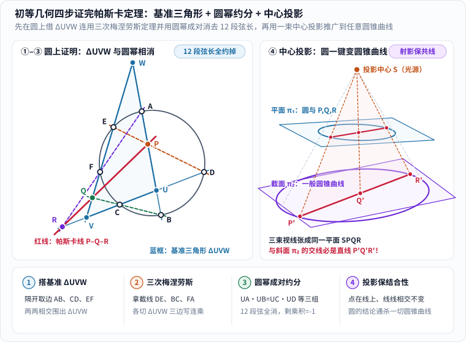
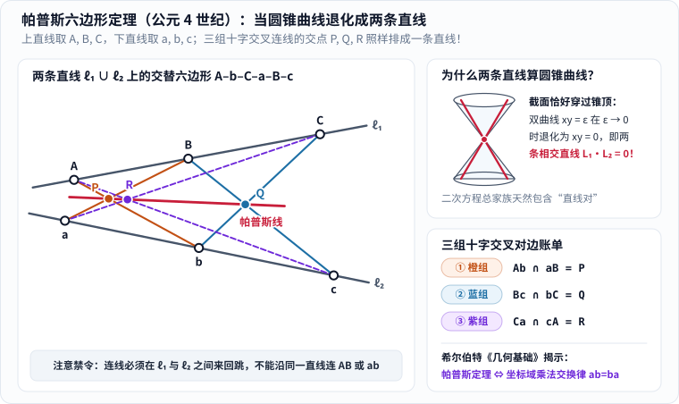
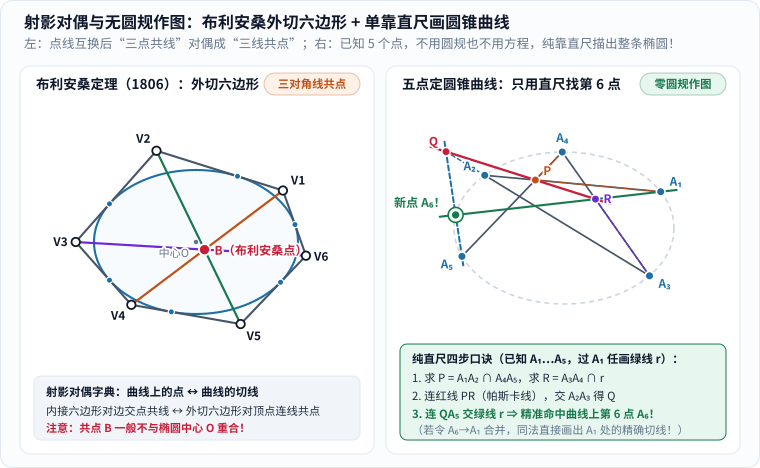

六个点，画出一个闭合六边形；把三组“对边”分别延长，得到三个交点。

这三个交点明明来自三对看起来互不相干的直线，最后却会像提前商量好了一样，乖乖排在同一条笔直的红线上。

这就是射影几何史上最令人着迷的定理之一——**帕斯卡定理（Pascal's theorem）**。它的结论短得像一个餐桌魔术，背后的故事却从十六岁少年布莱兹·帕斯卡的一页纸大纲出发，上承古希腊晚期亚历山大城帕普斯的十字交叉直线，下启十九世纪布利安桑的对偶翻转、“不用圆规只靠一把直尺画椭圆”的绝活，以及由 **60 条帕斯卡线**交织而成的**“帕斯卡神秘六边形”（Hexagrammum Mysticum）**。

_图 1：先看灰色自交六边形，再按橙、青、紫三组颜色依次配对，最后看穿过三交点的红色帕斯卡线。动画在 5 秒内播放一次并停留在完整终态；静止或关闭动态效果时也可直接按下方三组边号跟读。[单独打开，刷新可重播](/assets/images/pascal/pascal-construction.svg)；[查看带延长线的原静态图](/assets/images/pascal/pascal-theorem.svg)。_

---

## 一、先把游戏规则说清楚：什么叫“隔三条配对”？

初次接触帕斯卡定理的人，十有八九会在第一步踩空：盯着一个歪七扭八甚至自己穿过自己的六边形，凭肉眼到处找“哪两条边面对面”。一旦配错了边，后面自然怎么连都不共线。先把游戏规则立稳，整件事就成了一套谁都不会算错的机械口诀。

### 1. 顶点顺序可以自交：不看图形胖瘦，只数边序

在任意一条非退化的**圆锥曲线**——无论是圆、椭圆、抛物线还是双曲线——上任取六个互不相同的点，给它们标上编号 $$1$$ 到 $$6$$，然后按你喜欢的**任意顺序**首尾相连，围成一个闭合六边形。

这里的“任意顺序”是实打实的：你既可以顺着曲线乖乖画一个凸六边形，也可以故意横穿曲线内部，画出一颗交叉重叠的六角星。例如在图 1 中，我们选定的顶点巡游顺序是：

$$
1 \to 4 \to 2 \to 6 \to 3 \to 5 \to 1
$$

沿着这趟行程按出场先后写出六条边，依次是：

- 边①：$$14$$（表示连接点 $$1$$ 与点 $$4$$ 的直线，不是数字十四）；
- 边②：$$42$$；
- 边③：$$26$$；
- 边④：$$63$$；
- 边⑤：$$35$$；
- 边⑥：$$51$$。

所谓三组**对边（opposite sides）**，根本不看图上哪两条线段离得最远，而是严格按六边形的巡游次序**相隔三条边配成一对**——也就是**边①配边④、边②配边⑤、边③配边⑥**：

$$
(14,\ 63),\qquad (42,\ 35),\qquad (26,\ 51)
$$

把每一对边所在的直线分别无限延伸（如果两条线段本身已经相交，交点就在内部；如果在有限线段内没碰上，就用直尺把它们延长出去），得到三个交点 $$P, Q, R$$。帕斯卡定理断言：

> **无论六个点在圆锥曲线上怎样挑选，也无论六边形按什么顺序连接交叉，三组对边的交点 $$P, Q, R$$ 必定共处于同一条直线上。**

这条串起三个交点的直线，就叫作该六边形的**帕斯卡线（Pascal line）**。

### 2. 跟着配色做三次配对：别把路过的杂交点认错人

在自交六边形里，线条彼此横穿，图上会冒出一大堆看似诱人的交叉点。**千万不要见着交叉就标字母**——只有配对表里钦定的那三组直线交点，才是真正的 $$P, Q, R$$：

| 读图步骤 | 配哪两条边？ | 边序关系 | 锁定哪个交点？ |
|---|---|---|---|
| 第一组（橙色） | 直线 $$14$$ 与直线 $$63$$ | 边① 与 边④ | 交于点 **$$P$$** |
| 第二组（青色） | 直线 $$42$$ 与直线 $$35$$ | 边② 与 边⑤ | 交于点 **$$Q$$** |
| 第三组（紫色） | 直线 $$26$$ 与直线 $$51$$ | 边③ 与 边⑥ | 交于点 **$$R$$** |

图 1 特意挑选了一组非常友好的点位，让 $$P, Q, R$$ 恰好全都落在各自线段的内部，第一遍跟读时连延长线都省了；要是你把点 $$2$$ 或点 $$5$$ 沿着椭圆挪开几厘米，某个交点很可能嗖地一下飞到椭圆外头老远的地方，这时只要老老实实把对应两边延长，用直尺连起 $$P$$ 和 $$Q$$，第三个交点 $$R$$ 依然稳稳站在那条红线上。

如果你想亲手拖动曲线上的点来找感觉，可以打开 [GeoGebra 的 Pascal's theorem 动态作图页](https://www.geogebra.org/m/uZ94jeUb)（外部交互页面需联网并开启 JavaScript；正文完全独立可读）。不过在数学家眼里，哪怕你在屏幕上拖动一万次都看着共线，那也只能算“实验现象”，还不是保证一切位置都成立的严格证明。

### 3. 十六岁少年的“一页纸大纲”：从德萨格沙龙到《圆锥曲线论》

把时钟拨回十七世纪上半叶的巴黎。布莱兹·帕斯卡（Blaise Pascal，1623–1662）从小跟着父亲出入梅森神父（Marin Mersenne）主持的科学沙龙——那里简直是当时法兰西最顶尖头脑的俱乐部，费马、笛卡尔、罗伯瓦尔都与这个圈子往来密切（关于帕斯卡日后与费马通信创立概率论的另一段传奇，可参看姊妹篇《[帕斯卡怎样把一场赌局变成概率论]()》）。

当时的几何学正经历一场静悄悄的观念地震。建筑师兼数学家**吉拉尔·德萨格（Girard Desargues）**在 1639 年研究透视画法与石工截切时提出：与其把圆、椭圆、抛物线和双曲线当成四种孤立的图形分别死算边长和角度，不如用**中心投影（透视）**把它们看成同一个圆在不同倾斜画布上的影子！

年仅十六岁的帕斯卡敏锐地接住了这把火炬。1639 年底至 **1640 年 2 月**，他把自己的核心发现浓缩印成了一张单页传单——《圆锥曲线论纲》（*Essai pour les coniques*，详见 [MacTutor 数学史档案：Blaise Pascal](https://mathshistory.st-andrews.ac.uk/Biographies/Pascal/)）。在这页短短的大纲里，少年帕斯卡先把神秘六边形作为核心引理亮了出来，并预告自己将由此一举推出阿波罗尼奥斯《圆锥曲线论》里的几百条经典命题！据说远在荷兰的笛卡尔初读这页传单时，一度不敢相信它真出自一个十六岁孩子之手，怀疑背后定有德萨格代笔。

令人扼腕的是，帕斯卡后来撰写的完整长篇手稿生前未能付印；1676 年莱布尼茨旅居巴黎时曾亲自借阅并摘录赞叹过这份手稿，但原稿此后不幸散佚。于是就留下了一个吊足后人胃口的问题：**既然帕斯卡当年的原始长篇证明没能完整传世，我们今天能不能只用中学几何知识，自己动手把帕斯卡定理彻彻底底证出来？**

答案不仅是可以，而且证明过程干净利落得像做了一场约分游戏！

---

## 二、动手证一次：为什么那三个交点非共线不可？

要证明任意圆锥曲线上的帕斯卡定理，千万别一上来就列满黑板的二次曲线坐标方程硬解交点——那样算上三页纸也未必能因式分解出来。最聪明的路线分两步走：**先在最对称的“圆”上用初等几何证出来，再打开一束手电筒，用中心投影把它一键复制到所有圆锥曲线上！**

为了避免边名里的数字跟算式里的乘号打架，这一章我们把圆 $$\mathcal{O}$$ 上的六个顶点改记为大写字母 $$A, B, C, D, E, F$$，按巡游顺序 $$A \to B \to C \to D \to E \to F \to A$$ 连成六边形（允许像图 2 左栏那样自交）。此时六条边依次是 ① $$AB$$、② $$BC$$、③ $$CD$$、④ $$DE$$、⑤ $$EF$$、⑥ $$FA$$，三组对边的交点分别是：

$$
P = AB \cap DE,\qquad Q = BC \cap EF,\qquad R = CD \cap FA
$$

对照下面这张精确计算的几何分步图，我们只用四步就能直捣黄龙（这一经典初等证法收录于 Coxeter 与 Greitzer 著《几何新方法和新观点》*Geometry Revisited* 第 3.8 节）：

_图 2：左栏在圆上取隔开的三条边 $$AB, CD, EF$$（蓝色实线）围出基准三角形 $$\Delta UVW$$，再拿另外三条边 $$DE$$（橙虚线）、$$BC$$（绿虚线）、$$FA$$（紫虚线）充当截线；右栏从投影中心 $$S$$ 发出视线，把平面 $$\pi_1$$ 上的圆与帕斯卡线投射到倾斜截面 $$\pi_2$$ 上的一般圆锥曲线与直线 $$P'Q'R'$$ 上。[单独打开大图](/assets/images/pascal/pascal-menelaus-proof.svg)。_

### 1. 第一步：借三条隔开的非相邻边，搭起一座“基准三角形” ΔUVW

要在平面几何里证明“三个散落的点 $$P, Q, R$$ 共线”，最锋利的现成武器莫过于**梅涅劳斯定理（Menelaus's theorem）的逆定理**——只要能找到一个合适的三角形，让 $$P, Q, R$$ 恰好一个萝卜一个坑地蹲在它的三条边（或延长线）上，剩下的就全是线段比值的乘除法了！

去哪儿找这个天选三角形呢？秘诀就藏在六边形**隔开取出的三条非相邻边**里：我们把边① $$AB$$、边③ $$CD$$、边⑤ $$EF$$ 所在的直线单独拎出来（假定它们处于一般位置，两两相交且不三线共点），记它们的交点为：

$$
U = AB \cap CD,\qquad V = CD \cap EF,\qquad W = EF \cap AB
$$

仔细核对一下这座蓝色**基准三角形 $$\Delta UVW$$** 的三条边所在直线：

- 边 $$WU$$ 所在的直线，就是直线 **$$AB$$**！而 $$P = AB \cap DE$$，所以 **点 $$P$$ 天然躺在直线 $$WU$$ 上**（同时圆上的点 $$A, B$$ 也躺在 $$WU$$ 上）；
- 边 $$UV$$ 所在的直线，就是直线 **$$CD$$**！而 $$R = CD \cap FA$$，所以 **点 $$R$$ 天然躺在直线 $$UV$$ 上**（同时圆上的点 $$C, D$$ 也躺在 $$UV$$ 上）；
- 边 $$VW$$ 所在的直线，就是直线 **$$EF$$**！而 $$Q = BC \cap EF$$，所以 **点 $$Q$$ 天然躺在直线 $$VW$$ 上**（同时圆上的点 $$E, F$$ 也躺在 $$VW$$ 上）！

这一步搭台堪称神来之笔：我们还没开始算一个数，$$P, R, Q$$ 三个主角就已经严丝合缝地分别站到了 $$\Delta UVW$$ 的三条边线 $$WU, UV, VW$$ 上！

### 2. 第二步：用三次梅涅劳斯定理，把 P、Q、R 写进三串连乘式

先用一句话唤醒**梅涅劳斯定理**：如果一条不经过顶点的直线（叫“截线”）依次切过 $$\Delta UVW$$ 的三边直线 $$WU, UV, VW$$ 于三点 $$X, Y, Z$$，那么沿着三角形绕一圈写出的**有向线段之比**（规定同一直线上方向相同取正、方向相反取负）乘起来必定等于 $$-1$$：

$$
\frac{\overline{WX}}{\overline{XU}} \cdot \frac{\overline{UY}}{\overline{YV}} \cdot \frac{\overline{VZ}}{\overline{ZW}} = -1
$$

反之（**梅涅劳斯逆定理**），如果分别位于三边直线 $$WU, UV, VW$$ 上的三个点满足上面这串有向比乘积等于 $$-1$$，这三个点就必定在同一条直线上！

现在，六边形那三条还没派上用场的偶数号边——④ $$DE$$、② $$BC$$、⑥ $$FA$$——正好排着队上场，轮流充当切过 $$\Delta UVW$$ 的三条截线：

1. **第一刀：拿直线 ④ $$DE$$ 去切 $$\Delta UVW$$**
   直线 $$DE$$ 与 $$WU$$（即 $$AB$$）交于 **$$P$$**，与 $$UV$$（即 $$CD$$）交于 **$$D$$**，与 $$VW$$（即 $$EF$$）交于 **$$E$$**。套用梅涅劳斯定理得第 (1) 式：

   $$
   \frac{\overline{WP}}{\overline{PU}} \cdot \frac{\overline{UD}}{\overline{DV}} \cdot \frac{\overline{VE}}{\overline{EW}} = -1
   $$

2. **第二刀：拿直线 ② $$BC$$ 去切 $$\Delta UVW$$**
   直线 $$BC$$ 与 $$WU$$（即 $$AB$$）交于 **$$B$$**，与 $$UV$$（即 $$CD$$）交于 **$$C$$**，与 $$VW$$（即 $$EF$$）交于 **$$Q$$**。套用梅涅劳斯定理得第 (2) 式：

   $$
   \frac{\overline{WB}}{\overline{BU}} \cdot \frac{\overline{UC}}{\overline{CV}} \cdot \frac{\overline{VQ}}{\overline{QW}} = -1
   $$

3. **第三刀：拿直线 ⑥ $$FA$$ 去切 $$\Delta UVW$$**
   直线 $$FA$$ 与 $$WU$$（即 $$AB$$）交于 **$$A$$**，与 $$UV$$（即 $$CD$$）交于 **$$R$$**，与 $$VW$$（即 $$EF$$）交于 **$$F$$**。套用梅涅劳斯定理得第 (3) 式：

   $$
   \frac{\overline{WA}}{\overline{AU}} \cdot \frac{\overline{UR}}{\overline{RV}} \cdot \frac{\overline{VF}}{\overline{FW}} = -1
   $$

别被这三行分式吓到——请注意，直到这一步为止，我们甚至**还没有用过“$$A,B,C,D,E,F$$ 在同一个圆上”这个条件**！对平面上随便乱点的六个点，上面三式全都照样成立。那么，“六个点共圆”的魔法到底在哪一刻显灵呢？

### 3. 第三步：三式相乘，圆幂定理让 12 段弦长成对抵消为 1！

见证奇迹的时刻到了：把上面第 (1)、(2)、(3) 式的左边全部乘在一起，右边也乘在一起（右边是 $$(-1)\times(-1)\times(-1) = -1$$）。

在左边的 9 个分式里，先把含有目标点 $$P, R, Q$$ 的那三项挑到最前头作为主角，再把剩下的 **12 段有向线段**按它们所挂靠的三角形顶点 $$U, V, W$$ 分成三堆：

$$
\left(\frac{\overline{WP}}{\overline{PU}} \cdot \frac{\overline{UR}}{\overline{RV}} \cdot \frac{\overline{VQ}}{\overline{QW}}\right)
\cdot \left(\frac{\overline{UC}\cdot\overline{UD}}{\overline{BU}\cdot\overline{AU}}\right)
\cdot \left(\frac{\overline{VE}\cdot\overline{VF}}{\overline{DV}\cdot\overline{CV}}\right)
\cdot \left(\frac{\overline{WB}\cdot\overline{WA}}{\overline{EW}\cdot\overline{FW}}\right)
= -1
$$

先处理分母里一个极小的符号细节：在有向线段里，$$\overline{BU} = -\overline{UB}$$ 且 $$\overline{AU} = -\overline{UA}$$，负负得正，所以 $$\overline{BU}\cdot\overline{AU} = \overline{UA}\cdot\overline{UB}$$！同理 $$\overline{DV}\cdot\overline{CV} = \overline{VC}\cdot\overline{VD}$$，$$\overline{EW}\cdot\overline{FW} = \overline{WE}\cdot\overline{WF}$$。

现在盯着后面那三个括号，唤醒初中几何里的**圆幂定理**（《几何原本》第三卷命题 35、36）：从平面上同一个定点出发画两条直线与同一个圆相交，无论这个定点是在圆外（割线定理）还是在圆内（相交弦定理），**从该点到两个圆周交点的有向线段乘积都等于同一个定值（该点对圆的幂 $$d^2 - r^2$$）**！

挨个点名核对：

- **站在顶点 $$U$$ 往圆看**：直线 $$UAB$$ 和直线 $$UCD$$ 是过 $$U$$ 的两条割线（或相交弦），因为 $$A, B, C, D$$ 共圆，立刻有 $$\overline{UA}\cdot\overline{UB} = \overline{UC}\cdot\overline{UD}$$，第一个杂项括号**整块约成 $$1$$**！
- **站在顶点 $$V$$ 往圆看**：直线 $$VCD$$ 和直线 $$VEF$$ 过同一点 $$V$$ 且 $$C, D, E, F$$ 共圆，立刻有 $$\overline{VC}\cdot\overline{VD} = \overline{VE}\cdot\overline{VF}$$，第二个杂项括号**整块约成 $$1$$**！
- **站在顶点 $$W$$ 往圆看**：直线 $$WEF$$ 和直线 $$WAB$$ 过同一点 $$W$$ 且 $$E, F, A, B$$ 共圆，立刻有 $$\overline{WE}\cdot\overline{WF} = \overline{WA}\cdot\overline{WB}$$，第三个杂项括号**整块约成 $$1$$**！

整整 12 段看似乱麻的割线长，在“六点共圆”的号令下啪啪啪全部成对抵消，干净得只剩下最前面那一串：

$$
\frac{\overline{WP}}{\overline{PU}} \cdot \frac{\overline{UR}}{\overline{RV}} \cdot \frac{\overline{VQ}}{\overline{QW}} = -1
$$

根据**梅涅劳斯逆定理**，分别落在 $$\Delta UVW$$ 三边直线上的三个点 $$P, R, Q$$ **必然三点共线**！圆上的帕斯卡定理，就此宣告证毕！

### 4. 第四步：打开手电筒——中心投影把“圆的证明”一键推广到所有圆锥曲线

圆上证完了，那椭圆、抛物线和双曲线怎么办？难道要把焦点距离公式搬出来重算三遍吗？

完全不用！回到图 2 右栏的三维场景：顾名思义，任何一条非退化的**圆锥曲线**，都可以放进三维空间里，看作一个以圆为底面的正圆锥被某个倾斜平面 $$\pi_2$$ 切出来的截面（关于圆锥截面与焦球美妙关系的立体图解，可参看姊妹篇《[用几何读懂圆锥曲线与丹德林球]()》）。

现在把圆锥的顶点 $$S$$ 想象成一盏点状手电筒光源，从 $$S$$ 发出无数条直线光线，把水平面 $$\pi_1$$ 上的圆以及圆内接六边形 $$ABCDEF$$，逐点投射到倾斜平面 $$\pi_2$$ 上的目标圆锥曲线 $$A'B'C'D'E'F'$$ 上：

1. **哪些东西在投影中变掉了？** 线段的长度变了、夹角大小变了，甚至原本的“圆幂相等”在斜面上也不再保持相等——但这全都是我们已经卸磨杀驴用完的脚手架！
2. **哪些东西在投影中绝对不变？** **点与直线的结合关系（incidence）绝对不变！** 平面 $$\pi_1$$ 上的一条直线（比如边 $$AB$$），连同光源 $$S$$ 一起张成一张平坦的“光片平面” $$SAB$$；这张光片平面切过斜面 $$\pi_2$$，交线必然仍是一条笔直的直线 $$A'B'$$！同理，两条直线的交点 $$P = AB \cap DE$$，沿着光线 $$SP$$ 必然精准投射成新两边的交点 $$P' = A'B' \cap D'E'$$。
3. **为什么 $$P', Q', R'$$ 必然共线？** 因为在水平面 $$\pi_1$$ 上，我们已经严格证明了 $$P, Q, R$$ 共处于同一条帕斯卡直线上！这意味着三条视线 $$SP, SQ, SR$$ 全都躺在同一张平坦的光片平面 $$SPQR$$ 里；而两张平面（光片平面 $$SPQR$$ 与倾斜截面 $$\pi_2$$）相交，它们的交线**只能是一条直线**！于是 $$P', Q', R'$$ 别无选择，必须整整齐齐排在这条交线上！

细心的读者可能会追问最后一个漏洞：**万一在某种对称摆法下，有两组对边恰好互相平行，在普通平面上“没有交点”，或者投影时某个点恰好沿着平行于 $$\pi_2$$ 的光线飞走了，怎么办？**

这正是射影几何最潇洒的扩充（详见姊妹篇《[彭赛列和射影几何]()》）：在**射影平面 $$\mathbb{RP}^2$$** 中，每一簇互相平行的直线都被视为相交于同一个方向上的**无穷远点**，而平面上所有方向的无穷远点共同组成一条**无穷远直线**。

- 如果 $$P$$ 和 $$Q$$ 都是无穷远点（即前两组对边各自平行），连接 $$P, Q$$ 的帕斯卡线本身就是无穷远直线——此时定理立刻预言：第三个交点 $$R$$ 也必须在无穷远直线上，也就是说**第三组对边必定也互相平行**！
- 如果只有 $$P$$ 一个点跑到了无穷远处（第一组对边平行），那么穿过有限点 $$Q, R$$ 与无穷远点 $$P$$ 的帕斯卡线，就是欧氏平面里一条**过 $$Q, R$$ 且与第一组对边平行**的普通直线！

没有任何打补丁式的分类讨论，添上一条无穷远直线后，所有平行特例与一般情况合体成了同一个滴水不漏的定理。

---

## 三、退化的惊喜：当圆锥曲线“压扁”成两条直线（帕普斯定理）

刚才我们把截面 $$\pi_2$$ 斜着切过圆锥，切出了椭圆、抛物线和双曲线。如果恶作剧地把这把刀继续往上挪，让截面**不偏不倚正好穿过圆锥的尖顶 $$S$$**，切出来的会是什么图形？

### 1. 截面穿过圆锥顶点：两条相交直线也是二次曲线家族成员

当平面穿过双圆锥的公共顶点并切入锥面内部时，它切出来的不再是一条光滑弯曲的弧线，而是圆锥侧面上**两条相交于顶点的笔直母线 $$\ell_1$$ 与 $$\ell_2$$**！

用解析几何的语言看，这件事同样顺理成章：反比例双曲线的方程是 $$xy = \varepsilon$$；当你把常数 $$\varepsilon$$ 慢慢拧小趋近于 $$0$$，双曲线的两支就会越贴越近，在 $$\varepsilon = 0$$ 的极限瞬间“啪”地拍扁成方程 $$xy = 0$$——也就是 $$x = 0$$ 和 $$y = 0$$ **两条直线并在一起**！更一般地，任意两条直线 $$L_1(x,y) = 0$$ 与 $$L_2(x,y) = 0$$ 乘起来得到的 $$L_1(x,y)\cdot L_2(x,y) = 0$$，展开后依然是一个货真价实的二元二次方程，在代数几何中称为**退化圆锥曲线（degenerate conic）**。

既然“两条直线拼成的线对”也是圆锥曲线家族的合法成员，那么帕斯卡定理在它身上还灵不灵？

答案是：**不仅灵验，而且比帕斯卡早了整整一千三百年就被古希腊人发现了！** 大约在**公元 340 年前后**，亚历山大城的数学家**帕普斯（Pappus of Alexandria）**在他的《数学汇编》（*Synagoge* / *Collection*）第七卷中证明了下面这条定理，今天称为**帕普斯六边形定理（Pappus's hexagon theorem）**：

_图 3：左栏在上方直线 $$\ell_1$$ 上任取三点 $$A, B, C$$，在下方直线 $$\ell_2$$ 上任取三点 $$a, b, c$$（两直线可相交也可平行）；按上下交替顺序连成六边形后，橙、蓝、紫三组十字交叉对边的交点 $$P, Q, R$$ 严格落在红色帕普斯线上。右栏说明双圆锥过顶截面如何退化为直线对。[单独打开大图](/assets/images/pascal/pappus-two-lines.svg)。_

### 2. 上三点 A, B, C 配下三点 a, b, c：十字交叉为什么必须来回跳？

跟着图 3 左栏动手画一遍帕普斯定理，只需要一把直尺和十秒钟：

1. 先随便画两条直线 $$\ell_1$$ 和 $$\ell_2$$；在 $$\ell_1$$ 上随便点三个点 **$$A, B, C$$**（谁左谁右无所谓），在 $$\ell_2$$ 上随便点三个点 **$$a, b, c$$**；
2. 让六边形的连线在上下两条直线之间**一上一下来回跳跃**，按巡游顺序 $$A \to b \to C \to a \to B \to c \to A$$ 走完一圈；
3. 按“隔三条边配对”的同一套规则，读出三组漂亮的对称“十字交叉”对边：
   - **橙色组（边① $$Ab$$ 与边④ $$aB$$）**：在 $$A, B$$ 与 $$a, b$$ 之间画交叉十字，交点记作 **$$P$$**；
   - **蓝色组（边⑤ $$Bc$$ 与边② $$bC$$）**：在 $$B, C$$ 与 $$b, c$$ 之间画交叉十字，交点记作 **$$Q$$**；
   - **紫色组（边③ $$Ca$$ 与边⑥ $$cA$$）**：在 $$C, A$$ 与 $$c, a$$ 之间画大跨度交叉十字，交点记作 **$$R$$**。

拿直尺往 $$P, Q, R$$ 上一靠——分毫不差，三点永远共线！而且刚才第二章我们在圆上练熟的那套“基准三角形 + 三次梅涅劳斯定理”打法，搬到两条直线上甚至更省事：只需把三次梅涅劳斯切线换到由 $$Ab, Bc, Ca$$（或另一组）搭出的三角形上，再对直线 $$\ell_1$$ 上的 $$A,B,C$$ 和直线 $$\ell_2$$ 上的 $$a,b,c$$ 各用一次梅涅劳斯定理，连圆幂定理都不用请，所有杂项比值当场约成 $$1$$！

不过这里要留心一个退化情形特有的**“踩坑禁令”**：为什么连接顺序必须在 $$\ell_1$$ 和 $$\ell_2$$ 之间交替跳，而不能偷懒连出 $$A \to B \to C \to c \to b \to a \to A$$？因为如果你在 $$\ell_1$$ 上连了 $$AB$$，它其实整条就是直线 $$\ell_1$$ 本身；万一有两条对边同时赖在同一条底线 $$\ell_1$$ 上，它们的“交集”就会变成整条直线而不是唯一确定的点，定理的前提就退化失效了。

### 3. 希尔伯特挖出的代数灵魂：帕普斯定理竟然等价于“乘法交换律”！

到了 1899 年，现代公理化几何的奠基人大卫·希尔伯特（David Hilbert）出版名著《几何基础》（*Grundlagen der Geometrie*），在帕普斯这张看似简单的十字交叉图底下，挖出了一颗震惊整个数学界的代数彩蛋！

希尔伯特问了一个极深的问题：如果我们不预先假定平面上已经有实数坐标，而是只从“两点连成一线、两线交于一点”的纯粹射影几何公理出发，给直线上的点一步步定义出几何版的“加法”和“乘法”，需要加进哪条几何定理，才能保证造出来的这套代数运算像我们熟悉的实数一样听话？

他证明了两条堪称奇迹的对应关系：

- **德萨格定理（Desargues's theorem）** 成立 $$\Longleftrightarrow$$ 几何坐标的乘法满足**结合律** $$(xy)z = x(yz)$$（此时坐标构成一个“除环/斜体”，例如哈密顿四元数 $$\mathbb{H}$$ 就满足结合律但不满足交换律）；
- **帕普斯六边形定理** 成立 $$\Longleftrightarrow$$ 几何坐标的乘法进一步满足**交换律 $$xy = yx$$**（此时坐标才真正构成一个可交换的**域 Field**，并且由帕普斯定理还能单独推出德萨格定理——这就是著名的 Hessenberg 定理）！

谁能想到，你在草稿纸上随手画两条直线、打三个叉看见的那条红色共线，在逻辑底层竟然跟小学生背的“三五十五等于五三十五（$$ab = ba$$）”是同一件事的几何化身！

---

## 四、对偶翻转与纯直尺作图：布利安桑定理与“无圆规画椭圆”

如果说帕普斯定理让我们看到了帕斯卡定理向古代源头的延伸，那么到了十九世纪初，法国几何学家又在帕斯卡定理身上玩出了两手更惊艳的绝活：**一手把它“内外翻转”变出一条新定理，另一手干脆扔掉圆规，只靠一把无刻度直尺画出了整条圆锥曲线！**

_图 4：左栏展示 1806 年布利安桑定理——椭圆外切六边形 $$V_1V_2V_3V_4V_5V_6$$ 的三条对顶点连线 $$V_1V_4, V_2V_5, V_3V_6$$ 精确交汇于同一个布利安桑点 $$B$$（注意 $$B$$ 一般不与椭圆中心 $$O$$ 重合！）；右栏展示已知曲线上五点 $$A_1\dots A_5$$ 时，过 $$A_1$$ 任画绿线 $$r$$，如何单靠一把无刻度直尺四步锁定曲线上的第 6 点 $$A_6$$。[单独打开大图](/assets/images/pascal/brianchon-dual.svg)。_

### 1. 把“点”和“线”互换角色：1806 年布利安桑外切六边形定理

在射影平面 $$\mathbb{RP}^2$$ 里，有一个美得令人窒息的对称性，叫作**对偶原理（Principle of Duality）**：如果把平面几何命题里的每一个“点”字和“直线”字互换、把“连接两点的直线”换成“两条直线的交点”、把“三点共线”换成“三线共点”，只要原命题是纯粹的射影定理，翻译出来的新命题就**自动为真**！

具体到圆锥曲线上，实现这种点线互换的翻译机叫**极点—极线对应（pole–polar reciprocation）**：圆锥曲线上的每一个**点**，唯一对应曲线在该点的一条**切线**；连接曲线上两点的弦，则对应两条切线的交点。

**1806 年**，正在巴黎综合理工学院（École Polytechnique）师从蒙日求学的 21 岁大学生**夏尔·朱利安·布利安桑（Charles Julien Brianchon）**，在《巴黎综合理工学院杂志》上发表论文，把帕斯卡定理整句塞进了这台对偶翻译机：

| 帕斯卡定理（1640，内接版） | 对偶字典互换 | 布利安桑定理（1806，外切版） |
|---|---|---|
| 在圆锥曲线上任取 **6 个点** | 曲线上的点 $$\longleftrightarrow$$ 曲线的切线 | 作圆锥曲线的任意 **6 条切线** |
| 相邻点连成 **内接六边形的 6 条边** | 两点连线 $$\longleftrightarrow$$ 两线交点 | 相邻切线交出 **外切六边形的 6 个顶点 $$V_1\dots V_6$$** |
| 三组对边的 **3 个交点 $$P, Q, R$$** | 对边交点 $$\longleftrightarrow$$ 对顶点连线 | 连接三组对顶点的 **3 条主对角线 $$V_1V_4, V_2V_5, V_3V_6$$** |
| 三个交点 **三点共线**（帕斯卡线） | 共线 $$\longleftrightarrow$$ 共点 | 三条主对角线 **三线共点**（布利安桑点 $$B$$） |

看图 4 左栏时，请特别留心一个初学者极易掉进去的视觉错觉：不少人画完一个比较匀称的外切六边形，看到三条主对角线交在中间，就想当然以为那个交点是椭圆的几何中心 $$O$$。**千万别搞混！** 我们在图 4 左栏特意选了不对称的六个切点，并同时标出了灰色椭圆中心 $$O$$ 与红色**布利安桑点 $$B$$**——两者明明隔开了一截距离！只有当外切六边形本身恰好关于中心对称时，$$B$$ 才会偶然撞上 $$O$$；而在任意不对称外切（甚至外切于根本没有有限中心的抛物线！）时，三条对角线依然雷打不动地汇聚于一点 $$B$$。

### 2. 五点唯一确定一条圆锥曲线：为什么偏偏是“5 个点”？

在亮出纯直尺作图绝活之前，先算一笔简单的自由度账：

- **2 个不同点**唯一确定一条直线（一次方程 $$Ax + By + C = 0$$ 有 3 个系数，同乘非零常数不变，剩 $$3 - 1 = 2$$ 个自由度）；
- **3 个不共线的点**唯一确定一个圆（圆方程 $$x^2 + y^2 + Dx + Ey + F = 0$$ 有 $$3$$ 个待定系数）；
- 那么平面上**一般圆锥曲线**的普遍二次方程呢？

$$
Ax^2 + Bxy + Cy^2 + Dx + Ey + F = 0
$$

数一数：一共有 $$A, B, C, D, E, F$$ **6 个系数**；把整个方程两边同时除以某个非零系数，曲线丝毫不变，所以真正的独立自由度恰好是 **$$6 - 1 = 5$$ 个**！

这意味着：**只要在平面上给出任意 5 个点 $$A_1, A_2, A_3, A_4, A_5$$（其中任意三点都不共线，排除退化直线对），穿过这 5 个点的圆锥曲线就已经在茫茫平面上被唯一锁死了！**

可问题来了：如果你手里**既没有计算机去解五元一次方程组，甚至连一把圆规、一把带刻度的尺子都没有，只有一根笔直的木条（无刻度直尺）**，你能不能把这条已经被 5 个点暗中锁死的椭圆（或双曲线），一个点接一个点地精准描出来？（关于尺规与单用直尺的能力边界，可对照姊妹篇《[一把直尺一个圆规能画出什么]()》。）

### 3. 扔掉圆规与方程：如何单靠一把无刻度直尺描出第 6 个点与切线？

帕斯卡定理微微一笑：“有我这一条共线性质就够了！”

跟着图 4 右栏的编号，假设纸上已经点好了曲线上的 5 个点 $$A_1, A_2, A_3, A_4, A_5$$。现在你想知道：从 $$A_1$$ 出发朝任意选定的方向画一条绿色射线 $$r$$，这条射线跟那条“看不见的唯一圆锥曲线”除了 $$A_1$$ 之外，还会在哪里发生第二次相交（记那个未知交点为 $$A_6$$）？

别忘了，一旦 $$A_6$$ 落在这条曲线上，六边形 $$A_1 \to A_2 \to A_3 \to A_4 \to A_5 \to A_6 \to A_1$$ 就必须服从帕斯卡定理！虽然点 $$A_6$$ 此刻还没露面，但**边⑥ $$A_6A_1$$ 所在的直线就是你刚刚亲手画出去的那条绿线 $$r$$**！顺藤摸瓜，只需拿无刻度直尺连四次线：

1. **第一步（找已知对边交点 $$P$$ 和 $$R$$）**：
   - 把已知边 $$A_1A_2$$ 与已知对边 $$A_4A_5$$ 延长相交，标出第一个交点 **$$P = A_1A_2 \cap A_4A_5$$**；
   - 把已知边 $$A_3A_4$$ 与它的对边——也就是你刚画的绿色直线 **$$r$$（即 $$A_6A_1$$）**——相交，标出第三个交点 **$$R = A_3A_4 \cap r$$**！
2. **第二步（画出帕斯卡红线，反抓中间点 $$Q$$）**：
   既然 $$P$$ 和 $$R$$ 已经到手，用直尺直接连起直线 **$$PR$$**——这就是未来的帕斯卡线！帕斯卡定理保证，第二组对边（$$A_2A_3$$ 与未知的 $$A_5A_6$$）的交点 $$Q$$ 必定躺在这条红线 $$PR$$ 上；同时 $$Q$$ 又必须躺在已知直线 $$A_2A_3$$ 上。于是把红线 $$PR$$ 与直线 $$A_2A_3$$ 一交，就白捡了第二个交点 **$$Q = PR \cap A_2A_3$$**！
3. **第三步（收网命中 $$A_6$$）**：
   既然 $$Q$$ 是 $$A_2A_3$$ 与 $$A_5A_6$$ 的交点，那么直线 **$$QA_5$$** 就是边 $$A_5A_6$$ 本尊！拿直尺连起 $$Q$$ 和 $$A_5$$，延长出去与绿色射线 $$r$$ 相交——**那个交点 $$QA_5 \cap r$$，分毫不差就是圆锥曲线上的第 6 个精确点 $$A_6$$！**

更绝的是，如果你让绿线 $$r$$ 绕着 $$A_1$$ 像雷达扫描一样每隔几度转一个新方向，重复上面这三次直线相交，一分钟内就能描出几十个精确点，把整条圆锥曲线串珠成线！

顺手还能附赠一个**纯直尺画切线**的彩蛋：如果我们让第 6 个点 $$A_6$$ 沿着曲线无限靠近并最终贴到 $$A_1$$ 身上（极限退化为五边形 $$A_1 A_1 A_2 A_3 A_4 A_5$$），原本的割线 $$A_6A_1$$ 就会变成曲线在 **$$A_1$$ 处的精确切线 $$t_1$$**！把刚才的步骤倒过来走一遍：

- 先求全由已知点决定的 $$P = A_1A_2 \cap A_4A_5$$ 和 $$Q = A_2A_3 \cap A_5A_1$$；
- 连帕斯卡线 $$PQ$$，与已知边 $$A_3A_4$$ 交出点 $$R = PQ \cap A_3A_4$$；
- 最后拿直尺**连接 $$R$$ 与 $$A_1$$**——这条直线 $$RA_1$$ 不偏不倚，正是该圆锥曲线在 $$A_1$$ 点的严格几何切线！全程没有求导，没有圆规，只有直尺连线与找交点。

---

## 五、固定六个点不许动：怎样织出 60 条线的“神秘六边形”迷宫？

走完了单个六边形的证明、退化与对偶，现在让我们回到文章开头那个最让人心驰神往的名字——**“帕斯卡神秘六边形”（Hexagrammum Mysticum）**。它到底“神秘”在哪儿？

### 1. 算清组合账：6! 为什么要除以 6 再除以 2？

试着做一个实验：**把圆锥曲线上的六个点死死钉住不许动，只改变连接它们的巡游顺序。**

六个不同的顶点全排列，一共有 $$6! = 720$$ 种排法。但别急着说有 720 个六边形，因为同一个闭合六边形会被重复点名好几次：

- **换起点不换图形（除以 $$6$$）**：同一个闭合圈 $$1\to 2\to 3\to 4\to 5\to 6\to 1$$，改从 $$2$$ 出发读成 $$2\to 3\to 4\to 5\to 6\to 1\to 2$$，画在纸上完全是同一组六条边，一共有 $$6$$ 种不同起点；
- **倒着走也不换图形（除以 $$2$$）**：顺时针走一圈和逆时针倒着走一圈 $$1\to 6\to 5\to 4\to 3\to 2\to 1$$，画出来的依然是同一个六边形，三组对边也丝毫没变。

扣掉这两种重复计数后，六个固定顶点真正能连出的**不同闭合六边形**恰好有：

$$
\frac{6!}{6 \times 2} = \frac{720}{12} = 60\ \text{种}
$$

既然每一种连接顺序都是合法的内接六边形，每一种顺序都会独立召唤出一条属于自己的帕斯卡线！当六个点处于一般位置时，这 60 种连法就会在平面上织出 **60 条互不重合的帕斯卡线**（如果六个点摆得高度对称，例如正六边形，部分帕斯卡线会发生重合或退化为无穷远直线）：

_图 5：六个点固定在圆周的一般位置上，由程序枚举全部 60 种不等价的六边形巡游顺序并叠加绘出全部 60 条帕斯卡线。密布的线网并非杂乱无章，而是在暗中三三共点、四四共线。[单独打开大图](/assets/images/pascal/pascal-60-lines.svg)。_

第一次盯着图 5 密如蛛网的线条看，千万别试图拿手指去一根根数满 60 条——只需记住它的生成动作是**“钉死六点 → 换一种巡游顺序 → 重新按边序①④、②⑤、③⑥找三个交点 → 连出新一条帕斯卡线”**，连续换满 60 种走法，就织出了这张大网。

### 2. 斯泰纳点、柯克曼点与凯莱线：交点长出的高阶秩序

到了十九世纪，雅各布·斯泰纳（Jakob Steiner，1828）、托马斯·柯克曼（Thomas Kirkman，1849）、阿瑟·凯莱（Arthur Cayley）、尤利乌斯·普吕克（Julius Plücker）与乔治·萨蒙（George Salmon）等一批几何大师接力钻进这张 60 线迷宫，惊讶地发现：**这 60 条帕斯卡线绝不是乱糟糟地两两相交，而是像晶体一样一层接一层长出了高阶的共点与共线对称！**

在一般位置的经典配置中，整座 Hexagrammum Mysticum 大厦的门牌清点如下：

| 几何对象名称 | 精确数量 | 它们是怎样彼此锁扣的？ |
|---|---:|---|
| **帕斯卡线（Pascal lines）** | 60 条 | 由同一组六点的 60 种六边形连接顺序分别生成 |
| **斯泰纳点（Steiner points）** | 20 个 | 60 条帕斯卡线三三一组交汇于 1 个斯泰纳点（分作 20 组） |
| **柯克曼点（Kirkman points）** | 60 个 | 60 条帕斯卡线按**另一套**三三分组方式，还会额外三线共点交出 60 个柯克曼点 |
| **凯莱线（Cayley lines）** | 20 条 | 每条凯莱线恰好串起 **1 个斯泰纳点 + 3 个柯克曼点**（共 4 点共线！） |
| **普吕克线（Plücker lines）** | 15 条 | 20 个斯泰纳点又四四共线，排成 15 条普吕克线 |
| **萨蒙点（Salmon points）** | 15 个 | 20 条凯莱线又四四共点，交汇出 15 个萨蒙点 |

读这张表不用死背人名，最要紧的是避开中文科普里一个流传甚广的张冠李戴误区——有人常把“20 条凯莱线”错写成“20 条柯克曼线”。在这座经典几何迷宫里，**柯克曼对应的是 60 个三线共点的“点”，而串起 1 个斯泰纳点与 3 个柯克曼点的那 20 条直线叫“凯莱线”**（此外斯泰纳点与凯莱线等构型背后还与 6 个元素的对称群 $$S_6$$ 独有的外自同构对称深刻相连，现代组合几何综述可见 Baralić & Spasojević 2012）。

### 3. 下次看图不迷路：五步读懂整套射影几何网络

合上这篇跨越一千七百年的几何侦探笔记，下次再见到帕斯卡六边形或任何射影几何构型时，不妨按下面五级台阶在脑海里回放一遍：

1. **认准规则**：六个点躺在任意圆锥曲线上，按实际巡游顺序列出边①到边⑥，**隔三条边配对**（①配④、②配⑤、③配⑥），交出 $$P, Q, R$$；
2. **看透证明**：在圆上借奇数边搭起基准三角形 $$\Delta UVW$$，三次梅涅劳斯定理连乘后，**圆幂定理把 12 段割线长成对约成 $$1$$**，再用中心投影一束光铺满所有圆锥曲线；
3. **抓住退化**：截面切过圆锥顶点时，曲线拍扁成两条直线 $$\ell_1 \cup \ell_2$$，帕斯卡定理化身为公元 4 世纪的**帕普斯十字交叉定理**，暗藏乘法交换律 $$ab = ba$$；
4. **善用对偶与直尺**：点线互换翻出**布利安桑外切六边形三对角线共点**；反用帕斯卡线，已知 5 点**只靠一把无刻度直尺**就能描出整条圆锥曲线与精确切线；
5. **仰望网络**：钉死六个点换遍 $$6! / (6\times 2) = 60$$ 种顺序，局部的小共线定理彼此搭桥，最终生长出 60 线、20 斯泰纳点、60 柯克曼点的宏伟射影大厦。

十六岁的帕斯卡当年印下那张单页传单时，打动后世数学家的从来不只是“三个点居然在一条线上”的巧合，而是他率先推开了一扇新大门：**当你放下对边长短和角大小的执念，只追问“谁在谁上面、谁和谁相交”，混乱多变的图形深处就会浮现出坚不可摧的秩序。**

---

## 延伸阅读

本文中的历史年份、初等几何证明、射影对偶关系及神秘六边形点线计数均核对自原始数学史档案、经典几何教材与综述文献：

1. **帕斯卡生平与《圆锥曲线论纲》（1640）史料**：参见 [MacTutor History of Mathematics：Blaise Pascal](https://mathshistory.st-andrews.ac.uk/Biographies/Pascal/)——详述帕斯卡出入梅森学院、受德萨格 1639 年射影著作启发、于 1640 年初印行单页 *Essai pour les coniques* 以及莱布尼茨 1676 年审阅遗稿的完整经过。
2. **圆上梅涅劳斯定理 + 圆幂定理 + 中心投影证明**：H. S. M. Coxeter & S. L. Greitzer, *Geometry Revisited*（《几何新方法和新观点》，Mathematical Association of America, 1967），第 3.8 节与第 4 章——给出利用基准三角形与三次梅涅劳斯定理约去圆幂的经典初等证法。
3. **帕普斯六边形定理与乘法交换律**：Pappus of Alexandria, *Collection*（《数学汇编》第七卷，约公元 340 年）；以及 David Hilbert, *Grundlagen der Geometrie*（《几何基础》，1899）——证明射影平面中的帕普斯定理等价于坐标域的乘法交换律。
4. **布利安桑对偶定理与五点纯直尺作圆锥曲线**：Charles Julien Brianchon (1806), *Mémoire sur les surfaces courbes du second degré*, *Journal de l'École Polytechnique*, 6(13), 297–311；亦可对照 [Wolfram MathWorld：帕斯卡定理](https://mathworld.wolfram.com/PascalsTheorem.html) 与 [布利安桑定理](https://mathworld.wolfram.com/BrianchonsTheorem.html)。
5. **神秘六边形（Hexagrammum Mysticum）完整点线配置**：参见 [Wolfram MathWorld：帕斯卡线](https://mathworld.wolfram.com/PascalLines.html)、[斯泰纳点](https://mathworld.wolfram.com/SteinerPoints.html)、[柯克曼点](https://mathworld.wolfram.com/KirkmanPoints.html)、[凯莱线](https://mathworld.wolfram.com/CayleyLines.html)，以及 Đorđe Baralić & Igor Spasojević (2012), [《Illumination of Pascal's Hexagrammum and Octagrammum Mysticum》](https://arxiv.org/abs/1209.4795) 对 60 线、20 斯泰纳点、60 柯克曼点、20 凯莱线、15 普吕克线与 15 萨蒙点的现代组合几何梳理。
6. **交互实验与站内姊妹篇**：外部动态演示可访问 [GeoGebra：Pascal's theorem](https://www.geogebra.org/m/uZ94jeUb)（需联网与 JavaScript，不替代数学证明）；站内延伸推荐《[用几何读懂圆锥曲线与丹德林球]()》、《[彭赛列和射影几何]()》、《[一把直尺一个圆规能画出什么]()》以及《[帕斯卡怎样把一场赌局变成概率论]()》。
