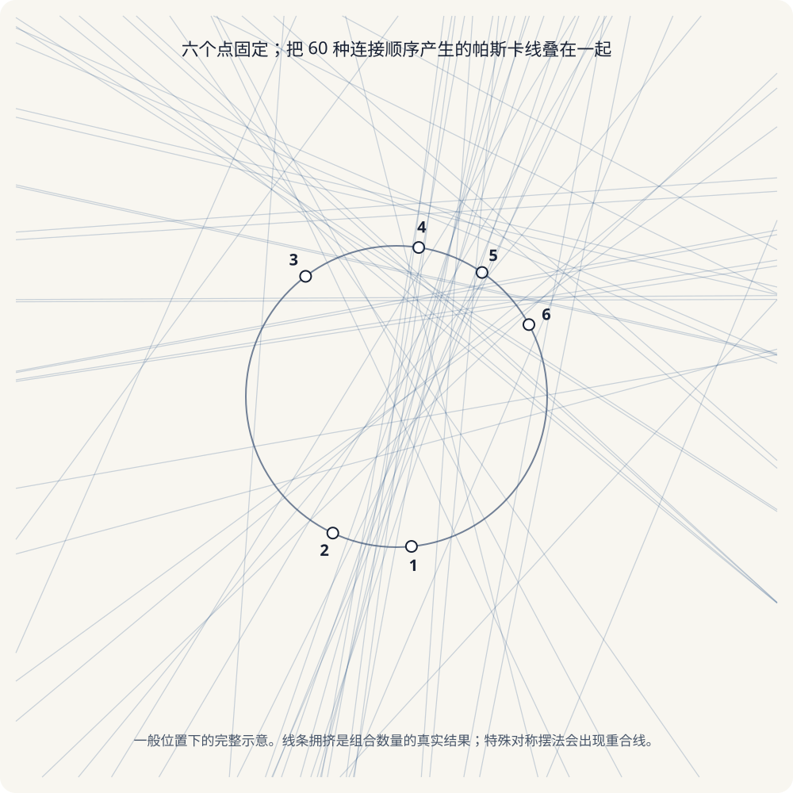

六个点，画出一个六边形；把三组“对边”分别延长，得到三个交点。

这三个点看起来各管各的，却会乖乖排在同一条直线上。

这就是**帕斯卡定理**。它的结论短得像一个几何魔术，而它背后的故事，则从帕斯卡十六岁时研究圆锥曲线开始，一路通向后来被称为**“帕斯卡神秘六边形”**的庞大几何网络。

_图 1：先看灰色六边形，再按橙、青、紫三组颜色配对，最后看红线。动画在 5 秒内播放一次，停留在完整图；静止时也可按下方三组边号阅读。[单独打开，刷新可重播](/assets/images/pascal/pascal-construction.svg)；[查看带延长线的原静态图](/assets/images/pascal/pascal-theorem.svg)。_

## 先把游戏规则说清楚

在一条圆锥曲线——比如椭圆、抛物线或双曲线——上取六个不同的点，给它们标上 1 到 6。然后按任意顺序连接成闭合六边形。

这里的“任意”真的包括交叉的星形路径，不要求画成一个规规矩矩、凸凸的六边形。

如果六边形的顶点顺序是

$$
1\to4\to2\to6\to3\to5\to1,
$$

那么六条边依次为 $$14,42,26,63,35,51$$。所谓三组**对边**，不是图上看起来距离最远的边，而是按六边形的边序相隔三条的边：

$$
(14,63),\qquad(42,35),\qquad(26,51).
$$

分别延长每一对边，它们相交于 $$P,Q,R$$。帕斯卡定理说：

> **不管六个点在圆锥曲线上怎样选，也不管六边形怎样交叉，三个对边交点 $$P,Q,R$$ 总在一条直线上。**

这条直线就叫**帕斯卡线**。

要注意，“对边”是由**顶点连接顺序**决定的，不是先看图形，再凭肉眼猜哪两条边相对。先读出六条边，隔三条配对，就不会配错。

### 跟着图，只做三次配对

| 读图顺序 | 找哪两条边？ | 在哪里标点？ |
|---|---|---|
| 橙色，边①与边④ | $$14$$ 与 $$63$$ | 它们交于 $$P$$ |
| 青色，边②与边⑤ | $$42$$ 与 $$35$$ | 它们交于 $$Q$$ |
| 紫色，边③与边⑥ | $$26$$ 与 $$51$$ | 它们交于 $$R$$ |

这里“14”是“连接点 1 和点 4”，不是数字十四。图上有不少别的交叉，**不要见到一个交叉就当成 $$P,Q,R$$**：只取表中指定的两条直线的交点。

这个自交六边形特意选得比较方便：三个指定交点都在相应线段内，第一遍不必真的延长；换一种点位，交点可能跑到六边形外，才需要把边延长。最后，用直尺连接 $$P,Q$$，再看 $$R$$ 是否在线上。

这是一幅帮助理解定理的示意图，不是定理的一般性证明。想观察“换位置会怎样”，可以打开 [GeoGebra 的 Pascal’s theorem 动态作图](https://www.geogebra.org/m/uZ94jeUb)，试着改变圆锥曲线上的点位，重新观察对边交点。外部页面可能需要网络和 JavaScript；拖动许多次也只是实验验证，不能代替对所有情况的数学证明。

## 帕斯卡为什么十六岁就在研究圆锥曲线？

布莱兹·帕斯卡出生于 1623 年。1639 年，年仅十六岁的他写下《圆锥曲线论》（*Essai pour les coniques*），其中包含后来以他命名的六边形定理。数学史资料有时把发现或发表年份记作 1639 或 1640；稳妥地说，这项成果出现在他十六岁前后的早期圆锥曲线研究中。

当时的几何学正从古典尺规问题，走向研究点、直线、曲线之间的关系。帕斯卡的定理特别之处在于：它不关心六边形的边有多长、角有多大，只关心**哪些点落在同一条曲线上、哪些交点落在同一条直线上**。

这也是它和射影几何如此合拍的原因。透视投影可以把圆画成椭圆，也可以把看起来笔直的形状拉伸；但“点在线上”“三点共线”这类关系会保留下来。

这里的“圆锥曲线”，就是平面切圆锥时得到的曲线家族：圆、椭圆、抛物线和双曲线。用透视投影换一个观察平面，同一类圆锥曲线可能换一种面貌；在射影几何里，它们可以放进同一套语言讨论。帕斯卡研究的因此不只是某个椭圆上的漂亮图案，而是圆锥曲线上六个点之间普遍成立的关联。

## “神秘六边形”到底神秘在哪？

固定圆锥曲线上的六个点，不要移动它们，只改变连接顺序。

六个顶点一共有 $$6!$$ 种排列。但同一个闭合六边形从不同顶点开始读，仍是同一个图形；反方向读也仍然是同一个图形。因此要除以 6 种起点选择和 2 种读向：

$$
\frac{6!}{6\times2}=60.
$$

于是，六个固定的点可以组成 **60 种不同的六边形连接顺序**。每种顺序都满足帕斯卡定理，于是各自产生一条帕斯卡线。

在一般位置下，这会形成 60 条不同的帕斯卡线；但“60 种六边形”不保证“任何特殊摆法都恰好看见 60 条互不重合的线”。如果六点特别对称，有些帕斯卡线会重合；若一对对边平行，它们的交点在欧氏平面里看不见，却可视为射影平面上的**无穷远点**。

这整个由六点、六边形、帕斯卡线以及它们的交点构成的结构，后来被称为 **Hexagrammum Mysticum**，常译作“帕斯卡神秘六边形”。这里的“六边形”不是一个单独的六边形，而是一整套由同一组六点生成的几何关系。

_图 2：六个点固定在圆上，改变顶点顺序，叠加画出 60 条帕斯卡线。图中采用一般位置的点，因此线条交织得很密；它不是所有特殊构型的通用外观。_

这张图不容易“看清”每条线，恰恰是在提醒我们：所谓神秘，不是因为某一条线很难画，而是因为六十种连法叠在一起后，交点之间竟还有规律。

第一次读到这里，不用在密密麻麻的图里找齐 60 条线。记住“**固定六点 → 换一种连法 → 重新找三个交点 → 得到另一条帕斯卡线**”，再把这个过程重复，才是这张网络图的生成方式。它不是把最开始那三个交点任意连来连去。

## 60 条线的交点，也不是随机散落

十九世纪的几何学家继续追问：这些帕斯卡线彼此相交，会发生什么？

在一般构型中，经典的 Hexagrammum Mysticum 包含一批彼此关联的特殊点和直线：

| 名称 | 数量 | 关系 |
|---|---:|---|
| 帕斯卡线 | 60 | 由 60 种六边形顺序分别得到 |
| 斯泰纳点 | 20 | 每个是 3 条帕斯卡线的共点 |
| 柯克曼点 | 60 | 另一类由 3 条帕斯卡线共点形成的点 |
| 凯莱线 | 20 | 每条通过 1 个斯泰纳点和 3 个柯克曼点 |
| 普吕克线 | 15 | 每条通过 4 个斯泰纳点 |
| 萨蒙点 | 15 | 每个是 4 条凯莱线的共点 |

这张表最值得记住的不是人名，而是**交点关系能一层层继续长出新关系**：线三三相交得到点，特殊的点再落到新的直线上，新的直线又在别处相交。

### 小心一个常见的“线”名错误

你可能会看到“20 条柯克曼线”的说法。经典配置里，正确的名称和对应关系是：

- **20 条凯莱线**：每条含一个斯泰纳点和三个柯克曼点；
- **15 条普吕克线**：每条含四个斯泰纳点；
- **15 个萨蒙点**：每个是四条凯莱线的共点。

“柯克曼”在这组经典关系里对应的是**点**，不是 20 条线。把柯克曼点、凯莱线、普吕克线混成一类，会把这张几何地图的路名和地名贴反。

Wolfram MathWorld 对这些关联有清楚的逐项说明；数学论文则会更深入讨论这些点线配置为何成立。这里的表格是结构导览，不是把全部证明塞进一篇入门文章。

## 为什么叫“投影几何”，平行线还会相交？

欧氏几何里，两条平行线永不相交。但在帕斯卡定理里，某一对对边完全可能平行。此时怎么办？

射影几何的回答是：把所有平行线的方向视为同一个**无穷远点**。同方向的平行线就在这个点相交。再把所有方向的无穷远点合在一起，就得到无穷远直线。

这样一来，定理就不需要因为“这两条线恰好平行”而打补丁。仍然可以说那一对边有交点，只是交点在无穷远处；帕斯卡线也照样成立。

这不是说我们能拿尺子在天空里找到一个点，而是一个非常好用的数学扩充：把投影下不变的关系写得统一、完整。透视画里的平行铁轨似乎在远方汇合，正好能帮助我们想象这个概念。

## 对偶之后，图形从“内接”翻成“外切”

帕斯卡定理说的是：六个点在圆锥曲线上，六边形**内接**，三组对边交点共线。

它的射影对偶定理叫**布利安桑定理**：六边形**外切**于圆锥曲线时，连接三组对顶点的三条线会共点。

可以把对偶想成交换两种角色：

| 帕斯卡定理 | 布利安桑定理 |
|---|---|
| 点在圆锥曲线上 | 直线与圆锥相切 |
| 对边交点 | 对顶点连线 |
| 三点共线 | 三线共点 |

这不是单纯把图形翻个面，而是射影几何中“点—线互换、共线—共点互换”的对应。一个定理像在内侧连点，另一个像在外侧围线。

## 从一张图记住整件事

下次看到帕斯卡神秘六边形，可以按这个次序读图：

1. 先找出位于同一圆锥曲线上的六个点；
2. 按实际连接顺序列出六条边，允许自交；
3. 把相隔三条边的边配成三组；
4. 延长三组对边，得到三个交点；
5. 把 60 种连接顺序都试一遍，就得到 60 条帕斯卡线；再看这些线怎样三三相交。

帕斯卡的惊人之处，不只是十六岁时发现一条“神奇的红线”。更深的美感在于：**当你不断改变六个点的连接顺序，局部的小定理会彼此搭桥，最后长出一张有名字、有计数、还能继续探索的几何网络。**

## 延伸阅读

- [Wolfram MathWorld：帕斯卡定理](https://mathworld.wolfram.com/PascalsTheorem.html)：定理表述、历史与布利安桑对偶。
- [Wolfram MathWorld：帕斯卡线](https://mathworld.wolfram.com/PascalLines.html)：60 种六边形顺序、特殊重合，以及斯泰纳点与柯克曼点。
- [Wolfram MathWorld：斯泰纳点](https://mathworld.wolfram.com/SteinerPoints.html)：斯泰纳点、凯莱线与普吕克线之间的关系。
- [Wolfram MathWorld：柯克曼点](https://mathworld.wolfram.com/KirkmanPoints.html)。
- [Wolfram MathWorld：凯莱线](https://mathworld.wolfram.com/CayleyLines.html)。
- [Wolfram MathWorld：布利安桑定理](https://mathworld.wolfram.com/BrianchonsTheorem.html)。
- Baralić 与 Spasojević，[《Illumination of Pascal's Hexagrammum and Octagrammum Mysticum》](https://arxiv.org/abs/1209.4795)，关于经典配置的现代组合几何研究。
- 帕斯卡《圆锥曲线论》的历史线索，可参见 [MacTutor：Blaise Pascal](https://mathshistory.st-andrews.ac.uk/Biographies/Pascal/)。
- [GeoGebra：Pascal's theorem](https://www.geogebra.org/m/uZ94jeUb)：六个圆锥曲线上的点与对边交点的动态作图，作为外部交互阅读，不转载其图形。
- 文中示意图为原创 SVG：单个自交六边形的静态图和分组动画使用相同点位，网络图则由程序枚举另一组六点的 60 种连接顺序后绘制。
