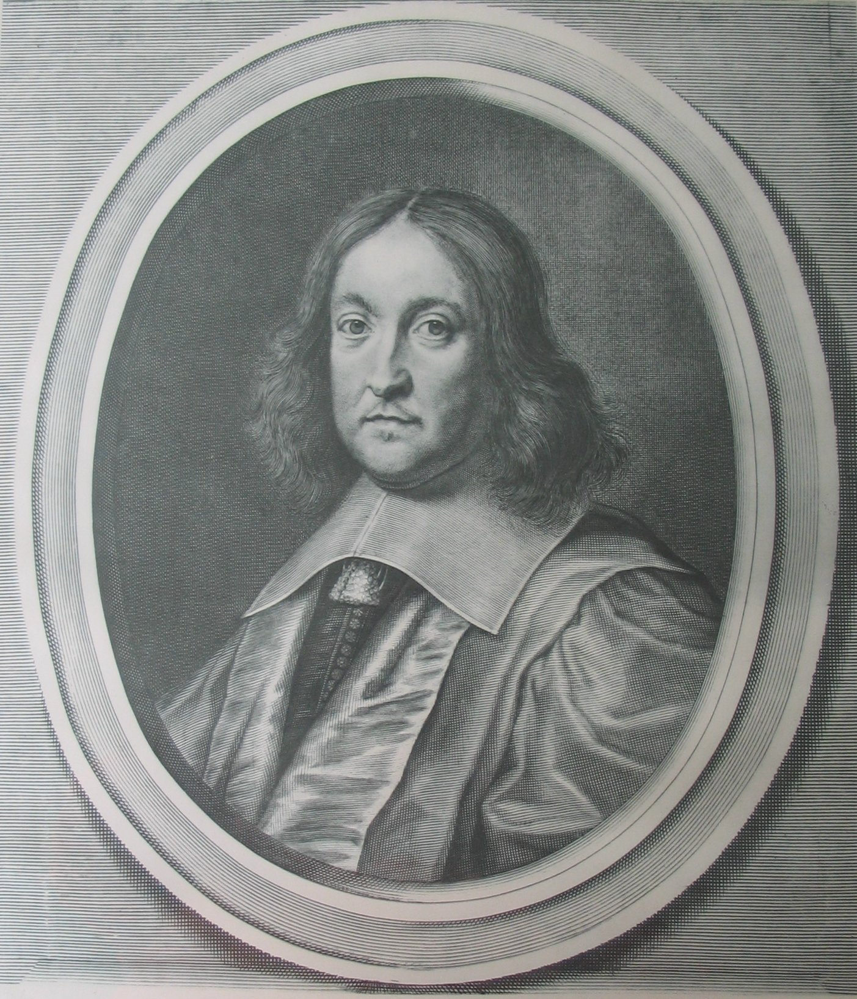
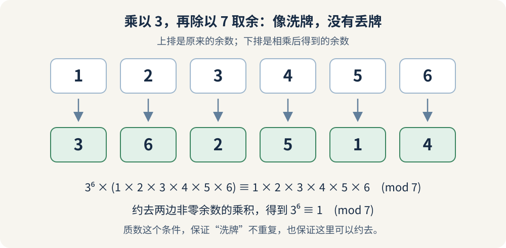
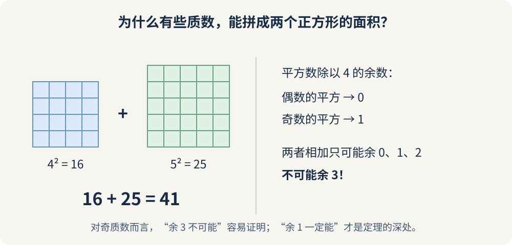
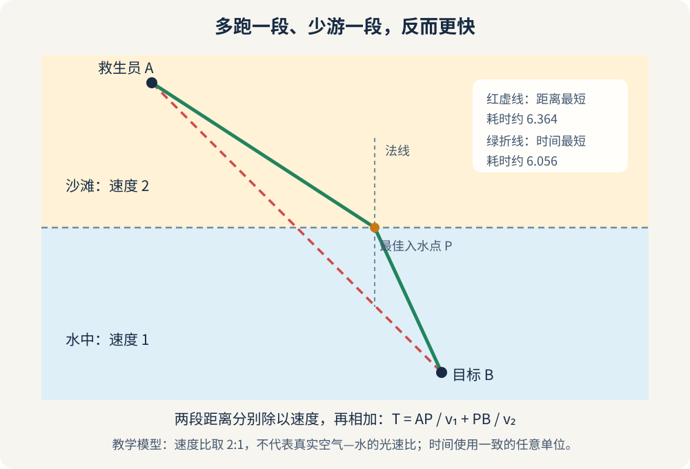

如果你的同事白天处理法律文书，下班后突然给你寄来一封信：

> 这个数学问题，我已经解决了。你也试试。

你认真算了几个星期，依然毫无头绪。再追问证明，他却只给一点提示，顺手又寄来一道新题。

你大概会想：这人究竟是来交流的，还是来折磨人的？

十七世纪的欧洲数学家，对这种体验并不陌生。寄信的人叫**皮埃尔·德·费马（Pierre de Fermat）**，主业是法国图卢兹的一名司法官员，却在数学史上留下了一个格外响亮的称号：

**“业余数学家之王”。**

这不是官方头衔。“业余”也不是说他水平普通，而是说数学不是他的本职。他的数学成就，足以让许多职业研究者仰望。

最出名的故事，当然是那句“我有一个美妙的证明，可惜页边太小”。但如果只记住这句，未免低估了他：费马还研究过质数的余数、两个平方数的秘密、光为什么折弯，以及一场没打完的赌局到底该怎么分钱。

今天，我们不把他供成一位永远正确的天才。就跟着这位爱寄挑战信的法官，看看他的几次“业余出手”，究竟厉害在哪里。


_图 1：费马肖像，François de Poilly 作。图片下载自 [Wikimedia Commons 文件页](https://commons.wikimedia.org/wiki/File:Pierre_de_Fermat_(F._Poilly).jpg)，该页以公有领域作品标注。后面的四幅数学示意图（含一幅动画）为本文原创绘制。_

## 一、他的主业不是大学教授，朋友圈却全是数学高手

费马在十七世纪初出生于法国西南部，后来学习法律。1631 年，他进入图卢兹的 Parlement 任职，并在此后的职业生涯中担任司法职务。

这里的 **Parlement 不是今天意义上的民选议会，而是当时的高等法院**。所以，与其想象他在议会席上投票，不如想象他在法院系统里处理案件和文书。[1]

不过，他不是一个完全不与外界接触、只靠灵感独自算题的人。

费马与梅森、笛卡尔、帕斯卡、惠更斯等人通信。没有互联网的年代，信件就是数学家的讨论区：寄一个问题过去，过些日子收到反驳、解法，或者另一个更难的问题。

费马尤其喜欢“出题挑战”。一些通信对象确实觉得，他把结论说得太快，把方法交代得太少。但“他从来不写证明”又说过头了：他曾向同行寄送关于极值、切线等问题的方法，也留下了无穷递降的论证。更准确的说法是：

> **他没有把许多成果整理成完整、公开出版的论文，常通过通信、手稿和书页批注传播思想。**

这让他的成果像散落在不同抽屉里的宝物，也让后人不得不反复辨认：哪些是他已经证明的？哪些只是极有把握的猜想？

第一站，先看一个我们真的能跟着证明的定理。

## 二、费马小定理：把余数洗一遍牌，会发生什么？

很多人听过“费马大定理”，却不知道还有一个“小定理”。

它不小气，只是名字比较谦虚：

> 如果 \(p\) 是质数，整数 \(a\) 不是 \(p\) 的倍数，那么 \(a^{p-1}\) 除以 \(p\)，余数一定是 1。

数学上写作：

$$
a^{p-1}\equiv1\pmod p.
$$

这里的 \(\pmod p\)，可以理解成“只看除以 \(p\) 的余数”。比如 \(15\equiv1\pmod7\)，意思是 15 和 1 除以 7 的余数相同。

拿 \(p=7,\ a=3\) 试试：

$$
3^6=729=7\times104+1.
$$

巧合吗？费马的结论说：质数换成 11、13、17……只要满足条件，规律仍然成立。他在 1640 年的通信中提出了这个结果。[2]

### 不用算大数，也能看懂一个证明

把模 7 的非零余数排出来：

```text
1  2  3  4  5  6
```

每个数乘以 3，再除以 7 取余：

```text
3  6  2  5  1  4
```

发现了吗？一个数没少，也没有重复，只是换了顺序。


_图 2：乘以一个非零余数，在质数模数下会把全部非零余数重新排列。这个“洗牌”性质，是小定理的一条简洁证明思路；这里不是复原费马本人的证明。_

如果乘出来的两张“牌”相同，比如 \(3i\equiv3j\pmod7\)，就意味着 7 整除 \(3(i-j)\)。7 是质数，又不整除 3，所以只能整除 \(i-j\)。而 \(i,j\) 都在 1 到 6 之间，因此只能是同一张牌。

把上下两排各自全部相乘，余数当然相同：

$$
3^6(1\times2\times3\times4\times5\times6)
\equiv
1\times2\times3\times4\times5\times6
\pmod7.
$$

两边的括号都不含因子 7，可以在模 7 的意义下约去，于是：

$$
3^6\equiv1\pmod7.
$$

把 7 换成任意质数 \(p\)，把 3 换成不被 \(p\) 整除的整数 \(a\)，同一套思路仍然有效。

原来，那条看起来突然降临的幂次规律，背后是一场不会丢牌的乘法洗牌。

### 它和今天的网络加密，究竟有什么关系？

费马当然没有预见手机支付。但他研究的模运算，后来确实进入了现代密码学。

以 **RSA** 为例：它使用两个大质数构造模数，通过模幂运算实现加密或签名。为何一组指数运算能被另一组指数运算“还原”，可用费马小定理及其推广、配合中国剩余定理来解释。

不过，这里要把两件事分开：

**小定理帮助说明算法为什么算得回来；它本身不保证攻击者算不出来。** RSA 的安全性还涉及大整数计算的困难性、密钥长度、填充方案和实现质量。[3]

也不能说“所有 HTTPS、网银或手机支付都在用 RSA”。现代系统还可能采用椭圆曲线等其他公钥机制，并结合对称加密。费马的小定理，是现代数学工具箱里的重要工具，不是全网唯一的一把锁。

另一个反转是：**通过小定理的检查，不代表一定是质数。**

例如 \(341=11\times31\) 明明是合数，却满足

$$
2^{340}\equiv1\pmod{341}.
$$

这类“伪装成质数”的数，提醒我们：定理的正向成立，不等于反过来也成立。

## 三、平方和定理：为什么 41 能拆，43 却不行？

费马特别喜欢问整数“能不能”：

能不能拆成两个平方？能不能写成两个立方？看起来相似的数，为什么一个行，另一个死活不行？

看看下面这组：

$$
5=1^2+2^2,\qquad
13=2^2+3^2,\qquad
41=4^2+5^2.
$$

再试 3、7、11、19、43。你会发现，这些质数不能写成两个整数的平方和。

费马提出的两平方和定理告诉我们，奇质数的区别藏在除以 4 的余数里：

| 奇质数的类型 | 能否写成两个整数平方之和 | 例子 |
|---|---|---|
| 除以 4 余 1 | 一定能 | \(5,13,17,29,37,41\) |
| 除以 4 余 3 | 不可能 | \(3,7,11,19,23,43\) |

唯一的偶质数 2 也可以：\(2=1^2+1^2\)。

对能够表示的质数，这种拆分在**不计正负号和两个数先后顺序**时是唯一的。比如 \(41=4^2+5^2\) 与 \(41=5^2+(-4)^2\)，并不算两种不同的拆法。[4]


_图 3：41 可以拆成两个正方形的面积。右边解释“除以 4 余 3 为什么不可能”；但“余 1 的奇质数为什么一定能”，还需要更深的证明。_

### “为什么不行”，我们现在就能证明

偶数可写成 \(2k\)，平方后是 \(4k^2\)，除以 4 余 0。

奇数可写成 \(2k+1\)，平方后是

$$
(2k+1)^2=4k(k+1)+1,
$$

除以 4 余 1。

两个平方相加，余数只能是：

$$
0+0=0,\qquad0+1=1,\qquad1+1=2.
$$

**无论怎么加，都凑不出余数 3。**

所以 43 除以 4 余 3，它根本没有机会被拆成两个整数的平方和。不是我们没试够，而是所有尝试都被同一条余数规则挡住了。

难的却是另一半：为什么每一个余 1 的奇质数都一定能拆？

费马谈到过用**无穷递降法**处理这个问题，但现存说明没有完整展开关键构造。后来，欧拉给出了公开的证明。[1][4] 与其把故事说成“欧拉替他补了几行作业”，不如说：费马的判断很深，证明它也确实需要真功夫。

所谓无穷递降，核心想法是：假如存在某种正整数解或反例，就从它构造一个严格更小的同类对象；这样一路缩小，会与正整数不可能无限下降相矛盾。真正困难的地方，不是说出“往下递降”，而是找到那台能把对象变小的机器。

## 四、费马原理：绕一点路，为什么反而更快？

接下来，把数字放一边，去海滩走走。

救生员站在沙滩上的 A 点，海里 B 点有人需要救援。假设他在沙滩上跑得快，在水里游得慢，怎样才能最快到达？

最直观的回答是：直线最短，直接过去。

可距离最短，未必时间最短。在快的地面上多跑一段，换来在慢的水里少游一段，反而可能更早到达。

这就是理解**费马原理**的经典类比。光通过不同介质时速度不同，跨越界面会折射；费马用传播时间的思想，解释了这种转折。


_图 4：根据救生员类比重新绘制的中文示意图。设 A 为 \((-3,3)\)、B 为 \((3,-3)\)，岸线为 \(y=0\)，两段速度分别为 2 和 1；最快入水点的横坐标约为 1.615。这个速度比是教学设定，不是真实空气与水的光速比。_

### 一条折线，怎么算出“快”？

把入水点叫 P，两段速度分别是 \(v_1,v_2\)，总时间就是

$$
T=\frac{AP}{v_1}+\frac{PB}{v_2}.
$$

图中的直线路径总长度最短，但它在水里的部分比较长，总耗时约为 **6.364**；绿色折线在岸上多走了一些，在水里少走了一些，总耗时约为 **6.056**。时间单位与所选长度、速度单位配套即可。


_图 5：让两条路线真正“比一场”。动画把所有时间按同一比例压缩，在约 4.8 秒内播放一次；两个圆点都在入水后减速，绿色先到。红色终点圆较大，绿色较小，停住后仍能看见两种颜色。[单独打开动画，刷新可重播](/assets/images/fermat/least-time-race.svg)。关闭动态效果时只显示路线，仍可对照图上的耗时。_

这里没有故意把绿色动画调快来“证明”结论：每一段耗时都按“距离÷所在介质的速度”计算。红线在岸上、在水里的距离各约为 4.243，所以总时间是 \(4.243/2+4.243/1\approx6.364\)；绿线则分别约为 5.504、3.304，总时间为 \(5.504/2+3.304/1\approx6.056\)。**绿线的总路程更长，时间却少了约 4.83%。**

也不是“在岸上跑得越远越好”。若一直跑到 B 的正上方再垂直入水，时间变成 \(\sqrt{45}/2+3\approx6.354\)，反而比绿色路线慢。最佳路径需要在“多跑”与“少游”之间找到平衡。

如果把 P 沿着岸线左右移动，寻找使时间最小的位置，会得到：

$$
\frac{\sin\theta_1}{v_1}
=
\frac{\sin\theta_2}{v_2}.
$$

其中两个角都从垂直界面的**法线**量起，不是从岸线量起。

对光而言，折射率 \(n=c/v\)。代进去就得到斯涅尔折射定律：

$$
n_1\sin\theta_1=n_2\sin\theta_2.
$$

从快的介质进入慢的介质，光会朝法线偏折。插进水里的筷子看起来弯了，不是筷子真的拐弯，而是到达眼睛的光在界面处改变了传播方向。[5]

### 光会算账吗？

当然不会。

“光选择最快路线”是一种形象说法，不表示光会提前侦察路线、拿计算器比较结果。费马原理是在几何光学中描述光路的数学规律。

更严谨地说，通常讨论的现代形式是**光程驻值原理**：在适当的几何光学条件下，实际光路的光程，对邻近路径的一阶变化为零。这里这个平直界面、两侧均匀介质的例子，确实对应最小传播时间；但不能把所有光学情形都简化成“全局耗时最短”。

还有一个小小的名称区别：它叫**费马原理**，不是“费马引理”。不是他先发现了折射定律，而是他给出了从传播时间出发理解它的方法。

如果想继续动手，可以打开科罗拉多大学博尔德分校的 [PhET「光的折射」中文交互模拟](https://phet.colorado.edu/sims/html/bending-light/latest/bending-light_all.html?locale=zh_CN)。先观察空气进入水，再交换介质，比较光线向法线靠近还是远离；角度始终从法线量起。这个模拟展示真实的折射与反射模型，**不是上面 2:1 速度设定的救生员竞赛**。这里只链接官方模拟，不复制或重新发布其程序。

## 五、他还差一点就“撞上”微积分了

费马的贡献远不止数论与光学。他也是解析几何的重要先驱，并研究过曲线的切线、面积以及函数的最大值和最小值。

在牛顿、莱布尼茨建立微积分体系之前，他就发展出一套处理极值和切线的办法，通常用 **adequality** 这个词来讨论。[1]

例如，一根 40 米长的绳子围成长方形，怎样围出最大面积？

设一边长 \(x\)，另一边就长 \(20-x\)，面积为

$$
A(x)=x(20-x).
$$

如果把一边增加一点点 \(h\)，新面积与原面积的差是：

$$
A(x+h)-A(x)=h(20-2x)-h^2.
$$

在现代语言里，让变化量趋近于零，极值位置满足 \(20-2x=0\)，所以 \(x=10\)：面积最大的长方形是正方形。

这段计算是用现代符号说明他的思路，与费马当年的完整表述并不相同。但它让人看见：**比较一个量和它稍微变化后的量**，如何通向切线和极值。

不能因此说“微积分已经被费马一个人全部发明了”。不过，在微积分发展史上，他绝不是路过打酱油的人。

## 六、那句“页边太小”，究竟留下了什么？

现在，终于走到费马最著名的书页边。

勾股定理里，有许多漂亮的整数例子：

$$
3^2+4^2=5^2.
$$

把平方换成立方呢？

$$
x^3+y^3=z^3.
$$

换成四次方、五次方呢？

费马在阅读丢番图《算术》的拉丁译本时，留下一个断言：当整数 \(n>2\) 时，

$$
x^n+y^n=z^n
$$

**没有正整数解。**

紧接着，就是那句著名批注。意思大致是：

> 我发现了一个真正美妙的证明，可惜这里的页边太窄，容不下它。

这条批注通常被叙述为写于约 1637 年，不过确切落笔时间并不确定；重要而确实的出版节点是 **1670 年**：费马去世后，他的儿子萨缪尔把父亲的批注收入《算术》的新版，难题由此广为人知。[1][6]

### 他到底有证明，还是在吹牛？

最诚实的回答是：**我们不知道他当时脑中那个证明是什么。**

没有留存的完整一般性证明，不能因为费马是天才，就认定他说的一定已经证明；也不能因为后人花了很久，便断言他当时故意骗人。

费马确实留下了与 \(n=4\) 情形密切相关的无穷递降论证，但那不等于解决了所有指数。许多数学史研究者倾向于认为，他可能曾把一个有漏洞的思路当作一般证明。这里的“可能”，不能偷偷省掉。

“费马大定理”也不是“小定理升级后的第二关”，二者谈的是不同问题。“最后定理”这一名称，通常与他遗留断言中这道题长期未获解决有关，不是说这是他人生最后一天出的题。

### 三百多年后，证明终于赶到了

这场长跑，不是把指数一个一个试到无穷大。

欧拉、索菲·热尔曼、库默尔等人推进了不同部分；到二十世纪，问题又与椭圆曲线和模形式之间的深层联系接上了线。

所谓椭圆曲线，并不是椭圆的另一种画法。常见方程形式是

$$
y^2=x^3+Ax+B,
$$

还需满足相应的非奇异条件。它属于另一类代数曲线，“椭圆”这个名字很容易让人望文生义。

证明的大方向可以粗略理解为：**假如费马方程存在反例，就能造出一条具有特殊性质的椭圆曲线；里贝等人的工作表明，它不可能是模的，而怀尔斯证明的半稳定椭圆曲线模性又要求它必须是模的，矛盾。**

这只是路线说明，不是几句话就完成的证明。它真正厉害的地方，是把一个整数方程连接到两片看似遥远的数学大陆。

| 年份 | 发生了什么 |
|---|---|
| 1993 | 安德鲁·怀尔斯公开报告证明，随后发现关键缺口 |
| 1994 | 怀尔斯与理查德·泰勒合作，解决关键缺口 |
| 1995 | 怀尔斯的论文及泰勒—怀尔斯的配套论文发表于《数学年刊》 |
| 2016 | 怀尔斯因相关突破获阿贝尔奖 |

1995 年的两篇论文，可以直接在《数学年刊》查到。[7][8] 阿贝尔奖的授奖词也明确提到，他通过半稳定椭圆曲线的模性猜想证明费马大定理。[9]

如果从惯用的“约 1637 年”算到 1995 年，就是常说的 **358 年**。这个数字有叙事力量，但别忘了：起点是一个约定俗成的约年，不是一张精确到日的立项单。

最让人感慨的不是“费马一个人难倒了所有后人”，而是：为追上那句短短的批注，数学本身已经长成了他无法见到的样子。

## 七、别忘了，他还帮帕斯卡分过赌金

费马并非只喜欢离现实很远的整数。

1654 年，他与帕斯卡通信讨论“点数问题”：比赛没打完，赌注该怎么分？他们的工作成为现代概率论的重要奠基之一。

假设两人每局获胜的机会各半，各局相互独立。在先赢 3 局的比赛中，甲以 2:1 领先，甲还差 1 胜，乙还差 2 胜。把未来最多两局的结果补齐，四种等可能序列是：

```text
甲甲、甲乙、乙甲、乙乙
```

前三种都对应甲最终获胜，只有最后一种是乙逆转。于是甲拥有 \(3/4\) 的胜算，64 枚金币就应分成 48 与 16。

在甲已经赢下第一局的路径中，第二局只是帮助统一计数的假想补位，不是真的要求冠军继续比赛。

这一故事可以接着读[《帕斯卡怎样把一场赌局变成概率论？》]()。换到费马的角度看，他的特长又出现了：**把可能性组织起来，寻找隐藏在表面之下的整数结构。**

## 八、给天才保留一个犯错的位置

如果故事到这里结束，费马好像成了“每个猜想都对，只是懒得写证明”的神人。

可他也猜错过。

他曾猜想，下面这一族数全是质数：

$$
F_n=2^{2^n}+1,\qquad n=0,1,2,\ldots
$$

前五个确实很配合：

$$
3,\ 5,\ 17,\ 257,\ 65537.
$$

到了下一项，欧拉找到了反例：

$$
F_5=2^{32}+1
=4294967297
=641\times6700417.
$$

它不是质数。[10]

这不会抹去费马的成就，反而让我们看清数学的工作方式：好奇心负责提出问题，直觉负责指路，最后还得由证明或反例来裁决。

一位法官在工作之外，研究了数论、概率、解析几何、极值和光学。他值得记住的，不只是“业余也能赢过专业”的励志标签，更不是一句“有证明但不告诉你”的玩笑。

**他让很多看似微不足道的问题，长出了巨大的后果。**

一个余数，通向模运算；两个平方，通向数论结构；一条折弯的光线，通向极值思想；一小块写不下的页边，牵动了几代人的探索。

至于那本《算术》，后来的读者大概都有同一个愿望：

下次给费马送书，麻烦挑一本页边宽一点的。

## 资料与图片来源

本文把人物轶事与数学解释结合，以下资料用于核对履历、定理条件和证明史；文中的洗牌证明、矩形例子与救生员模型均以现代语言讲解，不作为费马原稿复原。

1. [MacTutor：Pierre de Fermat](https://mathshistory.st-andrews.ac.uk/Biographies/Fermat/)。法律职业、通信、极值方法、光学与无穷递降的历史。
2. [Wolfram MathWorld：Fermat's Little Theorem](https://mathworld.wolfram.com/FermatsLittleTheorem.html)。小定理、证明与伪素数的区别。
3. [IETF RFC 8017：RSA Cryptography Specifications](https://www.rfc-editor.org/rfc/rfc8017.html)。RSA 的密钥、模幂原语与加密、签名方案。
4. [Wolfram MathWorld：Fermat's 4n+1 Theorem](https://mathworld.wolfram.com/Fermats4nPlus1Theorem.html)。两平方和定理、唯一性的限定与欧拉的证明。
5. [TU Delft 光学教材／Physics LibreTexts：Principle of Fermat](https://phys.libretexts.org/Bookshelves/Optics/BSc_Optics_(Konijnenberg_Adam_and_Urbach)/02%3A_Geometrical_Optics/2.03%3A_Principle_of_Fermat)；[David J. Raymond：Fermat's Principle](https://phys.libretexts.org/Bookshelves/University_Physics/Radically_Modern_Introductory_Physics_Text_I_(Raymond)/03%3A_Geometrical_Optics/3.05%3A_Fermats_Principle)。传播时间、光程、折射推导与驻值条件，后者也讨论了并非最小值的例子。
6. [MacTutor：Fermat's last theorem](https://mathshistory.st-andrews.ac.uk/HistTopics/Fermat%27s_last_theorem/)。批注传播、早期特殊情形和后续发展；批注年代的记载存在差异，本文不把约年当作确切日期。
7. Andrew Wiles，[Modular elliptic curves and Fermat's Last Theorem](https://annals.math.princeton.edu/1995/141-3/p01)，*Annals of Mathematics*，1995。
8. Richard Taylor 与 Andrew Wiles，[Ring-theoretic properties of certain Hecke algebras](https://annals.math.princeton.edu/1995/141-3/p02)，*Annals of Mathematics*，1995。
9. [阿贝尔奖官网：2016 年得主 Andrew Wiles](https://abelprize.no/abel-prize-laureates/2016)。
10. [Wolfram MathWorld：Fermat Number](https://mathworld.wolfram.com/FermatNumber.html)。费马数及合数反例。

交互延伸：[PhET Interactive Simulations，University of Colorado Boulder：Bending Light](https://phet.colorado.edu/en/simulations/bending-light)，上文链接其官方中文模拟。外部模拟需要网络和 JavaScript，文章本身的图文不依赖它加载。

肖像：[Wikimedia Commons：Pierre de Fermat (F. Poilly)](https://commons.wikimedia.org/wiki/File:Pierre_de_Fermat_(F._Poilly).jpg)，François de Poilly 作，公有领域。四幅中文示意图为本文原创；救生员图与竞速动画参考同类经典教学模型，按文中明确给出的坐标和速度重新计算绘制。
