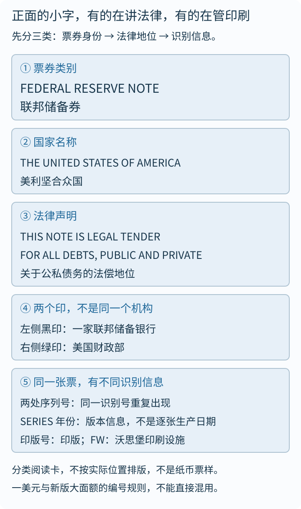
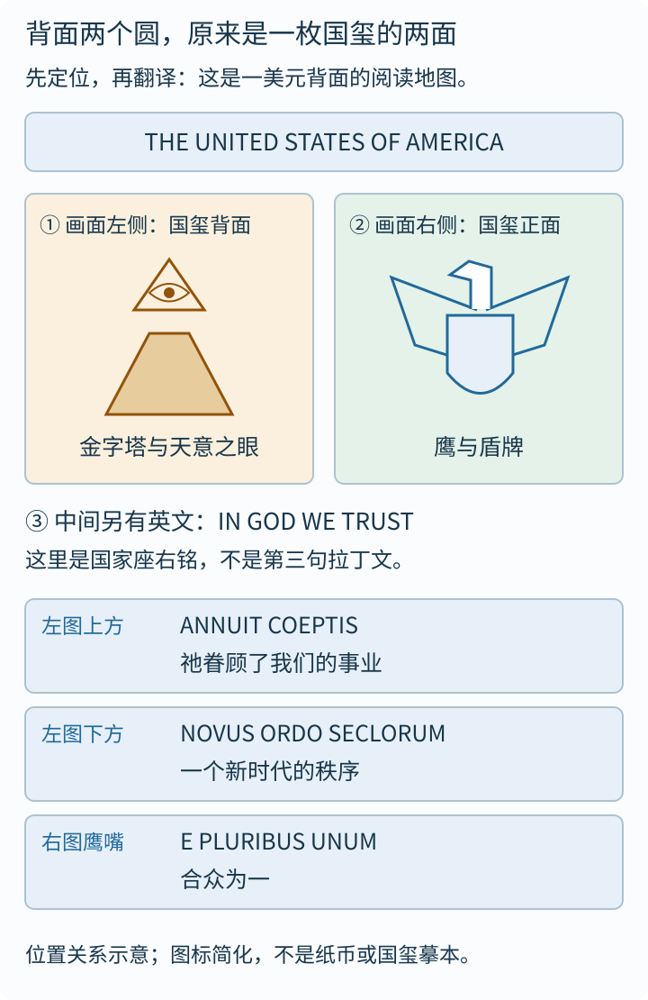
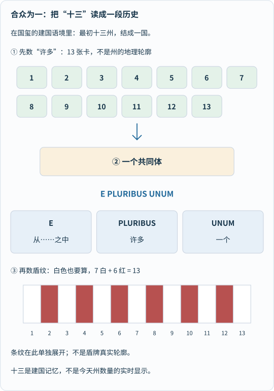
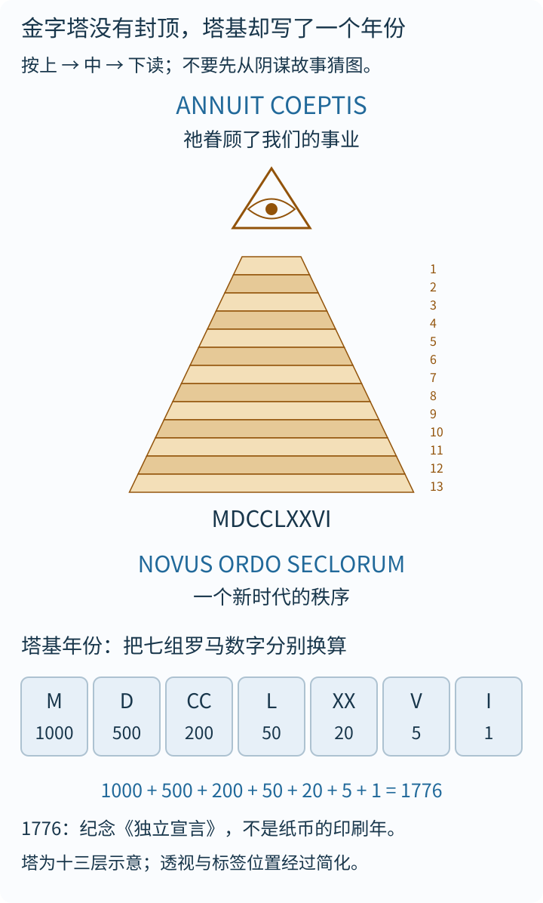
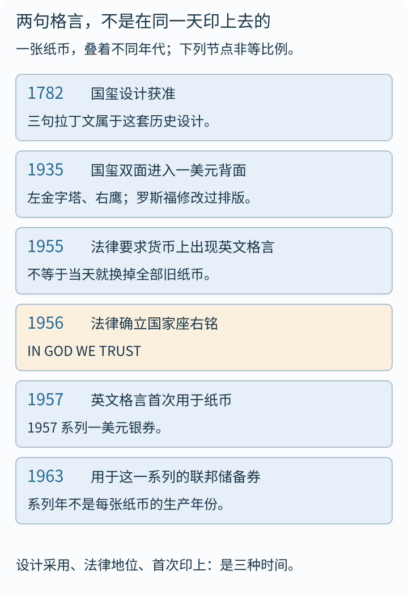

假如递给你一张常见的一美元纸币，只给你十秒钟打量，你多半能认出正中央的乔治·华盛顿肖像、四个角落的“1”，以及背面大大的英文“ONE”。

可如果把放大镜交给你，再多给你两分钟，画风往往一下子就变成了悬疑侦探片：

- **为什么一张现代美洲国家的钞票背面，会突兀地立着一座没封顶的石头金字塔？**
- **金字塔顶上悬着的那只发光眼睛到底在看谁？上下两串不像英语的字母又在念什么咒语？**
- **右边那只白头海雕为什么一只爪子抓树枝、一只爪子抓箭束？正面那一串串带字母甚至带五角星（`★`）的绿号码，又藏着什么出厂档案？**

一张只够在自动售货机买瓶水的普通纸币，突然变成了一张信息密度惊人的密室逃脱线索卡。

这篇文章的缘起，正是孩子随口问出的一句略显别扭的英文回忆——**“for many one”**。它其实是在凭印象复述鹰嘴飘带上那句著名的拉丁文格言：

> **E PLURIBUS UNUM**
> **Out of many, one.**
> **合众为一。**

不过，今天我们不急着翻完这句格言就收工。沿着手里的纸面从材质、正面印章、背面国玺一路追到微米级的光学防伪物理，你会发现：**一美元加上新版一百美元，简直是一座可以装进钱包随身携带的“历史、拉丁文与应用物理微型博物馆”。**

出发前先立好清晰的路标：下文关于国玺与版面布局的逐格拆解，主要针对今天流通最广的**一美元联邦储备券（Federal Reserve Note）**；到第七章揭秘现代光学防伪时，则会请出集防伪黑科技于一身的**新版一百美元**同台对比。想边读边对照实物细节的读者，可随时打开[美国货币教育项目（USCurrency.gov）的一美元官方交互页](https://www.uscurrency.gov/denominations/1)切换正反面；外站交互依赖网络与 JavaScript，而本文全部原创中文分步图与正文完全支持独立通读。

---

## 一、还没看图案，先摸摸底子：为什么美元叫“绿背钞”，丢进洗衣机还洗不烂？

在拿放大镜找拉丁文之前，不妨先用手指捻一捻这张钞票，回答两个最基础、却十有八九会被答错的感官问题：**为什么全世界都习惯把美元俗称为“绿背钞（Greenbacks）”？为什么普通笔记本纸忘在裤兜里进一次洗衣机就碎成雪花渣，而一张一美元转完脱水桶拿出来晾干，居然照样挺括能花？**

### 1. 1862 年的防照相化学战：“绿背钞（Greenbacks）”为什么偏偏选了绿色？

很多人以为美元印成绿色只是因为设计师偏爱“象征生机与财富的颜色”。翻开美国财政部与雕刻印刷局（BEP）的技术史档案，真相其实是一场发生在 **19 世纪中叶的硬核“反照相防伪化学战”**！

1. **湿版照相术引爆的假钞危机**：1850 年代，美国尚未建立统一的联邦纸币体系，各地州立特许商业银行各自印行了数千种五花八门的钞票。恰逢**湿版火棉胶照相术（wet-plate collodion photography）**兴起，伪钞犯如获至宝——只要把真钞架在照相机前拍一张高清晰黑白玻璃底片，就能翻晒转印制版，批量印出以假乱真的假钞！当时不少银行试着在钞票上加印普通红、黄彩色底纹，可伪钞犯只需用药水轻轻一漂洗，不耐酸碱的彩墨就褪得一干二净，照样能拍出纯正的黑色线条底片。
2. **亨特专利绿墨的双重物理化学绝杀**：1857 年，化学家托马斯·斯特里·亨特（Thomas Sterry Hunt）研发出一种以倍半氧化铬（三氧化二铬 $$\mathrm{Cr_2O_3}$$，后续印钞配方中常与铜系及矿物颜料复配）为核心的特种防伪绿油墨（俗称“加拿大绿墨”）。这种绿墨同时卡死了伪钞犯的两条路：
   - **化学上刀枪不入**：铬氧化物极其稳定，强酸、强碱、漂白剂与有机溶剂统统洗不掉它，想先褪掉绿色再翻拍黑色线条彻底没戏；
   - **光学上让黑白底片“色盲抓瞎”**：19 世纪中叶的湿版火棉胶感光乳剂只对蓝紫光敏感（属于色盲片/正色片早期阶段），对红绿光极不敏感。在当时的照相机底片眼里，**深绿色花纹和纯黑色线条曝光后全都呈现一团漆黑，根本无法通过拍照把绿色底纹与黑色主景分离开来**！伪钞犯要想仿造，只能退回老路一刀一刀纯手工重新雕刻两套钢版，造假成本顿时飙升。
3. **1862 年“绿背钞”得名**：1861 年美国南北战争爆发，林肯政府为筹措联邦军费，于 **1862 年**正式大规模发行具有法偿效力的联邦纸币（即即期票据与美利坚合众国券 Legal Tender Notes），背面通体印上这层防照相特种绿墨。北军士兵与市民见其背面一片醒目的翠绿，便顺口给它起了个响亮绰号——**Greenbacks（绿背钞）**！尽管今天的彩色数码扫描仪早已不怕单色绿墨，但“正面黑墨、背面绿墨”的历史基因，就这样在一美元身上延续了一百六十多年。

### 2. 不是木浆纸，而是一块“布”：$$75\%$$ 棉 ＋ $$25\%$$ 亚麻与约 $$4{,}000$$ 次双折测试

再揭开第二个秘密：严格按材料学分类，**你手里的美元根本不是日常意义上的“纸（木浆纸）”，而是一小片特制的无纺棉麻织物基片！**

- **普通纸为什么一洗就烂、一晒就黄？** 我们写字的打印纸、报纸由木材打碎制成的**木浆纤维（wood pulp）**抄造，纤维较短且含有木质素：遇水浸泡后纤维间的氢键迅速瓦解成纸浆糊，晒久了木质素氧化就会发黄变脆。
- **美元底纸的独门配方**：自 **1879 年**起，马萨诸塞州道尔顿市的克雷恩公司（Crane & Co.）便一直为美国雕刻印刷局独家供应钞票基材，其公开核心配比为精确的 **$$75\%$$ 棉纤维 ＋ $$25\%$$ 亚麻纤维**，不含一丁点木浆！棉纤维提供柔韧抗撕裂的骨架，长而挺拔的亚麻纤维赋予钞票清脆硬挺的“弹指声（snap）”。如果把一美元凑近强光仔细看空白处，你还能看见纸胎内部随机嵌着许多极其细小的**红色与蓝色防伪纤维丝**（早年曾掺入真丝纤维，现代改用特种合成纤维）——注意，这些红蓝细丝是在抄纸打浆阶段直接混进棉麻纤维里的，用针尖甚至能轻轻挑动，绝不是后天印在表面的线条！
- **约 $$4{,}000$$ 次双折的魔鬼体检**：按照美国雕刻印刷局与美联储的钞票耐用标准，这种经过明胶/合成树脂施胶强化的棉麻钞纸，必须能承受约 **$$4{,}000$$ 次正反双向对折（double folds）**才会断裂（普通木浆纸往往折几十到一两百次就断了）！正因如此，一张一美元在无数双手中摸爬滚打的平均流通寿命长达约 **$$6.6$$ 年**，偶尔随牛仔裤滚一趟洗衣机也能全身而退。

---

## 二、正面逐格拆解：这回不读神话，先读一张钞票的“管理说明书”

摸清了棉麻“绿背”底子，我们先把乔治·华盛顿朝上摊平。比起背面充满古典象征的鹰和金字塔，一美元正面密密麻麻的小字其实是一份极其严谨的**金融法律与印刷溯源说明书**——可以按**“票券身份 → 法律边界 → 双印章与出厂密码”**分三步逐格破译（官方逐项图解可核对 [USCurrency.gov 纸币标识指南](https://www.uscurrency.gov/denominations/bank-note-identifiers)）。

_图 1 怎么看：顺着 ①→⑤ 的顺序，先把正面的英文与号码按功能归入三个抽屉——谁发行的什么券（①②）、法律上管什么用（③）、哪家联储辖区与哪块钢版印出来的（④⑤）。本图为功能分类教学卡，不按真实钞票坐标复制排版，亦不构成钞票票样。[单独打开正面文字阅读卡](/assets/images/dollar-reading/front-reading.svg)。_

### 1. 票券抬头与法偿声明：“法定货币”为什么不等于“每家商店都必须收现金”？

先读正面上半截最醒目的两组法律定性文字：

1. **顶栏抬头 `FEDERAL RESERVE NOTE`（联邦储备券）**：下面紧跟着国名 `THE UNITED STATES OF AMERICA`、中央肖像 `WASHINGTON` 与底部面额 `ONE DOLLAR`。别觉得这行抬头是废话——美国历史上还流通印行过抬头写着 `SILVER CERTIFICATE`（银券，凭券可向财政部兑付等值银币或银块，1960 年代停发但至今仍具面值效力）和 `UNITED STATES NOTE`（美利坚合众国券，红印章）的一美元。认准 `FEDERAL RESERVE NOTE`，才锁死了它是今天由美联储体系发行的现行主力钞票。
2. **左上方两行小字法偿声明**：
   > **THIS NOTE IS LEGAL TENDER**
   > **FOR ALL DEBTS, PUBLIC AND PRIVATE**
   > （本券是清偿一切公私债务的法定货币。）

   这里藏着一个连美国本土消费者都经常误会的法律冷知识：举着这行字走进一家写着“本店仅支持刷卡/无现金支付（Card Only）”的咖啡馆，能不能指着钞票说“上面写了法定货币，你不收现金就犯了联邦法”？
   **[美联储官方网站的专门问答（FAQ）](https://www.federalreserve.gov/faqs/currency_12772.htm)给出了明确否定的澄清**：“法定货币（Legal Tender）”的意思是，当你已经欠了别人一笔债（比如吃完饭结账的餐费债务、税款、法院判决赔偿或贷款），你掏出美元现钞还债在法律上是完全有效的清偿手段；但在一笔交易还没发生之前，**联邦法律并没有强制规定全美每一家私营商店、航空公司或无人便利店都必须收受现金**（除非该州或该市——如马萨诸塞州、新泽西州或纽约市、旧金山等地——另行通过了禁止实体店拒收现金的地方法规）。把“清偿既有公私债务的法偿效力”和“零售商事前约定的付款方式”区分开，才算真正读懂了这两行小字。

### 2. 左右两枚印章的分工：左边黑印认“十二家联储辖区（A1–L12）”，右边绿印认“财政部”

再看华盛顿肖像左右两侧对称坐落的两枚圆形齿边印章——它们**既不是装饰花纹，也不是背面的美国国玺**，而是代表两套各司其职的国家机构：

- **右侧绿色圆印：美国财政部印章（Department of the Treasury Seal）**：印章构图源自 1789 年以来的北美财政部传统徽记——上方一架**天平**象征公平公允，中间人字形饰带上镶着 **$$13$$ 颗星**代表最初十三州，下方一把**钥匙**象征官方权威与国库监管，外圈环绕拉丁文缩写 `THESAUR. AMER. SEPTENT. SIGIL.`（全称 *Thesauri Americae Septentrionalis Sigillum*，意为“北美财政部之印”，1968 年起外圈改用英文 `THE DEPARTMENT OF THE TREASURY` 并标出成立年份 `1789`）。
- **左侧黑色圆印：联邦储备银行辖区印章（Federal Reserve Bank Seal）**：美国中央银行体系并不是只有华盛顿特区一座大楼，而是把全美划分为 **$$12$$ 个联邦储备区**，每区设一家区域联邦储备银行。在一美元和两美元正面，左侧黑印中央醒目印着 **`A` 到 `L` 中的一个大写英文字母**（恰好是字母表第 $$1$$ 到第 $$12$$ 个字母！），并在肖像四周空白处配印对应的阿拉伯数字 **`1` 到 `12`**，一眼就能查出这张钞票是由哪一家区域联储银行向雕刻印刷局下单定制的：

| 辖区代码（字母＋数字） | 对应的联邦储备银行所在地 | 辖区代码（字母＋数字） | 对应的联邦储备银行所在地 |
| --- | --- | --- | --- |
| **A1** | 波士顿（Boston） | **G7** | 芝加哥（Chicago） |
| **B2** | 纽约（New York） | **H8** | 圣路易斯（St. Louis） |
| **C3** | 费城（Philadelphia） | **I9** | 明尼阿波利斯（Minneapolis） |
| **D4** | 克利夫兰（Cleveland） | **J10** | 堪萨斯城（Kansas City） |
| **E5** | 里士满（Richmond） | **K11** | 达拉斯（Dallas） |
| **F6** | 亚特兰大（Atlanta） | **L12** | 旧金山（San Francisco） |

举个例子：如果你手里的一美元左边黑印里写着大大的 **`B`**，四周印着四个 **`2`**，它就是**纽约联邦储备银行（B2）**发行的！（顺带留心面额差异：在新版 5 美元至 100 美元大面额钞票上，左边黑印统一改成了代表整个美联储系统的白头海雕通用黑印，而把 `A1`–`L12` 辖区代码浓缩进了左上角序列号下方的字母数字组合里，例如 `L12`。）

### 3. 序列号、“星号补号钞（★）”、印版坐标与双签名制度

把目光移向右侧绿印上下对称印了两遍的那串绿色号码，以及角落里比米粒还小的字母与签名——这里藏着印钞厂精密的质量追踪流水账：

1. **序列号（Serial Number）与神奇的“星号钞（`★` Star Note）”**：在一美元上，绿色序列号由 **“1 位联储辖区首字母（`A`–`L`）＋ 8 位数字 ＋ 1 位后缀字母”** 组成（两端完全一致，防止撕裂残损或涂改；后缀字母跳过容易和数字 `0` 看混的字母 `O`）。最有趣的彩蛋是：如果你某天找零拿到一张序列号末尾不是字母，而是一颗实心绿色五角星（例如 `B 03849215 ★`）的美元，先别以为遇到了错版假钞！这就是收藏界津津乐道的**“星号补号钞（Star Note）”**：
   - **为什么要有星号钞？** 印钞厂每次在巨大棉麻纸张上整版联印 32 张或 50 张钞票。出厂质检时一旦发现某一张油墨蹭脏、裁切偏斜或折角，必须将这张废票当场销毁。可机械跳号机已经按顺序一路往下印了几十万张，为了补印“刚才作废的那唯一一个号码”专门停机重调跳号轮，既极其昂贵又容易造成重号事故！于是印钞局提前印好一批末尾带五角星 `★` 的专用替补钞票，抽出一张顶替废票塞进钞捆，既保证每捆整整 100 张分毫不差，又让每一张钞票的身份证号在全世界独一无二！
2. **印版位置字母（Plate Position）、版号与沃思堡厂标 `FW`**：在一美元正面左上角和右下角，还能找到类似 `C`、`G2` 这样的微小版位检查字母与正面印版号（Face Plate Number，背面右下角另有背面印版号 Back Plate Number），它们就像电影院座位排号一样，精确记录了这张小纸片当初趴在 32 联或 50 联大钢版上的第几象限、第几行第几列——万一某块钢版出现细微划痕，质检员一查版位就能秒速揪出问题母版！如果正面版号前面还多印了两个小字母 **`FW`**，说明它诞生于得克萨斯州**沃思堡（Fort Worth）**的西部印钞设施；没有 `FW` 的则印自首都华盛顿特区总厂。
3. **双签名制度与 `SERIES` 系列年份**：正面下方左右两侧各有一行手写体签名——**左侧是美国财政部司库（Treasurer of the United States），右侧是美国财政部长（Secretary of the Treasury）**，两人共同为钞票信用背书。旁边的 `SERIES 2017A` 或 `SERIES 2021` **绝不是这张钞票下印刷机的具体生产生日**！只有当票面重大设计改版，或者财政部长、司库换人导致签名更新时，系列年份（或后缀字母 A、B）才会变更。

---

## 三、翻到背面先立坐标：为什么纸币背面同时印着美国国玺的“正面”与“背面”？

读懂了正面的出厂档案，现在把钞票翻过来——全篇最吊人胃口的视觉迷宫正式铺开。

背面正中央是硕大的英文“ONE”，左右两边各嵌着一枚圆框徽章：左圆里立着未完工的金字塔和发光的眼睛，右圆里展翅站着白头海雕、条纹盾牌与星云。

_图 2 怎么看：先锁定左右两枚大圆环的整体身份，再定位三处拉丁文（左圆上下两条、右圆鹰嘴飘带一条），最后看正中后来才搬进来的英文座右铭。本图为空间拓扑关系导览图，简化了精细防伪底纹，不可用于钞票真伪鉴定。[单独打开阅读地图](/assets/images/dollar-reading/reverse-map.svg)。_

### 1. 左右两枚圆章的镜像关系：右鹰是国玺正面，左塔是从未刻成实体章的国玺背面

先把视线落到左右两个大圆正下方的英文绶带上，试着把左边圆底下的三个词和右边圆底下的四个词连起来通读一遍：

> **THE GREAT SEAL** ＋ **OF THE UNITED STATES**
> （美利坚合众国国玺）

真相豁然开朗：**左右这两个圆根本不是两枚各自为政的神秘徽章，而是同一枚“美国国玺（Great Seal of the United States）”的一体两面！**

这里藏着一个极好玩的空间绕口令：

- 在**一美元纸币的背面**上，右手边老鹰那一圆是**美国国玺的正面（Obverse）**，左手边金字塔那一圆则是**美国国玺的背面（Reverse）**！千万别把“钞票的正反面”和“国玺印章的正反面”混成一回事。
- 更冷门的一桩档案事实来自[美国国家档案馆（National Archives）的国玺原始设计文献](https://www.archives.gov/milestone-documents/original-design-of-the-great-seal-of-the-united-states)：1782 年大陆会议正式批准国玺正反两面图样后，美国国务院历代实际用黄铜和精钢雕刻成实体压印机钢模、用来在国际条约和总统委任状火漆或纸面上盖章认证的，**从头到尾只有右边“白头海雕”这一面（国玺正面）**！左边“金字塔与天意之眼”虽然贵为法定国玺背面设计，两百四十多年来却**从来没有被刻成过一枚真正拿来盖文件的实体印章**——反倒借着每年几十亿张流通的一美元纸币，成了全世界出镜率最高的一幅“未刻之印”！

### 2. 别把一美元套遍钱包：两美元的《独立宣言》与一百美元的独立厅

在往下细读拉丁文前，顺手帮大家踩碎一个流传极广的常识误区：经常有人没掏钱包就凭印象说“每张美元背面都印着老鹰和金字塔”。

其实打开官方货币图谱一看便知，**在现行流通的所有美元纸币面额里，唯独一美元背面印着美国国玺正反双面**！不同面额的背面就像不同主题的国家历史展厅：现行[两美元](https://www.uscurrency.gov/denominations/2)背面镌刻的是画家约翰·特朗布尔名作《独立宣言》呈交大陆会议的群像场景；五美元是林肯纪念堂，十美元是美国财政部大楼，二十美元是白宫，五十美元是国会大厦，而[一百美元](https://www.uscurrency.gov/denominations/100)背面则是费城独立厅（Independence Hall）。正因为一美元面值最小、找零最频繁、几十年版式未大改，国玺双面才成了世人眼里最经典的“美元名片”。

---

## 四、右圆国玺正面解码：白头海雕、十三道盾纹与“合众为一”

现在把放大镜移到右边这枚真正承担国家盖章重任的**国玺正面（Obverse）**，从鹰嘴里的拉丁文一路数到它的双爪与头顶星辰（一手设计阐释均核对自美国国务院出版的官方史料专册[《The Great Seal of the United States》PDF](https://diplomacy.state.gov/wp-content/uploads/2022/10/Great-Seal-PDF.pdf)）。

_图 3 怎么看：上半部分展示北美最初十三个殖民地州汇合成一个联邦共同体的建国语境；中段把拉丁文 `E PLURIBUS UNUM` 逐词拆解并核对 13 个字母长度；底部把胸前条纹盾牌平铺展开，看清“7 道白条 ＋ 6 道红条 ＝ 13 道竖条”的真实计数规则。[单独打开“合众为一”图](/assets/images/dollar-reading/many-to-one.svg)。_

### 1. 鹰嘴飘带里的 `E PLURIBUS UNUM`：为什么正好也是 $$13$$ 个字母？

北美白头海雕嘴里紧紧衔着一条飞舞的绶带，上面印着三个大写拉丁词：

| 拉丁文词形 | 语法格与字面词义 | 组合进短语里的准确理解 |
| --- | --- | --- |
| **E**（*ex* 的简写） | 介词（支配夺格）：出自、从……之中 | 从……里面走出来 |
| **PLURIBUS**（*plus* 复数夺格） | 形容词/名词化：许多、众多部分 | 许多独立的个体（最初十三州） |
| **UNUM**（*unus* 中性单数） | 数词：一个、统一整体 | 凝结成为一个完整的联邦国家 |

三个词扣在一起，字面结构清清楚楚：**“从许多之中，合为一个整体（Out of many, one）”**——这就是为什么英语绝不能翻成颠倒因果的“for many one”，而中文译名**“合众为一”**四个字简直信达雅兼具！顺手数一数去掉空格后的拉丁字母个数：

$$
\text{E}(1) + \text{PLURIBUS}(8) + \text{UNUM}(4) = 13\ \text{个字母}
$$

连格言本身的字母总数都严丝合缝撞上了建国数字 $$13$$！

更妙的是这枚国玺自身的诞生过程，简直就是“合众为一”的现场行为艺术：1776 年 7 月 4 日签署《独立宣言》当天傍晚，大陆会议就火速任命**本杰明·富兰克林、约翰·亚当斯、托马斯·杰斐逊**三位开国元勋组成第一届国玺设计委员会，并邀请熟悉欧洲纹章学的瑞士裔艺术家**皮埃尔·尤金·杜·西米蒂埃（Pierre Eugène du Simitière）**担任顾问。结果三位大人物各自脑洞太大（富兰克林想画摩西分红海，杰斐逊想画以色列人走旷野），整套方案被国会搁置，唯独西米蒂埃提议借鉴自古典拉丁传统与当时伦敦《绅士杂志》（*Gentleman's Magazine*）扉页箴言的 **`E Pluribus Unum`** 被保留了下来！此后历经 1780 年第二届、1782 年第三届委员会（纹章学者**威廉·巴顿 William Barton** 深度参与），最终由大陆会议秘书**查尔斯·汤姆森（Charles Thomson）**汇总三届精华定稿，于 **1782 年 6 月 20 日**正式获国会批准——一枚讲述“许多合成一个”的国玺，历经六年、三届委员会、十余位设计者接力才合众为一，这比任何“神秘天才一夜画成”的爽文都更有历史温度。

### 2. 数清国玺正面的四组“$$13$$”：七白六红无依托盾牌、橄榄枝与箭束

顺着汤姆森 1782 年提交国会的官方纹章说明，你可以在右圆老鹰身上精准点验出四组指向**北美最初十三州**的建国数字 `13`：

1. **头顶荣耀光环里的 $$13$$ 颗五角星**：冲破云层排成六角星阵，汤姆森在 1782 年原文中写道，这象征着**“一颗新星座在主权国家的天空中升起（a new constellation）”**。
2. **胸前不靠任何外物支撑的 $$13$$ 条纹盾牌**：很多人数盾牌竖条时会数错，因为只盯着深色条看！按纹章学规矩，**浅色白条（银底）和深色红条都要算数**：一共是 **$$7$$ 道白竖条 ＋ $$6$$ 道红竖条 ＝ $$13$$ 道竖条（pales）**，共同顶起上方横贯的一整块蓝色盾首（象征国会把十三州连成一体）。而且汤姆森专门强调了一个细节：欧洲贵族纹章的盾牌两边常画狮子、独角兽扶着，而美国这面盾牌**完全悬挂在白头海雕胸前，没有任何外力扶持**，寓意“自由的美利坚人应当依靠自身的美德与力量自立”。
3. **右爪紧握的和平橄榄枝（$$13$$ 片橄榄叶 ＋ $$13$$ 颗橄榄果）**：注意看图时的左右换位——就像面对面看真人一样，**鹰自己的右爪（在我们读者视角的左侧！）**抓着一枝象征和平的橄榄枝，现行一美元雕刻版上连叶片带果实都精细配成了 **$$13$$ 片叶子与 $$13$$ 颗橄榄果**。
4. **左爪紧握的武力箭束（$$13$$ 支利箭）**：**鹰自己的左爪（在我们读者视角的右侧！）**紧紧攥着一束 **$$13$$ 支箭**，象征必要时保卫国家的战争防御权；橄榄枝与箭束并举，代表联邦国会执掌和平与战争的主权。

至于为什么今天美国早已有 $$50$$ 个州（国旗上的星星每次加新州都会更新到 50 颗，但红白条纹依然保持 13 道），一美元上的箭和星星却没跟着改成 50？因为国玺铭刻的是 **1776 年建国起点的历史坐标**，是纪念碑上的奠基铭文，而不是随行政区划实时跳动的电子计分牌。

### 3. 鹰头永远朝向橄榄枝：澄清“战时美元老鹰会转头看箭”的著名谣言

紧盯老鹰的脖子看一秒钟：它虽然两爪分握橄榄枝与箭束，但**鹰头和锐利的目光却坚定地扭向自己右爪的橄榄枝一侧**——用再直观不过的视觉重心宣告：**具备自卫武力，但永远优先凝望并倾向和平！**

就在这儿，互联网地摊文常编造一个听起来特玄乎的段子：“平时美元上的老鹰看橄榄枝，一旦美国正式宣战进入战时状态，印钞厂就会悄悄把老鹰的头改成朝向利箭！”

**这是一条板上钉钉的张冠李戴谣言！** 美国国务院《美国国玺》官方史册第 8 页专门加注辟谣：**自 1782 年定型至今两百四十余年，美国国玺（以及一美元纸币背面）上的白头海雕从来没有掉过一次头，无论战时平时永远朝向橄榄枝！** 传言到底是怎么串台的呢？原来美国另有一枚长得很像的**“美国总统徽章（Seal of the President of the United States）”**，早年总统徽章上的鹰头曾朝向箭束一侧；1945 年二战尾声时，杜鲁门总统下令重修总统徽章，把总统徽章上的鹰头也永久改成了朝向和平橄榄枝！把“总统徽章 1945 年向和平转头”添油加醋传成了“美元钞票战时转头看箭”，恰恰提醒我们：读历史图像，差一个名词就可能差出十万八千里。

---

## 五、左圆国玺背面解码：未封顶金字塔、维吉尔拉丁诗句与 `MDCCLXXVI` 加法

深吸一口气，现在把放大镜移向全票面最容易被拍成惊悚悬疑片封面的区域——**左圆：美国国玺背面（Reverse）**。别被网上的神秘滤镜吓住，我们按**“塔底算术 → 塔身与两句古罗马诗 → 1935 年手稿与都市传说祛魅”**三步拆穿它。

_图 4 怎么看：自底向上或自顶向下逐层核对。塔基是一道可以亲手验算的罗马数字加法题；塔身由 13 层石阶砌成且顶部留白未封顶；上空三角光辉中悬着天意之眼，环绕两句化用自古罗马诗人维吉尔的拉丁铭文。[单独打开金字塔解码图](/assets/images/dollar-reading/pyramid-and-year.svg)。_

### 1. 一步步算清塔基罗马数字 `MDCCLXXVI`：为什么加起来正好是 $$1776$$？

先低头看金字塔最底层基座砖块上刻着的那串神秘大写字母：**`MDCCLXXVI`**。它根本不是什么银行家暗语，而是一串最规整不过的**纯加法型古罗马数字**！

回忆一下罗马数字的七个基本底座符号：$$\mathrm{M} = 1000$$，$$\mathrm{D} = 500$$，$$\mathrm{C} = 100$$，$$\mathrm{L} = 50$$，$$\mathrm{X} = 10$$，$$\mathrm{V} = 5$$，$$\mathrm{I} = 1$$。罗马数字有一条铁律：“大数在左、小数在右”一律直接相加；只有遇到 `IV`（$$5 - 1 = 4$$）或 `IX`（$$10 - 1 = 9$$）这种“小数跑到大数左边”时才做减法。仔细检查 `MDCCLXXVI`，从左到右单调递减，连一个减法组合都没有，完全可以按数位分组一步步累加：

$$
\mathrm{M}(1000) + \mathrm{D}(500) + \mathrm{CC}(200) + \mathrm{LXX}(70) + \mathrm{VI}(6) = 1776
$$

如果把并排重复的字母再彻底拆开到每一个单字符，就和图 4 底部的验算条分毫不差：

$$
1000 + 500 + (100 + 100) + 50 + (10 + 10) + 5 + 1 = 1776
$$

算出来的 **$$1776$$**，正是《独立宣言》发表的建国元年！瞧，光这小小一行塔基砖石，就帮我们把一张钞票上容易搅成一团的**三个不同年份概念**彻底分清了：塔底的 `1776` 是纪念国家诞生的起点年；国玺图案获国会通过是在六年后的 `1782` 年；而正面印着的 `SERIES` 年份则是钞票版式与签名的授权年——三者各司其职，谁也不冒充谁。

### 2. 十三层未完工金字塔与两句改编自古罗马诗人维吉尔的拉丁铭文

算清了 $$1776$$，再往上看这座**刚好砌了 $$13$$ 层石阶却没有封顶尖石的平顶金字塔**，以及悬浮在金字塔正上方放射万丈光芒三角形里的**天意之眼（Eye of Providence）**。

在 1782 年查尔斯·汤姆森呈交国会的法定释义文本里，每一个元素都有明确无误的古典启蒙解释，压根不需要靠猜谜：

1. **十三层未封顶石头金字塔**：汤姆森原文只有凝练有力的三个词——象征**“力量与持久（Strength and Duration）”**。底层 $$13$$ 级石阶代表最初奠基的十三个州，而上方留空未封顶，则直观传达出“这座新生的联邦大厦才刚刚打下地基，未来还将继续向上生长建造”的开放意象。
2. **顶弧拉丁铭文 `ANNUIT COEPTIS`（恰好又是 $$13$$ 个字母！）**：汤姆森曾任费城古典拉丁学校导师，对古罗马桂冠诗人**维吉尔（Virgil，公元前 70–前 19 年）**烂熟于心。这句格言化用自维吉尔史诗《埃涅阿斯纪》（*Aeneid* 第 9 卷第 625 行 *Iuppiter omnipotens, audacibus adnue coeptis*，“全能的朱庇特啊，请眷顾我们大胆的事业”，亦见《农事诗》*Georgics* 第 1 卷第 40 行）。汤姆森把祈使语气 *adnue* 改成了第三人称陈述语气 ***annuit***（单拼 $$6$$ 字母，合 `COEPTIS` $$7$$ 字母刚好凑成 **$$6 + 7 = 13$$ 个字母**！），配合下方的天意之眼充当隐含主语，美国国务院标准英译为 **“He [God / Providence] has favored our undertakings”**——即**“天意（祂）眷顾了我们的建国事业”**。
3. **底带拉丁铭文 `NOVUS ORDO SECLORUM`**：同样出自查尔斯·汤姆森对**维吉尔《牧歌集》第四首（*Eclogues* IV，第 5 行）**名句 *Magnus ab integro saeclorum nascitur ordo*（“一个伟大的时代新序列正从头诞生”）的浓缩化用！国务院官方英译为 **“A new order of the ages”**，汤姆森本人在 1782 年档案中写得明明白白：**“借以宣告从《独立宣言》这一年开始的新美利坚时代（the beginning of the new American Era, which commences from the date of the Declaration of Independence）”**。
   - **千万避开现代政治词汇的望文生义陷阱**：拉丁词 *seclorum*（*saeculorum*）指的是历史纪元、世代、时代（ages / eras），绝不是“世界/全球（*mundi*）”！把 1782 年文人引用古罗马诗歌欢呼“告别殖民旧纪元、开启美利坚新时代”，硬译成现代阴谋论视频里的“世界新秩序（New World Order）”，完全是跨世纪的错译嫁接。

### 3. 史实核查：1935 年罗斯福与华莱士的排版手稿，以及共济会／光照派都市传说的破绽

既然国玺背面早在 1782 年就设计好了，为什么它偏偏隔了一百五十三年，直到 **1935 年系列（Series 1935）一美元银券**才第一次印上钞票？围绕金字塔与全视之眼沸沸扬扬的**“共济会（Freemasons）／巴伐利亚光照派（Illuminati）暗中操控货币密码”**都市传说，在真实历史档案面前到底站不站得住脚？

让我们摆出可核查的一手档案证据链，把**真实发生过的精彩内幕**和**无据拼贴的网络神话**一刀切开：

- **1935 年登上钞票的真实推手与罗斯福亲手改稿**：1934–1935 年罗斯福新政（New Deal）期间，时任农业部长（后任副总统）**亨利·华莱士（Henry A. Wallace）**在国务院翻阅国玺历史画册时，一眼被背面那句“*Novus Ordo Seclorum*（新时代的秩序）”打动，觉得它与美国走出大萧条开启新政时代的气象遥相呼应，便兴奋地拿给**富兰克林·罗斯福总统（FDR）**看。罗斯福拍板将国玺正反两面一并印上一美元背面！美国国务院《美国国玺》史册印刷第 13 页（PDF 第 14 页）至今完整影印保存着 1935 年 6 月财政部呈报罗斯福审阅的设计样稿：最初雕刻师把老鹰放在左边、金字塔放在右边，罗斯福起初签了字批准，随后又改了主意划掉原签，**亲手用笔画出交叉箭头把左右两圆对调，变成今天的“左金字塔、右老鹰”**，还亲笔批注在两圆下方补刻 `THE GREAT SEAL` 与 `OF THE UNITED STATES`！你看，真实历史压根不是黑袍密室里的神秘仪式，而是一场看得见涂改笔迹的日常审稿办公。
- **四条硬核史实拆穿“共济会／光照派设计了 1782 年金字塔”的传言**：
  1. **谁最先画出了“三角光辉里的天意之眼”？** 1776 年第一届委员会里率先提议画“放射光辉三角形中的天意之眼”的人，是艺术顾问**杜·西米蒂埃**——而他本人**根本不是共济会会员**！在三位委员（富兰克林、亚当斯、杰斐逊）中，唯有富兰克林一人是共济会成员，可富兰克林自己提交的方案画的是《圣经》摩西分红海，连半块金字塔石头都没有，而且当场就被国会否决了！
  2. **1782 年定稿人用的是文艺复兴基督教艺术传统，早于美国共济会公开徽记**：最终敲定金字塔与维吉尔诗句的威廉·巴顿与查尔斯·汤姆森，其“三角形代表三位一体、眼睛代表神圣天意眷顾”的构图，早在 1525 年意大利画家庞托莫（Pontormo）的《以马忤斯的晚餐》等欧洲文艺复兴宗教画与纹章学图谱中就已司空见惯；反倒是美国共济会印刷手册（如托马斯·史密斯·韦伯 1797 年《共济会指南》*Freemason's Monitor*）大规模采用全视之眼插图，已经是国玺获批 **15 年之后（1797 年）**的事了！把先后顺序颠倒过来，就像说父亲长相抄袭了十五年后才出生的儿子一样荒唐。
  3. **巴伐利亚光照派（Illuminati）更是八竿子打不着**：亚当·魏斯豪普特 1776 年 5 月在德国因戈尔施塔特创立的巴伐利亚光照派是一个存在仅九年（1785 年即遭取缔）的小型欧洲启蒙秘密社团，它的社团徽记其实是站在书本上的**密涅瓦猫头鹰（Owl of Minerva）**，既不用未封顶金字塔，也从未跨过大西洋指导过费城大陆会议秘书查尔斯·汤姆森画国玺！
  4. **那共济会因素究竟在哪儿出现过？** 实事求是地说，1935 年拍板把这枚 1782 年老国玺搬上一美元的**罗斯福与华莱士两人确实都是共济会会员**——两人在 1935 年欣赏这套古典启蒙图案的寓意是一回事，把 1782 年本属于启蒙古典诗歌与传统纹章学的国玺硬说成“秘密组织统治钱包的暗号”，则是缺乏基本时间线核查的都市传说。

---

## 六、背面正中的英文比国玺年轻近两百年：`IN GOD WE TRUST` 何时登上纸币？

读完了左右两枚 1782 年的古典圆章，再把目光挪回背面正中央大字“ONE”的正上方——那里端端正正印着四个英文单词：

> **IN GOD WE TRUST**
> （我们信靠上帝。）

因为它和鹰嘴里的 `E PLURIBUS UNUM` 肩并肩印在同一张纸上，十有八九的读者都会顺理成章以为：“这两句格言肯定是 1776 年或 1782 年开国元勋们一起写在美元上的！”

恰恰相反！如果给一美元背面做一次“考古地层切片”，你会发现**中间这句英文搬进美元纸币的时间，比旁边两枚国玺圆章晚了足足一百七十多年**！

_图 5 怎么看：自上而下阅读一张一美元背面的“历史沉积岩层”（本图为事件先后逻辑图，节点间距不按年份等比例缩放）。先把 18 世纪的国玺定型、1930 年代的纸币改版与 1950 年代的冷战立法分层剥离，就能看懂为什么不同时代的语言会叠印在同一张小纸片上。[单独打开历史分层图](/assets/images/dollar-reading/layers-of-history.svg)。_

### 1. 六个关键年份分清五件事：从 1864 年硬币、1956 年国家座右铭到 1957 年银券

为了绝不把硬币与纸币、银券与联邦储备券搅混，我们可以对照[美国众议院历史办公室立法档案](https://history.house.gov/HistoricalHighlight/Detail/36275)、[1956 年《美国法律大全》第 70 卷第 732 页原件](https://www.govinfo.gov/content/pkg/STATUTE-70/pdf/STATUTE-70-Pg732.pdf)（现编入[《美国法典》第 36 编第 302 条](https://www.govinfo.gov/content/pkg/USCODE-2024-title36/html/USCODE-2024-title36-subtitleI-partA-chap3-sec302.htm)）与[雕刻印刷局货币史](https://www.bep.gov/currency/history)，把六个关键节点一次锁死：

| 历史年份 | 真实发生的具体事件 | 最容易踩空的常见误读 |
| --- | --- | --- |
| **1782 年** | 大陆会议批准美国国玺设计（含三句拉丁文） | 当时既没有现代联邦储备券，也没有 `In God We Trust` |
| **1864 年** | 南北战争期间财政部长萨蒙·蔡斯推动，首次在 **2 美分硬币**上铸造 `In God We Trust` | 它在**硬币**上诞生于内战时期，但此后近百年一直没印上联邦流通纸币 |
| **1935 年** | 罗斯福与华莱士推动国玺正反两面登上 **1935 系列一美元银券**背面 | 当时背面“ONE”上方还是空白底纹，没有这句英文！ |
| **1955 年** | 艾森豪威尔签署公法（P.L. 84-140），要求所有美钞与硬币随新印版逐步加印 `In God We Trust` | 并不是一夜之间把全国老钞票收缴销毁，而是趁换滚筒凹版工艺时分批更新 |
| **1956 年** | 1956 年 7 月 30 日通过公法 851（P.L. 84-851），正式确立 `In God We Trust` 为美国**法定国家座右铭（National Motto）** | 在此之前，`E Pluribus Unum` 虽被广泛视为事实上的传统格言，但从未通过国会专门立法定为国家座右铭 |
| **1957 / 1963 系列** | **1957 年**率先印上 1957 系列一美元**银券**投入流通；随后在 **1963 系列**正式印上今天我们用的**一美元联邦储备券** | 注意区分银券与联邦储备券，且“1963 系列”并非每张钞票的印刷日 |

### 2. 两句格言并存的身份账：国玺历史铭文与法定国家座右铭各司其职

为什么这句在硬币上待了九十年的话，偏偏在 1950 年代中期密集走完“上纸币 ＋ 立国铭”两道立法程序？

美国众议院历史档案保留了 1955 年提案议员查尔斯·贝内特（Charles E. Bennett）在国会山上的发言记录——当时正值**美苏冷战（Cold War）**意识形态对峙高峰，提案者明确提出，要在与苏联官方无神论的对垒中，借日常流通的每一张纸币提醒国民珍视精神信仰根基（同年国会还在《效忠誓词》里补入了“under God”一词）。可见，冷战并不是这句格言的“出生证明”（它 1864 年就在内战硬币上出生了），却是推动它登上现代美元纸币的直接时代引擎。

今天这两句话和平共处在一美元背面，身份清清楚楚：**`E PLURIBUS UNUM` 是 1782 年镌刻在国玺鹰嘴里的建国联合箴言；`IN GOD WE TRUST` 则是 1956 年由法律明文确立的国家座右铭**——两层隔着近两个世纪的历史岩层，就这样静静叠印在了同一方棉麻纤维上。

---

## 七、从一美元摸到一百美元：钞票里的四重防伪物理学

逛完了历史与拉丁文展厅，最后我们换上应用物理学家的放大镜：为什么一张小小纸币极难用家用高精度激光打印机或彩色复印机仿造？

这里先解答一个有趣现象：**为什么 5 美元、10 美元、20 美元、50 美元和 100 美元在过去三十年里轮番大改版、加彩底、换大图，唯独一美元从 1963 系列至今几乎没动过模样？** 一是因为一美元面值太小，伪钞犯费尽心机造一美元连特种棉麻纸成本都赚不回来；二是美国国会长期在拨款法案中附加专门条款禁止随意改动一美元外观，以免全美数百万台自动售货机、地铁购票机与自助收银机的纸币识别头被迫集体停机换代！

即便如此，朴素的一美元依然装备着硬核的机械与微缩防伪；而站在美元防伪金字塔尖的**新版一百美元（2009A / 2013 年发行版本杰明·富兰克林像）**，更是把薄膜光学干涉与微透镜阵列物理直接织进了纸里（官方防伪演示可对照 [USCurrency.gov 一百美元防伪专题页](https://www.uscurrency.gov/denominations/100)）：

### 1. 指甲能刮出棱感的凹版印刷（Intaglio）与放大镜下的微缩文字（Microprinting）

先试两项在一美元和一百美元上都能亲手摸到、看到的精密机械绝活：

1. **高压凹版雕刻印刷（Intaglio Printing）——指甲刮得出来的立体油墨山脊**：
   普通书本杂志采用平版胶印，家用打印机采用喷墨或碳粉热熔，摸上去全是平溜溜的一层。而真美元的人像外套、边框几何旋轮花纹（Guilloché）与大面额数字，采用的是**精钢凹版印刷**：雕刻师（与现代激光数控设备）在坚硬钢版上刻出深浅不一的精细凹槽，擦去钢版平面多余油墨、只留凹槽内部藏满高黏度特种油墨，然后启动巨型滚筒凹印机，以**每平方英寸数千磅（高达数十兆帕、线压力达十余吨级）的惊人高压**把润湿的棉麻钞纸死死压进钢版凹槽里！
   结果，棉麻纤维被硬生生压出微观浮雕变形，吸饱的厚重油墨更在纸面上隆起一道道几十微米高的立体棱脊——**用你的大拇指指甲轻轻刮过华盛顿或富兰克林衣服肩膀处的衣褶条纹，指尖立刻能感觉到清晰的“沙沙”凹凸颗粒阻尼感**！这是任何平面彩色复印机从物理原理上就模仿不出来的三维触觉签名。
2. **微缩文字（Microprinting）——专门欺负扫描仪像素网格的“隐形字”**：
   拿一把 $$5\times$$ 到 $$10\times$$ 的光学放大镜凑近一百美元：沿着富兰克林衣领边缘看，原本肉眼以为是一条普通黑边线的地方，竟然整整齐齐排着一串比针尖还细、却笔锋锐利的英文大写字母 **`THE UNITED STATES OF AMERICA`**！再看金色鹅毛笔边框、小肖像框周围，到处藏着微缩的 `USA 100` 与 `ONE HUNDRED USA`。钢版凹印靠连续金属刀口直接压印，线条边缘在微米尺度下依然干净利落；而普通商用扫描仪与喷墨/激光打印机受限于光栅网点分辨率（DPI）与墨滴扩散，一旦翻拍微缩文字，字母孔洞就会糊成一串断断续续的灰色麻点。

### 2. “铜色变绿色”的薄膜干涉光变油墨，与一百美元蓝条带里的百万微透镜莫尔放大

如果把新版一百美元拿在手里对着灯光轻轻前后倾斜，你会同时见证两场把彩色复印机逼入绝境的微观光学魔术：

1. **“铜色 $$\to$$ 绿色”光变油墨（Color-Shifting Optically Variable Ink）——钞票上的纳米法布里-珀罗干涉腔**：
   盯着一百美元正面右下角的大数字 **`100`**，以及左边古铜色墨水瓶里那口**自由钟（Bell in the Inkwell）**看：当你正对着钞票平视（入射角 $$\theta \approx 0^\circ$$）时，自由钟和数字 `100` 闪着温暖的**古铜色（红橙长波金属光泽）**，自由钟几乎隐身在同色墨水瓶里；可只要把钞票倾斜大约 $$45^\circ$$，自由钟和 `100` 瞬间变成鲜亮的**翠绿色（短波绿光）**，一口绿钟一下子从铜墨水瓶里跳了出来！
   **这不是变魔术，而是和肥皂泡、孔雀羽毛同源的“多层薄膜光学干涉（Thin-film Interference）”**：油墨里悬浮着无数纳米级厚度的多层高折射率介质与金属反射微片（就像无数微缩三明治）。光线斜射穿过厚度为 $$d$$、折射率为 $$n$$ 的透明介质层时，上下表面反射光的光程差满足 $$\Delta = 2 n d \cos\theta$$。当你倾斜钞票增大观察角 $$\theta$$ 时，$$\cos\theta$$ 变小，发生相长干涉增强的波长 $$\lambda$$ 随之向**短波方向移动（蓝移）**——于是长波段的古铜色（约 $$600\ \mathrm{nm}$$ 附近混合反射）顺滑跳变到了波长更短的绿色（约 $$530\ \mathrm{nm}$$）！彩色复印机只能拍下某一个固定角度的死颜色，不管你怎么歪着看，复印件永远不会变色。
2. **3D 动感蓝安全条带（3D Security Ribbon）——近百万颗微透镜阵列的“莫尔放大”奇迹**：
   再看一百美元正面中央竖向穿插的那条醒目蓝色条带（注意它是抄纸时分段**织入棉麻纸层里**的，不是贴在表面的胶带！）。试着做两个动作：
   - **把钞票前后俯仰倾斜**：蓝条带里的小自由钟（🔔）和数字 `100` 居然没有跟着前后动，而是**横着向左右两侧平滑游走**，还一边游走一边在“钟”与“100”之间互相变形切换！
   - **把钞票左右摇摆倾斜**：里面的自由钟和 `100` 反倒**竖着向上下方向滑动**！

   为什么运动方向偏偏和你的手势**正交垂直（差 $$90^\circ$$）**，而且薄薄一张纸里能浮现出几毫米深的立体悬浮景深？秘密在于这条仅几毫米宽的蓝塑料微条表面，精密压印了**数十万乃至近百万颗微米级球面/柱面聚合物微透镜阵列（Microlens Array）**，透镜底层则印着成千上万个肉眼根本看不见的微缩自由钟与 `100` 图案阵列！
   光学工程师故意让顶层微透镜的排列周期 $$p_1$$ 与底层微缩图标的排列周期 $$p_2$$ 之间留出一丁点极微小的周期差与微小夹角，构成了精密光学里的**莫尔放大器（Moiré Magnifier / 合成整体成像）**：不同微透镜各自采样底层图标略微错开的不同局部相位，在人眼视网膜前合成为放大数十倍、看似悬浮在纸面深处或上方的虚像；而微小旋转偏角在二维周期叠栅中正好把纵向视角变化映射成横向莫尔条纹相移——不用电池、不用芯片，单靠微纳几何光学就在一张薄棉麻纸上造出了全息般的动态防伪屏障！

---

## 八、今晚在家玩一场“纸币考古”：不用花一分钱的三关亲子寻宝

读完这趟跨学科导览，今晚完全不用去银行换一沓外币——打开本文配图或官方高清页面（家里正好有一张旅游剩下的零钞更佳），拿一张白纸和一支笔，就能和孩子玩一场二十分钟的**“桌面纸币考古闯关”**：

### 1. 第一关找语言、第二关排地层：在一张票面上分清拉丁文、英文与四个世纪

1. **第一关“语言侦探”**：遮住图注，让孩子在一美元背面圈出**三句拉丁文**（`E PLURIBUS UNUM`、`ANNUIT COEPTIS`、`NOVUS ORDO SECLORUM`）和**一句英文座右铭**（`IN GOD WE TRUST`），再顺手数一数 `E PLURIBUS UNUM` 和 `ANNUIT COEPTIS` 各自是不是刚好 $$13$$ 个字母，动手把塔底的 `MDCCLXXVI` 按 $$1000 + 500 + 200 + 70 + 6$$ 加一遍——孩子会第一次惊喜地发现，原来不是所有大写英文字母拼出来的句子都是英语！
2. **第二关“时间地层连连看”**：在草稿纸左边竖着写下 **1776、1782、1862、1935、1956** 五个年份，右边乱序写上“防照相绿墨让美元得名绿背钞”“《独立宣言》发表”“罗斯福拍板把国玺双面印上一美元并亲手对调左右位置”“美国国玺正反设计获准”“确立 In God We Trust 为法定国家座右铭”。不用死记硬背，只靠刚才听过的故事逻辑把线连对，孩子就彻底建立了“同一件日常物品身上叠着好几个世纪历史”的立体时间观。

### 2. 第三关跨面额对比与延伸思考：为什么钱上不干脆只印一个冷冰冰的数字？

打开官方两美元与一百美元页面，或者拿出一张人民币纸币（看看正面的毛泽东像、国徽、盲文点、光变面额数字，再翻看背面的人民大会堂、桂林山水、布达拉宫或三潭印月，以及蒙、藏、维、壮四种民族文字拼写的“中国人民银行”！）放在一起做第三关对比：

- 考考孩子：“是不是每张美元背面都有金字塔？一美元和一百美元谁的光学防伪装备更豪华，为什么？”
- 如果孩子追问出那个最本质的问题：**“既然钱只是拿来买东西记数的，为什么全世界各国不干脆只在白纸片上印一个大大的数字 `1` 和 `100`，非要费这么大劲画风景、刻古诗、藏微透镜呢？”**

这恰恰是整场亲子寻宝最值得停下来聊五分钟的时刻：首先，精细到微米级的凹版人像、复杂几何花纹与光变微透镜，是为了提高物理复制门槛、守护普通人每一次交易的**防伪信任**；而在这层工程目的之上，钞票又是每天在成千上万人掌心流转的特殊媒介，于是每一个国家都会不约而同地把最看重的历史起点、山川名胜、多语种共同体与精神格言浓缩到这方寸之间——**当我们只盯着数字看时，我们只是在算它能买几瓶水；当我们开始读上面的图与字时，我们是在读一个社会想怎样向世界介绍它自己。**

---

## 九、奶爸收尾：别急着找神秘阴谋，先学会把日常物件读清楚

### 1. 从“合众为一”到历史地层：一张普通纸片怎样叠放几代人的争论与手稿

回看整张一美元，最后最打动我的，反倒不是那只被无数悬疑视频渲染得神乎其神的眼睛，而是鹰嘴里那三个朴素的拉丁词——**`E PLURIBUS UNUM`（合众为一）**，以及每一处细节背后真实可查的“人味儿”：

- 它是 1776 年三位开国元勋讨论未果后留下的吉光片羽，是 1782 年汤姆森翻开古罗马诗人维吉尔诗集借来的古典诗行；
- 它是 1862 年化学家为对抗湿版照相机配出的铬绿油墨，是 1879 年以来棉纤维与亚麻纤维按 $$3:1$$ 交织出的耐折底布；
- 它也是 1935 年夏天罗斯福总统在办公桌上划掉原签名、画个箭头把金字塔和老鹰左右对调的改稿痕迹，以及 1950 年代国会山争论后新添上去的时代铭文。

### 2. 留给孩子的一副历史放大镜：好奇心负责提问，证据链负责把关

面对金字塔、罗马数字与陌生的拉丁字母，产生好奇心、想追问“这里面是不是藏着秘密”是人类最可爱的天性；但比编造一段神秘组织操控世界的爽快故事酷得多的本领，是**学会去翻一翻 1782 年的设计说明原件、算一算罗马数字加法、查一查 1935 年的改稿档案，甚至用指甲刮一刮凹版油墨的棱脊、对着光看一眼薄膜干涉的变色角**。

**真正迷人的日常物件，从来不需要靠虚假的阴谋论来增加魅力；它本来就大大方方地把化学、光学、法律和两百多年的真实历史，摊在你的手心里等你认出来。** 下次找零拿到一张纸币、一枚纪念硬币，或者一张印满小字的火车票，先别急着塞进兜里——凑近读一读，说不定下一座精彩绝伦的小博物馆，正静静躺在你的指尖上。

---

## 参考资料与延伸阅读

本文涉及的钞票基材配比、1862 年防伪绿墨源流、12 家联储辖区编码、星号补号钞规则、1782 年国玺档案原文、1935 年改稿手迹、1950 年代立法文献及 100 美元微光学防伪机制，均经一手官方机构档案与法规文本核查：

- [美国货币教育项目（USCurrency.gov）：一美元官方图谱](https://www.uscurrency.gov/denominations/1)、[两美元](https://www.uscurrency.gov/denominations/2)与[一百美元防伪特征详解](https://www.uscurrency.gov/denominations/100)：核对一美元现行正反面要素、跨面额背面图案差异，以及新版一百美元凹版印刷（Intaglio）、微缩文字（Microprinting）、铜绿光变油墨（Bell in the Inkwell & 100）与 3D 动感微透镜蓝安全条带（3D Security Ribbon）的光学表现。
- [官方纸币标识与符号指南（Bank Note Identifiers）](https://www.uscurrency.gov/denominations/bank-note-identifiers)：核对 `A1`（波士顿）至 `L12`（旧金山）十二家联邦储备银行印章代码、序列号前后缀、星号补号钞（`★` Star Notes）替补机制、印版位置字母、沃思堡设施代码 `FW`、系列年（Series）及财政部司库与财政部长双签名规则。
- [美国雕刻印刷局（BEP）：货币历史与印钞基材说明](https://www.bep.gov/currency/history)：核对 1862 年南北战争法定纸币防照相绿墨与“绿背钞（Greenbacks）”得名由来、75% 棉 ＋ 25% 亚麻无木浆钞纸配方与红蓝防伪纤维，以及 1957 系列银券与 1963 系列联邦储备券的时间先后。
- [美国国家档案馆（National Archives）：1782 年美国国玺原始设计档案](https://www.archives.gov/milestone-documents/original-design-of-the-great-seal-of-the-united-states)：核对 1776–1782 年三届国玺设计委员会历程、1782 年 6 月 20 日正式获准文本，以及“国玺正面实际刻模盖章、国玺背面从未刻制实体印章却印上一美元”的档案事实。
- [美国国务院外交博物馆：《The Great Seal of the United States》官方史料专册（PDF）](https://diplomacy.state.gov/wp-content/uploads/2022/10/Great-Seal-PDF.pdf)：印刷页码第 4–6 页核对查尔斯·汤姆森 1782 年对盾纹、橄榄枝、箭束、未封顶金字塔与三句拉丁文（含维吉尔《埃涅阿斯纪》与《牧歌集》第四首古典出处）的官方释义；第 8 页注释核对国玺鹰头始终朝向橄榄枝与 1945 年总统徽章修改的区分；第 13 页（PDF 第 14 页）核对 1935 年罗斯福亲笔调换国玺正反左右位置的审稿原件及历史传说辨析。
- [美国众议院历史办公室：将“In God We Trust”印在货币上的立法纪实](https://history.house.gov/HistoricalHighlight/Detail/36275)、[1956 年 7 月 30 日国家座右铭公法原页（70 Stat. 732）](https://www.govinfo.gov/content/pkg/STATUTE-70/pdf/STATUTE-70-Pg732.pdf)及[《美国法典》第 36 编第 302 条](https://www.govinfo.gov/content/pkg/USCODE-2024-title36/html/USCODE-2024-title36-subtitleI-partA-chap3-sec302.htm)：核对 1864 年 2 美分硬币先例、1955 年货币铭文立法冷战背景与 1956 年国家座右铭法定地位的区分。
- [美联储官方问答（Federal Reserve FAQ）：商家能否拒收美元现钞？](https://www.federalreserve.gov/faqs/currency_12772.htm)：核对 `Legal Tender`（清偿公私债务法偿地位）与私人商业交易收款约定及州地方法规之间的准确法律边界。
- **原创图解与数值校验说明**：本文全部 5 幅中文分步示意图均由 `python tools/visuals.py build dollar-reading` 原创生成并执行自动化校验（逐一核验 13 张州卡、7 白 6 红共 13 道盾纹、13 层金字塔阶数、拉丁格言 13 字母长度及 `MDCCLXXVI` 分项求和等于 `1776`）；示意图仅作版面拓扑与历史分层教学导读，不复制钞票精细防伪花纹，不作流通票样或鉴真依据。
