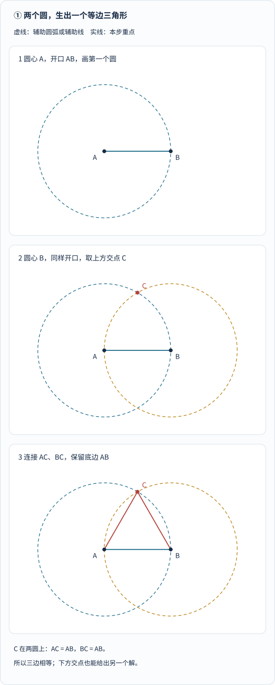
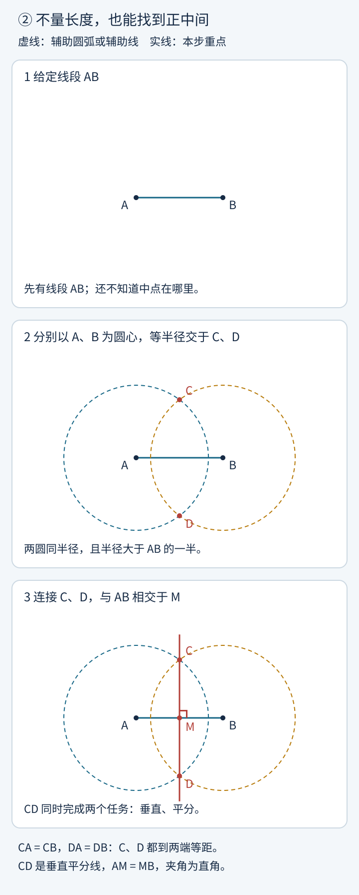
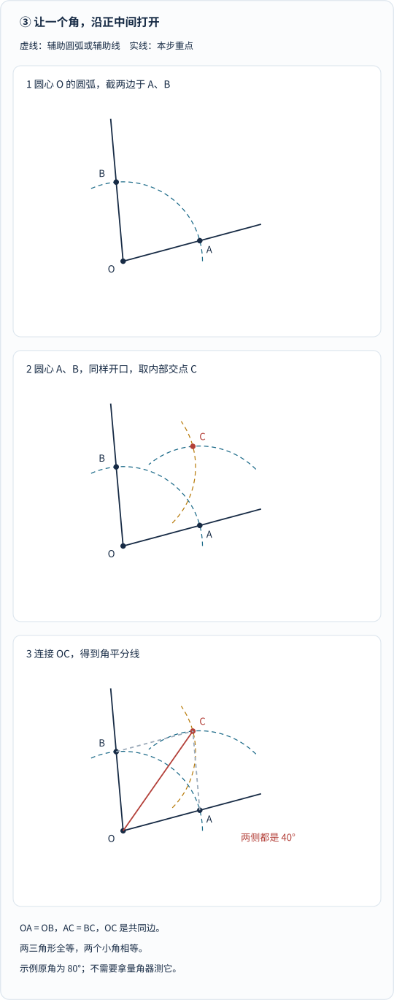
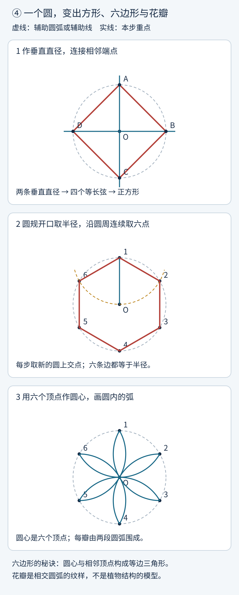
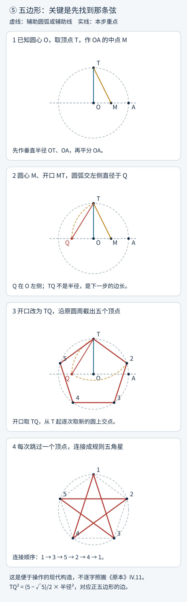
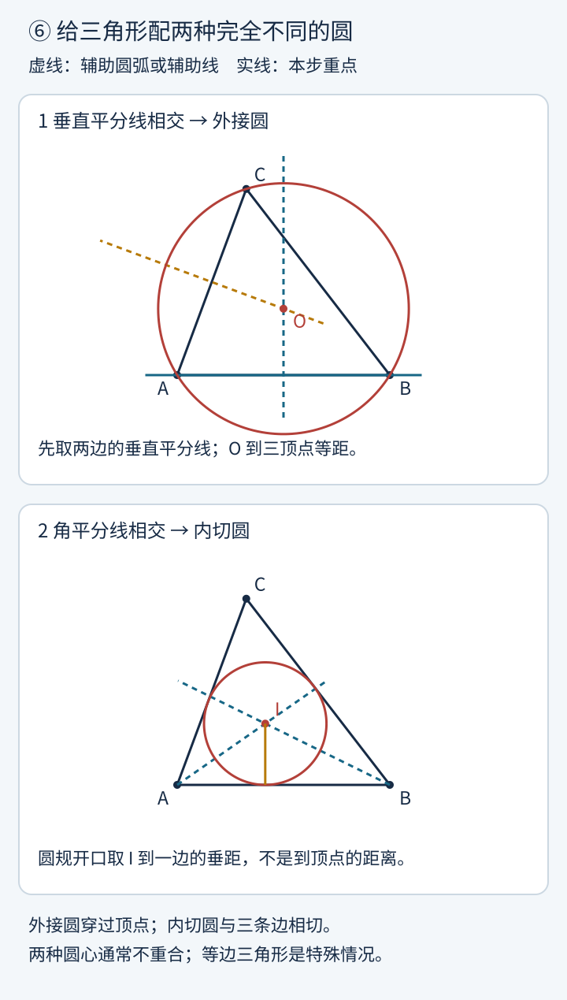
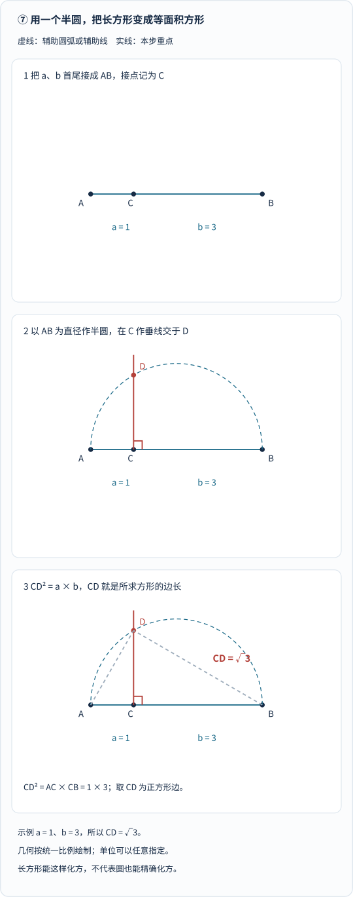
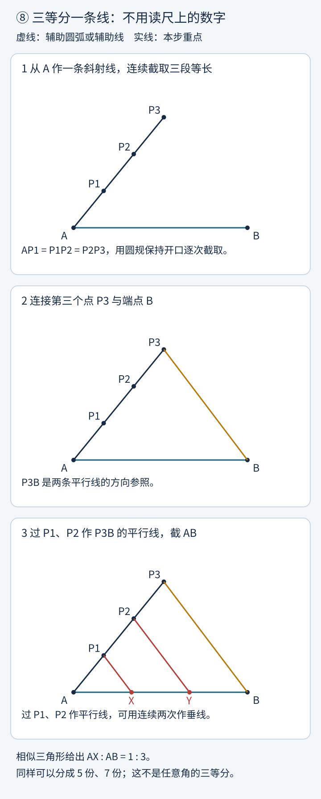

如果把你的直尺刻度全部擦掉，再收走量角器，只留下一把圆规，你还能做什么？

画个圆，当然可以。

画一条直线，也不难。

可如果我接着要求：

“找出这条线的正中间。”

“把这个角分成完全一样的两半。”

“画一个真正的正五边形，再让它长出一颗五角星。”

事情突然就有点像魔术了：**你不能读刻度，却能精确找到相等的长度；你不能量角，却能让角度严格相等。**

这就是尺规作图最迷人的地方。

它不是“手很稳的人画得更像”，而是：**通过有限个有理由的操作，让图形的性质自己成立。**

两千多年前，《几何原本》就把这种思路编织成了一座巨大的知识建筑。今天，我们不急着爬到屋顶，先带一把尺子和一个圆规，从门口走进去。

## 一、先说游戏规则：这把尺子，不负责量长度

这里的“尺”，指**没有刻度的直尺**。

它能做两件事：连接已经确定的两个点，把一条直线继续延长。不能看着尺上的数字截取 3 厘米，也不能把尺边当作一个固定宽度的特殊工具，偷偷塞进图形里。

“规”就是圆规。它负责以一个已经确定的点为圆心，以一个已经得到的长度为半径，画圆或圆弧。

圆弧不必画满一圈。如果只需要两个交点，保留附近的小段弧就够了。

新的点主要从三种交会中产生：直线与直线、直线与圆、圆与圆。也可以在允许的位置任取辅助点，但结论必须不依赖“恰好凭眼力选中了正确位置”。

这和日常画图有一个重要区别：

**尺规作图讨论的是理想的数学工具，以及有限步骤中的精确构造。**

纸上的线有粗细，圆规会打滑，实际操作当然有误差。数学说的“相等”，不是要求你用铅笔实现无限精度，而是说：如果按理想规则操作，结果必然满足那个性质。

### 一个容易漏掉的小细节：圆规能不能搬运开口

现代课堂里，我们通常允许圆规保持开口，把已有线段的长度搬到另一处。

《几何原本》的最初公设并没有直接把这种搬运作为独立能力。第一卷命题 2 专门证明了：可以在指定点出发，构造出一条等于给定线段的线段。因此，允许搬运长度只是简化操作，并没有扩大最终可作图形的范围。[原文与说明：I.2](https://mathcs.clarku.edu/~djoyce/elements/bookI/propI2.html)

下面采用这种方便动手的现代约定，但**不允许用刻度读数，也不允许滑动带标记的尺子去“凑”一个位置**。后者会改变游戏规则。

## 二、《几何原本》不是一本“古代图形大全”

欧几里得约在公元前 300 年编纂《几何原本》。这部著作不是说“所有结果都由他一个人首次发现”，而是把许多已有数学组织成一个从基本假设逐步推导的体系。

它共有十三卷，不只讲平面图形，也涉及比例、数论、不可通约量和立体几何。第一卷从三角形等基础内容出发，第四卷讨论圆内接、圆外切图形，第十三卷最终走向正多面体。[资料：Clay 数学研究所《几何原本》档案目录](https://www.claymath.org/library/historical/euclid/)

而它的第一道正式命题，并不是一个吓人的公式：

> 在给定线段上，构造一个等边三角形。

这个开场非常漂亮。

一方面，谁都能跟着画；另一方面，它马上告诉你数学的规矩：

**作出来之后，还得解释它为什么就是你要的东西。**

这也是下面每个小实验都保留“为什么”的原因。图是路标，证明才是让你放心走过去的桥。

顺带提醒：现代公理化研究也发现，《原本》有一些未明确说出的假设，例如某些圆的交点为什么存在。所以，敬佩它的体系，不等于宣称它已经具有现代形式化系统的全部严密性。David Joyce 对第一命题的评注就讨论了这些细节。[原文与评注：I.1](https://mathcs.clarku.edu/~djoyce/elements/bookI/propI1.html)

## 三、第一招：两个圆，生出一个等边三角形

先在纸上画一条线段 \(AB\)。

现在不许量它多长，但可以让圆规的两脚分别落在 A、B 上。这个开口，就是我们已经得到的一段长度。

**跟着做：**

1. 以 A 为圆心，以 AB 为半径画圆。
2. 以 B 为圆心，用同样的半径画另一个圆。取上方交点 C。
3. 连接 AC、BC，保留原来的 AB。

*从上往下看：蓝色圆确定“到 A 的距离等于 AB”，金色圆确定“到 B 的距离也等于 AB”；C 同时满足这两条要求。最后出现的红色两边不是靠目测配出来的，而是被两个圆约束出来的。下方交点也能产生一个对称的等边三角形。*

**为什么一定对？**

C 在第一个圆上，所以 \(AC=AB\)。

C 在第二个圆上，所以 \(BC=AB\)。

因此三边相等：

$$
AB=AC=BC.
$$

这就是《几何原本》第一卷命题 1 的核心构造。[查看原文 I.1](https://mathcs.clarku.edu/~djoyce/elements/bookI/propI1.html)

你可能已经发现，圆规其实不只是“画圆工具”。

**它更像一台“制造等长条件”的机器。**

## 四、第二招：不量长度，怎样找到正中间

这次给你一条线段 AB，要找中点 M。

最容易犯的错误是：“先估计一半，把圆规开到差不多那么大。”

不需要。我们恰恰可以避开“一半究竟在哪”。

**跟着做：**

1. 以 A 为圆心画弧，半径取大于 AB 的一半。最省心的选法是直接用 AB。
2. 以 B 为圆心，以相同半径画弧，得到上下两个交点 C、D。
3. 连接 CD，它与 AB 的交点就是 M。

*先找两个圆的交点，不要先猜 M。图里使用的共同半径大于半条 AB，但不等于 AB；你动手时也可以直接取 AB，构造结论相同。红色 CD 既垂直于 AB，又通过它的中点。*

**为什么一定对？**

C 到 A、B 的距离一样，D 到 A、B 的距离也一样。

在平面上，到一条线段两端等距的点，都在它的垂直平分线上。于是 CD 就是这条线。

这个性质也能从等腰三角形及全等关系证明，并不需要拿三角板检查“看上去是不是 90 度”。

这个工具一次给了我们两件东西：

**平分线段，以及作出垂线。**

需要注意的是，我们用了两个不同的交点。如果圆规开口太小，两圆不相交；刚好取半条 AB，两圆只有一个切点，也不能按这个步骤得到 CD。

### 以后说“作垂线”，不是突然偷加一把三角板

如果已知点 P 在直线上，可以先用以 P 为圆心的圆，在直线上截出两点 A、B。因为 \(PA=PB\)，作 AB 的垂直平分线就会经过 P。

如果 P 不在直线上，则用以 P 为圆心、半径足够大的圆截该直线于 A、B，再作 AB 的垂直平分线。由于 \(PA=PB\)，这条垂线也经过 P。

以后我们把“作垂线”当成一个已经搭好的小模块，内部仍然只有直线和圆。

## 五、第三招：一个角，怎样从正中间分开

取一个大于 0 度、小于 180 度的角，顶点记为 O。

不要去量它究竟是 80 度还是 83 度。我们的目标不是先知道角有多大，而是让两边对称地接受相同约束。

**跟着做：**

1. 以 O 为圆心画一段弧，与角的两边分别交于 A、B。这样 \(OA=OB\)。
2. 分别以 A、B 为圆心，以相同半径画弧，取角内部、不同于 O 的交点 C。这里可以统一用 OA 作半径。
3. 连接 O、C，得到角平分线。

*先看 A、B：它们到 O 等距。再看 C：它到 A、B 等距。最后比较 OAC 和 OBC 两个三角形，三条对应边分别相等。图中原角是 80 度，但这只是脚本选的示例，不是操作时需要测量的数字。*

**为什么一定对？**

两个三角形有：

$$
\begin{aligned}
OA&=OB,\\
AC&=BC,\\
OC&=OC.
\end{aligned}
$$

由三边对应相等，两个三角形全等。因此：

$$
\angle AOC=\angle COB.
$$

《原本》第一卷命题 9 也构造角平分线；它的正文采用在 AB 上构造等边三角形的路线。这里使用 Joyce 评注中给出的另一种常见构造，方便大家直接拿圆规操作，不冒充逐字复刻古代步骤。[原文与替代构造：I.9](https://mathcs.clarku.edu/~djoyce/elements/bookI/propI9.html)

做到这里，我们已经有了一套小积木：等长、垂直、平分。

接下来的图形，大部分就是这些积木重新组合。

## 六、一个圆，怎样长出正方形、六边形和六瓣花

### 1. 正方形：把圆分成四个相同的方向

假设圆心 O 已知。

先画一条过 O 的直线，与圆交成一条直径。再过 O 作它的垂线，得到另一条直径。按圆周顺序连接四个端点，就是圆内接正方形。

理由并不是“它很对称，所以差不多”。两条垂直直径把周角分成四个直角；相等的圆心角对应等长的弦，四条边相等，四个内角也都是直角。

**给定圆却没标圆心怎么办？** 任取两条不平行的弦，分别作垂直平分线，它们的交点就是圆心。这又调用了刚刚做好的工具。

### 2. 正六边形：最让人愉快的一次“恰好”

在同一个圆上取一个起点。圆规开口不再随意选，而是直接取圆的半径。

以起点为圆心画弧，与原圆相交，选一个方向作为前进方向；以新点为圆心重复，之后每次取不同于上一个顶点的那个新交点。

你会在六步后回到出发点。

*第一格看两条垂直直径；第二格看从顶点 1 到顶点 2 的一条边，它与圆的半径相等；第三格不再增加多边形边，而是保留六个顶点作圆心时落在原圆内部的弧。六瓣花来自相交圆的几何关系，不是某种神秘的自然定律。*

为什么恰好六步？

圆心 O 和相邻两个顶点构成一个三角形。两条半径等长，而我们截出的弦也等于半径，所以它是等边三角形，圆心角就是 60 度。

六个 60 度，正好绕满一周。

《原本》第四卷命题 15 给出圆内接正六边形的构造与证明；这里采用便于操作的连续截弦形式。[原文 IV.15](https://mathcs.clarku.edu/~djoyce/elements/bookIV/propIV15.html)

### 3. 六瓣花：不再只连线，开始保留弧

保留刚得到的六个顶点。

以每个顶点为圆心，圆规仍保持原来的半径，画出位于原圆内部的圆弧。它们会共同形成六瓣花纹。

这里没有使用新工具，只是把原本为“找交点”服务的辅助圆弧，变成了图形本身。

这也是许多几何纹样的一个入口：**先有规则的点网，再决定保留哪些线与弧。**

### 4. 八边形、十二边形，还能继续生长

有了正方形，把相邻顶点之间的圆心角二等分，就能得到正八边形。继续二等分，可以得到正十六边形。

从正六边形出发，同样能得到正十二边形、正二十四边形。

注意，不是拿圆规沿圆周“凭感觉找弧长的一半”，而是**先作圆心角的角平分线，再找它与圆的交点**。

尺规在这里像一套可以复用的程序：已经证明正确的模块，可以反复调用。

## 七、五边形没那么听话：先把正确的边长找出来

正六边形的边长恰好等于半径。正五边形不享受这个便利。

如果仍然把圆规开成半径，你得到的还是六等分，不会因为心里想着“五角星”就自动变成五等分。

我们需要先构造出一条特殊的弦。

下面给出一个方便动手的现代构造。它与《原本》第四卷命题 11 达到相同目标，但步骤不同。

**准备：** 已知圆心 O，作两条互相垂直的半径：向上的 OT、向右的 OA。T 是五边形最上方的顶点。

**跟着做：**

1. 作 OA 的中点 M。
2. 以 M 为圆心、MT 为半径画弧，与水平直径在 O 左侧交于 Q。
3. 把圆规开口改成 TQ。以 T 为起点，用这个长度在原圆上连续截弦，每次沿同一方向选择新顶点，最终得到五个顶点。顺次连接。

*第二格最关键：圆心是 M，不是 O；开口是 MT，不是原圆半径；Q 取在 O 左侧。第三格要再次换开口，改成 TQ。TQ 并不是正五边形中已经画好的一条边，而是先在辅助位置构造出来、随后搬到原圆上的正确边长。第四格把顶点 T 编为 1，隔点相连，就得到五角星。*

**为什么这条 TQ 恰好合适？**

设原圆半径为 \(R\)。由直角三角形 OMT：

$$
MT=\sqrt{R^2+(R/2)^2}
=\frac{\sqrt5}{2}R.
$$

Q 位于 M 左边，并且 \(MQ=MT\)，因此：

$$
OQ=MQ-MO
=\frac{\sqrt5-1}{2}R.
$$

再看直角三角形 TOQ：

$$
\begin{aligned}
TQ^2
&=OT^2+OQ^2\\
&=\frac{5-\sqrt5}{2}R^2.
\end{aligned}
$$

它正好等于圆内接正五边形边长的平方。用现代三角函数表示，这条边为：

$$
s=2R\sin36^\circ
=R\sqrt{\frac{5-\sqrt5}{2}}.
$$

这里的代数是在**检验这套构造**，不是让你拿计算器读出小数再用刻度尺描线。

欧几里得的构造会先建立一种两个底角分别为顶角两倍的等腰三角形，再将角的关系搬到圆中。想看原来的证明路线，可以读 [IV.11](https://mathcs.clarku.edu/~djoyce/elements/bookIV/propIV11.html)。

### 再跳一个顶点，五角星出现了

得到五个顶点后，不连接相邻顶点，而是每次跳过一个，按“1→3→5→2→4→1”连接，就得到规则的五角星。

这些线其实是正五边形的对角线。

正五边形中，对角线长度 \(d\) 与边长 \(s\) 满足：

$$
\frac ds=\frac{1+\sqrt5}{2}.
$$

这就是黄金比例。

它不是因为“五角星长得漂亮”就被赋予的神秘数字。对角线相交产生一批相似三角形，由相似关系可以得到一个大于 1 的比值 \(x\)，满足 \(x^2=x+1\)，解出来就是上面的数。

更不应把它扩大成“所有美丽建筑、所有人体比例、所有植物都严格遵守黄金比例”。这里得到的是**这个精确几何构型里的比例关系**。

## 八、给三角形配两个圆：穿过顶点，还是贴着三边

现在随手画一个普通三角形，不必是等边的。

你想给它配一个圆，有两种完全不同的愿望。

一种是：圆穿过三个顶点。

另一种是：圆在里面，恰好贴着三条边。

它们分别叫**外接圆**和**内切圆**。

*第一格找 O：它到三个顶点等距，所以用它作圆心，圆会穿过顶点。第二格找 I：它到三条边的垂直距离相等，所以圆可以同时与三边相切。外接圆和内切圆的圆规开口不是同一种距离。*

### 外接圆：寻找“到三个点一样远”的位置

1. 选三角形的两条边，分别作垂直平分线。
2. 两线交于 O。
3. 以 O 为圆心，以 O 到任一顶点的距离为半径画圆。

为什么不用第三条边也可以？

第一条垂直平分线保证 \(OA=OB\)，第二条保证 \(OA=OC\)。于是三者相等，第三条边的垂直平分线也经过 O。

外心不一定在三角形内部：锐角三角形在内部，直角三角形在斜边中点，钝角三角形则在外部。图里只画一个锐角例子，不要把它当成所有三角形的外观。

### 内切圆：寻找“到三条边一样远”的位置

1. 作两个内角的角平分线，交于 I。
2. 从 I 向一条边作垂线，垂足记为 H。
3. 以 I 为圆心、IH 为半径画圆。

注意这次半径是**到边的垂距**，不是到顶点的距离。

角平分线上的内部点，到角的两条边等距。因此 I 到三边的垂直距离相同，圆会同时与它们相切。

在一般三角形中，O 和 I 不是同一个点。等边三角形是一种特别整齐的情况，它们才会重合。

这两种构造分别见《原本》第四卷 [命题 5：外接圆](https://mathcs.clarku.edu/~djoyce/elements/bookIV/propIV5.html)与[命题 4：内切圆](https://mathcs.clarku.edu/~djoyce/elements/bookIV/propIV4.html)。

## 九、圆规不仅画图，还能“开平方”

假如有一个长方形，两边长分别是 \(a\)、\(b\)。想画一个面积与它相同的正方形，边长应该是多少？

若把所求边长记为 \(x\)，就是：

$$
x^2=ab,\qquad x=\sqrt{ab}.
$$

不能拿计算器算出小数，也不能用尺子读取它。那么，怎样让这个根号自己从图里长出来？

**跟着做：**

1. 把长度 a、b 首尾接在同一直线上，得到 AB，接点为 C，因此 \(AC=a\)、\(CB=b\)。
2. 找 AB 中点，以 AB 为直径画半圆。
3. 在 C 处作 AB 的垂线，与半圆交于 D。CD 就是 \(\sqrt{ab}\)。
4. 以 CD 为边作正方形：在 C、D 处向同一侧作垂线，用圆规分别截取等于 CD 的两段，再连接新端点。

*先看底边：示例里 a=1、b=3，不是把直径随便一分为二。再看 C 的垂线：它交半圆于 D，得到 CD=√3。第三格中的斜虚线帮助说明直角三角形关系，不是求 D 时必须先画的线。图形使用统一长度比例。*

**为什么一定对？**

设半圆半径为：

$$
r=\frac{a+b}{2}.
$$

半圆圆心到 C 的距离是 \(|a-b|/2\)。在这个直角三角形中，用勾股定理：

$$
\begin{aligned}
CD^2
&=\left(\frac{a+b}{2}\right)^2
-\left(\frac{a-b}{2}\right)^2\\
&=ab.
\end{aligned}
$$

所以，以 CD 为边的正方形，与原长方形面积相等。

这正是《原本》第二卷命题 14 的重要思路：把直线围成的图形转化成等面积正方形。第六卷还从比例与相似的角度讨论几何平均数。[原文与解释：II.14](https://mathcs.clarku.edu/~djoyce/elements/bookII/propII14.html)

当一段长度取作单位 1，另一段为 a，这个半圆就能构造 \(\sqrt a\)。

所以，**尺规不是只会描图，它还藏着一台几何计算器。**

## 十、线段能三等分，角为什么不行

先做一个很容易成功的实验：三等分线段 AB。

**跟着做：**

1. 从 A 作一条不与 AB 共线的辅助射线。
2. 在射线上保持圆规开口，连续截出三段等长，依次到达 P1、P2、P3。
3. 连接 P3 与 B。
4. 过 P1、P2 分别作 P3B 的平行线，与 AB 交于 X、Y。

*不要从原线段上直接猜三分点。先把容易复制的等长段放在辅助射线上，再通过平行线把比例搬回 AB。红色两条平行线是尺规可构造的：先过辅助点作 P3B 的垂线，再过该点作这条垂线的垂线。*

由相似三角形：

$$
\frac{AX}{AB}=\frac{AP_1}{AP_3}=\frac13.
$$

同理，\(AY/AB=2/3\)，所以 \(AX=XY=YB\)。

同样的想法可以分成 5 份、7 份，或任意给定的正整数份。这里说的是有限份，不是一次画出无限多个点。[原文与说明：VI.9](https://mathcs.clarku.edu/~djoyce/elements/bookVI/propVI9.html)

可换成**任意角的三等分**，事情就变了。

没有一套只用无刻度直尺与圆规、经过有限步，就能把任意给定角精确三等分的方法。

“任意”二字非常重要。90 度可以三等分成 30 度；先作 60 度，再二等分，就有 30 度。**不是每个角都不能三等分，而是没有对所有角通用的办法，甚至 60 度本身就无法在这些规则下三等分。**

1837 年，旺策尔给出了相关不可作性证明。它不是说前人手不够稳，也不是说还差一把更好的圆规，而是规则决定了某些目标无法到达。[资料：Joyce，I.9 的评注](https://mathcs.clarku.edu/~djoyce/elements/bookI/propI9.html)、[MacTutor：三等分角史](https://mathshistory.st-andrews.ac.uk/HistTopics/Trisecting_an_angle/)

### 加上一条刻痕，游戏就可能变了

如果允许在尺上标记一段长度，再让尺子同时满足“经过这个点、两个标记分别落在两条线或曲线上”的位置条件，就引入了称为 **neusis** 的嵌入作图。

这比普通直尺连接两个已知点更强，确实可以用于三等分角。

所以，你在网上看到一个“三等分角成功”的视频，先别急着判断：

它是近似作图？特殊角？还是用了带标记的尺、折纸、额外曲线或滑动配准？

**换了工具之后做成一件事，不等于证明原来那套规则没有限制。**[工具规则与例子：I.Post.2 评注](https://mathcs.clarku.edu/~djoyce/elements/bookI/post2.html)

## 十一、为什么有些图形，怎么努力也画不出来

这段是可选的数学放大镜。你不必先学抽象代数，也能抓住门槛在哪里。

把最初给定的一段长度规定为 1，再给平面安上坐标。

直线与直线相交，需要解一次方程。

直线与圆相交，会遇到二次方程。

两个不同圆相交时，可以用两圆方程相减得到一条直线，再归结为直线与圆相交。

于是，从单位线段出发，尺规能够得到的坐标与长度，可以通过有限次四则运算和开平方来描述；反过来，这些允许的实数运算也能用几何方式实现。开平方要求被开方数非负，除法要求分母不为零。

这解释了为什么 \(\sqrt2\)、\(\sqrt3\)、\(\sqrt5\) 能出现，也解释了为什么“有根号”并不等于“不能作图”。

但**开平方不是任意开方**。

从有理数起步，每次真正增加新的二次扩张时，代数次数至多乘 2。可作的代数数，其最小多项式次数必须是 2 的幂；这是必要条件，不能反过来说“次数是 2 的幂就自动保证可作”。还需要能放进逐层二次扩张的结构里。

这里用现代代数解释限制，不是声称欧几里得已经使用域扩张语言。想看逐层扩张、次数和下面三大问题的完整论证，可以跟读开放教材 [AATA, Remixed!：What's Not Constructible](https://openmathbooks.org/aatar/section-constructions-conc.html)。

### 倍立方：不是把边长乘 2

把一个边长为 1 的立方体，变成体积为 2 的立方体，所求边长是：

$$
x=\sqrt[3]{2}.
$$

边长乘 2 会让体积变成 8，不是 2。

\(x^3-2\) 在有理数上不可约，所需数的代数次数是 3，不是 2 的幂，因此不能只从单位线段用尺规精确作出。

这不是不能在工程上近似加工一个体积翻倍的盒子，而是**不能用指定的理想工具完成这个精确数学构造**。

### 三等分 60 度：问题藏在三次方程里

如果能三等分 60 度，就能作出 20 度。

令 \(x=2\cos20^\circ\)，由三倍角公式：

$$
x^3-3x-1=0.
$$

这个三次多项式没有有理根，因此在有理数上不可约，x 的次数为 3。于是，它也越过了尺规只靠逐层开平方能够到达的边界。

这里的代数论证补上了前面“60 度不能三等分”的原因。

### 化圆为方：不是再多开几次平方，就能跨过去

给一个半径为 1 的圆，要求画出面积相等的正方形，其边长应为：

$$
s=\sqrt\pi.
$$

1882 年，林德曼证明了 \(\pi\) 是超越数：它不是任何非零整系数多项式的根。因此 \(\sqrt\pi\) 也不是代数数，而尺规从单位长度得到的数都是代数数，精确化圆为方便不可能。

这里同样要求**有限步**。允许无限逼近、给误差范围，当然能画出越来越接近的图形；那是另一个完全合理的任务，但不是精确尺规作图。[资料：II.14 的化圆为方评注](https://mathcs.clarku.edu/~djoyce/elements/bookII/propII14.html)、[MacTutor：化圆为方史](https://mathshistory.st-andrews.ac.uk/HistTopics/Squaring_the_circle/)

把三个问题放在一起，就能看清它们不是“还没找到窍门”：

| 目标 | 必须得到的量 | 在经典规则下的障碍 |
| --- | --- | --- |
| 单位立方体体积翻倍 | \(\sqrt[3]2\) | 所需数的次数为 3 |
| 三等分 60 度 | \(2\cos20^\circ\) | 所需数的次数为 3 |
| 单位圆化成等面积正方形 | \(\sqrt\pi\) | 所需数是超越数 |

前面我们明明能把长方形化成等面积正方形，却不能因此把“长方形”三个字悄悄换成“圆”。

数学里，**一个词换了，整道问题可能就换了。**

## 十二、七边形不行，十七边形却可以？尺规的世界并不按难易排序

做到五边形和六边形，你可能会自然地问：

“接下来是不是七、八、九，慢慢往上画就行？”

并不是。

正七边形、正九边形，都不能用经典尺规精确构造。但正十七边形可以。

这听上去像故意刁难：七个顶点比十七个少，怎么反而不行？

因为决定门槛的不是笔画数量，而是背后的代数结构。

高斯发现正十七边形可以尺规构造，是这一领域的重要突破；相关理论在他 1801 年出版的《算术研究》中得到阐述。它把看似只属于画图的问题，与数论连接了起来。[资料：MacTutor 高斯传记](https://mathshistory.st-andrews.ac.uk/Biographies/Gauss/)

更一般地，一个正 n 边形是否可作，有完整判据：当 \(n\ge3\)，它可作，当且仅当 n 可以写成 **2 的非负整数次幂，乘上一些互不相同的费马素数**；这个素数乘积也可以为空。

费马素数是形如 \(2^{2^k}+1\) 且确实为素数的数，其中 \(k\) 为非负整数。已知的包括 3、5、17、257、65537。不是每一个这种形式的数都是素数。

所以：

- 12 是 \(4\times3\)，可作。
- 15 是 \(3\times5\)，可作。
- 9 是 \(3\times3\)，把 3 重复用了，不符合条件。
- 7 不是费马素数，也不符合条件。
- 17 本身就是费马素数，可作。

这个完整的充要条件通常称为高斯—旺策尔定理，不能把后来补足的必要性全部归给高斯。[说明：IV.16 的正多边形评注](https://mathcs.clarku.edu/~djoyce/elements/bookIV/propIV16.html)

还有一件很漂亮的事：正十五边形不是必须从头硬造。

在同一圆里，从同一点同向作出正三角形的一条边与正五边形的一条边，它们对应的圆心角分别为 120 度与 72 度，相差 48 度。再把这部分角二等分，就得到 24 度，正好是 \(360^\circ/15\)。

这正是《原本》第四卷命题 16 的构造思想。

原来，那些一开始看起来孤零零的三角形、五边形与角平分线，早就在替后面的图形铺路。

## 十三、最后，把辅助线留下来

很多人画完图，会习惯性地把辅助线全擦掉。

如果只是交一张整洁的图，这当然可以。

但如果你想理解这张图，最好先别急。

等边三角形背后的两个圆，告诉你三边为什么相等。

垂直平分线背后的两组弧，告诉你中点为什么不用猜。

五边形背后的 M、Q，告诉你那条正确的弦是怎么出现的。

半圆背后的直角三角形，告诉你平方根为什么不是计算器专属的符号。

**辅助线不是多余的笔迹，它们是推理留下的脚印。**

尺规作图的乐趣，也不只是最后得到一朵花或一颗星。

更有趣的是，你开始能看见：一个点的位置，为什么被前面的条件牢牢决定；一条边的长度，为什么不需要刻度也能复制；一件事为什么能做，另一件看起来差不多的事却不能。

当你愿意追问这些“为什么”，你拿在手里的就不只是一把尺子和一个圆规了。

你正在用一套极简单的工具，体验数学最基本的一种力量：

**不靠看着像，而靠知道它必然如此。**

---

## 参考资料与跟读入口

本文实际查阅下列页面。构造图全部重新计算、原创绘制，没有复制网站里的配图或扫描件。网页中的交互程序可能依赖浏览器或 JavaScript；本文的步骤与静态图不依赖它们。

| 资料 | 支持的内容与读法 |
| --- | --- |
| [Clay 数学研究所：《几何原本》十三卷档案](https://www.claymath.org/library/historical/euclid/) | 约公元前 300 年的著作、十三卷主题、希腊文与英译的命题索引。其展示的抄本作于公元 888 年，不是欧几里得手稿；扫描图片有单独使用要求，本文未转载。 |
| [David E. Joyce，Clark University：I.1](https://mathcs.clarku.edu/~djoyce/elements/bookI/propI1.html) | 等边三角形的构造与证明，也说明古代公理表述中存在需要补足的逻辑细节。 |
| [I.2：复制已有长度](https://mathcs.clarku.edu/~djoyce/elements/bookI/propI2.html) | 为什么保持开口的现代圆规约定不扩大可作范围，以及欧几里得如何处理搬运线段。 |
| [I.9：角平分线](https://mathcs.clarku.edu/~djoyce/elements/bookI/propI9.html) | 原命题、常见替代构造、三等分角与旺策尔证明的背景。 |
| [IV.15：圆内接正六边形](https://mathcs.clarku.edu/~djoyce/elements/bookIV/propIV15.html) | 等边三角形与六个相等圆心角的连接。 |
| [IV.11：圆内接正五边形](https://mathcs.clarku.edu/~djoyce/elements/bookIV/propIV11.html) | 欧几里得的原始构造路线，以及对角线、相似三角形的比例关系。本文的 M、Q 方法另作现代代数核对。 |
| [IV.4：内切圆](https://mathcs.clarku.edu/~djoyce/elements/bookIV/propIV4.html)与[IV.5：外接圆](https://mathcs.clarku.edu/~djoyce/elements/bookIV/propIV5.html) | 从角平分线或边的垂直平分线寻找圆心。 |
| [II.14：化直线图形为等面积正方形](https://mathcs.clarku.edu/~djoyce/elements/bookII/propII14.html) | 半圆、几何平均数、面积转化及为何不能直接推广到精确化圆为方。 |
| [VI.9：截取线段的指定部分](https://mathcs.clarku.edu/~djoyce/elements/bookVI/propVI9.html) | 辅助射线、等长截取、平行线与相似三角形。 |
| [I.Post.2 评注：neusis](https://mathcs.clarku.edu/~djoyce/elements/bookI/post2.html) | 带标记的尺子配准为何超出普通尺规规则，以及它如何改变三等分角的能力。 |
| [MacTutor：Trisecting an angle](https://mathshistory.st-andrews.ac.uk/HistTopics/Trisecting_an_angle/) | 任意角与特殊角的区别，古代额外工具、曲线与现代不可作性问题。 |
| [MacTutor：Squaring the circle](https://mathshistory.st-andrews.ac.uk/HistTopics/Squaring_the_circle/) | 精确化圆为方与近似方法的历史，不能把古代所有几何研究都说成只许使用尺规。 |
| [AATA, Remixed!：What's Not Constructible](https://openmathbooks.org/aatar/section-constructions-conc.html) | 从逐层二次扩张得到可作数的次数限制，并证明倍立方、三等分 60 度与精确化圆为方的不可作性；适合想继续读代数证明的读者。 |
| [IV.16 评注：可作正多边形](https://mathcs.clarku.edu/~djoyce/elements/bookIV/propIV16.html) | 十五边形、倍增边数、费马素数及一般可作条件。 |
| [MacTutor：Gauss](https://mathshistory.st-andrews.ac.uk/Biographies/Gauss/) | 正十七边形的突破与《算术研究》的出版背景。 |

**图解说明：** 八幅 SVG 由 `python tools/visuals.py build compass-geometry` 生成，逐图核对等长、圆上位置、夹角、平行关系、五边形闭合、几何平均数，以及内切圆相切和外接圆共圆。脚本中的坐标和三角函数用于验证与绘制结果，不是要求读者在尺规操作中偷用量角器或坐标刻度。

**想动手时：** 先画大一些，用细笔保留辅助弧；每完成一步就标上字母，再对照下一格。全部图解可单独打开放大，不需要等待动画播放。
