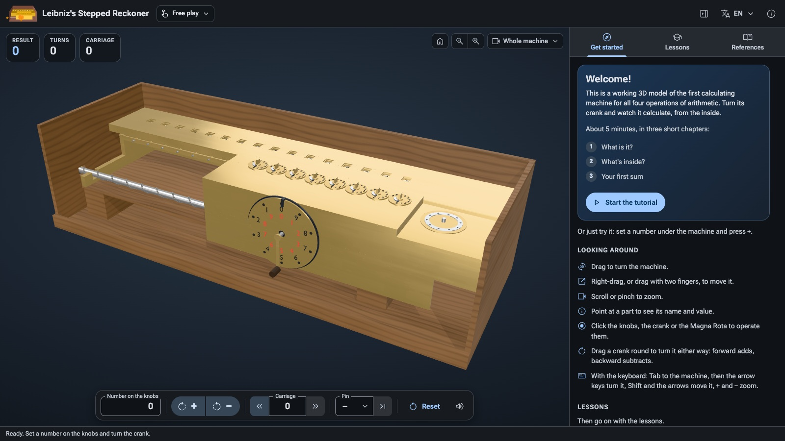
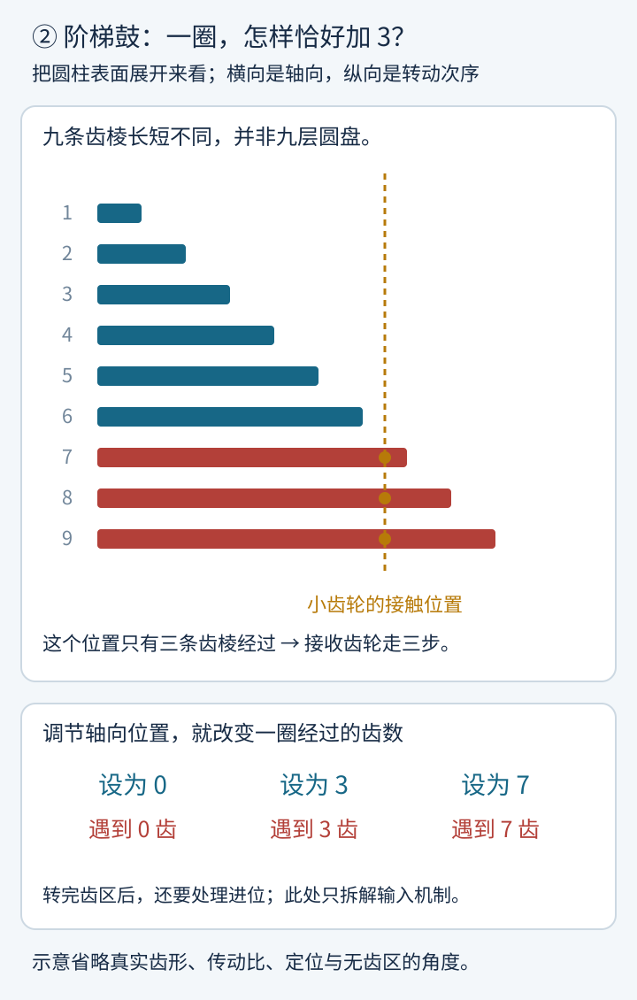
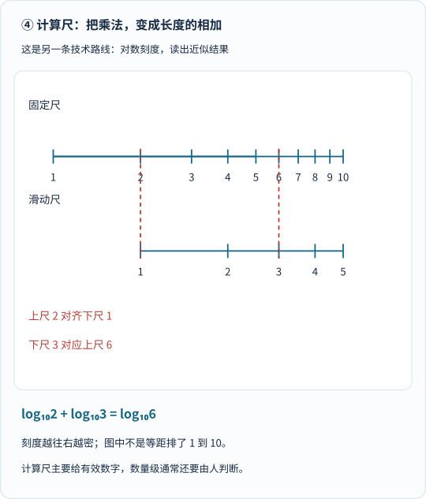
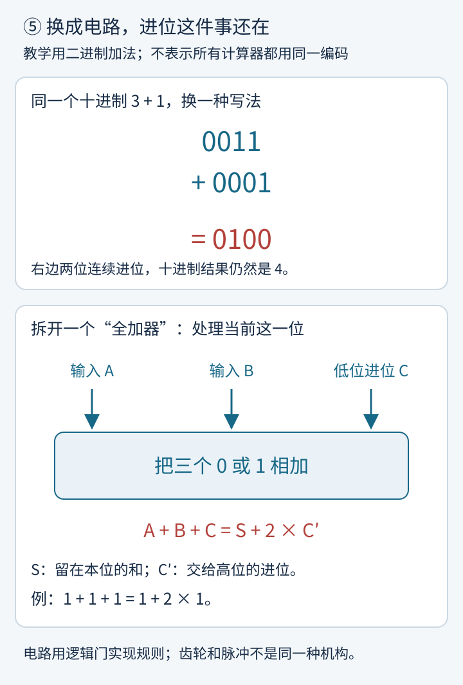
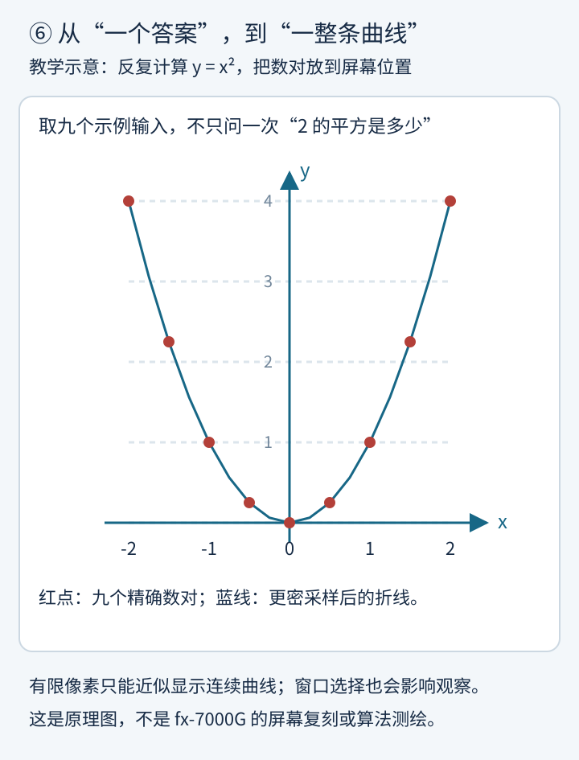
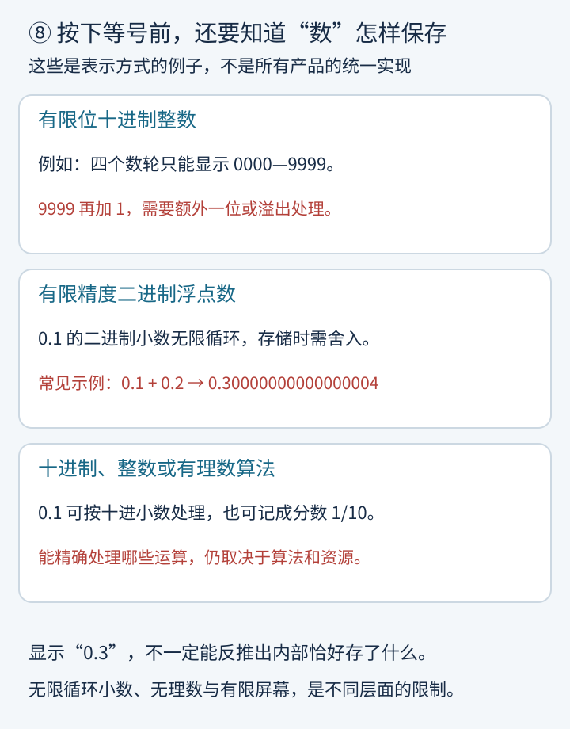

你有没有认真看过手机上的计算器？

一个灰扑扑的小图标，打开，输入几个数，按下等号。

答案出来得太容易，以至于我们很少问：**如果没有芯片，没有电池，甚至没有电，机器还能不能替人算数？**

能。

而且，你真的可以用手摇出来。

最近我看到一个很有意思的开源项目：有人把莱布尼茨的机械计算器做成了浏览器里的三维模型。木盒、黄铜零件、旋钮、滑架，还有一个看起来颇有仪式感的摇柄。

设好数字，摇一下，结果窗口里的数字就变了。

再把外壳隐去，你能看到：**不是某个看不见的“数学精灵”在报答案，而是一些零件，正在执行可以解释的步骤。**



*这是开源项目的三维复刻界面，不是历史原机照片。作者为 leibniz-stepped-reckoner contributors；图片来自[项目 README 中的原文件](https://github.com/wixette/leibniz-stepped-reckoner/blob/main/images/readme/free-play.jpg)，依 [CC BY-SA 4.0](https://creativecommons.org/licenses/by-sa/4.0/) 使用，未修改图片。项目代码采用 Apache-2.0，原创模型、文档和这张截图采用另一套许可，不能混为一谈。*

这台“黄铜计算器”把我拉回了另一个熟悉的名字：帕斯卡。

我们前面聊过他和费马怎样从未完的赌局里推算未来。但更早一些，这位年轻人已经在琢磨另一件事：

**能不能把算账时最容易出错的那一步，交给机器？**

沿着这个问题往下走，计算器的历史就不再是一张枯燥的年份表了。

它是一场持续了几个世纪的接力：**怎样保存数，怎样改变数，怎样不漏掉进位，又怎样让越来越复杂的规则自动执行。**

## 一、先别急着找“发明者”：算盘，也在替人保存数字

假如要你算一百笔账，真正累人的是什么？

不只是做出“7 加 8 等于 15”。

还要记住这一位写 5，下一位加 1；不能看错行，不能漏掉上一笔，不能把刚算出的结果忘掉。

算盘已经分担了其中一部分工作：珠子的位置保存数字，拨珠改变数字，熟练的人还能把许多步骤压缩成流畅的动作。

但在普通手动算盘上，**何时进位、怎样操作，主要仍由使用者执行**。工具保存状态，人负责推进算法。

机械计算器要再往前跨一步：

> 不只让物体代表数字，还要让物体之间的联系，执行一部分算术规则。

这一步比“把算盘装进盒子”难得多。

尤其是遇到这样一道小学生也会的题：

$$
99+1=100.
$$

纸上只有五个字符，机器里面却藏着一场接力赛。

## 二、帕斯卡遇到的大麻烦：不是 2 加 3，而是 99 加 1

17 世纪 40 年代，帕斯卡为了帮助承担税务工作的父亲处理计算，研制了后来被称为 **Pascaline** 的计算器。

它不是现代键盘式计算器。使用者把尖笔插进输入轮相应的位置，转到挡块那里，输入的数就被加进结果。

美国计算机历史博物馆介绍，帕斯卡制作了约 50 台，卖出的约有 15 台。这些数字是馆方给出的估计，但足以说明一个区别：它不只是纸上的构想，也不是只有一次演示的孤品。[来源：CHM，席卡德与帕斯卡计算器](https://www.computerhistory.org/revolution/calculators/1/47)

现在先不钻进它的全部齿轮，想象一个简化的十进制机器：

每个数轮只有 0 到 9。

个位从 2 变成 3，很容易：走一格。

个位从 9 再走一格，就不能显示 10 了。它必须回到 0，同时通知十位：“你加 1。”

可如果十位也正好是 9 呢？


*从上往下看红色数位：个位处理完，还没结束；十位也要处理，百位最后才能收到那个 1。这是十进制进位的逻辑拆解，不是对帕斯卡内部零件或动作时序的逐件复刻。图中的前导零只是为了对齐数位。*

**真正的难点，不是把一个轮子转动，而是让一串轮子可靠地传递“溢出”。**

如果简单地让所有高位都由低位硬推，连续进位时就会遇到越来越多的阻力与机械约束。帕斯卡机采用了带有下落重锤的进位机构：先准备好动作，到需要进位时释放。

可以把它理解成接力棒，但别把比喻当成机构图：历史机器里的锁止、释放、重力和零件配合，都需要具体设计。CHM 特别提到这一进位机构的复杂与可靠性问题。[同一馆藏说明](https://www.computerhistory.org/revolution/calculators/1/47)

帕斯卡的重要贡献，不是“第一次想到人可以用工具算数”，而是认真把**输入、保存结果和自动进位**装进了可使用的机器。

### 那他是不是“世界上第一个发明计算器的人”？

这样说太满。

1623 年，席卡德写给开普勒的信已经记录了一种计算机器。它把用于加减的齿轮机构，与用于乘除的纳皮尔算筹结合在一起。CHM 将它列为已知最早的机械四则计算器；不过，这里的乘除路径与后来阶梯鼓机器的自动累加机构不能直接画等号。[来源：CHM](https://www.computerhistory.org/revolution/calculators/1/47)

于是，“第一台”要先补上问题：

你指最早的文字记录？实际制作？少量生产？四则功能？还是全部运算都以怎样的机械方式实现？

**计算器不是某一天由一个人从零发明完成的。**

## 三、莱布尼茨的野心：不能只会加，还得会乘

莱布尼茨不满足于一台加法机器。

他希望同一套机构能处理加、减、乘、除。

但他没有为乘法另外请来一个“乘法小人”。

先看这道题：

$$
23\times4=23+23+23+23.
$$

如果一台机器能保存结果，每摇一圈就往里面加 23，那么摇四圈，不就得到 92 了吗？

想法很简单，难点转移了：

**怎样让同一个输入机构，既能每圈加 1，也能每圈加 3、加 7，而且不用每换一个数字就换一套齿轮？**

莱布尼茨的重要设计，是**阶梯鼓**。

它不是九层大小不同的蛋糕，而是一个带着长短不同齿棱的圆柱机构。通过调节轴向的相对位置，让与它接触的小齿轮，在一圈中遇到指定数量的齿棱。

设为 3，就有三次有效啮合；设为 7，就有七次。



*先看九条长短不同的横条：它们表示圆柱表面的齿棱。再看金色虚线：它表示小齿轮所在的轴向接触位置。转一圈时，只有跨过这条线的三条齿棱会经过接触处，于是产生三步输入。图是展开后的原理图，省略真实齿形、传动比和无齿区角度；不是制造图纸。*

这件事非常巧。

以前，“加多少”像是操作者手上转多远的问题。

现在，它变成了**机构设在什么位置**的问题。设置完成后，曲柄统一转一圈，各位就能输入各自的数字。

CHM 把这种阶梯鼓概括为：一个机构在一圈中可以表示 0 到 9 的任一数字。这个思路后来被许多机械计算器采用。[来源：CHM，莱布尼茨与 Curta](https://www.computerhistory.org/revolution/calculators/1/49)

### 但别把 1673 年的演示，想成今天屏幕里的成品

莱布尼茨在 1673 年已有计算机器的展示，此后几十年仍持续制作、修改不同版本。早期展示、后来的阶梯鼓方案、留存至今的机器，并不是一张照片对应的同一个时刻。

不同机构对版本和完成状态的描述也有差别。德累斯顿工业大学的馆藏页面明确提到，原机并未完全完善；其复刻机为可靠进位重新设计了驱动杆的张角。[来源：TU Dresden，莱布尼茨计算机复刻藏品](https://tu-dresden.de/mn/math/die-fakultaet/sammlungen/historische-rechenmaschinen/exponate/leibniz-rechenmaschine)

**有了正确的计算思想，不代表每根轴、每个齿、每一次连续进位都已经可靠。**

工程史往往就藏在这条缝里。

## 四、滑架一挪，为什么就乘了十

阶梯鼓解决“这一圈输入多少”。

乘大数时，还需要另一个看起来很朴素的零件：**可以移动的滑架**。

想象输入数是 23。

如果输入机构的个位对准结果的个位，一圈加 23。

如果把整个输入机构向更高位移动一格，原来的个位对准十位，一圈就加 230。

再移一格，就是 2300。

它不是把 23 算了一遍“乘十公式”，而是直接改变了数位对齐关系。

我们纸上列竖式时把第二行往左错一位，机器就用滑架把这件事物理地做了出来。

拿复刻项目教程里的例子试试：

$$
\begin{aligned}
1709\times365
&=1709\times(5+60+300)\\
&=8545+102540+512700\\
&=623785.
\end{aligned}
$$


*每一格分开看“每圈加多少”“本步增加多少”“累计结果是多少”。第二步不是重新从零开始；它是在 8545 上再加 102540。第三步同理。移动滑架，相当于把竖式中的数位对齐关系交给机构。*

总共摇几圈？

$$
5+6+3=14.
$$

不是 365 圈。

当然，这里数的是主要累加圈数，还没把设置数字、移动滑架，以及某些历史机构可能需要的额外进位处理算作操作成本。不能据此宣传“所有机器只要十四个动作就完成”。

除法则可以沿另一条路走：在合适数位上反复减去除数，记录减了多少次，再移动一位继续。真实操作还涉及试减、恢复及读数；它不是现代计算器按一下除号就全部包办的体验。[操作例子：项目 README 的乘除教程](https://github.com/wixette/leibniz-stepped-reckoner#how-it-calculates-in-six-lessons)

**四则运算看起来是四件事，机器却能复用“加减、计数、位移”这几个模块。**

## 五、顺手玩一下：把那个复刻项目当成一扇透明窗

你找到的项目是 [wixette/leibniz-stepped-reckoner](https://github.com/wixette/leibniz-stepped-reckoner)，提供[简体中文在线模拟器](https://wixette.github.io/leibniz-stepped-reckoner/?lang=zh-CN)。

外部页面需要网络、JavaScript，以及支持其三维渲染的浏览器。它是扩展体验，不是看懂本文的前提。

第一次打开，不必立刻挑战大乘法：

1. 清零，在“旋钮上的数”输入 2，按“+”。
2. 改成 3，再按“+”，看结果变成 5。
3. 清零，输入 9999 并加一次，再改成 1 加一次；切换到观察进位的视图，留意为什么连着几个 9 特别有看头。
4. 再试 12：先加一次，把滑架向左移一格，再加一次。结果 132，正好是 $$12+120$$。

理解以后，再跟着它的课程做 1709×365。项目还有插销与大轮计圈的操作，不必把手摇次数全靠脑子记住。

### 最值得读的，反而是它承认“不确定”的地方

我查看了本地项目的说明、研究报告和进位设计决策。它不只贴出一个漂亮模型，还说明：哪些尺寸来自复刻图纸，哪些经过估计；为什么不同研究者复原出的进位行为不完全一样。

尤其是连续进位，项目区分了教学用的顺序传播模式与可能需要后续动作的延迟进位解释。其设计文档还明确承认：后一种模式并不逐圈复现所有历史说明中的表现，部分时序仍是复原选择。[项目说明：How faithful is the model?](https://github.com/wixette/leibniz-stepped-reckoner#how-faithful-is-the-model)、[进位解释与后续修正](https://github.com/wixette/leibniz-stepped-reckoner/blob/main/design/decisions/0001-carry-interpretation.md)

这不是扫兴。

恰恰相反，**“怎样算才对”和“当年的那台机器究竟怎样动”，是两个相关、却不完全相同的问题。**

一个模型可以帮助理解原理，却不能仅凭它运行顺畅，就反推几百年前的原机已经同样顺畅。

## 六、另一条聪明路线：不转齿轮，让尺子替你乘

计算器的历史不是一条“帕斯卡传给莱布尼茨，再一路缩小”的直线。

旁边还有另一条重要路线：**计算尺**。

普通直尺的刻度等距。计算尺却可以把数字放在与它的对数成比例的位置上。

为什么有用？

因为：

$$
\log(ab)=\log a+\log b.
$$

乘法，变成了两个长度相加。

看一个最小的例子：算 2×3。

把滑动尺上的 1 对准固定尺上的 2，再找滑动尺上的 3；它会对准固定尺上的 6。



*先看上尺 2 和下尺 1 的对齐线，再看下尺 3 对应的上尺位置。每个刻度的位置由对数计算，不是为了让答案对上而随意摆放。图只展示一段乘法刻度；完整计算尺还有游标、其他刻度与跨区间读数问题。*

它与齿轮计算器的气质不太一样：

机械数轮追求在可容纳位数内，正确记录离散的数字。

计算尺则让连续的位置关系近似代表数量，读数受刻度、尺寸和使用者影响；数量级通常还需要人判断。

两者不是简单的“谁更先进”，而是选择了不同的实现与取舍。

CHM 将计算尺的发明追溯到 17 世纪，通常归功于 1620 年代的奥特雷德。此后很长时间，计算尺是工程师的重要工具。[来源：CHM，Slide Rules](https://www.computerhistory.org/revolution/story/44)

直到你可以把三角函数和对数装进衣兜，这条路线才遇到强有力的替代者。

## 七、从天才的工坊，到每天都能用的办公室

一台机器能在展示时算对，与一千台机器能在办公室里年复一年地算对，中间隔着什么？

材料、加工精度、装配、磨损、维修、价格，以及愿不愿意为它付钱的人。

19 世纪，托马斯·德·科尔马的 **Arithmometer，算术计**，把阶梯鼓思路推向了商业使用。

1820 年是它早期发展的重要节点，不应理解成“这一年起成熟产品就立刻铺满办公室”。后续的设计与制造改进，才让它成为具有商业意义的产品。CHM 的介绍尤其强调：工业时代的市场需求与生产能力，共同促成了这种变化。[来源：CHM，Mass-Produced Calculators](https://www.computerhistory.org/revolution/calculators/1/52)

另一类机械计算器采用可伸缩销齿的轮子：设定数字，决定有多少齿伸出来。一圈带动多少步，同样可以改变。这不是阶梯鼓本体，却回应了相似的输入问题。[来源：CHM，Pins and Levers](https://www.computerhistory.org/revolution/calculators/1/54)

后来，电动机还可以接过人的手摇工作。

**但“用电动机带齿轮”，不等于“用电子电路计算”。** 动力换成电，算术规则仍可能主要由机械机构执行。

这就像电动缝纫机仍然是在用针和线缝衣服，不是因为插了电就变成了另一种材料。

## 八、机械时代最后的惊喜：一只不用电池的“胡椒磨”

如果你以为机械计算器必然是一大盒黄铜，就会错过 **Curta**。

它小到可以拿在手里，顶部一个曲柄，外形常让人想到胡椒研磨器。

但摇出来的不是胡椒，是加减乘除的结果。

设计者库尔特·赫茨施塔克在二战前已有相关工作；被囚禁于布痕瓦尔德集中营期间继续完善设计，战后才把 Curta 带入生产。

这段历史不应写成浪漫的“苦难激发天才”故事。迫害不是发明的必要条件，也不值得美化。值得记住的是，一个人在极端处境下仍继续思考，并在战后把设想做成了精密产品。

Curta 采用了经过改造的阶梯鼓思路。CHM 将它称为最小的纯机械四则计算器，并指出，即使电子计算器已经出现，它仍受到一些汽车拉力赛使用者的喜爱。[来源：CHM，Curta](https://www.computerhistory.org/revolution/calculators/1/49)

这是一条漂亮的长线：

**莱布尼茨时代的机构思想，并没有随着发明者去世而消失；它在加工、设计与使用需求的推动下，长出了新的身体。**

## 九、电子计算器来了：先上办公桌，后来才进衣兜

电子计算器并不是一开始就薄得像卡片。

1961 年，英国 Bell Punch 公司发布 ANITA Mark VII 和 Mark VIII，被视为最早的全电子桌面计算器。它们属于电子管时代，而不是今天熟悉的“一颗小芯片加一块液晶屏”。

英国计算历史中心的馆藏介绍区分了开发、原型、发布与接单时间：早期原型出现在 1958 年，两款产品在 1961 年 10 月推出；面向英国市场的 Mark VIII 到 1962 年初才开始接单。[来源：Centre for Computing History，ANITA 馆藏说明](https://www.computinghistory.org.uk/det/43909/Sumlock-Anita-Comptometer-Mark-9/)

这里最重要的变化不是“机器终于通电”。

而是：**数字状态与运算规则，开始主要由电子器件和电路来实现，不必再让一整列机械数轮承担算术传递。**

不过，进位并没有消失。

它只是换了载体。



*上半部分仍然是连续进位，只是逢二进一。下半部分把一个数位拆开：两个输入 A、B，加上来自低位的 C，输出本位 S 和交给高位的 C′。这是帮助理解数字电路的二进制模型，不表示所有历史或现代计算器都以相同方式编码；例如还有按十进制数字编码的设计。*

你会发现一个跨越时代的共同问题：

机器必须知道**本位留下什么，往高位送去什么**。

但是，不要反过来说“现代芯片只是把莱布尼茨的齿轮做小”。逻辑门、寄存器、控制程序和电子时序，有自己的技术发展，不是黄铜机构的简单缩微。

### 一个有趣的交叉口：计算器需求，推动了微处理器

1971 年 11 月，Intel 4004 的首个广告出现在《Electronic News》上。它的开发与日本计算器厂商 Busicom 的定制芯片需求密切相关。

CHM 列出的团队包括费德里科·法金、特德·霍夫、斯坦·梅泽和岛正利。[来源：CHM，1971 年 11 月 15 日](https://www.computerhistory.org/tdih/november/15/)

这一段故事很有反转感：

我们今天容易把计算器想成“电脑里最简单的小软件”。

但在计算技术的发展中，**对计算器的需求，也曾推动后来通用计算的重要部件向前迈了一步。**

不能把整部计算机史缩成这个订单，不过这确实是两条历史相交的一个重要节点。

## 十、HP-35：把工程师的计算尺，装进衣兜

到了 1972 年，惠普推出 HP-35。

它不只是会加减乘除，还能处理三角、对数、指数等科学计算。CHM 将它列为第一款掌上科学计算器；“35”来自它的 35 个按键，上市价格是 395 美元。[来源：CHM，1972 年 1 月 4 日](https://www.computerhistory.org/tdih/January/4/)

395 美元是当年的标价，不是今天币值换算后的价格。

它也不是第一台能拿在手里的计算工具：前面的 Curta 就能拿在手里；“科学”“电子”“掌上”这些限定词，一个也不能随意省掉。

CHM 记载，惠普的挑战是把桌面科学计算器的功能放进衬衣口袋，HP-35 第一年就售出超过十万台。[来源：CHM，Power in Your Pocket](https://www.computerhistory.org/revolution/calculators/1/64)

对工程师而言，这并不只是“同一个答案来得更快”。

原来需要查表、摆计算尺、估计读数的一些步骤，可以直接按键完成。计算任务的组织方式，也随工具一起改变。

当然，这不是某一天所有计算尺同时退休。旧工具、新工具和不同使用习惯，会长期重叠。

### 接下来的比赛：更薄，以及不只会报一个数

芯片和封装的进步，让电子计算器继续缩小。

1983 年的卡西欧 SL-800，机身尺寸约为 85×54×0.8 毫米，重量约 12 克。它不只是在口袋里少占一点地方，已经在向一张卡片的形态靠近。[来源：计算历史中心，SL-800 馆藏说明](https://www.computinghistory.org.uk/det/73953/Casio-SL-800-Film-card-Calculator/)

但“越做越薄”并不是唯一方向。

1985 年，卡西欧 fx-7000G 把绘图功能带入了手持计算器。馆藏介绍将它列为第一款绘图计算器：除了科学计算和编程，还能把函数关系显示为点阵图像。[来源：计算历史中心，fx-7000G](https://www.computinghistory.org.uk/det/52958/Casio-FX-7000G-graphing-calculator/)

这让问题从“2 的平方是多少”，变成了：

**当 x 连续变化时，x 的平方会怎样变化？**

一个最朴素的理解方法是：选一批 x，分别算出 y，把数对映射到屏幕位置。真实绘图还要处理像素、连线、窗口尺度与间断点，不能理解成“随便取几个点连上，所有函数都不会出错”。



*红点取 x=-2、-1.5、……、2，对应 y=x²；蓝线采用间隔更小的十七个样本点连成折线，并非真正连续的抛物线。这里画的是基本思路，不是 fx-7000G 的屏幕或内部绘图算法复刻。*

此时，计算器不只是替你省下一串手算。

它也成为了观察关系的工具：数字可以变成曲线，曲线又能帮助你提出新的问题。


*这是精选路标，不是完整发明名录。纵向间距不按年代等比例绘制；“记录”“持续改进”“量产”“发布”“广告”刻意分开，避免把一种原型出现的年份，当成成熟产品已经普及的年份。*

## 十一、今天：计算器没有消失，只是有时不再长得像计算器

今天说“计算器”，可能指一台考试用科学计算器，一台支持绘图的设备，一台财务计算器，也可能是电脑、手机或网页里的一个功能。

这些东西并没有全部被同一种产品取代。

专用设备有它的场景，软件则可以借用通用计算机的屏幕、键盘、处理器和存储，再用程序组织计算。

例如开源的 Windows 计算器项目，就同时区分：

标准模式按输入命令即时执行；科学模式按运算优先级处理表达式；此外还有程序员模式、日期与单位换算等功能。[来源：Microsoft Calculator 项目说明](https://github.com/microsoft/calculator)

这也解释了一个日常小疑问：

**同样按“2 + 3 × 4”，为什么有的模式像在算 20，有的像在算 14？**

即时执行模式会先结算 $$2+3$$，再乘 4；遵循通常优先级的表达式模式则先算 $$3\times4$$，再加 2。

这里不能不看具体产品就下结论，百分号等按键的含义尤其可能因模式而异。

按钮长得一样，背后的交互规则并不一定一样。

### 芯片更快，不代表“所有数都能毫无误差地存进去”

另一件容易忽略的事，是数字怎样保存。

机械计算器的结果窗有位数限制，计算尺有读数精度限制；现代软件也要选择数值表示。

常见二进制浮点数不能有限地精确表示十进制 0.1，就像十进制不能用有限位精确写完三分之一。于是，在常见的编程环境中，会出现：

```text
0.1 + 0.2
→ 0.30000000000000004
```

这不是“所有计算器都会这样显示”，更不是计算机突然忘记了小学加法。

十进制算法、有理数表示、任意精度算法、显示时的舍入，都可能改变你看到的结果。Windows 计算器项目就明确说明，其基本四则运算采用任意精度计算；不能拿一段普通二进制浮点代码的表现，概括所有计算器的内部实现。



*先问“内部保存的是什么”，再问“屏幕显示了什么”。显示为 0.3，不必然说明内部采用精确十进制；反过来，也不能因为一些程序出现浮点尾数，就断言所有计算器都会出错。有限资源下，无理数和无限展开的小数仍需要恰当的表达与近似。*

Python 官方文档对二进制小数、舍入以及十进制和分数算法有通俗解释。[来源：浮点算术的问题与限制](https://docs.python.org/3/tutorial/floatingpoint.html)

从这个角度看，计算器史还有一条不太显眼的主线：

**人类不只在追求算得更快，也在不断决定：哪些要精确，哪些可以近似，哪些必须向使用者说明。**

## 十二、最后，再摇一次那根曲柄

再回到开头那个三维模型。

旋钮负责把数字交给机构。

阶梯鼓决定一圈输入多少。

结果轮保存已经算到哪里。

进位装置处理跨越数位的消息。

滑架把同一个输入搬到更高或更低的位置。

操作者设置、摇动、移动、读数，和机器共同完成一套计算过程。

几百年后的我们，把许多动作交给了电路和程序。木盒不见了，黄铜不见了，摇柄也不见了。

但那个问题仍然能认出来：

**怎样把一条抽象规则，变成某种可靠地发生的物理过程？**

帕斯卡让数轮学会在合适的时候“把一交出去”。

莱布尼茨让一圈转动可以接受不同的数字，让滑架承担数位的变化。

后来的人把可靠性、制造、市场、电子器件、算法和界面一项项补上，才把今天这个不起眼的小图标送到我们手里。

下一次按下等号时，不妨想一秒钟：

**你看到的是一个答案。那个答案背后，是几百年的人在努力让规则不再只存在于脑子里。**

---

## 参考资料与互动入口

下列页面已实际打开查阅。资料中的“第一”保留其技术与产品类别限定；本文没有把各机构描述的不同版本、原型与成品强行压成一个完成年份。

| 资料 | 支持的内容与跟读建议 |
| --- | --- |
| [CHM：Schickard’s Calculator and The Pascaline](https://www.computerhistory.org/revolution/calculators/1/47) | 席卡德 1623 年通信、纳皮尔算筹与加减机构；帕斯卡帮助父亲、输入操作、下落重锤进位和少量生产。 |
| [CHM：The Leibniz Step Reckoner and Curta Calculators](https://www.computerhistory.org/revolution/calculators/1/49) | 莱布尼茨多版本研制、阶梯鼓输入、留存原机，以及赫茨施塔克与 Curta 的历史。 |
| [TU Dresden：Leibniz-Rechenmaschine](https://tu-dresden.de/mn/math/die-fakultaet/sammlungen/historische-rechenmaschinen/exponate/leibniz-rechenmaschine) | 八位输入、十六位结果、计圈与滑架；复刻为了可靠进位而重新设计驱动杆张角，不能把复刻表现直接等同于原机。 |
| [波恩大学 Arithmeum：莱布尼茨计算器动画](https://www.arithmeum.uni-bonn.de/en/calculating-machine-videos/archive/01-the-first-mechanical-calculator-for-all-four-arithmetic-operations-by-gottfried-wilhelm-leibniz.html) | 博物馆制作的完整机构动画，适合对照本文的简化图进一步观察；本文未转载其视频或模型。 |
| [wixette/leibniz-stepped-reckoner](https://github.com/wixette/leibniz-stepped-reckoner) 与[中文在线版](https://wixette.github.io/leibniz-stepped-reckoner/?lang=zh-CN) | 本文灵感来源；设置数字、滑架、乘除教程、模型的忠实程度与许可。本文也检查了用户提供的本地副本。 |
| [项目进位设计决策](https://github.com/wixette/leibniz-stepped-reckoner/blob/main/design/decisions/0001-carry-interpretation.md) | 复原解释、时序选择与后续修正；它是现代项目的研究记录，不是莱布尼茨原始手稿。 |
| [CHM：Slide Rules](https://www.computerhistory.org/revolution/story/44) | 奥特雷德与 1620 年代计算尺、近似读数、长期工程应用。图中的对数位置由本文脚本计算。 |
| [CHM：Mass-Produced Calculators](https://www.computerhistory.org/revolution/calculators/1/52) 与[Pins and Levers](https://www.computerhistory.org/revolution/calculators/1/54) | 算术计、工业化生产与可靠性改进，以及不同于阶梯鼓的销轮路线。 |
| [Centre for Computing History：ANITA 馆藏说明](https://www.computinghistory.org.uk/det/43909/Sumlock-Anita-Comptometer-Mark-9/) | 1958 年原型、1961 年两款发布、1962 年接单与电子管技术；该页馆藏实物是 1964 年的 Mark 9，不能误认为它就是 1961 年型号。 |
| [CHM：1971 年 11 月 15 日](https://www.computerhistory.org/tdih/november/15/) | 4004 广告、四人研发团队与 Busicom 计算器需求。 |
| [CHM：HP-35 发布](https://www.computerhistory.org/tdih/January/4/) 与[Power in Your Pocket](https://www.computerhistory.org/revolution/calculators/1/64) | 1972 年科学掌上计算器、35 键、当年价格，以及口袋尺寸与销量。 |
| [计算历史中心：SL-800](https://www.computinghistory.org.uk/det/73953/Casio-SL-800-Film-card-Calculator/) 与[fx-7000G](https://www.computinghistory.org.uk/det/52958/Casio-FX-7000G-graphing-calculator/) | 1983 年卡片型计算器的尺寸与重量，以及 1985 年手持绘图计算器、科学计算与编程能力。 |
| [Microsoft Calculator](https://github.com/microsoft/calculator) | 当代软件计算器的模式、即时执行与优先级、基本四则运算的任意精度实现说明。 |
| [Python 官方文档：Floating-Point Arithmetic](https://docs.python.org/3/tutorial/floatingpoint.html) | 有限二进制表示、显示舍入及 decimal、fractions 等不同数值表示的区别。 |

**图片与模型说明：** 八幅 SVG 为本文原创教学图，由 `python tools/visuals.py build calculator-history` 生成，核对十进制与二进制进位、阶梯鼓选齿数量、乘法分项、累计结果、对数刻度、函数采样与数值表示。它们不是任何馆藏机器的精密测绘图。唯一转载图片是开头的项目界面，作者、原文件与 CC BY-SA 4.0 许可已在图下注明；该图片保留原许可，不据此改变本文其他原创内容的许可。

**想动手时：** 先玩 2+3，再玩 9999+1，最后玩滑架位移。静态分步图已经保留完整信息，不需要先打开外部模拟器，也不需要等动画结束才能理解。
