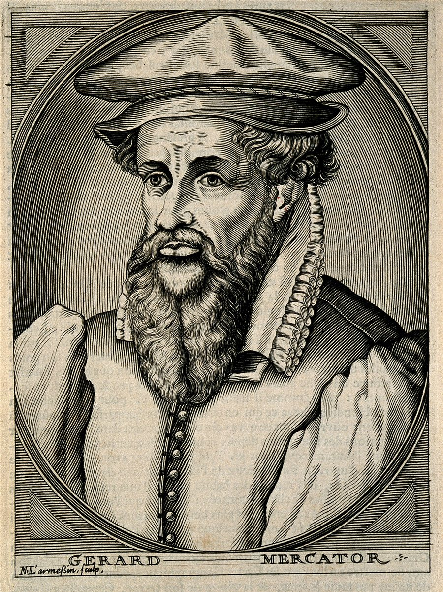
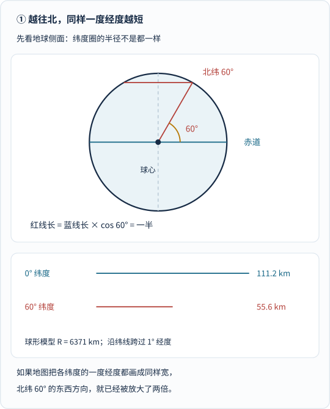
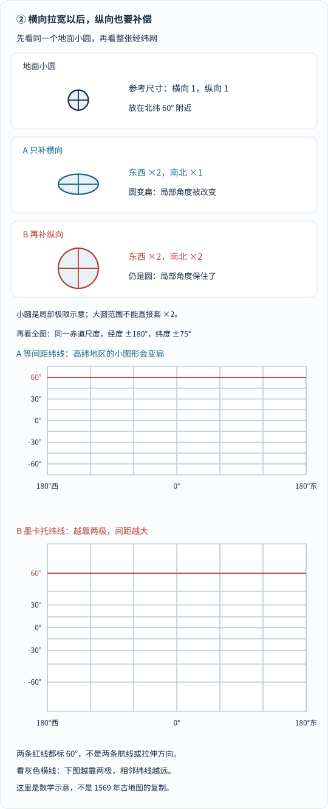
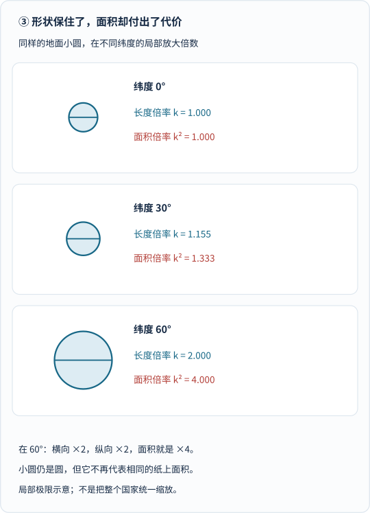
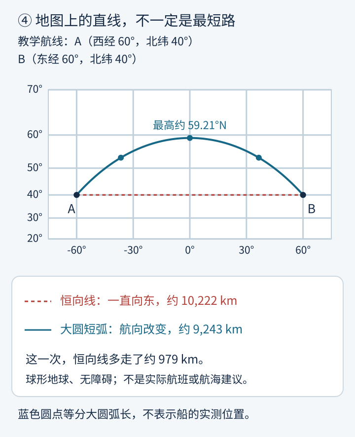
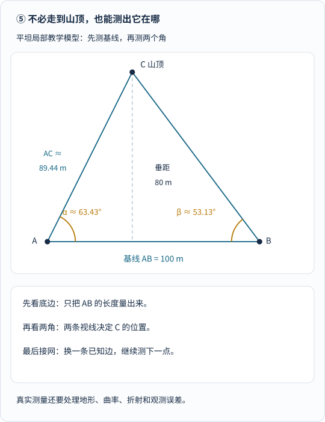
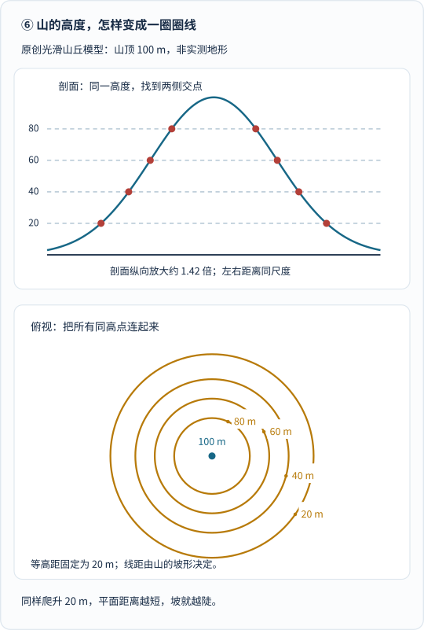
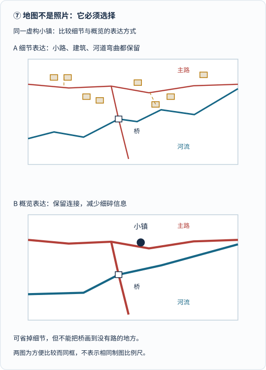
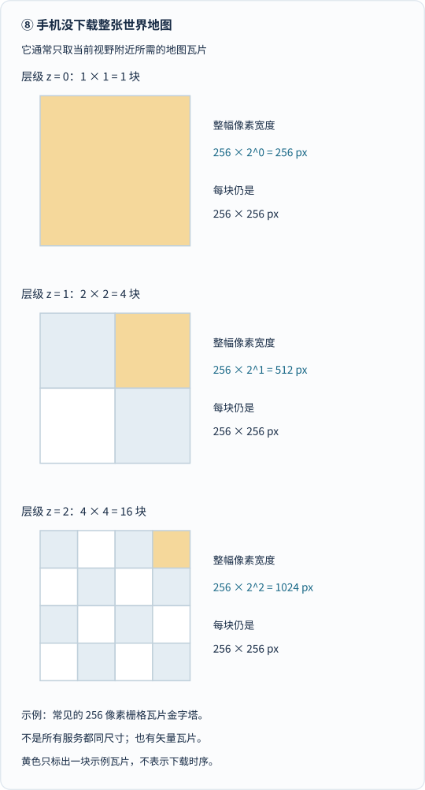

拿出一张世界地图，你可能会碰到两件怪事。

第一件：格陵兰岛看起来大得惊人，仿佛可以和非洲掰掰手腕。

第二件：两个城市之间，飞机的航线明明应该越短越好，画在地图上却弯成一道拱桥。

是地图画错了，还是飞机绕远了？

先别急着责怪它们。这里藏着一个几乎所有地图都绕不过去的难题：

**地球是弯的，纸是平的。你要保住什么，就可能不得不牺牲另一些东西。**

四百多年前，有个人没有回避这笔交易。他替远航的人选了一项特别重要的东西：方向。

这个人就是**杰拉杜斯·墨卡托（Gerardus Mercator，1512—1594）**。

不过，如果只记住“他发明了墨卡托投影”，就像认识一个厨师，却只知道他有一把好菜刀。墨卡托真正重要的地方，是把测量、数学、资料判断、刻版与出版接在一起，让地图越来越像一种**可以制作、核对、使用和更新的知识工具**。

我们先去看看他的工作台，再把一张地图从头做出来。

## 一、这个改变世界的人，先是一位特别能动手的匠人

墨卡托出生于当时尼德兰地区的鲁佩尔蒙德，所在地今天属于比利时。他年轻时在鲁汶学习，后来长期在杜伊斯堡工作，那里今天属于德国。

他的姓原本有 Kremer、Cremer 等写法，意思与“商人”有关；Mercator 是相应的拉丁语形式。那时学者把姓名拉丁化并不罕见。这个后来成为投影名称的单词，起初并不是什么神秘的几何暗号。[资料：芝加哥大学出版社《Rhumb Lines and Map Wars》节选](https://press.uchicago.edu/Misc/Chicago/534316.html)

*这是 Nicolas de Larmessin 制作的后世墨卡托肖像版画，不是照片，也不应当作他工作时的现场记录。来源为 Wellcome Collection，经 Wikimedia Commons 获取；具体文件页与许可见文末。*

他并非一出场就站在讲台上宣布：“我来改变地图学。”

他先得学会很具体的手艺：怎样把小字刻进铜版，怎样让一排刻度足够准确，怎样制作科学仪器，又怎样把印出来的纸瓣贴成一个地球仪。

他与数学家**杰玛·弗里修斯**、工匠**加斯帕尔·范德海登**合作制作地球仪。数学、地理资料和精细刻制，在同一个工作坊里相遇。后来他也自己编绘地图、制作印版、经营出版。[资料：MacTutor 墨卡托传记](https://mathshistory.st-andrews.ac.uk/Biographies/Mercator_Gerardus/)

这很像今天做一个地图产品：不能只有一张漂亮的界面。背后还得有坐标、数据、计算、字体、图层与发布。

他的经历也并不平顺。1544 年，他因异端嫌疑被监禁数月，后来获释。有关其具体宗教归属，历史研究并不完全一致；不能把这段经历简化成一个已经查明所有细节的英雄剧本。1552 年，他迁到杜伊斯堡，继续制作地图、地球仪与仪器。[资料：芝加哥大学出版社节选](https://press.uchicago.edu/Misc/Chicago/534316.html)

而等待他的最大难题，并不是“怎样把线刻得更漂亮”，而是：

**怎样把一个球面上的路线，变成纸上可以放心使用的路线？**

## 二、航海者需要的，不只是“看起来像地球”

想象一个教学场景：你站在一艘船上，面前摆着地图和罗盘。

你知道大致要往东北走，可海上没有路牌，也没有一条已经修好的公路。你最想知道的是：“如果保持这个航向，会走到哪里？”

这里要先分清两种“直”。

**纸上的直线**，是拿尺子画出来的。

**球面上的最短路线**，在理想球形地球上，是连接两点的大圆短弧。大圆，就是用一个经过球心的平面切球，得到的那个圆；赤道是一个例子，经线与它的对面经线合起来也是。

还有第三种路线：一直保持相同的、相对于当地正北的方位角。它叫**恒向线**，也叫等角航线或 rhumb line。

多数恒向线不是大圆。斜着穿过各条经线、却始终保持同一个交角的路线，在球面上一般会弯曲。

所以，“我一直朝罗盘上的某个方向走”，并不自动等于“我沿着球面最短路走”。

恒向线也不是墨卡托凭空发现的。葡萄牙数学家佩德罗·努内斯等人已经研究过相关问题；墨卡托熟悉这些工作。他在 1541 年的地球仪上表示了恒向线，后来寻找适合平面地图的解决办法。[资料：MacTutor 墨卡托传记](https://mathshistory.st-andrews.ac.uk/Biographies/Mercator_Gerardus/)

1569 年，他发表了一幅由 **18 张印张**组成的世界地图，标题强调它经过调整，以适合航海使用。

这幅地图的重要承诺是：

**让恒向线在纸上成为直线。**

它并不意味着航海从此只需画一条线。真实罗盘指向磁北，需要考虑磁偏角；海流、风、位置测定和沿途风险也不会被一张投影自动解决。这里谈的是地图的几何性质：**相对于真北保持不变的航向，怎样表示在纸上。**

古地图的具体外观，可以在[1569 年世界地图合成图的文件页](https://commons.wikimedia.org/wiki/File:Mercator_1569_world_map_composite.jpg)中观看。那是一张带有密集文字与历史地理认识的大图，不是今天的卫星底图。本文不直接转载该页的合成照片，下面用原创经纬网把难点拆开。

## 三、为什么格陵兰被“吹大”？先看一条纬线

地球仪上的经纬线，看起来规整，却不是一个普通的方格纸。

经线从北极通向南极，在两极会合；纬线绕着地球横向走，越靠近极点，圈越小。

于是，同样跨过 **1 度经度**：

在赤道，沿纬线走的距离比较长；在北纬 60 度，就只有赤道的一半。

*先看上面的截面：红色纬度圈的直径只有蓝色赤道的一半。再看下面的长度：在半径 6371 千米的球形模型里，一度经度沿纬线约为 111.2 千米与 55.6 千米。这里比较的是沿纬线的长度，不是任意两点的最短距离；地球的椭球细节暂时省略。*

如果你把所有经线画成等距竖线，那么纸上“跨过一度经度”的宽度，就不再随纬度变小。

原本只有一半长的东西，被画成了同样宽。

**北纬 60 度的东西方向，相对于赤道的基准，已经被放大了两倍。**

现在麻烦来了：如果横向放大两倍，纵向却不变，一个当地的小圆就会变成横着的椭圆，原本的交角也会改变。

墨卡托的办法是：既然横向已经被拉大，那么纵向也按相同的局部倍率拉大。

到了北纬 60 度，不只东西方向放大两倍，南北方向也要放大两倍。

这意味着纬线不能仍然等距。**越靠两极，它们之间的纸上距离就必须越大。**

*先看上面的三个小图：同一个地面小圆，在 A 中横向 ×2、纵向 ×1，变成扁椭圆；在 B 中两个方向都 ×2，又成为圆，但尺寸比地面参考大了。小图是北纬 60 度附近的局部线性近似，放大后供观察，不是整个纬度带的精确轮廓。*

*再看下面两幅经纬网：两条红线都只是标出北纬 60 度，不是航线，也不是两个拉伸方向。真正要比较的是灰色横线之间的距离：A 等距，B 越靠两极越疏。两图的赤道尺度相同，纬度都截取到南北纬 75 度，因此 B 也更高。*

这里说的“两倍”，指北纬 60 度**附近一小段距离**的倍率，不是“赤道到北纬 60 度的整段高度恰好翻倍”，也不是任意两条纬线之间的距离都翻倍。沿途纬度不同，放大倍率也在改变；整段高度必须把这些不同倍率累积起来。

这就是墨卡托投影最核心的设计：**在一个足够小的地方，横向与纵向按同样的倍率伸缩，保住局部角度。**

数学上把这种性质称为**保角**。

请注意这个“小”。保角不意味着一个跨越很多纬度的国家，整体轮廓只是等比例放大；更不意味着地图上任意远处两点的方位关系，都可以直接当成真实航向。

它是一种局部性质。传统墨卡托投影与恒向线的关系，可以参考 [Esri 的投影说明](https://pro.arcgis.com/en/pro-app/latest/help/mapping/properties/mercator.htm)。

### 面积的账，比长度更夸张

横向两倍，纵向两倍，面积就是四倍。

*先看圆有没有被压扁：没有。再看它们有没有保持同样大小：也没有。图中半径按局部长度倍率计算；面积倍率是它的平方。这是微小区域的示意，不是对整个国家直接套一个倍率。*

在我们采用的、赤道局部尺度归一为 1 的球面墨卡托模型中：

| 纬度 | 局部长度倍率 | 局部面积倍率 |
| --- | --- | --- |
| 0° | 1 | 1 |
| 30° | 约 1.155 | 约 1.333 |
| 60° | 2 | 4 |
| 75° | 约 3.864 | 约 14.93 |

这些倍率不是某个国家真实面积的测量结果，而是**投影在相应纬度附近的变形规律**。

格陵兰大部分位于高纬地区，所以在这类世界地图上容易显得异常巨大。问题不是它突然长大了，而是它恰好站在了地图的“放大区”。

墨卡托地图可以擅长帮助理解航向，同时不适合用肉眼比较全球国家的面积。**地图的优点和缺点，常常是同一项设计的两面。**

## 四、可选的数学放大镜：纬线究竟要拉开多少

不想看公式，可以直接跳到下一节。前面的直觉已经足够使用。

想把这笔账算明白，就约定：

\(R\) 是球形地球的半径，\(\varphi\) 是纬度，\(\lambda\) 是经度，\(\lambda_0\) 是中央经线的经度。计算时，角度都用**弧度**。

球面上，在纬度 \(\varphi\) 附近沿东西方向跨过一个很小的经度差 \(d\lambda\)，长度近似为：

$$
ds_{\mathrm{东西}}=R\cos\varphi\,d\lambda.
$$

把经线画成等距竖线，可以取纸上的水平坐标：

$$
x=R(\lambda-\lambda_0).
$$

这里的 \(x\) 是投影平面坐标，不是未经缩放就直接印到纸上的厘米数。真正打印时还会整体缩放。

图上的水平增量是 \(dx=R\,d\lambda\)。与地面长度相比，横向倍率就是：

$$
k=\frac{1}{\cos\varphi}.
$$

南北方向的球面小距离为 \(R\,d\varphi\)。为了让纵向倍率也等于 \(k\)，纵坐标必须满足：

$$
dy=\frac{R}{\cos\varphi}\,d\varphi.
$$

从赤道累积到纬度 \(\varphi\)，就得到：

$$
\begin{aligned}
y
&=R\int_0^\varphi\frac{1}{\cos u}\,du\\
&=R\ln\tan\left(\frac{\pi}{4}+\frac{\varphi}{2}\right).
\end{aligned}
$$

赤道对应 \(y=0\)。纬度越接近两极，这个坐标的绝对值越大；到了极点，它没有有限的值。

因此，**墨卡托地图根本不能把南北极安放在有限的纸面上**。

“在地球外套一个圆筒，再展开”可以帮助想象经纬网的大致形式，但不能当成这套公式的推导。墨卡托投影不是拿一盏灯照球，把影子直接投到圆筒上就得到的；纬线间隔必须按特定的数学规律安排。

这里的积分，是我们今天解释其几何性质的方式，**不是声称墨卡托在 1569 年已经使用了后来成熟的微积分记号与理论**。我们也没有据此断言他当年具体的作图步骤。投影公式与适用模型可参考 [John P. Snyder 的 USGS《Map Projections: A Working Manual》](https://www.usgs.gov/publications/map-projections-a-working-manual)。

如果你刚读过[《微积分到底在算什么？从一条曲线走到真实世界》]()，这里就是一个很漂亮的连接：先规定“每一小段应该拉长多少”，再通过累积确定整条纬线的位置。

### 为什么恒向线恰好变直

设航向角 \(\alpha\) 从当地正北向东量起。对一段足够短的球面路径：

$$
\tan\alpha
=\frac{\text{东西向位移}}{\text{南北向位移}}.
$$

墨卡托在这个局部把两个方向乘上了同一个倍率，因此这个比值不变。在图上，它就是 \(dx/dy\)。

如果航向角一直不变，纸上路线的方向也一直不变，于是它成为直线。正东或正西对应水平线，南北航向对应竖线。

**它保住的，是沿途不变的方位角，而不是替你保证路线最短。**

## 五、地图上弯起来的路，可能反而省了近一千公里

现在用两个虚构的教学出发点算一次。

A 在西经 60 度、北纬 40 度；B 在东经 60 度、北纬 40 度。它们纬度相同，经度差 120 度。

暂时把地球看成半径 6371 千米的球，忽略陆地、风、海流和管制条件。

第一条路线，一直向东，沿北纬 40 度的纬线走。它是恒向线；在墨卡托图上，正好是一条水平直线。

第二条路线，沿两点之间的大圆短弧走。它会先向更北的地方拱起，再回到 B；在这张图上，显得弯弯的。

*先认端点 A、B，再比较虚线与实线。红色虚线始终向东，蓝色实线是大圆短弧；后者最高到约北纬 59.21 度。蓝色点等分大圆弧长，便于跟读，不是实测航迹。图上的弯曲程度来自投影计算，长度则在球面上计算。*

沿纬线的距离为：

$$
L_{\mathrm{恒向}}
=R\cos40^\circ\cdot\frac{2\pi}{3}
\approx10222\,\mathrm{km}.
$$

大圆短弧的距离为：

$$
\begin{aligned}
L_{\mathrm{大圆}}
&=R\arccos\bigl(
\sin^2 40^\circ\\
&\qquad+\cos^2 40^\circ\cos120^\circ
\bigr)\\
&\approx9243\,\mathrm{km}.
\end{aligned}
$$

这一次，“看起来直”的路线反而长了约 **979 千米**，比大圆短弧多走约 **10.6%**。

当然，不是每一条恒向线都比大圆短弧长：沿经线走，或者沿赤道走，在合适的短弧范围内，它们可以重合。

现实中的航班也不一定严格沿大圆。风场、航路、空域与安全因素，都可能影响最优选择。这个例子只说明：

**不要在一张投影地图上，直接用尺子的长短裁决球面上的远近。**

## 六、要做地图，第一步不是画海岸线，而是回答“它在哪”

一个制图师面对的任务，可以拆成四个不同的问题：

**位置怎样测出来？坐标依据什么？球面怎样变平面？哪些信息该被画出来？**

投影只回答其中第三个。

如果一座港口的坐标已经测错，换一种漂亮投影，并不能把它救回来。

### 1. 经纬度是一种地址，但地址也需要共同的底座

纬度与经度帮助我们在地球上指定位置。不过，精密制图里的地球不是一个完美光滑的球。

常用的参考模型是**椭球**：它足够简单，方便计算，又能比圆球更好地描述地球的整体形状。

但椭球仍然没有山谷和高楼。实际地形的高度要另外记录；与平均海平面相关的高度讨论，还会用到**大地水准面**等概念。它们不是同一个东西。

进一步说，坐标不仅要有数字，还要有参考系统。两份数据即使都写“经纬度”，若基准或坐标系统不同，也可能无法直接叠在一起。

NOAA 对大地测量的解释强调：持续测量的位置、参考点与统一的空间参考系统，是让不同地图彼此一致的基础。[资料：NOAA，什么是大地测量](https://oceanservice.noaa.gov/facts/geodesy.html)

可以把它想成很多人一起搭模型：先商定共同的底板和尺子，再谈各自积木的位置。

### 2. 早期测量的妙招：不走遍每条边，先搭三角形

假如你在平地上，要知道远处一个山顶的位置，但不方便走过去量距离。

你可以先在地面上选择 A、B 两点，准确量出它们之间的**基线**。再分别在 A、B 观察山顶 C，测出两条视线与基线的夹角。

一个三角形，一条边加两个角，就足以确定形状和大小。

*先看底边 AB：100 米是直接量到的。再看两个底角：约 63.43 度与 53.13 度。两条视线相交后，C 的位置被确定。在这个平坦局部教学模型中，AC 约 89.44 米，C 到基线的垂距为 80 米；这不是一份真实山地测量记录。*

用正弦定理，可以算出：

$$
\begin{aligned}
AC
&=\frac{AB\sin\beta}{\sin(\alpha+\beta)}\\
&\approx89.44\,\mathrm m.
\end{aligned}
$$

接下来，把刚刚确定的一条边当成下一块三角形的已知边。这样不断接下去，就能铺出一个测量网。

弗里修斯在 1533 年发表的工作中介绍了三角测量的理论与应用，是欧洲测量史上的重要一环。墨卡托的地区地图与这种数学测绘环境紧密相连，但他 1540 年佛兰德地图中具体的实地测量究竟由谁承担，研究者有不同判断。**不能看到地图署名，就把全部观测都算在一个人头上。**[资料：MacTutor 弗里修斯传记](https://mathshistory.st-andrews.ac.uk/Biographies/Gemma_Frisius/)、[芝加哥大学出版社节选](https://press.uchicago.edu/Misc/Chicago/534316.html)

真实测量当然比图里复杂：观测有误差，大范围要考虑地球曲率，视线还可能受大气折射影响。会多测一些角与距离，再通过校核和调整，让整张网尽可能一致。

### 3. GPS 没有取消这个问题，只是换了测量方式

今天可以使用 GPS、北斗等卫星导航系统、全站仪和其他测绘设备。

卫星定位主要利用信号传播时间形成距离观测，在模型中求解位置与接收机钟差；它不是简单地“看卫星之间的夹角”。这类包含时钟等影响的距离观测称为“伪距”，并不直接等于没有误差的几何距离。[资料：ESA Navipedia，GNSS 基本观测量](https://gssc.esa.int/navipedia/index.php/GNSS_Basic_Observables)

这与早期三角测量的具体算法不同，但共同点很清楚：

**位置不是凭眼睛猜出来的，而是从带有误差的观测中计算、核对出来的。**

导航软件里的一个小蓝点，看着轻巧，背后站着一整套测量与参考系统。

## 七、卫星已经能拍照，为什么照片还不是地图

假如你从楼顶斜着拍一张操场照片。

靠近相机的一边显得宽，远处的一边显得窄；高楼还可能向某一侧倾倒。你不能直接拿这张照片，逐处量出可靠的地面距离。

飞机和卫星拍地面，也会遇到类似问题。相机姿态、传感器几何、地形起伏，都影响像素与地面位置的对应关系。

因此，要制作可用于测绘的**正射影像**，需要利用控制点、相机或传感器参数、地形高程模型等，把影像纠正到明确的地图几何框架中。

USGS 的正射影像说明特别指出：这是让航拍照片的细节与地图的几何性质结合起来的过程，不是仅仅把照片旋转到“上北下南”。[资料：USGS 高分辨率正射影像](https://www.usgs.gov/centers/eros/science/usgs-eros-archive-aerial-photography-high-resolution-orthoimagery-hro)

而要知道地面究竟有多高，可以使用重叠照片的摄影测量，也可以使用激光雷达（LiDAR）等方法。

激光雷达向地面发射光，测量返回信号，再结合设备的位置、姿态与校准信息，得到一大群带有三维坐标的点，称为**点云**。

其中一些点落在树冠上，一些落在屋顶上，一些落到地面上。因此，点云不能不加区分地直接等同于裸地地形；后续还要分类、处理，再生成所需的高程产品。[资料：NOAA 激光雷达说明](https://oceanservice.noaa.gov/facts/lidar.html)

制图师此时拿到的，已经不只是一幅照片，而是一组可以共同定位的信息：影像、地形、道路、水系、建筑与地名。

**现代地图，是许多来源的数据被正确放到一起之后，再设计出来的。**

## 八、山为什么画成一圈圈？等高线不是装饰

把一座山想成一块蛋糕。

在 20 米高度横着切一次，在 40 米、60 米、80 米再切。每个水平切面与山体表面的交线，俯视到地图上，就是一条等高线。

当然，真实山体不能这么切；我们是从高程数据中计算这些线。

下面造一座原创的光滑小山，不用真实地形来增加不必要的干扰。

*先看剖面：同一高度的横线，在山的两侧找到红色交点。再看俯视图：绕山一周，把所有同高点连起来。两部分使用同一个山丘模型；不是为了好看随手画几圈。图中等高距为 20 米；剖面为便于看清高度变化，纵向相对于横向放大约 1.42 倍，俯视图没有这种拉伸。*

这座教学小山的高度函数是：

$$
h(x,y)
=100\exp\left(-\frac{x^2+y^2}{80^2}\right).
$$

这里 \(x,y\) 用米表示，高度 \(h\) 也用米表示。山顶为 100 米。

例如，求 40 米等高线，只需令 \(h=40\)。它对应一个圆，半径约为 76.58 米。

对于这座模型山，任意一条高度为 \(h_0\) 的等高线半径都是：

$$
\begin{aligned}
r&=80\sqrt{-\ln(h_0/100)},\\
&\qquad 0<h_0<100.
\end{aligned}
$$

真实地形通常没有这么圆，等高线会扭来扭去，但原则相同：**一条线连接的是同一参考高度的地点。**

在等高距相同的前提下，如果沿某个方向跨过相邻等高线的水平距离很短，说明短距离内高度改变很大，坡比较陡；线疏的地方通常比较缓。

还要看数字与符号。闭合的等高线不必然表示山峰，也可能表示洼地；不能只凭“看起来像一圈圈”就下结论。[资料：USGS，什么是地形图](https://www.usgs.gov/faqs/what-a-topographic-map)

你看到的那些褐色曲线，其实是一种把第三个维度压进纸面的语言。

## 九、坐标都对了，为什么还不能把一切原样画出来

假设你要做一张城市步行图。

小巷、桥、出口和台阶，可能十分重要。

如果改做全国交通图，仍把每个台阶都画上去，整张图只会变成一团墨。

这里就需要**制图综合**：根据用途和比例尺，选择、省略、简化、合并，必要时适度夸张某些符号，让信息仍然能被读懂。

*先在两图里找到桥：它们都位于道路跨河的位置。再比较建筑与细碎弯曲：概览版减少了这些信息，却不能把关键连接关系改错。两图被同框摆放只是方便比较，不表示相同的实际制图比例尺；整个小镇是原创教学构造。*

### “大比例尺”反而通常看得更细

这个名字容易把人绕晕。

\(1:25000\) 表示图上 1 厘米对应地面 250 米；\(1:1000000\) 表示图上 1 厘米对应地面 10 千米。

前者的比例数值更大，所以叫**大比例尺**。在相同纸张面积上，它通常展示更小的地面范围，却能放进更多细节。

后者叫**小比例尺**，适合看更广的区域。

这里的换算指名义比例尺的读法。若一张大范围投影地图的尺度随位置变化，就不能把某一处的比例尺当成全图处处不变的尺子。

此外，地图上的道路经常比真实宽度所对应的纸上尺寸更粗。这不一定是错误，可能是为了让你看得见。但它就不适合用来量道路实际宽度。

**简化不等于乱画。可以少说，不能把该说的关系说反。**

### 不同用途，需要不同的投影

看全球各地区面积，通常应优先考虑**等积投影**。

做区域精密测绘，可能选择横轴墨卡托、兰伯特正形圆锥等适合该区域的投影，并控制范围内的变形。

从一个中心点比较到各地的距离，可以考虑合适的方位等距投影。但“等距”也有条件，不能理解为平面上所有点对的距离都完全正确。

USGS 的投影手册列出了多种投影的用途与公式；它自己也没有坚持“全国所有地图只用一种投影”。[资料：USGS 投影手册介绍](https://www.usgs.gov/publications/map-projections-a-working-manual)

球面不能被无伸缩地完整摊成平面。等积、保角与特定距离性质，不是全都能同时无条件满足的菜单。

所以，一张“最好的地图”，必须补上后半句：

**对什么任务最好？**

## 十、从铜版到手机：墨卡托为什么还没有退休

我们把时间拨回墨卡托的晚年。

他要做的不只是单张地图，还希望把有关世界的知识组织成一套系统著作。

他的地图分批出版，1594 年去世后，儿子鲁莫尔德等家人继续整理，1595 年刊出了以 **Atlas** 为题的重要著作。这个词后来成为“地图集”的通用名称。

但不能因此说“第一本现代地图集就是墨卡托在 1595 年发明的”。**奥特柳斯在 1570 年出版的《寰宇大观》（Theatrum Orbis Terrarum），已经是现代世界地图集的重要开创者。**

墨卡托与奥特柳斯既是同行，也是朋友。墨卡托的意义更多在于自己的编绘研究、系统化知识计划，以及 Atlas 这个名称后来持续传播。后续出版者洪迪乌斯等人扩充和再版，也参与了这段历史。[资料：乌得勒支大学，墨卡托与洪迪乌斯的 Atlas](https://www.uu.nl/en/special-collections/collections/maps-and-atlases/world-maps-and-atlases/the-atlas-by-mercator-and-hondius)

还有一个常被忽略的细节：**一本墨卡托地图集，并不意味着里面每一页都采用墨卡托投影**。人物、出版品牌和一种数学投影，是三个相关但不同的概念。

这条道路为什么广阔？因为地图逐渐不再只是“某个人画的一张世界图”，而成为可以成套整理、批量印制、相互比较、继续修订的知识产品。

今天，一块屏幕把这条道路又延长了。

### 手机怎样让你一边滑动，一边“长出”地图

许多网络地图采用**Web Mercator**作为显示框架，把地图按不同缩放层级组织起来，再切成瓦片。

你往右拖一下，系统不必重新下载整个世界，通常只需获取视野附近需要的瓦片。

*先看每一小块：示例里始终是 256×256 像素。再看整幅世界：缩放层级每增加一级，横纵像素各翻倍，瓦片总数变成四倍。黄色只标出一块瓦片，不是下载动画；实际服务也可能使用其他尺寸或矢量瓦片。*

一种常见栅格瓦片模型是：

$$
\begin{aligned}
\text{每边瓦片数}&=2^z,\\
\text{瓦片总数}&=4^z,\\
\text{整幅像素宽度}&=256\cdot2^z.
\end{aligned}
$$

这里 \(z\) 是缩放层级。不是所有地图服务都使用完全相同的规则，但它足以解释为什么“放大地图”并不是简单地把一张小图片撑大。

这个技术实例可以参考 [Microsoft Learn 的地图瓦片系统说明](https://learn.microsoft.com/en-us/bingmaps/articles/bing-maps-tile-system)。该文档对应特定产品的技术设计，不应理解为对其服务可用状态的承诺。

### Web Mercator 和传统墨卡托，不宜混为一谈

传统墨卡托可以按球面或椭球模型计算。

Web Mercator 常把基于 WGS 84 椭球的经纬度，代入球面形式的投影公式，便于统一显示与切瓦片。严格说，这种混用并不完全保留椭球上的保角性质；不能把“传统墨卡托严格保角”原封不动搬到 Web Mercator 上。

常见正方形世界瓦片范围也会把纬度截在约南北 **85.0511 度**，而不是把两极塞进去。

为什么是这个数？球面墨卡托覆盖全部经度时，横坐标范围为 \(-\pi R\) 到 \(+\pi R\)。若纵向也取相同范围，就有：

$$
\begin{aligned}
|y|&=\pi R,\\
|\varphi|&=\arctan(\sinh\pi)\\
&\approx85.0511^\circ.
\end{aligned}
$$

这是一项方便组织正方形地图的选择，不是地球在这个纬度突然结束了。[资料：Esri，Web Mercator 的模型与限制](https://pro.arcgis.com/en/pro-app/latest/help/mapping/properties/mercator.htm)

同样重要的是：**屏幕怎样显示，与后台怎样计算距离、面积和路线，是不同层次。**

专业软件可以在显示 Web Mercator 底图的同时，用球面或椭球测地算法量距离，或把数据转换到合适的投影后算面积。

不要直接把显示平面上的坐标差当成地面距离；也不必因为底图有失真，就断言所有导航距离都错了。应当检查软件实际采用的计算方法。

## 十一、墨卡托留下的，不是一张“完美地图”

现在再看看格陵兰和那条弯弯的航线，你可能已经不会立刻喊“画错了”。

你会先问：

这张图采用什么投影？它保住了什么？牺牲了什么？数据从哪来？这把尺子适合量什么？

这些问题，就是地图学走向成熟时逐渐长出来的习惯。

墨卡托不是第一个画地图的人。他之前已有托勒密的地理传统、海图制作、地区测绘与航海数学；他之后也还有大量制图师、测量者、出版者与数学家的工作。

他的划时代之处，不是一个人把此前地图全部作废，而是**把已有知识与航海需求重新接起来，做出一项有明确数学性质的设计，再通过精密制作与系统出版，让它能够进入实际使用和后续改进。**

从他的铜版工作台，到手机里的地图，贯穿其中的其实还是同一条链：

**观测得到位置，参考系统统一位置，投影安排位置，制图选择信息，出版与软件把它交到读者手里。**

地图并不是把世界完整地复制了一遍。

它是一个经过测量、计算与取舍的回答。

墨卡托最值得我们记住的，也许不是“他把地球画平了”，而是：

**他让人们更清楚地知道，为了在一张平纸上做成某件事，究竟要付出什么代价。**

---

## 参考资料与图片来源

以下页面支持不同层面的论述。传记中的解释与评价，不等于投影公式的证明；现代技术文档，也不应被倒推成墨卡托本人当年的作图记录。

| 资料 | 本文主要用它核对什么 |
| --- | --- |
| [芝加哥大学出版社：Mark Monmonier《Rhumb Lines and Map Wars》中的“Mercator’s Résumé”](https://press.uchicago.edu/Misc/Chicago/534316.html) | 姓名、工艺与出版经历，宗教经历的限定，佛兰德地图测量者的争议，墨卡托与奥特柳斯不同的地图集工作方式。 |
| [MacTutor：Gerardus Mercator](https://mathshistory.st-andrews.ac.uk/Biographies/Mercator_Gerardus/) | 生卒与学习经历、地球仪合作、努内斯与恒向线背景、1569 年十八印张航海地图及后续出版。 |
| [MacTutor：Gemma Frisius](https://mathshistory.st-andrews.ac.uk/Biographies/Gemma_Frisius/) | 数学与仪器制作环境，1533 年的三角测量工作及测定经度的思路。 |
| [乌得勒支大学特藏：The “Atlas” by Mercator and Hondius](https://www.uu.nl/en/special-collections/collections/maps-and-atlases/world-maps-and-atlases/the-atlas-by-mercator-and-hondius) | 1570 年奥特柳斯地图集、墨卡托分批出版与 1595 年遗著、家人及后续出版者的贡献。 |
| [USGS：John P. Snyder，Map Projections: A Working Manual（1987）](https://www.usgs.gov/publications/map-projections-a-working-manual) | 投影的数学、使用范围、球面与椭球模型，以及为什么制图需要多种投影。页面提供正式报告入口。 |
| [Esri：Mercator](https://pro.arcgis.com/en/pro-app/latest/help/mapping/properties/mercator.htm) | 保角的局部性质、恒向线、面积失真、极点限制，以及 Web Mercator 与传统墨卡托的严格区别。 |
| [NOAA：What is geodesy?](https://oceanservice.noaa.gov/facts/geodesy.html) | 测量与统一参考系统、椭球、大地水准面及现代空间定位。 |
| [ESA Navipedia：GNSS Basic Observables](https://gssc.esa.int/navipedia/index.php/GNSS_Basic_Observables) | 信号传播时间、伪距、几何距离与接收机钟差，说明卫星定位不是简单的测角三角测量。 |
| [USGS：High Resolution Orthoimagery](https://www.usgs.gov/centers/eros/science/usgs-eros-archive-aerial-photography-high-resolution-orthoimagery-hro) | 为什么航拍照片需要几何纠正；控制点、传感器参数与高程模型怎样参与正射处理。 |
| [NOAA：LiDAR](https://oceanservice.noaa.gov/facts/lidar.html) | 激光测距与位置、姿态信息形成三维点云，再生成高程及其他产品。 |
| [USGS：What is a topographic map?](https://www.usgs.gov/faqs/what-a-topographic-map) | 等高线表示相同参考高度，地形图不只是道路图，也表达坡度与地形。 |
| [Microsoft Learn：Bing Maps Tile System](https://learn.microsoft.com/en-us/bingmaps/articles/bing-maps-tile-system) | 特定栅格瓦片系统的像素大小、层级、分辨率与纬度截断。不是所有平台的统一规范。 |

**肖像许可：** Nicolas de Larmessin，墨卡托肖像版画；馆藏来源为 [Wellcome Collection，V0003979](https://wellcomecollection.org/works/kp8wx2h3)，所用数字文件及授权信息见 [Wikimedia Commons 原始文件页](https://commons.wikimedia.org/wiki/File:Gerard_Mercator_(Cremer)._Line_engraving_by_N._de_Larmessin,_Wellcome_V0003979.jpg)。原版画属于公有领域；文件页同时标明 Wellcome 数字图像的 [CC BY 4.0](https://creativecommons.org/licenses/by/4.0/) 信息。本文保留作者与馆藏署名，仅缩小图片并重新压缩，未改变画面内容。

**古地图延伸阅读：** [墨卡托 1569 年世界地图合成图文件页](https://commons.wikimedia.org/wiki/File:Mercator_1569_world_map_composite.jpg)，可查看原图构成、照片来源与使用说明。该合成照片未嵌入本文；查看外站大图需要网络，不能用它取代正文图解。

**原创图解：** 八幅 SVG 均由本文配套脚本 `python tools/visuals.py build mercator-maps` 计算生成。采用球面模型的图已明确限定；航线长度、三角测量、等高线与瓦片数量有数值断言。图解均为静态，重点步骤不依赖动画或外部交互资源。
