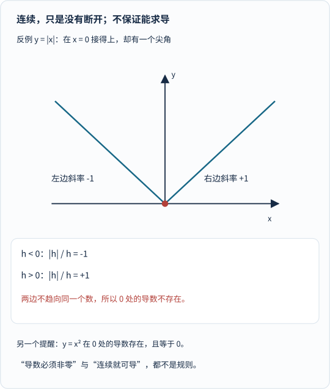
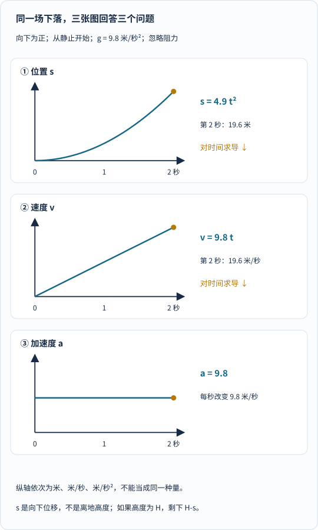
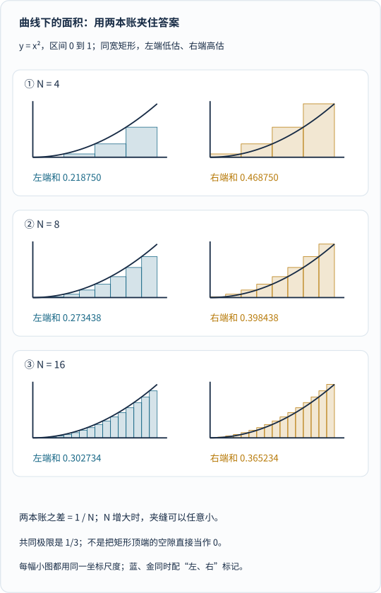
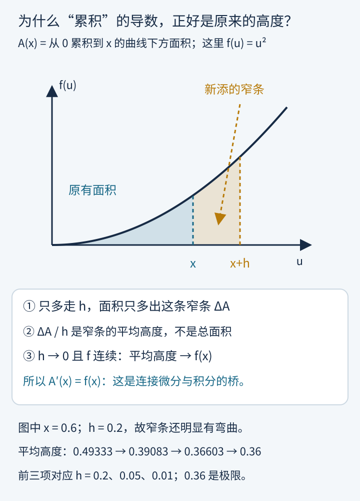
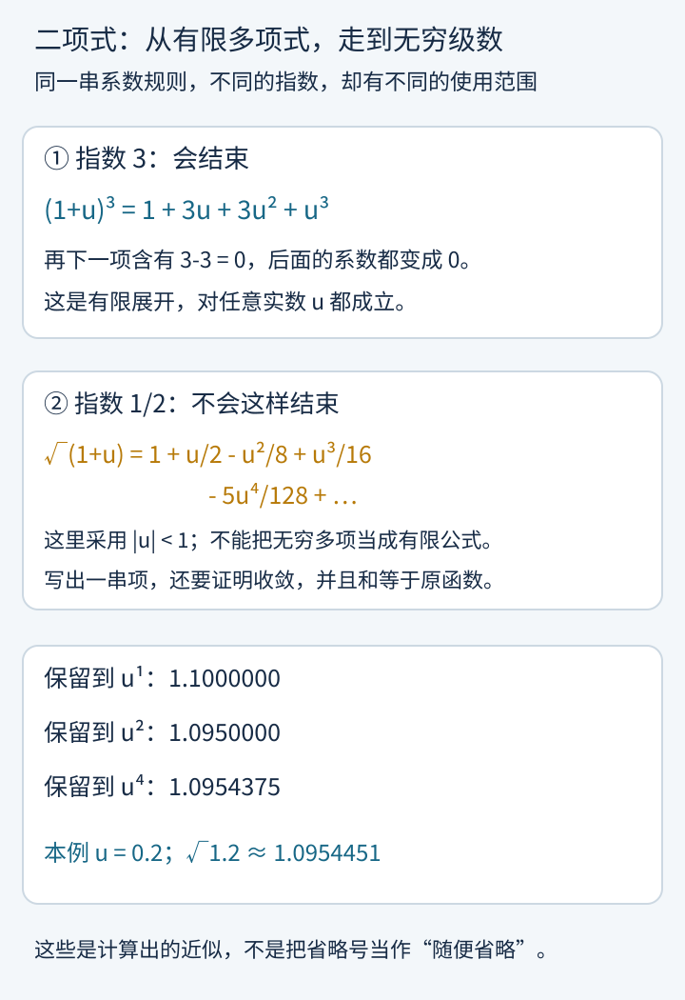
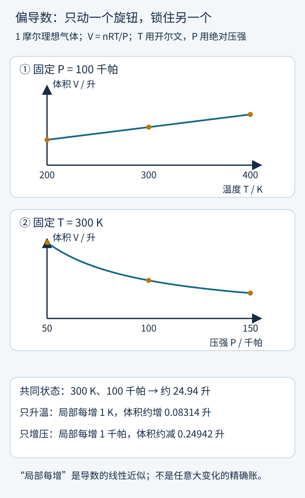
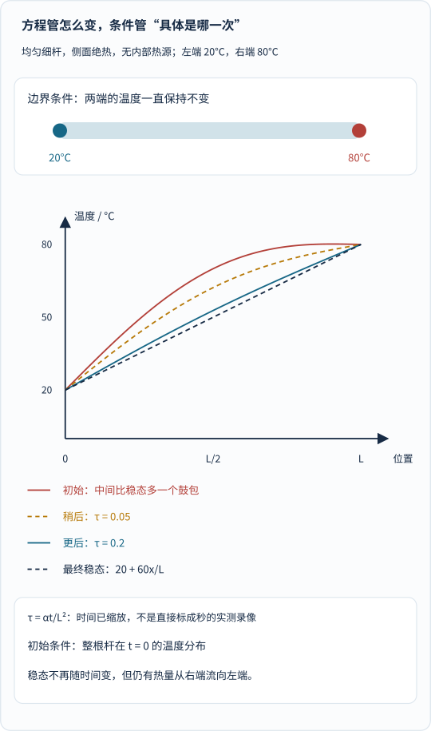

汽车仪表盘说：“现在的速度是每小时 60 公里。”

你有没有觉得这句话有点奇怪？

速度不是“走过的距离除以花掉的时间”吗？可是，**“现在”只是一个瞬间，既没有一段时间，也没有一段路程，究竟拿什么来除？**

另一个问题同样奇怪。

假如有人把一辆车每个时刻的速度都告诉你，却没有直接告诉你走了多远。你能不能把这一堆“此刻有多快”，拼成“最后走了多远”？

微积分的入口，就藏在这两个互相照镜子的问题里：

**微分问：此刻怎样变化？积分问：这些变化，累计出了什么？**

但这两句话还只是路标。我们要亲手走过一次，才知道它们为什么不是玄学。

这篇文章沿着两条线前进：数学上反复看一条简单的曲线 $$y=x^2$$；物理上反复看一个从静止开始下落的小球。先把导数和积分真正接起来，再走进二项式级数、多变量和热传导。后半篇是拓展，不必第一次就记住所有符号。

如果想先看它怎样用到月亮和轨道，可以读[《月亮一直在下落？微积分怎样算出天体的路》]()。这里则把镜头拉得更近：**工具本身，是怎么长出来的？**

## 一、先别碰极限：变量与函数究竟是什么

### 1. 变量：给正在变化的东西取一个名字

把时间叫作 $$t$$，把小球向下走过的位移叫作 $$s$$。

时间往前走，位移也跟着变；它们就是这个问题中的变量。把重力加速度取为 $$g=9.8\,\mathrm{m/s^2}$$，在我们暂时采用的近地模型里，$$g$$ 是常量。

“常量”不意味着自然界永远不变，只意味着**在当前模型和讨论范围内，把它当作固定的量**。

先约定模型：小球从静止释放，忽略空气阻力，重力加速度视为常量，而且只讨论碰到地面之前的运动。

在这个模型里：

$$
s(t)=\frac12gt^2=4.9t^2
$$

这里 $$t$$ 以秒计，$$s$$ 以米计。这个关系来自匀加速运动；后面我们还会反过来从运动方程把它推出来。

| 释放后时间 | 向下位移 |
| --- | --- |
| $$0\,\mathrm{s}$$ | $$0\,\mathrm{m}$$ |
| $$0.5\,\mathrm{s}$$ | $$1.225\,\mathrm{m}$$ |
| $$1\,\mathrm{s}$$ | $$4.9\,\mathrm{m}$$ |
| $$2\,\mathrm{s}$$ | $$19.6\,\mathrm{m}$$ |

### 2. 函数：每个允许的输入，都有一个确定的输出

给定时间 $$t$$，模型就给出位移 $$s$$。我们说：**位移是时间的函数**。

写成 $$s=s(t)$$，括号不是乘法，而是在提醒你：“这个位移的值，要看输入的时间。”

数学上，我们先拿一个更简单、没有单位的版本：

$$
y=f(x)=x^2
$$

输入 $$2$$，输出 $$4$$；输入 $$-2$$，也输出 $$4$$。

这没有违背函数的要求：**同一个输入不能对应两个不同输出，但不同输入可以得到相同输出。** 此外还要说明输入范围，也就是定义域。平方函数可以接受所有实数；物理上的下落模型却不能不加限制地延伸到落地以后。

函数也不一定有一个漂亮的公式。表格、测量记录、程序和对应规则，都可以描述函数。现代函数概念并不是某位数学家在某一天“一次定义完毕”的；它经历了从几何关系到变量依赖等多次发展。[MacTutor：函数概念的历史](https://mathshistory.st-andrews.ac.uk/HistTopics/Functions/)

## 二、第一步：两点之间的变化，完全不用微积分

### 1. 数学账：曲线两点连成割线，算出区间平均变化率

来看 $$y=x^2$$。

假设从 $$x=1$$ 走到 $$x=2$$。纵坐标从 $$1$$ 变成 $$4$$，因此：

$$
\frac{\text{输出的变化}}{\text{输入的变化}}
=\frac{4-1}{2-1}=3
$$

这个数是**这段区间的平均变化率**。

画在图上，把 $$(1,1)$$ 与 $$(2,4)$$ 连起来，得到一条割线。它的斜率就是 $$3$$。这里的斜率表示：输入平均增加一单位，输出平均增加三单位。

### 2. 物理账：平均速度为什么掩盖了“正在加速”的细节？

物理上也一样。小球从第 $$1$$ 秒落到第 $$2$$ 秒，位移从 $$4.9$$ 米变成 $$19.6$$ 米：

$$
\overline v
=\frac{19.6-4.9}{2-1}
=14.7\,\mathrm{m/s}
$$

这是真实模型中的区间平均速度，却不能直接说“小球在第 $$1$$ 秒就是这个速度”。

因为小球还在加速：第 $$1$$ 秒刚开头它还没这么快，快到第 $$2$$ 秒末尾时又比 $$14.7\,\mathrm{m/s}$$ 更快。

**平均值把一整段经历压成了一个数；我们现在想知道的，却是某个特定时刻。**

## 三、第二步：让另一点靠近，但不要把分母变成零

### 1. 先做代数化简：在 $$h\ne 0$$ 时提取公因式消掉分母

固定 $$P=(1,1)$$。

把另一点写成 $$Q=(1+h,(1+h)^2)$$。这里 $$h$$ 表示横坐标的增量，**暂时必须非零**。

两点之间的斜率为：

$$
\begin{aligned}
\frac{(1+h)^2-1}{h}&=\frac{2h+h^2}{h}\\
&=2+h\qquad(h\ne0)
\end{aligned}
$$

注意，到这里为止，仍然只有初中代数。

我们只是展开平方、提取公因式、约去非零的 $$h$$。还没有偷偷用“无穷小”。

现在让 $$h$$ 缩小：

| $$h$$ | 割线斜率 $$2+h$$ |
| --- | --- |
| $$1$$ | $$3$$ |
| $$0.5$$ | $$2.5$$ |
| $$0.1$$ | $$2.1$$ |
| $$0.01$$ | $$2.01$$ |
| $$-0.1$$ | $$1.9$$ |
| $$-0.01$$ | $$1.99$$ |

从右边靠近，斜率趋近 $$2$$；从左边靠近，也趋近 $$2$$。

_先看固定的蓝点 P，再看金色割线怎样改变。红点沿平方曲线靠近 P；最后的金线是极限切线，不是让两个重合点去决定一条线。动画等待一秒后分步播放八秒，随后停在切线；这是教学步骤的时间，不是小球运动的真实时间。减少动态效果时直接显示终态，底部始终保留静态路线。[单独打开，刷新可重播](/assets/images/calculus-foundations/secant-limit.svg)。_

### 2. 极限不是“算很多次，猜一个答案”

上面的表帮助我们看到趋势，却还不是一般保证。

这次我们能给出一个精确的保证：

$$
|(2+h)-2|=|h|
$$

如果要求斜率误差小于 $$0.001$$，只要 $$0<|h|<0.001$$ 就行。

如果要求误差小于任意给定的正数 $$\varepsilon$$，只要 $$0<|h|<\varepsilon$$ 就行。

**不是我挑了几个好看的样本，而是这个范围里的所有非零 $$h$$，都满足同一个误差要求。**

这正是极限思想的核心：无论你把误差要求提得多严格，都能找到足够小的邻域，保证结果落在要求以内。现代教材用 $$\varepsilon$$ 与 $$\delta$$ 把它写得更精确；我们在这个例子里已经看到了它的骨架。[OpenStax：极限的精确定义](https://openstax.org/books/calculus-volume-1/pages/2-5-the-precise-definition-of-a-limit)

因此可以写：

$$
\lim_{h\to0}\frac{(1+h)^2-1}{h}=2
$$

### 3. 为什么这不是“零除以零”

原来的差商在 $$h=0$$ 时没有定义。

但**极限问的是非零的 $$h$$ 越来越接近零时，差商趋向哪里，不是在问把零直接代进去会算出什么。**

约分后的 $$2+h$$ 与原式在所有非零 $$h$$ 上相等，所以它们趋近零时有相同极限。那个没有定义的点，不妨碍我们研究它附近的趋势。[OpenStax：约分与极限法则](https://openstax.org/books/calculus-volume-1/pages/2-3-the-limit-laws)

## 四、第三步：导数，就是把这件事推广到任意位置

### 1. 从单点斜率升级为导数函数 $$f'(x)=2x$$

刚才算的是 $$x=1$$。如果把固定位置换成任意的 $$x$$：

$$
\begin{aligned}
\frac{f(x+h)-f(x)}{h}
&=\frac{(x+h)^2-x^2}{h}\\
&=2x+h
\end{aligned}
$$

让 $$h$$ 趋近零，得到：

$$
f'(x)=2x
$$

撇号 $$f'$$ 读作“$$f$$ 的导数”。它本身又是一个函数：告诉你原函数在每个可导位置的局部变化率。

一般定义是：

$$
f'(x)=\lim_{h\to0}\frac{f(x+h)-f(x)}{h}
$$

**前提是这个极限存在，而且是一个有限实数。** 对定义域内部的点，左右两边必须给出同一答案；区间端点则需说明是否采用单侧导数。

同一件事，也常写成莱布尼茨风格的记号：

$$
\frac{dy}{dx}
$$

在这里，它表示 $$y$$ 关于 $$x$$ 的导数。不能因为长得像分数，就把它理解成“两个零相除”。在合适的数学框架下，微分记号可以参与严密运算，但每条运算规则都有自己的含义和条件。[OpenStax：导数、切线与瞬时变化率](https://openstax.org/books/calculus-volume-1/pages/3-1-defining-the-derivative)

### 2. 连续的曲线，不一定到处有导数

看一个反例：

$$
f(x)=|x|
$$

在 $$x=0$$，这条线没有断开，可它有一个尖角。

从右边靠近，差商是 $$+1$$；从左边靠近，差商是 $$-1$$。两边谈不拢，就没有一个共同的导数。

_先看尖角左右两条直边，再对照下面的两个差商。问题不是线有没有连上，而是两侧有没有同一个局部变化率。另一个方向的关系成立：在一点可导，就在该点连续；反过来不成立。_

顺便纠正另一个常见误会：**导数完全可以等于零。** 比如 $$x^2$$ 在 $$x=0$$ 的导数就是 $$0$$。

“输出增量与输入增量都趋近零，但比值一定不趋近零”，也不是普遍规律。答案可能是零、非零，也可能根本没有有限极限。[OpenStax：可导与连续、绝对值反例](https://openstax.org/books/calculus-volume-1/pages/3-2-the-derivative-as-a-function)

### 3. 微分：保留变化的线性主部

“导数”和“微分”相关，却不是两个完全相同的名词。

平方函数的实际增量是：

$$
\Delta y=2x\,\Delta x+(\Delta x)^2
$$

其中 $$2x\,\Delta x$$ 是线性部分，后面的平方项是余下的误差。微分记作：

$$
dy=f'(x)\,dx=2x\,dx
$$

当我们把 $$dx$$ 选成实际的输入增量 $$\Delta x$$，$$dy$$ 就给出这个线性预测。有限变化时，**$$dy$$ 一般不精确等于 $$\Delta y$$**。

例如从 $$x=1$$ 增加 $$0.1$$：线性预测增加 $$0.2$$，实际增加 $$0.21$$；差的 $$0.01$$，就是 $$h^2$$。

这里“微”的力量不是让误差凭空消失，而是能够说明误差怎样随尺度缩小。

## 五、物理线接上了：速度与加速度其实是两次追问

### 1. 连续两次求导：从位置曲线一路读出速度与加速度

回到小球：

$$
s(t)=4.9t^2
$$

在时刻 $$t$$，用长度为 $$h$$ 的短时间段计算平均速度：

$$
\frac{s(t+h)-s(t)}{h}
=9.8t+4.9h
$$

于是瞬时速度是：

$$
v(t)=\frac{ds}{dt}=9.8t
$$

在第 $$1$$ 秒，速度是 $$9.8\,\mathrm{m/s}$$。如果用第 $$1$$ 秒到第 $$1.1$$ 秒的区间测平均速度，得到 $$10.29\,\mathrm{m/s}$$，略大一些，因为小球在这段时间里继续加速。

速度还在变化，再问一次：

$$
a(t)=\frac{dv}{dt}
=\frac{d^2s}{dt^2}
=9.8\,\mathrm{m/s^2}
$$

二阶导数不是另一个神秘工具，只是**对变化率，再求一次变化率**。

_从上往下读：位移曲线的斜率给出速度；速度曲线的斜率给出加速度。三张图的横轴都是秒，但纵轴的单位不同，不能把线的高度当作同一种物理量。这里的位移向下为正，不是离地高度。_

### 2. 单位，是公式的防错栏杆

位置用米，时间用秒；第一次除以时间，单位变成米每秒；再一次，变成米每二次方秒：

$$
s:\mathrm{m},\qquad
v:\mathrm{m/s},\qquad
a:\mathrm{m/s^2}
$$

它们不是三种写法表达同一件事，而是三个不同问题。

更高阶的导数也有意义。加速度的时间变化率常称为“急动度”，与乘坐电梯时加速度是否突然改变有关。不过，理解经典运动的入口，主要是一阶和二阶导数。

### 3. 负号表示方向，不自动表示“越来越慢”

刚才选择向下为正，所以落下的速度与加速度都是正的。

如果改用“离地高度” $$z$$，取向上为正、初始高度为 $$H$$，那么同一次下落就写成：

$$
\begin{aligned}
z(t)&=H-4.9t^2\\
z'(t)&=-9.8t\\
z''(t)&=-9.8
\end{aligned}
$$

加速度是负的，小球却越落越快。

在一维中，速度与加速度同号时，速率通常增加；反号时，速率通常减小。**速率是速度的大小，不带方向。**

在多维中，加速度还可以只让速度改变方向。匀速圆周运动就是例子：速率不变，速度向量仍然在变。

## 六、换个方向问：知道每一刻多快，怎样拼出走了多远

### 1. 直线特例：用速度—时间图下的三角形面积算回位移

导数把一段运动“拆”成局部变化率。现在我们反过来“拼”。

假设只知道小球的速度：

$$
v(t)=9.8t
$$

把 $$0$$ 到 $$2$$ 秒切成很多小段。每段宽度为 $$\Delta t$$，挑一个代表时刻 $$t_i$$，用：

$$
v(t_i)\,\Delta t
$$

估计这一段的位移。再把各段相加：

$$
\sum_i v(t_i)\,\Delta t
$$

这就是积累的起点。

几何上，把时间放在横轴、速度放在纵轴，每一项都是一个小矩形的“宽乘高”。物理上，单位是：

$$
\frac{\mathrm m}{\mathrm s}\times\mathrm s=\mathrm m
$$

所以**速度—时间图下的带符号面积，对应位移**。这里不能把这张图的“面积”误会成平方米。

小球的速度图是一条从零开始的直线，$$0$$ 到 $$2$$ 秒下方是一块三角形：

$$
\frac12\times2\,\mathrm s\times19.6\,\mathrm{m/s}
=19.6\,\mathrm m
$$

熟悉的几何面积，已经帮我们把瞬时速度拼回了位移。

### 2. 弯曲的图，没有现成的三角形怎么办

来算数学曲线 $$y=x^2$$ 在 $$0$$ 到 $$1$$ 下方的面积。

把区间切成 $$N$$ 个同宽小段，每段宽 $$1/N$$。

因为平方函数在这个区间单调增加，用左端点高度画矩形，会低估；用右端点高度，会高估。

_每一行先看蓝色的左端账，再看金色的右端账。小矩形不是精确面积，但两本账夹住了精确面积；增加分段后，夹缝缩小。三行的小图使用相同尺度，数值由矩形宽高实际求和得到。_

两本账可以直接用有限求和算出来：

$$
L_N=\frac1{N^3}\sum_{i=0}^{N-1}i^2
=\frac13-\frac1{2N}+\frac1{6N^2}
$$

$$
R_N=\frac1{N^3}\sum_{i=1}^{N}i^2
=\frac13+\frac1{2N}+\frac1{6N^2}
$$

因此：

$$
R_N-L_N=\frac1N
$$

只要 $$N$$ 足够大，这个差可以比任意给定的正误差还小，而且两边都趋近 $$1/3$$。

这不是“忽略了顶部小块，所以剩下的一定准确”，而是**用可控制的误差，证明近似共同逼近同一个结果**。

这个极限叫定积分：

$$
\int_0^1x^2\,dx=\frac13
$$

积分号可以理解为“把很多小贡献累积起来”；下限 $$0$$ 与上限 $$1$$ 指定范围，$$dx$$ 标明按哪个变量累积。严格定义由分割、取样与求和极限给出，不是把真的“零宽小块”直接相加。[OpenStax：定积分与黎曼和](https://openstax.org/books/calculus-volume-1/pages/5-2-the-definite-integral)

### 3. 定积分不永远是普通的正面积

如果曲线在横轴下方，贡献取负。定积分算的是**带符号的净累积**。

同样，对于一维有正负方向的速度：

$$
\begin{aligned}
\text{位移}&=\int_{t_0}^{t_1}v(t)\,dt\\
\text{路程}&=\int_{t_0}^{t_1}|v(t)|\,dt
\end{aligned}
$$

向右走两米，再向左走两米，位移是零，路程是四米。

小球始终朝同一方向下落时，两者数值碰巧相同；不能把这个特例当成普遍结论。

## 七、真正的桥：为什么找一个原函数，就能算累积

到这里，我们其实有两个看起来不相干的任务。

一个任务是找局部斜率；另一个任务是把很多小块加起来。

微积分最漂亮的地方，不是给这两件事各起一个名字，而是发现了它们之间的桥梁。

### 1. 先看裂项相消的直觉：中间的分界点怎样全部抵消？

为什么成千上万个小矩形的和，最后竟然只由区间的起点 $$a$$ 和终点 $$b$$ 两个数决定？

不妨把区间 $$[a,b]$$ 切成 $$N$$ 小段，分点依次记为：

$$
a=x_0<x_1<x_2<\cdots<x_N=b
$$

设每段宽度为 $$\Delta x_k=x_k-x_{k-1}$$。假如我们手头已经有一个函数 $$F(x)$$，它的导数恰好等于被积的变化率 $$F'(x)=f(x)$$（例如位置 $$s(t)$$ 的导数是速度 $$v(t)$$）。

在第 $$k$$ 小段上，$$F$$ 的净增量是 $$F(x_k)-F(x_{k-1})$$。根据微分中值定理（或局部线性近似），只要 $$F$$ 在闭区间上连续、开区间内可导，每一小段内部都能找到某个代表点 $$c_k\in(x_{k-1},x_k)$$，使得这一小段的高度差严格写成“局部变化率乘宽度”：

$$
F(x_k)-F(x_{k-1})=F'(c_k)\,\Delta x_k=f(c_k)\,\Delta x_k
$$

现在把全部 $$N$$ 段从头加到尾，看左边发生了什么奇迹：

$$
\begin{aligned}
\sum_{k=1}^{N}\bigl[F(x_k)-F(x_{k-1})\bigr]
&=\bigl[F(x_1)-F(x_0)\bigr]+\bigl[F(x_2)-F(x_1)\bigr]+\cdots+\bigl[F(x_N)-F(x_{N-1})\bigr]\\
&=F(x_N)-F(x_0)=F(b)-F(a)
\end{aligned}
$$

这就是**裂项相消（telescoping sum）**：第 $$1$$ 段加上的 $$+F(x_1)$$ 立刻被第 $$2$$ 段的 $$-F(x_1)$$ 抵消，第 $$2$$ 段的 $$+F(x_2)$$ 又被第 $$3$$ 段的 $$-F(x_2)$$ 抵消……所有内部节点全军覆没，只剩下最右端 $$F(b)$$ 减去最左端 $$F(a)$$！

而等式右边的 $$\sum_{k=1}^{N}f(c_k)\,\Delta x_k$$ 恰恰就是一个黎曼和！当分段越来越细（最大段宽趋向 $$0$$）、$$f$$ 可积时，右边趋向定积分 $$\int_a^b f(x)\,dx$$，左边却自始至终纹丝不动地等于 $$F(b)-F(a)$$——这就是为什么“累加无数微小变化”会等于“原函数在两端的总落差”！

### 2. 累积到这里的总量，求导为什么回到原函数值？

反过来问：随便给一个连续函数 $$f$$，一定能造出这样的原函数吗？答案就藏在累积面积本身里。固定起点 $$a$$，定义：

$$
A(x)=\int_a^xf(u)\,du
$$

$$A(x)$$ 就是“从 $$a$$ 累积到 $$x$$ 的总量”。这里用 $$u$$ 当积分中的临时变量，避免把固定终点 $$x$$ 与沿途位置混淆。

把终点再向前挪 $$h$$，总量多出的，只有最后一条窄条：

$$
A(x+h)-A(x)=\int_x^{x+h}f(u)\,du
$$

把这条新增面积除以宽度 $$h$$，得到的是**窄条的平均高度**。

_先只看金色窄条，不要把左侧全部面积也算进去。新增面积除以宽度是平均高度；当宽度缩小，连续性保证这一小段的高度都接近终点高度。本图用较大的 $$h=0.2$$ 让窄条看得见，没有把它伪装成精确矩形。下面给出继续缩小时的计算结果。_

为什么“平均高度”一定接近 $$f(x)$$？

因为连续性保证：在足够靠近 $$x$$ 的整段范围里，$$f(u)$$ 都可以与 $$f(x)$$ 相差不到任意指定的 $$\varepsilon$$。

把这一小段的高度平均起来，误差仍然不到 $$\varepsilon$$。因此：

$$
\lim_{h\to0}\frac{A(x+h)-A(x)}{h}=f(x)
$$

也就是说：

$$
A'(x)=f(x)
$$

**对一个连续变化率先做累积，再对累积结果求导，就回到原来的变化率。**

这是微积分基本定理的一个方向。连续性是这里采用的充分条件；我们没有声称“任意可积函数都处处有这样的导数”。[OpenStax：微积分基本定理](https://openstax.org/books/calculus-volume-1/pages/5-3-the-fundamental-theorem-of-calculus)

### 3. 所以，面积可以用端点相减来算

如果另一个函数 $$F$$ 满足：

$$
F'(x)=f(x)
$$

就称 $$F$$ 是 $$f$$ 的一个**原函数**，也叫反导数。

刚才的累计函数 $$A$$ 也有相同导数。在同一个区间里，两个处处可导的函数如果导数相同，它们只差一个常数。

于是基本定理的另一个方向是：

$$
\int_a^bf(x)\,dx=F(b)-F(a)
$$

原来，**寻找原函数这件事，可以代替直接计算那一大堆小矩形的极限和。**

对平方函数：

$$
F(x)=\frac{x^3}{3},\qquad F'(x)=x^2
$$

所以：

$$
\int_0^1x^2\,dx
=\frac{1^3}{3}-\frac{0^3}{3}
=\frac13
$$

与刚才两本矩形账的共同极限，完全吻合。

### 4. 不定积分的“加 C”，为什么不能丢

请看：

$$
\left(\frac{x^3}{3}\right)'=x^2,\qquad
\left(\frac{x^3}{3}+100\right)'=x^2
$$

求导看不见一个整体加上的常数。反过来找原函数，当然不止一个答案。

因此：

$$
\int x^2\,dx=\frac{x^3}{3}+C
$$

不定积分表示一个函数族；定积分在指定上下限后，得到一个数。算端点差时，常数自动抵消：

$$
[F(b)+C]-[F(a)+C]=F(b)-F(a)
$$

**“加 C”不是老师为了扣分设置的机关，而是求导确实丢掉了一条信息。**

## 八、物理再走一步：从力，推出一次具体的运动

### 1. 两次积分配上初始条件：从牛顿第二定律推回落体公式

现在终于可以把运动方程写出来，而不只是背位移公式。

在恒定质量的经典力学模型里，牛顿第二定律说：

$$
m\frac{d^2s}{dt^2}=F_{\mathrm{net}}
$$

$$F_{\mathrm{net}}$$ 是该方向的合力。它不是某一个力随便代进去；如果有重力、阻力、支持力，就要先把它们合成。

**导数提供描述加速度的语言，牛顿第二定律则是受实验支持的物理规律。它不是从导数定义里证明出来的。**[OpenStax：牛顿第二定律](https://openstax.org/books/university-physics-volume-1/pages/5-3-newtons-second-law)

对刚才的小球，向下为正、只有重力，合力 $$mg$$，所以：

$$
s''(t)=g
$$

我们知道的不是位置，而是**位置怎样二次变化**。含有未知函数及其导数的方程，就是微分方程。

积分一次：

$$
s'(t)=gt+C_1
$$

再积分一次：

$$
s(t)=\frac12gt^2+C_1t+C_2
$$

方程还没有决定这是“哪一次下落”。

如果初始位置为 $$s(0)=s_0$$，初始速度为 $$s'(0)=v_0$$，那么：

$$
C_1=v_0,\qquad C_2=s_0
$$

因此：

$$
s(t)=s_0+v_0t+\frac12gt^2
$$

这次选 $$s_0=0$$、$$v_0=0$$，才得到 $$s=4.9t^2$$。

**同一个力学规律，配上不同的初始位置与初始速度，就得到不同的具体运动。**

### 2. 为什么不能把天体距离直接当成一维落体位置

对行星，位置应先用向量 $$\mathbf r(t)$$ 表示。在把中心天体视为固定、只考虑其牛顿引力的近似下：

$$
\mathbf r''(t)
=-\frac{GM}{|\mathbf r(t)|^3}\mathbf r(t)
$$

负号表示加速度指向中心，不是宣布行星永远减速。

尤其要小心：**距离 $$r=|\mathbf r|$$ 的二阶导数，并不等于全部向心加速度。**

匀速圆周运动的半径没有变，$$r''=0$$，却仍然有向心加速度。在平面极坐标中，径向运动方程是：

$$
r''-r(\theta')^2=-\frac{GM}{r^2}
$$

其中 $$\theta$$ 是位置方向角。只有纯径向运动、不绕中心转动的情形，才能去掉角运动项，写成 $$r''=-GM/r^2$$。

这也说明为什么“把物理翻译成微分方程”不等于已经解决物理：变量选错、漏掉方向或初始条件，解出来的可能根本不是原来的问题。

轨道怎样从这样的方程长出来，前面的[天体运动文章]()有更完整的向量图与数值计算。

### 3. 有原函数，不意味着有初等公式

像 $$x^2$$，原函数很好找；但：

$$
f(x)=e^{-x^2}
$$

虽然连续，却没有用有限次初等函数运算写出的原函数。

这不意味着“积分不存在”。基本定理仍然能用累计积分定义一个原函数；我们还可以用级数、数值积分，或者引入专门的函数来表达结果。[OpenStax：用级数处理没有初等原函数的积分](https://openstax.org/books/calculus-volume-2/pages/6-4-working-with-taylor-series)

“没有初等闭式”“没有解”“无法近似”，是三件不同的事。也不能在没有规定函数集合与概率模型时，随口说“随机选一个函数能解出的概率是多少”。

## 九、回头看牛顿的工具箱：二项式为什么会帮助微积分

### 1. 正整数次幂的有限展开：挑出差商里的关键一阶项

现在回看二项式，才不会让它变成入门时的拦路虎。

小学、初中熟悉的是：

$$
(a+b)^2=a^2+2ab+b^2
$$

对整数 $$n\ge3$$，把有限展开的前几项写出来：

$$
\begin{aligned}
(x+h)^n&=x^n+nx^{n-1}h\\
&\quad+\binom n2x^{n-2}h^2\\
&\quad+\cdots+h^n
\end{aligned}
$$

它是一个有限展开。

减去 $$x^n$$，再除以非零 $$h$$，得到：

$$
\begin{aligned}
\frac{(x+h)^n-x^n}{h}
&=nx^{n-1}\\
&\quad+\binom n2x^{n-2}h\\
&\quad+\cdots+h^{n-1}
\end{aligned}
$$

当 $$h\to0$$，后面这些含 $$h$$ 的项都趋近零，只留下：

$$
\frac{d}{dx}x^n=nx^{n-1}
$$

这个推导给出正整数幂的规则；平方函数已在前面演示，$$n=1$$ 时直接得到 $$1$$。它让我们看见：**二项式展开如何把差商中“关键的一阶变化”挑出来。**

### 2. 如果指数不是正整数呢：广义二项式无穷级数

牛顿的重要工作之一，是发展广义二项式展开，把非整数幂也纳入计算工具箱。现代形式是：

$$
\begin{aligned}
(1+u)^\alpha&=1+\alpha u\\
&\quad+\frac{\alpha(\alpha-1)}{2!}u^2\\
&\quad+\frac{\alpha(\alpha-1)(\alpha-2)}{3!}u^3+\cdots
\end{aligned}
$$

这里 $$\alpha$$ 是实数指数；第 $$k$$ 个幂的系数为：

$$
\binom{\alpha}{k}
=\frac{\alpha(\alpha-1)\cdots(\alpha-k+1)}{k!}
$$

如果 $$\alpha$$ 是非负整数，包括 $$0$$，乘积迟早会碰到零，展开就结束。

如果不是非负整数，通常要面对无穷级数。本文采用一个安全、清楚的范围：

$$
|u|<1
$$

在这个范围内，上面的二项式级数成立；端点 $$u=\pm1$$ 需要按指数另行讨论，不能自动包含进来。

_先看指数 3 为什么会出现零系数，再看平方根为什么不会在同一位置结束。最后代入 $$u=0.2$$，比较保留不同次数后的近似。数值只是展示精度；级数成立的条件与收敛证明，不能由几个近似样本代替。_

例如：

$$
\begin{aligned}
\sqrt{1+u}&=1+\frac u2-\frac{u^2}{8}\\
&\quad+\frac{u^3}{16}-\frac{5u^4}{128}+\cdots
\end{aligned}
$$

代入 $$u=0.2$$，保留到四次项：

$$
\sqrt{1.2}\approx1.0954375
$$

而 $$\sqrt{1.2}\approx1.095445115$$，本次截断的实际绝对误差约 $$7.6\times10^{-6}$$。这里是针对这个具体例子计算出的误差，不是对所有 $$u$$ 的统一误差界。

如果要写成 $$(a+b)^\alpha$$，一个足够安全的实数情形是取 $$a>0$$，并且 $$|b/a|<1$$，再写成：

$$
(a+b)^\alpha=a^\alpha(1+b/a)^\alpha
$$

不能忘掉收敛范围与实数幂的定义条件。[OpenStax：二项式级数](https://openstax.org/books/calculus-volume-2/pages/6-4-working-with-taylor-series)

这解释了为什么广义二项式会成为牛顿处理曲线、求积与变化的有力工具。但我们不把“当年的计算成功”冒充全部现代严格性，也不把尚未证明的无穷展开偷偷塞进前面那个有限展开的证明。

## 十、世界不只一个旋钮：偏导数是怎么来的

### 1. 锁住其余旋钮只拧一个：理想气体的两个切片变化率

小球的位置只依赖一个时间变量，已经够有意思。

现实却常常有多个旋钮。

对固定物质的量 $$n$$ 的理想气体：

$$
PV=nRT,\qquad V(T,P)=\frac{nRT}{P}
$$

体积 $$V$$ 同时取决于温度 $$T$$ 与压强 $$P$$。$$R$$ 是气体常量。这里温度必须使用开尔文，压强必须是绝对压强；理想气体是低密度、远离液化等情况下的近似模型，不是所有气体、所有环境的精确规律。[OpenStax：理想气体模型](https://openstax.org/books/university-physics-volume-2/pages/2-1-molecular-model-of-an-ideal-gas)

如果只改变温度，锁住压强：

$$
\left.\frac{\partial V}{\partial T}\right|_P=\frac{nR}{P}
$$

如果只改变压强，锁住温度：

$$
\left.\frac{\partial V}{\partial P}\right|_T=-\frac{nRT}{P^2}
$$

弯弯的 $$\partial$$ 表示偏导数。它不是另一种神秘极限，而是**只允许一个变量变化、其他变量固定时的导数**。

_先看上图：锁住压强，升温使体积线性增大。再看下图：锁住温度，增压使体积按反比减小。两图都经过 300 K、100 千帕、约 24.94 升的同一个状态；它们是两个切片，不是把二维图假装成完整三维曲面。_

例如取 $$n=1\,\mathrm{mol}$$、$$R\approx8.314\,\mathrm{L\cdot kPa/(mol\cdot K)}$$，在 $$T=300\,\mathrm K$$、$$P=100\,\mathrm{kPa}$$ 处：

$$
V\approx24.942\,\mathrm L
$$

只升温时，局部变化率约 $$0.08314\,\mathrm{L/K}$$；只增压时，局部变化率约 $$-0.24942\,\mathrm{L/kPa}$$。

### 2. 两个旋钮同时在动：用多变量链式法则合成总变化率

“局部”很重要。压强一下改变很多，不能把这个导数乘上大增量，当成精确变化。

如果温度与压强都随时间变，就不是锁住一个旋钮了，而要用链式法则：

$$
\frac{dV}{dt}
=\frac{\partial V}{\partial T}\frac{dT}{dt}
+\frac{\partial V}{\partial P}\frac{dP}{dt}
$$

偏导数看“单个方向的影响”；总导数看“沿着实际变化路径，两种影响合起来怎样”。[OpenStax：偏导数](https://openstax.org/books/calculus-volume-3/pages/4-3-partial-derivatives)、[多变量链式法则](https://openstax.org/books/calculus-volume-3/pages/4-5-the-chain-rule)

## 十一、热传导：方程管规律，条件管具体故事

### 1. 为什么热方程右边是空间二阶导数，而不是一阶？

现在看一根细杆。

左端一直保持 $$20^\circ\mathrm C$$，右端一直保持 $$80^\circ\mathrm C$$，侧面绝热，没有内部发热；假设材料均匀、热学参数不随温度变。

设 $$u(x,t)$$ 是位置 $$x$$、时刻 $$t$$ 的温度。它同时依赖空间与时间。

一个经典模型是热方程：

$$
\frac{\partial u}{\partial t}
=\alpha\frac{\partial^2u}{\partial x^2}
$$

这里 $$\alpha>0$$ 是热扩散率，单位为 $$\mathrm{m^2/s}$$。两边单位都是每秒改变多少温度。

左边问“这里的温度随时间怎样变”；右边问“温度沿空间的弯曲怎样影响这个变化”。方程来自导热定律与能量守恒，不是看到一个曲线就任意写出来的。[OpenStax：偏导与热方程](https://openstax.org/books/calculus-volume-3/pages/4-3-partial-derivatives)

为什么是空间的二阶导数，而不是一阶？

一阶导数描述温度梯度，它影响热量流向；一小段杆的温度升降，取决于**流进来的热量与流出去的热量是否相等**。要比较两端热流的差，就再次涉及空间变化。均匀材料的一维导热定律可写成：

$$
\dot Q=-kA\frac{\partial u}{\partial x}
$$

$$k$$ 是导热系数，$$A$$ 是杆的截面积，$$\dot Q$$ 是沿 $$+x$$ 方向的传热功率。负号表示热从高温向低温流，而不是说热量“变负了”。[OpenStax：热传递与导热定律](https://openstax.org/books/university-physics-volume-2/pages/1-6-mechanisms-of-heat-transfer)

### 2. 初始条件与边界条件，不是一回事

只给热方程还不够。

边界条件告诉我们两端怎么保持：

$$
u(0,t)=20,\qquad u(L,t)=80
$$

这里 $$L$$ 是杆长，温度数值以摄氏度计。

初始条件告诉我们开始时整根杆怎样：

$$
u(x,0)=u_0(x)
$$

如果一根杆的中间很热，另一根杆的中间很冷，即使两端温度相同，它们接下来也不会经历同样的过程。

_先看固定两端，再看中间的温度曲线。红色初态在线性温度上多了一个鼓包；金色、蓝色曲线是同一热方程的稍后结果；虚线给出最终稳态。横轴为杆的位置，不是时间；图例中的 $$\tau=\alpha t/L^2$$ 是缩放时间，不是实测秒数。所有端点始终满足 20 与 80 度，曲线由下面的解析解计算。_

如果初态选为：

$$
u_0(x)=20+60\frac{x}{L}+20\sin\frac{\pi x}{L}
$$

一个满足上述方程与条件的解是：

$$
u(x,t)
=20+60\frac{x}{L}
+20e^{-\pi^2\alpha t/L^2}\sin\frac{\pi x}{L}
$$

不用记住这串式子，只看它的结构：

**固定的线性部分，加上一个随时间指数衰减的鼓包。**

代入 $$x=0,L$$，正弦项都为零，边界始终正确；代入 $$t=0$$，得到初态；分别求时间一阶导数与空间二阶导数，也能直接核对热方程。

如果改变鼓包的初始高度，就改变这次具体的加热故事，但不改变热方程或两端边界。

### 3. 稳态，不意味着处处同温

当 $$t$$ 增大，鼓包衰减，最终温度为：

$$
u_{\mathrm{eq}}(x)=20+60\frac{x}{L}
$$

每个位置的温度不再随时间变，但左边仍冷、右边仍热。热量仍持续从右边向左边传递，只是每小段流入和流出的热量平衡。

因此：

$$
\frac{\partial u_{\mathrm{eq}}}{\partial t}=0
$$

不等于：

$$
\frac{\partial u_{\mathrm{eq}}}{\partial x}=0
$$

对这根无内热源、侧面绝热的均匀杆，稳态使热方程化为：

$$
\frac{d^2u_{\mathrm{eq}}}{dx^2}=0
$$

它的解是直线，斜率和截距由两端温度确定。

在这个例子中，**初值决定走到稳态前的过程；边界决定最终线性温度分布。** 更一般的问题还会受到几何、热源、材料与边界类型的影响，不能照搬这根杆的答案。

## 十二、最后一个加餐：拉普拉斯方程为什么会出现在流体里

### 1. 第一层约束：不可压缩流体的质量守恒给出散度为零

前面已经能读懂主线，这一节只是帮我们避免一个容易混淆的名字。

质量守恒的一般连续性方程是：

$$
\frac{\partial\rho}{\partial t}
+\nabla\cdot(\rho\mathbf v)=0
$$

$$\rho$$ 是密度，$$\mathbf v$$ 是速度场。这里的散度 $$\nabla\cdot$$ 汇总各空间方向的净流出：某处流出去的质量多于流进来的，该处密度就会下降。

如果密度视为常量、流体不可压缩，这变成：

$$
\nabla\cdot\mathbf v=0
$$

### 2. 第二层约束：叠加上无旋速度势，才长出拉普拉斯方程

再加一个独立条件：流动无旋，而且在允许引入速度势的区域内，例如合适的单连通区域，可以写：

$$
\mathbf v=\nabla\phi
$$

这表示各方向的速度由同一个速度势 $$\phi$$ 的偏导数给出。“无旋”描述局部旋转性质，不是说流线在纸上不能弯。

把两件事结合：

$$
\nabla\cdot\nabla\phi=\nabla^2\phi=0
$$

展开就是：

$$
\frac{\partial^2\phi}{\partial x^2}
+\frac{\partial^2\phi}{\partial y^2}
+\frac{\partial^2\phi}{\partial z^2}=0
$$

这才得到拉普拉斯方程。MIT 的势流讲义正是按“速度势 → 质量守恒 → 拉普拉斯方程”的顺序组织这一推导。[MIT，Techet：Potential Flow Theory，第 1—2 页](https://web.mit.edu/2.016/www/handouts/2005Reading4.pdf)

所以，**拉普拉斯方程不是一般连续性方程的另一个名字**。它是在额外条件下得到的特定形式。

我们刚才那根杆的一维稳态方程，也有“二阶空间导数等于零”的结构。不同物理故事，有时会留下相同的数学骨架；不过变量的含义、适用条件与边界依然不同。

## 十三、牛顿与莱布尼茨，究竟“发明”了什么

### 1. 流数点号与莱布尼茨微分记号：两套互补的语言

读到这里，再看历史，就不只是背两个名字。

求面积、找切线、研究运动，早在牛顿和莱布尼茨之前就有人做。古代求积方法、费马的工作、巴罗对切线与求积的联系，都属于这条长路。

牛顿与莱布尼茨的关键贡献，是各自发展出能系统处理这些问题的方法，并把**局部变化与整体累积之间的联系**推进成强大的计算工具。[MacTutor：微积分的兴起](https://mathshistory.st-andrews.ac.uk/HistTopics/The_rise_of_calculus/)

牛顿喜欢从“流动的量”与“流率”理解变化。今天用时间函数看位置、速度和加速度，很容易体会这种出发点。他的点号记法至今也没有失去用处：

$$
\dot s=\frac{ds}{dt},\qquad
\ddot s=\frac{d^2s}{dt^2}
$$

在力学里，一看点号就知道“对时间求导”，往往非常方便；不能简单说它“不如现代记号”。

莱布尼茨的 $$d$$ 与积分号 $$\int$$ 则特别适合清楚地标明变量和运算结构。积分号来自拉长的 S，呼应求和。MacTutor 的传记记录了他在 1675 年手稿中使用积分记号，以及 1684 年微分论文、1686 年积分记号进入印刷出版的不同节点。[MacTutor：莱布尼茨传记](https://mathshistory.st-andrews.ac.uk/Biographies/Leibniz/)

### 2. 手稿突破、书信通信与正式发表不是同一天

发现、写进手稿、与人通信、正式发表，不是同一天。

关于牛顿，可靠数学史资料把他微积分与级数方法的重要发展放在 1665—1666 年，并记录了之后不同文稿与出版的时间。按他的生日换算，1665 年 5 月时为 **22 周岁**；“当时 23 岁”不能直接照写成周岁年龄。[MacTutor：牛顿传记](https://mathshistory.st-andrews.ac.uk/Biographies/Newton/)

这篇文章的灵感材料提到“1665 年 5 月 20 日”的具体手稿。本次没有取得足以独立核对该日期与手稿内容的一手记录，因此不把这个具体日子当作文章的确定证据；这并不等于断言那份手稿不存在。

同样，我们不能从早期方法的强大，跳到“任何连续曲线都能求出切线和曲率”。连续不保证可导，已经有绝对值函数这个反例；二阶导数描述斜率变化，也不能不加条件就当成曲率本身。

**历史上的突破值得赞叹，现代的适用条件也值得认真。两者不需要互相牺牲。**

## 十四、最后，把这一路收进两个问题

### 1. 一张总对账表：从一条曲线到真实世界的微积分工具箱

在收尾之前，用一张总对账表把整篇文章走过的数学概念、物理角色和最容易踩空的边界锁在一起：

| 核心工具 | 它回答什么问题 | 本文数学算例 | 对应物理账本 | 最容易踩空的误区 |
| --- | --- | --- | --- | --- |
| **差商与极限** | 区间不断缩小时，平均变化率趋向哪个确定值？ | $$\lim_{h\to 0}\frac{(1+h)^2-1}{h}=2$$ | 越来越短时间窗里的平均速度逼近瞬时速度 | 极限是在 $$h\ne 0$$ 时考察趋势，绝不是把 $$0/0$$ 硬除出来 |
| **导数与高阶导数** | 在任意位置，局部变化率（及变化率的变化率）是多少？ | $$f(x)=x^2 \Rightarrow f'(x)=2x$$ | 位移 $$s$$ 求导得速度 $$v$$，再求导得加速度 $$a$$ | 连续曲线有尖角（如 $$\vert x\vert$$）就不可导；负加速度不自动等于减速 |
| **黎曼和与定积分** | 许多个微小局部贡献加起来，净累积是多少？ | $$L_N\le \frac{1}{3}\le R_N$$，夹逼出 $$\int_0^1 x^2\,dx=\frac{1}{3}$$ | 速度—时间曲线下的带符号面积给出净位移 | 曲线落到横轴下方时贡献为负；往返运动中位移不等于总路程 |
| **微积分基本定理** | 为什么找一个原函数，只算两端差就能代替无穷细分求和？ | $$\sum_{k=1}^N[F(x_k)-F(x_{k-1})]=F(b)-F(a)$$ | 每一小段位置增量首尾裂项抵消，只剩终点减起点 | 不定积分必须保留 $$+C$$；像 $$e^{-x^2}$$ 有原函数但无初等闭式 |
| **微分方程与初边值** | 已知局部变化规则，怎样确定唯一一次真实过程？ | $$s''(t)=g$$；热方程 $$\frac{\partial u}{\partial t}=\alpha\frac{\partial^2 u}{\partial x^2}$$ | 力学靠初始位置与初速度定轨迹；导热靠初态与两端边界定演化 | 稳态 $$\partial u/\partial t=0$$ 只表示温度分布不再随时间变，不等于处处同温 |

### 2. 回到汽车仪表盘：说清“正在发生”与“已经积累”

现在再回头看仪表盘。

“这一刻多快”，不是拿零秒去除零米，而是研究越来越短时间段里的平均速度，是否趋向一个确定值。

再回头看累积。

“到现在走了多远”，不是把一堆没有宽度的线神奇地加起来，而是分割、计算小贡献、控制误差，让和趋向一个确定结果。

微积分基本定理告诉我们：对连续的变化率，这两条路能够接起来。

于是我们得到一套很自然的问法：

**给出位置，求导得到速度，再求导得到加速度；给出加速度，结合初始条件，通过积分重建速度与位置。**

同样的方法还能问：一小段材料的温度为什么变化？同时拧动温度和压强两个旋钮，体积会怎样？一瞬间的引力如何不断改变速度，最后形成一条轨道？

微积分不是突然从天上掉下来的一页公式。

它是人类为了把“**正在发生**”与“**已经积累**”说清楚，一步一步磨出来的语言。

## 参考资料与图解说明

正文与图解为围绕教学主线重新组织的原创内容；所提供的长篇材料作为灵感线索，没有将其中的历史断言与数学表述未经核查地直接沿用。以下教材和数学史页面均实际查阅；MIT 势流 PDF 已读取相关页。引用支持的是具体定义、定理、模型与历史节点，不代表文章照搬教材的全部表述。

| 资料 | 本文使用与支持的内容 |
| --- | --- |
| [OpenStax《Calculus 1》2.3：极限法则](https://openstax.org/books/calculus-volume-1/pages/2-3-the-limit-laws)、[2.5：极限的精确定义](https://openstax.org/books/calculus-volume-1/pages/2-5-the-precise-definition-of-a-limit) | 去心邻域内约分不改变极限；误差要求与邻域保证。 |
| [OpenStax《Calculus 1》3.1：定义导数](https://openstax.org/books/calculus-volume-1/pages/3-1-defining-the-derivative)、[3.2：导数函数](https://openstax.org/books/calculus-volume-1/pages/3-2-the-derivative-as-a-function) | 差商、切线、瞬时速度；可导与连续的关系；绝对值反例与高阶导数。 |
| [OpenStax《Calculus 1》5.2：定积分](https://openstax.org/books/calculus-volume-1/pages/5-2-the-definite-integral) | 黎曼和、带符号累积、位移与路程的区别。 |
| [OpenStax《Calculus 1》5.3：微积分基本定理](https://openstax.org/books/calculus-volume-1/pages/5-3-the-fundamental-theorem-of-calculus) | 连续函数的累计积分求导，以及用原函数的端点差计算定积分。 |
| [OpenStax《Calculus 2》6.4：泰勒与二项式级数](https://openstax.org/books/calculus-volume-2/pages/6-4-working-with-taylor-series) | 广义二项式系数、收敛范围、平方根近似，以及非初等原函数的级数处理。 |
| [OpenStax《Calculus 3》4.3：偏导数](https://openstax.org/books/calculus-volume-3/pages/4-3-partial-derivatives)、[4.5：链式法则](https://openstax.org/books/calculus-volume-3/pages/4-5-the-chain-rule) | 固定其他变量、沿实际路径的总导数、空间与时间偏导、热方程及指数衰减的正弦解。 |
| [OpenStax《University Physics 1》5.3：牛顿第二定律](https://openstax.org/books/university-physics-volume-1/pages/5-3-newtons-second-law) | 恒质量条件下合力与加速度的关系，以及其物理而非定义性质。 |
| [OpenStax《University Physics 2》2.1：理想气体模型](https://openstax.org/books/university-physics-volume-2/pages/2-1-molecular-model-of-an-ideal-gas) | 气体状态方程、绝对压强、开尔文与模型条件。 |
| [OpenStax《University Physics 2》1.6：热传递](https://openstax.org/books/university-physics-volume-2/pages/1-6-mechanisms-of-heat-transfer) | 一维导热定律、侧面绝热均匀杆的稳态热流与线性温度分布。 |
| [MIT，A. H. Techet：Potential Flow Theory，2005，第 1—2 页](https://web.mit.edu/2.016/www/handouts/2005Reading4.pdf) | 在势流假设下由速度势与不可压缩质量守恒得到拉普拉斯方程；不是一般连续性方程的改名。 |
| [MacTutor：The rise of calculus](https://mathshistory.st-andrews.ac.uk/HistTopics/The_rise_of_calculus/) | 古代求积、早期切线方法，以及牛顿、莱布尼茨之前与之后的发展。 |
| [MacTutor：Newton](https://mathshistory.st-andrews.ac.uk/Biographies/Newton/)、[Leibniz](https://mathshistory.st-andrews.ac.uk/Biographies/Leibniz/) | 生日、微积分发展的阶段、记号与正式发表时间。 |
| [MacTutor：The function concept](https://mathshistory.st-andrews.ac.uk/HistTopics/Functions/) | 函数概念的渐进发展，避免把现代定义一次性归给 1694 年。 |

八幅 SVG 均为原创计算图。生成器保存在 `python tools/visuals.py build calculus-foundations`，核对割线斜率、左右差商、自由落体、矩形上下界、基本定理的窄条平均高度、二项式系数、气体偏导，以及热方程与初始、边界条件。只有割线图采用一次性的分步动画，其余静态展示；动画不承担证明，禁用运动后正文与数值仍然完整。
