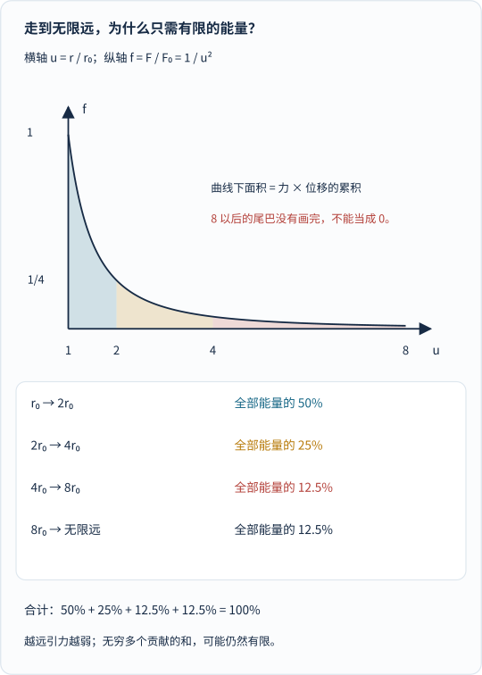
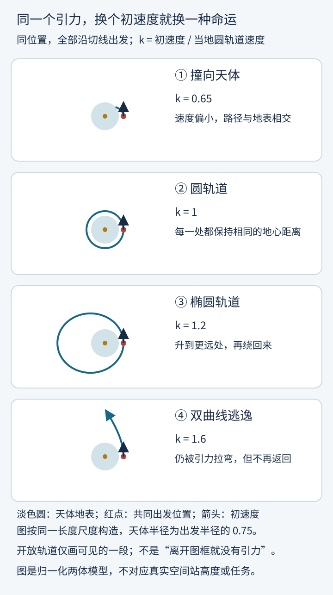

苹果落下来，大家觉得很正常。

月亮挂在天上，大家也觉得很正常。

可把这两件“正常”的事放在一起，就有点不对劲了：

**如果地球一直拉着月亮，月亮为什么没有掉下来？**

再看空间站里的宇航员。他们连一滴水都能放在面前，看它飘成一个小球。难道飞得高一点，地球的引力就消失了？

还有那些飞向远方的探测器：既然引力一直拉着它们，为什么有的能绕回来，有的却一去不返？

这篇文章想把三个经常分开讲的东西接起来：

**万有引力告诉我们此刻受到什么作用，微积分告诉我们运动怎样变化，天体轨道则是这些变化累积出来的结果。**

上一篇[从开普勒到牛顿]()主要讲观测规律怎样变成力学解释。这次不再逐条背定律，而是把镜头拉近：**究竟怎样从“一瞬间的引力”，算出一条完整的路？**

## 一、先看一件反直觉的事：月亮就在下落

这里的“下落”，不是说明天月亮会比今天更靠近地球。

它是说：**如果不受力，月亮会沿此刻的速度方向直走；地球引力让它偏离这条直线，持续向地球一侧弯曲。**

绕行的关键，不是“不受引力”，而是**既有侧向速度，又不断受到引力造成的转向**。

想象在一个没有空气阻力的世界，从很高处把一个小球横着抛出去：

抛得慢，它很快撞到地表；抛得足够快，它在下落的同时，地表也因为地球的弯曲而向远处退开。合适的初始速度，就能让小球不断绕行。

这与牛顿著名的高山抛射思想实验是一回事。它不是实际架炮发射的工程方案，而是把“落向地面”和“绕地球运行”接在一起的想象工具。[NASA：微重力与绕行的思想实验](https://www.nasa.gov/centers-and-facilities/glenn/what-is-microgravity/)

但是，月亮离地球那么远，引力还够用吗？

我们算个数量级。

## 二、从苹果算到月亮：同一个规律，竟能接得上

先认识万有引力最常见的写法：

$$
F=G\frac{Mm}{r^2}
$$

这里 \(M\) 是中心天体质量，\(m\) 是小物体质量，\(r\) 是两者间距，\(G\) 是引力常量。力沿两者连线，相互吸引。

把它与质量不变时的牛顿第二定律 \(F=ma\) 接起来，小物体质量约去，得到引力加速度的大小：

$$
a=\frac{GM}{r^2}
$$

可以先不记那些字母，抓住两件事：

**距离加倍，引力加速度降为四分之一；距离变成60倍，则大约降为三千六百分之一。**

而且，在相同位置、只受引力、忽略小物体对中心天体运动的影响时，较重与较轻的小物体有同样的加速度。不是重物受到的引力一样小，而是它的质量与惯性也一起变大。

地球半径约6370千米，地月平均距离约384400千米，后者约为前者的60.3倍。

_先看上面的距离图：月亮画得很小不是忘了放大，而是采用了同一长度尺度。再读下面两种加速度。这里计算的是“地球在月球距离处产生的引力”，不是月亮表面的自身重力。_

图中采用JPL公布的地球引力参数与上述近似距离，得到：

| 位置 | 地球引力加速度的近似大小 |
| --- | --- |
| 地表附近 | 9.82米/秒² |
| 月球平均距离处 | 0.00270米/秒² |

加速度很小，但它不是零，更不是可有可无。

如果用月球平均距离和约27.3天的绕行周期 \(T\)，把运动粗略看成圆周运动，所需的向心加速度为：

$$
a_{\text{绕行}}=\frac{4\pi^2r}{T^2}
\approx0.00273\,\mathrm{m/s^2}
$$

**从引力算出来的0.00270，与从月球运动反算出来的0.00273，数量级和数值都很接近。**

把这段转弯缩到1秒看，月球相对于原先的切线只偏向地球约1.35毫米。小得几乎看不见，却日复一日累积成了绕行。

这不是精密月球理论，也不是把现代参数算一遍就重现了牛顿的全部历史推理。我们用了平均距离、圆轨道近似，还暂时忽略了地球自身运动与太阳等影响；两个数接近是很好的直觉检验，不能替代完整的模型和观测核查。[NASA月球距离](https://science.nasa.gov/moon/facts/)、[JPL引力参数](https://ssd.jpl.nasa.gov/astro_par.html)、[教材中的月球轨道估算](https://openstax.org/books/university-physics-volume-1/pages/13-4-satellite-orbits-and-energy)

> 上面的简式适用于点质量，也适用于球对称天体之间相应的外部引力情形。把地球看成固定球体，是教学近似；不是说真实地球绝对不动、绝对均匀，也不是说在任何位置都能直接用一个球心距离代替复杂分布。

## 三、空间站里为什么漂着？因为大家一起掉

有人可能会说：“月亮还在受引力，可空间站里应该没多少引力了吧？”

恰好相反。

取400千米高度，距地心的距离不是400千米，而是：

$$
r=6370+400=6770\,\mathrm{km}
$$

和地表相比，引力加速度的比例是：

$$
\frac{a_{\text{高处}}}{a_{\text{地表}}}
=\left(\frac{6370}{6770}\right)^2
\approx88.5\%
$$

**还有将近九成。**

你站在地上时，地面会托住你；体重秤感受到的，就是这种支撑作用。

在理想自由落体的空间站里，舱体、宇航员、苹果和秤都在一起运动。地板不再像站在地面时那样持续托住你，所以支撑力读数接近零，物体看起来在舱内漂浮。

_先看引力条形图，确认“漂浮”不等于“没有引力”。再看左右两个房间：左图有支撑，右图共同自由落体。人物与房间是机制示意，不按尺寸比例绘制。_

这也是为什么“不重了”需要小心说：

**质量没有消失，引力也没有消失；改变的是支撑与相对运动。**

同样400千米高度的理想圆轨道，速度约7.67千米/秒，一圈约92.4分钟。这些数来自引力与圆周运动的计算，不是空间站开着发动机在一条硬轨道上跑。

真实空间站会受到残余大气阻力、振动、姿态变化和引力梯度等影响，因此常用“微重力”描述这种环境，而不是声称完美零重力。[NASA：为什么宇航员漂浮](https://www.nasa.gov/learning-resources/for-kids-and-students/what-is-microgravity-grades-5-8/)、[OpenStax：地表附近与轨道高度的引力](https://openstax.org/books/university-physics-volume-1/pages/13-2-gravitation-near-earths-surface)

好了，我们现在知道物体会被怎样拉。接下来要问：**“拉”怎样变成“路”？**

## 四、微分不是把东西切成粉末，而是问“此刻怎样变”

先拿一段运动录像。

你能逐帧记录物体的位置，比较相邻两帧，就能知道这段时间移动了多少。移动量除以经过的时间，是平均速度。

如果观察窗口不断缩短，这个比值在适当条件下趋向一个确定的值，就得到瞬时速度：

$$
\mathbf v(t)
=\lim_{\Delta t\to0}
\frac{\mathbf r(t+\Delta t)-\mathbf r(t)}{\Delta t}
$$

黑体的 \(\mathbf r\) 不只是“距离”，而是**位置向量**：它带着位置与方向的信息。

可以把向量想成一支箭头，或者一份坐标。例如在平面里写成 \((x,y)\)，就分别告诉你横向和纵向的位置。

在天体运动中，这个区别非常重要。

### 一个容易踩的坑：距离不变，速度怎么会不为零？

物体在圆轨道上走，距地心的距离不变。

如果只对这个距离求导，当然得到0。可这只能说明：**它没有在这一刻沿径向靠近或远离地心。**

它仍然在侧向运动。

不妨比较两个位置：

从圆的右侧走到上侧，离中心都一样远，但横、纵坐标已经变了。因此，**位置向量在变，距离这个数却可以不变。**

同理，速度大小不变，也不意味着加速度为零。

速度指向不断转动，速度向量就在变；它的变化率，就是加速度：

$$
\mathbf a(t)=\frac{d\mathbf v}{dt}
=\frac{d^2\mathbf r}{dt^2}
$$

这个“二阶导数”没有神秘魔法：只是先问位置怎样变，再问这种变化又怎样变。

_先看黑箭头指向哪里，再看红箭头指向哪里。动画中的箭头与物体一同转动，速度始终切向、加速度始终向心。它采用理想圆轨道，把一个周期压缩成8秒，不是月球真实轨道的计时录像。_

[单独打开运动向量动画，刷新可重播](/assets/images/calculus-gravity/differentiate-motion.svg)。动画只播放一次并停回初态；即使提前播完，或系统开启“减少动态效果”，完整静态箭头与时刻标记仍然可读。

**恒定的速率，可以配上不断变化的速度向量；这正是圆周运动需要向心加速度的原因。** [教材：圆周运动的位置、速度与加速度](https://openstax.org/books/university-physics-volume-1/pages/4-4-uniform-and-nonuniform-circular-motion)

## 五、积分：把每一小段变化，加回成运动

微分从运动中读出变化率，积分可以沿反方向把变化累计回来。

为了先看懂它，暂时回到地表附近的短时自由落体。

设向下为正方向，物体从静止开始，不计空气阻力，加速度近似为恒定的 \(g=9.8\,\mathrm{m/s^2}\)。

第0秒，向下速度为0；第0.5秒，约4.9米/秒；第1秒，约9.8米/秒。

如果想知道这一秒下落多少，只拿最后的9.8米/秒乘1秒，会算大。因为物体不是这一整秒都以最后的速度运动。

我们可以把时间分成小段：每段拿一个代表速度，乘上这一小段时间，再相加。时间分得越来越细，这些和就趋向积分。

此例的速度—时间图是一条直线，0到1秒下面的面积是三角形，位移约为：

$$
\frac12\times1\,\mathrm s\times9.8\,\mathrm{m/s}
=4.9\,\mathrm m
$$

用更一般的方式写：

$$
\mathbf v(t)=\mathbf v_0+\int_0^t\mathbf a(\tau)\,d\tau
$$

$$
\mathbf r(t)=\mathbf r_0+\int_0^t\mathbf v(\tau)\,d\tau
$$

这里 \(\tau\) 只是积分时使用的时间变量；\(\mathbf v_0\)、\(\mathbf r_0\) 分别是初速度与初始位置。

两条式子就说了两句话：

**累计加速度，得到速度的变化；累计速度，得到位置的变化。**

初始条件不能丢。只告诉你“受到地球引力”，还不能确定物体究竟是从山上落下、沿圆轨道绕行，还是飞向远方。

另外，速度积分得到的是带方向的位移，不自动等于总路程；物体中途往回走时，这个区别尤其重要。

微积分基本定理在连续性等相应条件下，把变化率与累积联系起来。它不是一句“切得够碎就行”，而是一种有条件、有证明的关系。[教材：微积分基本定理](https://openstax.org/books/calculus-volume-1/pages/5-3-the-fundamental-theorem-of-calculus)

## 六、真正的天体问题：引力跟着位置变，位置又跟着引力变

刚才的地表例子近似用了恒定加速度。

到了太空，这个偷懒办法就不够了：

物体靠近中心天体，引力会增强；物体绕到另一边，引力的方向也会变。

所以我们需要一条规则，**在每一个位置都告诉你此刻的加速度向量**。

把 \(\mu=GM\) 当成一个合起来的引力参数，\(r\) 表示距中心的距离，\(\hat{\mathbf r}\) 表示朝外的单位方向箭头，就有：

$$
\mathbf a=-\frac{\mu}{r^2}\hat{\mathbf r}
$$

负号表示方向朝内。

由于 \(\hat{\mathbf r}=\mathbf r/r\)，也可以写成：

$$
\frac{d^2\mathbf r}{dt^2}
=-\frac{\mu}{r^3}\mathbf r
$$

别被右边的 \(r^3\) 吓到：**这仍然是反平方引力。** 位置向量 \(\mathbf r\) 的长度是 \(r\)，所以右边的加速度大小还是 \(\mu/r^2\)。

这就是一条微分方程。

“微分方程”听着高深，意思却很具体：

> 我要找一条位置随时间变化的曲线，使它每一刻的二阶变化率，都恰好等于那个位置应有的引力加速度。

**不是先挑一条好看的椭圆，再把物体贴上去；而是让运动处处服从同一条局部规则。**

### 电脑怎样接住这件事？

可以把连续问题近似成小时间步，但不能忘记：每走一步，都要重新看位置、重新计算引力。

_按①到④往下读：先给位置与速度，再算加速度，而不是只输入一个“轨道形状”。图采用速度Verlet方法演示一个时间步；单位经过归一化，数值不是秒与千米。_

图中从位置 \((1,0)\)、速度 \((0,1)\) 出发，令归一化引力参数为1，取时间步0.2。

先用短时间近似推进位置：

$$
\mathbf r_1\approx
\mathbf r_0+\mathbf v_0\Delta t
+\frac12\mathbf a_0(\Delta t)^2
$$

然后在新位置重算加速度，利用步首、步尾的加速度平均值更新速度：

$$
\mathbf v_1\approx
\mathbf v_0+\frac{\mathbf a_0+\mathbf a_1}{2}\Delta t
$$

这个有限步长方法给出的新位置约为 \((0.98000,0.20000)\)；解析圆轨道同一时刻的位置，则约为 \((0.98007,0.19867)\)。

**很接近，但并不一样。**

数值积分是用有限计算逼近连续运动，不是微积分的定义，更不是“步数够多就必定没有错误”。要检查步长收敛、守恒量，并和已知解或观测比较。

上一篇已经用不同步长[对照过数值轨道的误差]()。这里要抓住的是另一层意义：**天体的整条路，是局部的引力规则与初始条件共同决定的。**

## 七、积分还有第二份工作：算出逃走要多少能量

积分不只负责“把时间里的变化加起来”。

它还可以累计空间里的贡献。

假设把一个物体从距中心 \(r_0\) 的位置向外移。在一小段径向位移里，克服引力所需的功，可以近似看成：

$$
\text{这一小段功}\approx
\frac{GMm}{r^2}\,\Delta r
$$

这里先讨论引力对应的势能变化，不是在计算真实火箭的燃料消耗；推进效率、火箭自身质量、飞行阻力等还没加入。

如果想把这笔账加到无限远，会不会需要无限多能量？

直觉可能说：“距离无限长，当然要无限多。”

但引力越来越弱，后面的每一段账单也越来越小。

_先看曲线：距离越远，力越小。再看四段能量账：距离一倍倍拉长，新增能量却一半半减少。图只画到八倍距离，后面未画出的尾部仍贡献12.5%，不能把图框边缘当作引力边界。_

这次积分给出：

$$
W_{r_0\to\infty}
=\int_{r_0}^{\infty}\frac{GMm}{r^2}\,dr
=\frac{GMm}{r_0}
$$

它是有限的。

更有趣的是，把这笔总账按距离分段：

| 从哪里到哪里 | 占全部能量的比例 |
| --- | --- |
| \(r_0\) 到 \(2r_0\) | 50% |
| \(2r_0\) 到 \(4r_0\) | 25% |
| \(4r_0\) 到 \(8r_0\) | 12.5% |
| \(8r_0\) 到无限远 | 12.5% |

**无限多个贡献，累积起来可以是有限值。**

当然，这不代表“所有无穷求和都有限”。这里成立，是因为反平方引力随距离减弱得足够快，而且这一段积分从正的起始距离 \(r_0\) 开始。[教材：变引力下的势能与功](https://openstax.org/books/university-physics-volume-1/pages/13-3-gravitational-potential-energy-and-total-energy)

## 八、逃逸速度：不是冲出一层叫“引力”的玻璃罩

现在换个方式付这笔账：

不是一路慢慢向外搬，而是在起点给物体足够的动能，之后只靠引力运动。

若动能刚好等于从这里到无限远所需的势能增量，就处在临界逃逸条件：

$$
\frac12m v_{\text{逃}}^2=\frac{GMm}{r_0}
$$

于是：

$$
v_{\text{逃}}=\sqrt{\frac{2GM}{r_0}}
$$

质量 \(m\) 又约掉了。

在不计空气阻力、忽略其他天体、中心质量近似固定等条件下，同一位置的小物体有相同的逃逸速率。

400千米高度处，这个数约为**10.85千米/秒**；前面算的同高度圆轨道速度约为**7.67千米/秒**。二者正好相差 \(\sqrt2\) 倍。

如果从地表半径代入，才得到常见的约7.9千米/秒与11.2千米/秒。前者是理想圆轨道速率的地表数值，不能理解成物体真的能贴着有大气、有山的地面稳定绕行。

这里还有两个重要限制。

**第一，达到逃逸速率不等于任何方向发射都安全。** 对有限大小的天体，朝内运动仍可能撞上地表；方向、推力和其他作用不能丢。

**第二，低于某个位置的逃逸速率，并不禁止一艘持续获得能量的飞船最终离开。** 这个阈值说的是给定位置、给定初始能量、此后只受理想引力的运动，不是一条规定发动机何时必须达到某读数的交通法规。

最容易误解的还是“逃逸”两个字：

**飞船不是到了某个有限距离，引力突然变成0；它仍会被拉、仍会减速，只是不会因此折返。**

刚好达到临界逃逸速率时，在理想模型中，速度趋向0要等到距离趋向无限远；高于临界条件，则还能留下非零的远处速率。这是能量的判据，不是引力罩的边界。[教材：逃逸速率及碰撞限制](https://openstax.org/books/university-physics-volume-1/pages/13-3-gravitational-potential-energy-and-total-energy)

## 九、圆、椭圆、抛物线、双曲线，为什么都能出现在天空里？

到这里，可能会产生一个新问题：

同一条反平方引力规则，为什么能画出不同形状？

因为**规则相同，不等于初始条件相同**。

在理想二体模型里，选择不同的初始位置与速度，就会改变能量和角动量，从而改变轨道。

把无穷远的引力势能定为0，忽略小物体对中心天体运动的影响时，单位质量的总机械能可以写成：

$$
\varepsilon=\frac{v^2}{2}-\frac{GM}{r}
$$

负的势能不是“物体欠宇宙的钱”，只是选定零点后的能量记法。靠得近时，引力势能更低；走向远处，它逐渐上升到0。

另一个量“角动量”，可以先用来理解**侧向绕行的程度**。把每单位质量的角动量大小记为 \(h\)，在这个模型里有 \(h=r\,v_\perp\)：\(v_\perp\) 是垂直于地心连线的那部分速度，不是全部速率。

理想中心引力只沿半径拉，这个量会保持不变。纯粹沿半径运动时，侧向速度为0，角动量也为0；同样快却朝不同方向运动，就不一定有同样的绕行能力。

在不发生碰撞的非退化二体运动中：

| 总机械能 | 轨道类型 |
| --- | --- |
| \(\varepsilon<0\) | 束缚的椭圆；圆是特殊情况 |
| \(\varepsilon=0\) | 临界的抛物线逃逸 |
| \(\varepsilon>0\) | 双曲线开放轨道 |

这张表说的是理想自由轨道；纯径向运动、地表碰撞、阻力、推力和多体作用都需要另外处理。

_四行使用同一个出发位置、同一长度尺度。先读右侧速度倍数，再看路径；箭头只指初速度方向，长度不表示速率大小。慢速路径碰到地表就结束，开放路径只显示一段。天体半径取出发半径的0.75，是教学构造，不对应空间站高度。_

图里，初速度是当地圆轨道速度的1.2倍时，物体没有立刻逃走，而是绕成更大的椭圆。因为：

$$
1.2<\sqrt2\approx1.414
$$

1.6倍则超过临界速率，在图示的切向出发、无遮挡理想情形下，形成双曲线逃逸。

但即使速率相同，**方向不同，命运也可能不同**：沿切线出发可以绕行，径向向内则可能撞向天体。

### 那椭圆究竟从哪里“长”出来？

不是只画几条数值路径，就完成了一般证明。

反平方引力的微分方程与角动量关系，经过解析求解，可得到轨道的圆锥曲线形式：

$$
r(\theta)=\frac{p}{1+e\cos\theta}
$$

这里把角度原点选在适当的轴线上；\(p\) 是一个由轨道条件决定的长度参数，\(e\) 是偏心率。相应条件下，\(e=0\) 是圆，\(0<e<1\) 是椭圆，\(e=1\) 是抛物线，\(e>1\) 是双曲线。

本文不展开完整的解析推导，但图中的路径按这一解构造，并逐点核对能量与角动量。它们不是凭视觉画出的“像椭圆”的曲线。

**那些看起来完全不同的轨道，原来是同一套方程在不同条件下的解。** [教材：反平方引力与圆锥曲线轨道](https://openstax.org/books/university-physics-volume-1/pages/13-5-keplers-laws-of-planetary-motion)

## 十、算出了轨道，还得让真实星空来验收

我们这一路用了一个很干净的世界：

一个中心天体，一个小物体，没有阻力，没有推力，没有第三个天体来搅局。

真实星空不会这么配合。

月球既受地球影响，也受太阳等天体影响；地球与月球都绕共同质心运动，不是地球永远钉在原点。

用前面的平均距离与JPL参数估计，这个地月共同质心距地心约4670千米，位于地球内部。于是，“月亮绕地球”可以很好用，但“地球绝对不动”仍然只是近似。

卫星还会感受到地球并非完美球体的引力差异；低轨物体要考虑大气阻力；高精度天体计算还需要相对论等修正。

所以，真正的轨道预测不只是把牛顿方程扔给电脑，然后等它打印一个答案。

还要**拿观测去约束参数、改进模型，再检查预测是否与新观测一致**。

JPL对DE440/DE441星历的介绍就明确说：这些行星与月球轨道，是把数值积分结果拟合到地面和空间观测得到的。观测包括航天器测距等数据；不是“理论已经漂亮，就不需要继续测量”。[JPL：DE440与DE441星历说明](https://ssd.jpl.nasa.gov/doc/de440_de441.html)

这正是微积分的用途，也正是它的边界：

**它让我们可靠地组织变化，不会自动替我们保证初值、参数和物理模型都正确。**

## 十一、最后补一段历史：这些工具不是被一个苹果砸出来的

把万有引力、微积分、天体运动讲在一起，很容易让人误以为三者都在牛顿脑中同一天成形。

实际的发展要长得多。

面积、曲线、切线与变化运动的问题，有阿基米德、开普勒、卡瓦列里、费马、巴罗等人的长期积累。牛顿在1660年代发展自己的流数方法，莱布尼茨在1670年代独立发展微积分，并在1684年、1686年分别发表微分与积分相关论文。

今天常用的微分与积分记号主要沿袭莱布尼茨的体系；现代严格极限的表达又经历了后续发展。

我们这篇用导数、向量、能量与数值算法来讲轨道，是**今天的教学语言**，不等于牛顿当年就用同样的符号和程序写过这篇文章。

故事最动人的地方，不是一位天才把所有东西一次造完，而是：

有人研究天空的位置，有人研究曲线的面积，有人研究运动的变化，最后这些问题彼此接上，成了一种可以预测世界的语言。[圣安德鲁斯大学：微积分发展史](https://mathshistory.st-andrews.ac.uk/HistTopics/The_rise_of_calculus/)、[莱布尼茨传记与发表时间](https://mathshistory.st-andrews.ac.uk/Biographies/Leibniz/)

## 尾声：微积分没有拴住月亮，但它让我们看懂了月亮

月亮不会读微积分。

它也没有拿着一张椭圆地图，逐点确认自己走对了没有。

它只是在每一刻受到作用、改变运动。那些连续发生的小变化，累积成了我们看到的天体轨道。

微分让我们看见一瞬间的转向，积分让我们把这些变化接成长路；再换一个积分，我们又能算出，走向远方究竟要多少能量。

**同一套引力，有时让苹果落地，有时让月亮绕行，有时又让飞船走向不再返回的远方。**

区别，不在它们是否“受到引力”，而在初始条件、获得的能量，以及沿途还发生了什么。

下次看月亮，也许可以换个念头：

它不是悬在一根看不见的绳子上。

它正沿着一条不断被引力改变的路，继续走向下一刻。

---

## 参考资料与配图说明

正文使用了实际打开的资料，按下面这些内容分别核查：

- [NASA：月球事实](https://science.nasa.gov/moon/facts/)：地月平均距离384400千米、月球半径及绕行背景。27.3天的圆轨道估算使用下列OpenStax教材数据，不把月相约29.5天的周期混作恒星月。
- [JPL：天体动力学参数](https://ssd.jpl.nasa.gov/astro_par.html)：地球与月球的引力参数；本文采用地球 \(GM=398600.435507\,\mathrm{km^3/s^2}\)，地球半径另取教材近似值6370千米，不暗示所有输入具有相同精度。
- [OpenStax：地表附近的引力](https://openstax.org/books/university-physics-volume-1/pages/13-2-gravitation-near-earths-surface)：引力加速度、质量约去、距离应从地心计起与高处引力的估算。
- [NASA Glenn：微重力是什么](https://www.nasa.gov/centers-and-facilities/glenn/what-is-microgravity/)、[NASA：微重力学生读本](https://www.nasa.gov/learning-resources/for-kids-and-students/what-is-microgravity-grades-5-8/)：绕行自由落体、高山抛射思想实验、空间站仍有强引力与共同下落。
- [OpenStax：圆周运动](https://openstax.org/books/university-physics-volume-1/pages/4-4-uniform-and-nonuniform-circular-motion)：位置向量、切向速度、向心加速度与对时间求导的关系。
- [OpenStax《微积分》：微积分基本定理](https://openstax.org/books/calculus-volume-1/pages/5-3-the-fundamental-theorem-of-calculus)：变化率与累积的联系及适用条件。
- [OpenStax：引力势能与总能量](https://openstax.org/books/university-physics-volume-1/pages/13-3-gravitational-potential-energy-and-total-energy)：通过功积分求势能、逃逸速率、能量判据与有限天体碰撞的限制。
- [OpenStax：卫星轨道与能量](https://openstax.org/books/university-physics-volume-1/pages/13-4-satellite-orbits-and-energy)：圆轨道速度与周期、约27.3天的月球运动估算、圆轨道与逃逸速率的关系。
- [OpenStax：开普勒定律与圆锥曲线解](https://openstax.org/books/university-physics-volume-1/pages/13-5-keplers-laws-of-planetary-motion)：理想二体轨道、偏心率、能量与角动量决定的轨道类型。
- [JPL：DE440/DE441星历说明](https://ssd.jpl.nasa.gov/doc/de440_de441.html)：通过数值积分与观测拟合建立实际行星、月球轨道。
- [MacTutor：微积分发展史](https://mathshistory.st-andrews.ac.uk/HistTopics/The_rise_of_calculus/)、[莱布尼茨传记](https://mathshistory.st-andrews.ac.uk/Biographies/Leibniz/)：前人积累、牛顿与莱布尼茨的独立贡献、1684与1686年的发表时间。

本文六幅中文SVG均为原创教学图，生成脚本保留在 `python tools/visuals.py build calculus-gravity`。脚本核对地月尺度、引力与圆轨道估算、400千米高度的引力比例、速度与周期、向量方向、数值积分步长收敛、分段功积分，以及圆锥曲线路径的能量与角动量。

唯一的运动动画采用理想匀速圆轨道，箭头与物体作为整体旋转，保证速度切向、加速度向心；8秒只表示压缩后的一个周期。动画只播放一次，支持“减少动态效果”，保留完整静态信息。所有教学构造都在图注标明；没有把模拟图、示意图当成真实测量或航天任务方案。
