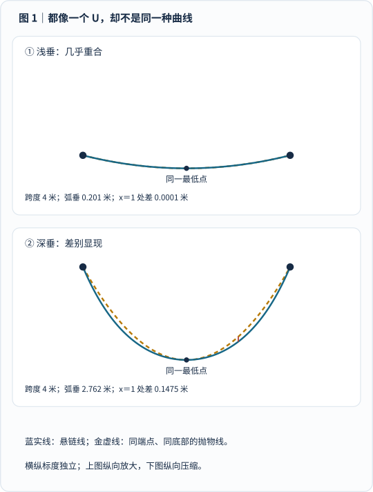
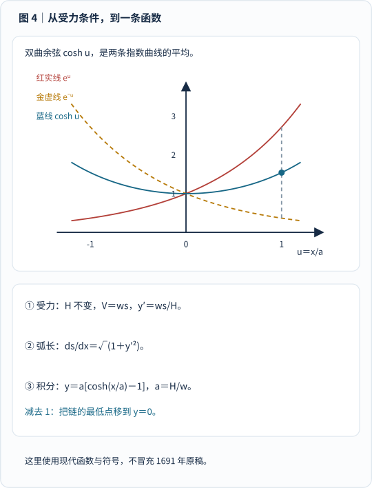
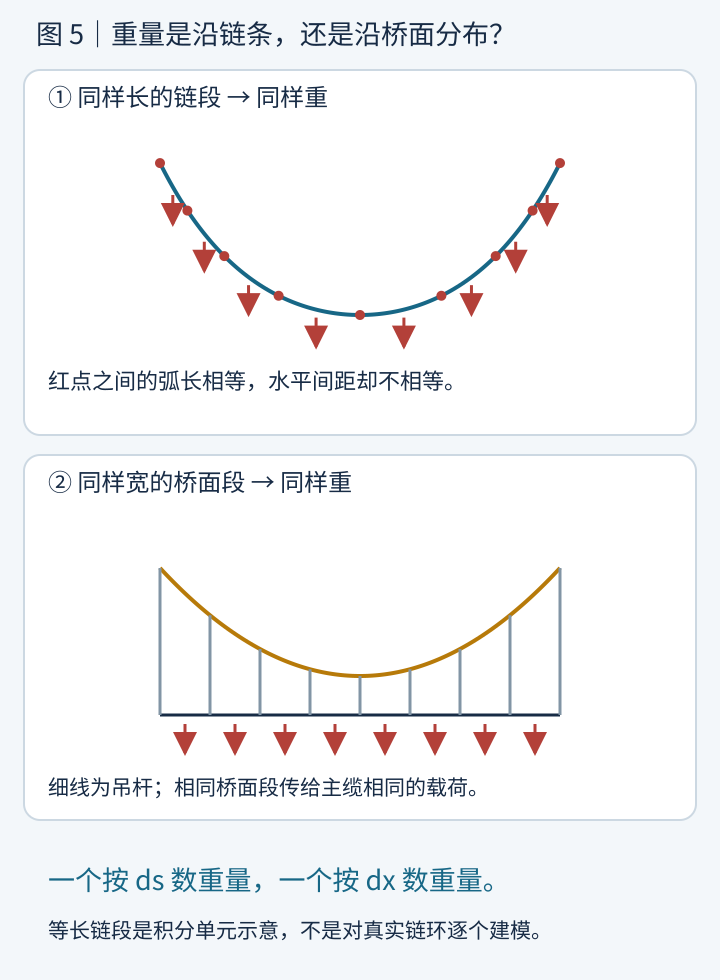
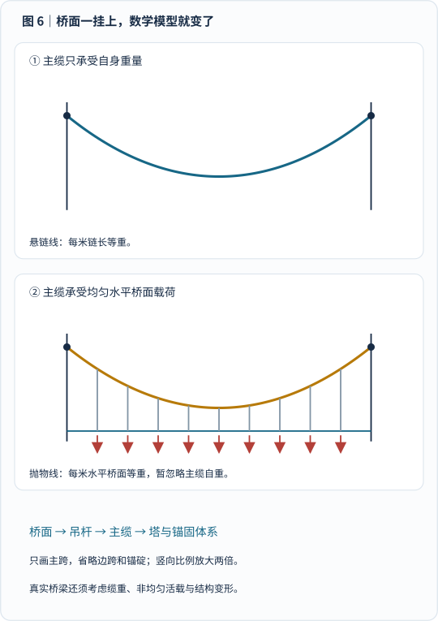
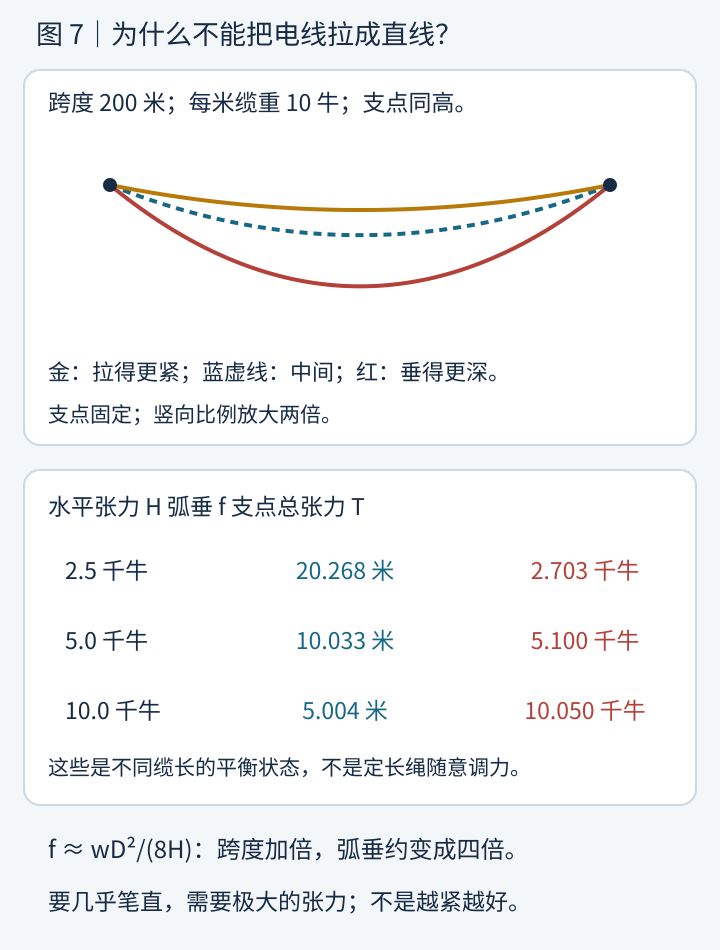
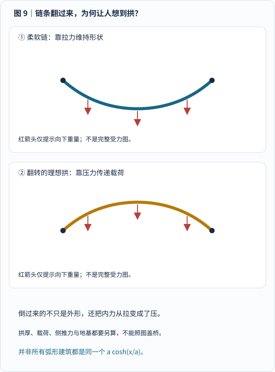

假如让你出一道能难住数学家的题，你会选什么？

伯努利的办法很便宜：**拿一根链，两端挂起来，问它到底是什么曲线。**

不是猜个“差不多的 U”，而是给出一个方程，让它在每一个位置都经得起受力检查。

这道题在 17 世纪末成了一场数学挑战。莱布尼茨、惠更斯、约翰·伯努利都参与了。它看起来是链子的问题，实际上却在问：**刚刚发展起来的微积分，能不能把现实里的形状算出来？**

今天，这道题没有消失。桥梁的主缆、电线的弧垂、建筑拱的受力，都能把我们带回这根链。

文章分两条路走：先用图和小数值把力学讲清，再把同一个故事翻译成微积分。没学过积分，也可以沿着图注读到桥梁和电网；想自己算一遍，则可以跟着公式逐步核对。

## 1. 第一眼像抛物线，为什么还要另起名字？

一根均匀、足够柔软的链，只承受自己的重量，两端固定，静止后得到的理想曲线叫 **悬链线**，英文 *catenary*，名字来自拉丁语“链”。

它不是抛物线。但这话很容易让人不服气：“看起来不都一样吗？”

_图 1 怎么看：每组蓝实线和金虚线的端点、最低点完全相同，所以不是拿两条随便画的曲线比较。先看浅垂组，几乎分不开；再看深垂组，同一水平位置处出现了差距。两组使用不同纵向比例，不能直接比较上下图的视觉弯曲程度。_

这里的深垂组，跨度都是 \(4\) 米，弧垂约 \(2.762\) 米。在离中点水平距离 \(1\) 米的地方，悬链线与配对的抛物线高度相差约 \(0.1475\) 米——将近 \(15\) 厘米。

**像不像是视觉问题；是不是，是数学和物理问题。**

早期数学家也遇到过这个陷阱。[MacTutor 的悬链线史料](https://mathshistory.st-andrews.ac.uk/Curves/Catenary/)记载，伽利略曾把悬链形状视为抛物线，容吉乌斯的工作则否定了这个判断，相关结果在他身后于 1669 年出版。容吉乌斯本人于 1657 年去世，不能把出版年份写成他当年才做出发现。这里也不把今天使用的精确比较图冒充他们当年的证明。

接下来先不猜方程。我们从链条为什么不能“随便弯”入手。

## 2. 链子静止，不等于链子没有受力

把一根均匀的软链，两端挂在同一高度。等它静下来，链子在中间垂下。

链子柔软，几乎不能像一根硬杆那样靠弯曲刚度维持形状。这里把它理想化成只能沿自身方向传递拉力的柔索。

取最低点 \(O\) 到右边某个位置 \(P\) 之间的一段链。**“截取”只是脑中划出研究范围，不是真的剪断后还让它悬着。**

这段链受到三股力：

- 左端的链子向左拉；
- \(P\) 点外侧的链子沿斜方向拉；
- 链段自身的重量向下。

如果链处于静止状态，这三股力必须互相平衡。

_图 2 怎么看：先看黄色箭头，左边的链在 \(O\) 处向左拉；再看红箭头，右边的链在 \(P\) 处沿切线向右上拉；最后看蓝箭头，这段链的总重量向下，等效作用点在链段重心。动画只按顺序显示力，下方分力三角形始终保留。每个面板内的力箭头使用同一尺度。_

[单独打开受力动画，刷新可重播](/assets/images/catenary/cut-and-balance.svg)。动画播放一次后停留在完整结果；减少动态效果时直接显示结果。

先用一个不用微积分的例子：假如每米链重 \(10\) 牛，一段 \(1\) 米长的链就重 \(10\) 牛。右端斜拉力向上的那部分，必须恰好托住这 \(10\) 牛。

为什么只说“向上的那部分”？因为斜拉力同时做两件事：横着拉、向上托。它是一股力，可以拆成水平和竖直两个分量，不是凭空多出两股独立外力。

我们用下面几个符号记账：

| 符号 | 含义 | 单位 |
|---|---|---|
| \(x\) | 从最低点向右量的水平距离 | 米 |
| \(y\) | 相对最低点的高度，向上为正 | 米 |
| \(s\) | 从最低点沿链走到 \(P\) 的弧长 | 米 |
| \(w\) | 每米链长的重量，不是质量 | 牛顿／米 |
| \(H,V\) | 拉力的水平、竖直分量 | 牛顿 |

下面推导先只看右半条链，因而 \(x,s\geq0\)。

这段链的总重就是：

$$
V=ws.
$$

为什么 \(P\) 点拉力的竖直分量刚好等于 \(ws\)？因为我们取出的整段链没有上下加速：上拉力必须托住它自己的全部重量。

同时，水平方向没有其他外力。每个截面处的水平张力分量都相同，记作 \(H\)。

于是 \(P\) 点拉力的方向斜率，也就是链条的切线斜率，为：

$$
\frac{dy}{dx}=\frac{V}{H}=\frac{ws}{H}.
$$

如果把每米链长的重量记为 \(w\)，把 \(H/w\) 记为一个长度 \(a\)，就得到：

$$
\frac{dy}{dx}=\frac{s}{a},
\qquad
a=\frac{H}{w}.
$$

这两条关系已经藏着整条曲线的答案：

- 越远离最低点，下面挂着的链越多，\(s\) 越大；
- 链挂得越多，竖直拉力 \(V=ws\) 越大；
- 因此链越往外，斜率越陡。

图 2 中，取 \(a=1\) 米、\(w=10\) 牛／米。到水平距离 \(x=1.2\) 米的地方，这一侧的链长约为 \(1.510\) 米，因此重量约 \(15.095\) 牛；水平张力是 \(10\) 牛。斜拉力的总大小约为 \(18.107\) 牛，不是两个分量直接相加，而是用勾股关系计算。

这里还有一个反直觉的点：**最低点的链水平，不代表那里没有张力。** 最低点竖直分量为零，但水平张力仍是 \(H\)。越往支点，总张力越大，因为它还要提供越来越大的竖直分量。

### 多取半米，为什么切线就更陡？

现在把“取链段”的操作重复三次。保持每米重量 \(w=10\) 牛／米、水平张力 \(H=10\) 牛，只改变研究范围。

_图 3 怎么看：左边黑点每隔半米链长标一个；蓝线依次沿已静止的链描出研究范围。右边三个分力三角形使用相同力尺度，水平边一样长，竖直边逐次变长，所以红色合力方向越来越陡。这不是链条正在伸长、下落或振动。_

| 取出的链长 \(s\) | 需托住的重量 \(V=ws\) | 水平分量 \(H\) | 切线斜率 \(V/H\) |
|---:|---:|---:|---:|
| \(0.5\) 米 | \(5\) 牛 | \(10\) 牛 | \(0.5\) |
| \(1.0\) 米 | \(10\) 牛 | \(10\) 牛 | \(1.0\) |
| \(1.5\) 米 | \(15\) 牛 | \(10\) 牛 | \(1.5\) |

[单独打开链段分步动画，刷新可重播](/assets/images/catenary/length-builds-slope.svg)。三个数值和分力图始终可读，不需要等动画才能理解。

注意，取 \(1\) 米链长时，水平距离只有约 \(0.881\) 米。**不能把 \(s\) 偷换成 \(x\)**：顺着弯曲链条走，当然比沿水平方向量得长。

到这里，我们已经知道局部规则：**托住的链越多，拉力越陡，链的切线也越陡。** 微积分接下来负责把无数个局部规则拼成整条曲线。

## 3. 微积分登场：为什么会出现双曲余弦？

要把上面的直觉变成方程，还差一步：链长 \(s\) 与水平距离 \(x\) 有什么关系？

先在纸上把一小段链放大，看成一个很小的直角三角形：横着走 \(dx\)，向上走 \(dy\)，沿链走 \(ds\)。在微分意义下，弧长满足勾股关系：

$$
ds=\sqrt{dx^2+dy^2}.
$$

所以：

$$
\frac{ds}{dx}
=\sqrt{1+\left(\frac{dy}{dx}\right)^2}.
$$

把 \(\frac{dy}{dx}=\frac{s}{a}\) 代进去：

$$
\frac{ds}{dx}=\sqrt{1+\left(\frac{s}{a}\right)^2}.
$$

这就是微分方程：未知的不是一个数，而是“链长随水平位置怎样变化”的函数。把等式整理成一边只含 \(s\)、另一边只含 \(x\)，再累加：

$$
\int_0^s\frac{du}{\sqrt{1+(u/a)^2}}=x.
$$

这里 \(u\) 是积分时临时使用的链长变量。左边每一项都有长度单位，所以算出的 \(x\) 也应当是长度。

这个积分可写成：

$$
x=a\ln\left[\frac{s}{a}+
\sqrt{1+\left(\frac{s}{a}\right)^2}\right].
$$

不必背这条积分公式。重要的是：我们从“切线怎么倾斜”，走到了“走出多少水平距离”。把这个关系反解，使用最低点条件 \(s=0\) 对应 \(x=0\)，得到：

$$
s=a\sinh\left(\frac{x}{a}\right).
$$

这里的 \(\sinh\) 是 **双曲正弦**，不是普通三角函数里的正弦。它只是把两个指数函数的差写得简洁一些：

$$
\begin{aligned}
\sinh u&=\frac{e^u-e^{-u}}{2},\\
\cosh u&=\frac{e^u+e^{-u}}{2}.
\end{aligned}
$$

再把链长代回斜率式，做第二次积分，并规定最低点 \(y=0\)：

$$
y(x)=\int_0^x\sinh(u/a)\,du.
$$

因此：

$$
\boxed{y=a\left[\cosh\left(\frac{x}{a}\right)-1\right]}.
$$

\(\cosh\) 叫 **双曲余弦**。有些课本把坐标原点选在另一处，因此会写成 \(y=a\cosh(x/a)\)。两种写法只差一个竖直平移，最低点的形状完全一样。

_图 4 怎么看：上方红实线与金虚线是一升一降的指数函数，蓝线取它们的平均；灰竖线上的蓝点说明如何“取平均”。下方三步提醒你，双曲余弦不是先猜出的形状，而是受力规则与弧长关系共同导出的结果。使用的是现代函数和符号，不是 1691 年原稿的排版。_

**第一次积分把链长和水平距离接起来；第二次积分把斜率累加成高度。** 这就是微积分在这里真正干的事，不只是给曲线贴上一个陌生名字。

如果你已经学过求导，可以用两个短检查验证推导：

$$
y'=\sinh(x/a),
\qquad
y''=\frac{1}{a}\cosh(x/a).
$$

而由 \(\cosh^2 u-\sinh^2 u=1\)，又有：

$$
y''=\frac{1}{a}\sqrt{1+(y')^2}.
$$

再检查单位：\(a=H/w\) 的单位是米，因此 \(x/a\) 没有单位，适合放进指数函数；最后乘上 \(a\)，高度 \(y\) 又回到米。这也是抓出公式错误的一种办法。

但别把公式当作不带条件的魔法。这里假设：

- 链条柔软、均匀，每米链长的重量相同；
- 重力处处相同；
- 没有风、覆冰、弹性伸长和外加的额外载荷；
- 链的两端固定，链处于静止平衡。

支点等高是本文为了方便取对称坐标的条件，不是悬链线存在的必要条件。**支点不等高时，最低点通常不在水平跨度中点**；仍可用平移后的悬链线描述理想均匀柔索，但要重新求支点条件。

推导可对照 [Virginia Tech 物理学讲义的受力法与变分法，PDF](https://www1.phys.vt.edu/~takeuchi/Tools/CSAAPT-Spring2019-Catenary%26SuspensionBridge.pdf)。现实桥索或输电导线若偏离模型条件，就要把实际载荷和材料性质也放进计算。

## 4. 悬索桥来了：为什么同样的拉力，算出另一条曲线？

悬链线与抛物线看上去都像开口向上的 U。小垂度下，它们甚至很难用肉眼分辨。

为什么还要区分？

因为受力模型不同。

**悬链线：** 均匀链条的重量，平均分布在每一米 **链长** 上。

**理想悬索桥抛物线：** 若主缆自重可以忽略，而它托住的是均匀的水平桥面重量，那么载荷平均分布在每一米 **水平跨度** 上。

“每米链长”与“每米水平距离”，不是同一把尺。

_图 5 怎么看：上面沿链长等分，红点之间弧长相等、水平间距不等；下面沿水平桥面等分，各段同样宽、同样重。细吊杆把桥面重量传给主缆。箭头只表示分配方式，不能拿上下箭头长短比较载荷大小。_

用力平衡，抛物线也可以一步步推出来。

假设桥面给主缆的向下载荷为 \(q\) 牛／米水平跨度。仍从主跨中点向右量水平距离 \(x\)。中点到 \(x\) 的总载荷就是 \(qx\)，所以：

$$
V(x)=qx,
\qquad
\frac{dy}{dx}=\frac{V}{H}=\frac{q}{H}x.
$$

积分之后：

$$
y=\frac{q}{2H}x^2.
$$

这就是抛物线。

还记得我们刚才特意强调“不能把 \(s\) 换成 \(x\)”吗？现在不是偷偷换符号，而是**真的换了物理问题**。

均匀链条的斜率随链长 \(s\) 增长；均布桥面载荷下，斜率随水平距离 \(x\) 增长。后者再积分一次，正好就是 \(x^2\)。

因此，**抛物线来自水平均匀分布的载荷假设，不是因为名字里有“桥”。**

### 悬索桥的主缆到底是什么曲线？

这要看桥的结构与加载。

- 自由悬挂、只承受均匀自身重量的主缆，是悬链线。
- 典型悬索桥的桥面近似水平，桥面重量经吊杆传给主缆；若主缆自重很小，常用抛物线近似。
- 真实主缆同时承受桥面载荷和自身重量，通常不能直接套用其中某个纯模型；车辆、风荷载和结构变形还会进一步增加复杂性。

Virginia Tech 的悬链线与悬索桥讲义分别推导了均匀链重下的悬链线，以及理想均匀桥面载荷下的抛物线，并指出真实桥缆还同时承担自身重量。

_图 6 怎么看：上图只有缆重；下图让桥面载荷通过吊杆传入主缆。两图跨度和弧垂相同，但分别求解不同受力模型，不是同一根定长缆“挂上桥面前后”的动画。只画主跨，省略边跨和锚碇，纵向放大两倍。_

如果同时保留缆重 \(w\) 和均布水平桥面载荷 \(q\)，同一套思路会给出：

$$
H y''=w\sqrt{1+(y')^2}+q.
$$

右边第一项是“每米水平距离上实际有多长链”乘以单位链重；第二项是那一米桥面传下来的载荷。令 \(q=0\)，回到悬链线；忽略 \(w\)，回到抛物线。这个式子只讨论竖向静载、柔索与连续均布载荷，仍不是完整桥梁计算。

“桥索是抛物线”与“桥索是悬链线”，不能只凭照片争论。应该先问：**重量沿哪种距离分布？哪些重量被计入？**

## 5. 电线为什么不拉直？先问多出来的长度放在哪里

如果两根支柱相隔 \(200\) 米，却在中间挂上 \(201\) 米多的线，多出的长度总得有个去处。对均匀柔索来说，它会通过下垂，在固定支点之间安置这段长度。

这里还有一个重要问题：公式里的 \(a\) 到底由谁定？

对两端等高的理想柔索，总链长是：

$$
\ell=2a\sinh\left(\frac{D}{2a}\right).
$$

\(D\) 是水平跨度，\(\ell\) 是沿导线量出的总长度。**先给定跨度与链长，再由这个关系求 \(a\)，然后才求张力 \(H=wa\)。** 它们不是可以随便独立调节的三个旋钮。

由此还有一个有趣结论：如果两根理想链的长度、支点位置相同，且各自均匀，那么即使单位长度重量不同，它们的平衡形状也相同；较重的那根需要同比增大的张力。这个结论不包括材料弹性伸长。

把一段输电导线看成均匀柔索，在没有风和覆冰、两端等高的理想模型里，它的自重沿导线长度分布，因此形状是悬链线。

从最低点到支点的水平距离为 \(D/2\)，最大弧垂为：

$$
f=a\left[\cosh\left(\frac{D}{2a}\right)-1\right].
$$

又因为 \(a=H/w\)，当垂度相对跨度较小时，可用 \(\cosh u\approx1+u^2/2\)：

$$
f\approx\frac{D^2}{8a}
=\frac{wD^2}{8H}.
$$

这个近似式把工程直觉说得很清楚：

- 同一跨度和线重下，水平张力 \(H\) 越大，导线垂得越少；
- 同样线重和张力下，跨度 \(D\) 翻倍，弧垂大约变成四倍。

_图 7 怎么看：三根线跨度相同、每米重相同，长度却不同。黄色的水平张力最大、弧垂最小，红色垂得更深。不能理解成“一根不伸长的定长线，支点不动，却任意改张力”。表中的支点总张力包含竖直分量，纵向放大两倍。_

例子中的参数是教学用的：跨度 \(200\) 米、每米重量 \(10\) 牛。我们把不同水平张力带入精确悬链线公式：

| 水平张力 \(H\) | 弧垂 \(f\) | 支点合张力 |
|---:|---:|---:|
| \(2.5\) 千牛 | \(20.268\) 米 | \(2.703\) 千牛 |
| \(5.0\) 千牛 | \(10.033\) 米 | \(5.100\) 千牛 |
| \(10.0\) 千牛 | \(5.004\) 米 | \(10.050\) 千牛 |

支点合张力不是单独的水平分量 \(H\)。在支点处，竖直分量也不为零；这里的理想等高模型满足：

$$
T_{\text{支点}}
=H\cosh\left(\frac{D}{2a}\right).
$$

**拉得越紧，垂度越小，但支架、绝缘子、锚固和导线本身要承受的拉力越大。** 设计不是“尽量拉直”，而是在多种载荷与安全余量之间折中。

更极端一点：若想让有重量的柔索完全水平，竖直拉力就无从产生，却又必须托住自重。在这个理想模型中，弧垂趋近于零要求水平张力趋向无穷大；**“几乎直”与“完全直”，不能混为一谈。**

## 6. 多出24厘米，为什么最低点能下降约87厘米？

导线通电会发热，天气和日照也会改变导线温度。金属升温后会伸长；在固定支点之间，较长的导线通常垂得更低。

[美国能源部 2019 年动态线路额定值报告，第 3—5 页，PDF](https://www.energy.gov/sites/default/files/2021/03/f83/DLR%20Report%20-%20June%202019%20final%20-%20FOR%20PUBLIC%20USE.pdf)指出，导线温度上升会导致伸长、增加弧垂、减少与地面及其他物体的净空；导线额定电流与散热条件、环境温度、风和日照等因素相关。

下面动画不是实际电网的热仿真，而是一个容易复算的 **几何示范**：假设一根教学缆线的自由长度按线膨胀系数随温度增加，再在同一跨度下重新求静力平衡。这里暂时忽略弹性、蠕变、风、覆冰和塔线耦合；图中数字绝不是安全净空标准。

_图 8 怎么看：先看全跨，支点不动，蓝虚线、金虚线、红实线依次表示三个平衡状态；再看下方放大的中间30米，最低点下降就清楚了。上下图是同一段导线的两个视图，不是两段线。全跨纵向放大4倍，局部纵向放大13.75倍，不能比较两图的视觉坡度。动画同步扫过计算状态，不是六秒内真实升温或振动。_

[单独打开温升动画，刷新可重播](/assets/images/catenary/temperature-and-clearance.svg)。不支持这类动画或启用减少动态效果时，三条静态参考线和最终状态仍保留。

本图假设跨度 \(200\) 米、初始自由长度约 \(201.336\) 米，线膨胀系数取教学数值 \(0.000020/^\circ\text{C}\)。温升 \(60^\circ\text{C}\) 后，理想缆线长度约增加 \(0.242\) 米，计算弧垂从 \(10.033\) 米增至 \(10.908\) 米。

| 相对初态的温升 | 教学缆线总长度 | 最大弧垂 | 假设支点高24米时的几何净空 |
|---:|---:|---:|---:|
| \(0^\circ\text{C}\) | \(201.336\) 米 | \(10.033\) 米 | \(13.967\) 米 |
| \(30^\circ\text{C}\) | \(201.457\) 米 | \(10.479\) 米 | \(13.521\) 米 |
| \(60^\circ\text{C}\) | \(201.578\) 米 | \(10.908\) 米 | \(13.092\) 米 |

这里说的是**导线温度增加60度**，不是“室外气温一定达到60度”。温升后链的总重量保持不变，因此每米线的重量略有降低，程序也把这一点计入了。

为什么总长度只增加约24厘米，最低点却能下降约87厘米？因为线一开始已经接近水平，大部分长度用于横跨，而不是竖直下垂。浅垂近似进一步给出：

$$
\ell-D\approx\frac{8f^2}{3D}.
$$

也就是说，**多出的长度大致与弧垂的平方有关，不是“增加多少线长，就只下降多少高度”。** 这条近似由链长的双曲正弦展开和弧垂近似相结合得到，只用于垂度较小的等高支点模型；上表使用的是精确悬链线公式。

**现实导线并不是只会几何变长。** 它会伸长、改变张力，可能有不同结构材料，也会受风和冰荷载；工程人员用具体导线规格、温度和张力关系、跨距、地形与适用标准做弧垂—张力计算。这里的简化模型只说明为什么温度与净空会发生联系。

实际电力设施可能致命。不要用本文的示意公式来判断某条线路是否安全，也不要靠近、触碰或自行测量电线；作业净空和线路操作必须遵守当地供电单位及安全规范。

## 7. 把链倒过来：不用电脑，也能寻找拱的力路

现在把前面那条悬链线翻个面。

柔软的链子靠 **拉力** 托住自己。若把一条适当形状的链倒过来，拼成一座理想拱，拱的内力则主要沿着石块或构件传递 **压力**。

1675 年，罗伯特·胡克曾把这条关系藏进一段拉丁文字母谜。解开后的意思可以译为：

> 柔软的连续绳索怎样悬挂，倒过来紧密连接的拱就怎样站立。

这是很有力的结构直觉：当拱的形状与受力相适配，重量可以沿拱的曲线传到两侧支座，减少不利的弯曲趋势。关键不是把任何漂亮曲线翻转，而是**把对应载荷下的受拉力路，转成受压力路**。

_图 9 怎么看：上图是受拉的柔链，下图是上下镜像后的理想受压力路。红箭头只提示重力向下，不是完整结构受力图。图线不是砖拱外轮廓，更没有给出厚度、支座或施工尺寸。_

[MIT 的《As Hangs the Flexible Line》，第9—11页，PDF](https://web.mit.edu/masonry/papers/block_dejong_ochs_NNJ.pdf)详细解释了胡克的想法，还记述了一个很精彩的应用：1748 年，波莱尼研究罗马圣彼得大教堂有裂缝的穹顶，把对应结构部分的重量换成 **32 个不等重的砝码**，挂到模型上，检查翻转后的力路能否容纳在结构截面里。

这里的关键词是“不等重”。如果用细绳挂上若干集中砝码，绳在砝码之间可能是直线段，整体呈索多边形，**不再自动等于均匀自重下那条双曲余弦曲线**。模型的价值恰恰在于：你可以把实际载荷分布也一起挂进去，而不是执着于某个固定函数。

**这并不意味着任何弯拱都应该直接照搬悬链线。** 拱有厚度，荷载未必均匀，侧推力需要地基或扶壁承受，结构材料也可能不适合只承压。每种建筑都要针对载荷和材料单独设计。

## 8. 伯努利出题，莱布尼茨们怎样打开局面？

“挂起来的链是什么曲线？”并不是数学家第一次观察的问题。

从“不是抛物线”到“精确是什么”，仍隔着一道难关。毕竟你可以否定一个猜测，却依然不知道正确答案。

17 世纪末，瑞士数学家 **雅各布·伯努利**（Jacob，也常译作 Jakob）向同行提出挑战：找到链条曲线的精确方程。

参加这场竞赛的包括：

- **克里斯蒂安·惠更斯**，以几何与力学见长；
- **戈特弗里德·威廉·莱布尼茨**，微积分符号的创造者之一；
- **约翰·伯努利**，雅各布的弟弟，后来以推广微积分和提出最速降线挑战而闻名。

1691 年，这几位数学家各自给出悬链线的解答。惠更斯还曾在 1690 年的一封写给莱布尼茨的信中使用悬链线的名称。这里把命名通信与解答年份分开，不写成“谁先取名，谁就独自解出了问题”。

历史不是“雅各布不会算，弟弟帮他做题”这么简单。[MacTutor 的约翰·伯努利传记](https://mathshistory.st-andrews.ac.uk/Biographies/Bernoulli_Johann/)记述，兄弟俩一起研读莱布尼茨的微积分论文，约翰的悬链线解答也利用了雅各布提出问题时的思路。雅各布推动交流，莱布尼茨与约翰展示了新方法的力量，惠更斯则从自己的几何和力学路径处理同一问题。

当时微积分不是今天人人必修的课，而是还在传播的新工具。**它的说服力来自这种任务：不是只会变换符号，而是真能从局部规律得到一条完整曲线。**

不同概述对挑战发生于1690还是1691的记述并不完全一致，本文不据此虚构一个精确的“出题日”；可以稳妥确认的是，这几位数学家的解答在1691年出现。

特别值得一提的是，**这不是在 1691 年发明现代欧拉—拉格朗日方程**。当时的人用自己掌握的力学、几何和无穷小方法来解决链条问题。今天课本里常见的变分法，是后来发展出的统一讲法；用现代语言重写历史问题，不能倒过来说 17 世纪的人已经使用了所有现代形式。

## 9. 欧拉和拉格朗日：能不能让整条曲线参加竞争？

上面的力平衡推导，只需微分与积分。还可以换一个问题来问：

**在两端固定、总长度一定的所有曲线中，哪一条让链的重力势能最低？**

如果曲线记为 \(y(x)\)，总长度为：

$$
\ell=\int\sqrt{1+(y')^2}\,dx.
$$

链的重力势能与链段的高度乘以链段重量有关：

$$
U=\int w\,y\sqrt{1+(y')^2}\,dx.
$$

为什么“长度固定”不能省？如果允许无限加长，链当然可以垂得越来越低，那就不是在解同一个问题。比较不同形状时，两端位置和总长度都必须保持一致。

这次我们不能任意改长度，而要在长度固定的条件下，让势能 \(U\) 尽可能小。现代数学会引入一个乘子 \(\lambda\)，把约束并入同一个积分：

$$
\int \left(wy+\lambda\right)\sqrt{1+(y')^2}\,dx.
$$

然后使用 **变分法**：不只微调一个数，而是把曲线在中途轻轻变形，比较积分会怎样改变。满足极值条件的函数要遵守欧拉—拉格朗日方程，最后也会得到悬链线。

这就是分析上的升级：

- 普通微积分：已知一条函数，求斜率、面积或变化率；
- 变分法：在许多可能的函数中，寻找让某个积分最小或最大的那一条。

[欧拉1744年的变分法著作档案](https://scholarlycommons.pacific.edu/euler-works/65/)说明，他把孤立的极值题发展为一般类型的问题。1755 年，19岁的拉格朗日把新的极值方法寄给欧拉，得到积极回应；[MacTutor 拉格朗日传记](https://mathshistory.st-andrews.ac.uk/Biographies/Lagrange/)记录了这段交流及他随后把变分方法应用于力学的工作。

这里不必把欧拉—拉格朗日方程再完整推一遍，但应记住区别：**势能极小是在比较静止形状；讨论运动轨迹时，通常比较的是作用量的驻值，不能把所有力学都说成“每一刻势能最低”。**

它与力学的联系极深。你可以从 **链条受力平衡** 得到悬链线，也可以从 **势能极小** 和变分方程得到它；同一道物理问题，两种数学视角互相印证。

稍后我们还会遇到分析力学：拉格朗日把运动问题写成广义坐标与能量函数的方程，让约束不一定非得拆成每个方向的一股力来追踪。那是另一篇故事；在这里，链条只是提前露出一条线索——**微积分不光能算物体怎么动，也能帮我们找出物体静下来时的形状。**

## 10. 用三句话，辨认身边下垂的线

让我们把链、桥和电网摆在一起：

| 场景 | 主要载荷如何分布 | 理想曲线或常用模型 |
|---|---|---|
| 均匀、自由悬挂的链 | 每米链长重量相同 | 悬链线 |
| 忽略缆重、托均匀水平桥面 | 每米水平跨度载荷相同 | 抛物线 |
| 有自重、温度、风或冰的导线 | 依材料与环境条件计算 | 悬链线或更完整的弧垂—张力模型 |

所以，下次看到一条弯弯的缆绳，先问的不是“它是不是抛物线”，而是：

> **它承受什么重量？这些重量按链长分，还是按水平距离分？**

答案一变，曲线就可能跟着变。

如果想做一个安全的小观察，可以只用桌边的普通软线或细链，两端固定后看它静止的形状；再想象或用很轻的小物件改变局部载荷。你会发现，形状不是由“两端之间画个U”决定的。不要靠近真实电线，也不要用教学模型判断建筑承载能力。

最后别把它与前一篇的**摆线**混淆：摆线来自圆的滚动，并在特定无摩擦重力模型下解决最速下降、等时问题；悬链线来自柔索的静力平衡。一个研究“怎样最快滑到”，一个研究“怎样挂着不动”，问题不同，答案也不同。

## 结尾：一根链条，把微积分挂在了空中

悬链线看起来只是重力拉出来的弧线，但它实际上把好几件事情连在一起：

- 一小段链条的受力平衡；
- 微积分如何从局部斜率拼出整条曲线；
- 悬链线与抛物线看起来相似、成因却不同；
- 桥梁和输电线为什么必须把实际载荷与材料条件算清；
- 雅各布·伯努利的挑战，莱布尼茨与约翰·伯努利的解答，以及后来的欧拉、拉格朗日变分法。

数学最迷人的地方之一，不是给熟悉的事物贴上复杂名字，而是把一句朴素的问题——“这根链为什么这样垂？”——变成可以逐段核对、计算和应用的机制。

## 参考资料

| 资料 | 支持的内容 |
|---|---|
| [MacTutor：悬链线](https://mathshistory.st-andrews.ac.uk/Curves/Catenary/) | 悬链线方程、1691 年的解答、惠更斯命名通信及伽利略、容吉乌斯相关史实 |
| [MacTutor：容吉乌斯](https://mathshistory.st-andrews.ac.uk/Biographies/Jungius/) | 生卒年及科学工作背景；用于区分发现与身后出版时间 |
| [MacTutor：约翰·伯努利](https://mathshistory.st-andrews.ac.uk/Biographies/Bernoulli_Johann/) | 兄弟研读莱布尼茨论文、悬链线解答与合作竞争的背景 |
| [Virginia Tech：悬链线与悬索桥，PDF](https://www1.phys.vt.edu/~takeuchi/Tools/CSAAPT-Spring2019-Catenary%26SuspensionBridge.pdf) | 链重分布下悬链线的两种推导、均布桥面载荷下的抛物线模型、两者比较与实际桥缆条件 |
| [美国能源部：动态输电线路额定值，PDF](https://www.energy.gov/sites/default/files/2021/03/f83/DLR%20Report%20-%20June%202019%20final%20-%20FOR%20PUBLIC%20USE.pdf) | 导线温度、热额定值、伸长、弧垂与净空，以及线路监测方法 |
| [MIT：As Hangs the Flexible Line，PDF](https://web.mit.edu/masonry/papers/block_dejong_ochs_NNJ.pdf) | 胡克1675年的字母谜、绳索与拱的力路对应、波莱尼1748年的32个不等重砝码模型、推力线与结构条件 |
| [Euler Archive：1744年变分法著作](https://scholarlycommons.pacific.edu/euler-works/65/) | 原著书目、出版年及从特殊极值题走向一般方法的贡献；这里使用档案内容概述，不声称译读整本拉丁文 |
| [MacTutor：拉格朗日](https://mathshistory.st-andrews.ac.uk/Biographies/Lagrange/) | 1755年与欧拉的通信、变分方法及其力学应用的发展 |

文中九幅图由 `python tools/visuals.py build catenary` 计算生成，原创 SVG 位于 `assets/images/catenary/`，没有转载论文中的图片。脚本校验等弧长取点、张力与切线斜率、链长积分、近似误差，以及教学温升模型中的长度、弧垂、局部放大与质量守恒。三幅教学动画均播放一次、保留静态信息并响应减少动态效果；桥梁和电线使用明确限定的模型，不提供工程设计或安全距离依据。
